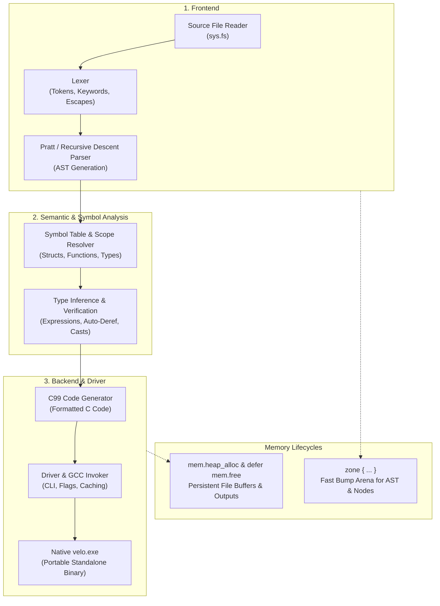
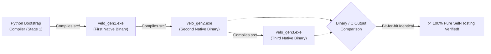

# Velo Stage 2 Architecture: The Self-Hosted Native Compiler

> **Target Goal**: A 100% self-hosted, standalone native compiler written purely in Velo (`.vl`), compiled into `velo.exe` with zero runtime dependencies.

---

## 1. High-Level Compiler Pipeline

The self-hosted compiler translates Velo source files (`.vl`) into highly-optimized, standard C99 code, invoking GCC/Clang to produce standalone native binaries.



---

## 2. Directory & Modular File Structure

To guarantee **production-grade maintainability**, no single file shall contain thousands of lines. Code is strictly organized into clean, single-responsibility modules:

```text
src/
├── main.vl                      # CLI Entry point & argument dispatcher
│
├── common/                      # Shared types, error reporters, constants
│   ├── diagnostics.vl           # Error reporting with source line & column display
│   ├── string_builder.vl        # High-speed dynamic string buffer for emission
│   └── utils.vl                 # Character classifiers & string helpers
│
├── frontend/                    # Lexical & syntactic analysis
│   ├── token.vl                 # TokenType enum constants & Token struct
│   ├── lexer.vl                 # Tokenizer scanning chars into tokens
│   └── parser.vl                # Recursive descent & Pratt expression parser
│
├── ast/                         # AST Node definitions (data layouts)
│   ├── types.vl                 # Type expressions & annotations
│   ├── expr.vl                  # Literal, Binary, Unary, MemberAccess, Call AST nodes
│   └── stmt.vl                  # VarDecl, Assign, If, While, Loop, Zone, Defer, Function AST nodes
│
├── analysis/                    # Semantic checks & scope resolution
│   ├── symbol_table.vl          # Scope stacks, variable & function declarations
│   └── type_checker.vl          # Type compatibility, auto-dereference rules
│
└── backend/                     # Target code generation
    ├── codegen_c.vl             # Emits valid, formatted C99 translation units
    └── driver.vl                # Manages cache dir, file writing, GCC compilation
```

---

## 3. Memory Architecture in the Compiler

The self-hosted compiler uses Velo's unique dual-memory system for maximum performance and zero memory leaks:

### 3.1 The Compilation `zone` (Arena)
* **What Lives in `zone`**: Tokens, AST nodes, expression trees, temporary identifiers.
* **Why**: A compiler produces millions of small AST nodes during parsing. Calling `malloc` for each node would cause heap fragmentation and GC pauses.
* **1-Cycle Reset**: Once code generation is finished for a module, the entire AST arena is wiped in **1 CPU cycle** by resetting the zone watermark:
```rust
zone {
    let tokens = tokenize(source)
    let ast = parse(tokens)
    let c_code = emit_c(ast)
    fs.write_file(output_path, c_code)
} // ALL AST nodes, tokens, and temporary allocations are instantly freed here!
```

### 3.2 Persistent Heap (`mem.heap_alloc` + `defer mem.free`)
* **What Lives in Heap**: File read buffers, output string builders, CLI arguments.
* **Why**: Output text and source buffers may need to outlive individual inner scopes.
* **Zero-Leak Invariant**: Every `mem.heap_alloc` is paired with a mandatory `defer mem.free`:
```rust
let source = fs.read_file(path)
if source == null {
    diagnostics.report_error("Cannot read file", path)
    return
}
defer mem.free(source) // 100% guaranteed leak-free on all return paths!
```

---

## 4. Component Technical Contracts

### 4.1 Frontend: `token.vl` & `lexer.vl`
* **Token Representation**:
  ```rust
  data Token {
      kind: i32       // TOK_IDENT, TOK_INT, TOK_ACT, etc.
      start: usize    // Offset in source buffer
      length: usize   // Token length
      line: i32       // 1-indexed source line
      col: i32        // 1-indexed source column
  }
  ```
* **Performance**: Zero string copying during tokenization; tokens are lightweight slice descriptors referencing the source buffer.

### 4.2 Frontend: `parser.vl`
* **Parsing Strategy**: Pratt parser for precedence-driven expressions (`+`, `*`, `==`, `.`, `@`); recursive descent for top-level statements.
* **Disambiguation**: PascalCase rule for struct instantiation vs block expressions.

### 4.3 Backend: `codegen_c.vl`
* **Emitted Output**: Clean, readable C99 with standard headers:
  - `<stdio.h>`, `<stdlib.h>`, `<stdint.h>`, `<stdbool.h>`, `<string.h>`
  - Inclusion of `velo_runtime.h`
* **Deduplication**: Automatically deduplicates forward declarations and struct definitions across multiple modules.

---

## 5. Security & Robustness Standards

1. **Path Traversal & File Sanitization**:
   - File paths passed to `use "..."` or CLI are normalized to canonical absolute paths.
   - Circular imports (`A.vl` -> `B.vl` -> `A.vl`) are detected via a canonical `visited_modules` set.
2. **Buffer Safety**:
   - String buffer reading uses strict boundary checks (`pos < length`).
   - Null-terminated strings guaranteed on all `fs.read_file` outputs.
3. **Deterministic Error Handling**:
   - No silent crashes. All syntax and type errors print formatted diagnostics:
     ```text
     [Velo Error] examples/bad.vl:14:12 - Unknown identifier 'foo'
         14 | let x = foo + 1
            |          ^^^
     ```

---

## 6. Verification: The Triple-Bootstrap Test 🔄

The ultimate industry-standard test for a self-hosted compiler is the **Triple-Bootstrap Test**:



When `velo_gen2` and `velo_gen3` produce identical C output, self-hosting is formally complete and mathematically deterministic.
