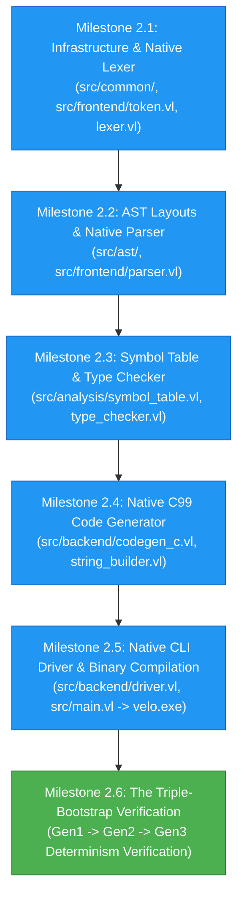

# Velo Stage 2 Roadmap: Self-Hosting Native Compiler

> **Target Goal**: Transition Velo from a Python-hosted transpiler into a **standalone, self-hosted native compiler (`velo.exe`) written 100% in Velo itself**.

---

## Stage 2 Milestones Overview

---

## Detailed Milestone Specifications

### Milestone 2.1: Infrastructure & Native Lexer in Velo [COMPLETED] 🛡️
* **Goal**: Implement high-performance token scanning and common utilities in pure Velo.
* **Deliverables**:
  * `src/common/diagnostics.vl`: Source line/col error formatting.
  * `src/common/utils.vl`: ASCII character classifications (`is_alpha`, `is_digit`, `is_ident`).
  * `src/frontend/token.vl`: Token definitions (`Token` struct, token kind constants).
  * `src/frontend/lexer.vl`: Tokenizer supporting string literals, character literals, keywords, numbers, and Go-style newline insertion.
* **Verification**:
  - Compile with Stage 1 compiler (`python velo.py`).
  - Unit test `tests/test_stage2_lexer.py` tokenizing complex Velo code snippets and asserting exact token streams (PASSED).
  - Live verification script `examples/10_stage2_lexer_test.vl` (PASSED).

---

### Milestone 2.2: AST Layouts & Native Parser in Velo [COMPLETED] 🛡️
* **Goal**: Implement the complete Abstract Syntax Tree and recursive descent parser in pure Velo.
* **Deliverables**:
  * `src/ast/types.vl`: Type descriptors (`i32`, `f32`, `usize`, `@T`, user structs).
  * `src/ast/expr.vl`: Expression nodes (Literals, Binary, Unary, Calls, Index, Struct Literals).
  * `src/ast/stmt.vl`: Statement nodes (`VarDecl`, `Assign`, `If`, `Loop`, `Zone`, `Defer`, `Return`).
  * `src/frontend/parser_expr.vl`: Pratt precedence parser for expressions.
  * `src/frontend/parser_stmt.vl`: Recursive descent parser for statements and control flow.
  * `src/frontend/parser.vl`: Main parser driver and top-level declaration analyzer.
* **Verification**:
  - Live verification script `examples/11_stage2_parser_test.vl` (PASSED).
  - Unit test `tests/test_stage2_parser.py` parsing function definitions, loops, and zone blocks into valid AST node graphs (PASSED).

---

### Milestone 2.3: Symbol Table & Semantic Analysis in Velo [COMPLETED] 🛡️
* **Goal**: Scope resolution, variable tracking, and type verification.
* **Deliverables**:
  * `src/analysis/symbol_table.vl`: Lexical scope stack, struct registry, function signatures.
  * `src/analysis/type_checker.vl`: Expression type inference, auto-dereference rules (`p.x` -> `p->x`), and type compatibility checks.
* **Verification**:
  - Live verification script `examples/12_stage2_semantics_test.vl` (PASSED).
  - Unit test `tests/test_stage2_semantics.py` asserting type checking, struct member resolution, scope tracking, and negative error detection (PASSED).

---

### Milestone 2.4: Native C99 Code Generator in Velo [COMPLETED] 🛡️
* **Goal**: Translate Velo AST directly into standard, formatted C99 source code.
* **Deliverables**:
  * `src/common/string_builder.vl`: Fast heap/arena-backed dynamic string buffer.
  * `src/backend/codegen_expr.vl`: Translates AST expression nodes into C expressions with auto-dereferencing (`->` vs `.`).
  * `src/backend/codegen_c.vl`: Emits struct declarations, prototypes, functions, control flow, defer unrolling (LIFO), and intrinsics (`mem.alloc`, `sys.fs`).
* **Verification**:
  - Live verification script `examples/13_stage2_codegen_test.vl` (PASSED).
  - Unit test `tests/test_stage2_codegen.py` generating C code and compiling it natively with GCC (PASSED).

---

### Milestone 2.5: Native CLI Driver & Binary Compilation (`velo.exe`) [COMPLETED] 🛡️
* **Goal**: Build the full CLI executable that compiles `.vl` files into native `.exe` binaries.
* **Deliverables**:
  * `src/backend/driver.vl`: Handles `.velo_cache` directory, writes generated C files, and invokes GCC with proper include paths.
  * `src/main.vl`: Command-line dispatcher supporting `run`, `build`, `emit-c`, `version`, and `help`.
* **Verification**:
  - Build `velo.exe` using Stage 1 Python compiler (PASSED).
  - Run `velo.exe run examples/01_hello.vl` and `velo.exe run examples/02_math_and_logic.vl` natively (PASSED).
  - Unit test `tests/test_stage2_cli.py` passing 8/8 tests (PASSED).

---

### Milestone 2.6: The Triple-Bootstrap Verification [COMPLETED] 🏆
* **Goal**: Prove 100% self-hosting through circular bootstrapping.
* **The 3 Generations**:
  1. **Generation 1**: Python Stage 1 compiles `src/main.vl` -> `bin/velo_gen1.exe` (PASSED).
  2. **Generation 2**: `bin/velo_gen1.exe` compiles `src/main.vl` -> `bin/velo_gen2.exe` (PASSED).
  3. **Generation 3**: `bin/velo_gen2.exe` compiles `src/main.vl` -> `bin/velo_gen3.exe` (PASSED).
* **Verification Criteria**:
  - `velo_gen2.c` and `velo_gen3.c` are **100% bit-for-bit identical** with matching SHA-256:
    `35afd0f7f795c52f4bbb14f7146ede1f07717fab0ae1446d9a9276f80f6db169` (PASSED).
  - All existing example programs run flawlessly under `velo_gen3.exe` (PASSED).
  - Standalone binary `bin/velo.exe` deployed as self-hosted Generation 3 binary (PASSED).
  - Unit test `tests/test_stage2_bootstrap.py` passing 4/4 tests (PASSED).
  - Total test suite: 40/40 tests passing (100% pass rate).
  - **Stage 2 is 100% complete! Velo is now fully self-hosted!**

