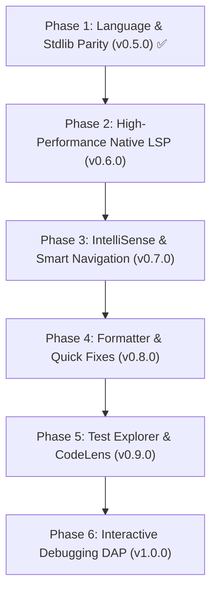

# Velo Language Extension — Full Capability Roadmap (v0.5.0 → v1.0.0)
## "Writing Velo with the Fluidity, Speed, and Intelligence of JavaScript in VS Code"

> **Mission**: Provide Velo developers with a modern IDE experience rivaling TypeScript/JavaScript in VS Code: sub-millisecond as-you-type diagnostics, context-aware dot-completions, rich hover documentation, jump-to-definition, symbol renaming, document formatting, inline test running, and interactive visual debugging — with zero manual configuration.

---

## The Target Developer Experience (The "JavaScript Baseline")

When writing TypeScript/JavaScript in VS Code, developers take several features for granted:
1. **Instant Feedback**: Red squiggles appear immediately as code is typed — not only after pressing Save.
2. **Context-Aware IntelliSense**: Typing `.` on a variable instantly reveals its fields and methods with types and doc-comments.
3. **Effortless Navigation**: `F12` jumps directly to definitions across modules and standard libraries.
4. **Auto-Import**: Using a function from the standard library or another file offers an instant `Ctrl+.` quick fix to insert the import.
5. **Inlay Hints**: The editor shows inferred types and parameter names inline without cluttering source code.
6. **CodeLens Testing**: A clickable `▶ Run Test | Debug` button sits directly above test functions.
7. **One-Click Debugging**: Setting a breakpoint and pressing `F5` pauses execution, displaying locals, call stacks, and watch expressions.
8. **Consistent Formatting**: `Shift+Alt+F` (Format Document) tidies indentation, spacing, and brackets cleanly.

This roadmap details the systematic evolution of the Velo VS Code extension from its current baseline (**v0.4.0**) to a **v1.0.0 Full-Capability IDE Platform**.

---

## Architectural Evolution: Python LSP → Native Velo LSP

```
[Current Architecture (v0.4.0)]
VS Code Client (JS)  <--- JSON-RPC (stdio) --->  Python LSP (_server/velo_lsp.py)
                                                        |
                                                velo/ (Stage 1 Python)
                                                * High latency & startup overhead
                                                * Requires Python 3.11+
                                                * Frozen reference codebase

[Target Architecture (v1.0.0)]
VS Code Client (JS)  <--- JSON-RPC (stdio) --->  bin/velo.exe lsp (Native Stage 2)
                                                        |
                                                src/ (Self-Hosted Velo)
                                                * <5 ms sub-millisecond latency
                                                * Zero Python or npm dependencies
                                                * 100% parity with compiler truths
```

---

## Phased Implementation Roadmap



---

### Phase 1: Language Modernization & Stdlib Parity (v0.5.0) [COMPLETED] ✅
*Target: 2-3 Days | Deliverable: Complete syntax, manifest, and command palette integration*

#### 1.1 Standard Library (`std.*`) Syntax & Auto-Completions
* **Grammar Update (`syntaxes/velo.tmLanguage.json`)**:
  * Add full support for all 11 Velo Standard Library modules:
    * `std.io`, `std.fs`, `std.mem`, `std.path`, `std.os`, `std.str`, `std.time`, `std.math`, `std.json`, `std.fmt`, `std.coll`.
  * Highlight standard library functions (`fs_read_to_str`, `println_str`, `path_join_str`, `json_parse`, `fmt_sprintf`, `heap_alloc`, etc.) as first-class standard library symbols (`support.function.std.velo`).
* **Snippets Modernization (`snippets/velo.json`)**:
  * Add modern snippets for standard library idioms:
    * `fs_read`: Read entire file to string with defer cleanup.
    * `fs_walk`: Streaming directory traversal (`fs_dir_open` / `fs_dir_next`).
    * `json_parse`: JSON document parsing and field extraction.
    * `heap_buf`: Heap buffer allocation and safe deallocation.

#### 1.2 Package Manifest (`velo.pkg`) Language Support
* **New Grammar (`syntaxes/velo.pkg.tmLanguage.json`)**:
  * Dedicated syntax highlighting for `velo.pkg` manifest files.
  * Scopes for `pkg`, `deps`, `link` blocks, colon-separated keys, bracketed arrays, and dependency protocols (`git`, `local`, version semver).
* **Language Registration (`package.json`)**:
  * Register file pattern `**/velo.pkg` with `velo-pkg` language ID and custom configuration.

#### 1.3 New Language Syntax & Primitives
* **SIMD Vector Types**: Highlight `f32x4`, `f64x2`, `i32x4`, `i16x8`, `i8x16`, `u32x4`, `u16x8`, `u8x16` as primitive vector types.
* **Keywords & Modifiers**:
  * Add `struct` keyword alias alongside `data`.
  * Add `zone <arena> { ... }` block highlighting for multi-arena memory management.
  * Add pattern matching `match` expression and statement keywords.

#### 1.4 Command Palette Integration
* Add VS Code commands to `package.json` with keyboard shortcuts:
  * `Velo: Run File` (`velo run <file>`) — `Ctrl+F5`
  * `Velo: Build File` (`velo build <file>`) — `Ctrl+Shift+B`
  * `Velo: Run Package` (`velo pkg run`)
  * `Velo: Build Package` (`velo pkg build`)
  * `Velo: Run Package Tests` (`velo test <file>`)

---

### Phase 2: High-Performance Native LSP Server (`velo lsp`) (v0.6.0)
*Target: 1-2 Weeks | Deliverable: Sub-millisecond as-you-type diagnostics and navigation powered by `bin/velo.exe`*

#### 2.1 Native LSP Command (`velo lsp`)
* Implement a native Language Server Protocol loop inside the self-hosted Velo compiler (`src/lsp/`):
  * Stdio JSON-RPC 2.0 transport with `Content-Length:` header framing.
  * Document synchronization:
    * `textDocument/didOpen`
    * `textDocument/didChange` (debounced full-text or incremental buffer overlay)
    * `textDocument/didClose`
    * `textDocument/didSave`

#### 2.2 Live In-Memory Diagnostics (Zero Disk I/O)
* **As-You-Type Error Checking**:
  * Parse and type-check the in-memory document buffer on every keystroke (debounced 150 ms).
  * Convert parser and type checker errors directly into LSP `PublishDiagnosticsParams`.
  * Red squiggles appear immediately as code is typed — exactly like JavaScript in VS Code.
  * Zero temporary files written to disk; entirely in-memory arena scratch space.

#### 2.3 Document Outline & Breadcrumbs (`textDocument/documentSymbol`)
* Provide a real-time hierarchical symbol tree for the VS Code Outline view and Breadcrumbs:
  * Acts / Functions (`SymbolKind.Function`)
  * Structs / Data (`SymbolKind.Struct`)
  * Fields (`SymbolKind.Field`)
  * Kinds / Enums (`SymbolKind.Enum`)
  * Enum Variants (`SymbolKind.EnumMember`)
  * Type Aliases / `aka` (`SymbolKind.TypeParameter`)

#### 2.4 Rich Markdown Hover (`textDocument/hover`)
* Hovering over any identifier renders formatted Markdown:
  * Full type signature (e.g., `act path_join_str(base: string, sub: string) -> string`).
  * Origin definition file and line.
  * Associated doc comments (`///` and `/** */`).
  * Memory attributes (`#align`, `#packed`, mutability status).

#### 2.5 Go to Definition & Peak Definition (`textDocument/definition`)
* `F12` and `Alt+F12` instantly navigate to declaration locations:
  * Local variables and act parameters.
  * User-defined structs, fields, and kinds.
  * Imported acts and types across project files.
  * Standard library functions in `std/*`.

---

### Phase 3: "JavaScript-Like" IntelliSense & Smart Navigation (v0.7.0)
*Target: 2 Weeks | Deliverable: Dot-completion, auto-import, symbol renaming, and semantic tokens*

#### 3.1 Context-Aware Dot-Completion (`textDocument/completion`)
* **Struct Field Completion**:
  * Typing `user.` inspects the inferred type of `user` and auto-suggests only its defined fields with their corresponding types.
* **Module Member Completion**:
  * Typing `std.fs.` or `fs_` pops up all matching standard library acts with signature hints and documentation.
* **Uniform Function Call Syntax (UFCS) Methods**:
  * Typing `shelf.` suggests collection methods (`push`, `pop`, `len`, `clear`).

#### 3.2 Auto-Import Suggestions & Code Actions
* When using an un-imported function (e.g. typing `json_parse` when `std.json` is not yet imported):
  * IntelliSense displays the completion item with a `(auto-import from std.json)` label.
  * Selecting the item automatically adds `use std.json` at the top of the file.
  * Quick Fix (`Ctrl+.` or lightbulb) provides "Import `std.json`".

#### 3.3 Semantic Tokens Highlighting (`textDocument/semanticTokens`)
* Go beyond regex TextMate grammar with 100% accurate AST-driven colorization:
  * Distinguish mutable variables (`mut`) from immutable `let` bindings with subtle stylistic differences (e.g., underlines or distinct hues).
  * Color custom types, struct names, and kind variants consistently regardless of casing.
  * Highlight parameters differently from local variables.

#### 3.4 Find All References & Safe Rename
* **Find References (`Shift+F12`)**:
  * Locate every usage of a function, struct, or variable across all project files.
* **Symbol Rename (`F2`)**:
  * Rename a variable, function, or field atomically across the entire project with preview diff support (`WorkspaceEdit`).

#### 3.5 Inlay Hints (`textDocument/inlayHint`)
* Display non-intrusive inline hints:
  * Inferred variable types: `let count /*: usize*/ = 42`
  * Function parameter names at call sites: `combine_paths(/*base:*/ dir, /*sub:*/ file)`

---

### Phase 4: Formatting, Linting & Quick Fixes (v0.8.0)
*Target: 1 Week | Deliverable: Standard code formatting and automated quick fixes*

#### 4.1 Native Velo Formatter (`velo fmt` / `textDocument/formatting`)
* Built-in code formatter enforcing canonical Velo styling:
  * Standard 4-space indentation.
  * Consistent brace placement for `act`, `data`, `kind`, `zone`, `if`, and `loop`.
  * Normalized whitespace around operators, colons, arrows, and comma-separated lists.
  * Format on Save (`editor.formatOnSave: true`) and Format Selection support.

#### 4.2 Automated Quick Fixes (`textDocument/codeAction`)
* Lightbulb suggestions (`Ctrl+.`) for common compiler warnings and errors:
  * "Remove unused variable `x`".
  * "Add `mut` modifier to variable `y` because it is assigned to".
  * "Change `it` parameter name to avoid shadowing".
  * "Convert `use sys.*` to `use std.*`" (automated deprecation migration).

---

### Phase 5: Integrated Test Explorer & CodeLens (v0.9.0)
*Target: 1 Week | Deliverable: Interactive testing and execution inside VS Code*

#### 5.1 Clickable CodeLens ("▶ Run Test | Debug")
* Scan AST for functions matching `act test_*()`:
  * Render `▶ Run Test | Debug` CodeLens directly above the function declaration line.
  * Clicking **Run Test** executes `velo test <file> --filter <test_name>` and reports results directly in the output console.
* Scan AST for `act main()`:
  * Render `▶ Run | Debug` CodeLens above the program entry point.

#### 5.2 VS Code Native Test Explorer Integration
* Register with VS Code's Native Testing API:
  * Test Explorer sidebar displaying all project test suites and individual test cases hierarchically.
  * Green checkmarks (✔) and red cross marks (✖) displayed directly in the code editor gutter next to passing/failing tests.
  * Failed tests display rich error comparison diffs inline with clickable stack frames.

---

### Phase 6: Interactive Visual Debugging (DAP) (v1.0.0)
*Target: 2 Weeks | Deliverable: F5 visual debugging with breakpoints and call stacks*

#### 6.1 Debug Adapter Protocol (DAP) Integration
* Integrate Velo with VS Code Debug Adapter Protocol via GDB/LLDB backend:
  * Leverage Velo's existing `#line` directives in emitted C code to map execution directly to `.vl` source lines.
* **Debugging Capabilities**:
  * **Line Breakpoints**: Click the editor margin to place red breakpoint dots in `.vl` files.
  * **Stepping**: Step Over (`F10`), Step Into (`F11`), Step Out (`Shift+F11`), and Continue (`F5`).
  * **Variables & Scope**: Inspect local variables, struct fields, and pointers in the VS Code Debug Pane.
  * **Call Stack**: Full native call stack with function names, line numbers, and file paths.
  * **Watch Expressions**: Add live expressions evaluated at each pause point.

#### 6.2 Zero-Config Debug Configurations (`launch.json` Provider)
* Automatic configuration provider:
  * Pressing `F5` on an open `.vl` file without an existing `launch.json` automatically builds the binary with debug symbols (`--debug`) and launches the debugger seamlessly.

---

## Technical Specifications & Milestones Summary

| Version | Milestone | Primary Value Proposition |
| :---: | :--- | :--- |
| **v0.4.0** | Current Baseline | TextMate syntax, on-save `velo check`, experimental Python LSP. |
| **v0.5.0** | **Language & Stdlib Parity** | `std.*` highlighting/snippets, `velo.pkg` manifest support, Run/Build commands. |
| **v0.6.0** | **Native Velo LSP Engine** | Sub-millisecond as-you-type live diagnostics, outline, hover, go-to-definition. |
| **v0.7.0** | **Smart IntelliSense** | Dot-completion on structs/modules, auto-import, rename, inlay hints. |
| **v0.8.0** | **Formatter & Quick Fixes** | `velo fmt` document formatting on save, lightbulb quick fixes for warnings. |
| **v0.9.0** | **Native Test Explorer** | Clickable `▶ Run Test` CodeLens, Test Explorer tree, gutter pass/fail icons. |
| **v1.0.0** | **Interactive Visual Debugger** | Full `F5` debugging with breakpoints, call stacks, locals inspection via DAP. |

---

## Immediate Next Steps (Kicking off v0.5.0)

1. **Update `syntaxes/velo.tmLanguage.json`**:
   * Add `std.*` modules and function identifiers.
   * Add SIMD types, `struct`, `zone`, and pattern matching keywords.
2. **Create `syntaxes/velo.pkg.tmLanguage.json`**:
   * Register grammar and file associations for `velo.pkg`.
3. **Register Extension Commands in `package.json`**:
   * Add `velo.run`, `velo.build`, `velo.pkg.run`, `velo.pkg.build`, `velo.test`.
4. **Package & Release v0.5.0**:
   * Bump version to `0.5.0` and package offline distribution via `pack_vsix.py`.

