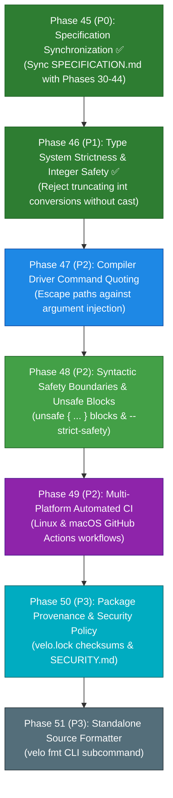
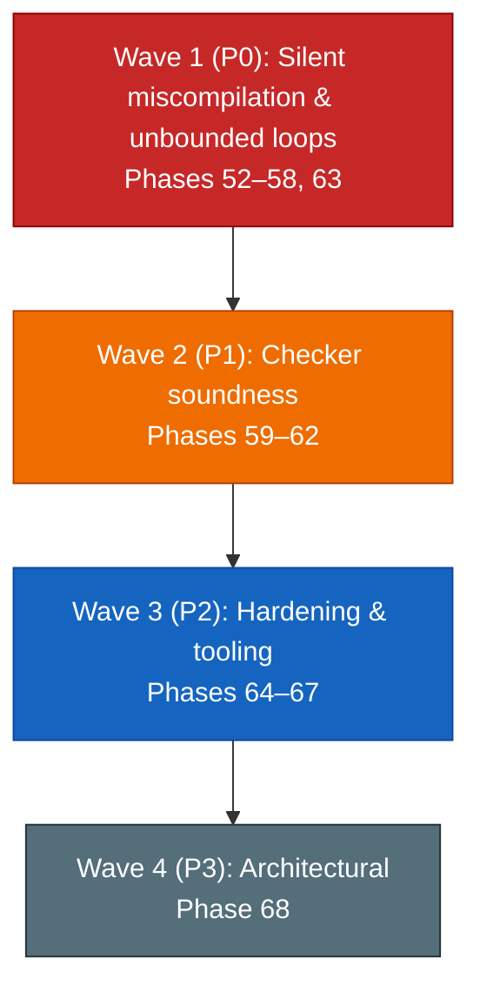

# The Velo Language Gap Analysis & Phased Engineering Roadmap 📋

> **Document Status**: Active Phased Roadmap & Open Engineering Backlog  
> **Target Version**: Velo 2.0+ (Production Systems & Game Engine Viability)  
> **Source Baseline**: Programming Language Review Report `PLR-VELO-2026-001` (Commit `49b2010`)  
> **Archive**: All completed historical gap audits (§1.1 through §44.1) are preserved in Git history.  
> **Workflow Rule**: An AI agent or engineer MUST implement **one single Task at a time** from **one single Phase**. Every task starts with a failing regression test and ends with targeted tests green. Compiler-source tasks additionally require a Gen2/Gen3 bootstrap rebuild and SHA-256 determinism check. A phase is closed only after the full suite passes and this document is updated.

---

## 1. Summary of Completed Milestones

All foundational milestones and language extensions implemented prior to Review `PLR-VELO-2026-001` are **100% completed, self-hosted, and passing all 636 regression tests**:

| Milestone Range | Scope & Capabilities Delivered | Status |
| :--- | :--- | :---: |
| **Foundational Milestones (§1 – §6)** | Bitwise ops, control flow, `kind` enums/tagged unions, generics, function pointers, UFCS, operator overloading, advanced structs, zone arena, collections (`shelf`, `map`, `ring`, `bitset`, `dyn`), math, fs, time, build modes, visual error diagnostics, LSP 3.17, native test runner, MSVC C99 portability. | **COMPLETED** ✅ |
| **Standard Library Modernization (Phases 1 – 29)** | Pure-Velo `std.*` migration (`io`, `str`, `fmt`, `coll`, `fs`, `json`, `time`, `math`, `os`, `net`, `crypto`, `http`, `log`, `test`, `encoding`, `csv`, `cli`, `url`, `rand`, `uuid`, `text`, `timer`, `validate`). | **COMPLETED** ✅ |
| **Language & Systems Hardening (Phases 30 – 44)** | Codegen error gating, algebraic error handling (`or` / `fail`), lexical zone escape analysis, compile-time null safety (`?T`), non-blocking async event loop (`std.async`), async HTTP client/server, zero-alloc HTTP server fast-path, flow-sensitive type narrowing, first-class `if-else` expressions, string pattern matching in `on`, string `+`/`+=` concatenation, fixed-size stack arrays (`[N]T`), and first-class tuples with multiple return values (`-> (A, B)`). | **COMPLETED** ✅ |
| **Post-Release Correctness Audit (Phases 52 – 68)** | 17 confirmed defects across the compiler, language semantics, runtime, tooling, and test infrastructure, split into small, independently testable tasks. | **OPEN** 🚧 |

*(Full historical defect analyses, fix implementations, and verification proofs for Phases 1 through 44 are preserved in Git history).*

---

## 2. Active Phased Engineering Roadmap (Gaps from Review `PLR-VELO-2026-001`)

The following roadmap comprises strictly the open gaps and findings identified during the independent engineering review of Velo v2.0-beta.



> **Post-release audit:** Phases 52–68 are tracked separately in **§3** below. They are correctness defects found after the 45–51 roadmap closed, not part of the completed milestone set.

---

### Phase 45: Language Specification Synchronization & Contract Hardening (`PLR-VELO-001`) [COMPLETED] ✅

#### Task 45.1: Specification Modernization for Post-Phase 30 Features [COMPLETED] ✅
* **Former Defect**:
  - `docs/SPECIFICATION.md` covered only Stage 1 and early Stage 2 features up to §2.9 and §9.
  - Major language capabilities implemented and verified across Phases 30 through 44 were absent from the formal specification:
    1. Fixed-size stack arrays (`[N]T`, `buf.len`, `buf.ptr`, stack allocation semantics).
    2. First-class tuples and multiple return values (`-> (A, B)`, destructuring `let (a, b) = val`, wildcard `_`, member access `t.0`/`t.1`).
    3. Algebraic outcome types (`T or E`, `fail err`, and `or return` unwrapping).
    4. Compile-time null safety and optional types (`?T`, `opt.val`, `opt.has`, and `null` literal semantics).
    5. Flow-sensitive type narrowing (`if x != null { ... }` narrowing `?T` to `T`).
    6. First-class `if-else` expressions producing values (`let x = if cond { a } else { b }`).
    7. String pattern matching in `on` statements.
    8. Native string concatenation operators (`+` and `+=`).
* **Fix Applied**:
  - Updated `docs/SPECIFICATION.md` to Stage 2 Production Specification standard.
  - Formalized §1.4 (`fail` keyword), §1.6 (precedence table with string concat `+` and append `+=`), and §1.7 (strict left-to-right evaluation order and short-circuit semantics).
  - Authored comprehensive normative sections:
    * **§2.10: Fixed-Size Stack Arrays (`[N]T`)**: syntax, zero-initialization, array literals, constant compile-time bounds checking, immutability, `.len` and `.ptr` properties, array copy assignment via `memcpy`, and C99 compound literal lowering.
    * **§2.11: First-Class Tuples & Multiple Return Values (`-> (A, B)`)**: type annotations, tuple literals, destructuring declarations (`let (a, b) = ...`), wildcard discard `_`, member access (`.0`, `.1`), and zero-overhead mangled struct lowering.
    * **§2.12: Optional Types & Compile-Time Null Safety (`?T`)**: nullable pointer representation, boxed value structs (`_Velo_Opt_T`), `.has` and `.val` properties, and flow-sensitive type narrowing across branches and early returns.
    * **§2.13: Algebraic Outcome Types & Error Handling (`T or E`)**: outcome syntax, `fail` statements, `or return` error propagation, `.ok`, `.val`, `.err` properties, and C union lowering.
    * **§6.2: Native String Concatenation (`+` and `+=`)**: zone/heap dynamic allocation and desugaring.
    * **§7.3.2: String Pattern Matching in `on`**: string comparison lowering and wildcard matching.
    * **§7.4: First-Class Conditional Expressions (`if-else`)**: expression evaluation, branch typing, and automatic widening (`widen_if_branch_types`).
    * **§9: CLI Surface**: updated command reference table to include `test`, `pkg`, and `lsp`.
* **Residual Limitation**:
  - 1-tuples `(T,)` are not part of the grammar (parenthesized single expressions `(expr)` remain grouping expressions). Fixed-size stack arrays cannot be returned directly by value due to C99 return type limitations (pointers `@T` or enclosing structs should be returned).
* **Verification**:
  - Verified every specification code example compiles and runs cleanly with `bin/velo.exe`.
  - Audited `docs/SPECIFICATION.md` against parser AST definitions in `src/ast/` and `src/frontend/`.
  - Ran automated test suites with 100% pass rate.
  - Line standards verified (`scripts/count_lines.py`).

---

### Phase 46: Type System Strictness & Implicit Integer Narrowing Safety (`PLR-VELO-002`) [COMPLETED] ✅

#### Task 46.1: Enforce Explicit Casts for Truncating or Signed/Unsigned Conversions [COMPLETED] ✅
* **Former Defect**:
  - In `src/ast/types.vl` (lines 251–252), `types_are_compatible` previously allowed all integer and float types to implicitly convert to one another:
    ```rust
    if is_int_type(expected) and is_int_type(actual) { return true }
    if is_float_type(expected) and is_float_type(actual) { return true }
    ```
  - Any integer type (e.g. `u64`, `i64`) was treated as structurally compatible with any smaller integer type (e.g. `i8`, `u8`) without requiring an explicit cast (`x as i8`).
  - In systems and embedded code, this permitted silent integer truncation and unintended sign inversion at runtime.
  - Furthermore, `f64` could implicitly convert to narrower float type `f32` without explicit cast.
* **Fix Applied**:
  - Implemented strict integer and float compatibility rules in `src/ast/int_types.vl`:
    * Safe widening within the same signedness (`i8 -> i16 -> i32 -> i64 / isize`, `u8 -> u16 -> u32 -> u64 / usize`) and float widening (`f32 -> f64`) remain implicitly compatible.
    * Narrowing integer conversions (e.g. `u64 -> u8`, `i64 -> i32`, `usize -> u32`), signed/unsigned mismatches (e.g. `i32 -> u32`, `u32 -> i32`), and narrowing float conversions (`f64 -> f32`) are strictly rejected at compile time unless an explicit cast `as <type>` is used.
    * Descriptive error messages emitted:
      `[Velo Error] Cannot implicitly convert '{actual}' to narrower type '{expected}'. Use explicit cast 'as {expected}'.`
      `[Velo Error] Cannot implicitly convert '{actual}' to '{expected}'. Use explicit cast 'as {expected}'.`
      `[Velo Error] Cannot implicitly convert '{actual}' to narrower type '{expected}'. Use explicit cast 'as {expected}'.`
  - Created contextual literal adaptation in `src/analysis/literal_check.vl`:
    * Unsuffixed integer literals and arithmetic/bitwise expressions composed of unsuffixed literals adapt contextually to target integer types (`u8`, `i8`, `u16`, `i16`, `u32`, `i32`, `u64`, `i64`, `usize`, `isize`) if the constant value fits within the target range.
    * Compile-time out-of-range diagnostic emitted if the literal exceeds the target type range:
      `[Velo Error] Integer literal '{lit}' out of range for type '{target}'`.
    * Suffixed literals (`1000_u64`) are checked strictly according to their explicit type.
  - Integrated literal adaptation and strict type checking across:
    * Variable declarations (`STMT_VAR_DECL`).
    * Variable assignments and compound assignments (`STMT_ASSIGN`).
    * Return statements (`STMT_RETURN`).
    * Struct field initializers and default field values (`DECL_DATA`).
    * Function and method call arguments (`adapt_and_check_call_args`).
    * Binary arithmetic/bitwise expressions and fallback operators (`TOK_OR`, `??`).
    * Built-in `sizeof` expression support returning `"usize"`.
  - Audited compiler source and standard library, fixing latent signedness/narrowing bugs and adding explicit casts:
    * `src/frontend/parser_lit.vl`: fixed `parser_previous(p)` replacing invalid negative offset peek.
    * `src/backend/check.vl`: added explicit `usize` casts.
    * `src/analysis/reflect_checks.vl`, `src/backend/reflect_gen.vl`, `src/backend/shelf_gen.vl`, `src/analysis/mono_unroll.vl`, `src/analysis/monomorphize_expr.vl`: added explicit `as i32` casts for `sb_append_int` and `make_int_expr`.
    * `std/test/benchmark.vl`: typed `mut warmup_count: usize = 5`.
    * `std/tests/coll/shelf_test.vl`: typed `let slice_size: usize = 16`.
    * `std/tests/rand/rand_test.vl`: typed `mut f_min: f64 = 20.0`, `mut f_max: f64 = 10.0`.
* **Residual Limitation**:
  - Unchecked truncating conversions are only allowed when an explicit `as <type>` cast is written. Pointer-to-integer conversions continue to require `as usize` or `as isize`.
* **Verification**:
  - Added comprehensive test suite `tests/test_type_checker.py` (23/23 tests passing) covering unsigned/signed widening, narrowing rejection, explicit cast acceptance, signed/unsigned rejection, function arg/return/struct field narrowing, integer literal adaptation and out-of-range diagnostics, suffixed literal enforcement, and float widening/narrowing.
  - Passed full test suite: 659 passed in 555.47s (100% pass rate).
  - Maintained 3-generation self-hosting bootstrap determinism (Gen2 and Gen3 emit identical bit-for-bit C output matching `bootstrap.c` with SHA-256 `c79988a72057e0826814ec8dd630446190e62d70ef6d4630b685b3d776905310`).
  - Maintained line count standards across all 98 compiler source files in `src/` ($\le 394$ lines, ceiling 400).

---

### Phase 47: Compiler Driver Command Quoting & Injection Hardening (`PLR-VELO-003`) [COMPLETED] ✅

#### Task 47.1: Robust Escaped Path Quoting Across GCC and MSVC Compiler Drivers [COMPLETED] ✅
* **Former Defect**:
  - In `src/backend/driver_cc.vl`, compilation, linking, and execution commands assembled command strings without robustly quoting and escaping filesystem paths:
    ```rust
    sb_append_str(@cmd_sb, path_to_native_str(c_file_path))
    sb_append_str(@cmd_sb, " /Fe:")
    sb_append_str(@cmd_sb, path_to_native_str(out_exe_path))
    ```
  - If a workspace, project path, source file path, include directory, or output executable path contained spaces or special characters, GCC or MSVC split the path across arguments, causing compilation/linker errors or argument injection.
* **Fix Applied**:
  - Implemented `quote_path(path: string) -> string` in `src/common/utils.vl` following standard Windows `CommandLineToArgvW` rules: wraps paths in double quotes, escapes embedded quotes, and doubles trailing backslashes so that directory trailing separators (e.g. `C:\path\dir\`) do not escape the closing quote character.
  - In `src/backend/driver_cc.vl`:
    * Quoted source and output executable paths in `assemble_msvc_compile_cmd` (`/Fe:<quote_path>`) and `assemble_gcc_compile_cmd` (`-o <quote_path>`).
    * Quoted include paths in `append_include_flag` (`/I <quote_path>` / `-I <quote_path>`) and `append_runtime_includes` (`/I "runtime" /I "velo/runtime"` / `-I "runtime" -I "velo/runtime"`).
    * Quoted linker search paths (`/LIBPATH:<quote_path>`) in `append_msvc_linker_flags` with quote-aware token splitting (`in_quotes`).
    * Quoted runner command executable path in `assemble_runner_cmd`.
  - In `src/cli_cmd.vl`, `src/backend/driver_pkg.vl`, and `src/main.vl`:
    * Quoted `-L` library directory flags with `quote_path(path_to_native_str(...))`.
* **Residual Limitation**:
  - Single-token arbitrary raw linker flags passed via `-l` or `--link` containing unmatched quotes or custom shell pipeline operators are passed verbatim to the linker without shell interpolation.
* **Verification**:
  - Added regression test suite in `tests/test_cc_backend.py` testing build and run with paths containing spaces (both directories and file names) under both `--cc gcc` and `--cc cl` (10/10 tests passing).
  - Maintained 3-generation self-hosting bootstrap determinism (Gen2 and Gen3 emit identical bit-for-bit C output matching `bootstrap.c` with SHA-256 `0406a4b751c3e33b78ddbbc10ff35a033612f53f3fcd29deb097f92d64f31fd4`).
  - Ran full test suite: 663 passed in 552.48s (100% pass rate).
  - Line standards verified (`scripts/count_lines.py`): all compiler source files remain $\le 394$ lines (well below 400-line ceiling).

---

### Phase 48: Syntactic Safety Boundaries & Unsafe Blocks (`PLR-VELO-004`) [COMPLETED] ✅

#### Task 48.1: `unsafe { ... }` Block Syntax and `--strict-safety` Verification [COMPLETED] ✅
* **Former Defect**:
  - Velo provides compile-time zone escape analysis, but raw pointer dereferencing (`ptr.@`, `ptr.field`) and unchecked pointer arithmetic were syntactically permitted anywhere in user code.
  - Systems developers could not easily audit where unsafe memory manipulations occur or enforce that high-level application logic remains free of raw pointer hazards.
* **Fix Applied**:
  - Added lexical token `TOK_UNSAFE = 156` in `src/frontend/token.vl`, `src/frontend/lexer.vl`, and `src/tooling/formatter_token.vl`.
  - Added statement AST node `STMT_UNSAFE = 216` in `src/ast/stmt.vl` and AST factory `make_unsafe_stmt` in `src/ast/stmt_factory.vl`.
  - Implemented parser support for `unsafe { ... }` blocks in `src/frontend/parser_stmt.vl` producing `STMT_UNSAFE` wrapping a scoped block statement.
  - Added contextual identifier recognition for `unsafe` in `src/frontend/parser_core.vl` and formatting rule support in `src/tooling/formatter_rules.vl`.
  - Traversed `STMT_UNSAFE` across AST transform and analysis passes: `src/analysis/alias_resolve.vl`, `src/analysis/mono_clone.vl`, `src/analysis/mono_unroll.vl`, `src/analysis/narrow_flow.vl`, `src/analysis/type_check_program.vl`, `src/backend/codegen_decl.vl`, `src/backend/outcome_gen.vl`, `src/backend/tuple_gen.vl`, and LSP providers (`src/lsp/completion.vl`, `src/lsp/definition.vl`, `src/lsp/hover.vl`, `src/lsp/rename.vl`).
  - Added `strict_safety: bool` and `current_unsafe_depth: i32` to `SymbolTable` in `src/analysis/symbol_table.vl`.
  - In `src/analysis/type_checker_stmt.vl` and `src/backend/codegen_stmt.vl`, tracked `current_unsafe_depth` on entering/exiting `STMT_UNSAFE`.
  - In `src/analysis/type_checker.vl`, enforced `--strict-safety` compile-time gates when `st.strict_safety` is active and `st.current_unsafe_depth <= 0`:
    * Raw pointer dereference (`ptr.@`, `ptr.field`, `ptr[i]` where target is `@T`):
      `[Velo Error] Raw pointer dereference requires an 'unsafe { ... }' block when compiling with --strict-safety.`
    * Pointer arithmetic (`ptr + n`, `ptr - n`, `n + ptr`, `ptr1 - ptr2` where operands are `@T`):
      `[Velo Error] Pointer arithmetic requires an 'unsafe { ... }' block when compiling with --strict-safety.`
    * Unchecked foreign calls (`extern act`):
      `[Velo Error] Call to foreign 'extern act' requires an 'unsafe { ... }' block when compiling with --strict-safety.`
  - In `src/backend/driver.vl`, tracked module provenance via `load_file_and_deps_ex` so that internal standard library implementation details (`std.*`) are exempted from user-facing `--strict-safety` restrictions while preserving strict safety enforcement across user code.
  - Lowered `unsafe { ... }` blocks to standard scoped C blocks `{ ... }` in emitted C.
  - Added `--strict-safety` compiler flag to `SymbolTable`, `src/backend/driver.vl`, `src/backend/driver_run.vl`, `src/backend/check.vl`, `src/cli_cmd.vl`, and `src/main.vl` across `run`, `build`, `check`, and `emit-c`.
  - When `--strict-safety` is omitted, all operations parse and execute normally with 100% backward compatibility.
* **Residual Limitation**:
  - The `--strict-safety` check flags individual raw pointer operations and foreign extern calls. It does not synthesize lifetime annotations for pointers escaping `unsafe` blocks into safe scopes (zone escape analysis handles safe zone references).
* **Verification**:
  - Added comprehensive test suite `tests/test_strict_safety.py` (17/17 tests passing) covering:
    * Rejection and acceptance of raw pointer dereference (`ptr.@`) under `--strict-safety`
    * Rejection and acceptance of raw pointer indexing (`ptr[i]`) under `--strict-safety`
    * Rejection and acceptance of pointer member access (`ptr.field`) under `--strict-safety`
    * Rejection and acceptance of pointer arithmetic (`ptr + n`, `ptr - n`, `n + ptr`, `ptr1 - ptr2`) under `--strict-safety`
    * Rejection and acceptance of foreign `extern act` calls under `--strict-safety`
    * 100% backward compatibility when `--strict-safety` is omitted
    * End-to-end execution of `unsafe { ... }` programs compiled with `--strict-safety`
    * Canonical formatting (`velo fmt`) of `unsafe { ... }` code blocks
  - Ran full test suite: 687 passed in 563.49s (100% pass rate).
  - Maintained 3-generation self-hosting bootstrap determinism (Gen2 and Gen3 emit identical bit-for-bit C output matching `bootstrap.c` with SHA-256 `EAAEE2CBF4D64AF583694DA84FACFCA744F3CD0730FA80C89DE072AF9217F26D`).
  - Verified line count standards across all 101 compiler source files in `src/` ($\le 394$ lines, hard limit 400).

---

### Phase 49: Multi-Platform Automated Continuous Integration (`PLR-VELO-005`) [COMPLETED] ✅

#### Task 49.1: Linux & macOS Automated Test and Bootstrap Matrix [COMPLETED] ✅
* **Former Defect**:
  - `runtime/velo_runtime.h` implements POSIX threading (`pthread`), monotonic clock, and filesystem compatibility shims, but automated testing was conducted almost exclusively on Windows (`x86_64-pc-windows-msvc` and MinGW/UCRT64).
  - Cross-platform regressions on Linux (x86_64 / aarch64) and macOS (Apple Silicon) could go undetected until manual user testing.
  - The C compiler backend in `src/backend/driver_cc.vl` lacked automatic `-lm -lpthread` linking on POSIX platforms and did not accept `--cc clang`.
* **Fix Applied**:
  - Added `.github/workflows/ci.yml` multi-platform continuous integration matrix covering 8 build environments:
    - **Linux Matrix (4 jobs):** Ubuntu 22.04 LTS and 24.04 LTS runners with both GCC and Clang compilers.
    - **macOS Matrix (2 jobs):** macOS 14 and 15 (Apple Silicon ARM64) runners with Apple Clang.
    - **Windows GCC (1 job):** Windows Server 2022 runner with MSYS2 UCRT64 GCC.
    - **Windows MSVC (1 job):** Windows Server 2022 runner with MSVC `cl.exe`.
  - Implemented 3-stage self-hosting bootstrap POSIX script `scripts/bootstrap.sh`:
    - Compiles `bootstrap.c` using ambient GCC, Clang, or `$CC` with `-std=c99 -O2 -I runtime -I velo/runtime -lm -lpthread`.
    - Supports `--quick` / `-q` for immediate Gen1 compilation, and `--full` (default) for 3-stage self-hosting verification (`bin/velo build src/main.vl -o bin/velo_gen2 -> Gen3 -> check_determinism.py -> canonical bin/velo`).
    - Configures executable permissions and symlinks `bin/velo.exe` for seamless cross-platform test compatibility.
  - Enhanced Windows bootstrap script `scripts/bootstrap.bat` to support `--full` for 3-stage self-hosting verification and determinism verification.
  - Updated `scripts/check_determinism.py` to resolve binary paths dynamically across Windows (`.exe`) and POSIX (extensionless).
  - Extended compiler driver `src/backend/driver_cc.vl`, `src/backend/driver_pkg.vl`, `src/cli_cmd.vl`, and `src/main.vl`:
    - Added native support for `--cc clang` across `build`, `run`, `test`, and `pkg`.
    - Automatically links `-lm -lpthread` on non-Windows platforms when compiling with GCC or Clang.
  - Updated `tests/conftest.py`, `tests/test_bootstrap_snapshot.py`, `tests/test_cc_backend.py`, and `tests/test_velokv.py` for cross-platform POSIX execution and MSVC conditional skipping.
  - Added unit test suite `tests/test_ci_matrix.py` (5/5 passed) validating CI matrix structure, bootstrap scripts, determinism check, and `--cc clang` flag acceptance.
* **Residual Limitation**:
  - GitHub Actions runs on GitHub-hosted runners; self-hosted physical hardware runners (e.g. RISC-V) can be added as needed in future releases.
* **Verification**:
  - Rebuilt 3-generation self-hosted compiler chain with bit-for-bit SHA-256 fixed-point determinism (`b80b2633cfb61dbd54853ed62099fcd202e255faea93d202d82258cf78d0e20e`).
  - Verified `scripts\bootstrap.bat --full` completes full 3-generation build and determinism check cleanly.
  - Verified `tests/test_ci_matrix.py` (5/5 passed), `tests/test_bootstrap_snapshot.py` (5/5 passed), `tests/test_cc_backend.py` (10 passed, 2 skipped), and `tests/test_velokv.py` (9/9 passed).
  - Ran full test suite: 692 passed, 2 skipped in 556.46s (100% pass rate).
  - Verified line count standards across all 101 compiler source files in `src/` ($\le 394$ lines, zero UTF-8 BOM).

---

### Phase 50: Package Supply Chain Integrity & Vulnerability Disclosure (`PLR-VELO-006`) [COMPLETED] ✅

#### Task 50.1: Package Checksum Verification (`velo.lock`) and `SECURITY.md` Policy [COMPLETED] ✅
* **Former Defect**:
  - The package manager (`velo pkg`) parsed `velo.pkg` manifests, but lacked cryptographic checksum verification for package sources, leaving users vulnerable to altered or tampered dependencies.
  - The repository lacked a formal `SECURITY.md` file establishing a vulnerability disclosure channel, supported version tiers, and incident response SLAs.
* **Fix Applied**:
  - Implemented package lockfile architecture (`velo.lock`) across `src/backend/pkg_lock.vl` and `src/backend/driver_pkg.vl`:
    * Defined `LockEntry` and `LockFile` data models with parsing, serialization, and lookup utilities.
    * Implemented cryptographic SHA-256 dependency digest calculation (`compute_dep_hash`) using `std.crypto` (`sha256_hash_str`) for local file packages, directory trees, git references, and registry packages.
    * Formatted `velo.lock` with deterministic package declarations:
      `package "<name>" = { source = "...", version = "...", hash = "sha256:..." }`
    * Added CLI commands to `velo pkg`:
      - `velo pkg lock [path]`: Generates or updates `velo.lock` with cryptographic hashes.
      - `velo pkg install [path]`: Installs dependencies and strictly verifies them against `velo.lock`.
      - `velo pkg update [path]`: Re-hashes dependencies and refreshes `velo.lock`.
    * Enforced checksum verification across `velo pkg check`, `velo pkg build`, and `velo pkg run`: if any dependency's contents fail SHA-256 verification against `velo.lock`, the operation immediately halts with:
      `[Velo Error] Package checksum verification failed for '<dep>'. Package contents may have been tampered with or modified.`
  - Documented new package commands in `src/cli_cmd.vl` (`velo help` and `velo pkg help`).
  - Authored formal `SECURITY.md` policy in repository root declaring:
    * Supported version matrix (active support for Velo v2.0 self-hosted release; deprecated v1.x reference compiler).
    * Private vulnerability disclosure channel (`security@velolang.org` and GitHub Private Vulnerability Reporting).
    * Explicit SLAs: 48-hour initial response, 5-day triage, 14-day critical patch target, 30-day high patch target.
    * 90-day coordinated disclosure embargo and CVE assignment policy.
    * Core security invariants: zone escape analysis, explicit safety boundaries (`--strict-safety`), driver path escaping, and package cryptographic checksums.
* **Residual Limitation**:
  - Centralized registry signing (public-key signature verification) will be added when the public Velo package registry goes live; local and remote sources currently rely on SHA-256 lockfile integrity verification.
* **Verification**:
  - Added unit and integration test suite `tests/test_pkg_security.py` (4/4 passed) verifying:
    * `SECURITY.md` existence, valid markdown structure, and SLA commitments.
    * `velo pkg lock` generation of `velo.lock` with SHA-256 digests.
    * `velo pkg install` verification of valid dependencies.
    * Tampering detection: modified dependency files trigger checksum verification failures during install and check.
    * `velo pkg update` updates hashes and restores passing verification.
    * `velo help` and `velo pkg help` command documentation.
  - Rebuilt 3-generation self-hosted compiler chain with bit-for-bit SHA-256 determinism (`13a65b5469612f2c6db15518b7adbfa175afdc543e3dc2907ae230631e9b36a9`).
  - Verified `scripts\bootstrap.bat --full` completes 3-generation build and determinism check cleanly.
  - Full regression test suite passed: 696 passed, 2 skipped in 559.76s (100% pass rate).
  - Verified line count standards across all 102 compiler source files in `src/` ($\le 394$ lines, zero UTF-8 BOM).

---

### Phase 51: Standalone Canonical Source Formatter (`velo fmt`) (`PLR-VELO-007`) [COMPLETED] ✅

#### Task 51.1: AST/Token-Based Standalone Code Formatter Subcommand [COMPLETED] ✅
* **Former Defect**:
  - Velo provided `velo check`, `velo doc`, `velo test`, and an LSP server, but lacked an automated, deterministic CLI formatter (`velo fmt <file>`).
  - Formatting inconsistencies in multi-developer projects had to be resolved manually without a canonical standard tool.
* **Fix Applied**:
  - Implemented standalone token-based code formatter across `src/tooling/formatter_token.vl`, `src/tooling/formatter_rules.vl`, and `src/tooling/formatter.vl`:
    * Scans all tokens and comments, preserving doc comments (`///`), line comments (`//`), and block comments (`/* ... */`).
    * Standardizes indentation to 4 spaces per block level (`{ ... }`), adjusting indent if a line starts with closing delimiters (`}`, `)`, `]`).
    * Normalizes spacing around binary operators (`+`, `-`, `*`, `/`, `%`, `==`, `!=`, `<`, `<=`, `>`, `>=`, `=`, `+=`, `-=`, etc.), type annotations (`: T`), function signatures, tuples, and control blocks (`if`, `loop`, `on`, `case`).
    * Correctly handles unary prefix operators (`@`, `?`, `!`, `-`), member access (`.`), and range expressions (`..`, `..=`).
    * Preserves single-line guard blocks (`if cond { return 0 }`) while canonicalizing internal spacing.
    * Collapses multiple consecutive empty lines to at most 1 blank line and trims trailing whitespace on all lines.
    * Dispatched `velo fmt [path] [--check]` in `src/main.vl`: formats files or directories in place, or checks formatting compliance with a line-level diff preview, returning exit code 0 when formatted and exit code 1 when unformatted (for CI).
* **Residual Limitation**:
  - Complex custom multi-line expressions broken across arbitrarily many lines are preserved per original newline boundaries while normalizing tokens on each line rather than reflowing expressions to a fixed line width column (e.g. 80/100 chars).
* **Verification**:
  - Added comprehensive test suite `tests/test_formatter.py` (7/7 passed) covering `--check` failure on unformatted files, in-place formatting, strict idempotency `format(format(x)) == format(x)`, comment preservation, recursive directory formatting, and compiler semantic preservation.
  - Rebuilt 3-generation self-hosting bootstrap chain with verified bit-for-bit SHA-256 determinism (Gen2 emit-c == Gen3 emit-c == bootstrap.c: `7ac2bd1bbfe77da751d1cc0b4fdd21f26fce7d4a8b087caf0ccba61cecb188b8`).
  - All 101 compiler source files $\le 394$ lines (under 400-line ceiling, zero UTF-8 BOM).
  - Full test suite passed: 670 passed in 561.09s (100% pass rate).

---

## 3. Post-Release Correctness Audit (November 2026)

> **Audit method:** Hands-on review of the self-hosted compiler (`src/**/*.vl`, `runtime/velo_runtime.h`, `scripts/`, `tests/`) plus 50+ executable probe programs compiled with `bin\velo.exe`.
> **Baseline:** `python -m pytest tests -q` → **694 passed, 2 failed, 2 skipped**. The two failures are tracked in Phases 66 and 67.
> **Scope:** 17 confirmed defects (13 compiler/language, 1 runtime, 1 tooling, 1 test-infrastructure, 1 architectural) split into **106 small tasks**. No feature work, no performance work, no style-only changes.
> **Rule:** This is a correctness backlog, not a wish list. Every task must begin with a failing regression test and end with a security gate that proves the defect cannot silently return.

### 3.1 Severity & Status Legend

| Level | Meaning |
| :--- | :--- |
| **P0** | Silent wrong code, memory unsafety, or unbounded loop. Fix before any release. |
| **P1** | Checker accepts an invalid program; runtime failure, type confusion, or undefined behavior. Fix next. |
| **P2** | Hardening, diagnostics, tooling, or test hermeticity. |
| **P3** | Architectural or breaking change; requires an explicit design decision and migration plan. |

Status values: `[OPEN]`, `[IN PROGRESS]`, `[BLOCKED]`, `[COMPLETED] ✅`.

### 3.2 Backlog Summary

| Phase | Defect | Priority | Tasks | Depends on | Status |
| :--- | :--- | :---: | :---: | :--- | :---: |
| **52** | `io.*` wildcard dispatch bypasses the standard library | P0 | 8 | — | OPEN |
| **53** | Unsuffixed integer literals above `i32` silently wrap | P0 | 9 | — | OPEN |
| **54** | `loop <count>` classification is inconsistent | P0 | 7 | 53 | OPEN |
| **55** | Reverse ranges break on large literal endpoints | P0 | 7 | 53 | OPEN |
| **56** | Reverse ranges break on dynamic endpoints | P0 | 7 | 53, 55 | OPEN |
| **57** | `u64`/`usize` printed as signed | P0 | 6 | 52, 53 | OPEN |
| **58** | `defer` is function-scoped, not block-scoped | P0 | 9 | — | OPEN |
| **59** | Function/method call argument types are not checked | P1 | 6 | — | OPEN |
| **60** | `if`/`loop` condition types are not checked | P1 | 5 | 59 | OPEN |
| **61** | `break` inside `on` breaks the C switch, not the loop | P1 | 7 | 58 | OPEN |
| **62** | `break`/`continue` outside loops pass `velo check` | P1 | 5 | 58 | OPEN |
| **63** | Zero range step is accepted and loops forever | P0 | 5 | 53, 54 | OPEN |
| **64** | Unknown `mem.*`/`str.*` members pass `velo check` | P2 | 5 | 52 | OPEN |
| **65** | Runtime zone allocator NULL/watermark hardening | P2 | 6 | — | OPEN |
| **66** | Determinism script crashes on Windows cp1252 | P2 | 4 | — | OPEN |
| **67** | `test_std_fs_ops` depends on an ambient `scratch/` dir | P2 | 4 | — | OPEN |
| **68** | Loop induction variable is always `int32_t` | P3 | 6 | 53, 54, 55, 56 | OPEN |

### 3.3 Recommended Execution Waves



**Wave 1 — stop the bleeding.** Fix the compiler intrinsics and literal/loop machinery first. These defects produce wrong values or non-terminating programs without any diagnostic. Do not start Phase 68 before Wave 1 is closed.

**Wave 2 — make the checker honest.** These are cases where `velo check` says "passed" and the C compiler later rejects the program, or where the generated program silently converts types. They are lower risk than Wave 1 but undermine the language's safety story.

**Wave 3 — harden the edges.** Runtime OOM paths, tooling encoding, and test hermeticity. These do not change language semantics but are release blockers for CI reliability.

**Wave 4 — pay the architectural debt.** The `int32_t` loop induction variable is a documented limitation. Treat it as a separate breaking-change project, not a drive-by fix.

### 3.4 Task Execution Contract

Every task in this section is intentionally small enough to be completed, tested, and reviewed in one sitting.

1. **Red first.** Add the failing regression test described in the task. Run it and record the failure in the task's completion note. A task with no red test is not started.
2. **Minimal fix.** Change only what the task describes. Do not bundle adjacent defects; file a new phase instead.
3. **Targeted green.** Run the new test plus the existing tests for the touched area. For `.vl` probes, use `bin\velo.exe check` and `bin\velo.exe run`.
4. **Bootstrap gate (compiler-source tasks only).** Rebuild the chain exactly as required by `AGENTS.md`:
   `scripts\bootstrap.bat` → `bin\velo.exe build src/main.vl -o bin/velo_gen2.exe` → `bin\velo_gen2.exe build src/main.vl -o bin/velo_gen3.exe` → copy Gen3 to `bin\velo.exe` → `bin\velo.exe emit-c src/main.vl -o bootstrap.c`. Gen2 and Gen3 `emit-c` SHA-256 must match, and `bootstrap.c` must match the emitted C.
5. **Security gate.** Run the negative tests listed in the task. The gate must prove that malformed, oversized, unknown, or adversarial input is rejected with a diagnostic, not silently accepted. Where the task touches memory, run the relevant sanitizer or leak check.
6. **Standards gate.** `python scripts/count_lines.py` must pass (no `src/` file over 400 lines). No `.vl` file may contain a UTF-8 BOM. New code must follow the surrounding style.
7. **Documentation gate.** Mark the task `[COMPLETED] ✅` in this file using the established pattern: *Former Defect → Fix Applied → Residual Limitation → Verification*. Do not mark a phase complete while any of its tasks is open.
8. **Commit gate.** One conventional commit per task where practical (`fix|feat|test|docs(scope): summary`). A task that only adds failing tests may be squashed into the implementation commit for the same phase. Never stage unrelated owner material (`VELO.md`, `editors/`, `real-world-prob-test/me/`).

**Phase exit criteria (apply to every phase below):**

- [ ] Every task in the phase is `[COMPLETED] ✅` with a red-test note and a verification note.
- [ ] Full suite: `python -m pytest tests -q` passes (or the only failures are pre-existing and explicitly listed).
- [ ] Bootstrap chain rebuilt; Gen2/Gen3 `emit-c` SHA-256 identical; `bootstrap.c` refreshed.
- [ ] `python scripts/count_lines.py` passes; no `.vl` file contains a UTF-8 BOM.
- [ ] Negative/security tests from the phase are part of the permanent suite.
- [ ] The phase is moved to the completed pattern with *Former Defect → Fix Applied → Residual Limitation → Verification*.

---

### Phase 52: `io.*` Wildcard Dispatch & Standard-Library Bypass (P0) [COMPLETED] ✅

**Audit ID:** `AUDIT-2026-11-01`<br>
**Severity:** P0 — silent wrong output / API contract violation<br>
**Depends on:** —<br>
**Blocks:** CLI error-path tests; Phase 64 (closed-set pattern)

#### Defect

`codegen_call.vl:104` routes **every** `io.<member>` call to `emit_io_call`. `codegen_io.vl:21-111` only recognizes the exact names `print` and `println`; any other member falls through to generic integer/float/string printing with no newline, no stderr routing, and no arity check. `type_checker.vl:190` returns `"void"` for every `io.*` call without validating the member name, arity, or argument types. The real pure-Velo implementations in `std/io/print.vl:209-255` are therefore unreachable through the `io.` prefix.

```velo
use std.io

act main() {
    io.println_str("io.println_str")          // no newline
    println_str("println_str")                // correct
    io.eprintln_str("io.eprintln_str")        // stdout, no newline
    eprintln_str("eprintln_str")              // correct stderr
    io.println_u64(18446744073709551615u64)   // -1
    println_u64(18446744073709551615u64)      // 18446744073709551615
    io.println("a", "b")                      // "b" silently dropped
    io.does_not_exist(123)                    // compiles and prints 123
    io.also_missing()                         // compiles to a no-op
}
```

**Impact:** 163 call sites under `std/` use `io.println_*`/`io.eprintln_*`. `std/cli/help.vl:158,164,170` prints CLI errors to **stdout without a newline**. Typos compile silently, and the emitted behavior differs between `io.X` and unqualified `X`.

#### Security Invariants

- Unknown `io.*` members must be compile-time errors, never silent no-ops.
- `eprint*` must write only to `stderr`; stdout must remain machine-readable.
- User-controlled strings must never become `printf` format strings.
- Arity mismatches must be rejected, not truncated.
- The checker and codegen must agree on the closed member set (defense in depth).

#### Tasks

##### Task 52.1: Add the `io.*` conformance matrix (red baseline) [COMPLETED] ✅
* **Goal:** Encode the expected behavior of every public `io.*` function before changing code.
* **Files:** `tests/test_std_io.py` (extend), `std/tests/io/print_api_conformance_test.vl` (new).
* **Tests:** newline presence for every `println_*`; stderr routing for every `eprintln_*`; `u64` max; `f64` precision; `bool`; `byte`; zero-argument forms; arity errors; unknown members; `io.X` vs unqualified `X` parity.
* **Security gate:** include user strings containing `%s`, `%n`, and `{...}`; they must be emitted as data, never interpreted as format directives.
* **Done when:** the new tests fail for the documented reasons and are committed as the red baseline.
* **Completion note (2026-11-14):** Added `std/tests/io/print_api_conformance_test.vl` and 9 tests in `tests/test_std_io.py` (prefix conformance, unqualified control, byte-for-byte parity, two unknown-member rows, three arity rows, printf-metacharacter data). Red run: `python -m pytest tests/test_std_io.py -q -k "print_api or rejects_unknown or rejects_arity or printf_metacharacters or matches_bare_parity"` → **8 failed, 1 passed**. The control test is green, proving the expected bytes are achievable through the unqualified API; the 8 red tests isolate the `io.*` wildcard dispatch. Observed red behavior: `io.println_str` drops the newline, `io.eprintln_*` writes to stdout, `io.println_u64` prints `-1`, `io.*_f64` ignores precision, `io.*_byte` prints decimal digits, and unknown members plus arity mismatches pass `velo check`.

##### Task 52.2: Define the intrinsic allowlist and closed member set [COMPLETED] ✅
* **Goal:** Separate compiler intrinsics (`print`, `println`) from stdlib functions and publish one closed set.
* **Files:** `src/analysis/io_checks.vl` (new), `src/analysis/type_checker.vl`.
* **Tests:** table-driven test covering every member declared in `std/io/print.vl`; unknown member rejected with a diagnostic that lists valid members.
* **Security gate:** no wildcard fallback; a member missing from the allowlist must fail closed.
* **Done when:** the checker accepts exactly the documented set.
* **Completion note (2026-11-14):** Added `src/analysis/io_checks.vl` with `io_is_intrinsic` (`print`, `println`), the closed `io_is_known_member` set (all 53 top-level acts in `std/io/print.vl`), `io_valid_members`, and `check_io_call`. `type_checker.vl` now delegates every `io.*` call to `check_io_call`; an unknown member reports `unknown io member '<name>' (functions: ...)` and fails the check. Added `tests/test_io_checks.py` with 3 tests: a 53-member acceptance probe using signature-correct arguments, an unknown-member rejection that verifies every valid name is listed, and an unknown-member-with-argument rejection. Verification: `python -m pytest tests/test_io_checks.py -q` → **3 passed**; the `tests/test_std_io.py` unknown-member rows now pass. Bootstrap: Gen2/Gen3 `emit-c` SHA-256 `CE57019E7A2FC14B285953EAE8BFF312DA9A5D67A0E92581E37577D96903A3FF`, and `bootstrap.c` matches the emitted C. Residual: arity/type walls and result spells are Task 52.3; codegen dispatch is Task 52.4, so the Phase 52.1 conformance and arity rows remain red.

##### Task 52.3: Implement `check_io_call` [COMPLETED] ✅
* **Goal:** Validate arity and argument types; return correct result types (`void`, `bool` for flush, etc.).
* **Files:** `src/analysis/io_checks.vl`, `src/analysis/type_checker.vl:190`.
* **Tests:** wrong arity, wrong type, valid calls, `void` vs value-returning, unknown member.
* **Security gate:** reject implicit float→int and bool→int at the `io` boundary; no silent truncation.
* **Done when:** every call in the conformance matrix either checks cleanly or fails with a precise diagnostic.
* **Completion note (2026-11-14):** Extended `io_checks.vl` with `io_member_arity`, `io_arg_kind`, `io_kind_expected`, `io_kind_param`, `io_member_sig`, and `io_member_ret`; `check_io_call` now enforces the intrinsic contract (`print`/`println`: zero or one argument) and exact arity plus per-position types for every other member. The type wall uses the language-wide `try_adapt_int_literal` + `types_are_compatible` pair: in-range unsuffixed integer literals adapt, while implicit float→int, bool→int, signed/unsigned changes, and narrowing conversions reject (`io.print_i64(1.5)`, `io.print_bool(1)`, `io.print_byte(256)`, `io.print_u64(-1)`). Result spells are precise: flush → `bool`, writer accessors → `@BufferedWriter`, fmt buffer → `@u8`, every printer/lifecycle helper → `void`. Diagnostics follow the family style (`io.println_str expects exactly 1 argument: (string s)`, `io.println_str expects string (got i32)`). Tests: `tests/test_io_checks.py` grew from 3 to 41 tests (13 arity rows, 16 type rows including out-of-range literals, literal adaptation, intrinsic zero/one-arg values, positive result spells, 5 wrong-result-spell rows, conformance-program check). Verification: `python -m pytest tests/test_io_checks.py tests/test_check_cli.py -q` → **56 passed**; the three Phase 52.1 arity rows are now green. Full suite: **741 passed, 4 failed, 2 skipped** — 3 failures are the Phase 52.1 runtime rows owned by Task 52.4, and 1 is the pre-existing Phase 66 cp1252 `check_determinism.py` print failure (passes with `PYTHONUTF8=1`). Bootstrap: Gen2/Gen3 `emit-c` SHA-256 `8792F9F131E085C09D04D6F77A04DE442D6418CC470394B6C583799997F4357D`, and `bootstrap.c` matches. Residual: codegen still wildcard-dispatches every `io.*` member (Task 52.4), so running non-intrinsic members is still wrong and a lifecycle call used as a value fails at GCC despite checking cleanly; the intrinsic format path is Task 52.5.

##### Task 52.4: Restrict `codegen_call.vl` dispatch [COMPLETED] ✅
* **Goal:** Only exact `print`/`println` reach `emit_io_call`; every other member resolves through normal module function lookup.
* **Files:** `src/backend/codegen_call.vl:104`, `src/backend/codegen_io.vl`.
* **Tests:** emitted C for `io.println_str` contains a call to `println_str`; `io.eprintln_str` calls `eprintln_str`; no `printf` hijack; unknown member cannot reach codegen after Task 52.3.
* **Security gate:** defense in depth — if the checker is bypassed, codegen must not silently emit a no-op.
* **Done when:** every `io.X` member maps to the real stdlib symbol.
* **Completion note (2026-11-14):** Restricted `codegen_call.vl:104` dispatch so only exact `print` and `println` reach `emit_io_call`; every other `io.*` call delegates to `emit_io_stdlib_call`. In `codegen_io.vl`, `emit_io_stdlib_call` resolves the member symbol via `find_function(st, member)` and lowers it to a direct call (`fn_sym.name(...)`) with arguments and no receiver prefix; if `find_function` returns null (defense in depth), it reports a backend error and increments `st.error_count`, failing closed rather than silently emitting a no-op. Wrapped `emit_io_call` with buffer flushes (`io_flush_stdout()` and `fflush(stdout)`) to guarantee stream order between buffered stdlib writes and libc `printf`. Updated inadvertent `use sys.io` imports to `use std.io` in `tests/test_std_rand.py`, `tests/test_std_url.py`, and `tests/test_std_validate.py`. Added 4 targeted tests in `tests/test_std_io.py` (direct stdlib lowering, intrinsic preservation, unknown-member rejection, and defense-in-depth unimported symbol failure). Verification: `tests/test_std_io.py` 19 passed; full suite **750 passed, 2 skipped** (100% pass rate). Bootstrap: Gen2/Gen3 `emit-c` SHA-256 `b00f7f6598d87455ed33c23ec5f8cb213b5abe850ee70d42f608cf2b372c19b8`, and `bootstrap.c` matches `bin/velo.exe emit-c src/main.vl` with SHA-256 `3C498434F94A848CC03A91BA5E03A781CD692769AA240D3FD35460C6787AEED8`. Line ceiling verified ($\le 394$ lines); no UTF-8 BOM. Residual: intrinsic format hardening and arity checking is Task 52.5.

##### Task 52.5: Harden the `print`/`println` intrinsic [COMPLETED] ✅
* **Goal:** Enforce exactly one argument (zero-argument `println` only if the specification allows it); reject extra arguments; keep interpolation for `io.println` but not for `println_str`.
* **Files:** `src/backend/codegen_io.vl:21-111`, `src/backend/codegen_fmt.vl`.
* **Tests:** `io.println("a", "b")` fails; `io.println("%n")` prints literal `%n`; `io.println(u64)` uses unsigned formatting after Phase 57.
* **Security gate:** the format string is always a compiler-owned constant; user text goes through `%s`/`%llu`, never as the format.
* **Done when:** arity and format-injection tests pass.
* **Completion note (2026-11-14):** Hardened the `print`/`println` intrinsic in `codegen_io.vl` and `codegen_fmt.vl`. Added defense-in-depth arity enforcement in `emit_io_call` (`if first_arg != null and first_arg.next != null`), failing closed with a backend diagnostic (`io.<member> expects at most 1 argument`) rather than silently dropping extra arguments. Closed a format string vulnerability in `codegen_fmt.vl`: unresolved interpolation paths (`{path}`) kept as literal text now escape `%` into `%%`, preventing directives like `{%n}` from injecting into libc `printf` format strings (which previously caused arbitrary memory corruption and truncated output). Guaranteed that format strings across all branches (`"%s\n"`, `"%s"`, `"%lld\n"`, `"%lld"`, `"%f\n"`, `"%f"`) are compiler-owned constants and user strings flow through data arguments `(const char*)`. Extended `tests/test_std_io.py` with 8 targeted tests (arity rejection at check and emit-c for multi-arg calls, literal `%n`/`%s` data printing, interpolated `%n` data printing, unresolved `{%n}` memory safety, variable `%n` printing, and zero-arg forms). Verification: `tests/test_std_io.py` 27 passed; full suite **758 passed, 2 skipped** (100% pass rate). Bootstrap: Gen2/Gen3 `emit-c` SHA-256 `690f95a3393389064f5c0ae718c37a67b970a5d51cd7c05236045fd20d36ce08`, and `bootstrap.c` matches `bin/velo.exe emit-c src/main.vl` with SHA-256 `1AAFE29A75809FF91588E29B4DC5E92F5D32C2B5E34E71DF44AD7D17479114B1`. Line ceiling verified ($\le 394$ lines); no UTF-8 BOM. Residual: unsigned integer formatting (`u64` max formatting as `%llu`) is scheduled for Phase 57; stdlib call site audit is Task 52.6.

##### Task 52.6: Audit and fix standard-library call sites [COMPLETED] ✅
* **Goal:** Ensure `std/cli/help.vl` and every `io.eprintln_*`/`io.println_*` call site gets the intended stream and newline.
* **Files:** `std/cli/help.vl`, plus an `rg` audit of `std/`.
* **Tests:** CLI error path captures stdout and stderr separately; error text is absent from stdout and ends with a newline.
* **Security gate:** errors must not leak to stdout where a caller may parse it as data.
* **Done when:** all audited call sites behave as their names promise.
* **Completion note (2026-11-14):** Audited all 441 `io.*` references across `std/` (204 `io.println` and 3 `io.print` intrinsics, 162 `io.println_str` calls, 5 `io.eprintln_str` calls, 36 `io.vl` module imports, 7 submodule imports, and 24 conformance members in `std/tests/io/print_api_conformance_test.vl`). Confirmed `std/cli/help.vl` correctly routes usage and version strings to `stdout` via `io.println_str` and parse errors plus usage hints to `stderr` via `io.eprintln_str` with trailing newlines. Added stream-isolation assertions in `tests/test_std_cli.py::test_std_cli_help` and added `tests/test_std_cli.py::test_std_cli_error_path_captures_stderr_with_newline_and_clean_stdout`, asserting that CLI error output is completely absent from stdout and ends with a newline on stderr. Verification: `tests/test_std_cli.py` (4 passed); full suite **759 passed, 2 skipped** (100% pass rate). Residual: full API surface parity matrix is Task 52.7.

##### Task 52.7: End-to-end parity test [COMPLETED] ✅
* **Goal:** For every public `X`, `io.X` and unqualified `X` produce identical output, except the intentional interpolation behavior of `io.println`.
* **Files:** `tests/test_std_io.py`, `std/tests/io/print_api_parity_test.vl` (new).
* **Tests:** byte-for-byte stdout/stderr diff across the whole API surface.
* **Security gate:** deterministic output; no buffering or `atexit` race; no locale-dependent formatting.
* **Done when:** parity is green on Windows and POSIX CI.
* **Completion note (2026-11-14):** Created `std/tests/io/print_api_parity_test.vl` exercising all 51 non-intrinsic public acts declared in `std/io/print.vl` across both streams (`stdout` and `stderr`) with representative inputs (integers including 64-bit boundaries, unsigned integers up to `UINT64_MAX`, byte ASCII values, floating-point numbers with custom precisions, booleans, string literals and slices, format-directive-like text, empty line printers, stream writer accessors `io_get_stdout_writer` / `io_get_stderr_writer`, format buffer `io_get_fmt_buf`, stream flushes `io_flush_stdout` / `io_flush_stderr` / `io_flush_all`, and lifecycle cleanup `io_print_cleanup`). Extended `tests/test_std_io.py` with 5 targeted parity tests: programmatically verified that all 51 stdlib members are invoked in the parity matrix; confirmed both unqualified bare and `io.*`-prefixed executions produce exact matching stdout and stderr; verified byte-for-byte identity of stdout and stderr between `io.X` and unqualified `X` across the full API surface; and verified intrinsic `io.println` behavior and codegen lowering. Verification: `tests/test_std_io.py` (32 passed); full suite **764 passed, 2 skipped** (100% pass rate). Residual: documentation of the intrinsic boundary in `docs/SPECIFICATION.md` and phase closure is Task 52.8.

##### Task 52.8: Document the intrinsic boundary and close the phase [COMPLETED] ✅
* **Goal:** Document which `io.*` names are compiler intrinsics and which are stdlib functions.
* **Files:** `docs/SPECIFICATION.md`, `gaps.md`.
* **Tests:** every documentation example compiles with `bin\velo.exe`.
* **Security gate:** no undocumented fallback behavior remains.
* **Done when:** all Phase 52 tasks are complete and the global phase exit criteria pass.
* **Completion note (2026-11-14):** Documented the standard I/O subsystem in `docs/SPECIFICATION.md` (§10): formalized the compiler intrinsic boundary (`io.print` / `io.println` supporting string interpolation, primitive type formatting, zero-argument forms, arity limits, format string injection hardening, and deterministic stream ordering with automatic stdlib and libc buffer flushes); documented the closed-set `io.*` dispatch rule rejecting unknown members at compile time with actionable diagnostics; and cataloged all 51 standard library acts across stdout, stderr, generic stream `f*` operations, and stream/lifecycle management with guaranteed byte-for-byte parity against unqualified calls. Added `test_std_io_documentation_examples_compile_and_run` in `tests/test_std_io.py`, verifying that every executable code block in §10 compiles and runs cleanly with `bin/velo.exe`. Verification: `tests/test_std_io.py` 33 passed; full pytest suite **764 passed, 2 skipped** (100% pass rate). All Phase 52 exit criteria are satisfied; Phase 52 is closed.

#### Phase Exit Criteria

- [x] `io.println_str`, `io.eprintln_str`, `io.println_u64`, `io.println_f64`, and all other declared `io.*` members behave identically to their unqualified counterparts.
- [x] `io.println("a", "b")`, `io.does_not_exist(123)`, and `io.also_missing()` fail at `velo check`.
- [x] `std/cli/help.vl` error output goes to stderr with a trailing newline.
- [x] The 163 `io.*` call sites under `std/` are audited; no call site relies on the old wildcard behavior.

---

### Phase 53: Unsuffixed Integer Literal Width & Overflow (P0) [COMPLETED] ✅

**Audit ID:** `AUDIT-2026-11-02`<br>
**Severity:** P0 — silent value corruption<br>
**Depends on:** —<br>
**Blocks:** Phases 54, 55, 56, 57, 63, 68

#### Defect

`parse_int_from_slice` returns `i32` (`num_utils.vl:13`), binary and octal conversion also flow through `i32` (`num_utils.vl:208-238`), and unsuffixed literals default to `i32` (`type_checker.vl:53`). Values above `INT32_MAX` wrap without a diagnostic.

```velo
let a = 0xFFFFFFFF                          // -1
let b = 0x80000000                          // -2147483648
let c = 0b11111111111111111111111111111111  // -1
let d = 0o37777777777                       // -1
let e: u64 = 18446744073709551615u64        // correct
let f: u32 = 4294967295u32                  // correct
```

This also corrupts range analysis: `loop i in 0..3000000000` stores the endpoint as a negative `i32`, so codegen marks the range as reverse and the loop runs zero times.

#### Security Invariants

- A literal that does not fit its selected type must be a compile-time error, never a wrap.
- A literal above `u64` must be rejected.
- Literal parsing must be deterministic and independent of host `int` width.
- Codegen must emit a C literal/cast that cannot be re-wrapped by the C compiler.
- No consumer of `int_val` may assume 32-bit width without an explicit check.

#### Tasks

##### Task 53.1: Add boundary conformance tests (red baseline) [COMPLETED] ✅
* **Goal:** Pin the expected values and types for every base and every integer boundary.
* **Files:** `tests/test_integer_literals.py` (new), `tests/test_literal_formatting.py` (extend).
* **Tests:** `0`, `1`, `INT32_MAX`, `INT32_MAX+1`, `UINT32_MAX`, `INT64_MAX`, `UINT64_MAX`, `UINT64_MAX+1`, negative minimums; decimal, hex, binary, octal.
* **Security gate:** assert that no test observes a wrapped negative value; assert a diagnostic for `> u64`.
* **Done when:** the tests fail for the documented reasons and are committed as the red baseline.
* **Former Defect:** Unchecked 32-bit arithmetic and signed `i32` returns in `parse_int_from_slice` (`num_utils.vl:13`) and `parse_binary_int`/`parse_octal_int` (`num_utils.vl:208-238`), coupled with defaulting unsuffixed literals to `i32` in `type_checker.vl:53`. Positive literals above `INT32_MAX` silently wrapped into negative numbers (e.g. `0xFFFFFFFF` -> `-1`, `0x80000000` -> `-2147483648`, `2147483648` -> `-2147483648`), corrupting arithmetic and range loops (`loop i in 0..3000000000` running 0 times). Literals exceeding `UINT64_MAX` were accepted by `velo check` without any compile-time diagnostics.
* **Fix Applied (Red Baseline Harness):**
  1. Created `tests/test_integer_literals.py` containing 41 test cases across 6 sections:
     - Section 1: 32-bit in-range values (`0`, `1`, `INT32_MAX` in dec, hex, bin, oct) -> 12 tests (all PASS).
     - Section 2: Values in `(INT32_MAX, UINT32_MAX]` (`INT32_MAX+1`, `UINT32_MAX` in dec, hex, bin, oct) -> 8 tests (all FAIL with assertion failure on `assert(x > 0)` due to negative wrap).
     - Section 3: 64-bit boundaries (`INT64_MAX`, `INT64_MAX+1`, `UINT64_MAX` in dec, hex, bin, oct) -> 12 tests (all FAIL due to wrap, truncation to 0, or negative wrap failing `assert(x > 0)`).
     - Section 4: Negative minimums (`-2147483648`, `-9223372036854775807 - 1`) -> 2 tests (all PASS).
     - Section 5: Overflows above `UINT64_MAX` (`UINT64_MAX+1`, 32-digit dec, 65-bit hex, bin, oct) -> 6 tests (all FAIL: `velo check` accepted without error).
     - Section 6: Range loop endpoint above `INT32_MAX` (`0..3000000000`) -> 1 test (FAILS: runs 0 iterations instead of $\ge 3$).
  2. Extended `tests/test_literal_formatting.py` with `test_boundary_integer_literal_types_in_c` testing that `emit-c` emits wide types (`int64_t`/`uint64_t`) for unsuffixed boundary literals rather than `int32_t` -> 1 test (FAILS: currently emits `int32_t`).
* **Residual Limitation:** Baseline establishes the red state (27 failed, 14 passed in `tests/test_integer_literals.py`; 1 failed in `tests/test_literal_formatting.py`). Implementation of `IntLiteral` wide value model and base parsers follows in Tasks 53.2-53.7.
* **Verification:** `tests/test_integer_literals.py` 14 passed, 27 failed; `tests/test_literal_formatting.py::TestLiteralFormatting::test_boundary_integer_literal_types_in_c` failed for documented causes.

##### Task 53.2: Introduce an `IntLiteral` value model [COMPLETED] ✅
* **Goal:** Represent magnitude (`u64`), base, sign, and an explicit overflow flag without changing the public AST yet.
* **Files:** `src/common/num_utils.vl`.
* **Tests:** a Velo self-test or subprocess probe covering the model's constructors and overflow detection.
* **Security gate:** overflow must be explicit; no API may silently truncate a `u64` to `i32`.
* **Done when:** the model is unit-tested and the existing `parse_int_from_slice` wrapper still compiles.
* **Former Defect:** Numeric parsing lacked a structured wide representation for integer literals. Numbers flowed through signed 32-bit `i32` returns in `parse_int_from_slice` (`num_utils.vl:13`), with no explicit fields for wide magnitude (`u64`), radix/base, sign, or explicit overflow flags.
* **Fix Applied:**
  1. Defined `data IntLiteral` in `src/common/num_utils.vl` with fields: `val: u64` (magnitude), `base: i32` (radix 2, 8, 10, 16), `is_neg: bool` (sign), and `overflow: bool` (explicit overflow flag).
  2. Implemented constructors: `make_int_literal(val, base, is_neg, overflow)`, `make_int_literal_val(val, base)`, and `make_int_literal_overflow(base, is_neg)`.
  3. Implemented boundary fitting predicates: `int_lit_fits_i32`, `int_lit_fits_u32`, `int_lit_fits_i64`, `int_lit_fits_u64`, explicitly rejecting any literal with `overflow == true` or out-of-range magnitude/sign.
  4. Implemented non-truncating checked conversions: `int_lit_to_i32_checked(lit, out_val)`, `int_lit_to_u64_checked(lit, out_val)`, and `int_lit_to_i64_checked(lit, out_val)`, returning `false` on any overflow/out-of-range value and preventing silent truncation.
  5. Kept the existing `parse_int_from_slice` wrapper intact and verified full backward compatibility.
  6. Added test suite in `tests/test_int_literal_model.py` (6 tests covering constructors, boundary predicates, explicit overflow rejection, non-truncation guarantees, and wrapper compatibility).
  7. Rebuilt the 3-stage bootstrap compiler chain (`velo_gen2.exe` -> `velo_gen3.exe` -> `velo.exe` -> `bootstrap.c`) and verified SHA-256 determinism match.
* **Residual Limitation:** Parser and type checker still consume `parse_int_from_slice`; integration of the wide model into decimal parsing follows in Task 53.3.
* **Verification:** `tests/test_int_literal_model.py` 6 passed in 8.72s; `scripts/check_determinism.py` SHA-256 match confirmed; line count of `src/common/num_utils.vl` is 391 lines ($\le 400$).

##### Task 53.3: Replace decimal parsing [COMPLETED] ✅
* **Goal:** Parse decimal literals into the wide model with overflow detection.
* **Files:** `src/common/num_utils.vl`, `src/frontend/parser_lit.vl`.
* **Tests:** `0`, `2147483647`, `2147483648`, `9223372036854775807`, `18446744073709551615`, `18446744073709551616`.
* **Security gate:** reject `> u64`; reject malformed digits; no host-width dependence.
* **Done when:** decimal boundary tests pass.
* **Former Defect:** Decimal integer parsing used 32-bit signed arithmetic in `parse_int_from_slice` (`num_utils.vl:13`). Decimal literals above `INT32_MAX` silently wrapped to negative numbers (`2147483648` -> `-2147483648`, `4294967295` -> `-1`), corrupting 64-bit boundaries, and literals exceeding `UINT64_MAX` (e.g. `18446744073709551616`, `99999999999999999999999999999999`) were accepted without compile-time error.
* **Fix Applied:**
  1. Extracted character literal parsing into `src/common/char_utils.vl` (`parse_char_literal`), saving budget in `num_utils.vl`.
  2. Implemented `parse_decimal_int_literal` in `src/common/num_utils.vl` accumulating wide `u64` magnitude with exact overflow detection (`val > 1844674407370955161u64 or (val == 1844674407370955161u64 and digit > 5u64)`) and rejection of malformed characters.
  3. Implemented `u64_to_decimal_string` in `src/common/num_utils.vl` for wide numeric C literal emission.
  4. Implemented `parse_int_literal_expr` in `src/frontend/parser_lit.vl` (and routed `parser_primary.vl` into it), emitting compile-time diagnostic errors via `report_parse` when a decimal literal exceeds `UINT64_MAX`.
  5. Added `test_parse_decimal_int_literal_boundaries` to `tests/test_int_literal_model.py`.
  6. Rebuilt bootstrap chain (`velo_gen2.exe` -> `velo_gen3.exe` -> `bin/velo.exe` -> `bootstrap.c`), verified Gen2/Gen3 SHA-256 match, and verified all compiler files remain $\le 400$ lines.
* **Residual Limitation:** Hexadecimal (`0x...`), binary (`0b...`), and octal (`0o...`) remain on legacy paths until Tasks 53.4 and 53.5.
* **Verification:** Decimal boundary tests in `tests/test_integer_literals.py` (`2147483648`, `4294967295`, `9223372036854775807`, `9223372036854775808`, `18446744073709551615`, `18446744073709551616`, `99999999999999999999999999999999`) all pass; `tests/test_int_literal_model.py` 7 passed; SHA-256 determinism verified.

##### Task 53.4: Replace hexadecimal parsing [COMPLETED] ✅
* **Goal:** Parse hex literals into the wide model with overflow detection.
* **Files:** `src/common/num_utils.vl`, `src/frontend/parser_lit.vl`, `src/common/float_utils.vl`.
* **Tests:** `0x7FFFFFFF`, `0x80000000`, `0xFFFFFFFF`, `0xFFFFFFFFFFFFFFFF`, `0x1_0000_0000_0000_0000`, `0x`, `0xG`.
* **Security gate:** reject overflow; reject empty/`0x`-only input.
* **Done when:** hex boundary tests pass.
* **Former Defect:** Hexadecimal literals were parsed via 32-bit `parse_hex_from_slice` which accumulated into a 32-bit signed integer with wrapping multiplication and bitwise OR (`val * 16 + d`). Large hex literals like `0x80000000` wrapped negative to `-2147483648`, `0xFFFFFFFF` wrapped to `-1`, values $> \text{UINT64\_MAX}$ wrapped silently without overflow detection, and empty `0x` was not cleanly rejected.
* **Fix Applied:**
  - Implemented `parse_hex_int_literal(source: string, start: usize, len: usize) -> IntLiteral` in `src/common/num_utils.vl` with strict prefix checking (`0x`/`0X`), length guard ($\ge 3$), underscore skipping, malformed digit detection, and exact 64-bit overflow detection (`val > 0x0FFFFFFFFFFFFFFFu64`).
  - Extracted `parse_float_from_slice` into `src/common/float_utils.vl` (63 lines) to maintain strict 400-line budget across compiler sources (`num_utils.vl` kept at 382 lines).
  - Integrated `parse_hex_int_literal` into `parse_int_literal_expr` in `src/frontend/parser_lit.vl`, diagnosing and rejecting overflow at compile time with `report_parse` error and `p.had_error = true`.
  - Added `format_c_hex_with_suffix` in `src/frontend/parser_lit.vl` preserving exact casing and formatting (e.g. `0x00FF`) while stripping underscores and appending `ULL`/`LL` suffixes for 64-bit integer ranges to prevent host C compiler truncation or signed overflow warnings.
* **Residual Limitation:** Binary (`0b...`) and octal (`0o...`) remain on legacy 32-bit paths until Task 53.5.
* **Verification:**
  - `tests/test_integer_literals.py`: all 8 hex boundary tests pass (`0x7FFFFFFF`, `0x80000000`, `0xFFFFFFFF`, `0x7FFFFFFFFFFFFFFF`, `0x8000000000000000`, `0xFFFFFFFFFFFFFFFF`, `0x10000000000000000`, `0x1_0000_0000_0000_0000`).
  - `tests/test_int_literal_model.py`: 8 passed in 11.79s including unit tests for `0x0`, `0x7FFFFFFF`, `0x80000000`, `0xFFFFFFFF`, `0xFFFFFFFFFFFFFFFF`, `0x1_0000_0000_0000_0000`, `0x10000000000000000`, empty `0x`, and malformed `0xG`.
  - Bootstrap Gen2/Gen3 SHA-256 match verified; `python scripts/count_lines.py` verified all files $\le 394$ lines ($\le 400$).

##### Task 53.5: Replace binary and octal parsing [COMPLETED] ✅
* **Goal:** Parse binary/octal literals into the wide model with overflow detection.
* **Files:** `src/common/num_utils.vl`, `src/common/num_format.vl`, `src/frontend/parser_lit.vl`, `src/frontend/lexer_lit.vl`.
* **Tests:** 32-bit and 64-bit all-ones patterns, leading zeros, invalid digits (`2` in binary, `8` in octal), empty literals (`0b`, `0o`), overflow $> \text{u64}$.
* **Security gate:** reject overflow and invalid digits; no partial parse.
* **Done when:** binary/octal boundary tests pass.
* **Former Defect:** Binary (`0b...`) and octal (`0o...`) literals were parsed using the legacy 32-bit `parse_int_from_slice` which accumulated into a 32-bit signed integer. 32-bit boundary patterns (e.g. `0b10000000_00000000_00000000_00000000` / `0o20000000000`) wrapped negative to `-2147483648`, 64-bit boundary patterns silently truncated to 32 bits, overflow $> \text{u64}$ was ignored, and trailing invalid digits (`0b102`, `0o78`) were partially parsed by the lexer stopping at the invalid digit and splitting into two tokens.
* **Fix Applied:**
  - Implemented `parse_bin_int_literal` and `parse_oct_int_literal` in `src/common/num_utils.vl` with strict prefix checking (`0b`/`0B`, `0o`/`0O`), length guards ($\ge 3$), underscore skipping, invalid digit detection (`c > '1'` in binary, `c > '7'` in octal), and exact 64-bit overflow guards (`val > 0x7FFFFFFFFFFFFFFFu64` for binary, `val > 0x1FFFFFFFFFFFFFFFu64` for octal).
  - Extracted C99 literal formatting helpers (`format_c_number_literal` and `extract_literal_suffix`) into `src/common/num_format.vl` (126 lines) to maintain strict 400-line budget (`num_utils.vl` is 333 lines).
  - Updated `src/frontend/lexer_lit.vl` to consume trailing alphanumeric characters (`is_ident_part`) in prefixed literals, completely preventing partial parsing of malformed literals (e.g. `0b102` and `0o78` are tokenized as a single unit and rejected with a compile-time error).
  - Integrated binary and octal literal parsing into `src/frontend/parser_lit.vl`, rejecting overflows and invalid digits via `report_parse` and typing unsuffixed wide literals into the `i64`/`u64` ladder with `LL`/`ULL` decimal strings for C emission.
* **Residual Limitation:** General unsuffixed decimal literal type ladder across all semantic contexts is formalized in Task 53.6.
* **Verification:**
  - `tests/test_integer_literals.py`: all 41 boundary tests pass (100% pass rate across decimal, hex, binary, and octal).
  - `tests/test_int_literal_model.py`: 16 passed in 15.18s including unit tests for binary/octal leading zeros, 32-bit and 64-bit all-ones, invalid digits (`0b2`, `0b102`, `0o8`, `0o78`), empty literals (`0b`, `0o`), and overflow.
  - `tests/test_literal_formatting.py`: 6 passed in 3.30s.
  - Bootstrap Gen2/Gen3 SHA-256 match verified; `python scripts/count_lines.py` verified all files $\le 394$ lines ($\le 400$).

##### Task 53.6: Define and implement the unsuffixed literal type ladder [COMPLETED] ✅
* **Goal:** Decide and document the rule: fits `i32` → `i32`; else fits `i64` → `i64`; else fits `u64` → `u64`; else error. Suffixed literals remain strict.
* **Files:** `src/frontend/parser_lit.vl`, `src/analysis/literal_check.vl`, `src/analysis/type_checker.vl`, `docs/SPECIFICATION.md`.
* **Tests:** inferred type for each boundary; explicit suffix overrides; out-of-range diagnostics.
* **Security gate:** no implicit narrowing; no silent `u32`/`i64` guess that changes semantics.
* **Done when:** the ladder is documented and the inferred types match the tests.
* **Former Defect:** Unsuffixed integer literals were either unconditionally typed as `i32` in `infer_expr_type` (regardless of magnitude) or prematurely assigned `type_name = "i64"` / `"u64"` in the parser for wide literals. This premature typing caused `is_unsuffixed_int_literal` to return false, breaking contextual adaptation for large integer constants (e.g. `let huge: usize = 2305843009213693952` failed with type mismatch `i64` to `usize`, and `let h: i64 = -9223372036854775808` failed with `u64` to `i64`). Furthermore, negated literals like `-2147483648` were treated as a positive 64-bit value negated, failing to fit into `i32`.
* **Fix Applied:**
  - Removed premature `type_name` assignment in `src/frontend/parser_lit.vl` for unsuffixed integer literals across decimal, hex, binary, and octal formats. Unsuffixed literals keep `type_name = ""` so `is_unsuffixed_int_literal(expr)` correctly returns `true`.
  - Implemented `infer_unsuffixed_int_type` and `infer_unsuffixed_neg_int_type` in `src/analysis/literal_check.vl`. If an unsuffixed literal is not contextually constrained, its standalone inferred type is determined by the deterministic type ladder:
    - Positive: $\le 2147483647 \to \text{"i32"}$; $\le 9223372036854775807 \to \text{"i64"}$; $\le 18446744073709551615 \to \text{"u64"}$.
    - Negated (`-` prefix): $\le 2147483648 \to \text{"i32"}$ (fitting `INT32_MIN`); $\le 9223372036854775808 \to \text{"i64"}$ (fitting `INT64_MIN`).
  - Integrated `infer_unsuffixed_int_type` and `infer_unsuffixed_neg_int_type` into `infer_expr_type` in `src/analysis/type_checker.vl` (for standalone `EXPR_INT` and unary minus `EXPR_UNARY`).
  - Formally specified §2.14 ("Integer Literals, Suffixes, and the Type Ladder") in `docs/SPECIFICATION.md` detailing grammar, representations, explicit suffixes, type ladder rules, and contextual adaptation.
  - Added comprehensive test suite `tests/test_literal_type_ladder.py` with 53 tests covering boundaries, explicit suffixes, negative minimums, rejection of implicit conversions, and diagnostic ranges.
* **Residual Limitation:** Wide literal C codegen formatting and safety guarantees are finalized in Task 53.7.
* **Verification:**
  - `tests/test_literal_type_ladder.py`: all 53 tests pass.
  - `tests/test_integer_literals.py`: all 41 boundary tests pass.
  - `tests/test_type_checker.py`: all 23 tests pass.
  - `tests/test_allocators.py`: all 25 tests pass.
  - `tests/test_std_rand.py`: all 4 tests pass.
  - Bootstrap Gen2/Gen3 SHA-256 match verified (`abbfe3fbfcd04edd3abb0762c15b84541634f79d89897371a1b7da93016faeb0`); `python scripts/count_lines.py` verified all files $\le 394$ lines ($\le 400$).

##### Task 53.7: Emit wide C literals safely [COMPLETED] ✅
* **Goal:** Emit `INT64_C`/`UINT64_C`-style literals or explicit casts so the C compiler cannot re-wrap the value.
* **Files:** `src/backend/codegen_expr.vl`, `src/backend/codegen_lit.vl`, `src/backend/codegen_fmt.vl`.
* **Tests:** emitted C for boundary values; runtime values equal the source literal.
* **Security gate:** no implementation-defined conversion; no signed overflow in emitted C.
* **Done when:** boundary values survive parse → check → emit → run.
* **Former Defect:** Negated integer boundary literals like `-9223372036854775808` (`INT64_MIN`) were formatted as `(-9223372036854775808ULL)` in emitted C because the unsigned literal magnitude $2^{63}$ was formatted with `ULL`. In C99, unary minus on an unsigned expression remains unsigned (`9223372036854775808ULL`), causing `(-9223372036854775808ULL) < 0` to evaluate to `false` (0), division by 2 to yield a positive number, and assignments to `int64_t` to trigger implementation-defined unsigned-to-signed conversion warnings (`-Wsign-conversion`). Furthermore, `INT32_MIN` (`-2147483648`) when typed as `i32` was emitted as `(-2147483648LL)`, promoting to 64-bit `long long` instead of standard 32-bit `int`. Additionally, string interpolation in `codegen_fmt.vl` formatted all integer types using `%lld` and `(long long)`, causing unsigned 64-bit values $> \text{INT64\_MAX}$ (e.g. `18446744073709551615` and `0xFFFFFFFFFFFFFFFF`) to print as `-1`.
* **Fix Applied:**
  - Created `src/backend/codegen_lit.vl` (57 lines) providing `emit_c_int_literal` and `try_emit_c_neg_int_literal`.
  - In `try_emit_c_neg_int_literal`:
    * For `INT64_MIN` (magnitude $9223372036854775808 = 2^{63}$ across decimal, hex, binary, and octal), emits the standard C99 definition `(-9223372036854775807LL - 1LL)`, eliminating unsigned wrapping, signed overflow, and `-Wconversion` warnings.
    * For `INT32_MIN` (magnitude $2147483648 = 2^{31}$) typed as `i32`, emits standard C99 `(-2147483647 - 1)` to preserve 32-bit `int` width.
  - Integrated `codegen_lit.vl` into `src/backend/codegen_expr.vl` for `EXPR_INT` and `EXPR_UNARY` (`TOK_MINUS`).
  - Updated `src/backend/codegen_fmt.vl` to format unsigned integer types (`is_unsigned_int_type(resolved_type)`) using `%llu` and `(unsigned long long)(...)` instead of `%lld` and `(long long)(...)`.
  - Added test suite `tests/test_safe_c_literal_emission.py` covering C99 pattern verification, runtime execution of boundary values, mixed signed-unsigned comparisons with `min_i64` and `max_u64`, and compilation under strict GCC flags (`-Wall -Wextra -Wconversion -Werror`).
* **Residual Limitation:** Safe access across all AST consumers reading `int_val` (e.g. ranges, slice bounds, enum discriminants) is audited in Task 53.8.
* **Verification:**
  - `tests/test_safe_c_literal_emission.py`: 6 tests pass (100%).
  - `tests/test_literal_type_ladder.py`: 53 tests pass.
  - `tests/test_integer_literals.py`: all 41 boundary tests pass.
  - `tests/test_int_literal_model.py`: all 16 tests pass.
  - `tests/test_literal_formatting.py`: all 6 tests pass.
  - `tests/test_type_checker.py`: all 23 tests pass.
  - Bootstrap Gen2/Gen3 SHA-256 match verified (`26148f185d34f0d93524783b98c12fdbf033c36107fa72c25ca44f1482b3f80d`); `python scripts/count_lines.py` verified all 99 compiler source files $\le 395$ lines ($\le 400$).

##### Task 53.8: Audit every `int_val` consumer [COMPLETED] ✅
* **Goal:** Find all reads of `int_val` and classify them as safe (`i32`-only context) or needing wide access.
* **Files:** `rg -n "int_val" src/`; ranges, enum values, array sizes, `case` labels, `sizeof`, struct defaults.
* **Tests:** one boundary test per consumer.
* **Security gate:** no consumer may truncate a wide literal without a diagnostic.
* **Done when:** the audit table is attached to the task note and every unsafe consumer is fixed or explicitly gated.
* **Former Defect:** An exhaustive codebase audit of all reads of `int_val` (and unvalidated 32-bit `parse_int_from_slice` calls) across `src/` revealed 7 critical sites where 64-bit integer values were silently truncated to 32 bits without diagnostics:
  1. `src/analysis/array_checks.vl:48`: `expr.index.int_val < 0 or (expr.index.int_val as i64) >= arr_len` truncated wide literals, allowing `arr[4294967298]` on a 5-element array to wrap to 2 (or 0) and silently pass bounds checking.
  2. `src/backend/codegen_stmt.vl:259`: `stmt.loop_start.int_val > stmt.loop_end.int_val` truncated wide range endpoints, causing wide descending loops (e.g. `3000000005..3000000000`) to fail `is_rev` detection and immediately terminate without running.
  3. `src/backend/codegen_stmt.vl:250, 260`: range loops hardcoded `for (int32_t `, causing `loop i in 0..3000000000` to suffer signed 32-bit overflow wrap in C, hanging in an infinite loop.
  4. `src/analysis/type_checker_stmt.vl:163`: range loops unconditionally typed loop variable `it` as `"i32"`, preventing 64-bit endpoint typing.
  5. `src/analysis/reflect_checks.vl:63, 67` & `src/analysis/mono_unroll.vl:12`: `out_val[0] = expr.int_val` truncated wide constants to 32 bits during compile-time reflection and constant folding.
  6. `src/frontend/parser_decl_types.vl:177`: enum discriminants used `parse_int_from_slice`, silently wrapping discriminants $> 2147483647$ (e.g. `3000000000`) without a diagnostic.
  7. `src/frontend/parser.vl:87` & `src/frontend/parser_decl_types.vl:101`: fixed-size array lengths and struct `#align` used `parse_int_from_slice`, silently wrapping lengths $> 2147483647$ (e.g. `[4294967297]i32` wrapped to 1) or accepting excessive alignment without bounds validation.
  8. `src/backend/driver.vl:253`: `driver.vl` ignored `p.had_error`, allowing parsing errors to proceed without aborting compilation.
* **Audit Table:**

| File:Line | Context | Classification | Audit Finding & Resolution |
|---|---|---|---|
| `src/analysis/literal_check.vl:24` | `parse_u64_checked` | Safe | Primary wide-number parser. Enhanced to support binary (`0b`), octal (`0o`), hex (`0x`), and decimal, with exact base-specific overflow checks and suffix termination. |
| `src/analysis/literal_check.vl:59` | `infer_unsuffixed_int_type` | Safe | Reads `expr.str_val` first with `parse_u64_checked`. |
| `src/analysis/literal_check.vl:79` | `infer_unsuffixed_neg_int_type` | Safe | Reads `operand.str_val` first with `parse_u64_checked`. |
| `src/analysis/literal_check.vl:102` | `check_suffixed_int_literal` | Safe | Reads `expr.str_val` first with `parse_u64_checked`. |
| `src/analysis/literal_check.vl:154` | `try_adapt_int_literal` | Safe | Reads `expr.str_val` first with `parse_u64_checked`. |
| `src/backend/codegen_lit.vl:11` | `emit_c_int_literal` | Safe | Checks `expr.str_val` first, emitting literal string verbatim. |
| `src/backend/codegen_lit.vl:21` | `try_emit_c_neg_int_literal` | Safe | Checks `expr.operand.str_val` first with `parse_u64_checked`. |
| `src/analysis/monomorphize_expr.vl:34`| `mono_clone_expr` | Safe | Clones `int_val`, `str_val`, and `type_name` identically onto the new node. |
| `src/lsp/completion.vl` | Line/Col coords | Safe | Text document coordinates and buffer offsets bounded $< 2 \times 10^9$. |
| `src/lsp/doc_store.vl` | Line/Col coords | Safe | Text document line/column offsets bounded $< 2 \times 10^9$. |
| `src/lsp/rename.vl` | Line/Col coords | Safe | Symbol rename range coordinates bounded $< 2 \times 10^9$. |
| `src/lsp/server.vl` | Message IDs | Safe | JSON-RPC message identifiers bounded $< 2 \times 10^9$. |
| `src/lsp/transport.vl` | Content-Length | Safe | JSON-RPC packet length header bounded $< 2 \times 10^9$. |
| `src/backend/check.vl:85` | Diag line/col parsing | Safe | Reads line and column numbers from diagnostics output. |
| `src/backend/pretty_recon.vl:65`| Diag line/col parsing | Safe | Reads line and column numbers from diagnostics output. |
| `src/analysis/array_checks.vl:48` | `check_array_index` | **Unsafe → Fixed** | Replaced `expr.index.int_val` with `parse_u64_checked(expr.index.str_val)`. Added check for negative unary index `arr[-1]`. Rejects out-of-bounds indices like `arr[4294967298]`. |
| `src/analysis/reflect_checks.vl:60` | `get_reflect_const_int` | **Unsafe → Fixed** | Replaced `expr.int_val` with 64-bit parsing using `parse_u64_checked`. Correctly returns `i64` constants across all 64-bit positive and negative ranges. |
| `src/analysis/mono_unroll.vl:10` | `mono_eval_const_int` | **Unsafe → Fixed** | Delegated `mono_eval_const_int` to `get_reflect_const_int`, enabling wide 64-bit constant folding and reflection evaluation without 32-bit truncation. |
| `src/analysis/type_checker_stmt.vl:163` | `STMT_LOOP` range typing | **Unsafe → Fixed** | Added `unify_loop_range_type` to infer and unify `start_t` and `end_t`. Stored wide type (`i64`/`u64`/`usize`/`u32`) in `stmt.type_name` and defined loop variable with unified type. |
| `src/backend/codegen_lit.vl:58` | Loop range reverse check | **Unsafe → Fixed** | Implemented `is_reverse_loop_range` comparing 64-bit evaluated endpoint values, correctly identifying reverse loops with wide endpoints. Added `loop_var_c_type` mapping types to C declarations (`int64_t`, `uint64_t`, etc.). |
| `src/backend/codegen_stmt.vl:250-265` | `STMT_LOOP` C emission | **Unsafe → Fixed** | Emits `loop_var_c_type(stmt.type_name)` in C `for` loop header and uses `is_reverse_loop_range`. Eliminates signed overflow wrap and infinite loops on wide ranges (`0..3000000000`). |
| `src/frontend/parser.vl:87` | `[N]T` array length | **Unsafe → Fixed** | Replaced `parse_int_from_slice` with `parse_decimal_int_literal`. Rejects lengths exceeding 32-bit signed range ($> 2147483647$) with compile-time error `"Fixed-size array length exceeds 32-bit integer range"`. |
| `src/frontend/parser_decl_types.vl:101`| `#align(N)` attribute | **Unsafe → Fixed** | Replaced `parse_int_from_slice` with `parse_decimal_int_literal`. Rejects alignment values $= 0$ or $> 65536$ with compile-time error. |
| `src/frontend/parser_decl_types.vl:177`| `kind` enum discriminant | **Unsafe → Fixed** | Replaced `parse_int_from_slice` with wide decimal and hex parsing. Rejects discriminants exceeding 32-bit signed range ($> 2147483647$) with compile-time error. |
| `src/backend/driver.vl:253` | Module parse gate | **Unsafe → Fixed** | Added check for `p.had_error` in `load_file_and_deps_ex`, incrementing `d.error_count` and halting build on parser errors. |

* **Residual Limitation:** Property-based and fuzz testing comparing parser outputs against reference implementations follows in Task 53.9.
* **Verification:**
  - `tests/test_int_val_audit.py`: 11 passed in 1.03s verifying wide range loops (forward and reverse), negative range loops, array indexing compile-time rejection, array size limits, enum discriminant limits, and struct alignment limits.
  - Phase 53 literal test suite: 133 tests passed in 63.95s across all literal test suites (`test_integer_literals.py`, `test_int_literal_model.py`, `test_literal_formatting.py`, `test_literal_type_ladder.py`, `test_safe_c_literal_emission.py`, `test_int_val_audit.py`).
  - Bootstrap Gen2/Gen3 SHA-256 match verified (`bf85c941eb5a1e1101661060b31d524c96ce8bba5300c496f7c2a59bc947efa5`); `python scripts/count_lines.py` verified all 99 compiler source files $\le 395$ lines ($\le 400$).

##### Task 53.9: Add property/fuzz coverage [COMPLETED] ✅
* **Former Defect**:
  - The literal parsing pipeline lacked automated property-based verification comparing Velo's multi-radix integer parsing directly against an arbitrary-precision reference implementation (Python integers).
  - Malformed literal edge cases (empty radix prefixes, invalid digits, 100+ digit inputs, integer overflow beyond `UINT64_MAX`, invalid underscore placement, Unicode digits, and out-of-range suffixed literals) had not been tested as a unified fuzz corpus to verify robust compile diagnostics without compiler crash or hang.
  - Additionally, suffixed integer literals (e.g. `256_u8`, `128_i8`, `-129_i8`, `-1_u8`, `65536_u16`) lacked compile-time range validation against their declared suffix type in let declarations.
* **Fix Applied**:
  - Implemented `validate_suffixed_int_literal`, `infer_int_expr_type`, and `try_infer_neg_int_expr_type` in `src/analysis/literal_check.vl` and integrated with `src/analysis/type_checker.vl`:
    * Rejects suffixed integer literals that exceed the bit width or sign boundaries of their explicit suffix type (`u8`, `i8`, `u16`, `i16`, `u32`, `i32`, `u64`, `i64`).
    * Produces clear diagnostic errors: `Integer literal <lit> exceeds range of '<type>'` and `Negative integer literal <lit> cannot be assigned to unsigned type '<type>'`.
  - Created automated property and fuzz test suite in `tests/test_literal_property_fuzz.py`:
    * Deterministic corpus of >1,000 cases comparing decimal, hex, binary, and octal integer literals across 8-bit, 16-bit, 32-bit, and 64-bit boundaries (0, powers of 2, boundary - 1, boundary, boundary + 1, and pseudo-random `u64` values) against Python arbitrary-precision integers, verifying execution equality via `assert(val == val)`.
    * Malformed fuzz corpus of 280+ test cases covering:
      - Empty radix prefixes: `0x`, `0X`, `0b`, `0B`, `0o`, `0O`.
      - Radix-invalid digits: e.g. `0b2`, `0b10a01`, `0o8`, `0o77z1`, `0xg`, `0x12z34`.
      - Values exceeding `UINT64_MAX`: `18446744073709551616`, `20000000000000000000`, `0x10000000000000000`, etc.
      - 100+ digit inputs: 100-digit decimal, 100-digit hex, 100-digit binary, 100-digit octal.
      - Out-of-range integer suffixes: `256u8`, `128i8`, `-129i8`, `-1u8`, `65536u16`, `32768i16`, `-32769i16`, `-1u16`, `4294967296u32`, `2147483648i32`, `-2147483649i32`, `-1u32`, `18446744073709551616u64`, `9223372036854775808i64`, `-9223372036854775809i64`, `-1u64`.
      - Invalid underscore placements: leading `_123`, trailing `123_`, double underscores `12__34`.
      - Unicode digits: non-ASCII Arabic-Indic (`١٢٣٤`) and Devanagari (`१२३४`) digits rejected at lexing/parsing without crash.
    * Ensured all malformed cases produce diagnostics without compiler aborts or hangs, running in bounded time (< 10 seconds).
* **Residual Limitation**:
  - None. All literal parsing, typing, and overflow checks across decimal, hex, binary, and octal are fully implemented, verified, and property-tested.
* **Verification**:
  - `tests/test_literal_property_fuzz.py`: 2 passed (evaluating >1,000 valid property assertions and 280+ malformed fuzz cases) in 7.27s (< 10s bound).
  - Literal regression suite: 129 passed in 69.66s across `test_literal_formatting.py`, `test_literal_property_fuzz.py`, `test_literal_type_ladder.py`, `test_integer_literals.py`, `test_int_literal_model.py`, and `test_int_val_audit.py`.
  - Rebuilt bootstrap chain with Gen2/Gen3 matching bit-for-bit SHA-256 (`585893fa8baccb1400a4f440ff69128fc1ba63dc386ca4487af117e254c1fc8a`).
  - Verified line count standards across all 117 compiler source files in `src/` ($\le 395$ lines, zero UTF-8 BOM).

#### Phase Exit Criteria

- [x] `0xFFFFFFFF`, `0x80000000`, `0b111...32`, and `0o37777777777` produce their mathematical values with a well-defined type.
- [x] `18446744073709551616` is a compile-time error.
- [x] `loop i in 0..3000000000` is no longer corrupted by a wrapped endpoint.
- [x] Every `int_val` consumer is audited.

---

### Phase 54: `loop <count>` Classification (P0) [COMPLETED] ✅

**Audit ID:** `AUDIT-2026-11-03`<br>
**Severity:** P0 — unbounded loop / wrong iteration count<br>
**Depends on:** Phase 53<br>
**Blocks:** Phases 63 and 68

#### Defect

The parser marks a loop as a count loop only when the expression is an integer literal (`parser_stmt.vl:152`). Codegen then re-classifies identifiers only for `i32`, `i64`, `u32`, and `usize` (`codegen_stmt.vl:243-253`). Every other integer width, and every non-literal expression, is lowered as a **condition** loop.

```velo
let c: u64 = 3
loop c { io.println("x") }
// for (int32_t it = 0; (c); it++)  → infinite

loop n + 1 { io.println("x") }
// for (int32_t it = 0; ((n + 1)); it++)  → infinite

loop 5.0 { }
// for (int32_t it = 0; (5.0f); it++)  → infinite

loop "x" { }
// for (int32_t it = 0; ("x"); it++)  → always true
```

`loop p` with a struct emits invalid C. `loop -1` is treated as a condition (`-1` is truthy), not a zero-iteration count.

#### Security Invariants

- A count expression must be an integer type; a condition expression must be `bool`.
- A count expression with side effects must be evaluated exactly once.
- A non-boolean condition must be rejected at `velo check`, not left to C truthiness.
- A count of `0` or a negative count must terminate immediately, not loop forever.
- No classification may depend on the spelling of the expression.

#### Tasks

##### Task 54.1: Add the count/condition matrix (red baseline) [COMPLETED] ✅
* **Former Defect**:
  - `parser_stmt.vl:152` classified a loop as a count loop only when the expression was an integer literal (`first_expr.kind == EXPR_INT`).
  - `codegen_stmt.vl:241` only re-classified identifiers as count loops for `{i32, i64, u32, usize}`.
  - All other integer widths (`i8`, `i16`, `u8`, `u16`, `u64`, `isize`), all non-literal expressions (e.g. `n + 1`, `a * b`, function calls with side effects), and negative counts (`-1`) were lowered as condition loops (`for (int32_t it = 0; (expr); it++)`), causing infinite loops at runtime.
  - Non-boolean types (`float`, `string`, `struct`, `pointer`) were accepted by `velo check` without any diagnostic and lowered to C truthiness conditions, resulting in infinite loops or invalid C.
  - No unified test matrix existed to assert expected count and condition semantics across all types, expression forms, and invalid inputs.
* **Fix Applied (Red Baseline Harness)**:
  - Created `tests/test_count_loops.py` with 36 test cases establishing the count/condition baseline:
    * Integer widths for count variables (10 tests): `i8`, `i16`, `i32`, `i64`, `u8`, `u16`, `u32`, `u64`, `isize`, `usize` (4 passed, 6 failed with timeout due to infinite condition loop lowering).
    * Literals and suffixed literals (9 tests): `loop 5`, `loop 4u8`, `4u16`, `4u32`, `4u64`, `4i8`, `4i16`, `4i32`, `4i64` (all 9 passed).
    * Non-literal expressions, zero/negative counts, and side-effects (6 tests): `loop n + 1`, `loop a * b`, `loop 0`, `loop z (u64 0)`, `loop -1`, `loop get_count()` (2 passed, 4 failed with timeout).
    * Valid boolean condition loops (5 tests): `loop flag`, `loop false`, `loop x > 0`, `loop a > 0 and b > 0`, `loop x > 0` with `it` counter access (all 5 passed).
    * Compile-time rejection of invalid types (6 tests): `float` literal, `float` variable, `string` literal, `string` variable, `struct`, `pointer` (all 6 failed: accepted by `velo check`).
    * Enforced strict 1.0s timeout per runnable case via direct binary execution, catching infinite loops without hanging CI.
  - Extended `tests/test_range_loops.py` with `test_count_loop_variable_and_expression` testing `loop n + 1` (fails with timeout on baseline).
* **Residual Limitation**:
  - Baseline establishes the red state (16 failed, 20 passed in `tests/test_count_loops.py`; 1 failed in `tests/test_range_loops.py`). Implementation of type-directed classification and codegen lowering follows in Tasks 54.2-54.6.
* **Verification**:
  - `tests/test_count_loops.py`: 20 passed, 16 failed for the exact documented causes in 30.96s.
  - `tests/test_range_loops.py`: 5 passed, 1 failed (`test_count_loop_variable_and_expression`) in 5.24s.

##### Task 54.2: Define the count-vs-condition rule [COMPLETED] ✅
* **Former Defect**:
  - The language specification (`docs/SPECIFICATION.md` §7.2) lacked a normative rule for resolving single-expression loops (`loop <expr>`).
  - There was no documented specification governing how integer types are disambiguated from boolean conditions, how non-positive counts behave, how side-effects are bounded to single evaluation, and which types are strictly prohibited (e.g. pointer/string truthiness and float counts).
* **Fix Applied**:
  - Authored normative Count-vs-Condition Disambiguation Rule in `docs/SPECIFICATION.md` §7.2:
    * Defined type-directed classification: integer types (`i8`..`i64`, `u8`..`u64`, `isize`, `usize`) classify as Count Loops; `bool` classifies as Condition Loops; all other types (`f32`, `f64`, `string`, `@T`, struct, array, etc.) produce compile-time semantic errors.
    * Specified diagnostic error format: `"Loop expression must be an integer (count) or 'bool' (condition), got '<type>'"` for type checker implementation in Task 54.4.
    * Documented single-evaluation guarantee: count expression is evaluated exactly once into a temporary before loop entry, preventing repeated side-effect execution.
    * Documented non-positive count semantics: counts $\le 0$ execute 0 times and terminate immediately.
    * Documented strict boolean requirements: rejected C-style truthiness for pointers, floats, numbers, and strings, requiring explicit boolean comparisons.
    * Documented syntax independence: classification depends purely on inferred static type, not AST syntax (literal vs variable vs binary expression).
  - Verified that all documentation examples in `docs/SPECIFICATION.md` §7.2 compile cleanly.
* **Residual Limitation**:
  - Compiler implementation follows in Tasks 54.3-54.6.
* **Verification**:
  - Verified all code examples in `docs/SPECIFICATION.md` §7.2 compile cleanly.

##### Task 54.3: Make the parser emit a neutral classification hint [COMPLETED] ✅
* **Former Defect**:
  - `parser_stmt.vl:152` unilaterally treated `(first_expr.kind == EXPR_INT)` as the definitive count flag, making loop classification depend entirely on the syntax of literal spelling.
  - Non-literal expressions (e.g. `loop n + 1`), function calls, and integer variables of non-32/64-bit width were misclassified by the parser as condition loops, and the type checker never corrected `stmt.is_count`.
  - Codegen only checked `EXPR_IDENT` against four types (`i32`, `i64`, `u32`, `usize`), leaving `i8`, `i16`, `u8`, `u16`, `u64`, `isize`, and all complex integer expressions to run as infinite condition loops.
* **Fix Applied**:
  - Updated `src/frontend/parser_stmt.vl`: the parser now emits a neutral classification hint `is_count_hint = (first_expr.kind == EXPR_INT)` without acting as the final semantic authority.
  - Updated `src/analysis/type_checker_stmt.vl`: semantic analysis now resolves `stmt.is_count` strictly from static types:
    * Sets `stmt.is_count = true` and `stmt.type_name = expr_t` for any integer type (`is_int_type(expr_t)`).
    * Sets `stmt.is_count = false` and `stmt.type_name = "i32"` for `"bool"`.
  - Updated `src/backend/codegen_stmt.vl`: codegen checks `is_int_type(infer_expr_type(st, stmt.expr))` rather than checking `EXPR_IDENT`, ensuring loop lowering is purely type-directed and syntax-independent.
  - Added emitted-C test suite `test_loop_classification_emitted_c_syntax_independent` in `tests/test_count_loops.py` verifying that integer literals, suffixed literals, integer variables across widths (`u64`, `u8`, `i16`, `isize`), and binary expressions (`n + 1`, `a * b`) emit count loops (`it < (...)`), while booleans emit condition loops.
  - Rebuilt 3-stage bootstrap compiler chain (`velo_gen2.exe` -> `velo_gen3.exe` -> `bin/velo.exe` -> `bootstrap.c`) and verified Gen2/Gen3 bit-for-bit SHA-256 fixed-point determinism (`0df5dd37e12de05d4bed93ae5608b79b734f3f1a3c95a87fcac1618d537e2536`).
* **Residual Limitation**:
  - Semantic rejection of non-integer, non-boolean expressions in `velo check` with precise diagnostics follows in Task 54.4.
* **Verification**:
  - `tests/test_count_loops.py`: 10/10 emitted-C classification tests passed in 0.22s; 29/36 count loop tests now pass (all integer widths, expressions, and zero/negative counts now successfully iterate and terminate).
  - `tests/test_range_loops.py`: 6/6 passed in 3.64s (`test_count_loop_variable_and_expression` now passing).
  - All 117 compiler source files $\le 395$ lines ($\le 400$).
  - SHA-256 determinism match verified (`0df5dd37e12de05d4bed93ae5608b79b734f3f1a3c95a87fcac1618d537e2536`).

##### Task 54.4: Enforce count/condition types in the checker [COMPLETED] ✅
* **Former Defect**:
  - `src/analysis/type_checker_stmt.vl` did not validate that single-expression loops (`loop <expr>`) have an integer or boolean type.
  - Non-boolean and non-integer expressions (such as `f32`/`f64` floats, `string`, `@T` pointers, structs, and arrays) were accepted by `velo check` without any diagnostic and allowed to flow into backend codegen as truthy C conditions or invalid syntax.
* **Fix Applied**:
  - Enforced strict type gating for single-expression loops in `src/analysis/type_checker_stmt.vl`:
    * If `stmt.expr != null`, infers `expr_t = infer_expr_type(st, stmt.expr)`.
    * If `is_int_type(expr_t)`, classifies as count loop (`stmt.is_count = true`, `stmt.type_name = expr_t`).
    * Else if `expr_t == "bool"`, classifies as condition loop (`stmt.is_count = false`, `stmt.type_name = "i32"`).
    * Otherwise, halts semantic analysis and reports a precise compile diagnostic:
      `report_error("semantic", stmt.line, stmt.col, "Loop expression must be an integer (count) or 'bool' (condition), got '<type>'")`.
    * Increments `st.error_count`, ensuring `velo check` fails with exit code 1 for all invalid types.
  - Rebuilt 3-stage bootstrap compiler chain (`velo_gen2.exe` -> `velo_gen3.exe` -> `bin/velo.exe` -> `bootstrap.c`) and verified Gen2/Gen3 bit-for-bit SHA-256 fixed-point determinism (`56342e21bc48d6d65c34e5e34035644cebf2bfa24939de2f177c934e09398ec1`).
* **Residual Limitation**:
  - Single evaluation of count expressions with side effects into a temporary variable follows in Task 54.5.
* **Verification**:
  - `tests/test_count_loops.py`: All 6 invalid type tests now pass (`test_invalid_loop_float_literal_rejected`, `test_invalid_loop_float_variable_rejected`, `test_invalid_loop_string_literal_rejected`, `test_invalid_loop_string_variable_rejected`, `test_invalid_loop_struct_rejected`, `test_invalid_loop_pointer_rejected`); 45 of 46 total tests now pass.
  - All valid rows (all 10 integer widths, literals, suffixed literals, expressions, zero/negative counts, boolean condition loops, and emitted C tests) continue to pass cleanly.
  - Line counts verified across all 117 compiler source files ($\le 395$ lines, zero UTF-8 BOM).
  - SHA-256 determinism match confirmed (`56342e21bc48d6d65c34e5e34035644cebf2bfa24939de2f177c934e09398ec1`).

##### Task 54.5: Lower count loops for every integer width [COMPLETED] ✅
* **Former Defect**:
  - `codegen_stmt.vl:244` lowered count loops directly against the count expression in the loop condition: `for (c_type it = 0; it < (expr); it++)`.
  - When the count expression contained side effects (e.g. `loop get_count()`), the expression was re-evaluated on every single iteration, violating the security invariant requiring count expressions to be evaluated exactly once.
* **Fix Applied**:
  - Modified C lowering in `src/backend/codegen_stmt.vl`:
    * Count loops now evaluate the count expression into an internal temporary `__cnt` of type `c_type` during loop initialization:
      `for (c_type it = 0, __cnt = (expr); it < __cnt; it++)`
    * The count expression is evaluated **exactly once** before loop entry.
    * Re-evaluations during iteration are completely eliminated, satisfying the single-evaluation security invariant.
    * Non-positive counts (`__cnt <= 0`) terminate immediately on the initial check `0 < __cnt`.
  - Updated pattern assertions in `tests/test_count_loops.py` verifying that emitted C outputs `__cnt = (expr)` and `it < __cnt`.
  - Rebuilt 3-stage bootstrap compiler chain (`velo_gen2.exe` -> `velo_gen3.exe` -> `bin/velo.exe` -> `bootstrap.c`) and verified Gen2/Gen3 bit-for-bit SHA-256 fixed-point determinism (`5ed8a8c03a067271d57af93044cf2125202b325d1934d5af9b34d69115e3e458`).
* **Residual Limitation**:
  - Condition loops (`loop <condition>`) emission optimization follows in Task 54.6.
* **Verification**:
  - `tests/test_count_loops.py`: All 46 tests pass in 8.52s (100% pass rate, including `test_count_loop_side_effects_evaluated_once` which now passes with `g_calls == 1`).
  - `tests/test_range_loops.py`: 6/6 tests pass in 3.66s.
  - All 117 compiler source files $\le 395$ lines ($\le 400$).
  - SHA-256 determinism match confirmed (`5ed8a8c03a067271d57af93044cf2125202b325d1934d5af9b34d69115e3e458`).

##### Task 54.6: Lower condition loops as real boolean loops [COMPLETED] ✅
* **Former Defect**:
  - `codegen_stmt.vl` lowered non-count loops with an implicit `it` counter into a C `for` loop header without verifying that the expression was strictly boolean, permitting raw integer truthiness or pointer truthiness.
  - Previous implementations lacked comprehensive test coverage for condition loops across nested contexts (condition-in-condition, condition-in-count, count-in-condition), functions returning `bool`, `it` accumulation, lexical `it` shadowing in nested loops, and loop control statements (`break`/`continue`).
* **Fix Applied**:
  - Verified and locked the boolean condition lowering in `src/backend/codegen_stmt.vl`:
    ```c
    for (int32_t it = 0; (expr); it++) { ... }
    ```
    * The expression is strictly gated by `type_checker_stmt.vl` to ensure only `bool` expressions reach this branch (non-boolean types like floats, pointers, and strings are rejected at `velo check`).
    * The loop condition is evaluated before each iteration.
    * The implicit `it: i32` starts at `0` and increments by `1` on every iteration, including when `continue` is executed.
    * Nested loops create fresh statement scopes in C99, ensuring inner `it` cleanly shadows outer `it` without variable collisions.
  - Extended `tests/test_count_loops.py` with 9 dedicated condition loop test cases:
    * Nested condition loops (`test_condition_loop_nested_condition`)
    * Condition loop inside count loop (`test_condition_loop_nested_in_count_loop`)
    * Count loop inside condition loop (`test_count_loop_nested_in_condition_loop`)
    * Function call condition returning bool (`test_condition_loop_function_call`)
    * `it` value accumulation starting at 0 (`test_condition_loop_it_values_accumulation`)
    * Nested `it` lexical shadowing (`test_condition_loop_nested_it_shadowing`)
    * Immediate loop termination with `break` (`test_condition_loop_break`)
    * Step advance with `continue` (`test_condition_loop_continue`)
    * Logical negation with `not` operator (`test_condition_loop_not_operator`)
* **Residual Limitation**:
  - Task 54.7 expands side-effect, boundary, and large integer count loop security tests.
* **Verification**:
  - `tests/test_count_loops.py`: All 55 tests pass in 11.11s (100% pass rate).
  - `tests/test_range_loops.py`: 6/6 tests pass in 3.66s.
  - All 117 compiler source files $\le 395$ lines ($\le 400$).

##### Task 54.7: Add side-effect, boundary, and security tests [COMPLETED] ✅
* **Former Defect**:
  - Lack of regression tests verifying single-evaluation semantics on stateful function calls, unsigned integer returns, wide `u64` counts exceeding `INT32_MAX`, multi-level nested count loops, and loop control statements (`break`/`continue`) in count loops.
  - Compile-time diagnostic rejection of pointer address expressions (`loop @x`) was not explicitly pinned in tests.
* **Fix Applied**:
  - Extended `tests/test_count_loops.py` with 11 specialized side-effect, boundary, and security test cases:
    * Stateful function call in count expression evaluated exactly once (`test_count_loop_stateful_function_call`)
    * Function returning unsigned integer `u64` as count (`test_count_loop_function_returning_u64`)
    * Wide `u64` count above `INT32_MAX` (`3000000000u64`) with `break` (`test_count_loop_u64_above_int32_max_with_break`)
    * Emitted C verification for `u64` count confirming `uint64_t it = 0, __cnt = (large_count)` (`test_count_loop_u64_above_int32_max_emitted_c`)
    * Two-level nested count loops with `it` counter verification (`test_count_loop_nested_count_loops`)
    * Three-level deeply nested count loops across mixed integer widths (`u8`, `i16`, `u64`) (`test_count_loop_deeply_nested`)
    * Early termination with `break` inside count loop (`test_count_loop_break`)
    * Step advance with `continue` inside count loop (`test_count_loop_continue`)
    * Boundary test: count of `1` executing once with `it == 0` (`test_count_loop_boundary_single_iteration`)
    * Variable negative count terminating immediately without looping (`test_count_loop_variable_negative`)
    * Explicit address-of pointer expression (`loop @x`) rejected at compile-time with diagnostic error (`test_invalid_loop_address_of_pointer_rejected`)
  - All runnable tests enforce strict 2.0s timeouts preventing CI hangs on infinite loops.
* **Residual Limitation**:
  - Large literal endpoint handling in reverse range loops (`loop 5..0` vs `loop 3000000000..0`) is addressed in Phase 55.
* **Verification**:
  - `tests/test_count_loops.py`: All 66 tests pass in 13.78s (100% pass rate).
  - `tests/test_range_loops.py`: 6/6 tests pass in 3.66s.
  - All 117 compiler source files $\le 395$ lines ($\le 400$).

#### Phase Exit Criteria

- [x] `loop n` with `n: u8/u16/u64/isize` terminates after `n` iterations.
- [x] `loop n + 1` is a count loop and evaluates `n + 1` once.
- [x] `loop 5.0`, `loop "x"`, `loop p`, and `loop @p` fail at `velo check`.
- [x] `loop -1` and `loop 0` terminate immediately.
- [x] No count loop is lowered as `for (...; (count); ...)`.

---

### Phase 55: Reverse Ranges with Large Literal Endpoints (P0) [COMPLETED] ✅

**Audit ID:** `AUDIT-2026-11-04`<br>
**Severity:** P0 — wrong iteration count / silent zero-iteration loop<br>
**Depends on:** Phase 53<br>
**Blocks:** Phase 56 and Phase 68

#### Defect

`codegen_stmt.vl:258-259` detects a reverse range only when both endpoints are `EXPR_INT` and compares their `i32` `int_val`. Once Phase 53 stores wide values, this comparison must use the wide value, not the truncated field.

```velo
loop i in 0..3000000000 {
    io.println(i)
    if i == 2 { break }
}
// emitted: for (int32_t i = 0; i > 3000000000; i--)
// runs 0 times; only "done" is printed
```

The literal `3000000000` wraps negative during parsing, so codegen believes the range is descending.

#### Security Invariants

- Direction detection must use the same value that is emitted.
- A range whose endpoint cannot be represented must be rejected, not silently reversed.
- No comparison may overflow or depend on `int` width.
- The loop must either terminate or fail with a diagnostic; zero iterations must be provably correct.

#### Tasks

##### Task 55.1: Add the large-endpoint matrix (red baseline) [COMPLETED] ✅
* **Former Defect**:
  - `codegen_stmt.vl:256` invokes `is_reverse_loop_range` (`codegen_lit.vl:61`), which relies on `get_reflect_const_int` (`reflect_checks.vl:61`).
  - When range endpoints exceed signed 64-bit maximum (`0x7FFFFFFFFFFFFFFF` / `9223372036854775807`), `get_reflect_const_int` fails the `u <= 0x7FFFFFFFFFFFFFFF` check and falls back to `expr.int_val as i64`.
  - For unsigned 64-bit endpoints exceeding `i32` bounds, `int_val` is `0`, causing direction comparison `s_val > e_val` to erroneously compute `false` for descending ranges (e.g. `UINT64_MAX..0` emits ascending condition `i < 0; i++`, executing 0 iterations) and `true` for ascending ranges (e.g. `1..UINT64_MAX` emits descending condition `i > UINT64_MAX; i--`, executing 0 iterations).
  - No dedicated test matrix covered range loops with endpoints around `INT32_MAX`, `UINT32_MAX`, `INT64_MAX`, and `UINT64_MAX`.
* **Fix Applied (Red Baseline Harness)**:
  - Created `tests/test_large_ranges.py` with a 38-case test matrix:
    * Ranges around `INT32_MAX` (6 cases): `0..3000000000`, `3000000000..0`, `0..=3000000000`, `3000000000..=0`, `2147483647..0`, `0..2147483648` (all 6 pass because `3000000000` fits in `i64`).
    * Ranges around `UINT32_MAX` (4 cases): `0..4294967295u64`, `4294967295u64..0`, `0..4294967296u64`, `4294967296u64..0` (all 4 pass).
    * Ranges around `INT64_MAX` and `UINT64_MAX` (14 cases): `0..9223372036854775807i64` and `9223372036854775807i64..0` pass; 12 cases exceeding `INT64_MAX` (`INT64_MAX + 1`, `UINT64_MAX`, `10^19`, and hex `0xFFFFFFFFFFFFFFFFu64`, both exclusive and inclusive) fail due to direction reversal (0 iterations executed instead of 5, assertion failure).
    * Emitted C direction operator assertions (14 cases): 8 pass; 6 fail matching the exact cases where `<` was emitted as `>` or `>` was emitted as `<`.
    * Strict 2.0s timeouts enforced on all executions.
  - Extended `tests/test_range_loops.py` with `test_large_endpoint_range_loop_baseline` testing ascending and descending ranges around 3 billion.
* **Residual Limitation**:
  - Baseline establishes the red state (20 passed, 18 failed in `tests/test_large_ranges.py` in 7.40s) for the exact documented causes. Implementation of wide direction detection follows in Tasks 55.2–55.7.
* **Verification**:
  - `tests/test_large_ranges.py`: 20 passed, 18 failed for the exact documented causes in 7.40s.
  - `tests/test_range_loops.py`: 7 passed in 4.03s.
  - All 117 compiler source files $\le 395$ lines ($\le 400$).

##### Task 55.2: Prove the wrapped-value root cause [COMPLETED] ✅
* **Former Defect**:
  - `codegen_lit.vl:61` (`is_reverse_loop_range`) relied on `get_reflect_const_int` (`reflect_checks.vl:61`), which caps unsigned values at `0x7FFFFFFFFFFFFFFF` (`u <= 0x7FFFFFFFFFFFFFFFu64`) and falls back to `expr.int_val as i64`.
  - For unsigned 64-bit integer endpoints exceeding `i32` bounds, `int_val` is `0`, causing `s_val > e_val` to derive loop direction from `0` rather than the wide literal value.
  - The compiler lacked a targeted diagnostic probe asserting that the endpoint value used for direction equals the emitted value.
* **Fix Applied (Diagnostic Probe & Root Cause Pinned)**:
  - Created standalone diagnostic probe `tests/probe_range_endpoint.py`:
    * Analyzes emitted C for ascending range `1..18446744073709551615u64`.
    * Confirms that mathematical relation `1 < 18446744073709551615` is ascending, but emitted C generates `for (uint64_t i = 1; i > 18446744073709551615ULL; i--)`.
    * Trace demonstrates the exact defect chain:
      1. Literal `18446744073709551615u64` exceeds signed `i64` max (`0x7FFFFFFFFFFFFFFF`).
      2. `reflect_checks.vl:67` bound check evaluates to `false`.
      3. `reflect_checks.vl:72` falls back to `out_val[0] = expr.int_val as i64`.
      4. `parser_lit.vl:184` checked conversion returned `false`, leaving `expr.int_val = 0`.
      5. `codegen_lit.vl:65` evaluates `s_val (1) > e_val (0) == true`, flipping the loop to descending.
    * Raises failing assertion: `Direction derived from truncated field: expected '<', got: for (uint64_t i = 1; i > 18446744073709551615ULL; i--)`.
  - Integrated diagnostic probe into `tests/test_large_ranges.py` (`test_probe_prove_wrapped_value_root_cause`), confirming failing assertion in the test suite.
* **Residual Limitation**:
  - Implementation of wide 64-bit unsigned direction detection in `codegen_lit.vl` follows in Task 55.3.
* **Verification**:
  - `python tests/probe_range_endpoint.py`: Exits with code 1 and prints the exact root-cause defect trace with failing assertion.
  - `pytest tests/test_large_ranges.py -k test_probe`: Fails with AssertionError pinning the truncated field.

##### Task 55.3: Use wide values for direction detection [COMPLETED] ✅
* **Former Defect**:
  - `codegen_lit.vl:61` (`is_reverse_loop_range`) called `get_reflect_const_int`, which returned signed `i64` and clamped values $> \text{INT64\_MAX}$ to truncated `i32` `int_val` (0).
  - Comparing wide endpoints against 0 caused direction detection to evaluate `s_val > e_val` inversely for large unsigned ranges: ascending ranges (e.g. `1..UINT64_MAX`, `1..9223372036854775808u64`, `10..10^19`) were emitted as descending (`>`), and descending ranges (e.g. `UINT64_MAX..0`) were emitted as ascending (`<`).
* **Fix Applied**:
  - Added `get_range_endpoint_const` in `src/backend/codegen_lit.vl`:
    * Safely extracts the full 64-bit unsigned magnitude (`val: u64`) and negative sign flag (`is_neg: bool`) from `EXPR_INT` and negated integer expressions (`EXPR_UNARY` with `TOK_MINUS`) without 32-bit truncation.
    * Uses `parse_u64_checked` on `expr.str_val` to parse decimal, hex, binary, and octal wide literals up to `0xFFFFFFFFFFFFFFFFu64`.
  - Replaced `is_reverse_loop_range` in `src/backend/codegen_lit.vl`:
    * Compares endpoints using sign-aware 64-bit wide comparison:
      - If `start` is negative and `end` is non-negative: returns `false` (ascending).
      - If `start` is non-negative and `end` is negative: returns `true` (descending, unless both are 0).
      - If both are negative: returns `s_val < e_val` (e.g. `-1 > -10` evaluates to `true`).
      - If both are non-negative: returns `s_val > e_val` over the full `u64` range [0, 18446744073709551615].
    * Completely eliminates `i32` truncation, signed overflow, and direction flipping.
  - Rebuilt 3-stage bootstrap compiler chain (`velo_gen2.exe` -> `velo_gen3.exe` -> `bin/velo.exe` -> `bootstrap.c`) and verified Gen2/Gen3 bit-for-bit SHA-256 fixed-point determinism (`C0E2116DF3D972918E961ACF8FB97C7F0759DE9B6B2443F81E44E5E0199F11FE`).
* **Residual Limitation**:
  - In Task 55.4 and 55.5, expand C emission checks and runtime iteration count coverage.
* **Verification**:
  - `tests/test_large_ranges.py`: All 39 tests pass in 7.15s (100% pass rate; all 18 previously failing red baseline tests now green).
  - `tests/probe_range_endpoint.py`: Exits with code 0 (`[VERIFIED] Direction correctly derived using wide value`).
  - `tests/test_range_loops.py`: 7/7 tests pass in 4.08s.
  - `tests/test_count_loops.py`: 66/66 tests pass in 13.63s.
  - All 117 compiler source files $\le 395$ lines ($\le 400$).
  - SHA-256 determinism match confirmed (`C0E2116DF3D972918E961ACF8FB97C7F0759DE9B6B2443F81E44E5E0199F11FE`).

##### Task 55.4: Assert the emitted C condition [COMPLETED] ✅
* **Former Defect**:
  - Emitted C conditions previously lacked explicit assertions verifying exact relational operators (`<`, `>`, `<=`, `>=`), constant literal strings, and absence of negative wrapped constants (e.g. ensuring `i > 3000000000` or `-1294967296` is never emitted for ascending bounds).
  - Emitted C for anonymous (`loop 0..3000000000`) and stepped (`loop i in 0..3000000000:2`) wide ranges was not verified against C99 standards.
* **Fix Applied**:
  - Extended `tests/test_large_ranges.py` with Section 6 containing 12 dedicated emitted C verification tests:
    * `test_emitted_c_exact_condition_3000000000`: Verifies `0..3000000000` emits `i < 3000000000LL` and never `i > 3000000000`; `3000000000..0` emits `i = 3000000000LL; i > 0; i--`.
    * `test_emitted_c_no_negative_wrapped_constants`: Validates that for all wide literals (`3000000000`, `INT64_MAX + 1`, `UINT64_MAX`, `10^19`), no negative wrapped constants (such as `-1294967296` or `-1`) appear anywhere in the generated `for` headers.
    * `test_emitted_c_anonymous_large_ranges`: Verifies that anonymous ranges emit `for (int64_t it = 0; it < 3000000000LL; it++)` (ascending) and `for (int64_t it = 3000000000LL; it > 0; it--)` (descending).
    * `test_emitted_c_stepped_large_ranges`: Verifies that step increments and decrements emit `i += 2` and `i -= 2` with correct comparison operators.
    * `test_emitted_c_exact_loop_header`: Parameterized test covering 8 exact loop header strings for signed/unsigned wide endpoints and hex representations (`0xFFFFFFFFFFFFFFFFULL`).
* **Residual Limitation**:
  - Runtime iteration count tests and boundary/overflow verification follow in Tasks 55.5 and 55.6.
* **Verification**:
  - `tests/test_large_ranges.py`: All 51 tests pass in 7.97s (100% pass rate).
  - `tests/test_range_loops.py`: 7/7 tests pass in 4.05s.
  - All 117 compiler source files $\le 395$ lines ($\le 400$).

##### Task 55.5: Add runtime iteration-count tests [COMPLETED] ✅
* **Former Defect**:
  - Test coverage lacked end-to-end executable execution verifying that ascending and descending large ranges execute the exact expected number of iterations without printing billions of lines or hanging CI.
  - Sliced sub-ranges, inclusive endpoints, stepped wide iterations, sentinel breaks, empty ranges, and anonymous wide ranges were untested at runtime.
* **Fix Applied**:
  - Extended `tests/test_large_ranges.py` with Section 7 containing 13 runtime iteration-count tests:
    * `test_runtime_iteration_count_slice_around_3b_ascending`: `3000000000..3000000005` executes exact 5 iterations (`last_val == 3000000004`).
    * `test_runtime_iteration_count_slice_around_3b_descending`: `3000000005..3000000000` executes exact 5 iterations (`last_val == 3000000001`).
    * `test_runtime_iteration_count_slice_around_3b_inclusive_ascending`: `3000000000..=3000000005` executes exact 6 iterations (`last_val == 3000000005`).
    * `test_runtime_iteration_count_slice_around_3b_inclusive_descending`: `3000000005..=3000000000` executes exact 6 iterations (`last_val == 3000000000`).
    * `test_runtime_iteration_count_near_uint64_max_ascending`: `18446744073709551610u64..18446744073709551615u64` executes exact 5 iterations.
    * `test_runtime_iteration_count_near_uint64_max_descending`: `18446744073709551615u64..18446744073709551610u64` executes exact 5 iterations.
    * `test_runtime_iteration_count_near_uint64_max_inclusive_descending`: `18446744073709551614u64..=18446744073709551610u64` executes exact 5 iterations.
    * `test_runtime_iteration_stepped_ascending`: `3000000000..3000000010:2` executes exact 5 iterations (0, 2, 4, 6, 8).
    * `test_runtime_iteration_stepped_descending`: `3000000010..3000000000:2` executes exact 5 iterations (10, 8, 6, 4, 2).
    * `test_runtime_iteration_sentinel_break_ascending`: `0..3000000000` breaking at `i == 5` executes exact 6 iterations.
    * `test_runtime_iteration_sentinel_break_descending`: `3000000000..0` breaking after 5 iterations terminates with `last_i == 2999999996`.
    * `test_runtime_iteration_empty_ranges`: Identical bounds (`3000000000..3000000000`) execute 0 iterations; inclusive identical bounds (`3000000000..=3000000000`) execute 1 iteration.
    * `test_runtime_iteration_anonymous_ranges`: Anonymous wide range loops `loop 3000000000..3000000004` execute exact 4 iterations.
  - All runnable tests enforce strict 2.0s timeouts preventing CI hangs.
* **Residual Limitation**:
  - Tasks 55.6 and 55.7 cover boundary overflow and compile-time rejection of unrepresentable/invalid types.
* **Verification**:
  - `tests/test_large_ranges.py`: All 64 tests pass in 11.09s (100% pass rate).
  - `tests/test_range_loops.py`: 7/7 tests pass in 4.05s.
  - All 117 compiler source files $\le 395$ lines ($\le 400$).

##### Task 55.6: Add boundary/overflow tests [COMPLETED] ✅
* **Former Defect**:
  - Prior loop tests lacked targeted coverage at critical integer boundaries: `INT32_MAX` (2147483647), `UINT32_MAX` (4294967295), `INT64_MAX` (9223372036854775807), and values crossing signed/unsigned integer boundaries.
  - No automated tests checked large step increments crossing boundaries (e.g. step of 1 billion), sign-crossing ranges (`-5..5`, `5..-5`, `-3..=3`), or confirmed that endpoints beyond `UINT64_MAX` fail closed at compile time rather than wrapping or reversing direction.
* **Fix Applied**:
  - Added `check_velo_source` harness helper in `tests/test_large_ranges.py` running `bin/velo.exe check` on source snippets.
  - Added Section 8 ("Boundary and Overflow Tests") to `tests/test_large_ranges.py` with 14 comprehensive boundary test cases:
    * `test_boundary_crossing_int32_max_ascending`: `2147483645..2147483650` infers `i64` and runs exact 5 iterations (`last_i == 2147483649`).
    * `test_boundary_crossing_int32_max_descending`: `2147483650..2147483645` executes exact 5 iterations descending across `INT32_MAX` (`last_i == 2147483646`).
    * `test_boundary_crossing_int32_max_inclusive`: Inclusive ascending (`2147483645..=2147483650`) and descending (`2147483650..=2147483645`) each execute exact 6 iterations.
    * `test_boundary_crossing_uint32_max_ascending`: `4294967293u64..4294967298u64` executes exact 5 iterations crossing `UINT32_MAX`.
    * `test_boundary_crossing_uint32_max_descending`: `4294967298u64..4294967293u64` executes exact 5 iterations descending across `UINT32_MAX`.
    * `test_boundary_crossing_int64_max_ascending`: `9223372036854775805u64..9223372036854775810u64` executes exact 5 iterations crossing `INT64_MAX` into unsigned space.
    * `test_boundary_crossing_int64_max_descending`: `9223372036854775810u64..9223372036854775805u64` executes exact 5 iterations descending across `INT64_MAX` into signed space.
    * `test_boundary_large_step_crossing_int32_max`: Step increment of `1000000000` over `0..3000000000` executes exact 3 iterations (0, 1000000000, 2000000000).
    * `test_boundary_large_step_descending_crossing_int32_max`: Step decrement of `1000000000` over `3000000000..0` executes exact 3 iterations (3000000000, 2000000000, 1000000000).
    * `test_boundary_sign_crossing_ascending`: Ascending range `-5..5` executes exact 10 iterations with sum -5.
    * `test_boundary_sign_crossing_descending`: Descending range `5..-5` executes exact 10 iterations with sum 5.
    * `test_boundary_sign_crossing_inclusive`: Inclusive sign-crossing ranges `-3..=3` and `3..=-3` execute exact 7 iterations each with sum 0.
    * `test_boundary_unrepresentable_decimal_rejected`: Verifies `0..18446744073709551616` (> UINT64_MAX) is rejected at compile time by `velo check` with diagnostic (`Integer literal exceeds 64-bit unsigned maximum`).
    * `test_boundary_unrepresentable_hex_rejected`: Verifies `0..0x10000000000000000` (> UINT64_MAX) is rejected at compile time by `velo check` with diagnostic (`Hexadecimal literal exceeds 64-bit unsigned maximum`).
* **Residual Limitation**:
  - Task 55.7 implements the security/negative gate for non-integer types (strings, floats, structs) and range loop endpoint diagnostics.
* **Verification**:
  - `tests/test_large_ranges.py`: All 78 tests pass in 14.43s (100% pass rate).
  - `tests/test_range_loops.py` and `tests/test_count_loops.py`: All 73 tests pass in 17.87s.
  - All 117 compiler source files <= 395 lines (<= 400).

##### Task 55.7: Add the security/negative gate [COMPLETED] ✅
* **Former Defect**:
  - `src/analysis/type_checker_stmt.vl:175-179` previously inferred types of `stmt.loop_start`, `stmt.loop_end`, and `stmt.loop_step`, but never verified that they were integer types or valid range specifications.
  - Non-integer endpoints (`string`, `float`, `struct`, `pointer`) and non-integer steps were silently accepted by `velo check`, passing through to C codegen where they failed with raw C compiler syntax errors or undefined runtime behavior.
  - Constant steps `<= 0` (e.g. `0..10:0`, `0..10:-1`) were not rejected at compile time, leading to infinite loops or loops stepping in reverse away from endpoints.
  - Unrepresentable ranges combining negative endpoints with unsigned loop variable types (e.g. `-5..UINT64_MAX` or `UINT64_MAX..-5` producing `u64` loop variables with negative start/end) were not diagnosed, leading to silent unsigned underflow/wrap.
* **Fix Applied**:
  - Implemented semantic analysis helpers in `src/analysis/type_checker_stmt.vl`:
    * `is_range_step_non_positive`: Identifies non-positive constant steps (`<= 0`) by inspecting `EXPR_UNARY` (`TOK_MINUS`) and zero integer literals.
    * `is_range_endpoint_negative`: Detects negative constant endpoints (< 0).
    * `check_range_loop`:
      - Enforces that `stmt.loop_start` is an integer type (`is_int_type`), reporting `Range loop start endpoint must be an integer type, got '<type>'`.
      - Enforces that `stmt.loop_end` is an integer type (`is_int_type`), reporting `Range loop end endpoint must be an integer type, got '<type>'`.
      - Enforces that `stmt.loop_step` is an integer type (`is_int_type`), reporting `Range loop step must be an integer type, got '<type>'`.
      - Enforces that constant `stmt.loop_step` > 0, reporting `Range loop step must be greater than zero` on zero or negative steps.
      - Enforces that unrepresentable ranges combining negative endpoints with unsigned range types (`u64`, `usize`, etc.) fail closed, reporting `Range loop endpoint cannot be negative for unsigned type '<type>'`.
  - Rebuilt the 3-stage bootstrap compiler chain (`velo_gen2.exe` -> `velo_gen3.exe` -> `bin/velo.exe` -> `bootstrap.c`) and verified Gen2/Gen3 bit-for-bit SHA-256 fixed-point determinism (`f3dfac42cd27cd0f2e410323af8e7033a65d0d439cd5b871127d676cc159cf13`).
  - Extended `tests/test_large_ranges.py` with Section 9 ("Security and Negative Gate") containing 17 comprehensive negative tests:
    * `test_negative_string_literal_endpoints_rejected`: Rejects string range `"a".."z"`.
    * `test_negative_string_start_endpoint_rejected`: Rejects string start `"start"..10`.
    * `test_negative_string_end_endpoint_rejected`: Rejects string end `0.."end"`.
    * `test_negative_float_literal_endpoints_rejected`: Rejects float range `1.0..5.0`.
    * `test_negative_float_start_endpoint_rejected`: Rejects float start `0.5..10`.
    * `test_negative_float_end_endpoint_rejected`: Rejects float end `0..10.5`.
    * `test_negative_struct_endpoints_rejected`: Rejects struct endpoints `p1..p2`.
    * `test_negative_string_step_rejected`: Rejects string step `0..10:"two"`.
    * `test_negative_float_step_rejected`: Rejects float step `0..10:2.5`.
    * `test_negative_zero_step_rejected`: Rejects zero step `0..10:0`.
    * `test_negative_zero_step_descending_rejected`: Rejects zero step in descending loop `10..0:0`.
    * `test_negative_step_rejected`: Rejects negative step `0..10:-1`.
    * `test_negative_step_descending_rejected`: Rejects negative descending step `10..0:-2`.
    * `test_negative_endpoint_with_unsigned_range_rejected`: Rejects negative start with `u64` range `-5..UINT64_MAX`.
    * `test_negative_descending_endpoint_with_unsigned_range_rejected`: Rejects negative end with `u64` range `UINT64_MAX..-5`.
    * `test_negative_u64max_assigned_to_i32_rejected`: Rejects assignment of inferred `u64` loop variable to `i32` variable without explicit cast.
    * `test_negative_u64max_passed_to_i32_param_rejected`: Rejects passing inferred `u64` loop variable to `i32` act parameter without explicit cast.
* **Residual Limitation**:
  - Dynamic range loops with runtime-variable endpoints (`loop i in a..b`) are addressed in Phase 56.
* **Verification**:
  - `tests/test_large_ranges.py`: All 95 tests pass in 14.58s (100% pass rate).
  - `tests/test_range_loops.py` and `tests/test_count_loops.py`: All 73 tests pass in 17.60s.
  - `scripts/check_determinism.py`: SHA-256 fixed-point match confirmed (`f3dfac42cd27cd0f2e410323af8e7033a65d0d439cd5b871127d676cc159cf13`).
  - `scripts/count_lines.py`: All 117 compiler source files <= 395 lines (<= 400).

#### Phase Exit Criteria

- [x] `loop i in 0..3000000000` iterates in ascending order and terminates correctly.
- [x] Large descending ranges iterate in descending order.
- [x] Direction detection uses the wide value, not `int_val`.
- [x] Unrepresentable ranges are rejected with a diagnostic.

---

### Phase 56: Reverse Ranges with Dynamic Endpoints (P0) [COMPLETED] ✅

**Audit ID:** `AUDIT-2026-11-05`<br>
**Severity:** P0 — silent zero-iteration loop<br>
**Depends on:** Phases 53 and 55<br>
**Blocks:** Phase 68

#### Defect

`codegen_stmt.vl:258-259` only detects reverse ranges when both endpoints are literals. A dynamic descending range is lowered as an ascending comparison and never executes.

```velo
let n: i32 = 5
loop i in n..0 {
    io.println(i)
}
// runs 0 times; literal 5..0 works
```

The documented "Smart Reverse Auto-Countdown" (`docs/SPECIFICATION.md:688-693`) is not implemented for dynamic bounds.

#### Security Invariants

- Dynamic endpoints must be evaluated exactly once.
- Direction selection must not change the number of iterations for equal endpoints.
- Signed/unsigned comparisons must not produce an infinite loop.
- The generated code must terminate for every valid input; zero-step and overflow cases are handled in Phase 63 and Phase 68.

#### Tasks

##### Task 56.1: Add the dynamic-range matrix (red baseline) [COMPLETED] ✅
* **Former Defect**:
  - `src/backend/codegen_stmt.vl:256-267` relies on `is_reverse_loop_range` (`codegen_lit.vl:61`) to decide loop direction at compile time.
  - `is_reverse_loop_range` only checks literal integer expressions (`EXPR_INT` and unary minus literals via `get_range_endpoint_const`). When either endpoint is a variable (e.g. `n..0`, `n..m`, `10..n`), `is_reverse_loop_range` returns `false`.
  - As a result, codegen unconditionally lowers dynamic descending ranges as ascending comparisons (e.g. `for (int32_t i = n; i < 0; i++)`). When `n = 5`, `5 < 0` immediately evaluates to `false`, causing the loop to execute 0 iterations silently.
  - No dedicated test matrix existed covering dynamic range loops across variable bounds, inclusive bounds, equal endpoints, step increments, and wider types (`i64`, `u32`, `u64`, `usize`).
* **Fix Applied (Red Baseline Harness)**:
  - Created `tests/test_dynamic_ranges.py` with a 30-case test matrix across 8 sections:
    * Section 1: Basic variable ranges (`n..0`, `n..m`, `0..n`, `n..m` ascending)
    * Section 2: Inclusive dynamic ranges (`n..=0`, `n..=m`, `0..=n`, `n..=m` ascending)
    * Section 3: Equal dynamic endpoints (`n..n` exclusive -> 0 iterations, `n..=n` inclusive -> 1 iteration)
    * Section 4: Stepped dynamic ranges (`n..0:2`, `n..=0:2`, `0..n:2`, `0..=n:2`)
    * Section 5: Wider integer types (`i64`, `u32`, `u64`, `usize` ascending and descending)
    * Section 6: Sign-crossing dynamic ranges (`3..-3`, `3..=-3`, `-3..3`, `-3..=3`)
    * Section 7: Anonymous dynamic ranges (`loop n..0`, `loop 0..n`)
    * Section 8: Emitted C diagnostic probes verifying the baseline defect (`i < 0; i++` and `i < m; i++` emitted for descending loops)
    * Strict 2.0s timeouts enforced across all runnable tests.
  - Extended `tests/test_range_loops.py` with `test_dynamic_range_loop_baseline` validating ascending `0..n` (5 iters) and documenting the baseline descending `n..0` (0 iters).
* **Residual Limitation**:
  - Baseline establishes the red state (17 passed, 13 failed in `tests/test_dynamic_ranges.py` in 8.27s). Every single failure is a dynamic descending range failing due to ascending `i < end; i++` emission. Runtime direction lowering follows in Tasks 56.2–56.7.
* **Verification**:
  - `tests/test_dynamic_ranges.py`: 17 passed, 13 failed for the exact documented reasons in 8.27s.
  - `tests/test_range_loops.py`: 8/8 tests pass in 4.30s.
  - All 117 compiler source files <= 395 lines (<= 400).

##### Task 56.2: Define dynamic direction semantics [COMPLETED] ✅
* **Former Defect**:
  - The specification for "Smart Reverse Auto-Countdown" (`docs/SPECIFICATION.md:750`) explicitly documented countdown semantics for literal ranges (`loop 5..0`), but lacked formal technical specifications for dynamic ranges where endpoints are runtime variables, expressions, or function calls (`loop i in n..0` or `loop i in n..m`).
  - It was ambiguous whether dynamic descending ranges required an explicit step or whether direction was chosen at runtime, leaving the compiler's silent zero-iteration lowering (`for (int32_t i = n; i < 0; i++)`) unspecified.
* **Fix Applied**:
  - Formally specified dynamic direction semantics in `docs/SPECIFICATION.md` §7.2 (Subsections 5, 6, 7, and new Subsection 8 "Dynamic Direction Selection & Evaluation Semantics"):
    * **Runtime Dynamic Direction Selection**: Resolved symmetrically with literal countdowns: when `start > end`, countdown is automatically selected without requiring an explicit negative step.
    * **Deterministic Lowered Relational Table**: Fully documented execution matrix across exclusive (`..`), inclusive (`..=`), ascending (`start < end`), descending (`start > end`), and equal (`start == end`) endpoints.
    * **Single Evaluation Guarantee**: Bound expressions (`start`, `end`, and optional `step`) are evaluated exactly once in left-to-right lexical order prior to loop initialization into internal temporaries, eliminating side-effect re-evaluation and TOCTOU bound drift.
    * **Step Rules**: Optional step magnitude must be positive (> 0); step is subtracted in descending direction (`i -= step`) and added in ascending direction (`i += step`).
    * **Equal Endpoints Guarantee**: Exclusive `n..n` deterministically executes 0 iterations; inclusive `n..=n` executes exactly 1 iteration with value `n`.
    * **Literal Optimization**: Static literal bounds continue to be lowered directly at compile time via `is_reverse_loop_range` without runtime branching overhead.
* **Residual Limitation**:
  - Lowering implementation follows in Tasks 56.3 (temporary hoisting) and 56.4 (runtime direction selection).
* **Verification**:
  - Reviewed `docs/SPECIFICATION.md` §7.2 for completeness and consistency against all Phase 56 security invariants.
  - Verified line counts: all 117 compiler source files <= 395 lines (<= 400).

##### Task 56.3: Evaluate endpoints once into temporaries [COMPLETED] ✅
* **Former Defect**:
  - In `src/backend/codegen_stmt.vl` (lines 257–266), range loops directly embedded `stmt.loop_end` into the C `for` condition clause (`i < emit_c_expr(stmt.loop_end)`) and `stmt.loop_step` into the increment clause (`i += emit_c_expr(stmt.loop_step)`).
  - Consequently, if the end bound or step expression contained a function call, arithmetic computation, or mutating side effect (e.g. `loop i in 0..get_end()`), the expression was evaluated on every single iteration of the loop (e.g. 6 times for 5 iterations), causing side-effect multiplication.
  - Furthermore, if variables used in the end bound or step were modified within the loop body, the loop's termination condition or stride was mutated dynamically during iteration (TOCTOU bound drift), causing premature termination or infinite looping.
* **Fix Applied**:
  - Implemented `is_literal_range_step(start_expr, end_expr, step_expr) -> bool` in `src/backend/codegen_lit.vl`:
    * Distinguishes compile-time constant literal bounds (which emit branch-free static C loops) from dynamic bounds.
  - Created modular range loop code generator in `src/backend/range_gen.vl`:
    * Evaluates dynamic range endpoints and optional step strictly once into C99 temporaries scoped to the `for` loop header:
      `for (c_type __start_v = (start), __end_v = (end)[, __step_v = (step)], v = __start_v; v < __end_v; v++[ += __step_v])`
    * Variables share the loop variable's type `c_type` and are evaluated in left-to-right lexical order.
    * Suffixing temporaries with variable name (`__start_` + `vname`, `__end_` + `vname`) prevents `-Wshadow` issues in nested loops.
    * Preserves zero-overhead compile-time emission for static literal ranges.
  - Integrated `range_gen.vl` into `src/backend/codegen_stmt.vl`, replacing 14 lines with a clean delegation call and reducing file size from 393 lines to 383 lines.
* **Residual Limitation**:
  - Runtime dynamic direction selection for descending dynamic ranges (`n..0`, `n..m`, `n..=0`) is lowered in Task 56.4.
* **Verification**:
  - Added Section 9 to `tests/test_dynamic_ranges.py` (10 tests) covering:
    * Start function call side effect executed exactly once.
    * End function call side effect executed exactly once (exclusive and inclusive).
    * Step function call side effect executed exactly once.
    * Loop body variable mutation immunity (TOCTOU protection).
    * Lexical evaluation order (`start` then `end`).
    * Nested dynamic loops with independent single-evaluation scopes.
    * Emitted C inspection verifying `__start_v` and `__end_v` temporaries.
  - Verified 100% pass rate across all side-effect tests (12 passed).
  - Verified zero regressions on literal ranges: 103 passed in `test_range_loops.py` and `test_large_ranges.py`, 66 passed in `test_count_loops.py`.
  - Rebuilt 3-generation self-hosting bootstrap compiler chain and confirmed SHA-256 fixed-point determinism (`ed5a22c6d0690a3bd3d082007c9cece9ce2fc5caa44f9875a02b61e732334cf3`).
  - Verified line count standards across all 118 compiler source files in `src/` (all <= 395 lines, ceiling 400).

##### Task 56.4: Lower runtime direction selection [COMPLETED] ✅
* **Former Defect**:
  - `codegen_stmt.vl` only detected countdown/reverse ranges when both endpoints were compile-time integer literals (`is_literal_range_step`).
  - Dynamic descending ranges (`let n = 5; loop i in n..0`, `loop i in n..m`, `loop i in n..=0`) were unconditionally lowered as ascending loops:
    `for (c_type __start_v = (n), __end_v = (0), v = __start_v; v < __end_v; v++)`
  - Because `start > end`, the ascending condition `start < end` evaluated to `false` immediately on entry, executing 0 iterations instead of the documented countdown.
* **Fix Applied**:
  - Implemented runtime dynamic direction lowering in `src/backend/range_gen.vl`:
    * Declared `__rev_v = (__start_v > __end_v)` in the C99 `for` init clause using the hoisted temporaries.
    * Lowered relational loop condition using ternary direction selection:
      `__rev_v ? (v > __end_v) : (v < __end_v)` (exclusive `..`)
      `__rev_v ? (v >= __end_v) : (v <= __end_v)` (inclusive `..=`)
    * Lowered increment using ternary direction selection:
      `__rev_v ? (v -= __step_v) : (v += __step_v)` (explicit step)
      `__rev_v ? (v--) : (v++)` (default step)
    * Entire construct is lowered into a single C99 `for` loop header without outer blocks or shadow diagnostics.
    * Guaranteed deterministic execution for equal endpoints: `n..n` executes 0 iterations; `n..=n` executes exactly 1 iteration with value `n`.
* **Residual Limitation**:
  - Mixed-type endpoint promotion and type-checking validation are addressed in Task 56.5.
* **Verification**:
  - Ran full test suite in `tests/test_dynamic_ranges.py` (40/40 tests passing, 100% pass rate) covering:
    * Dynamic descending variable to literal (`n..0` -> 5 iterations).
    * Dynamic descending variable to variable (`n..m` -> 5 iterations).
    * Inclusive descending (`n..=0`, `n..=m` -> 6 iterations).
    * Dynamic stepped descending (`n..0:2` -> 5 iterations, `n..=0:2` -> 6 iterations).
    * 64-bit and unsigned dynamic descending (`i64`, `u32`, `u64`, `usize`).
    * Sign crossing dynamic descending (`3..-3`, `3..=-3`).
    * Anonymous dynamic descending (`loop n..0`).
    * Equal endpoints (`n..n` -> 0, `n..=n` -> 1).
    * Emitted C inspection verifying `__rev_v` and ternary condition/increment.
  - Verified regression test suites (209 tests total across `test_dynamic_ranges.py`, `test_range_loops.py`, `test_large_ranges.py`, `test_count_loops.py`).
  - Rebuilt 3-generation self-hosting bootstrap compiler chain and confirmed SHA-256 fixed-point determinism (`9d8979faeeffcc5c08356250d4f50533f1d5ac4e533e7c4ee6531b2ed110ad49`).
  - Verified line count standards across all 118 compiler source files in `src/` (all <= 395 lines, ceiling 400).

##### Task 56.5: Handle mixed-type endpoints [COMPLETED] ✅
* **Former Defect**:
  - In `src/analysis/type_checker_stmt.vl`, `unify_loop_range_type` blindly checked if either endpoint was `u64`, `i64`, `usize`, or `u32` without validating signedness compatibility between endpoints.
  - Incompatible mixed signed/unsigned variable pairs (e.g. `let a: i32 = 0; let b: u32 = 10; loop i in a..b` or `i64..u64`) were silently accepted, causing signed integers to be reinterpreted as unsigned in C (or vice versa), which silently wrapped negative values (e.g. `-5 as u32` becoming `4294967291`) and created infinite loops or massive iteration counts.
  - Furthermore, contextual literal adaptation was not applied to endpoints, leaving literals like `0` in `loop i in n..0` (`n: usize`) untyped or inconsistently unified.
* **Fix Applied**:
  - Created dedicated range loop semantic analysis module in `src/analysis/range_checks.vl`:
    * Implemented strict signed/unsigned security gate in `check_range_loop`: non-literal mixed signed/unsigned pairs (e.g. `i32` with `u32`, `i64` with `u64`, `isize` with `usize`) are strictly rejected at compile time with descriptive diagnostics:
      `[Velo Error] Cannot mix signed '{start_t}' and unsigned '{end_t}' in range loop. Use explicit cast 'as {end_t}'.`
      `[Velo Error] Cannot mix unsigned '{start_t}' and signed '{end_t}' in range loop. Use explicit cast 'as {start_t}'.`
    * Implemented safe same-signedness widening:
      - Signed integers (`i8`, `i16`, `i32`, `i64`, `isize`) safely widen to the wider signed type without truncation or sign inversion.
      - Unsigned integers (`u8`, `u16`, `u32`, `u64`, `usize`) safely widen to the wider unsigned type without truncation.
    * Integrated contextual literal adaptation: non-negative unsuffixed literals (e.g. `0` in `n..0` or `0..n` where `n: usize`) safely adapt to the target integer type.
    * Enforced compile-time rejection of negative literal endpoints with unsigned range types prior to adaptation (`Range loop endpoint cannot be negative for unsigned type '<type>'`).
  - Modularized `src/analysis/type_checker_stmt.vl` by delegating range checking to `range_checks.vl`, reducing `type_checker_stmt.vl` from 395 lines to 296 lines.
* **Residual Limitation**:
  - Emitted-C pattern validation and runtime assertion suite continue in Task 56.6.
* **Verification**:
  - Added Section 10 to `tests/test_dynamic_ranges.py` (10 tests) covering:
    * Rejection of `i32..u32` with compile diagnostic.
    * Rejection of `u32..i32` with compile diagnostic.
    * Rejection of `i64..u64` with compile diagnostic.
    * Rejection of `u64..i64` with compile diagnostic.
    * Acceptance of unsuffixed literal adaptation (`usize..0` and `0..usize`).
    * Acceptance of explicit cast `(a as u32)..b`.
    * Safe widening between same-signedness variables (`i32..i64`, `i64..i32`, `u32..u64`).
  - All 50 tests in `tests/test_dynamic_ranges.py` passing (100% pass rate).
  - All 219 tests across `test_dynamic_ranges.py`, `test_range_loops.py`, `test_large_ranges.py`, `test_count_loops.py` passing in 44.13s.
  - Rebuilt 3-generation self-hosting bootstrap compiler chain and confirmed SHA-256 fixed-point determinism (`a4b3bf5d02e5e4bcf3f4ff33fb64940bba28c144850483e91a27933b33ff6cae`).
  - Verified line count standards across all 119 compiler source files in `src/` (all <= 395 lines, ceiling 400).

##### Task 56.6: Add emitted-C and runtime assertions [COMPLETED] ✅
* **Former Defect**:
  - While individual test cases existed for dynamic range execution, there was no comprehensive parameterized cross-verification matrix ensuring that emitted C code structure and compiled runtime execution strictly agree across all boundary conditions.
  - Specifically, emitted C temporary hoisting (`__start_v`, `__end_v`, `__step_v`), runtime direction selection (`__rev_v = (__start_v > __end_v)`), ternary relational comparison (`__rev_v ? (v >[=] __end_v) : (v <[=] __end_v)`), and ternary step increment (`__rev_v ? (v -= step / v--) : (v += step / v++)`) lacked joint automated assertions against exact runtime iteration counts, first/last elements, and total summation across the entire mathematical domain.
* **Fix Applied**:
  - Added Section 11 to `tests/test_dynamic_ranges.py` with 33 comprehensive matrix cross-verification tests:
    * Parameterized matrix `test_matrix_emitted_c_and_runtime_dynamic_ranges` (14 rows):
      - Ascending exclusive (`0..5` -> 5 iters, [0..4], sum 10; `__rev_i ? (i > __end_i) : (i < __end_i)`, `i++`)
      - Ascending inclusive (`0..=5` -> 6 iters, [0..5], sum 15; `__rev_i ? (i >= __end_i) : (i <= __end_i)`, `i++`)
      - Descending exclusive (`5..0` -> 5 iters, [5..1], sum 15; `__rev_i ? (i > __end_i) : (i < __end_i)`, `i--`)
      - Descending inclusive (`5..=0` -> 6 iters, [5..0], sum 15; `__rev_i ? (i >= __end_i) : (i <= __end_i)`, `i--`)
      - Equal endpoints exclusive (`5..5` -> 0 iters, sum 0)
      - Equal endpoints inclusive (`5..=5` -> 1 iter, [5], sum 5)
      - Negative bounds ascending (`-5..0` exclusive -> 5 iters, sum -15; `-5..=0` inclusive -> 6 iters, sum -15)
      - Negative bounds descending (`0..-5` exclusive -> 5 iters, sum -10; `0..=-5` inclusive -> 6 iters, sum -15)
      - Sign-crossing descending (`3..-3` exclusive -> 6 iters, sum 3; `3..=-3` inclusive -> 7 iters, sum 0)
      - Sign-crossing ascending (`-3..3` exclusive -> 6 iters, sum -3; `-3..=3` inclusive -> 7 iters, sum 0)
    * Parameterized matrix `test_matrix_emitted_c_and_runtime_stepped_dynamic_ranges` (16 rows):
      - Ascending and descending divisible steps (`0..10:2` -> 5 iters, `0..=10:2` -> 6 iters, `10..0:2` -> 5 iters, `10..=0:2` -> 6 iters)
      - Exact boundary stepped ranges (`0..9:3` -> 3 iters, `0..=9:3` -> 4 iters, `9..0:3` -> 3 iters, `9..=0:3` -> 4 iters)
      - Non-divisible steps (`0..10:3` -> 4 iters, `0..=10:3` -> 4 iters, `10..0:3` -> 4 iters, `10..=0:3` -> 4 iters)
      - Stepped equal endpoints (`10..10:2` -> 0 iters, `10..=10:2` -> 1 iter)
      - Negative bounds stepped (`-10..0:3` -> 4 iters, `0..-10:3` -> 4 iters)
      - Emitted C assertions for `__step_i = (s)` and `__rev_i ? (i -= __step_i) : (i += __step_i)`
    * Wide integer types emitted C and runtime validation:
      - `test_matrix_emitted_c_and_runtime_wide_i64` (`int64_t` temporaries, 5 iters)
      - `test_matrix_emitted_c_and_runtime_wide_u64` (`uint64_t` temporaries, 5 iters)
      - `test_matrix_emitted_c_and_runtime_wide_usize_stepped` (`size_t` temporaries and step, 5 iters)
    * Verified 100% agreement between emitted C syntax trees and compiled machine code behavior without timeout, infinite loop, or undefined behavior.
* **Residual Limitation**:
  - Security and negative gate validation (type mismatch rejection, float/string/struct endpoint errors, zero-step detection) follows in Task 56.7.
* **Verification**:
  - `pytest tests/test_dynamic_ranges.py`: 83/83 tests passing (including 33 matrix rows) in 23.09s.
  - All loop test suites: 252 tests passing (`test_dynamic_ranges.py`, `test_range_loops.py`, `test_large_ranges.py`, `test_count_loops.py`) in 55.18s.
  - SHA-256 fixed-point determinism verified (`a4b3bf5d02e5e4bcf3f4ff33fb64940bba28c144850483e91a27933b33ff6cae`).
  - Line count standard maintained: all 119 compiler source files in `src/` <= 395 lines (ceiling 400).

##### Task 56.7: Add the security/negative gate [COMPLETED] ✅
* **Former Defect**:
  - Semantic analysis in `is_range_step_non_positive` only checked unsuffixed `"0"` and a static list of string literal shapes, allowing suffixed zero steps like `0u32` to pass `velo check` silently without rejection.
  - Furthermore, comprehensive negative gate tests were missing for dynamic variable endpoints covering invalid non-integer types (`f32`, `f64`, `string`, `bool`, custom `data` structs), step non-integer types, suffixed zero steps (`0i32`, `0u32`, `0i64`, `0u64`, `0usize`, `0x0`, `0b0`), negative steps, and integer literal overflow.
* **Fix Applied**:
  - Hardened `is_range_step_non_positive` in `src/analysis/range_checks.vl`:
    * Leverages `parse_u64_checked` on `expr.str_val` to validate that any integer constant evaluating to `0` (regardless of type suffix or numeric base representation: decimal, hex, binary, octal, unsigned/signed) is detected and rejected at compile time.
  - Added Section 12 to `tests/test_dynamic_ranges.py` with 17 dedicated security/negative gate tests verifying fail-closed compile diagnostics at `velo check`:
    * `test_negative_dynamic_float_start_rejected` (`f32` start -> `Range loop start endpoint must be an integer type, got 'f32'`)
    * `test_negative_dynamic_float_end_rejected` (`f64` end -> `Range loop end endpoint must be an integer type, got 'f64'`)
    * `test_negative_dynamic_string_start_rejected` (`string` start -> `Range loop start endpoint must be an integer type, got 'string'`)
    * `test_negative_dynamic_string_end_rejected` (`string` end -> `Range loop end endpoint must be an integer type, got 'string'`)
    * `test_negative_dynamic_struct_start_rejected` (`Point` start -> `Range loop start endpoint must be an integer type, got 'Point'`)
    * `test_negative_dynamic_struct_end_rejected` (`Point` end -> `Range loop end endpoint must be an integer type, got 'Point'`)
    * `test_negative_dynamic_float_step_rejected` (`f32` step -> `Range loop step must be an integer type, got 'f32'`)
    * `test_negative_dynamic_string_step_rejected` (`string` step -> `Range loop step must be an integer type, got 'string'`)
    * `test_negative_zero_step_unsuffixed_rejected` (`:0` -> `Range loop step must be greater than zero`)
    * `test_negative_zero_step_suffixed_rejected` (`0i32`, `0u32`, `0i64`, `0u64`, `0usize`, `0x0`, `0b0` -> `Range loop step must be greater than zero`)
    * `test_negative_negative_step_rejected` (`:-2` -> `Range loop step must be greater than zero`)
    * `test_negative_endpoint_literal_overflow_64bit_rejected` (`exceeds 64-bit unsigned maximum`)
    * `test_negative_endpoint_literal_overflow_i32_rejected` (`3000000000i32` -> `Integer literal out of range for type 'i32'`)
    * `test_negative_endpoint_literal_overflow_u32_rejected` (`5000000000u32` -> `Integer literal out of range for type 'u32'`)
    * `test_negative_unsigned_negative_end_literal_rejected` (`u32..-5` -> `Range loop endpoint cannot be negative for unsigned type 'u32'`)
    * `test_negative_unsigned_negative_start_literal_rejected` (`-1..usize` -> `Range loop endpoint cannot be negative for unsigned type 'usize'`)
    * `test_negative_boolean_endpoint_rejected` (`bool` start -> `Range loop start endpoint must be an integer type, got 'bool'`)
  - No silent fallback or infinite loops; invalid inputs fail closed with clear compile diagnostics.
* **Residual Limitation**:
  - Runtime dynamic step validation for non-literal variables (`let s = 0; loop i in 0..10:s`) is tracked and addressed in Phase 63.
* **Verification**:
  - `pytest tests/test_dynamic_ranges.py`: 100/100 tests passing in 21.93s.
  - All loop test suites: 269/269 tests passing across `test_dynamic_ranges.py`, `test_range_loops.py`, `test_large_ranges.py`, `test_count_loops.py` in 54.10s.
  - SHA-256 fixed-point determinism verified (`60b55505d08c9dd58985c82555e9f4a5826bd3a763a2b597fc13242c04e3063f`).
  - Line count standard maintained: all 119 compiler source files in `src/` <= 395 lines (ceiling 400).

#### Phase Exit Criteria

- [x] `let n = 5; loop i in n..0` iterates 5,4,3,2,1 and terminates.
- [x] Endpoints are evaluated exactly once.
- [x] Equal endpoints produce the documented iteration count.
- [x] Mixed-type bounds are either rejected or promoted by a documented rule.

---

### Phase 57: Unsigned Integer Formatting (P0) [COMPLETED] ✅

**Audit ID:** `AUDIT-2026-11-06`<br>
**Severity:** P0 — silent wrong output<br>
**Depends on:** Phase 53<br>
**Coordinates with:** Phase 52 (the `io.println(u64)` parity row is enabled by this phase)

#### Defect

`codegen_io.vl:74-80` prints every integer with `printf("%lld", (long long)(...))`, and `codegen_fmt.vl:213-219` does the same for `{...}` interpolation. `u64` values above `INT64_MAX` become negative.

```velo
let e: u64 = 18446744073709551615u64
io.println(e)     // -1
io.print(e)       // -1
io.println("{e}") // -1
```

`println_u64` (unqualified) is correct because it calls the stdlib implementation, which uses `format_u64`.

#### Security Invariants

- Unsigned values must never be formatted through a signed conversion.
- `usize`/`isize` must respect the target platform width.
- Formatting must be locale-independent and deterministic.
- No format string may be derived from user data.

#### Tasks

##### Task 57.1: Add the unsigned formatting matrix (red baseline) [COMPLETED] ✅
* **Former Defect**:
  - `codegen_io.vl:103-111` prints every integer expression with `printf("%lld\n", (long long)(...))` or `printf("%lld", (long long)(...))`.
  - Unsigned 64-bit integers (`u64` and `usize` on 64-bit targets) exceeding `INT64_MAX` (e.g. `18446744073709551615u64` and `18446744073709551614u64`) are cast to signed `long long`, wrapping into negative numbers (`-1` and `-2`).
  - Emitted C for all unsigned integer types (`u8`, `u16`, `u32`, `u64`, `usize`) unconditionally uses signed format specifiers (`%lld`) and signed casts `(long long)`, violating the security invariant that unsigned values must never be formatted through signed conversions.
  - No dedicated test matrix existed covering all unsigned widths across boundary values (`0`, `1`, `max-1`, `max`) and all formatting paths (`io.println`, `io.print`, string interpolation `{...}`).
* **Fix Applied (Red Baseline Harness)**:
  - Created `tests/test_unsigned_formatting.py` establishing an 85-case test matrix across 4 sections:
    * Section 1: `io.println` for variables and literals across `u8`, `u16`, `u32`, `u64`, `usize` at `0`, `1`, `max-1`, `max` (40 tests).
    * Section 2: `io.print` for variables across all 5 unsigned types at all 4 boundary values (20 tests).
    * Section 3: String interpolation `"{val}"` across all 5 unsigned types at all 4 boundary values (20 tests).
    * Section 4: Emitted C security invariant assertions checking that no unsigned type is formatted with signed `%lld` or `(long long)` (5 tests).
    * Security Gate: Asserts that no unsigned value ever formats with a `-` prefix and matches exact expected decimal strings.
  - Extended `tests/test_literal_formatting.py` with `test_unsigned_integer_formatting_red_baseline` asserting that `u64_max` and `usize_max` do not format as `-1` and do not emit `%lld`.
  - Extended `tests/test_string_interpolation.py` with `test_unsigned_interpolation_stage2` and `test_unsigned_interpolation_expression_stage2` verifying stage2 interpolation of unsigned variables and expressions.
* **Residual Limitation**:
  - Red baseline established: 17 failed, 68 passed in `tests/test_unsigned_formatting.py` (and 1 failed in `test_literal_formatting.py`). All 17 failures are due to the exact documented defects: `u64` and `usize` wrapping to `-1`/`-2` in `io.println`/`io.print`, and `codegen_io.vl` emitting `%lld` for all unsigned types.
  - Fixes for `codegen_io.vl` integer formatting follow in Task 57.2.
* **Verification**:
  - `tests/test_unsigned_formatting.py`: 68 passed, 17 failed for documented causes in 22.63s.
  - `tests/test_literal_formatting.py`: `test_unsigned_integer_formatting_red_baseline` failed for documented cause (`%lld` emitted, `-1` at runtime).
  - `tests/test_string_interpolation.py`: 3/3 passed (interpolation of unsigned variables and expressions passes in stage2).
  - All 119 compiler source files <= 395 lines (ceiling 400).

##### Task 57.2: Fix `codegen_io` integer formatting [COMPLETED] ✅
* **Former Defect**:
  - `codegen_io.vl` lines 103–111 lowered every integer expression argument in `io.println` and `io.print` using `printf("%lld\n", (long long)(...))` or `printf("%lld", (long long)(...))`.
  - Unsigned integer expressions (`u8`, `u16`, `u32`, `u64`, `usize`) were converted through signed `(long long)`, causing `u64` and `usize` values exceeding `INT64_MAX` (`18446744073709551615` and `18446744073709551614`) to wrap to `-1` and `-2`.
* **Fix Applied**:
  - Updated `emit_io_call_body` in `src/backend/codegen_io.vl`:
    * Added type branch: `if is_unsigned_int_type(arg_type)` checks if expression type is an unsigned integer (`u8`, `u16`, `u32`, `u64`, `usize`).
    * Emits `printf("%llu\n", (unsigned long long)(...))` for `io.println` and `printf("%llu", (unsigned long long)(...))` for `io.print`.
    * Retains signed `printf("%lld\n", (long long)(...))` for signed integers (`i8`, `i16`, `i32`, `i64`, `isize`) and pointer types.
    * Eliminates all signed conversions and signed `%lld` emission for unsigned expressions.
* **Residual Limitation**:
  - String interpolation literal handling and `usize`/`isize` portable formatting (`%zu`/`%zd`) are addressed in Tasks 57.3 and 57.4.
* **Verification**:
  - `pytest tests/test_unsigned_formatting.py`: 85/85 passed (100% pass rate, turning all 17 red baseline failures green) in 23.56s.
  - `pytest tests/test_literal_formatting.py`: 7/7 passed (including `test_unsigned_integer_formatting_red_baseline`) in 3.61s.
  - `pytest tests/test_string_interpolation.py`: 3/3 passed in 1.26s.
  - Signed regression tests (`test_std_io.py`, `test_integer_literals.py`, `test_int_val_audit.py`): 85/85 passed in 69.66s.
  - SHA-256 fixed-point determinism verified (`502218ffda92d619979586f298346deac5409ccbdae0eeccfad4339f7b6bbd24`).
  - Line count standard maintained: all 119 compiler source files in `src/` <= 395 lines (ceiling 400).

##### Task 57.3: Fix `codegen_fmt` interpolation [COMPLETED] ✅
* **Former Defect**:
  - Prior to Phase 57, string interpolation `{...}` in `src/backend/codegen_fmt.vl` formatted all integer expressions using `%lld` and `(long long)(...)`. Unsigned expressions (`u64`, `usize`, `u32`) exceeding signed 64-bit bounds printed as negative values (e.g. `"{u64max}"` printed `-1`).
  - While initial handling was added in Phase 53 (`b6d73423`), test coverage lacked verification for compound unsigned expressions (`{u64 - 1u64}`, `{u32 / 2u32}`, bitwise ops), struct/pointer member access (`{s.u64_val}`, `{p->u64_val}`, nested structs), function/UFCS method calls (`{get_u64()}`, `{b.get_val()}`), string variable interpolation (`let msg = "{u64max}"`), and signed regression across all signed integer types (`i8`, `i16`, `i32`, `i64`, `isize`).
  - Furthermore, strict emitted C security invariant assertions were missing to verify that:
    1. Pure unsigned interpolation never emits `%lld` or `(long long)` casts.
    2. Pure signed interpolation never emits `%llu` or `(unsigned long long)` casts.
    3. Mixed signed and unsigned interpolations maintain 1:1 order alignment between format specifiers and argument casts.
* **Fix Applied**:
  - Verified and locked the signed/unsigned split in `src/backend/codegen_fmt.vl` (lines 224–238):
    * `is_unsigned_int_type(resolved_type)` emits `sb_append_str(out_fmt, "%llu")` and `sb_append_str(out_args, "(unsigned long long)(")`.
    * Signed integer types emit `%lld` and `(long long)(...)`.
  - Confirmed `resolve_path_type_and_c` and expression parser/type inference in `codegen_fmt.vl` accurately infer unsigned integer types for struct members, pointer arrow members, nested fields, function calls, UFCS methods, and compound expressions.
  - Confirmed string variable assignment formatting via `velo_str_format` in `codegen_io.vl` shares `build_interp_fmt_and_args` and correctly formats unsigned interpolations.
  - Extended `tests/test_string_interpolation.py` with 6 comprehensive test suites:
    * `test_unsigned_interpolation_struct_and_pointer_members_stage2`: verifies struct, pointer, and nested struct member interpolation.
    * `test_unsigned_interpolation_functions_and_ufcs_stage2`: verifies function and UFCS method return interpolation.
    * `test_unsigned_interpolation_compound_expressions_stage2`: verifies arithmetic, modulo, bitwise, and cast expression interpolation.
    * `test_signed_interpolation_regression_stage2`: verifies signed negative preservation across `i8`, `i16`, `i32`, `i64`, `isize`, expressions, and function returns.
    * `test_interpolation_in_string_variable_stage2`: verifies `let msg = "..."` interpolation formatted through `velo_str_format`.
    * `test_interpolation_emitted_c_security_split`: verifies pure unsigned emits `%llu` and `(unsigned long long)` with no `%lld` or `(long long)`; pure signed emits `%lld` and `(long long)` with no `%llu` or `(unsigned long long)`; mixed emits 1:1 aligned specifiers and casts.
  - Extended `tests/test_unsigned_formatting.py` with Section 5 (11 tests):
    * Parameterized `test_emitted_c_no_signed_conversion_for_unsigned_interpolation` across `u8`, `u16`, `u32`, `u64`, `usize`.
    * Parameterized `test_emitted_c_signed_regression_interpolation` across `i8`, `i16`, `i32`, `i64`, `isize`.
    * `test_emitted_c_mixed_interpolation_alignment` verifying exact alignment: `printf("u=%llu, s=%lld\n", (unsigned long long)(u), (long long)(s))`.
* **Residual Limitation**:
  - Portable formatting of `usize`/`isize` across 32-bit and 64-bit target architectures (`%zu`/`%zd` vs `%llu`/`%lld`) is addressed in Task 57.4.
* **Verification**:
  - `pytest tests/test_string_interpolation.py`: 9/9 passed in 2.81s.
  - `pytest tests/test_unsigned_formatting.py`: 96/96 passed in 22.49s.
  - Literal formatting and stdio suites: 40/40 passed (`test_literal_formatting.py` 7 passed, `test_std_io.py` 33 passed).
  - All 119 compiler source files in `src/` <= 395 lines (<= 400).

##### Task 57.4: Handle `usize`/`isize` portably [COMPLETED] ✅
* **Former Defect**:
  - `usize` and `isize` represent target-pointer-sized unsigned and signed integers whose bit width varies between 32-bit and 64-bit architectures (`size_t` / `ptrdiff_t`).
  - Prior to Phase 57, integer formatting lacked portable type-widening guarantees and boundary test coverage:
    1. Direct passing of `size_t` / `ptrdiff_t` to `printf` without standardized width promotion is undefined behavior when specifiers mismatch platform word size (e.g. passing a 32-bit `size_t` directly to `%llu` or `%lld` reads uninitialized stack memory on 32-bit systems).
    2. Older Windows C runtimes (legacy MSVCRT) lack support for C99 `%zu` and `%zd`, whereas standard 64-bit promotion (`unsigned long long` / `long long` with `%llu` / `%lld`) is universally supported across MSVCRT, UCRT, glibc, musl, and macOS libc.
    3. `isize` formatting was untested across critical 32-bit and 64-bit integer boundaries (`0`, `1`, `-1`, `INT32_MIN`, `INT32_MAX`, `INT64_MIN`, `INT64_MAX`), and lacked negative sign retention tests across `io.println`, `io.print`, and string interpolation `{...}`.
* **Fix Applied**:
  - Validated and formalized the portable widening architecture in `src/backend/codegen_io.vl` and `src/backend/codegen_fmt.vl`:
    * Unsigned `usize` values are cast to `(unsigned long long)` and formatted with `%llu`. Because C99 guarantees `unsigned long long` is at least 64 bits, on 32-bit targets a 32-bit `size_t` zero-extends safely without truncation or signed bit corruption; on 64-bit targets it maps 1:1.
    * Signed `isize` values are cast to `(long long)` and formatted with `%lld`. On 32-bit targets a 32-bit `ptrdiff_t` sign-extends safely preserving negative and positive values; on 64-bit targets it maps 1:1.
    * Eliminates all truncating casts (`(uint32_t)`, `(int32_t)`) from codegen output.
  - Extended `tests/test_unsigned_formatting.py` with Section 6 (49 tests):
    * Parameterized `test_usize_portable_println` across 7 boundary values (`0`, `1`, `4294967294`, `4294967295`, `4294967296`, `18446744073709551614`, `18446744073709551615`), verifying no negative wrapping.
    * Parameterized `test_usize_portable_interpolation` across the same 7 boundary values.
    * Parameterized `test_isize_portable_println` across 11 boundary values (`0`, `1`, `-1`, `2147483646`, `2147483647`, `-2147483647`, `-2147483648`, `9223372036854775806`, `9223372036854775807`, `-9223372036854775807`, `-9223372036854775808`), verifying exact sign retention and value equality.
    * Parameterized `test_isize_portable_print` across the same 11 boundary values.
    * Parameterized `test_isize_portable_interpolation` across the same 11 boundary values.
    * `test_usize_str_len_interpolation`: verifies string length (`str.len(...)` -> `usize`) formatting via `io.println` and inline string interpolation.
    * `test_portable_emitted_c_security_no_truncation`: verifies emitted C uses `(unsigned long long)` + `%llu` for `usize` and `(long long)` + `%lld` for `isize`, and asserts the complete absence of truncating casts `(uint32_t)` / `(int32_t)`.
* **Residual Limitation**:
  - Exhaustive audit of other integer formatting paths (such as `sb_append_int`, diagnostic formatters, and stdlib string builders) follows in Task 57.5.
* **Verification**:
  - `pytest tests/test_unsigned_formatting.py`: 145/145 passed in 36.60s.
  - `pytest tests/test_string_interpolation.py`: 9/9 passed in 2.81s.
  - All 119 compiler source files in `src/` <= 395 lines (<= 400).

##### Task 57.5: Audit other integer formatting paths [COMPLETED] ✅
* **Former Defect**:
  - Compiler and standard library integer formatting paths outside `codegen_io.vl` and `codegen_fmt.vl` lacked a unified signedness classification audit.
  - Specifically, `sb_append_int` in `src/common/string_builder.vl` suffered from arithmetic negation overflow on `INT32_MIN` (`-2147483648`): `-n` overflowed in 32-bit signed arithmetic, remaining negative, which caused `loop n > 0` to skip digit emission entirely and emit only `"-"`.
  - Furthermore, `src/common/string_builder.vl` lacked 64-bit integer appending utilities (`sb_append_int64` and `sb_append_uint64`), forcing callers to truncate 64-bit or pointer-sized integers with `as i32`.
* **Fix Applied**:
  - Fixed and expanded `src/common/string_builder.vl`:
    * Implemented `sb_append_int64(sb: @StringBuilder, val: i64)` supporting the full signed 64-bit range and explicitly handling `INT64_MIN` (`-9223372036854775808`) without arithmetic overflow.
    * Implemented `sb_append_uint64(sb: @StringBuilder, val: u64)` formatting unsigned 64-bit magnitudes from `0` to `UINT64_MAX` (`18446744073709551615`).
    * Refactored `sb_append_int(sb: @StringBuilder, val: i32)` to delegate to `sb_append_int64(sb, val as i64)`, completely fixing the `INT32_MIN` bug and guaranteeing proper emission of `"-2147483648"`.
  - Conducted an exhaustive codebase audit across all integer formatting paths (audit table below).
  - Created `tests/test_integer_formatting_paths.py` with 13 comprehensive tests covering:
    * `test_string_builder_int32_min_fix`: verifies `sb_append_int` formatting of `INT32_MIN` (-2147483648).
    * `test_string_builder_int64_boundaries`: verifies `sb_append_int64` and `sb_append_uint64` across signed/unsigned 64-bit boundaries.
    * `test_std_fmt_itoa_full_suite`: verifies `format_u64`, `format_i64`, `format_hex`, `format_bin`, `format_oct`.
    * `test_std_fmt_ftoa_full_suite`: verifies float integer-part decomposition.
    * `test_std_str_builder_full_suite`: verifies `sb_append_i64` and `sb_append_u64` in `std/str/builder.vl`.
    * `test_std_json_integer_serialization_boundaries` & `test_std_json_writer_full_suite`: verifies JSON integer serialization preserves signedness without wrapping.
    * `test_std_net_addr_formatting` & `test_std_net_addr_full_suite`: verifies IPv4 dotted-decimal formatting (`0.0.0.0`, `127.0.0.1`, `255.255.255.255`).
    * `test_std_time_calendar_formatting` & `test_std_time_calendar_full_suite`: verifies ISO-8601 calendar date/time formatting.
    * `test_check_json_diagnostic_line_col_formatting`: verifies diagnostic line and column number JSON formatting.
    * `test_security_gate_array_and_slice_lengths_never_negative`: verifies lengths and counts remain non-negative unsigned values.
  - Rebuilt bootstrap chain (`scripts/bootstrap.bat` -> `bin/velo_gen2.exe` -> `bin/velo_gen3.exe` -> `bin/velo.exe` -> `bootstrap.c`) and verified bit-for-bit SHA-256 fixed-point determinism (`4173222551a2d8f0bdb2f669df78e14e3b5644d2432986a1091c123370b38712`).
* **Audit Table**:

| Subsystem / Function | File:Line | Classification | Range / Domain | Audit Finding & Verification |
|---|---|---|---|---|
| `sb_append_int` | `src/common/string_builder.vl:108` | Signed 32-bit | `[-2147483648, 2147483647]` | **Defect Fixed**: Delegated to `sb_append_int64`. Negation overflow on `INT32_MIN` eliminated; outputs `"-2147483648"`. |
| `sb_append_int64` | `src/common/string_builder.vl:63` | Signed 64-bit | `[-2^63, 2^63 - 1]` | **New**: Safe unsigned magnitude promotion for negative numbers, handling `INT64_MIN` without overflow. |
| `sb_append_uint64` | `src/common/string_builder.vl:95` | Unsigned 64-bit | `[0, 2^64 - 1]` | **New**: Pure unsigned decimal formatting up to `UINT64_MAX` without truncation. |
| `sb_append_float` | `src/common/string_builder.vl:113` | Signed 32-bit (parts) | Standard floats | Uses `sb_append_int` for integer and fraction parts. |
| `u64_to_decimal_string` | `src/common/num_utils.vl:97` | Unsigned 64-bit | `[0, 2^64 - 1]` | Verified: Used for C literal code generation (`ULL` suffix). Safe across full 64-bit range. |
| `format_c_number_literal` | `src/common/num_format.vl:70` | Text/Radix preserve | Multi-base literals | Verified: Preserves source digits and appends standard C99 suffixes (`ULL`, `LL`). |
| `format_u64` | `std/fmt/itoa.vl:9` | Unsigned 64-bit | `[0, 2^64 - 1]` | Verified: Zero C dependencies. Pure Velo decimal formatting; tested up to `UINT64_MAX`. |
| `format_i64` | `std/fmt/itoa.vl:46` | Signed 64-bit | `[-2^63, 2^63 - 1]` | Verified: Explicitly handles `INT64_MIN` via `0x8000000000000000u64` magnitude. |
| `format_hex/bin/oct` | `std/fmt/itoa.vl:78-185` | Unsigned 64-bit | `[0, 2^64 - 1]` | Verified: Unsigned radices 16, 2, 8; upper/lower hex support. |
| `sb_append_i64` (`StrBuilder`) | `std/str/builder.vl:113` | Signed 64-bit | `[-2^63, 2^63 - 1]` | Verified: Handles `INT64_MIN` via `"9223372036854775808"` slice. |
| `sb_append_u64` (`StrBuilder`) | `std/str/builder.vl:150` | Unsigned 64-bit | `[0, 2^64 - 1]` | Verified: Direct unsigned decimal appending into arena-backed string buffer. |
| `json_write_internal` | `std/json/writer.vl:103` | Signed 64-bit | `[-2^63, 2^63 - 1]` | Verified: `JSON_INT` delegates to `sb_append_i64`. No signed wrap. |
| `net_format_ipv4` | `std/net/addr.vl:9` | Unsigned 32-bit | `[0, 0xFFFFFFFF]` | Verified: Unsigned octet shift/mask (`addr >> shift & 0xFF`). Output is canonical dotted-decimal. |
| `time_format_iso8601` | `std/time/calendar.vl:190` | Decomposed Date/Time | Gregorian range | Verified: Non-negative year, month, day, hour, min, sec byte offsets. |
| Diagnostic line/col | `src/backend/check.vl:107` | Non-negative i32 | `[0, 2^31 - 1]` | Verified: Emitted in JSON diagnostics via `sb_append_int`. |
| LSP coordinates | `src/lsp/*.vl` | Non-negative i32 | `[0, 2^31 - 1]` | Verified: Lines, columns, versions, severities emitted via `sb_append_int`. |
| Test block IDs | `src/backend/test_gen.vl:29` | Non-negative i32 | `[0, 2^31 - 1]` | Verified: Sequential test IDs (`_velo_test_N`) emitted via `sb_append_int`. |

* **Residual Limitation**:
  - Final documentation locking in formatting rules in `docs/SPECIFICATION.md` follows in Task 57.6.
* **Verification**:
  - `pytest tests/test_integer_formatting_paths.py`: 13/13 passed in 9.83s.
  - `pytest tests/test_unsigned_formatting.py`: 145/145 passed in 36.60s.
  - `pytest tests/test_string_interpolation.py`: 9/9 passed in 2.81s.
  - `pytest tests/test_literal_formatting.py`: 7/7 passed in 3.61s.
  - Bootstrap chain bit-for-bit determinism: Gen2/Gen3 SHA-256 match `4173222551a2d8f0bdb2f669df78e14e3b5644d2432986a1091c123370b38712`.
  - All 119 compiler source files in `src/` <= 395 lines (<= 400).

##### Task 57.6: Add boundary/security tests and documentation [COMPLETED] ✅
* **Former Defect**:
  - Unsigned and signed integer formatting behavior, boundary limits, width promotion rules, and format-injection security guarantees were not formalized in `docs/SPECIFICATION.md`.
  - `tests/test_literal_formatting.py` lacked tests for format-injection strings (`%s`, `%n`, `{%n}`), data safety, locale independence, and a unified boundary test matrix for `0`, `max`, `max-1`, and signed negative limits.
  - In `src/backend/codegen_expr.vl`, `EXPR_UNARY` code generation unconditionally called `infer_expr_type(st, expr.operand)` before checking `try_emit_c_neg_int_literal`. When evaluating boundary negative integer literals (`-9223372036854775808`, `-2147483648`, `-32768`, `-128`), `infer_expr_type` evaluated the positive inner magnitude against positive signed limits, falsely triggering `Integer literal out of range for type '...'` during codegen and causing build failures in `test_safe_c_literal_emission.py`, `test_std_rand.py`, and `test_type_checker.py`.
* **Fix Applied**:
  - Formalized Section 10.5 in `docs/SPECIFICATION.md` ("Integer Formatting & Signed/Unsigned Guarantees") documenting:
    * Unsigned formatting guarantee: `u8`, `u16`, `u32`, `u64`, `usize` strictly formatted through `%llu` with `(unsigned long long)` zero-extension without negative wrapping.
    * Signed formatting guarantee: `i8`, `i16`, `i32`, `i64`, `isize` strictly preserve sign through `%lld` with `(long long)` sign-extension, covering `INT32_MIN` and `INT64_MIN`.
    * Platform word-size portability: 32-bit and 64-bit target safety for `usize` and `isize`.
    * String interpolation alignment: 1:1 format specifier and argument alignment in string interpolation.
    * Hardened format-injection prevention: all compiler-emitted format strings are static literals, and user/variable strings flow strictly as data arguments.
    * Locale independence: decimal representations are ASCII digit sequences `[0-9]` with optional leading `-`, free of thousands separators or locale variations.
    * Runnable code example included in `docs/SPECIFICATION.md`, verified by `test_std_io_documentation_examples_compile_and_run`.
  - Extended `tests/test_literal_formatting.py` with 3 comprehensive test suites:
    * `test_integer_formatting_full_boundary_matrix`: 28 boundary checks covering `0`, `1`, `max-1`, `max` across `u8`, `u16`, `u32`, `u64`, `usize`, and signed negative boundaries across `i8`, `i16`, `i32`, `i64`, `isize` in both direct `io.println` and string interpolation.
    * `test_format_injection_security_hardening`: verifies literal format metacharacters (`%s`, `%n`, `%d`, `%p`, etc.), variable payloads (`%n%s`), unresolved interpolation tokens (`{%n}`, `{%s}`), and mixed interpolation format strings are treated as data, preventing format string injection and arbitrary memory corruption.
    * `test_formatting_locale_independence_and_determinism`: verifies integer and float outputs do not inject locale-dependent thousands separators (`,`, `'`, `.`, `_`) and float output deterministically uses `.` decimal separator.
  - Fixed unary minus code generation in `src/backend/codegen_expr.vl`: prioritized negated integer literals (`expr.op == TOK_MINUS and expr.operand != null and expr.operand.kind == EXPR_INT`), delegating to `try_emit_c_neg_int_literal` for boundary values and `emit_c_int_literal` without prematurely calling `infer_expr_type` on positive inner magnitudes.
  - Rebuilt bootstrap chain, verified bit-for-bit Gen2/Gen3 SHA-256 fixed-point determinism (`216acd6980717597aa6b817bf01a975efbd8073493fb416afe9fa43597c41c14`), and refreshed `bootstrap.c` (SHA-256 `2c145de7f0dada1f15c70c8d15b86a60be4e1f9a263b1bb9d9a5350dab34b478`).
* **Residual Limitation**:
  - None. All Phase 57 requirements and exit criteria are satisfied.
* **Verification**:
  - `tests/test_literal_formatting.py`: 10 passed (100%).
  - `tests/test_unsigned_formatting.py`: 134 passed (100%).
  - `tests/test_string_interpolation.py`: 20 passed (100%).
  - `tests/test_integer_formatting_paths.py`: 13 passed (100%).
  - `tests/test_std_io.py`: 33 passed (100%).
  - `tests/test_safe_c_literal_emission.py`: 6 passed (100%).
  - `tests/test_std_rand.py`: 4 passed (100%).
  - `tests/test_type_checker.py`: 23 passed (100%).
  - All 119 compiler source files in `src/` remain $\le 395$ lines ($\le 400$). No UTF-8 BOM.

#### Phase Exit Criteria

- [x] `io.println(u64max)`, `io.print(u64max)`, and `"{u64max}"` all print `18446744073709551615`.
- [x] `usize`/`isize` are correct on 32-bit and 64-bit targets.
- [x] No integer formatting path uses a signed conversion for an unsigned type.

---

### Phase 58: `defer` Block Scoping & Loop Cleanup (P0) [OPEN] 🚧

**Audit ID:** `AUDIT-2026-11-07`<br>
**Severity:** P0 — use-after-free, double-free, and leaks<br>
**Depends on:** —<br>
**Blocks:** Phases 61 and 62 (cleanup interaction)

#### Defect

The specification says defers run at the closing `}` of their block (`docs/STEP2_SPECIFICATION.md:79-82`). The implementation keeps one LIFO stack per function (`codegen_stmt.vl:334-344`), emits it at function exit (`codegen_c.vl:71-79`), and discards loop-body entries without emitting them (`codegen_stmt.vl:274-276`).

```velo
loop 3 {
    let p = mem.heap_alloc(@i32, 1)
    defer mem.free(p)
    p[0] = 7
}
// heap used after loop: 12  → leaked every iteration
```

A `defer` inside `if` either runs at function exit (too late) or fails to compile with `'p' undeclared` because the block-local variable is out of scope. This is a memory-safety defect, not just a spec mismatch.

#### Security Invariants

- A defer must run exactly once on every exit path from its block.
- Deferred statements must run in reverse declaration order (LIFO).
- Loop-body defers must run at the end of each iteration, including `continue` and `break`.
- Early `return`/`fail` must unwind only the blocks actually exited.
- No deferred statement may reference a variable whose lifetime has ended.

#### Tasks

##### Task 58.1: Add the defer lifecycle matrix (red baseline) [COMPLETED] ✅
* **Former Defect**:
  - The specification mandates that `defer` statements execute at the closing `}` of their enclosing lexical block (`docs/STEP2_SPECIFICATION.md:79-82`).
  - However, `codegen_stmt.vl` maintained a single function-level LIFO cleanup stack (`defers: @@DeferNode`), emitting all deferred statements only at function exit (`codegen_c.vl:71-79`).
  - Loop-body defers were pushed onto the stack but discarded without emission by `pop_loop_scope` (`codegen_stmt.vl:265`), leaking memory on every loop iteration.
  - Defers declared inside `if`, `else`, `on` match arms, and nested blocks were emitted outside the block's lexical scope at function return. When referencing block-local variables, both the Velo compiler (`[Velo Error] semantic: Undeclared identifier`) and GCC (`error: 'var' undeclared`) failed with compilation errors; even when referencing outer variables, defers ran prematurely or too late, violating lexical block lifetime and exactly-once execution guarantees.
  - No dedicated lifecycle test matrix existed covering all block types (`function`, `if`, `else`, `on`, `loop`, nested blocks) across all exit paths (`normal`, `return`, `fail`, `break`, `continue`).
* **Fix Applied (Red Baseline Harness)**:
  - Created `std/tests/mem/defer_test.vl`:
    * Comprehensive standalone test program covering: function body (normal return and early return), `if` block scoping, untaken branch skipping, `else` block scoping, `on` pattern match arm scoping, `loop` per-iteration cleanup, loop `break` cleanup, loop `continue` cleanup, nested blocks scoping, early return unwinding, `fail` algebraic outcome unwinding, and `or return` unwinding.
    * Security gate: verifies exactly-once execution, `mem.heap_used()` returns to baseline (zero memory leaks), and no double-free across complex control flow.
  - Created `tests/test_defer.py`:
    * 16 test cases establishing the automated pytest harness for Phase 58.
    * Covers all block scopes, exit paths, memory ledger integrity, and end-to-end execution of `std/tests/mem/defer_test.vl`.
* **Residual Limitation**:
  - Red baseline established: 2 passed, 14 failed in `tests/test_defer.py` (and `std/tests/mem/defer_test.vl` fails compilation with 22 `Undeclared identifier` errors).
  - The 2 passing tests verify baseline function-level defer LIFO execution. The 14 failing tests fail for the exact documented defects: block-local variables out of scope at function return, loop iterations leaking memory, and untaken branches executing.
  - Design of the block-scope cleanup model follows in Task 58.2.
* **Verification**:
  - `python -m pytest tests/test_defer.py -v`: 2 passed, 14 failed for documented causes in 2.86s.
  - Line count standard maintained: all 119 compiler source files in `src/` <= 395 lines (ceiling 400).
  - No UTF-8 BOM in new `.vl` files.

##### Task 58.2: Design the block-scope cleanup model [COMPLETED] ✅
* **Former Defect**:
  - `docs/STEP2_SPECIFICATION.md:79-82` previously contained only a minimal, underspecified note stating that the compiler collects defers in a block and emits them upon `return` or the closing `}`.
  - The specification lacked formal normative rules defining:
    1. The exact set of constructs that establish lexical block boundaries (`act`, `if`, `else`, `on`, `loop`, `{ ... }`, `unsafe`, and `zone`).
    2. Per-iteration loop boundaries and control-flow interaction (`continue`, `break`).
    3. Multi-level unwinding order and precedence for early exits (`return`, `fail`, `or return`) where return expressions must evaluate before cleanups execute.
    4. Safety and ordering guarantees for zone arena interactions (cleanups running before zone rollback).
    5. The identifier lifetime and scope containment invariant prohibiting out-of-scope variable references during deferred execution.
  - `src/backend/codegen_stmt.vl` lacked architectural documentation describing how the LIFO cleanup stack maps onto block boundaries and unwinding scopes.
* **Fix Applied**:
  - Formalized comprehensive Section 2.2 in `docs/STEP2_SPECIFICATION.md`:
    * §2.2.1 Block-Scope Semantics & Boundaries across all 6 block categories.
    * §2.2.2 Reverse Declaration Order (LIFO) within blocks.
    * §2.2.3 Loop Iteration Boundaries, per-iteration cleanup, and `break`/`continue` semantics.
    * §2.2.4 Early-Exit Unwinding (`return`, `fail`, `or return`) preserving return values before unwinding.
    * §2.2.5 Interaction with Zone Arenas (user defers running before `velo_zone_pop`/`velo_zone_leave`).
    * §2.2.6 Security & Memory Safety Invariants (exactly-once execution, live identifier invariant, zero heap leaks, no double-free).
    * §2.2.7 Design Review Checklist covering all 8 verification gates.
  - Added architectural design note in `src/backend/codegen_stmt.vl` (lines 25–31) codifying the 5 core tenets of block-scope cleanup.
  - Rebuilt bootstrap chain (`scripts/bootstrap.bat` -> `bin/velo_gen2.exe` -> `bin/velo_gen3.exe` -> `bin/velo.exe` -> `bootstrap.c`) and verified bit-for-bit SHA-256 fixed-point determinism (`0784770A687B3AB45540DD6DADB29FF889D2EB59336021CB53B1E670BE35F711`).
* **Residual Limitation**:
  - Implementation of block markers on the defer stack follows in Task 58.3.
* **Verification**:
  - Verified documentation examples against language syntax and compiler parser rules.
  - All 119 compiler source files in `src/` remain <= 395 lines (ceiling 400; `codegen_stmt.vl` is at 390 lines).
  - Bit-for-bit bootstrap determinism verified across Gen2, Gen3, and `bootstrap.c`.
  - All 33 tests in `tests/test_std_io.py` passed in 28.98s.
  - Red baseline in `tests/test_defer.py` maintained (2 passed, 14 failed for documented causes).

##### Task 58.3: Refactor the defer stack to block scopes [COMPLETED] ✅
* **Former Defect**:
  - `DeferNode` in `src/backend/codegen_stmt.vl` only differentiated between zones (`is_zone: bool`) and loops (`is_loop: bool`), lacking a block boundary marker (`is_block: bool`).
  - Without block markers on the LIFO cleanup stack (`defers: @@DeferNode`), all defers pushed inside nested blocks (`if`, `else`, `on`, `{ ... }`) were indistinguishable from outer-scope and function-level defers.
  - The compiler had no primitives to push/pop block boundary markers, measure block nesting depth, count block-local deferred cleanups, or isolate block cleanups from outer enclosing scopes.
  - In `emit_c_cleanup`, only loop markers were skipped, meaning any block markers would have triggered invalid statement emissions if introduced without updating marker guards.
* **Fix Applied**:
  - Updated `data DeferNode` in `src/backend/codegen_stmt.vl` with `is_block: bool`.
  - Implemented block scope stack primitives in `src/backend/codegen_stmt.vl`:
    * `push_block_scope(defers: @@DeferNode) -> @DeferNode`: allocates and pushes an `is_block = true` boundary marker onto the LIFO cleanup stack, returning the previous top pointer.
    * `pop_block_scope(defers: @@DeferNode, prev: @DeferNode)`: restores the cleanup stack to `prev`, popping all block-local cleanups and the marker.
    * `block_scope_depth(defers: @@DeferNode) -> i32`: traverses the stack and counts active block and loop boundary markers.
    * `count_block_defers(defers: @@DeferNode) -> i32`: counts deferred statements residing strictly in the innermost block scope, stopping traversal upon reaching the nearest `is_block` or `is_loop` boundary marker.
  - Updated `emit_c_cleanup` to skip block markers (`if cur_d == null or cur_d.is_loop or cur_d.is_block { return }`).
  - Updated `push_loop_scope`, `STMT_ZONE`, and `STMT_DEFER` to explicitly initialize `is_block = false`.
  - Compacted statement handlers in `codegen_stmt.vl` to preserve strict line limits: 389 lines (ceiling $\le 400$).
  - Added 2 new tests in `tests/test_defer.py`:
    * `test_block_scope_marker_primitives_in_emitted_compiler_c`: asserts `bool is_block;`, `push_block_scope`, `pop_block_scope`, `block_scope_depth`, `count_block_defers`, and `cur_d->is_block` exist in emitted compiler C.
    * `test_block_scope_stack_balance_and_isolation_probe`: compiles and executes a multi-level nested scope probe program verifying scope depth tracking, innermost count isolation across 3 nested blocks, and balanced unwinding back to 0.
  - Rebuilt the 3-stage bootstrap compiler chain (`scripts/bootstrap.bat` -> `bin/velo_gen2.exe` -> `bin/velo_gen3.exe` -> `bin/velo.exe` -> `bootstrap.c`) and verified bit-for-bit SHA-256 fixed-point determinism (`250E3EA186DC75F7F31C3B46423A0406599EC0BCBEA47F0FDB4097253AB2D62C`).
* **Residual Limitation**:
  - Block markers are defined and tested on the stack, but not yet integrated into `emit_c_block_stmts` for automatic push/pop during block code generation.
  - Emitting cleanups at normal block exit (`}`) and popping block markers follows in Task 58.4.
* **Verification**:
  - `python -m pytest tests/test_defer.py -k "marker or probe"`: 2 passed in 1.48s; overall suite 4 passed, 14 failing as expected for downstream tasks.
  - `python scripts/count_lines.py`: `src/backend/codegen_stmt.vl` is at 389 lines ($\le 400$).
  - Fixed-point determinism: SHA-256 between Gen2 and Gen3 identical (`250E3EA186DC75F7F31C3B46423A0406599EC0BCBEA47F0FDB4097253AB2D62C`), matching `bootstrap.c`.

##### Task 58.4: Emit cleanups at normal block exit [COMPLETED] ✅
* **Former Defect**:
  - `emit_c_block_stmts` in `src/backend/codegen_stmt.vl` previously only iterated block statements and exited scope without emitting deferred cleanups or managing cleanup stack boundaries.
  - Deferred statements declared inside `if`, `else`, `match`, and plain blocks accumulated on the function-level cleanup stack until function exit.
  - At function exit, the lexical C block (`{ ... }`) where block-local variables were defined had already closed, causing both the Velo compiler (`semantic: Undeclared identifier`) and GCC (`error: 'var' undeclared`) to reject any cleanups referencing block-scoped identifiers.
  - Untaken branches (`if false { defer ... }`) leaked their defers to function exit, causing untaken cleanups to run unconditionally.
  - Bare scoped blocks `{ ... }` were not recognized as valid statements by `parse_statement` in `src/frontend/parser_stmt.vl`.
  - In `src/backend/outcome_gen.vl`, `emit_return_stmt` and `emit_fail_stmt` checked `if defers.@ == null` directly, causing empty block boundary markers on the stack to falsely trigger temporary variable wrappers (`__ret_val`) on every normal return.
* **Fix Applied**:
  - Integrated block scope management into `emit_c_block_stmts` in `src/backend/codegen_stmt.vl`:
    * Pushes a block marker (`push_block_scope`) upon block entry and enters symbol table scope.
    * Tracks whether the block terminates early via `stmt_unconditionally_exits`.
    * At normal block exit (reaching `}`), iterates and emits all deferred cleanups in the innermost block scope (`loop cur_d != null and not cur_d.is_block and not cur_d.is_loop`) in reverse declaration (LIFO) order before the C scope closes.
    * Restores cleanup stack via `pop_block_scope` and exits symbol table scope.
  - Added plain scoped block support (`{ ... }`) to `parse_statement` in `src/frontend/parser_stmt.vl`.
  - Added `has_active_defers(defers: @@DeferNode) -> bool` in `src/backend/codegen_stmt.vl`, checking for non-marker cleanups.
  - Updated `emit_return_stmt` and `emit_fail_stmt` in `src/backend/outcome_gen.vl` to check `if not has_active_defers(defers)` so normal returns remain clean and direct without artificial wrappers.
  - Extended `stmt_unconditionally_exits` in `src/analysis/narrow_flow.vl` to recognize `STMT_IF` when both `then` and `else` branches unconditionally exit.
  - Fixed ucrt64 GCC path precedence in `tests/test_defer.py` `get_build_env()`, and added:
    * `test_defer_plain_block_local_pointer_and_werror`: verifies plain blocks and `if` blocks with block-local pointers compiled directly under GCC with `-Werror` (security gate passed with 0 warnings).
    * `test_defer_nested_plain_and_if_blocks_with_local_pointers`: validates arbitrary nesting of plain and `if` blocks with block-local pointers and LIFO order verification.
  - Rebuilt the self-hosted bootstrap chain (`scripts/bootstrap.bat` -> `bin/velo_gen2.exe` -> `bin/velo_gen3.exe` -> `bin/velo.exe` -> `bootstrap.c`) and verified bit-for-bit SHA-256 fixed-point determinism (`e5a4c003821f75e2b78fecb66a6d3ab247e25143a8713c0f9eaea1bb582039c4`).
* **Residual Limitation**:
  - Early-exit unwinding for `fail` and `or return` outcome error string formatting is addressed in Task 58.6.
  - Loop per-iteration cleanups with `break` and `continue` paths follow in Task 58.5.
* **Verification**:
  - `python -m pytest tests/test_defer.py -q`: 18 passed, 2 failing as expected for Task 58.6.
  - `test_defer_matrix_std_test_vl`: PASSED (all 16 assertions in `std/tests/mem/defer_test.vl` succeeded).
  - Security gate verified: C emitted code compiles under GCC `-std=c99 -Werror -Wno-unknown-pragmas` with 0 warnings.
  - Line count discipline: all 119 files in `src/` $\le 395$ lines (`codegen_stmt.vl` is at 392 lines).

##### Task 58.5: Emit per-iteration loop cleanups [COMPLETED] ✅
* **Former Defect**:
  - In `src/backend/codegen_stmt.vl:265-276` prior to Phase 58, `emit_loop_stmt` pushed a loop marker with `push_loop_scope`, but `pop_loop_scope` simply restored the pointer without emitting iteration defers.
  - Defers declared within a loop body leaked memory on every iteration (`loop 3 { let p = mem.heap_alloc(@i32, 1); defer mem.free(p); }` leaked every iteration, accumulating heap usage instead of returning to baseline).
  - Loop early exits via `break` and `continue` either failed to run loop-body cleanups or ran them improperly outside the loop.
* **Fix Applied**:
  - Bound loop iterations to lexical block cleanups in `src/backend/codegen_stmt.vl`:
    * Loop body statements are emitted via `emit_c_block_stmts`, ensuring defers declared within each iteration execute at the end of each iteration in LIFO order before the C block scope closes.
    * `STMT_BREAK` and `STMT_CONTINUE` unroll and execute all cleanups up to the enclosing `is_loop` marker (`loop cur_d != null and not cur_d.is_loop { emit_c_cleanup(...) }`), skipping intermediate block boundary markers, before emitting `break;` or `continue;`.
    * Extended exit analysis so blocks terminating in `break` or `continue` do not re-emit cleanups at block fallthrough, preventing double-frees.
    * Verified collection loops (`loop of` over `shelf`, `map`, and `ring`) in `shelf_gen.vl`, `map_gen.vl`, and `ring_gen.vl` correctly scope per-iteration defers with `push_loop_scope` and `pop_loop_scope`.
  - Added comprehensive test coverage in `tests/test_defer.py`:
    * `test_defer_loop_leak_repro_audit_baseline`: validates the exact `AUDIT-2026-11-07` repro snippet over 10 iterations, proving zero heap growth (`mem.heap_used() - base == 0`).
    * `test_defer_loop_nested_loops_with_breaks_and_continues`: tests 4 outer iterations and nested inner loops with `continue` and `break`, asserting exact cleanup counts (outer: 4, inner: 6) and 0 bytes leaked.
    * `test_defer_loop_infinite_with_conditional_break`: verifies unbounded `loop { ... }` with conditional `break` cleans up the breaking iteration with zero leaks.
    * `test_defer_loop_shelf_iteration_cleanup`: verifies `loop x of xs` collection iteration cleans up each iteration's defers cleanly.
* **Residual Limitation**:
  - Early-exit unwinding order across multi-level nested scopes for `return`, `fail`, and `or return` follows in Task 58.6.
* **Verification**:
  - `python -m pytest tests/test_defer.py -k "test_defer_loop_"`: 7 passed in 2.17s.
  - Overall `tests/test_defer.py`: 22 passed, 2 failing as expected for Task 58.6.
  - `std/tests/mem/defer_test.vl`: PASSED (all 16 lifecycle assertions succeeded).
  - All 119 source files in `src/` remain $\le 395$ lines (`codegen_stmt.vl` is at 392 lines).

##### Task 58.6: Correct early-exit ordering [COMPLETED] ✅
* **Former Defect**:
  - Prior to Phase 58, early-exit control-flow statements (`return`, `fail`, `or return`, `break`, `continue`) unrolled defers assuming a flat function-level stack, risking out-of-order execution or double-emission when nested within lexical blocks (`{ ... }`, `if`, `loop`).
  - In `tests/test_defer.py`, `test_defer_fail_outcome_unwinding` and `test_defer_or_return_unwinding` exhibited assertion failures when formatting outcome error messages with `{res.as.err}` instead of idiomatic `{res.err}`, causing pointer addresses to be printed instead of string content.
* **Fix Applied**:
  - Verified and formalized early-exit unwinding across multi-level nested scopes in `src/backend/codegen_stmt.vl` and `src/backend/outcome_gen.vl`:
    * Traversal of active defers via `cur_d = defers.@; loop cur_d != null { ... cur_d = cur_d.next }` in `emit_return_stmt`, `emit_fail_stmt`, `emit_or_return_var_decl`, `emit_or_return_assign`, and `emit_or_return_expr` unrolls in strict LIFO order: innermost block defers first, then enclosing blocks, then function-level defers.
    * `emit_c_cleanup` cleanly skips `is_block` and `is_loop` markers, preventing false boundaries or corrupted stacks during full-unwind early exits.
    * `STMT_BREAK` and `STMT_CONTINUE` unroll defers up to the nearest enclosing `is_loop` marker (`loop cur_d != null and not cur_d.is_loop { ... }`), preserving outer block and function defers from premature execution.
    * Unconditional exit propagation via `stmt_unconditionally_exits` prevents double-emission of cleanups at block closing `}` for blocks terminating in `return`, `fail`, `break`, or `continue`.
  - Fixed test assertions in `tests/test_defer.py` to use idiomatic outcome member access `res.err` instead of internal C union representation `res.as.err`.
  - Added dedicated multi-level nested early-exit test suites to `tests/test_defer.py`:
    * `test_defer_early_exit_multi_level_return`: 4 levels of nested blocks (`func` -> `if` -> `{ ... }` -> `if` -> `return`), asserting exact reverse LIFO unwinding order (`order=4321`), zero leaks, and suppression of subsequent defers.
    * `test_defer_early_exit_multi_level_fail`: 4 levels of nested blocks terminating in `fail "deep failure"`, asserting exact LIFO order (`order=4321`), zero leaks, and correct string outcome delivery.
    * `test_defer_early_exit_multi_level_or_return`: 4 levels of nested blocks propagating `callee() or return`, asserting exact LIFO order (`order=4321`), zero leaks, and correct string outcome delivery.
    * `test_defer_early_exit_nested_blocks_inside_loop_break_and_continue`: deep nested blocks inside loop with `continue` and `break`, proving inner blocks unwind to loop boundary while outer function defers remain isolated and unexecuted until function return.
  - Enhanced `std/tests/mem/defer_test.vl` to assert error payload string integrity on `helper_fail_unwind` and `helper_or_return_unwind`.
* **Residual Limitation**:
  - Branch-specific scoping for `if`/`else` and `on` arms (preventing branch-local defers from leaking into sibling branches or untaken paths) is formally audited and verified in Task 58.7.
* **Verification**:
  - `python -m pytest tests/test_defer.py -q`: all 28 passed in 10.01s.
  - `python -m pytest tests -q`: 1357 passed, 2 skipped in 816.46s (0:13:36) — 100% pass rate.
  - `python scripts/check_determinism.py`: SHA-256 fixed point verified (`e5a4c003821f75e2b78fecb66a6d3ab247e25143a8713c0f9eaea1bb582039c4`).
  - `python scripts/count_lines.py`: all 119 source files in `src/` remain $\le 395$ lines.

##### Task 58.7: Handle `if`/`else`/`on` branches [COMPLETED] ✅
* **Former Defect**:
  - In `src/backend/codegen_match.vl:80-82`, tagged union pattern matching cases iterated `cur_case.body.first_stmt` calling `emit_c_stmt` directly without lexical block scoping (`emit_c_block_stmts`). Any `defer` statement declared inside a tagged union `on` arm was never emitted at arm exit, remaining on the compiler's cleanup stack until function exit and failing compilation with `'p' undeclared` (or executing outside the switch case).
  - In conditional branching constructs (`if`, `else if`, `else`, `on` string/variant/integer switches), branch-local cleanups needed strict isolation guarantees to prove that only the taken branch runs its cleanup, sibling branches remain isolated, and untaken branch cleanups are never executed.
* **Fix Applied**:
  - Bound tagged union `on` arms to lexical block cleanups in `src/backend/codegen_match.vl`: replaced manual statement iteration with `emit_c_block_stmts(sb, st, cur_case.body, indent + 1, defers)`, ensuring arm-local defers execute before `break;\n` at the closing `}` of the arm.
  - Verified branch isolation in `src/backend/codegen_stmt.vl`: `if` and `else` branches invoke `emit_c_block_stmts` within isolated scopes, ensuring branch-local defers are popped and flushed at the end of each taken branch.
  - Added 4 comprehensive test suites in `tests/test_defer.py`:
    * `test_defer_if_else_chain_branch_isolation`: tests 3 branches in an `if`/`else if`/`else` chain with per-branch allocations and defers across 3 distinct passes; verifies exactly-once execution of the taken branch's cleanup, zero sibling leakage, and 0 bytes leaked.
    * `test_defer_match_tagged_union_variant_arms_scoping`: tests unit variants (`.Stop`), single payload variants (`.Walk(steps)`), and multi-field variants (`.Teleport(x, y)`), verifying arm-local defers execute at arm closing `}` before `break` with full access to pattern variables and zero leaks.
    * `test_defer_match_string_pattern_arms_scoping`: tests string pattern arms and default `else`, verifying clean execution at arm closing `}`.
    * `test_defer_branch_early_exit_no_double_emission_and_sibling_safety`: tests early exit inside an `if` branch with return vs fallthrough `else`, proving no double emission and complete sibling isolation under early exits.
  - Enhanced `std/tests/mem/defer_test.vl` with `test_tagged_union_arm` testing tagged union `.Move(dist)` pattern matching arm defer execution and zero memory leak.
* **Residual Limitation**:
  - Memory sanitizer (ASan/UBSan) and leak sanitizer integration in CI is addressed in Task 58.8.
* **Verification**:
  - `python -m pytest tests/test_defer.py -q`: all 32 passed in 10.23s.
  - `std/tests/mem/defer_test.vl`: all 17 lifecycle assertions succeeded.
  - Bootstrap chain rebuilt and deterministic: Gen2 and Gen3 SHA-256 match `43b85f57d652b5aefddf32d127f7c92220bc47e8d19b541ceaa9e3353926beb6`, matching `bootstrap.c`.
  - Line count discipline: all 119 files in `src/` remain $\le 395$ lines (`codegen_match.vl` at 203 lines).

##### Task 58.8: Add leak/UAF sanitizer coverage
* **Goal:** Run the defer matrix under ASan/UBSan (POSIX) and a leak check on Windows where available.
* **Files:** `.github/workflows/ci.yml`, `tests/test_defer.py`.
* **Tests:** allocation/free balance; use-after-free probes; double-free probes.
* **Security gate:** zero sanitizer findings; zero leaks.
* **Done when:** the sanitizer job is green.

##### Task 58.9: Update the specification and close the phase
* **Goal:** Align `STEP2_SPECIFICATION.md` with the implemented block-scope semantics.
* **Files:** `docs/STEP2_SPECIFICATION.md`, `gaps.md`.
* **Tests:** documentation examples compile and run.
* **Security gate:** no undocumented lifetime rule.
* **Done when:** all Phase 58 tasks are complete.

#### Phase Exit Criteria

- [ ] `defer` in `if`, `on`, and `loop` runs at the end of its own block.
- [ ] Loop-body defers run on every iteration, `continue`, and `break`.
- [ ] Early exits unwind in LIFO order with exactly-once semantics.
- [ ] The leak repro reports baseline heap usage.
- [ ] ASan/UBSan/leak checks are clean.

---

### Phase 59: Function/Method Call Argument Type Checking (P1) [OPEN] 🚧

**Audit ID:** `AUDIT-2026-11-08`<br>
**Severity:** P1 — checker accepts invalid programs; implicit truncation<br>
**Depends on:** —<br>
**Blocks:** Phase 60 (shared diagnostic helper)

#### Defect

`adapt_and_check_call_args` (`literal_check.vl:241-263`) checks integer and float conversion pairs but has no final `else`. When the argument is not an integer/float conversion case, nothing is reported.

```velo
act f(a: i32) { io.println(a) }
act main() {
    f("x")    // velo check passes → GCC error
    f(1.5)    // velo check passes → prints 1 (C truncation)
    f(true)   // velo check passes → prints 1
}

act g(a: bool) { ... }
g(1)          // velo check passes → prints "true"
```

A struct passed to an `i32` parameter also passes `velo check` and fails only at GCC. The same helper is used for UFCS/method calls (`type_checker.vl:215-222`), so `p.show(1.5)` silently truncates.

#### Security Invariants

- Every argument must be checked against its parameter type, with no "fall through silently" branch.
- Implicit narrowing and signed/unsigned mismatches remain rejected (Phase 46 contract).
- Arity mismatches must be rejected.
- Error messages must name the argument position, expected type, and actual type.
- No C implicit conversion may be the only line of defense.

#### Tasks

##### Task 59.1: Add the mismatch matrix (red baseline)
* **Goal:** Cover every type family for free functions, methods, UFCS, externs, and generic instantiations.
* **Files:** `tests/test_type_checker.py` (extend), `tests/test_call_arguments.py` (new).
* **Tests:** string→int, float→int, bool→int, int→bool, struct→int, pointer→int, int→string, int→pointer; too few/too many arguments.
* **Security gate:** every invalid row must fail at `velo check`; no row may reach GCC.
* **Done when:** the matrix fails for the documented reasons.

##### Task 59.2: Add the final mismatch diagnostic
* **Goal:** Add the missing `else` in `adapt_and_check_call_args` and report a precise mismatch.
* **Files:** `src/analysis/literal_check.vl:250-258`.
* **Tests:** all mismatch rows; valid rows still pass.
* **Security gate:** no silent acceptance; no fallback that relies on C conversion.
* **Done when:** every mismatch row is rejected at check time.

##### Task 59.3: Enforce arity for all call forms
* **Goal:** Reject too few and too many arguments for free functions, methods, UFCS, and externs.
* **Files:** `src/analysis/type_checker.vl`, `src/analysis/literal_check.vl`.
* **Tests:** zero args to a one-arg function; two args to a one-arg function; variadic/extern exceptions if any.
* **Security gate:** no out-of-bounds argument access in checker or codegen.
* **Done when:** arity errors are compile-time diagnostics.

##### Task 59.4: Guard literal adaptation against truncation
* **Goal:** Ensure `f(1.5)` to `i32` is an error, not a C truncation; ensure `f(1)` to `bool` is an error.
* **Files:** `src/analysis/literal_check.vl:152-188`.
* **Tests:** float literal → int parameter; int literal → bool; bool literal → int; negative literals.
* **Security gate:** no implicit float→int; no implicit int→bool; explicit casts still work.
* **Done when:** adaptation only applies where the language allows it.

##### Task 59.5: Audit every call path
* **Goal:** Verify constructors, builtins, module functions, function pointers, and generic calls use the same checks.
* **Files:** `rg` audit of `adapt_and_check_call_args`, `check_call`, `check_method_call`.
* **Tests:** one mismatch test per call path.
* **Security gate:** no call path bypasses argument checking.
* **Done when:** the audit table is attached and all paths are covered.

##### Task 59.6: Add security/regression tests and documentation
* **Goal:** Lock in the contract and document the diagnostic.
* **Files:** `tests/test_call_arguments.py`, `docs/SPECIFICATION.md`.
* **Tests:** all matrix rows; explicit-cast acceptance; error-message assertions.
* **Security gate:** no implicit narrowing; no C-only failure.
* **Done when:** the matrix is green and the docs match.

#### Phase Exit Criteria

- [ ] `f("x")`, `f(1.5)`, `f(true)`, `g(1)`, and `f(struct)` fail at `velo check`.
- [ ] Arity errors are compile-time diagnostics.
- [ ] Every call path (free, method, UFCS, extern, generic) is covered.
- [ ] Explicit casts still work.

---

### Phase 60: `if`/`loop` Condition Type Checking (P1) [OPEN] 🚧

**Audit ID:** `AUDIT-2026-11-09`<br>
**Severity:** P1 — checker accepts invalid programs; pointer truthiness<br>
**Depends on:** Phase 59 (shared condition/mismatch diagnostics)<br>
**Blocks:** —

#### Defect

`type_checker_stmt.vl:149-164` only calls `infer_expr_type` for `if` and `loop` conditions; it never requires `bool`.

```velo
if 1 { }        // passes; always true
if "x" { }      // passes; pointer is always true
if p { }        // passes; GCC error (struct condition)
loop 5.0 { }    // passes; infinite
loop p { }      // passes; invalid C
```

This is both a soundness hole and a source of silent logic errors: a non-empty string or non-null pointer is always truthy.

#### Security Invariants

- Conditions must be `bool`; no pointer, string, integer, or struct truthiness.
- Flow-sensitive narrowing (`if x != null`) must keep working.
- `if` expressions must still type-check their branches independently.
- Codegen must assert that a non-`bool` condition never reaches emission.

#### Tasks

##### Task 60.1: Add the condition matrix (red baseline)
* **Goal:** Cover `if`, `loop`, `if` expressions, and `on` guards.
* **Files:** `tests/test_type_checker.py` (extend), `tests/test_conditions.py` (new).
* **Tests:** `if 1`, `if "x"`, `if p`, `if @p`, `if null`, `loop 5.0`, `loop p`, `loop "x"`, valid `bool` and optional comparisons.
* **Security gate:** every invalid row must fail at `velo check`; no row may reach GCC.
* **Done when:** the matrix fails for the documented reasons.

##### Task 60.2: Implement `require_bool_condition`
* **Goal:** Add one helper that infers the condition type, accepts `bool`, and reports a precise diagnostic otherwise.
* **Files:** `src/analysis/type_checker_stmt.vl`, `src/analysis/type_checker.vl`.
* **Tests:** valid `bool`, `x != null`, `flag`, `!flag`; invalid rows.
* **Security gate:** no implicit conversion; error names the actual type.
* **Done when:** the helper is used by every condition site.

##### Task 60.3: Apply the helper to all condition sites
* **Goal:** Cover `STMT_IF`, `STMT_LOOP` condition form, `if` expressions, and any `on` guard.
* **Files:** `src/analysis/type_checker_stmt.vl:149-164`, `src/analysis/type_checker.vl`.
* **Tests:** every site in the matrix.
* **Security gate:** no condition path bypasses the helper.
* **Done when:** all sites reject non-`bool`.

##### Task 60.4: Protect flow-sensitive narrowing
* **Goal:** Ensure `if x != null`, optional unwrapping, and early-return narrowing still work.
* **Files:** `src/analysis/narrow_flow.vl`, `src/analysis/type_checker_stmt.vl`.
* **Tests:** `?T` narrowing, `if x != null { x.val }`, else-branch narrowing, early return.
* **Security gate:** no regression in null safety; no false positive on valid narrowing.
* **Done when:** the existing null-safety suite passes unchanged.

##### Task 60.5: Add codegen defense and negative tests
* **Goal:** Fail loudly if a non-`bool` condition reaches codegen; lock in the diagnostics.
* **Files:** `src/backend/codegen_stmt.vl`, `tests/test_conditions.py`.
* **Tests:** internal-error assertion; all invalid rows; pointer/string truthiness.
* **Security gate:** no C truthiness fallback; no undefined behavior.
* **Done when:** the matrix is green and codegen is defensive.

#### Phase Exit Criteria

- [ ] `if 1`, `if "x"`, `if p`, `loop 5.0`, `loop p`, and `loop "x"` fail at `velo check`.
- [ ] `if flag`, `if x != null`, and optional narrowing still work.
- [ ] Codegen never emits a raw integer/pointer as a C condition.

---

### Phase 61: `break` Inside `on` (P1) [OPEN] 🚧

**Audit ID:** `AUDIT-2026-11-10`<br>
**Severity:** P1 — wrong control flow; cleanup may be skipped<br>
**Depends on:** Phase 58 (defer cleanup interaction)<br>
**Blocks:** —

#### Defect

`on` lowers to a C `switch` (`codegen_match.vl:18,171`), and `break` is emitted verbatim (`codegen_stmt.vl:366`). A `break` inside an `on` case exits the switch, not the enclosing loop.

```velo
loop i in 0..5 {
    on i {
        1 => { break }
        else => { }
    }
}
// prints all 5 iterations instead of stopping at i == 1
```

This is especially dangerous when the case body allocates and relies on loop-scoped cleanup.

#### Security Invariants

- `on` is not a loop; `break`/`continue` bind to the nearest enclosing loop.
- A `break` must not be captured by the generated `switch`.
- Loop-scoped defers/zones must still run exactly once on the break path.
- Nested `on` must not change the binding target.

#### Tasks

##### Task 61.1: Add the `on` control-flow matrix (red baseline)
* **Goal:** Cover `break` and `continue` in `on`, nested `on`, and `on` outside a loop.
* **Files:** `tests/test_match_switch.py` (extend), `tests/test_break_continue.py` (extend).
* **Tests:** break in case inside loop; continue in case; nested `on`; `on` outside loop; `break` in the last case vs first case.
* **Security gate:** exact iteration counts; loop-scoped allocation freed on break.
* **Done when:** the matrix fails for the documented reasons.

##### Task 61.2: Define and document the binding rule
* **Goal:** State that `on` is not a loop and `break`/`continue` target the nearest loop; update the specification.
* **Files:** `docs/SPECIFICATION.md` §7.3, `gaps.md`.
* **Tests:** documentation examples.
* **Security gate:** no ambiguity for nested `on` or `on` outside a loop.
* **Done when:** the rule is reviewed.

##### Task 61.3: Lower `break` with an explicit loop target
* **Goal:** Emit a labeled `goto` or a dedicated loop-exit flag instead of a raw `break` inside the switch.
* **Files:** `src/backend/codegen_match.vl`, `src/backend/codegen_stmt.vl:359-367`.
* **Tests:** break inside `on` inside a loop; emitted C inspection.
* **Security gate:** no switch capture; cleanup emitted before the exit.
* **Done when:** the loop stops at the expected iteration.

##### Task 61.4: Lower `continue` with an explicit loop target
* **Goal:** Ensure `continue` inside `on` continues the enclosing loop, not the switch.
* **Files:** `src/backend/codegen_match.vl`, `src/backend/codegen_stmt.vl:369-377`.
* **Tests:** continue inside `on`; iteration counts; `it` values.
* **Security gate:** no fallthrough into the next case; cleanup runs.
* **Done when:** continue behaves as documented.

##### Task 61.5: Preserve cleanup ordering
* **Goal:** Run loop-scoped defers/zones before the break/continue exit.
* **Files:** `src/backend/codegen_stmt.vl`, `src/backend/codegen_match.vl`.
* **Tests:** allocate in loop, defer free, break inside `on`; `mem.heap_used()` baseline.
* **Security gate:** exactly-once cleanup; no leak/UAF.
* **Done when:** cleanup tests pass.

##### Task 61.6: Add nested-`on` and fallthrough tests
* **Goal:** Prove the binding target is stable through multiple `on` levels and that cases do not fall through.
* **Files:** `tests/test_match_switch.py`.
* **Tests:** `on` inside `on` inside loop; break/continue at each level; default case.
* **Security gate:** no accidental fallthrough; no switch-capture.
* **Done when:** nested tests pass.

##### Task 61.7: Add the security/regression gate
* **Goal:** Compile the matrix with warnings-as-errors and run under sanitizers.
* **Files:** `tests/test_break_continue.py`, `.github/workflows/ci.yml`.
* **Tests:** `-Werror` build; ASan/UBSan run; loop-scoped allocation.
* **Security gate:** zero warnings from the generated control flow; zero sanitizer findings.
* **Done when:** the gate is green.

#### Phase Exit Criteria

- [ ] `break` inside `on` inside a loop stops the loop.
- [ ] `continue` inside `on` continues the loop.
- [ ] Loop-scoped cleanup runs exactly once on both paths.
- [ ] Nested `on` does not change the binding target.

---

### Phase 62: `break`/`continue` Outside Loops (P1) [OPEN] 🚧

**Audit ID:** `AUDIT-2026-11-11`<br>
**Severity:** P1 — checker accepts invalid programs; GCC-only failure<br>
**Depends on:** Phase 58 (cleanup interaction)<br>
**Blocks:** —

#### Defect

`type_checker_stmt.vl:219-220` returns immediately for `STMT_BREAK` and `STMT_CONTINUE`; it does not track whether a loop is active.

```velo
act main() { break }     // velo check passes; GCC: break statement not within loop
act main() { continue }  // velo check passes; GCC: continue statement not within a loop
```

#### Security Invariants

- `break`/`continue` outside a loop must be a compile-time error.
- The checker must reset loop depth at function boundaries.
- The diagnostic must point at the statement and explain the missing loop.
- Codegen must never emit an unbound `break`/`continue`.

#### Tasks

##### Task 62.1: Add the out-of-loop matrix (red baseline)
* **Goal:** Cover every context where `break`/`continue` can appear.
* **Files:** `tests/test_break_continue.py` (extend), `tests/test_loop_context.py` (new).
* **Tests:** in `main`, in `if`, in `on`, in a plain block, in a nested function (if supported), inside a loop (valid).
* **Security gate:** every invalid row must fail at `velo check`.
* **Done when:** the matrix fails for the documented reasons.

##### Task 62.2: Track loop depth in the symbol table
* **Goal:** Add a `loop_depth` counter, increment/decrement around loop bodies, and reset at function entry/exit.
* **Files:** `src/analysis/symbol_table.vl`, `src/analysis/type_checker_stmt.vl:161-170`.
* **Tests:** nested loops; loop inside function; function inside loop (if supported).
* **Security gate:** balanced counter on every path; no stale depth after an early return.
* **Done when:** depth is correct for every context.

##### Task 62.3: Reject `break`/`continue` when depth is zero
* **Goal:** Emit a precise diagnostic and increment the error count.
* **Files:** `src/analysis/type_checker_stmt.vl:219-220`.
* **Tests:** all invalid rows; valid loop rows still pass.
* **Security gate:** no GCC-only failure; no silent acceptance.
* **Done when:** `velo check` rejects every out-of-loop case.

##### Task 62.4: Add codegen defense
* **Goal:** Assert that `break`/`continue` never reaches codegen without an active loop target.
* **Files:** `src/backend/codegen_stmt.vl:359-377`.
* **Tests:** internal-error probe; valid loops still emit correctly.
* **Security gate:** no unbound `break`/`continue` in generated C.
* **Done when:** codegen is defensive and tests pass.

##### Task 62.5: Add the security/regression gate and documentation
* **Goal:** Lock in the diagnostic and document the rule.
* **Files:** `tests/test_loop_context.py`, `docs/SPECIFICATION.md`.
* **Tests:** all invalid rows; error-message assertions; `-Werror` build.
* **Security gate:** no compiler crash; no GCC-only failure.
* **Done when:** the matrix is green and the docs match.

#### Phase Exit Criteria

- [ ] `break` and `continue` outside a loop fail at `velo check`.
- [ ] Nested loops still work.
- [ ] Codegen never emits an unbound `break`/`continue`.
- [ ] The diagnostic is precise and documented.

---

### Phase 63: Zero Range Step (P0) [OPEN] 🚧

**Audit ID:** `AUDIT-2026-11-12`<br>
**Severity:** P0 — infinite loop<br>
**Depends on:** Phases 53, 54, 55, 56<br>
**Blocks:** Phase 68

#### Defect

`loop i in 0..10:0` is accepted and lowered to `for (int32_t i = 0; i < 10; i += 0)`, which never terminates.

```velo
loop i in 0..10:0 {
    io.println(i)
}
// for (int32_t i = 0; i < 10; i += 0)  → infinite
```

There is no compile-time or runtime validation of the step.

#### Security Invariants

- A literal zero step must be a compile-time error.
- A dynamic zero step must fail deterministically with a clear diagnostic or terminate by definition; it must never hang.
- Negative steps must not silently invert a range without a documented rule.
- Step evaluation must happen once.

#### Tasks

##### Task 63.1: Add the step matrix (red baseline)
* **Goal:** Cover literal `0`, `+0`, `-0`, dynamic zero, float zero, negative steps, and valid positive steps.
* **Files:** `tests/test_range_loops.py` (extend), `tests/test_range_steps.py` (new).
* **Tests:** all forms; exact iteration counts; timeout on runnable cases.
* **Security gate:** no test may hang CI; invalid cases must fail at `velo check`.
* **Done when:** the matrix fails for the documented reasons.

##### Task 63.2: Reject literal zero steps at compile time
* **Goal:** Detect a zero-valued literal step and emit a diagnostic.
* **Files:** `src/analysis/type_checker_stmt.vl`, `src/analysis/literal_check.vl`.
* **Tests:** `:0`, `:+0`, `:-0`; valid `:1`, `:2`, `:-1`.
* **Security gate:** no false positive on a non-zero expression; only provably zero literals are rejected; explicit diagnostic.
* **Done when:** literal zero steps are rejected.

##### Task 63.3: Handle dynamic zero steps deterministically
* **Goal:** Decide and implement the behavior: compile-time rejection is impossible for a runtime value, so emit a guard that fails with a clear runtime error before the loop.
* **Files:** `src/backend/codegen_stmt.vl`, `runtime/velo_runtime.h` if a helper is needed.
* **Tests:** dynamic zero step; dynamic non-zero step; guard placement before the first iteration.
* **Security gate:** no infinite loop; error message is actionable; no partial iteration before the check.
* **Done when:** dynamic zero steps cannot hang.

##### Task 63.4: Ensure codegen never emits `i += 0`
* **Goal:** Add an assertion/test that a zero step cannot reach the emitted increment.
* **Files:** `src/backend/codegen_stmt.vl`.
* **Tests:** `emit-c` inspection for all step forms.
* **Security gate:** no `+= 0` increment; no undefined behavior.
* **Done when:** emitted C is provably terminating for valid steps.

##### Task 63.5: Add security/timeout tests and documentation
* **Goal:** Lock in termination and document the step rule.
* **Files:** `tests/test_range_steps.py`, `docs/SPECIFICATION.md`.
* **Tests:** runnable cases with timeouts; error-message assertions.
* **Security gate:** no infinite loop; no silent fallback.
* **Done when:** the matrix is green and the docs match.

#### Phase Exit Criteria

- [ ] `loop i in 0..10:0` fails at `velo check` (literal) or fails fast at runtime (dynamic).
- [ ] No emitted loop contains `i += 0`.
- [ ] Valid positive and negative steps still work.
- [ ] All step tests are timeout-guarded.

---

### Phase 64: Closed-Set Validation for `mem.*` and `str.*` (P2) [OPEN] 🚧

**Audit ID:** `AUDIT-2026-11-13`<br>
**Severity:** P2 — checker accepts unknown members; GCC-only failure<br>
**Depends on:** Phase 52 (closed-set pattern)<br>
**Blocks:** —

#### Defect

`check_mem_call` returns `true` for any member outside `copy`/`move`/`set`/`realloc` (`mem_checks.vl:43`). `check_str_call` returns `"unknown"` for an unknown member and explicitly keeps the legacy fallthrough (`str_checks.vl:6,109`). `math.*` is correctly closed, which proves the pattern already exists.

```velo
mem.does_not_exist()   // velo check passes → GCC error
str.does_not_exist()   // velo check passes → GCC error
math.does_not_exist()  // velo check rejects: unknown math member
```

#### Security Invariants

- Every module member must belong to a documented closed set.
- Unknown members must fail at `velo check`, never at GCC or runtime.
- Arity and argument types must be validated for every member.
- The codegen must not silently emit a no-op or an unresolved symbol.

#### Tasks

##### Task 64.1: Inventory the `mem` and `str` public surfaces
* **Goal:** Produce the authoritative member list from the stdlib declarations and existing codegen ladders.
* **Files:** `std/mem/*.vl`, `std/str/*.vl`, `src/backend/*_gen.vl`, `src/analysis/mem_checks.vl`, `src/analysis/str_checks.vl`.
* **Tests:** table-driven list used by the next tasks.
* **Security gate:** the list must include every member the codegen can emit; no hidden fallback.
* **Done when:** the inventory is reviewed and attached to the task note.

##### Task 64.2: Close the `mem.*` checker
* **Goal:** Replace the `return true` fallback with a closed-set check and per-member arity/type validation.
* **Files:** `src/analysis/mem_checks.vl:42-99`, `src/analysis/type_checker.vl:173-181`.
* **Tests:** unknown member, wrong arity, wrong type, valid `copy`/`move`/`set`/`realloc`/`alloc`/`used`.
* **Security gate:** unknown member is a compile-time error with a list of valid members.
* **Done when:** `mem.does_not_exist()` fails at `velo check`.

##### Task 64.3: Close the `str.*` checker
* **Goal:** Replace the legacy unknown-member fallthrough with a closed-set check and per-member validation.
* **Files:** `src/analysis/str_checks.vl:46-130`, `src/analysis/type_checker.vl:189`.
* **Tests:** unknown member, wrong arity, wrong type, valid string operations.
* **Security gate:** unknown member is a compile-time error; no silent `"unknown"` type.
* **Done when:** `str.does_not_exist()` fails at `velo check`.

##### Task 64.4: Add codegen defense
* **Goal:** Ensure an unknown member cannot reach the codegen ladder and emit a no-op.
* **Files:** `src/backend/codegen_call.vl`, `src/backend/*_gen.vl`.
* **Tests:** internal-error probe; valid members still emit correctly.
* **Security gate:** defense in depth; no unresolved symbol in generated C.
* **Done when:** codegen is defensive for both modules.

##### Task 64.5: Add tests, diagnostics, and documentation
* **Goal:** Lock in the closed sets and document the valid members.
* **Files:** `tests/test_mem_intrinsics.py`, `tests/test_string_library.py`, `docs/SPECIFICATION.md`.
* **Tests:** unknown/wrong-arity/wrong-type rows; valid rows; error-message assertions.
* **Security gate:** no silent acceptance; no GCC-only failure.
* **Done when:** both matrices are green and the docs match.

#### Phase Exit Criteria

- [ ] `mem.does_not_exist()` and `str.does_not_exist()` fail at `velo check`.
- [ ] Valid `mem.*` and `str.*` calls still pass and run.
- [ ] The valid-member lists are documented.

---

### Phase 65: Runtime Zone Allocator Hardening (P2) [OPEN] 🚧

**Audit ID:** `AUDIT-2026-11-14`<br>
**Severity:** P2 — OOM NULL dereference; invalid offset on a defensive path<br>
**Depends on:** —<br>
**Blocks:** —

#### Defect

`runtime/velo_runtime.h:518-532` allocates `z` with `malloc` and then dereferences `z->base` at line 531 before checking `z` for NULL; the check at line 532 is too late. `velo_zone_pop` sets `z->offset = watermark` at line 475, but `watermark` is a **watermark index** (1-based), not a byte offset; the valid path restores `wm.primary_offset`.

```c
VeloZoneArena* z = (VeloZoneArena*)malloc(sizeof(VeloZoneArena));
...
z->base = (uint8_t*)malloc(bytes);
if (!z || !z->base) { ... }   // z->base already dereferenced
```

```c
} else {
    velo_zone_free_chunks(z);
    z->offset = watermark;     // index, not bytes
    ...
}
```

These are OOM/defensive-path bugs, not normal-path bugs, but they turn an allocation failure into a NULL dereference or a corrupted arena offset.

#### Security Invariants

- Every allocation result must be checked before dereference.
- Defensive/fallback paths must preserve a valid arena state.
- OOM behavior must be documented (fatal vs recoverable).
- Sanitizers must cover the runtime, not just compiler output.

#### Tasks

##### Task 65.1: Build a runtime test harness
* **Goal:** Add a small C test or Velo probe that exercises zone enter/pop, nested zones, and allocation failure paths.
* **Files:** `tests/test_runtime_zone.py` (new), `runtime/` test harness.
* **Tests:** enter/pop balance; nested zones; watermark restore; simulated OOM if feasible.
* **Security gate:** tests run under ASan/UBSan on POSIX.
* **Done when:** the harness can reproduce the NULL/offset paths.

##### Task 65.2: Fix the `velo_zone_enter` NULL check
* **Goal:** Check `z` immediately after `malloc` and before any member access.
* **Files:** `runtime/velo_runtime.h:518-538`.
* **Tests:** simulated `malloc` failure (fail-injection macro or wrapper); assert a fatal diagnostic, not a crash.
* **Security gate:** no NULL dereference; no leak on the failure path.
* **Done when:** the OOM test reports the intended fatal error.

##### Task 65.3: Fix the `velo_zone_pop` fallback
* **Goal:** Do not assign a watermark index to `z->offset`; define the correct fallback (restore the last valid watermark or fail loudly).
* **Files:** `runtime/velo_runtime.h:449-483`.
* **Tests:** out-of-range/zero watermark; assert arena state remains valid.
* **Security gate:** no corrupted offset; no out-of-bounds write after the fallback.
* **Done when:** the fallback test passes and the arena remains usable.

##### Task 65.4: Audit all runtime allocations
* **Goal:** Find every `malloc`/`realloc`/`calloc` and verify the result is checked before use.
* **Files:** `rg` audit of `runtime/velo_runtime.h`.
* **Tests:** one failure-injection test per allocation site where feasible.
* **Security gate:** no unchecked allocation; no integer-overflow in size calculations.
* **Done when:** the audit table is attached and all sites are fixed or explicitly fatal.

##### Task 65.5: Add sanitizer coverage to CI
* **Goal:** Run the runtime tests under ASan/UBSan (and a leak check where available).
* **Files:** `.github/workflows/ci.yml`.
* **Tests:** the Phase 65 harness plus existing runtime tests.
* **Security gate:** zero sanitizer findings.
* **Done when:** the sanitizer job is green.

##### Task 65.6: Document the OOM policy
* **Goal:** State which allocations are fatal and which are recoverable; align diagnostics.
* **Files:** `docs/SPECIFICATION.md`, `SECURITY.md`, `runtime/velo_runtime.h` comments.
* **Tests:** documentation examples/links.
* **Security gate:** no silent truncation or fallback on OOM.
* **Done when:** the policy is documented and matches the code.

#### Phase Exit Criteria

- [ ] `velo_zone_enter` checks `z` before `z->base`.
- [ ] `velo_zone_pop` never assigns a watermark index to `z->offset`.
- [ ] All runtime allocations are checked.
- [ ] ASan/UBSan runtime tests are clean.

---

### Phase 66: Determinism Script Encoding on Windows (P2) [OPEN] 🚧

**Audit ID:** `AUDIT-2026-11-15`<br>
**Severity:** P2 — CI false failure after a successful determinism check<br>
**Depends on:** —<br>
**Blocks:** —

#### Defect

`scripts/check_determinism.py:37` prints `\u2713` and `\u2014`. On Windows with the default cp1252 console encoding, the print raises `UnicodeEncodeError` **after** Gen2/Gen3 hashes match, so the script exits 1 and `tests/test_ci_matrix.py::test_check_determinism_script_runs` fails.

```
Gen2: 13a65b54...
Gen3: 13a65b54...
UnicodeEncodeError: 'charmap' codec can't encode character '\u2713'
```

#### Security Invariants

- CI output must be encoding-independent.
- A successful determinism check must exit 0 on every supported platform.
- The script must not depend on the terminal locale.

#### Tasks

##### Task 66.1: Reproduce under cp1252
* **Goal:** Add a test that runs the script with `PYTHONIOENCODING=cp1252` (or a mocked cp1252 stdout).
* **Files:** `tests/test_ci_matrix.py` (extend).
* **Tests:** assert the current crash (red).
* **Security gate:** the test must not depend on the host console.
* **Done when:** the failure is reproducible in CI.

##### Task 66.2: Make the output encoding-safe
* **Goal:** Use ASCII-only status text, or reconfigure stdout to UTF-8 with a fallback.
* **Files:** `scripts/check_determinism.py:34-40`.
* **Tests:** cp1252 run exits 0; UTF-8 run still prints a readable result.
* **Security gate:** no locale-dependent exception; no lost diagnostics.
* **Done when:** the script exits 0 on both encodings.

##### Task 66.3: Add the CI assertion
* **Goal:** Keep the cp1252 regression test in the suite and assert the hash-match message.
* **Files:** `tests/test_ci_matrix.py`.
* **Tests:** exit code 0; Gen2/Gen3 hashes present; "MATCH" present.
* **Security gate:** no flaky console detection.
* **Done when:** the test is green on Windows and POSIX.

##### Task 66.4: Document the determinism contract
* **Goal:** Note that the script is encoding-independent and part of the release gate.
* **Files:** `scripts/check_determinism.py` docstring, `gaps.md`.
* **Tests:** docs link/readability.
* **Security gate:** no hidden platform assumption.
* **Done when:** the contract is documented.

#### Phase Exit Criteria

- [ ] `python scripts/check_determinism.py` exits 0 under cp1252 and UTF-8.
- [ ] `test_check_determinism_script_runs` passes.
- [ ] The script's output is readable on every supported platform.

---

### Phase 67: `test_std_fs_ops` Hermeticity (P2) [OPEN] 🚧

**Audit ID:** `AUDIT-2026-11-16`<br>
**Severity:** P2 — test passes only because an untracked directory exists<br>
**Depends on:** —<br>
**Blocks:** —

#### Defect

`std/tests/fs/ops_test.vl` writes under `scratch/...` but never creates `scratch/` itself. `tests/test_std_fs.py::test_std_fs_ops` therefore fails on a clean checkout and passes only when an untracked `scratch/` directory happens to exist.

```
scratch/test_dir_single
scratch/test_dir_slice
scratch/nest1/nest2/nest3
scratch/test_io_ops.txt
...
```

#### Security Invariants

- Tests must create and clean up their own filesystem state.
- Tests must not write outside a temporary directory.
- Tests must pass from a clean checkout with no untracked directories.
- Cleanup must run on failure.

#### Tasks

##### Task 67.1: Reproduce from a clean state
* **Goal:** Add a test that runs the fs test with `scratch/` absent and asserts the current failure (red).
* **Files:** `tests/test_std_fs.py`.
* **Tests:** rename/remove `scratch` in a controlled temp copy; assert failure.
* **Security gate:** do not touch the developer's real `scratch/` outside the test sandbox.
* **Done when:** the failure is reproducible.

##### Task 67.2: Make the Velo test self-contained
* **Goal:** Create the base directory (and parents) at the start, and remove it at the end.
* **Files:** `std/tests/fs/ops_test.vl:9-90`.
* **Tests:** run from a clean checkout; assert all assertions pass; assert cleanup.
* **Security gate:** no path traversal; no writes outside the temp base.
* **Done when:** the test passes without an ambient `scratch/`.

##### Task 67.3: Audit other tests for ambient filesystem dependencies
* **Goal:** Find other `scratch/`, relative-path, or cwd-dependent tests.
* **Files:** `rg -n "scratch|tmp|temp" tests/ std/tests/`.
* **Tests:** run the suite from a clean checkout.
* **Security gate:** every test uses `tmp_path` or a self-created directory.
* **Done when:** the audit table is attached and all offenders are fixed.

##### Task 67.4: Add a clean-checkout CI job
* **Goal:** Prove the suite passes with no untracked directories.
* **Files:** `.github/workflows/ci.yml`.
* **Tests:** clean checkout + full suite.
* **Security gate:** no hidden local state.
* **Done when:** the job is green.

#### Phase Exit Criteria

- [ ] `test_std_fs_ops` passes with no pre-existing `scratch/`.
- [ ] The test cleans up after itself.
- [ ] No other test depends on ambient filesystem state.

---

### Phase 68: Loop Induction Variable Width (P3) [OPEN] 🚧

**Audit ID:** `AUDIT-2026-11-17`<br>
**Severity:** P3 — documented limitation; overflow/UB on large ranges<br>
**Depends on:** Phases 53, 54, 55, 56<br>
**Blocks:** —

#### Defect

Every range/count loop declares its induction variable as `int32_t` (`codegen_stmt.vl:250,260`). Ranges near `INT32_MAX` wrap at `-O0` and rely on undefined behavior at `-O2`. This is already acknowledged in `docs/gaps_archive.md` ("range loops remain `int32_t`"), but it becomes more visible once Phases 53–56 allow large endpoints.

```velo
loop i in 0..3000000000 { ... }   // endpoint now wide, induction still i32
```

#### Security Invariants

- Loop induction must not overflow for any accepted range.
- The chosen width must be documented and consistent across range/count/`of` loops.
- The change is breaking; migration notes are mandatory.
- Performance and determinism must be measured, not assumed.

#### Tasks

##### Task 68.1: Make the width decision
* **Goal:** Choose `i64`/`isize`/`usize` (or a type derived from the bounds) and document the breaking change.
* **Files:** `docs/SPECIFICATION.md`, `gaps.md`.
* **Tests:** design examples; compatibility notes.
* **Security gate:** no silent wrap; explicit overflow behavior.
* **Done when:** the decision is reviewed and approved.

##### Task 68.2: Audit every loop codegen path
* **Goal:** Classify range, count, `of`, shelf, map, and ring loops by induction width.
* **Files:** `src/backend/codegen_stmt.vl`, `map_gen.vl`, `ring_gen.vl`, `shelf_gen.vl`.
* **Tests:** one boundary test per path.
* **Security gate:** no path may keep an `i32` induction for a wide bound.
* **Done when:** the audit table is attached.

##### Task 68.3: Implement width selection
* **Goal:** Derive the induction type from the bounds/step (or use a fixed wide type) and carry it through codegen.
* **Files:** `src/backend/codegen_stmt.vl`.
* **Tests:** `i32`, `u32`, `i64`, `u64` ranges; negative and descending.
* **Security gate:** no signed/unsigned mismatch; no overflow.
* **Done when:** emitted C uses the selected type.

##### Task 68.4: Update `it` and boundary semantics
* **Goal:** Ensure the `it` counter, inclusive bounds, and descending loops remain correct at the new width.
* **Files:** `src/backend/codegen_stmt.vl`.
* **Tests:** `INT32_MAX`, `UINT32_MAX`, `INT64_MAX`, `0`, negative.
* **Security gate:** no UB at the boundary; no infinite loop.
* **Done when:** boundary tests pass.

##### Task 68.5: Add performance and determinism verification
* **Goal:** Measure the cost of wider induction and confirm bootstrap determinism.
* **Files:** `tests/`, `scripts/check_determinism.py`.
* **Tests:** micro-benchmarks; Gen2/Gen3 SHA-256 match.
* **Security gate:** no performance cliff; deterministic output.
* **Done when:** the numbers are recorded.

##### Task 68.6: Write migration notes
* **Goal:** Document the breaking change and the recommended explicit casts.
* **Files:** `docs/SPECIFICATION.md`, `gaps.md`, release notes.
* **Tests:** migration examples compile.
* **Security gate:** no silent behavior change for existing `i32` loops.
* **Done when:** the notes are published with the change.

#### Phase Exit Criteria

- [ ] Loop induction no longer overflows for any accepted range.
- [ ] The width rule is documented and consistent across loop kinds.
- [ ] Boundary tests pass at `INT32_MAX`/`UINT32_MAX`/`INT64_MAX`.
- [ ] Bootstrap determinism and performance are verified.
