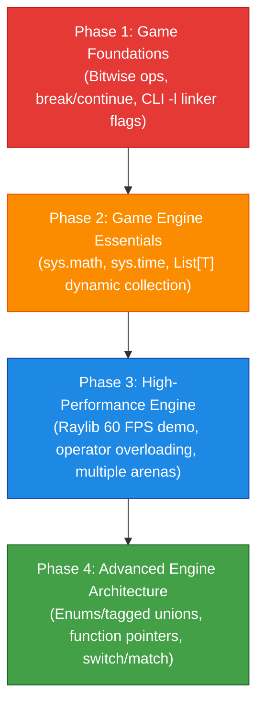

# The Complete Velo Language Gap Analysis (Small to Big) 📋

> **Document Status**: Living Architectural Audit  
> **Target Version**: Velo 2.0+ (Towards Production Systems & Game Engine Viability)  
> **Scope**: An exhaustive, brutally honest breakdown of every single gap, limitation, and missing feature in the Velo programming language—from minor syntax nuances to major compiler subsystems.

---

## Executive Summary & Gap Severity Matrix

Velo is a working, self-hosted, triple-bootstrapped systems programming language that compiles to native machine code via C99. While its core foundation (zone memory, pointers, structs, basic control flow, and multi-file modules) is verified and leak-free, it currently lacks several language features, standard libraries, and compiler controls required to build full-scale desktop applications and modern game engines.

| Severity Level | Focus Area | Impact |
| :--- | :--- | :--- |
| 🔴 **P0: Critical Blockers** | Bitwise ops, `break`/`continue`, custom linker flags (`-l`), slices/dynamic arrays | Blocks building game engines, binary protocols, and real loops |
| 🟠 **P1: Major Language Gaps** | `enum`/tagged unions, `switch`/`match`, math library, multi-arena allocators | Forces cumbersome boilerplate, unsafe type tricks, and prevents DOD/ECS |
| 🟡 **P2: Ergonomic Gaps** | Operator overloading, method syntax, default values, raw strings, block comments | Slows down iteration speed, friction when writing math/vector code |
| 🟢 **P3: Ecosystem & Tooling** | Debug symbols (`-g`), LSP/IDE tooling, package manager, native test runner | Affects developer comfort, discovery, and large-scale collaboration |

---

## 1. Syntax, Lexer & Tokenizer Gaps

### 1.1 Bitwise Operators [COMPLETED] ✅
* **Supported Operators**: Binary `&`, `|`, `^`, `<<`, `>>`, unary `~`, and compound assignments `&=`, `|=`, `^=`, `<<=`, `>>=`.
* **Verified**: Full operator precedence hierarchy in Stage 1 and Stage 2 self-hosted compilers. Verified with `examples/14_bitwise_operators.vl` and `tests/test_bitwise_operators.py`.

### 1.2 Comments & Documentation [COMPLETED] ✅
* **Nested Block Comments**: Arbitrary-depth multi-line comments (`/* ... /* ... */ ... */`) implemented in both Stage 1 and Stage 2 self-hosted lexers with unclosed comment diagnostics.
* **Structured Documentation**: Single-line `///` and block `/** ... */` doc comment recognition for top-level structs, functions, and externs.
* **Native Doc Generator CLI**: Built-in CLI command `velo doc <source.vl> [-o output.md]` extracting clean GitHub-flavored Markdown API reference documentation tables and signatures directly from AST definitions. Verified with `examples/15_docs_and_comments.vl` and `tests/test_docs_and_comments.py`.

### 1.3 Literal Formatting [COMPLETED] ✅
* **Numeric Bases**: Hexadecimal (`0x` / `0X`), binary (`0b` / `0B`), and octal (`0o` / `0O`) literals with full type preservation and C99 emission.
* **Digit Separators**: Underscore digit separators supported in all integer, hex, binary, octal, and floating point literals (e.g. `1_000_000`, `0xFF_AA_BB_CC`, `0b1010_1010`).
* **Scientific Notation**: Full exponent support (`1e-4`, `2.5e6`, `1E3`, `3.14e+2`) in both Stage 1 and Stage 2 self-hosted compilers.
* **Explicit Literal Suffixes**: Explicit integer (`u8`, `u16`, `u32`, `u64`, `usize`, `i8`, `i16`, `i32`, `i64`, `isize`) and float (`f32`, `f64`) suffixes with automatic type inference and C99 suffix mapping (`LL`, `ULL`, `U`, `f`). Verified with `examples/16_literal_formatting.vl` and `tests/test_literal_formatting.py`.

### 1.4 String & Character Escapes [COMPLETED] ✅
* **Raw / Multi-line Strings**: Supported via backticks (`` `...` ``). Preserves literal backslashes, quotes, and newlines across multiple lines without escape decoding. Automatically normalized and formatted into standard C99 string literals.
* **Unicode Escapes (`\uXXXX`)**: Full 4-digit hexadecimal Unicode escape support in standard string and character literals, encoded automatically into compliant UTF-8 multi-byte sequences (`0x00A9` -> `0xC2 0xA9`, `0x2764` -> `0xE2 0x9D 0xA4`).
* **Character Literals & Escapes**: Character literals support standard escapes (`\n`, `\t`, `\r`, `\0`, `\\`, `\'`, `\"`), 2-digit hex escapes (`\xNN`), and 4-digit Unicode escapes (`\uXXXX`), correctly evaluating to their numeric integer values. Verified with `examples/17_string_escapes.vl` and `tests/test_string_escapes.py`.

---

## 2. Control Flow & Language Statements

### 2.1 Loop Controls: `break` and `continue` [COMPLETED] ✅
* **Supported Controls**: Native `break` and `continue` statements in both `while` loops and `loop <var> in <start>..<end>` range loops.
* **Semantics & Code Generation**: Direct mapping to C99 `break;` and `continue;` control flow with correct nested loop scoping and Go-style statement termination. Verified with `examples/18_break_continue.vl` and `tests/test_break_continue.py`.

### 2.2 Branching: `on` Statement [COMPLETED] ✅
* **Signature `on` Keyword**: Velo exclusively standardizes on the punchy, unique 2-letter **`on <expr> { ... }`** keyword tailored for game engines and state dispatching (`match` and `switch` completely eliminated from the language).
* **Multi-Value Patterns**: Matching comma-separated alternative values in a single branch (e.g. `201, 202 => { ... }`).
* **Default & Wildcard Fallbacks**: Clean fallback handling supporting `else => { ... }` and wildcard `_ => { ... }`.
* **Block and Single-Statement Arms**: Supports curly-brace scoped code blocks `{ ... }` as well as concise single-statement arm bodies (e.g. `1 => action = "jump"`).
* **High-Performance C99 Jump Tables**: Emits native scoped C99 `switch (...) { case ...: { ... break; } default: { ... break; } }` blocks enabling $O(1)$ constant-time jump table optimizations by C compilers without accidental fallthrough. Verified with `examples/19_match_switch.vl` and `tests/test_match_switch.py`.

### 2.3 Range Loop Flexibility [COMPLETED] 🛡️
* **Unified Loop Syntax**: Consolidated all loops (`while`, `loop .. in`, `repeat`, `infinite`) into a single expressive `loop` keyword.
* **Custom Step Increments**: Slicing syntax `loop i in 0..10:2` for forward custom steps.
* **Smart Auto-Countdown**: When $start > end$ (`loop 5..0`), loops automatically decrement by `-1` without needing `:-1`. Custom decrement steps like `loop 10..0:2` also supported.
* **Inclusive & Exclusive Ranges**: Supports both half-open ranges `0..10` and fully inclusive ranges `0..=10` via `..=` operator.
* **Implicit Variable**: Anonymous ranges (`loop 0..10:2`), repeat loops (`loop 5`), condition loops (`loop cond`), and infinite loops (`loop`) automatically provide the `it` iteration counter starting at 0.
* **Retirement of `while`**: Retired `while` keyword across the entire language, compiler, test suite, and examples. Verified with `examples/20_range_loops.vl` and `tests/test_range_loops.py`.

---

## 3. Type System & Data Modeling

### 3.1 First-Class Enums & Tagged Unions (`kind`) [COMPLETED] ✅
* **Unified 4-Letter Keyword**: Velo standardizes on `kind` (harmonizing with `data`, `act`, `zone`, `loop`).
* **Pure Scalar Enums**: Unit variants (`North`, `East`) and explicit discriminants (`Ok = 200`, `NotFound = 404`) with zero runtime overhead, lowering directly to C99 `int32_t` scalars.
* **Payload-Bearing Tagged Unions**: Supports single-payload variants (`KeyDown: i32`) and multi-field payloads (`Click(button: i32, x: f32, y: f32)`), lowering to C99 `struct { int32_t kind; union { ... } as; }`.
* **Contextual Dot-Shorthand**: `let d: Direction = .North`, `let e: Event = .KeyDown(65)`, `let c: Event = .Click(1, 10.0, 20.0)` whenever target type is known; fully-qualified `Direction.North` always valid.
* **Pattern Matching Destructuring (`on`)**: Directly match with `on e { .KeyDown(key) => ..., .Click(btn, x, y) => ... }` with automatic payload variable bindings scoped to each arm. Verified with `examples/21_enums_and_unions.vl` and `tests/test_enums_and_unions.py`.

### 3.2 Generics / Parametric Polymorphism [COMPLETED] ✅
* **Syntax Choice**: Proposal A (`[T]`): `data Box[T]`, `kind Option[T]`, `act min[T]`, `act swap[T](a: @T, b: @T)`, multi-param `data Pair[K, V]`.
* **Zero-Cost C99 Monomorphization**: AST specialization pass monomorphizes generic structs, kinds, and functions on demand into concrete C99 types (`Box_i32`, `Option_string`, `min_i32`, `Pair_string_i32`) with zero virtual dispatch or boxing overhead.
* **Call-Site Type Inference**: Functions can be invoked directly as `min(15, 25)` without type arguments, inferring type arguments from parameters; explicit instantiation `min[f32](3.14, 2.71)` also supported.
* **Pointer & Struct Specialization**: Pointer types like `@T` cleanly unify and specialize (e.g. `swap[i32](@x, @y)`).
* **Self-Hosted Monomorphizer**: Fully integrated into both Python (`velo/monomorphize.py`) and self-hosted Stage 2 compiler (`src/analysis/monomorphize.vl`). Verified with `examples/22_generics.vl` and `tests/test_generics.py`.

### 3.3 Function Pointers & First-Class Callbacks [COMPLETED] ✅
* **Native `act(...) -> Ret` Syntax**: First-class function type signature harmonizing with Velo's `act` keyword (e.g. `act(i32, i32) -> i32`, `act(@Button) -> void`, `act() -> void`).
* **Variable Storage & Higher-Order Functions**: Storing named functions in variables (`let op: act(i32, i32) -> i32 = add`), passing callbacks to higher-order functions (`apply_binary(7, 8, op)`).
* **Struct Function Pointer Fields (Callbacks & Vtables)**: Storing function pointers in struct data fields (e.g. `data Button { on_click: act(@Button) -> void }`).
* **Direct Execution & Null Safety**: Calling function pointers directly via variable (`op(10, 20)`) or member access (`btn.on_click(@btn)`). Full null check compatibility (`if btn.on_click != null { btn.on_click(@btn) }`).
* **Inline Anonymous Functions**: Anonymous callbacks with parameter inference and block bodies: `act(b: @Button) { ... }`, `act(x: i32, y: i32) -> i32 { return x - y }`.
* **C99 Function Pointer Typedef Lowering**: Zero-overhead function pointer typedefs (`typedef int32_t (*velo_act_i32_i32_to_i32)(int32_t, int32_t);`), with anonymous functions lifted to `static` C functions with forward prototypes. Verified across Stage 1 Python compiler and Stage 2 self-hosted native compiler with `examples/23_function_pointers.vl` and `tests/test_function_pointers.py`.

### 3.4 Method Syntax / Uniform Function Call Syntax (UFCS) [COMPLETED] ✅
* **Pure UFCS Without OOP Keywords**: Any free function `act foo(self: T, ...)` or `act foo(self: @T, ...)` can be invoked using method call syntax: `x.foo(...)`. No `class`, `struct impl`, or OOP ceremony required.
* **Smart Auto-Referencing & Auto-Dereferencing**:
  - If a function expects a pointer `@T` and the receiver is a value lvalue of type `T`, the compiler automatically passes its address (`&x`).
  - If a function expects a value `T` and the receiver is a pointer `@T`, the compiler automatically dereferences the pointer (`*x`).
  - If the receiver type matches the first parameter type directly, it is passed directly without modification.
* **Struct Field Priority**: Struct fields (such as callback function pointers `btn.on_click(...)`) always take priority over free functions with the same name, preserving callback and vtable mechanics.
* **Method Chaining & Extensibility**: Supports fluent chaining (e.g. `p.translate(1.0, 2.0).scale(2.0)`) and extension methods on both structs and primitive types (e.g. `7.square()`).
* **Generic Method Specialization**: Works seamlessly with generic functions and data types (e.g. `box.unwrap()`), inferring type arguments from the receiver and arguments. Verified across Stage 1 Python compiler and Stage 2 self-hosted native compiler with `examples/24_ufcs_methods.vl` and `tests/test_ufcs_methods.py`.

### 3.5 Operator Overloading for Game Math [COMPLETED] ✅
* **Signature `act op <symbol>` Syntax**: Clean 2-letter `op` prefix aligning with Velo's keyword philosophy (`on`, `in`, `as`, `op`). Supports both `act op +(...)` and `act op+(...)`.
* **Disambiguation by Parameter Count**: Single-parameter declarations define unary operators (e.g. `act op -(v: Vector2)` for negation); two-parameter declarations define binary operators (e.g. `+`, `-`, `*`, `/`, `%`, `==`, `!=`, `<`, `<=`, `>`, `>=`).
* **Zero Runtime Overhead & C99 Name Mangling**: Deterministic C function identifier mangling based on operator name and operand types (`velo_op_add_Vector2_Vector2`, `velo_op_mul_Vector2_f32`, `velo_op_neg_Vector2`).
* **Automatic Compound Assignment**: Statements like `pos += vel` and `pos *= 2.0` automatically desugar into `pos = pos + vel` and `pos = pos * 2.0`, executing overloaded operators without duplicate boilerplate.
* **Smart Auto-Referencing / Auto-Dereferencing**: Functions expecting pointer parameters `@Vector2` automatically receive `&v` when invoked with value lvalues.
* **Bit-for-Bit Triple-Bootstrap Determinism**: Verified with `examples/25_operator_overloading.vl` and `tests/test_operator_overloading.py` across Python reference compiler and Stage 2 self-hosted native compiler.

### 3.6 Advanced Struct Features (🟡 P2 Ergonomic)
* **Default Field Initializers**: [COMPLETED] ✅ — *"Cannot declare `data Point { x: f32 = 0.0, y: f32 = 0.0 }`"* (Former Defect).
  - **Fix Applied**: Constant-literal defaults (int / float / string / bool, optional unary `-`) parsed in both compilers; struct literals fill omitted defaulted fields via C99 designated initializers appended after the provided ones; omitted fields without a default are now a compile error in both compilers (Python Stage 1 codegen validation, Stage 2 self-hosted semantic checker). Defaults are carried into every generic specialization.
  - **Verification**: `examples/26_advanced_structs.vl` + `tests/test_advanced_structs.py` (Stage 1 CLI run/emit-c assertions and native `bin/velo.exe` run).
* **Struct Packing & Alignment**: [COMPLETED] ✅ — *"No `#align(16)` / `#packed` directives"* (Former Defect).
  - **Fix Applied**: `data Name #align(N) #packed { ... }` parsed after name/type parameters in both compilers; emitted as `struct __attribute__((aligned(N), packed)) Name { ... };` on the definition only (forward typedefs untouched). Attributes survive generic instantiation.
  - **Verification**: Emitted C asserted in `tests/test_advanced_structs.py` for both compilers; native run compiles the attributes with GCC.
  - **Residual Limitation**: Attribute support is GCC/Clang-shaped (`__attribute__`); MSVC layouts would need a separate pragma mapping.
* **Type Aliases**: [COMPLETED] ✅ — *"No `type EntityId = u64`"* (Former Defect).
  - **Fix Applied**: `aka Name = <primitive|@primitive>` as a contextual keyword at top level only; target validated at parse time (no alias-of-alias). Both monomorphizers gained an always-running Pass 0 that canonicalizes alias names in every type string (fields, kind payloads, params/returns, locals, casts) order-free across the whole merged program, so aliases work even in programs without generics; codegen emits a decorative `typedef`.
  - **Verification**: Same example + test file; triple-bootstrap determinism re-verified (Gen2 vs Gen3 emit-c SHA-256 identical).
  - **Residual Limitation**: Aliases are primitive-only by design; alias declarations are not yet listed by `velo doc`, and `VELO.md` sync is owner material. The missing-field diagnostic wording differs slightly between the two compilers (both reject with the same exit behavior). Default-initializer values are not type-checked against their field type (constant-literal defaults only).

---

## 4. Memory Management & Hardware Access

### 4.1 Extensible Allocator Architecture [COMPLETED] ✅
* **Former Defect (Incomplete Architecture)**: The memory subsystem had the arena infrastructure (`VeloZoneArena`, `zone <bytes> { }` scoped blocks, a reuse pool of up to 32 arenas) but lacked the language-level `@Allocator` interface — functions could not receive an arena handle as a parameter, meaning every allocation always targeted the implicit thread-global active arena.
* **Fix Applied**:
  - **Runtime** (`velo/runtime/velo_runtime.h`): Added `typedef VeloZoneArena* VeloAllocator`, `velo_alloc_with(a, size, count)` (bump-allocates into an explicit arena handle), and `velo_alloc_used(a)` (reads its watermark).
  - **Language surface**: `@Allocator` is now a recognized Velo type (maps to `VeloZoneArena*` in C). Two new builtin intrinsics: `mem.current()` (captures the currently-active arena as a passable `@Allocator`) and `mem.alloc_with(a, @T, n)` (allocates `n` elements of `T` into arena `a`).
  - **Stage 1** (`velo/codegen_c.py`): `TYPE_MAP` extended with `"Allocator": "VeloZoneArena"`. `_emit_expression`, `_infer_raw_velo_type`, and `_resolve_expr_type` handle the two new intrinsics.
  - **Stage 2** (`src/backend/codegen_types.vl`, `src/backend/codegen_expr.vl`, `src/analysis/type_checker.vl`): `map_type_to_c` maps `Allocator → VeloZoneArena`; `infer_expr_type` returns `@Allocator` / `@T`; `emit_c_expr` emits the correct C for both new intrinsics. `is_known_type` accepts `Allocator`.
  - **Tests** (`tests/test_allocators.py`): 3 new parity tests — `test_allocator_passable_handle` (pass allocator to a function), `test_allocator_stored_in_struct` (store in a `data` field), `test_allocator_oom_is_fatal` (alloc_with into exhausted arena aborts with a legible error). All pass on both Stage 1 and Stage 2.
  - **Example** (`examples/28_allocator_interface.vl`): end-to-end demo including a `Pool` struct holding an `@Allocator`.
* **Residual Limitation**: `@Allocator` is a raw arena pointer (single bump-allocator strategy). Pluggable vtable-based allocators (heap, pool, slab) are not yet supported — `mem.heap_alloc` has no passable handle form. Handles are lifetime-untracked: using one after its `zone <bytes> { }` block exits is silent UB (no detection in either stage). `velo_alloc_used` exists in the runtime only — no language intrinsic reads a non-active arena's watermark. Active-arena state became per-thread in §4.2, but passing one `@Allocator` handle across threads is still unsynchronized by design.
* **Verification**: Triple-bootstrap chain rebuilt (Gen1 → Gen2 → Gen3, `bin/velo.exe` updated); SHA-256 fixed-point preserved (Gen2 ≡ Gen3 bit-for-bit). Full suite: **120/120 passing**.

### 4.2 Multithreaded Memory Safety [COMPLETED] ✅
* **Former Defect (Shared Arena State)**: The 32 MB default arena, the active-arena pointer (`g_velo_zone_active`) and the 32-slot private-arena reuse pool were process-global, unsynchronized C statics. Two threads calling `mem.alloc(...)` concurrently would corrupt each other's bump watermarks immediately, and `zone <bytes> { }` re-entries raced on one shared pool.
* **Fix Applied** (`velo/runtime/velo_runtime.h`, mirrored in both emitters):
  - Compiler-shim macro `VELO_TLS` (`__thread` for GCC/Clang, `__declspec(thread)` for MSVC) — both compilers emit C compiled with `-std=c99`, where the C11 keyword `_Thread_local` is unavailable, so the keyword path had to be shimmed at runtime level.
  - Zone state is now thread-local and lazily initialized per thread: its own 32 MB heap-backed default arena, its own active pointer, and its own reuse pool. All entry points (`velo_zone_push/pop`, `velo_zone_enter/leave`, `velo_mem_alloc`, `velo_mem_used`) read state through the single accessor `velo_zone_active()`, so concurrent threads bump independent watermarks and the pools cannot race.
  - Both emitters now emit that accessor for `mem.current()` — `velo/codegen_c.py` and `src/backend/codegen_expr.vl` were the only two call sites touching raw runtime state. `velo_runtime.h` remains thread-API-agnostic (no pthread/Win32 threads inside).
  - Single-threaded semantics are unchanged: first touch lazily creates the default arena with watermark 0, all OOM/fatal messages are byte-identical, `zone { }` / `zone <bytes> { }` behavior verified by the existing 4.1 test suite.
  - Test (`tests/test_thread_local_runtime.py`): a C harness compiled against the runtime header by the same GCC the drivers use, spawning 8 winpthreads that execute 300 iterations of `velo_zone_enter → alloc → write/readback → pop → leave` concurrently. Asserts: threads start with fresh (unused) default arenas, data written into a thread's arena is never clobbered, each thread's `mem.current()` handle is distinct across all threads, and the active pointer is restored exactly after block exit.
* **Verification**: Full suite **121/121** (120 prior + new threaded runtime test); triple-bootstrap chain rebuilt (Gen1 → Gen2 → Gen3), Gen2 ≡ Gen3 emit-c SHA-256 (`f7d12365…`); all compiler sources within the 400-line limit.
* **Residual Limitation**: Velo has no language-level thread-spawn surface yet (`thread.spawn(fn)` is feasible — act function-pointer values exist — but needs lifecycle/join/sync design first). Multi-threading today is reachable only from hand-written C: a Velo build links a single generated C file and the runtime ships no spawn/join helper, so a Velo program cannot create threads at all. Each thread's lazily-created 32 MB default arena is never freed at thread exit (no TLS destructors used) — exited threads leave their arena to process-exit reclamation, a virtual-reservation leak worth revisiting when the spawn surface lands. Program-level `global let/mut` variables compile to unsynchronized C statics: safe today only because no in-language thread can touch them. Sharing an `@Allocator` handle across threads still races by design (bump watermark is not synchronized; documented in the runtime header) — do not pass handles between threads until an atomic/locked variant exists. `g_velo_heap_active` remains a coarse global diagnostic counter (torn increments can skew `mem.heap_used()` only; no corruption — `malloc`/`free` themselves are thread-safe).

### 4.3 Low-Level Memory Intrinsics (🔴 P0 Critical)
* **Missing Primitives**:
  - `mem.copy(dest: @u8, src: @u8, count: usize)` (C `memcpy`).
  - `mem.set(dest: @u8, val: u8, count: usize)` (C `memset`).
  - `mem.move(...)` (C `memmove`).
  - `mem.realloc(...)` (Resizing persistent heap buffers).
* Currently, copying an array requires a manual Velo `while` loop indexing byte-by-byte.

---

## 5. Standard Library Gaps (`sys.*` and `std.*`)

Velo currently has a bare-minimum runtime (`velo_runtime.h`). To be a viable development language, the following libraries are missing:

### 5.1 String Processing Library (🔴 P0 Critical)
* Strings are currently raw C `const char*` with only `str.len(...)`.
* **Missing String Functions**:
  - `str.contains(s, sub)`
  - `str.starts_with(s, prefix)` / `str.ends_with(s, suffix)`
  - `str.split(s, delimiter)`
  - `str.trim(s)`
  - `str.replace(s, old, new)`
  - `str.to_upper(s)` / `str.to_lower(s)`
  - `str.index_of(s, char)`
  - `str.concat(a, b)`

### 5.2 Dynamic Collections (🔴 P0 Critical)
* No dynamic array (`List[T]` or `Vector[T]`).
* No hash map (`Map[K, V]` or `Dict[K, V]`).
* No ring buffer / circular queue.
* No bitset (critical for ECS component masks).

### 5.3 Math Library (`sys.math`) (🟠 P1 Major)
* There is no math standard library!
* **Missing Functions**:
  - Trigonometry: `sin`, `cos`, `tan`, `atan2`, `acos`, `asin`.
  - Exponential: `sqrt`, `cbrt`, `pow`, `exp`, `log`, `log2`.
  - Utility: `abs`, `min`, `max`, `floor`, `ceil`, `round`, `clamp`, `lerp`.
  - Constants: `PI`, `TAU`, `RAD2DEG`, `DEG2RAD`.

### 5.4 Extended File System & OS Primitives (`sys.fs`, `sys.os`) (🟠 P1 Major)
* **`sys.fs` Missing**:
  - `fs.read_dir(path)` (directory scanning).
  - `fs.create_dir(path)` / `fs.create_dir_all(path)`.
  - `fs.is_dir(path)` vs `fs.is_file(path)`.
  - `fs.copy(src, dst)` / `fs.rename(src, dst)`.
  - File streaming: `fopen`, `fread`, `fwrite`, `fseek` (currently only entire file read/write).
* **`sys.os` Missing**:
  - `os.get_env(key)` / `os.set_env(key, val)`.
  - `os.args()` (CLI argument access outside of `main(argc, argv)`).
  - `os.exit(code)` (immediate exit with status code).

### 5.5 High-Resolution Clock & Timing (`sys.time`) (🟠 P1 Major)
* No high-resolution timer (`time.now()`, `time.delta()`, `time.sleep_ms()`).
* In games, calculating `dt` (delta time) requires high-resolution performance counters (`QueryPerformanceCounter` on Windows, `clock_gettime` on Linux).

---

## 6. Compiler, Tooling & Build System Gaps

### 6.1 Linker Flags for Third-Party C Libraries (🔴 P0 Critical)
* **Current State**: `bin/velo.exe` hardcodes `gcc -O2 <c_file> -o <binary>`.
* **Impact**: You cannot link external libraries such as **Raylib, SDL2, OpenGL, Vulkan, Box2D, or SQLite** without manually running GCC in the terminal.
* **Needed Solution**:
  - `velo build main.vl -o game.exe -lraylib -lopengl32 -lgdi32 -lwinmm`
  - Or `#link "raylib"` / `#link "opengl32"` pragma in source code.

### 6.2 Optimization Flags & Build Modes (🟠 P1 Major)
* **Current State**: Always compiles with `-O2`.
* **Missing Modes**:
  - `velo build --debug` (emits `-O0 -g` with full debug symbols).
  - `velo build --release` (emits `-O3 -flto` with link-time optimization).

### 6.3 Diagnostic Formatting & Error Visuals (🟡 P2 Ergonomic)
* Current errors print: `[Velo Error] semantic:line:col - message`.
* Modern compilers (Clang, Rust, Zig) print colorized source code snippets with arrows pointing to the exact token:
  ```text
  examples/02_math_and_logic.vl:29:14: error: undeclared identifier 'foo'
     29 |     let x = foo + 10;
        |             ^^^
  ```

### 6.4 Developer Tooling: Language Server Protocol (LSP) (🟢 P3 Ecosystem)
* A declarative VS Code extension (TextMate grammar + snippets + language configuration)
  exists as local owner material (`editors/vscode/`), untracked and unpublished. It colors
  text but cannot report any compiler diagnostic.
* No LSP server providing autocomplete, jump-to-definition, hover documentation, or red
  squiggly error diagnostics in the editor. The enabling step is a `velo check [--json]`
  diagnostics-only CLI covering both compilers (see `editors/vscode/ROADMAP.md`, Phases 2–3);
  grammar currently misses `aka`, `#align`/`#packed`, and `op` (extension Phases 0).

### 6.5 Native Integrated Test Runner (🟢 P3 Ecosystem)
* Currently, tests are driven via Python `pytest` and subprocess invocations.
* Velo lacks an in-language test primitive:
  ```velo
  test "vector addition" {
      let v = Vec2{ x: 1.0, y: 2.0 }
      assert(v.x == 1.0)
  }
  ```
  and a `velo test` CLI subcommand.

### 6.6 Lexer Token Buffer Sizing & Overflow Diagnostics [COMPLETED] ✅
* **Former Defect (Silent Compiler Corruption)**: The self-hosted lexer (`src/frontend/lexer.vl`) used a hardcoded **8,192-token** capacity, and `add_token` **silently discarded** tokens beyond it. Any valid file past the cap (~2,000+ statements; large real-world or generated modules) produced a truncated token stream, derailing the parser into a runaway allocation loop that crashed with a **misleading `Zone Arena Out of Memory` fatal error** — the message blamed memory while the actual cause was lexer truncation. Notably masked because the compiler's own corpus obeys the `<= 400 lines/file` standard and never crossed the cap.
* **Fix Applied**: `src/backend/driver.vl` now sizes the token buffer from the source at both `create_lexer` call sites (compilation and docgen): `create_lexer(source, slen, slen + 2)` — provably sufficient since a token can never consume less than one source character. The lexer records overflow in the new `Lexer.dropped_count` field (explicitly zero-initialized, as arena memory is reused across files), and the driver emits a real diagnostic — `[Velo Error] <file>: lexer token buffer too small; N tokens were truncated. Split this file into smaller modules.` — failing the build/notably the docgen cleanly instead of emitting garbage.
* **Residual Limitation**: Very large single files (~0.5 MB+ of source) still exhaust the fixed 16 MB global arena with a loud (honest) allocation failure; proper resolution belongs to the multi-arena allocator work in §4.1.
* **Verification**: Triple-bootstrap chain rebuilt (Gen1 → Gen2 → Gen3, `bin/velo.exe` updated); SHA-256 fixed point preserved (Gen2 ≡ Gen3 bit-for-bit). New regression suite `tests/test_lexer_capacity.py` covers (1) a 23,921-token file that previously phantom-OOM'd now compiling and executing correctly, and (2) the truncation diagnostic firing with a correct truncated count on a tiny-cap test build. Full suite: **85/85 passing** (was 83).

### 6.7 Machine-Readable Diagnostics CLI (`velo check`) [COMPLETED] ✅
* **Former Limitation (Unstructured-Only Diagnostics)**: The only compiler failure surface was human-format stdout with no machine-readable mode — editors and tools could not consume diagnostics reliably, and the VS Code extension roadmap (Phase 2 keystone) had no stable contract to build on. `velo run`/`build` output mixes confirmation lines, recoverable parser cascades, and stage summaries in prose.
* **Fix Applied**: Both compilers implement `velo check <file> [--json]` — full validation pipeline (lex → parse → semantic analysis → monomorphization) with **no code generation and no execution**; exit 0 when clean, 1 when any diagnostic was reported; JSON schema `{file, ok, diagnostics:[{file, line, col, severity, message}]}` (1-based positions, `0/0` = unpositioned, documented in `docs/SPECIFICATION.md` §9/§9.1). Stage 1 extracts structured exceptions directly (`CompilerDriver.check` over `LexerError`/`ParserError` tokens and semantic ValueErrors). Stage 2's lack of module-level state (no in-core diagnostics buffer without threading collector state through every parser/checker signature) is closed by **fd-1 capture**: new runtime helpers `velo_capture_begin/end` (`velo/runtime/velo_runtime.h`, `_dup/_dup2/_fileno` with Windows + POSIX shims, uniquely-named `velo_*` symbols to avoid libc header collisions) capture the existing pretty error stream into a temp file, and `src/backend/check.vl` re-emits each captured line as a JSON diagnostic, folding recovered parse errors into the verdict (compiler's own success AND a captured error-line scan). Surfaced and closed in the same change: the Stage 2 semantic checker never whitelisted `fs.remove_file` although its own codegen emitter explicitly supported that name — `check.vl` uses it, so `type_checker.vl` now accepts it (parity with Stage 1's unchecked module calls). Nice CLI details: checker pseudo-filenames (`semantic`) are attributed to the checked file; `[Velo Warning]` lines map to `severity: "warning"` and keep `ok: true`; the `Semantic analysis failed with N errors.` summary is skipped (its constituent diagnostics are already listed).
* **Residual Limitations**: (1) *Collection policy differs* — Stage 1 fails fast at the first lex/parse error (typically 1 diagnostic) while Stage 2 collects many; parsing of a file with recoverable errors therefore yields different counts per compiler. (2) *Message wording differs* (historical per-compiler strings, e.g. `Source file not found:` vs `Source file does not exist:`; native missing-field diagnostics are positioned while Stage 1 semantic `ValueError`s carry no position today). (3) *Severity taxonomy divergence*: duplicate type aliases are a Stage 2 **warning** (`ok: true`) but a Stage 1 **error** (`ok: false`). (4) The JSON re-shapes the pretty stream on Stage 2; per-file attribution stays weak for multi-file programs (imported files' parse diagnostics carry their canonicalized path, checker diagnostics attribute to the checked file). (5) Stage 2 capture writes `velo_check_capture.tmp` into the CWD (`fs` module has no mkdir). (6) Newly discovered pre-existing defects recorded, not fixed here: calls inside string interpolation are emitted untranslated on the native side; `argv[0]` indexing produces garbage values (both block self-locating designs and remain open for the codegen backlog). (7) Stage 1 `ok` costs one discarded C-string generation (~microseconds at editor scale) rather than restructuring the pipeline — deliberate, no behavior change. (8) *Stage 2 codegen defect found by this feature (worked around, fix owed in codegen)*: `expr != null` where `expr` is a **function call** is expanded into a null-guarded ternary that re-evaluates the call — side effects run twice (`compile_source_to_c(...) != null` executed the pipeline twice and duplicated captured diagnostics; visible only under capture). Variables (`x != null`) are unaffected; the house idiom "bind the call to a local, then compare" is now used by `check.vl` and must be followed until the emitter emits single-evaluation null comparisons. (9) *Statement-level semantic divergence found by the Tier B LSP work*: statements that parse cleanly on both compilers diverge at the gate — Stage 1's semantic validation (CCodeGenerator-based) accepts an indented `pickle = definitely_not_a_decl` (assignment to an undeclared identifier) inside an act body (`ok: true`) while Stage 2's checker reports two `Undeclared identifier` errors (`ok: false`); bare two-identifier lines behave the same way. Exit codes diverge on such inputs. Fix decision owed: define the correct semantics (reject in both) and align Stage 1's checker. (10) *`use sys.str` loader divergence found by the Phase 4 extension parity work*: `str` calls are ambient on both stages (`str.len(s)` compiles with no `use` at all), but the module-root statement `use sys.str` compiles with Stage 1 (`ok: true` — the driver skips every `sys.*` import) while Stage 2's loader rejects it as a missing file (`Source file does not exist: <dir>/sys.str`). The builtin-module use namespace is therefore `{io, mem, fs}` on both stages, with `sys.str` a Stage-1-only no-op. Editor consequence closed in the same change: the extension grammar's `sys.(io|mem|fs)` use-root rule already encodes the both-stage truth, and the LSP analyzer's completion module roots now offer exactly `sys.io|sys.mem|sys.fs` (never `sys.str` as a `use` root — `str.*` remains a valid member-call surface). Compiler fix owed: either teach Stage 2's loader to accept builtin-module imports uniformly or gate Stage 1's `use sys.*` to the real modules.
* **Verification**: New suite `tests/test_check_cli.py` — 15 tests over both compilers: JSON schema conformance, exit codes, clean/parse-broken/semantic-broken/missing-file/warning paths, pretty mode, and **cross-compiler position parity** (first parse diagnostic lands on the identical line/col in both). Full suite: **107/107 passing** (was 92). Triple-bootstrap chain rebuilt (Gen1→Gen2→Gen3, `bin/velo.exe` updated); SHA-256 fixed point preserved (Gen2 ≡ Gen3 bit-for-bit); all compiler sources within the ≤400 line/file standard.

### 6.8 Parser: Reserved Keywords as Contextual Identifiers [COMPLETED] ✅
* **Former Defect (Keyword/Identifier Collision)**: The reserved keyword `data` (`TokenType.DATA` / `TOK_DATA`) could not be used as a variable name in either the Stage 1 Python parser or the Stage 2 self-hosted parser. Programs using `let data: @u8 = ...` or `mut data = ...` failed with `Expected variable name after 'let'` / `Expected variable name after 'mut'`. This blocked idiomatic naming — `data`, `kind`, and `op` are all English words as natural as `i` or `buf`.
* **Fix Applied**: Both parsers' identifier-acceptance functions now treat `TOK_DATA` / `TokenType.DATA` as contextually valid in name positions:
  - Stage 1 (`velo/parser.py`): `_check(TokenType.IDENTIFIER)` extended to match `DATA` tokens alongside `IDENTIFIER`, `KIND`, `OP`.
  - Stage 2 (`src/frontend/parser.vl`): `parser_check(p, TOK_IDENTIFIER)` extended to match `TOK_DATA` tokens alongside `TOK_KIND`, `TOK_OP`.
* **Semantic Correction**: `test_zone_inside_generic_function` was using `let bump: usize = ...` followed by `bump = bump + 0` — an assignment to an immutable binding (`let` = const in C). Corrected to `mut bump: usize = ...` (the test intent was always a mutable accumulator). Using `let` for mutable bindings was a test authoring error; Velo semantics (`let` = immutable, `mut` = mutable) remain unchanged.
* **Residual Limitation**: Other reserved keywords (`use`, `act`, `loop`, `zone`, `defer`, `return`, `break`, `continue`, `on`, `extern`, `aka`) are not yet contextually re-accepted as variable names and will still produce parser errors if used as identifiers. These rarely conflict in practice.
* **Verification**: Triple-bootstrap chain rebuilt (Gen1 → Gen2 → Gen3, `bin/velo.exe` updated); SHA-256 fixed point preserved (Gen2 ≡ Gen3 bit-for-bit). Full suite: **117/117 passing** (was 115).

---

## 7. Game Engine Specific Technical Gaps

| Engine Subsystem | Missing Velo Feature | Workaround Today |
| :--- | :--- | :--- |
| **Windowing & Input** | No C library linking flag in CLI | Manually invoke GCC with `-lraylib` / `-lSDL2` |
| **Math & Physics** | No Operator Overloading (`+`, `*`) | Must write `vec3_add(a, b)` |
| **Physics / Collision** | No Bitwise Operators (`&`, `|`, `^`) | Must use integer arithmetic or avoid bitmasks |
| **Asset Loading** | No streaming file seek (`fseek`) | Must load entire audio/texture files into RAM at once |
| **Frame Allocations** | Single fixed 16MB buffer | Good for small demos, but overflows on 4K meshes |
| **Animation / Events** | No Function Pointers / Callbacks | Must use integer action IDs and `if/else` ladders |
| **Entity Component System (ECS)** | No Generics or Struct Reflection | Must write hardcoded component arrays |
| **SIMD Math** | No 128-bit / 256-bit SIMD intrinsics | Relies purely on GCC autovectorization |

---

## 8. Prioritized Strategic Roadmap to Game Readiness



### Phase 1: Game Foundations (The "Make a Window" Milestone)
1. **Bitwise Operators**: Implement `&`, `|`, `^`, `~`, `<<`, `>>` in lexer, parser, semantics, and C codegen.
2. **Loop Controls**: Implement `break` and `continue` in `while` and `loop`.
3. **Linker Flag Passing**: Add `-l<lib>` and `-L<dir>` support to `velo build` and `velo run`.
4. **Validation**: Write an `extern` Raylib script that opens a window, captures keyboard input, and draws a rectangle at 60 FPS.

### Phase 2: Engine Essentials (The "Playable Gameplay" Milestone)
1. **`sys.math`**: Implement trigonometry, square root, powers, min/max, clamp, and lerp.
2. **`sys.time`**: Implement microsecond-accurate delta time calculation (`time.now()`).
3. **`mem.copy` / `mem.set`**: Native memory byte-block manipulation.
4. **Dynamic Array**: A standard resizable buffer library for managing game entities.

### Phase 3: Ergonomics & Scaling (The "Clean Code" Milestone)
1. **Operator Overloading**: Enable `+`, `-`, `*` on custom structs for vector and matrix math.
2. **Multiple Zone Arenas**: Parameterized arenas instead of a single global 16MB buffer.
3. **Enums & `switch`**: Clean state machines and event dispatching.
