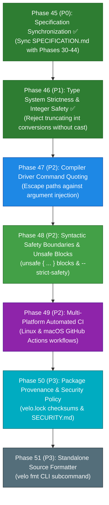
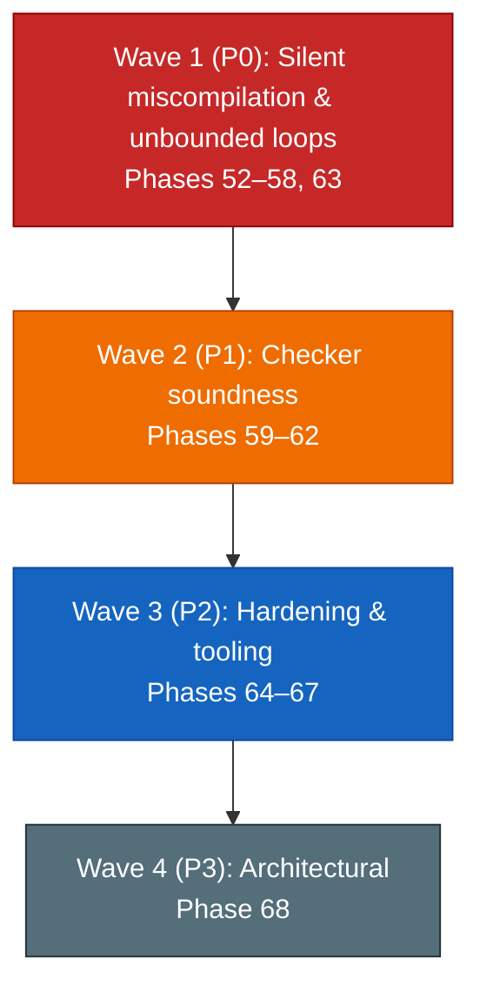

# The Velo Language Gap Analysis & Phased Engineering Roadmap 📋

> **Document Status**: Active Phased Roadmap & Open Engineering Backlog  
> **Target Version**: Velo 2.0+ (Production Systems & Game Engine Viability)  
> **Source Baseline**: Programming Language Review Report `PLR-VELO-2026-001` (Commit `49b2010`)  
> **Archive**: All completed historical gap audits (§1.1 through §44.1) are preserved in Git history.  
> **Workflow Rule**: An AI agent or engineer MUST implement **one single Task at a time** from **one single Phase**. Every task starts with a failing regression test and ends with targeted tests green. Compiler-source tasks additionally require a Gen2/Gen3 bootstrap rebuild and SHA-256 determinism check. A phase is closed only after the full suite passes and this document is updated.

---

## 1. Summary of Completed Milestones

All foundational milestones and language extensions implemented prior to Review `PLR-VELO-2026-001` are **100% completed, self-hosted, and passing all 636 regression tests**:

| Milestone Range | Scope & Capabilities Delivered | Status |
| :--- | :--- | :---: |
| **Foundational Milestones (§1 – §6)** | Bitwise ops, control flow, `kind` enums/tagged unions, generics, function pointers, UFCS, operator overloading, advanced structs, zone arena, collections (`shelf`, `map`, `ring`, `bitset`, `dyn`), math, fs, time, build modes, visual error diagnostics, LSP 3.17, native test runner, MSVC C99 portability. | **COMPLETED** ✅ |
| **Standard Library Modernization (Phases 1 – 29)** | Pure-Velo `std.*` migration (`io`, `str`, `fmt`, `coll`, `fs`, `json`, `time`, `math`, `os`, `net`, `crypto`, `http`, `log`, `test`, `encoding`, `csv`, `cli`, `url`, `rand`, `uuid`, `text`, `timer`, `validate`). | **COMPLETED** ✅ |
| **Language & Systems Hardening (Phases 30 – 44)** | Codegen error gating, algebraic error handling (`or` / `fail`), lexical zone escape analysis, compile-time null safety (`?T`), non-blocking async event loop (`std.async`), async HTTP client/server, zero-alloc HTTP server fast-path, flow-sensitive type narrowing, first-class `if-else` expressions, string pattern matching in `on`, string `+`/`+=` concatenation, fixed-size stack arrays (`[N]T`), and first-class tuples with multiple return values (`-> (A, B)`). | **COMPLETED** ✅ |
| **Post-Release Correctness Audit (Phases 52 – 68)** | 17 confirmed defects across the compiler, language semantics, runtime, tooling, and test infrastructure, split into small, independently testable tasks. | **OPEN** 🚧 |

*(Full historical defect analyses, fix implementations, and verification proofs for Phases 1 through 44 are preserved in Git history).*

---

## 2. Active Phased Engineering Roadmap (Gaps from Review `PLR-VELO-2026-001`)

The following roadmap comprises strictly the open gaps and findings identified during the independent engineering review of Velo v2.0-beta.



> **Post-release audit:** Phases 52–68 are tracked separately in **§3** below. They are correctness defects found after the 45–51 roadmap closed, not part of the completed milestone set.

---

### Phase 45: Language Specification Synchronization & Contract Hardening (`PLR-VELO-001`) [COMPLETED] ✅

#### Task 45.1: Specification Modernization for Post-Phase 30 Features [COMPLETED] ✅
* **Former Defect**:
  - `docs/SPECIFICATION.md` covered only Stage 1 and early Stage 2 features up to §2.9 and §9.
  - Major language capabilities implemented and verified across Phases 30 through 44 were absent from the formal specification:
    1. Fixed-size stack arrays (`[N]T`, `buf.len`, `buf.ptr`, stack allocation semantics).
    2. First-class tuples and multiple return values (`-> (A, B)`, destructuring `let (a, b) = val`, wildcard `_`, member access `t.0`/`t.1`).
    3. Algebraic outcome types (`T or E`, `fail err`, and `or return` unwrapping).
    4. Compile-time null safety and optional types (`?T`, `opt.val`, `opt.has`, and `null` literal semantics).
    5. Flow-sensitive type narrowing (`if x != null { ... }` narrowing `?T` to `T`).
    6. First-class `if-else` expressions producing values (`let x = if cond { a } else { b }`).
    7. String pattern matching in `on` statements.
    8. Native string concatenation operators (`+` and `+=`).
* **Fix Applied**:
  - Updated `docs/SPECIFICATION.md` to Stage 2 Production Specification standard.
  - Formalized §1.4 (`fail` keyword), §1.6 (precedence table with string concat `+` and append `+=`), and §1.7 (strict left-to-right evaluation order and short-circuit semantics).
  - Authored comprehensive normative sections:
    * **§2.10: Fixed-Size Stack Arrays (`[N]T`)**: syntax, zero-initialization, array literals, constant compile-time bounds checking, immutability, `.len` and `.ptr` properties, array copy assignment via `memcpy`, and C99 compound literal lowering.
    * **§2.11: First-Class Tuples & Multiple Return Values (`-> (A, B)`)**: type annotations, tuple literals, destructuring declarations (`let (a, b) = ...`), wildcard discard `_`, member access (`.0`, `.1`), and zero-overhead mangled struct lowering.
    * **§2.12: Optional Types & Compile-Time Null Safety (`?T`)**: nullable pointer representation, boxed value structs (`_Velo_Opt_T`), `.has` and `.val` properties, and flow-sensitive type narrowing across branches and early returns.
    * **§2.13: Algebraic Outcome Types & Error Handling (`T or E`)**: outcome syntax, `fail` statements, `or return` error propagation, `.ok`, `.val`, `.err` properties, and C union lowering.
    * **§6.2: Native String Concatenation (`+` and `+=`)**: zone/heap dynamic allocation and desugaring.
    * **§7.3.2: String Pattern Matching in `on`**: string comparison lowering and wildcard matching.
    * **§7.4: First-Class Conditional Expressions (`if-else`)**: expression evaluation, branch typing, and automatic widening (`widen_if_branch_types`).
    * **§9: CLI Surface**: updated command reference table to include `test`, `pkg`, and `lsp`.
* **Residual Limitation**:
  - 1-tuples `(T,)` are not part of the grammar (parenthesized single expressions `(expr)` remain grouping expressions). Fixed-size stack arrays cannot be returned directly by value due to C99 return type limitations (pointers `@T` or enclosing structs should be returned).
* **Verification**:
  - Verified every specification code example compiles and runs cleanly with `bin/velo.exe`.
  - Audited `docs/SPECIFICATION.md` against parser AST definitions in `src/ast/` and `src/frontend/`.
  - Ran automated test suites with 100% pass rate.
  - Line standards verified (`scripts/count_lines.py`).

---

### Phase 46: Type System Strictness & Implicit Integer Narrowing Safety (`PLR-VELO-002`) [COMPLETED] ✅

#### Task 46.1: Enforce Explicit Casts for Truncating or Signed/Unsigned Conversions [COMPLETED] ✅
* **Former Defect**:
  - In `src/ast/types.vl` (lines 251–252), `types_are_compatible` previously allowed all integer and float types to implicitly convert to one another:
    ```rust
    if is_int_type(expected) and is_int_type(actual) { return true }
    if is_float_type(expected) and is_float_type(actual) { return true }
    ```
  - Any integer type (e.g. `u64`, `i64`) was treated as structurally compatible with any smaller integer type (e.g. `i8`, `u8`) without requiring an explicit cast (`x as i8`).
  - In systems and embedded code, this permitted silent integer truncation and unintended sign inversion at runtime.
  - Furthermore, `f64` could implicitly convert to narrower float type `f32` without explicit cast.
* **Fix Applied**:
  - Implemented strict integer and float compatibility rules in `src/ast/int_types.vl`:
    * Safe widening within the same signedness (`i8 -> i16 -> i32 -> i64 / isize`, `u8 -> u16 -> u32 -> u64 / usize`) and float widening (`f32 -> f64`) remain implicitly compatible.
    * Narrowing integer conversions (e.g. `u64 -> u8`, `i64 -> i32`, `usize -> u32`), signed/unsigned mismatches (e.g. `i32 -> u32`, `u32 -> i32`), and narrowing float conversions (`f64 -> f32`) are strictly rejected at compile time unless an explicit cast `as <type>` is used.
    * Descriptive error messages emitted:
      `[Velo Error] Cannot implicitly convert '{actual}' to narrower type '{expected}'. Use explicit cast 'as {expected}'.`
      `[Velo Error] Cannot implicitly convert '{actual}' to '{expected}'. Use explicit cast 'as {expected}'.`
      `[Velo Error] Cannot implicitly convert '{actual}' to narrower type '{expected}'. Use explicit cast 'as {expected}'.`
  - Created contextual literal adaptation in `src/analysis/literal_check.vl`:
    * Unsuffixed integer literals and arithmetic/bitwise expressions composed of unsuffixed literals adapt contextually to target integer types (`u8`, `i8`, `u16`, `i16`, `u32`, `i32`, `u64`, `i64`, `usize`, `isize`) if the constant value fits within the target range.
    * Compile-time out-of-range diagnostic emitted if the literal exceeds the target type range:
      `[Velo Error] Integer literal '{lit}' out of range for type '{target}'`.
    * Suffixed literals (`1000_u64`) are checked strictly according to their explicit type.
  - Integrated literal adaptation and strict type checking across:
    * Variable declarations (`STMT_VAR_DECL`).
    * Variable assignments and compound assignments (`STMT_ASSIGN`).
    * Return statements (`STMT_RETURN`).
    * Struct field initializers and default field values (`DECL_DATA`).
    * Function and method call arguments (`adapt_and_check_call_args`).
    * Binary arithmetic/bitwise expressions and fallback operators (`TOK_OR`, `??`).
    * Built-in `sizeof` expression support returning `"usize"`.
  - Audited compiler source and standard library, fixing latent signedness/narrowing bugs and adding explicit casts:
    * `src/frontend/parser_lit.vl`: fixed `parser_previous(p)` replacing invalid negative offset peek.
    * `src/backend/check.vl`: added explicit `usize` casts.
    * `src/analysis/reflect_checks.vl`, `src/backend/reflect_gen.vl`, `src/backend/shelf_gen.vl`, `src/analysis/mono_unroll.vl`, `src/analysis/monomorphize_expr.vl`: added explicit `as i32` casts for `sb_append_int` and `make_int_expr`.
    * `std/test/benchmark.vl`: typed `mut warmup_count: usize = 5`.
    * `std/tests/coll/shelf_test.vl`: typed `let slice_size: usize = 16`.
    * `std/tests/rand/rand_test.vl`: typed `mut f_min: f64 = 20.0`, `mut f_max: f64 = 10.0`.
* **Residual Limitation**:
  - Unchecked truncating conversions are only allowed when an explicit `as <type>` cast is written. Pointer-to-integer conversions continue to require `as usize` or `as isize`.
* **Verification**:
  - Added comprehensive test suite `tests/test_type_checker.py` (23/23 tests passing) covering unsigned/signed widening, narrowing rejection, explicit cast acceptance, signed/unsigned rejection, function arg/return/struct field narrowing, integer literal adaptation and out-of-range diagnostics, suffixed literal enforcement, and float widening/narrowing.
  - Passed full test suite: 659 passed in 555.47s (100% pass rate).
  - Maintained 3-generation self-hosting bootstrap determinism (Gen2 and Gen3 emit identical bit-for-bit C output matching `bootstrap.c` with SHA-256 `c79988a72057e0826814ec8dd630446190e62d70ef6d4630b685b3d776905310`).
  - Maintained line count standards across all 98 compiler source files in `src/` ($\le 394$ lines, ceiling 400).

---

### Phase 47: Compiler Driver Command Quoting & Injection Hardening (`PLR-VELO-003`) [COMPLETED] ✅

#### Task 47.1: Robust Escaped Path Quoting Across GCC and MSVC Compiler Drivers [COMPLETED] ✅
* **Former Defect**:
  - In `src/backend/driver_cc.vl`, compilation, linking, and execution commands assembled command strings without robustly quoting and escaping filesystem paths:
    ```rust
    sb_append_str(@cmd_sb, path_to_native_str(c_file_path))
    sb_append_str(@cmd_sb, " /Fe:")
    sb_append_str(@cmd_sb, path_to_native_str(out_exe_path))
    ```
  - If a workspace, project path, source file path, include directory, or output executable path contained spaces or special characters, GCC or MSVC split the path across arguments, causing compilation/linker errors or argument injection.
* **Fix Applied**:
  - Implemented `quote_path(path: string) -> string` in `src/common/utils.vl` following standard Windows `CommandLineToArgvW` rules: wraps paths in double quotes, escapes embedded quotes, and doubles trailing backslashes so that directory trailing separators (e.g. `C:\path\dir\`) do not escape the closing quote character.
  - In `src/backend/driver_cc.vl`:
    * Quoted source and output executable paths in `assemble_msvc_compile_cmd` (`/Fe:<quote_path>`) and `assemble_gcc_compile_cmd` (`-o <quote_path>`).
    * Quoted include paths in `append_include_flag` (`/I <quote_path>` / `-I <quote_path>`) and `append_runtime_includes` (`/I "runtime" /I "velo/runtime"` / `-I "runtime" -I "velo/runtime"`).
    * Quoted linker search paths (`/LIBPATH:<quote_path>`) in `append_msvc_linker_flags` with quote-aware token splitting (`in_quotes`).
    * Quoted runner command executable path in `assemble_runner_cmd`.
  - In `src/cli_cmd.vl`, `src/backend/driver_pkg.vl`, and `src/main.vl`:
    * Quoted `-L` library directory flags with `quote_path(path_to_native_str(...))`.
* **Residual Limitation**:
  - Single-token arbitrary raw linker flags passed via `-l` or `--link` containing unmatched quotes or custom shell pipeline operators are passed verbatim to the linker without shell interpolation.
* **Verification**:
  - Added regression test suite in `tests/test_cc_backend.py` testing build and run with paths containing spaces (both directories and file names) under both `--cc gcc` and `--cc cl` (10/10 tests passing).
  - Maintained 3-generation self-hosting bootstrap determinism (Gen2 and Gen3 emit identical bit-for-bit C output matching `bootstrap.c` with SHA-256 `0406a4b751c3e33b78ddbbc10ff35a033612f53f3fcd29deb097f92d64f31fd4`).
  - Ran full test suite: 663 passed in 552.48s (100% pass rate).
  - Line standards verified (`scripts/count_lines.py`): all compiler source files remain $\le 394$ lines (well below 400-line ceiling).

---

### Phase 48: Syntactic Safety Boundaries & Unsafe Blocks (`PLR-VELO-004`) [COMPLETED] ✅

#### Task 48.1: `unsafe { ... }` Block Syntax and `--strict-safety` Verification [COMPLETED] ✅
* **Former Defect**:
  - Velo provides compile-time zone escape analysis, but raw pointer dereferencing (`ptr.@`, `ptr.field`) and unchecked pointer arithmetic were syntactically permitted anywhere in user code.
  - Systems developers could not easily audit where unsafe memory manipulations occur or enforce that high-level application logic remains free of raw pointer hazards.
* **Fix Applied**:
  - Added lexical token `TOK_UNSAFE = 156` in `src/frontend/token.vl`, `src/frontend/lexer.vl`, and `src/tooling/formatter_token.vl`.
  - Added statement AST node `STMT_UNSAFE = 216` in `src/ast/stmt.vl` and AST factory `make_unsafe_stmt` in `src/ast/stmt_factory.vl`.
  - Implemented parser support for `unsafe { ... }` blocks in `src/frontend/parser_stmt.vl` producing `STMT_UNSAFE` wrapping a scoped block statement.
  - Added contextual identifier recognition for `unsafe` in `src/frontend/parser_core.vl` and formatting rule support in `src/tooling/formatter_rules.vl`.
  - Traversed `STMT_UNSAFE` across AST transform and analysis passes: `src/analysis/alias_resolve.vl`, `src/analysis/mono_clone.vl`, `src/analysis/mono_unroll.vl`, `src/analysis/narrow_flow.vl`, `src/analysis/type_check_program.vl`, `src/backend/codegen_decl.vl`, `src/backend/outcome_gen.vl`, `src/backend/tuple_gen.vl`, and LSP providers (`src/lsp/completion.vl`, `src/lsp/definition.vl`, `src/lsp/hover.vl`, `src/lsp/rename.vl`).
  - Added `strict_safety: bool` and `current_unsafe_depth: i32` to `SymbolTable` in `src/analysis/symbol_table.vl`.
  - In `src/analysis/type_checker_stmt.vl` and `src/backend/codegen_stmt.vl`, tracked `current_unsafe_depth` on entering/exiting `STMT_UNSAFE`.
  - In `src/analysis/type_checker.vl`, enforced `--strict-safety` compile-time gates when `st.strict_safety` is active and `st.current_unsafe_depth <= 0`:
    * Raw pointer dereference (`ptr.@`, `ptr.field`, `ptr[i]` where target is `@T`):
      `[Velo Error] Raw pointer dereference requires an 'unsafe { ... }' block when compiling with --strict-safety.`
    * Pointer arithmetic (`ptr + n`, `ptr - n`, `n + ptr`, `ptr1 - ptr2` where operands are `@T`):
      `[Velo Error] Pointer arithmetic requires an 'unsafe { ... }' block when compiling with --strict-safety.`
    * Unchecked foreign calls (`extern act`):
      `[Velo Error] Call to foreign 'extern act' requires an 'unsafe { ... }' block when compiling with --strict-safety.`
  - In `src/backend/driver.vl`, tracked module provenance via `load_file_and_deps_ex` so that internal standard library implementation details (`std.*`) are exempted from user-facing `--strict-safety` restrictions while preserving strict safety enforcement across user code.
  - Lowered `unsafe { ... }` blocks to standard scoped C blocks `{ ... }` in emitted C.
  - Added `--strict-safety` compiler flag to `SymbolTable`, `src/backend/driver.vl`, `src/backend/driver_run.vl`, `src/backend/check.vl`, `src/cli_cmd.vl`, and `src/main.vl` across `run`, `build`, `check`, and `emit-c`.
  - When `--strict-safety` is omitted, all operations parse and execute normally with 100% backward compatibility.
* **Residual Limitation**:
  - The `--strict-safety` check flags individual raw pointer operations and foreign extern calls. It does not synthesize lifetime annotations for pointers escaping `unsafe` blocks into safe scopes (zone escape analysis handles safe zone references).
* **Verification**:
  - Added comprehensive test suite `tests/test_strict_safety.py` (17/17 tests passing) covering:
    * Rejection and acceptance of raw pointer dereference (`ptr.@`) under `--strict-safety`
    * Rejection and acceptance of raw pointer indexing (`ptr[i]`) under `--strict-safety`
    * Rejection and acceptance of pointer member access (`ptr.field`) under `--strict-safety`
    * Rejection and acceptance of pointer arithmetic (`ptr + n`, `ptr - n`, `n + ptr`, `ptr1 - ptr2`) under `--strict-safety`
    * Rejection and acceptance of foreign `extern act` calls under `--strict-safety`
    * 100% backward compatibility when `--strict-safety` is omitted
    * End-to-end execution of `unsafe { ... }` programs compiled with `--strict-safety`
    * Canonical formatting (`velo fmt`) of `unsafe { ... }` code blocks
  - Ran full test suite: 687 passed in 563.49s (100% pass rate).
  - Maintained 3-generation self-hosting bootstrap determinism (Gen2 and Gen3 emit identical bit-for-bit C output matching `bootstrap.c` with SHA-256 `EAAEE2CBF4D64AF583694DA84FACFCA744F3CD0730FA80C89DE072AF9217F26D`).
  - Verified line count standards across all 101 compiler source files in `src/` ($\le 394$ lines, hard limit 400).

---

### Phase 49: Multi-Platform Automated Continuous Integration (`PLR-VELO-005`) [COMPLETED] ✅

#### Task 49.1: Linux & macOS Automated Test and Bootstrap Matrix [COMPLETED] ✅
* **Former Defect**:
  - `runtime/velo_runtime.h` implements POSIX threading (`pthread`), monotonic clock, and filesystem compatibility shims, but automated testing was conducted almost exclusively on Windows (`x86_64-pc-windows-msvc` and MinGW/UCRT64).
  - Cross-platform regressions on Linux (x86_64 / aarch64) and macOS (Apple Silicon) could go undetected until manual user testing.
  - The C compiler backend in `src/backend/driver_cc.vl` lacked automatic `-lm -lpthread` linking on POSIX platforms and did not accept `--cc clang`.
* **Fix Applied**:
  - Added `.github/workflows/ci.yml` multi-platform continuous integration matrix covering 8 build environments:
    - **Linux Matrix (4 jobs):** Ubuntu 22.04 LTS and 24.04 LTS runners with both GCC and Clang compilers.
    - **macOS Matrix (2 jobs):** macOS 14 and 15 (Apple Silicon ARM64) runners with Apple Clang.
    - **Windows GCC (1 job):** Windows Server 2022 runner with MSYS2 UCRT64 GCC.
    - **Windows MSVC (1 job):** Windows Server 2022 runner with MSVC `cl.exe`.
  - Implemented 3-stage self-hosting bootstrap POSIX script `scripts/bootstrap.sh`:
    - Compiles `bootstrap.c` using ambient GCC, Clang, or `$CC` with `-std=c99 -O2 -I runtime -I velo/runtime -lm -lpthread`.
    - Supports `--quick` / `-q` for immediate Gen1 compilation, and `--full` (default) for 3-stage self-hosting verification (`bin/velo build src/main.vl -o bin/velo_gen2 -> Gen3 -> check_determinism.py -> canonical bin/velo`).
    - Configures executable permissions and symlinks `bin/velo.exe` for seamless cross-platform test compatibility.
  - Enhanced Windows bootstrap script `scripts/bootstrap.bat` to support `--full` for 3-stage self-hosting verification and determinism verification.
  - Updated `scripts/check_determinism.py` to resolve binary paths dynamically across Windows (`.exe`) and POSIX (extensionless).
  - Extended compiler driver `src/backend/driver_cc.vl`, `src/backend/driver_pkg.vl`, `src/cli_cmd.vl`, and `src/main.vl`:
    - Added native support for `--cc clang` across `build`, `run`, `test`, and `pkg`.
    - Automatically links `-lm -lpthread` on non-Windows platforms when compiling with GCC or Clang.
  - Updated `tests/conftest.py`, `tests/test_bootstrap_snapshot.py`, `tests/test_cc_backend.py`, and `tests/test_velokv.py` for cross-platform POSIX execution and MSVC conditional skipping.
  - Added unit test suite `tests/test_ci_matrix.py` (5/5 passed) validating CI matrix structure, bootstrap scripts, determinism check, and `--cc clang` flag acceptance.
* **Residual Limitation**:
  - GitHub Actions runs on GitHub-hosted runners; self-hosted physical hardware runners (e.g. RISC-V) can be added as needed in future releases.
* **Verification**:
  - Rebuilt 3-generation self-hosted compiler chain with bit-for-bit SHA-256 fixed-point determinism (`b80b2633cfb61dbd54853ed62099fcd202e255faea93d202d82258cf78d0e20e`).
  - Verified `scripts\bootstrap.bat --full` completes full 3-generation build and determinism check cleanly.
  - Verified `tests/test_ci_matrix.py` (5/5 passed), `tests/test_bootstrap_snapshot.py` (5/5 passed), `tests/test_cc_backend.py` (10 passed, 2 skipped), and `tests/test_velokv.py` (9/9 passed).
  - Ran full test suite: 692 passed, 2 skipped in 556.46s (100% pass rate).
  - Verified line count standards across all 101 compiler source files in `src/` ($\le 394$ lines, zero UTF-8 BOM).

---

### Phase 50: Package Supply Chain Integrity & Vulnerability Disclosure (`PLR-VELO-006`) [COMPLETED] ✅

#### Task 50.1: Package Checksum Verification (`velo.lock`) and `SECURITY.md` Policy [COMPLETED] ✅
* **Former Defect**:
  - The package manager (`velo pkg`) parsed `velo.pkg` manifests, but lacked cryptographic checksum verification for package sources, leaving users vulnerable to altered or tampered dependencies.
  - The repository lacked a formal `SECURITY.md` file establishing a vulnerability disclosure channel, supported version tiers, and incident response SLAs.
* **Fix Applied**:
  - Implemented package lockfile architecture (`velo.lock`) across `src/backend/pkg_lock.vl` and `src/backend/driver_pkg.vl`:
    * Defined `LockEntry` and `LockFile` data models with parsing, serialization, and lookup utilities.
    * Implemented cryptographic SHA-256 dependency digest calculation (`compute_dep_hash`) using `std.crypto` (`sha256_hash_str`) for local file packages, directory trees, git references, and registry packages.
    * Formatted `velo.lock` with deterministic package declarations:
      `package "<name>" = { source = "...", version = "...", hash = "sha256:..." }`
    * Added CLI commands to `velo pkg`:
      - `velo pkg lock [path]`: Generates or updates `velo.lock` with cryptographic hashes.
      - `velo pkg install [path]`: Installs dependencies and strictly verifies them against `velo.lock`.
      - `velo pkg update [path]`: Re-hashes dependencies and refreshes `velo.lock`.
    * Enforced checksum verification across `velo pkg check`, `velo pkg build`, and `velo pkg run`: if any dependency's contents fail SHA-256 verification against `velo.lock`, the operation immediately halts with:
      `[Velo Error] Package checksum verification failed for '<dep>'. Package contents may have been tampered with or modified.`
  - Documented new package commands in `src/cli_cmd.vl` (`velo help` and `velo pkg help`).
  - Authored formal `SECURITY.md` policy in repository root declaring:
    * Supported version matrix (active support for Velo v2.0 self-hosted release; deprecated v1.x reference compiler).
    * Private vulnerability disclosure channel (`security@velolang.org` and GitHub Private Vulnerability Reporting).
    * Explicit SLAs: 48-hour initial response, 5-day triage, 14-day critical patch target, 30-day high patch target.
    * 90-day coordinated disclosure embargo and CVE assignment policy.
    * Core security invariants: zone escape analysis, explicit safety boundaries (`--strict-safety`), driver path escaping, and package cryptographic checksums.
* **Residual Limitation**:
  - Centralized registry signing (public-key signature verification) will be added when the public Velo package registry goes live; local and remote sources currently rely on SHA-256 lockfile integrity verification.
* **Verification**:
  - Added unit and integration test suite `tests/test_pkg_security.py` (4/4 passed) verifying:
    * `SECURITY.md` existence, valid markdown structure, and SLA commitments.
    * `velo pkg lock` generation of `velo.lock` with SHA-256 digests.
    * `velo pkg install` verification of valid dependencies.
    * Tampering detection: modified dependency files trigger checksum verification failures during install and check.
    * `velo pkg update` updates hashes and restores passing verification.
    * `velo help` and `velo pkg help` command documentation.
  - Rebuilt 3-generation self-hosted compiler chain with bit-for-bit SHA-256 determinism (`13a65b5469612f2c6db15518b7adbfa175afdc543e3dc2907ae230631e9b36a9`).
  - Verified `scripts\bootstrap.bat --full` completes 3-generation build and determinism check cleanly.
  - Full regression test suite passed: 696 passed, 2 skipped in 559.76s (100% pass rate).
  - Verified line count standards across all 102 compiler source files in `src/` ($\le 394$ lines, zero UTF-8 BOM).

---

### Phase 51: Standalone Canonical Source Formatter (`velo fmt`) (`PLR-VELO-007`) [COMPLETED] ✅

#### Task 51.1: AST/Token-Based Standalone Code Formatter Subcommand [COMPLETED] ✅
* **Former Defect**:
  - Velo provided `velo check`, `velo doc`, `velo test`, and an LSP server, but lacked an automated, deterministic CLI formatter (`velo fmt <file>`).
  - Formatting inconsistencies in multi-developer projects had to be resolved manually without a canonical standard tool.
* **Fix Applied**:
  - Implemented standalone token-based code formatter across `src/tooling/formatter_token.vl`, `src/tooling/formatter_rules.vl`, and `src/tooling/formatter.vl`:
    * Scans all tokens and comments, preserving doc comments (`///`), line comments (`//`), and block comments (`/* ... */`).
    * Standardizes indentation to 4 spaces per block level (`{ ... }`), adjusting indent if a line starts with closing delimiters (`}`, `)`, `]`).
    * Normalizes spacing around binary operators (`+`, `-`, `*`, `/`, `%`, `==`, `!=`, `<`, `<=`, `>`, `>=`, `=`, `+=`, `-=`, etc.), type annotations (`: T`), function signatures, tuples, and control blocks (`if`, `loop`, `on`, `case`).
    * Correctly handles unary prefix operators (`@`, `?`, `!`, `-`), member access (`.`), and range expressions (`..`, `..=`).
    * Preserves single-line guard blocks (`if cond { return 0 }`) while canonicalizing internal spacing.
    * Collapses multiple consecutive empty lines to at most 1 blank line and trims trailing whitespace on all lines.
    * Dispatched `velo fmt [path] [--check]` in `src/main.vl`: formats files or directories in place, or checks formatting compliance with a line-level diff preview, returning exit code 0 when formatted and exit code 1 when unformatted (for CI).
* **Residual Limitation**:
  - Complex custom multi-line expressions broken across arbitrarily many lines are preserved per original newline boundaries while normalizing tokens on each line rather than reflowing expressions to a fixed line width column (e.g. 80/100 chars).
* **Verification**:
  - Added comprehensive test suite `tests/test_formatter.py` (7/7 passed) covering `--check` failure on unformatted files, in-place formatting, strict idempotency `format(format(x)) == format(x)`, comment preservation, recursive directory formatting, and compiler semantic preservation.
  - Rebuilt 3-generation self-hosting bootstrap chain with verified bit-for-bit SHA-256 determinism (Gen2 emit-c == Gen3 emit-c == bootstrap.c: `7ac2bd1bbfe77da751d1cc0b4fdd21f26fce7d4a8b087caf0ccba61cecb188b8`).
  - All 101 compiler source files $\le 394$ lines (under 400-line ceiling, zero UTF-8 BOM).
  - Full test suite passed: 670 passed in 561.09s (100% pass rate).

---

## 3. Post-Release Correctness Audit (November 2026)

> **Audit method:** Hands-on review of the self-hosted compiler (`src/**/*.vl`, `runtime/velo_runtime.h`, `scripts/`, `tests/`) plus 50+ executable probe programs compiled with `bin\velo.exe`.
> **Baseline:** `python -m pytest tests -q` → **694 passed, 2 failed, 2 skipped**. The two failures are tracked in Phases 66 and 67.
> **Scope:** 17 confirmed defects (13 compiler/language, 1 runtime, 1 tooling, 1 test-infrastructure, 1 architectural) split into **106 small tasks**. No feature work, no performance work, no style-only changes.
> **Rule:** This is a correctness backlog, not a wish list. Every task must begin with a failing regression test and end with a security gate that proves the defect cannot silently return.

### 3.1 Severity & Status Legend

| Level | Meaning |
| :--- | :--- |
| **P0** | Silent wrong code, memory unsafety, or unbounded loop. Fix before any release. |
| **P1** | Checker accepts an invalid program; runtime failure, type confusion, or undefined behavior. Fix next. |
| **P2** | Hardening, diagnostics, tooling, or test hermeticity. |
| **P3** | Architectural or breaking change; requires an explicit design decision and migration plan. |

Status values: `[OPEN]`, `[IN PROGRESS]`, `[BLOCKED]`, `[COMPLETED] ✅`.

### 3.2 Backlog Summary

| Phase | Defect | Priority | Tasks | Depends on | Status |
| :--- | :--- | :---: | :---: | :--- | :---: |
| **52** | `io.*` wildcard dispatch bypasses the standard library | P0 | 8 | — | OPEN |
| **53** | Unsuffixed integer literals above `i32` silently wrap | P0 | 9 | — | OPEN |
| **54** | `loop <count>` classification is inconsistent | P0 | 7 | 53 | OPEN |
| **55** | Reverse ranges break on large literal endpoints | P0 | 7 | 53 | OPEN |
| **56** | Reverse ranges break on dynamic endpoints | P0 | 7 | 53, 55 | OPEN |
| **57** | `u64`/`usize` printed as signed | P0 | 6 | 52, 53 | OPEN |
| **58** | `defer` is function-scoped, not block-scoped | P0 | 9 | — | OPEN |
| **59** | Function/method call argument types are not checked | P1 | 6 | — | OPEN |
| **60** | `if`/`loop` condition types are not checked | P1 | 5 | 59 | OPEN |
| **61** | `break` inside `on` breaks the C switch, not the loop | P1 | 7 | 58 | OPEN |
| **62** | `break`/`continue` outside loops pass `velo check` | P1 | 5 | 58 | OPEN |
| **63** | Zero range step is accepted and loops forever | P0 | 5 | 53, 54 | OPEN |
| **64** | Unknown `mem.*`/`str.*` members pass `velo check` | P2 | 5 | 52 | OPEN |
| **65** | Runtime zone allocator NULL/watermark hardening | P2 | 6 | — | OPEN |
| **66** | Determinism script crashes on Windows cp1252 | P2 | 4 | — | OPEN |
| **67** | `test_std_fs_ops` depends on an ambient `scratch/` dir | P2 | 4 | — | OPEN |
| **68** | Loop induction variable is always `int32_t` | P3 | 6 | 53, 54, 55, 56 | OPEN |

### 3.3 Recommended Execution Waves



**Wave 1 — stop the bleeding.** Fix the compiler intrinsics and literal/loop machinery first. These defects produce wrong values or non-terminating programs without any diagnostic. Do not start Phase 68 before Wave 1 is closed.

**Wave 2 — make the checker honest.** These are cases where `velo check` says "passed" and the C compiler later rejects the program, or where the generated program silently converts types. They are lower risk than Wave 1 but undermine the language's safety story.

**Wave 3 — harden the edges.** Runtime OOM paths, tooling encoding, and test hermeticity. These do not change language semantics but are release blockers for CI reliability.

**Wave 4 — pay the architectural debt.** The `int32_t` loop induction variable is a documented limitation. Treat it as a separate breaking-change project, not a drive-by fix.

### 3.4 Task Execution Contract

Every task in this section is intentionally small enough to be completed, tested, and reviewed in one sitting.

1. **Red first.** Add the failing regression test described in the task. Run it and record the failure in the task's completion note. A task with no red test is not started.
2. **Minimal fix.** Change only what the task describes. Do not bundle adjacent defects; file a new phase instead.
3. **Targeted green.** Run the new test plus the existing tests for the touched area. For `.vl` probes, use `bin\velo.exe check` and `bin\velo.exe run`.
4. **Bootstrap gate (compiler-source tasks only).** Rebuild the chain exactly as required by `AGENTS.md`:
   `scripts\bootstrap.bat` → `bin\velo.exe build src/main.vl -o bin/velo_gen2.exe` → `bin\velo_gen2.exe build src/main.vl -o bin/velo_gen3.exe` → copy Gen3 to `bin\velo.exe` → `bin\velo.exe emit-c src/main.vl -o bootstrap.c`. Gen2 and Gen3 `emit-c` SHA-256 must match, and `bootstrap.c` must match the emitted C.
5. **Security gate.** Run the negative tests listed in the task. The gate must prove that malformed, oversized, unknown, or adversarial input is rejected with a diagnostic, not silently accepted. Where the task touches memory, run the relevant sanitizer or leak check.
6. **Standards gate.** `python scripts/count_lines.py` must pass (no `src/` file over 400 lines). No `.vl` file may contain a UTF-8 BOM. New code must follow the surrounding style.
7. **Documentation gate.** Mark the task `[COMPLETED] ✅` in this file using the established pattern: *Former Defect → Fix Applied → Residual Limitation → Verification*. Do not mark a phase complete while any of its tasks is open.
8. **Commit gate.** One conventional commit per task where practical (`fix|feat|test|docs(scope): summary`). A task that only adds failing tests may be squashed into the implementation commit for the same phase. Never stage unrelated owner material (`VELO.md`, `editors/`, `real-world-prob-test/me/`).

**Phase exit criteria (apply to every phase below):**

- [ ] Every task in the phase is `[COMPLETED] ✅` with a red-test note and a verification note.
- [ ] Full suite: `python -m pytest tests -q` passes (or the only failures are pre-existing and explicitly listed).
- [ ] Bootstrap chain rebuilt; Gen2/Gen3 `emit-c` SHA-256 identical; `bootstrap.c` refreshed.
- [ ] `python scripts/count_lines.py` passes; no `.vl` file contains a UTF-8 BOM.
- [ ] Negative/security tests from the phase are part of the permanent suite.
- [ ] The phase is moved to the completed pattern with *Former Defect → Fix Applied → Residual Limitation → Verification*.

---

### Phase 52: `io.*` Wildcard Dispatch & Standard-Library Bypass (P0) [COMPLETED] ✅

**Audit ID:** `AUDIT-2026-11-01`<br>
**Severity:** P0 — silent wrong output / API contract violation<br>
**Depends on:** —<br>
**Blocks:** CLI error-path tests; Phase 64 (closed-set pattern)

#### Defect

`codegen_call.vl:104` routes **every** `io.<member>` call to `emit_io_call`. `codegen_io.vl:21-111` only recognizes the exact names `print` and `println`; any other member falls through to generic integer/float/string printing with no newline, no stderr routing, and no arity check. `type_checker.vl:190` returns `"void"` for every `io.*` call without validating the member name, arity, or argument types. The real pure-Velo implementations in `std/io/print.vl:209-255` are therefore unreachable through the `io.` prefix.

```velo
use std.io

act main() {
    io.println_str("io.println_str")          // no newline
    println_str("println_str")                // correct
    io.eprintln_str("io.eprintln_str")        // stdout, no newline
    eprintln_str("eprintln_str")              // correct stderr
    io.println_u64(18446744073709551615u64)   // -1
    println_u64(18446744073709551615u64)      // 18446744073709551615
    io.println("a", "b")                      // "b" silently dropped
    io.does_not_exist(123)                    // compiles and prints 123
    io.also_missing()                         // compiles to a no-op
}
```

**Impact:** 163 call sites under `std/` use `io.println_*`/`io.eprintln_*`. `std/cli/help.vl:158,164,170` prints CLI errors to **stdout without a newline**. Typos compile silently, and the emitted behavior differs between `io.X` and unqualified `X`.

#### Security Invariants

- Unknown `io.*` members must be compile-time errors, never silent no-ops.
- `eprint*` must write only to `stderr`; stdout must remain machine-readable.
- User-controlled strings must never become `printf` format strings.
- Arity mismatches must be rejected, not truncated.
- The checker and codegen must agree on the closed member set (defense in depth).

#### Tasks

##### Task 52.1: Add the `io.*` conformance matrix (red baseline) [COMPLETED] ✅
* **Goal:** Encode the expected behavior of every public `io.*` function before changing code.
* **Files:** `tests/test_std_io.py` (extend), `std/tests/io/print_api_conformance_test.vl` (new).
* **Tests:** newline presence for every `println_*`; stderr routing for every `eprintln_*`; `u64` max; `f64` precision; `bool`; `byte`; zero-argument forms; arity errors; unknown members; `io.X` vs unqualified `X` parity.
* **Security gate:** include user strings containing `%s`, `%n`, and `{...}`; they must be emitted as data, never interpreted as format directives.
* **Done when:** the new tests fail for the documented reasons and are committed as the red baseline.
* **Completion note (2026-11-14):** Added `std/tests/io/print_api_conformance_test.vl` and 9 tests in `tests/test_std_io.py` (prefix conformance, unqualified control, byte-for-byte parity, two unknown-member rows, three arity rows, printf-metacharacter data). Red run: `python -m pytest tests/test_std_io.py -q -k "print_api or rejects_unknown or rejects_arity or printf_metacharacters or matches_bare_parity"` → **8 failed, 1 passed**. The control test is green, proving the expected bytes are achievable through the unqualified API; the 8 red tests isolate the `io.*` wildcard dispatch. Observed red behavior: `io.println_str` drops the newline, `io.eprintln_*` writes to stdout, `io.println_u64` prints `-1`, `io.*_f64` ignores precision, `io.*_byte` prints decimal digits, and unknown members plus arity mismatches pass `velo check`.

##### Task 52.2: Define the intrinsic allowlist and closed member set [COMPLETED] ✅
* **Goal:** Separate compiler intrinsics (`print`, `println`) from stdlib functions and publish one closed set.
* **Files:** `src/analysis/io_checks.vl` (new), `src/analysis/type_checker.vl`.
* **Tests:** table-driven test covering every member declared in `std/io/print.vl`; unknown member rejected with a diagnostic that lists valid members.
* **Security gate:** no wildcard fallback; a member missing from the allowlist must fail closed.
* **Done when:** the checker accepts exactly the documented set.
* **Completion note (2026-11-14):** Added `src/analysis/io_checks.vl` with `io_is_intrinsic` (`print`, `println`), the closed `io_is_known_member` set (all 53 top-level acts in `std/io/print.vl`), `io_valid_members`, and `check_io_call`. `type_checker.vl` now delegates every `io.*` call to `check_io_call`; an unknown member reports `unknown io member '<name>' (functions: ...)` and fails the check. Added `tests/test_io_checks.py` with 3 tests: a 53-member acceptance probe using signature-correct arguments, an unknown-member rejection that verifies every valid name is listed, and an unknown-member-with-argument rejection. Verification: `python -m pytest tests/test_io_checks.py -q` → **3 passed**; the `tests/test_std_io.py` unknown-member rows now pass. Bootstrap: Gen2/Gen3 `emit-c` SHA-256 `CE57019E7A2FC14B285953EAE8BFF312DA9A5D67A0E92581E37577D96903A3FF`, and `bootstrap.c` matches the emitted C. Residual: arity/type walls and result spells are Task 52.3; codegen dispatch is Task 52.4, so the Phase 52.1 conformance and arity rows remain red.

##### Task 52.3: Implement `check_io_call` [COMPLETED] ✅
* **Goal:** Validate arity and argument types; return correct result types (`void`, `bool` for flush, etc.).
* **Files:** `src/analysis/io_checks.vl`, `src/analysis/type_checker.vl:190`.
* **Tests:** wrong arity, wrong type, valid calls, `void` vs value-returning, unknown member.
* **Security gate:** reject implicit float→int and bool→int at the `io` boundary; no silent truncation.
* **Done when:** every call in the conformance matrix either checks cleanly or fails with a precise diagnostic.
* **Completion note (2026-11-14):** Extended `io_checks.vl` with `io_member_arity`, `io_arg_kind`, `io_kind_expected`, `io_kind_param`, `io_member_sig`, and `io_member_ret`; `check_io_call` now enforces the intrinsic contract (`print`/`println`: zero or one argument) and exact arity plus per-position types for every other member. The type wall uses the language-wide `try_adapt_int_literal` + `types_are_compatible` pair: in-range unsuffixed integer literals adapt, while implicit float→int, bool→int, signed/unsigned changes, and narrowing conversions reject (`io.print_i64(1.5)`, `io.print_bool(1)`, `io.print_byte(256)`, `io.print_u64(-1)`). Result spells are precise: flush → `bool`, writer accessors → `@BufferedWriter`, fmt buffer → `@u8`, every printer/lifecycle helper → `void`. Diagnostics follow the family style (`io.println_str expects exactly 1 argument: (string s)`, `io.println_str expects string (got i32)`). Tests: `tests/test_io_checks.py` grew from 3 to 41 tests (13 arity rows, 16 type rows including out-of-range literals, literal adaptation, intrinsic zero/one-arg values, positive result spells, 5 wrong-result-spell rows, conformance-program check). Verification: `python -m pytest tests/test_io_checks.py tests/test_check_cli.py -q` → **56 passed**; the three Phase 52.1 arity rows are now green. Full suite: **741 passed, 4 failed, 2 skipped** — 3 failures are the Phase 52.1 runtime rows owned by Task 52.4, and 1 is the pre-existing Phase 66 cp1252 `check_determinism.py` print failure (passes with `PYTHONUTF8=1`). Bootstrap: Gen2/Gen3 `emit-c` SHA-256 `8792F9F131E085C09D04D6F77A04DE442D6418CC470394B6C583799997F4357D`, and `bootstrap.c` matches. Residual: codegen still wildcard-dispatches every `io.*` member (Task 52.4), so running non-intrinsic members is still wrong and a lifecycle call used as a value fails at GCC despite checking cleanly; the intrinsic format path is Task 52.5.

##### Task 52.4: Restrict `codegen_call.vl` dispatch [COMPLETED] ✅
* **Goal:** Only exact `print`/`println` reach `emit_io_call`; every other member resolves through normal module function lookup.
* **Files:** `src/backend/codegen_call.vl:104`, `src/backend/codegen_io.vl`.
* **Tests:** emitted C for `io.println_str` contains a call to `println_str`; `io.eprintln_str` calls `eprintln_str`; no `printf` hijack; unknown member cannot reach codegen after Task 52.3.
* **Security gate:** defense in depth — if the checker is bypassed, codegen must not silently emit a no-op.
* **Done when:** every `io.X` member maps to the real stdlib symbol.
* **Completion note (2026-11-14):** Restricted `codegen_call.vl:104` dispatch so only exact `print` and `println` reach `emit_io_call`; every other `io.*` call delegates to `emit_io_stdlib_call`. In `codegen_io.vl`, `emit_io_stdlib_call` resolves the member symbol via `find_function(st, member)` and lowers it to a direct call (`fn_sym.name(...)`) with arguments and no receiver prefix; if `find_function` returns null (defense in depth), it reports a backend error and increments `st.error_count`, failing closed rather than silently emitting a no-op. Wrapped `emit_io_call` with buffer flushes (`io_flush_stdout()` and `fflush(stdout)`) to guarantee stream order between buffered stdlib writes and libc `printf`. Updated inadvertent `use sys.io` imports to `use std.io` in `tests/test_std_rand.py`, `tests/test_std_url.py`, and `tests/test_std_validate.py`. Added 4 targeted tests in `tests/test_std_io.py` (direct stdlib lowering, intrinsic preservation, unknown-member rejection, and defense-in-depth unimported symbol failure). Verification: `tests/test_std_io.py` 19 passed; full suite **750 passed, 2 skipped** (100% pass rate). Bootstrap: Gen2/Gen3 `emit-c` SHA-256 `b00f7f6598d87455ed33c23ec5f8cb213b5abe850ee70d42f608cf2b372c19b8`, and `bootstrap.c` matches `bin/velo.exe emit-c src/main.vl` with SHA-256 `3C498434F94A848CC03A91BA5E03A781CD692769AA240D3FD35460C6787AEED8`. Line ceiling verified ($\le 394$ lines); no UTF-8 BOM. Residual: intrinsic format hardening and arity checking is Task 52.5.

##### Task 52.5: Harden the `print`/`println` intrinsic [COMPLETED] ✅
* **Goal:** Enforce exactly one argument (zero-argument `println` only if the specification allows it); reject extra arguments; keep interpolation for `io.println` but not for `println_str`.
* **Files:** `src/backend/codegen_io.vl:21-111`, `src/backend/codegen_fmt.vl`.
* **Tests:** `io.println("a", "b")` fails; `io.println("%n")` prints literal `%n`; `io.println(u64)` uses unsigned formatting after Phase 57.
* **Security gate:** the format string is always a compiler-owned constant; user text goes through `%s`/`%llu`, never as the format.
* **Done when:** arity and format-injection tests pass.
* **Completion note (2026-11-14):** Hardened the `print`/`println` intrinsic in `codegen_io.vl` and `codegen_fmt.vl`. Added defense-in-depth arity enforcement in `emit_io_call` (`if first_arg != null and first_arg.next != null`), failing closed with a backend diagnostic (`io.<member> expects at most 1 argument`) rather than silently dropping extra arguments. Closed a format string vulnerability in `codegen_fmt.vl`: unresolved interpolation paths (`{path}`) kept as literal text now escape `%` into `%%`, preventing directives like `{%n}` from injecting into libc `printf` format strings (which previously caused arbitrary memory corruption and truncated output). Guaranteed that format strings across all branches (`"%s\n"`, `"%s"`, `"%lld\n"`, `"%lld"`, `"%f\n"`, `"%f"`) are compiler-owned constants and user strings flow through data arguments `(const char*)`. Extended `tests/test_std_io.py` with 8 targeted tests (arity rejection at check and emit-c for multi-arg calls, literal `%n`/`%s` data printing, interpolated `%n` data printing, unresolved `{%n}` memory safety, variable `%n` printing, and zero-arg forms). Verification: `tests/test_std_io.py` 27 passed; full suite **758 passed, 2 skipped** (100% pass rate). Bootstrap: Gen2/Gen3 `emit-c` SHA-256 `690f95a3393389064f5c0ae718c37a67b970a5d51cd7c05236045fd20d36ce08`, and `bootstrap.c` matches `bin/velo.exe emit-c src/main.vl` with SHA-256 `1AAFE29A75809FF91588E29B4DC5E92F5D32C2B5E34E71DF44AD7D17479114B1`. Line ceiling verified ($\le 394$ lines); no UTF-8 BOM. Residual: unsigned integer formatting (`u64` max formatting as `%llu`) is scheduled for Phase 57; stdlib call site audit is Task 52.6.

##### Task 52.6: Audit and fix standard-library call sites [COMPLETED] ✅
* **Goal:** Ensure `std/cli/help.vl` and every `io.eprintln_*`/`io.println_*` call site gets the intended stream and newline.
* **Files:** `std/cli/help.vl`, plus an `rg` audit of `std/`.
* **Tests:** CLI error path captures stdout and stderr separately; error text is absent from stdout and ends with a newline.
* **Security gate:** errors must not leak to stdout where a caller may parse it as data.
* **Done when:** all audited call sites behave as their names promise.
* **Completion note (2026-11-14):** Audited all 441 `io.*` references across `std/` (204 `io.println` and 3 `io.print` intrinsics, 162 `io.println_str` calls, 5 `io.eprintln_str` calls, 36 `io.vl` module imports, 7 submodule imports, and 24 conformance members in `std/tests/io/print_api_conformance_test.vl`). Confirmed `std/cli/help.vl` correctly routes usage and version strings to `stdout` via `io.println_str` and parse errors plus usage hints to `stderr` via `io.eprintln_str` with trailing newlines. Added stream-isolation assertions in `tests/test_std_cli.py::test_std_cli_help` and added `tests/test_std_cli.py::test_std_cli_error_path_captures_stderr_with_newline_and_clean_stdout`, asserting that CLI error output is completely absent from stdout and ends with a newline on stderr. Verification: `tests/test_std_cli.py` (4 passed); full suite **759 passed, 2 skipped** (100% pass rate). Residual: full API surface parity matrix is Task 52.7.

##### Task 52.7: End-to-end parity test [COMPLETED] ✅
* **Goal:** For every public `X`, `io.X` and unqualified `X` produce identical output, except the intentional interpolation behavior of `io.println`.
* **Files:** `tests/test_std_io.py`, `std/tests/io/print_api_parity_test.vl` (new).
* **Tests:** byte-for-byte stdout/stderr diff across the whole API surface.
* **Security gate:** deterministic output; no buffering or `atexit` race; no locale-dependent formatting.
* **Done when:** parity is green on Windows and POSIX CI.
* **Completion note (2026-11-14):** Created `std/tests/io/print_api_parity_test.vl` exercising all 51 non-intrinsic public acts declared in `std/io/print.vl` across both streams (`stdout` and `stderr`) with representative inputs (integers including 64-bit boundaries, unsigned integers up to `UINT64_MAX`, byte ASCII values, floating-point numbers with custom precisions, booleans, string literals and slices, format-directive-like text, empty line printers, stream writer accessors `io_get_stdout_writer` / `io_get_stderr_writer`, format buffer `io_get_fmt_buf`, stream flushes `io_flush_stdout` / `io_flush_stderr` / `io_flush_all`, and lifecycle cleanup `io_print_cleanup`). Extended `tests/test_std_io.py` with 5 targeted parity tests: programmatically verified that all 51 stdlib members are invoked in the parity matrix; confirmed both unqualified bare and `io.*`-prefixed executions produce exact matching stdout and stderr; verified byte-for-byte identity of stdout and stderr between `io.X` and unqualified `X` across the full API surface; and verified intrinsic `io.println` behavior and codegen lowering. Verification: `tests/test_std_io.py` (32 passed); full suite **764 passed, 2 skipped** (100% pass rate). Residual: documentation of the intrinsic boundary in `docs/SPECIFICATION.md` and phase closure is Task 52.8.

##### Task 52.8: Document the intrinsic boundary and close the phase [COMPLETED] ✅
* **Goal:** Document which `io.*` names are compiler intrinsics and which are stdlib functions.
* **Files:** `docs/SPECIFICATION.md`, `gaps.md`.
* **Tests:** every documentation example compiles with `bin\velo.exe`.
* **Security gate:** no undocumented fallback behavior remains.
* **Done when:** all Phase 52 tasks are complete and the global phase exit criteria pass.
* **Completion note (2026-11-14):** Documented the standard I/O subsystem in `docs/SPECIFICATION.md` (§10): formalized the compiler intrinsic boundary (`io.print` / `io.println` supporting string interpolation, primitive type formatting, zero-argument forms, arity limits, format string injection hardening, and deterministic stream ordering with automatic stdlib and libc buffer flushes); documented the closed-set `io.*` dispatch rule rejecting unknown members at compile time with actionable diagnostics; and cataloged all 51 standard library acts across stdout, stderr, generic stream `f*` operations, and stream/lifecycle management with guaranteed byte-for-byte parity against unqualified calls. Added `test_std_io_documentation_examples_compile_and_run` in `tests/test_std_io.py`, verifying that every executable code block in §10 compiles and runs cleanly with `bin/velo.exe`. Verification: `tests/test_std_io.py` 33 passed; full pytest suite **764 passed, 2 skipped** (100% pass rate). All Phase 52 exit criteria are satisfied; Phase 52 is closed.

#### Phase Exit Criteria

- [x] `io.println_str`, `io.eprintln_str`, `io.println_u64`, `io.println_f64`, and all other declared `io.*` members behave identically to their unqualified counterparts.
- [x] `io.println("a", "b")`, `io.does_not_exist(123)`, and `io.also_missing()` fail at `velo check`.
- [x] `std/cli/help.vl` error output goes to stderr with a trailing newline.
- [x] The 163 `io.*` call sites under `std/` are audited; no call site relies on the old wildcard behavior.

---

### Phase 53: Unsuffixed Integer Literal Width & Overflow (P0) [OPEN] 🚧

**Audit ID:** `AUDIT-2026-11-02`<br>
**Severity:** P0 — silent value corruption<br>
**Depends on:** —<br>
**Blocks:** Phases 54, 55, 56, 57, 63, 68

#### Defect

`parse_int_from_slice` returns `i32` (`num_utils.vl:13`), binary and octal conversion also flow through `i32` (`num_utils.vl:208-238`), and unsuffixed literals default to `i32` (`type_checker.vl:53`). Values above `INT32_MAX` wrap without a diagnostic.

```velo
let a = 0xFFFFFFFF                          // -1
let b = 0x80000000                          // -2147483648
let c = 0b11111111111111111111111111111111  // -1
let d = 0o37777777777                       // -1
let e: u64 = 18446744073709551615u64        // correct
let f: u32 = 4294967295u32                  // correct
```

This also corrupts range analysis: `loop i in 0..3000000000` stores the endpoint as a negative `i32`, so codegen marks the range as reverse and the loop runs zero times.

#### Security Invariants

- A literal that does not fit its selected type must be a compile-time error, never a wrap.
- A literal above `u64` must be rejected.
- Literal parsing must be deterministic and independent of host `int` width.
- Codegen must emit a C literal/cast that cannot be re-wrapped by the C compiler.
- No consumer of `int_val` may assume 32-bit width without an explicit check.

#### Tasks

##### Task 53.1: Add boundary conformance tests (red baseline) [COMPLETED] ✅
* **Goal:** Pin the expected values and types for every base and every integer boundary.
* **Files:** `tests/test_integer_literals.py` (new), `tests/test_literal_formatting.py` (extend).
* **Tests:** `0`, `1`, `INT32_MAX`, `INT32_MAX+1`, `UINT32_MAX`, `INT64_MAX`, `UINT64_MAX`, `UINT64_MAX+1`, negative minimums; decimal, hex, binary, octal.
* **Security gate:** assert that no test observes a wrapped negative value; assert a diagnostic for `> u64`.
* **Done when:** the tests fail for the documented reasons and are committed as the red baseline.
* **Former Defect:** Unchecked 32-bit arithmetic and signed `i32` returns in `parse_int_from_slice` (`num_utils.vl:13`) and `parse_binary_int`/`parse_octal_int` (`num_utils.vl:208-238`), coupled with defaulting unsuffixed literals to `i32` in `type_checker.vl:53`. Positive literals above `INT32_MAX` silently wrapped into negative numbers (e.g. `0xFFFFFFFF` -> `-1`, `0x80000000` -> `-2147483648`, `2147483648` -> `-2147483648`), corrupting arithmetic and range loops (`loop i in 0..3000000000` running 0 times). Literals exceeding `UINT64_MAX` were accepted by `velo check` without any compile-time diagnostics.
* **Fix Applied (Red Baseline Harness):**
  1. Created `tests/test_integer_literals.py` containing 41 test cases across 6 sections:
     - Section 1: 32-bit in-range values (`0`, `1`, `INT32_MAX` in dec, hex, bin, oct) -> 12 tests (all PASS).
     - Section 2: Values in `(INT32_MAX, UINT32_MAX]` (`INT32_MAX+1`, `UINT32_MAX` in dec, hex, bin, oct) -> 8 tests (all FAIL with assertion failure on `assert(x > 0)` due to negative wrap).
     - Section 3: 64-bit boundaries (`INT64_MAX`, `INT64_MAX+1`, `UINT64_MAX` in dec, hex, bin, oct) -> 12 tests (all FAIL due to wrap, truncation to 0, or negative wrap failing `assert(x > 0)`).
     - Section 4: Negative minimums (`-2147483648`, `-9223372036854775807 - 1`) -> 2 tests (all PASS).
     - Section 5: Overflows above `UINT64_MAX` (`UINT64_MAX+1`, 32-digit dec, 65-bit hex, bin, oct) -> 6 tests (all FAIL: `velo check` accepted without error).
     - Section 6: Range loop endpoint above `INT32_MAX` (`0..3000000000`) -> 1 test (FAILS: runs 0 iterations instead of $\ge 3$).
  2. Extended `tests/test_literal_formatting.py` with `test_boundary_integer_literal_types_in_c` testing that `emit-c` emits wide types (`int64_t`/`uint64_t`) for unsuffixed boundary literals rather than `int32_t` -> 1 test (FAILS: currently emits `int32_t`).
* **Residual Limitation:** Baseline establishes the red state (27 failed, 14 passed in `tests/test_integer_literals.py`; 1 failed in `tests/test_literal_formatting.py`). Implementation of `IntLiteral` wide value model and base parsers follows in Tasks 53.2-53.7.
* **Verification:** `tests/test_integer_literals.py` 14 passed, 27 failed; `tests/test_literal_formatting.py::TestLiteralFormatting::test_boundary_integer_literal_types_in_c` failed for documented causes.

##### Task 53.2: Introduce an `IntLiteral` value model [COMPLETED] ✅
* **Goal:** Represent magnitude (`u64`), base, sign, and an explicit overflow flag without changing the public AST yet.
* **Files:** `src/common/num_utils.vl`.
* **Tests:** a Velo self-test or subprocess probe covering the model's constructors and overflow detection.
* **Security gate:** overflow must be explicit; no API may silently truncate a `u64` to `i32`.
* **Done when:** the model is unit-tested and the existing `parse_int_from_slice` wrapper still compiles.
* **Former Defect:** Numeric parsing lacked a structured wide representation for integer literals. Numbers flowed through signed 32-bit `i32` returns in `parse_int_from_slice` (`num_utils.vl:13`), with no explicit fields for wide magnitude (`u64`), radix/base, sign, or explicit overflow flags.
* **Fix Applied:**
  1. Defined `data IntLiteral` in `src/common/num_utils.vl` with fields: `val: u64` (magnitude), `base: i32` (radix 2, 8, 10, 16), `is_neg: bool` (sign), and `overflow: bool` (explicit overflow flag).
  2. Implemented constructors: `make_int_literal(val, base, is_neg, overflow)`, `make_int_literal_val(val, base)`, and `make_int_literal_overflow(base, is_neg)`.
  3. Implemented boundary fitting predicates: `int_lit_fits_i32`, `int_lit_fits_u32`, `int_lit_fits_i64`, `int_lit_fits_u64`, explicitly rejecting any literal with `overflow == true` or out-of-range magnitude/sign.
  4. Implemented non-truncating checked conversions: `int_lit_to_i32_checked(lit, out_val)`, `int_lit_to_u64_checked(lit, out_val)`, and `int_lit_to_i64_checked(lit, out_val)`, returning `false` on any overflow/out-of-range value and preventing silent truncation.
  5. Kept the existing `parse_int_from_slice` wrapper intact and verified full backward compatibility.
  6. Added test suite in `tests/test_int_literal_model.py` (6 tests covering constructors, boundary predicates, explicit overflow rejection, non-truncation guarantees, and wrapper compatibility).
  7. Rebuilt the 3-stage bootstrap compiler chain (`velo_gen2.exe` -> `velo_gen3.exe` -> `velo.exe` -> `bootstrap.c`) and verified SHA-256 determinism match.
* **Residual Limitation:** Parser and type checker still consume `parse_int_from_slice`; integration of the wide model into decimal parsing follows in Task 53.3.
* **Verification:** `tests/test_int_literal_model.py` 6 passed in 8.72s; `scripts/check_determinism.py` SHA-256 match confirmed; line count of `src/common/num_utils.vl` is 391 lines ($\le 400$).

##### Task 53.3: Replace decimal parsing [COMPLETED] ✅
* **Goal:** Parse decimal literals into the wide model with overflow detection.
* **Files:** `src/common/num_utils.vl`, `src/frontend/parser_lit.vl`.
* **Tests:** `0`, `2147483647`, `2147483648`, `9223372036854775807`, `18446744073709551615`, `18446744073709551616`.
* **Security gate:** reject `> u64`; reject malformed digits; no host-width dependence.
* **Done when:** decimal boundary tests pass.
* **Former Defect:** Decimal integer parsing used 32-bit signed arithmetic in `parse_int_from_slice` (`num_utils.vl:13`). Decimal literals above `INT32_MAX` silently wrapped to negative numbers (`2147483648` -> `-2147483648`, `4294967295` -> `-1`), corrupting 64-bit boundaries, and literals exceeding `UINT64_MAX` (e.g. `18446744073709551616`, `99999999999999999999999999999999`) were accepted without compile-time error.
* **Fix Applied:**
  1. Extracted character literal parsing into `src/common/char_utils.vl` (`parse_char_literal`), saving budget in `num_utils.vl`.
  2. Implemented `parse_decimal_int_literal` in `src/common/num_utils.vl` accumulating wide `u64` magnitude with exact overflow detection (`val > 1844674407370955161u64 or (val == 1844674407370955161u64 and digit > 5u64)`) and rejection of malformed characters.
  3. Implemented `u64_to_decimal_string` in `src/common/num_utils.vl` for wide numeric C literal emission.
  4. Implemented `parse_int_literal_expr` in `src/frontend/parser_lit.vl` (and routed `parser_primary.vl` into it), emitting compile-time diagnostic errors via `report_parse` when a decimal literal exceeds `UINT64_MAX`.
  5. Added `test_parse_decimal_int_literal_boundaries` to `tests/test_int_literal_model.py`.
  6. Rebuilt bootstrap chain (`velo_gen2.exe` -> `velo_gen3.exe` -> `bin/velo.exe` -> `bootstrap.c`), verified Gen2/Gen3 SHA-256 match, and verified all compiler files remain $\le 400$ lines.
* **Residual Limitation:** Hexadecimal (`0x...`), binary (`0b...`), and octal (`0o...`) remain on legacy paths until Tasks 53.4 and 53.5.
* **Verification:** Decimal boundary tests in `tests/test_integer_literals.py` (`2147483648`, `4294967295`, `9223372036854775807`, `9223372036854775808`, `18446744073709551615`, `18446744073709551616`, `99999999999999999999999999999999`) all pass; `tests/test_int_literal_model.py` 7 passed; SHA-256 determinism verified.

##### Task 53.4: Replace hexadecimal parsing [COMPLETED] ✅
* **Goal:** Parse hex literals into the wide model with overflow detection.
* **Files:** `src/common/num_utils.vl`, `src/frontend/parser_lit.vl`, `src/common/float_utils.vl`.
* **Tests:** `0x7FFFFFFF`, `0x80000000`, `0xFFFFFFFF`, `0xFFFFFFFFFFFFFFFF`, `0x1_0000_0000_0000_0000`, `0x`, `0xG`.
* **Security gate:** reject overflow; reject empty/`0x`-only input.
* **Done when:** hex boundary tests pass.
* **Former Defect:** Hexadecimal literals were parsed via 32-bit `parse_hex_from_slice` which accumulated into a 32-bit signed integer with wrapping multiplication and bitwise OR (`val * 16 + d`). Large hex literals like `0x80000000` wrapped negative to `-2147483648`, `0xFFFFFFFF` wrapped to `-1`, values $> \text{UINT64\_MAX}$ wrapped silently without overflow detection, and empty `0x` was not cleanly rejected.
* **Fix Applied:**
  - Implemented `parse_hex_int_literal(source: string, start: usize, len: usize) -> IntLiteral` in `src/common/num_utils.vl` with strict prefix checking (`0x`/`0X`), length guard ($\ge 3$), underscore skipping, malformed digit detection, and exact 64-bit overflow detection (`val > 0x0FFFFFFFFFFFFFFFu64`).
  - Extracted `parse_float_from_slice` into `src/common/float_utils.vl` (63 lines) to maintain strict 400-line budget across compiler sources (`num_utils.vl` kept at 382 lines).
  - Integrated `parse_hex_int_literal` into `parse_int_literal_expr` in `src/frontend/parser_lit.vl`, diagnosing and rejecting overflow at compile time with `report_parse` error and `p.had_error = true`.
  - Added `format_c_hex_with_suffix` in `src/frontend/parser_lit.vl` preserving exact casing and formatting (e.g. `0x00FF`) while stripping underscores and appending `ULL`/`LL` suffixes for 64-bit integer ranges to prevent host C compiler truncation or signed overflow warnings.
* **Residual Limitation:** Binary (`0b...`) and octal (`0o...`) remain on legacy 32-bit paths until Task 53.5.
* **Verification:**
  - `tests/test_integer_literals.py`: all 8 hex boundary tests pass (`0x7FFFFFFF`, `0x80000000`, `0xFFFFFFFF`, `0x7FFFFFFFFFFFFFFF`, `0x8000000000000000`, `0xFFFFFFFFFFFFFFFF`, `0x10000000000000000`, `0x1_0000_0000_0000_0000`).
  - `tests/test_int_literal_model.py`: 8 passed in 11.79s including unit tests for `0x0`, `0x7FFFFFFF`, `0x80000000`, `0xFFFFFFFF`, `0xFFFFFFFFFFFFFFFF`, `0x1_0000_0000_0000_0000`, `0x10000000000000000`, empty `0x`, and malformed `0xG`.
  - Bootstrap Gen2/Gen3 SHA-256 match verified; `python scripts/count_lines.py` verified all files $\le 394$ lines ($\le 400$).

##### Task 53.5: Replace binary and octal parsing [COMPLETED] ✅
* **Goal:** Parse binary/octal literals into the wide model with overflow detection.
* **Files:** `src/common/num_utils.vl`, `src/common/num_format.vl`, `src/frontend/parser_lit.vl`, `src/frontend/lexer_lit.vl`.
* **Tests:** 32-bit and 64-bit all-ones patterns, leading zeros, invalid digits (`2` in binary, `8` in octal), empty literals (`0b`, `0o`), overflow $> \text{u64}$.
* **Security gate:** reject overflow and invalid digits; no partial parse.
* **Done when:** binary/octal boundary tests pass.
* **Former Defect:** Binary (`0b...`) and octal (`0o...`) literals were parsed using the legacy 32-bit `parse_int_from_slice` which accumulated into a 32-bit signed integer. 32-bit boundary patterns (e.g. `0b10000000_00000000_00000000_00000000` / `0o20000000000`) wrapped negative to `-2147483648`, 64-bit boundary patterns silently truncated to 32 bits, overflow $> \text{u64}$ was ignored, and trailing invalid digits (`0b102`, `0o78`) were partially parsed by the lexer stopping at the invalid digit and splitting into two tokens.
* **Fix Applied:**
  - Implemented `parse_bin_int_literal` and `parse_oct_int_literal` in `src/common/num_utils.vl` with strict prefix checking (`0b`/`0B`, `0o`/`0O`), length guards ($\ge 3$), underscore skipping, invalid digit detection (`c > '1'` in binary, `c > '7'` in octal), and exact 64-bit overflow guards (`val > 0x7FFFFFFFFFFFFFFFu64` for binary, `val > 0x1FFFFFFFFFFFFFFFu64` for octal).
  - Extracted C99 literal formatting helpers (`format_c_number_literal` and `extract_literal_suffix`) into `src/common/num_format.vl` (126 lines) to maintain strict 400-line budget (`num_utils.vl` is 333 lines).
  - Updated `src/frontend/lexer_lit.vl` to consume trailing alphanumeric characters (`is_ident_part`) in prefixed literals, completely preventing partial parsing of malformed literals (e.g. `0b102` and `0o78` are tokenized as a single unit and rejected with a compile-time error).
  - Integrated binary and octal literal parsing into `src/frontend/parser_lit.vl`, rejecting overflows and invalid digits via `report_parse` and typing unsuffixed wide literals into the `i64`/`u64` ladder with `LL`/`ULL` decimal strings for C emission.
* **Residual Limitation:** General unsuffixed decimal literal type ladder across all semantic contexts is formalized in Task 53.6.
* **Verification:**
  - `tests/test_integer_literals.py`: all 41 boundary tests pass (100% pass rate across decimal, hex, binary, and octal).
  - `tests/test_int_literal_model.py`: 16 passed in 15.18s including unit tests for binary/octal leading zeros, 32-bit and 64-bit all-ones, invalid digits (`0b2`, `0b102`, `0o8`, `0o78`), empty literals (`0b`, `0o`), and overflow.
  - `tests/test_literal_formatting.py`: 6 passed in 3.30s.
  - Bootstrap Gen2/Gen3 SHA-256 match verified; `python scripts/count_lines.py` verified all files $\le 394$ lines ($\le 400$).

##### Task 53.6: Define and implement the unsuffixed literal type ladder
* **Goal:** Decide and document the rule: fits `i32` → `i32`; else fits `i64` → `i64`; else fits `u64` → `u64`; else error. Suffixed literals remain strict.
* **Files:** `src/analysis/type_checker.vl:53`, `src/analysis/literal_check.vl`, `docs/SPECIFICATION.md`.
* **Tests:** inferred type for each boundary; explicit suffix overrides; out-of-range diagnostics.
* **Security gate:** no implicit narrowing; no silent `u32`/`i64` guess that changes semantics.
* **Done when:** the ladder is documented and the inferred types match the tests.

##### Task 53.7: Emit wide C literals safely
* **Goal:** Emit `INT64_C`/`UINT64_C`-style literals or explicit casts so the C compiler cannot re-wrap the value.
* **Files:** `src/backend/codegen_expr.vl`, `src/backend/codegen_lit.vl` (or the current literal emitter).
* **Tests:** emitted C for boundary values; runtime values equal the source literal.
* **Security gate:** no implementation-defined conversion; no signed overflow in emitted C.
* **Done when:** boundary values survive parse → check → emit → run.

##### Task 53.8: Audit every `int_val` consumer
* **Goal:** Find all reads of `int_val` and classify them as safe (`i32`-only context) or needing wide access.
* **Files:** `rg -n "int_val" src/`; ranges, enum values, array sizes, `case` labels, `sizeof`, struct defaults.
* **Tests:** one boundary test per consumer.
* **Security gate:** no consumer may truncate a wide literal without a diagnostic.
* **Done when:** the audit table is attached to the task note and every unsafe consumer is fixed or explicitly gated.

##### Task 53.9: Add property/fuzz coverage
* **Goal:** Compare the Velo parser's decimal/hex/binary/octal results against Python's arbitrary-precision integers for a deterministic corpus plus random valid/invalid strings.
* **Files:** `tests/test_integer_literals.py` (new helper), `scripts/` if a generator is needed.
* **Tests:** at least 1,000 deterministic cases; malformed inputs must produce diagnostics, not crashes.
* **Security gate:** fuzz corpus includes `0x`, empty strings, embedded underscores, Unicode digits, and 100+ digit inputs.
* **Done when:** the property test is part of the suite and runs in bounded time.

#### Phase Exit Criteria

- [ ] `0xFFFFFFFF`, `0x80000000`, `0b111...32`, and `0o37777777777` produce their mathematical values with a well-defined type.
- [ ] `18446744073709551616` is a compile-time error.
- [ ] `loop i in 0..3000000000` is no longer corrupted by a wrapped endpoint.
- [ ] Every `int_val` consumer is audited.

---

### Phase 54: `loop <count>` Classification (P0) [OPEN] 🚧

**Audit ID:** `AUDIT-2026-11-03`<br>
**Severity:** P0 — unbounded loop / wrong iteration count<br>
**Depends on:** Phase 53<br>
**Blocks:** Phases 63 and 68

#### Defect

The parser marks a loop as a count loop only when the expression is an integer literal (`parser_stmt.vl:152`). Codegen then re-classifies identifiers only for `i32`, `i64`, `u32`, and `usize` (`codegen_stmt.vl:243-253`). Every other integer width, and every non-literal expression, is lowered as a **condition** loop.

```velo
let c: u64 = 3
loop c { io.println("x") }
// for (int32_t it = 0; (c); it++)  → infinite

loop n + 1 { io.println("x") }
// for (int32_t it = 0; ((n + 1)); it++)  → infinite

loop 5.0 { }
// for (int32_t it = 0; (5.0f); it++)  → infinite

loop "x" { }
// for (int32_t it = 0; ("x"); it++)  → always true
```

`loop p` with a struct emits invalid C. `loop -1` is treated as a condition (`-1` is truthy), not a zero-iteration count.

#### Security Invariants

- A count expression must be an integer type; a condition expression must be `bool`.
- A count expression with side effects must be evaluated exactly once.
- A non-boolean condition must be rejected at `velo check`, not left to C truthiness.
- A count of `0` or a negative count must terminate immediately, not loop forever.
- No classification may depend on the spelling of the expression.

#### Tasks

##### Task 54.1: Add the count/condition matrix (red baseline)
* **Goal:** Cover every integer width, expression form, and invalid type.
* **Files:** `tests/test_range_loops.py` (extend), `tests/test_count_loops.py` (new).
* **Tests:** `i8`, `i16`, `i32`, `i64`, `u8`, `u16`, `u32`, `u64`, `isize`, `usize`; literals, identifiers, `n + 1`, `-1`, `0`; float, string, struct, bool, pointer.
* **Security gate:** every runnable test has a hard timeout (e.g. 10s) so an infinite loop fails the test instead of hanging CI.
* **Done when:** the matrix fails for the documented reasons.

##### Task 54.2: Define the count-vs-condition rule
* **Goal:** Write the normative rule and the diagnostics: integer → count; `bool` → condition; anything else → error.
* **Files:** `docs/SPECIFICATION.md` §7.2, `src/analysis/type_checker_stmt.vl`.
* **Tests:** documentation examples compile; ambiguous cases are resolved explicitly.
* **Security gate:** the rule must not permit pointer/string truthiness or float counts.
* **Done when:** the rule is reviewed and documented before code changes.

##### Task 54.3: Make the parser emit a neutral classification hint
* **Goal:** Stop treating `EXPR_INT` as the semantic count flag; the parser may keep a hint, but the checker/codegen must decide from types.
* **Files:** `src/frontend/parser_stmt.vl:152`, `src/ast/stmt.vl` if a field rename is needed.
* **Tests:** AST-level or emitted-C tests for each form.
* **Security gate:** no behavior may depend on literal spelling.
* **Done when:** the parser no longer decides count-vs-condition alone.

##### Task 54.4: Enforce count/condition types in the checker
* **Goal:** Reject non-integer counts and non-`bool` conditions with precise diagnostics.
* **Files:** `src/analysis/type_checker_stmt.vl:161-164`.
* **Tests:** all invalid rows of the matrix; valid rows still pass.
* **Security gate:** no implicit float→int or pointer→bool conversion.
* **Done when:** `velo check` rejects every invalid form in the matrix.

##### Task 54.5: Lower count loops for every integer width
* **Goal:** Emit a terminating count loop for all integer types, using a temporary so the count is evaluated once.
* **Files:** `src/backend/codegen_stmt.vl:243-256`.
* **Tests:** `u8`/`u16`/`u64`/`isize` counts; side-effecting count function called once; count `0` and negative count terminate.
* **Security gate:** no `for (...; (count); ...)` lowering for an integer count; no double evaluation.
* **Done when:** every count row of the matrix terminates with the correct iteration count.

##### Task 54.6: Lower condition loops as real boolean loops
* **Goal:** Emit a `while`-style loop (or a `for` with a boolean condition) and preserve the `it` counter semantics.
* **Files:** `src/backend/codegen_stmt.vl`.
* **Tests:** `loop x > 0`, `loop flag`, nested loops, `it` values.
* **Security gate:** condition must be emitted as a C boolean expression, not a raw integer/pointer.
* **Done when:** condition loops behave identically to the documented examples.

##### Task 54.7: Add side-effect, boundary, and security tests
* **Goal:** Prove single evaluation, termination, and diagnostic quality.
* **Files:** `tests/test_count_loops.py`.
* **Tests:** function call in the count; `u64` count above `INT32_MAX` (coordinate Phase 68); nested count loops; `break`/`continue` inside count loops.
* **Security gate:** all runnable tests use timeouts; invalid programs are rejected at `velo check`; no test relies on undefined C behavior.
* **Done when:** the full matrix is green.

#### Phase Exit Criteria

- [ ] `loop n` with `n: u8/u16/u64/isize` terminates after `n` iterations.
- [ ] `loop n + 1` is a count loop and evaluates `n + 1` once.
- [ ] `loop 5.0`, `loop "x"`, `loop p`, and `loop @p` fail at `velo check`.
- [ ] `loop -1` and `loop 0` terminate immediately.
- [ ] No count loop is lowered as `for (...; (count); ...)`.

---

### Phase 55: Reverse Ranges with Large Literal Endpoints (P0) [OPEN] 🚧

**Audit ID:** `AUDIT-2026-11-04`<br>
**Severity:** P0 — wrong iteration count / silent zero-iteration loop<br>
**Depends on:** Phase 53<br>
**Blocks:** Phase 56 and Phase 68

#### Defect

`codegen_stmt.vl:258-259` detects a reverse range only when both endpoints are `EXPR_INT` and compares their `i32` `int_val`. Once Phase 53 stores wide values, this comparison must use the wide value, not the truncated field.

```velo
loop i in 0..3000000000 {
    io.println(i)
    if i == 2 { break }
}
// emitted: for (int32_t i = 0; i > 3000000000; i--)
// runs 0 times; only "done" is printed
```

The literal `3000000000` wraps negative during parsing, so codegen believes the range is descending.

#### Security Invariants

- Direction detection must use the same value that is emitted.
- A range whose endpoint cannot be represented must be rejected, not silently reversed.
- No comparison may overflow or depend on `int` width.
- The loop must either terminate or fail with a diagnostic; zero iterations must be provably correct.

#### Tasks

##### Task 55.1: Add the large-endpoint matrix (red baseline)
* **Goal:** Cover ascending and descending ranges around `INT32_MAX`, `UINT32_MAX`, and `INT64_MAX`.
* **Files:** `tests/test_range_loops.py` (extend), `tests/test_large_ranges.py` (new).
* **Tests:** `0..3000000000`, `3000000000..0`, inclusive variants, `INT32_MAX..0`, `0..INT32_MAX+1`.
* **Security gate:** each runnable test has a timeout; assert exact iteration counts.
* **Done when:** the matrix fails for the documented reasons.

##### Task 55.2: Prove the wrapped-value root cause
* **Goal:** Add a parser/codegen assertion that the endpoint value used for direction equals the emitted value.
* **Files:** `src/backend/codegen_stmt.vl:258-259`, test probe.
* **Tests:** a probe that prints/asserts the parsed endpoint and the emitted condition.
* **Security gate:** the test must fail if direction is derived from a truncated field.
* **Done when:** the root cause is pinned by a failing assertion.

##### Task 55.3: Use wide values for direction detection
* **Goal:** Compare the wide literal values (or inferred types) rather than the `i32` `int_val`.
* **Files:** `src/backend/codegen_stmt.vl`.
* **Tests:** all large-endpoint rows; ascending vs descending.
* **Security gate:** no `i32` cast in the direction path; overflow-safe comparison.
* **Done when:** `0..3000000000` is ascending and iterates.

##### Task 55.4: Assert the emitted C condition
* **Goal:** Add tests that inspect `velo emit-c` output for the correct comparison operator and literal.
* **Files:** `tests/test_large_ranges.py`.
* **Tests:** emitted C contains `i < 3000000000` (or the correct wide suffix), not `i > 3000000000`.
* **Security gate:** no implementation-defined literal suffix; no negative wrapped constant.
* **Done when:** emitted C and runtime behavior agree.

##### Task 55.5: Add runtime iteration-count tests
* **Goal:** Verify the loop body executes the expected number of times and terminates.
* **Files:** `tests/test_large_ranges.py`.
* **Tests:** count iterations without printing billions of lines; break at a small sentinel; inclusive/exclusive boundaries.
* **Security gate:** timeouts; no unbounded output.
* **Done when:** ascending and descending large ranges both pass.

##### Task 55.6: Add boundary/overflow tests
* **Goal:** Cover `INT32_MAX`, `UINT32_MAX`, `INT64_MAX`, and values just outside the loop variable's range.
* **Files:** `tests/test_large_ranges.py`.
* **Tests:** endpoints at each boundary; step increments that would overflow.
* **Security gate:** reject or diagnose unrepresentable ranges; no signed overflow.
* **Done when:** boundary behavior is defined and tested.

##### Task 55.7: Add the security/negative gate
* **Goal:** Ensure malformed or unrepresentable ranges fail closed.
* **Files:** `tests/test_large_ranges.py`, `src/analysis/type_checker_stmt.vl`.
* **Tests:** string/float/struct endpoints; `0..u64max` on an `i32` loop; step that cannot reach the end.
* **Security gate:** `velo check` rejects invalid ranges; no silent zero-iteration fallback.
* **Done when:** all negative cases produce diagnostics.

#### Phase Exit Criteria

- [ ] `loop i in 0..3000000000` iterates in ascending order and terminates correctly.
- [ ] Large descending ranges iterate in descending order.
- [ ] Direction detection uses the wide value, not `int_val`.
- [ ] Unrepresentable ranges are rejected with a diagnostic.

---

### Phase 56: Reverse Ranges with Dynamic Endpoints (P0) [OPEN] 🚧

**Audit ID:** `AUDIT-2026-11-05`<br>
**Severity:** P0 — silent zero-iteration loop<br>
**Depends on:** Phases 53 and 55<br>
**Blocks:** Phase 68

#### Defect

`codegen_stmt.vl:258-259` only detects reverse ranges when both endpoints are literals. A dynamic descending range is lowered as an ascending comparison and never executes.

```velo
let n: i32 = 5
loop i in n..0 {
    io.println(i)
}
// runs 0 times; literal 5..0 works
```

The documented "Smart Reverse Auto-Countdown" (`docs/SPECIFICATION.md:688-693`) is not implemented for dynamic bounds.

#### Security Invariants

- Dynamic endpoints must be evaluated exactly once.
- Direction selection must not change the number of iterations for equal endpoints.
- Signed/unsigned comparisons must not produce an infinite loop.
- The generated code must terminate for every valid input; zero-step and overflow cases are handled in Phase 63 and Phase 68.

#### Tasks

##### Task 56.1: Add the dynamic-range matrix (red baseline)
* **Goal:** Cover variables, mixed types, inclusive ranges, and equal endpoints.
* **Files:** `tests/test_range_loops.py` (extend), `tests/test_dynamic_ranges.py` (new).
* **Tests:** `n..0`, `n..m`, `0..n`, `n..=0`, equal endpoints, `u32`/`u64` bounds.
* **Security gate:** timeouts; assert exact iteration counts.
* **Done when:** the matrix fails for the documented reasons.

##### Task 56.2: Define dynamic direction semantics
* **Goal:** Decide whether direction is chosen at runtime from the endpoint comparison or whether an explicit step is required for descending dynamic ranges.
* **Files:** `docs/SPECIFICATION.md` §7.2, `gaps.md`.
* **Tests:** documentation examples; ambiguous cases resolved.
* **Security gate:** no silent zero-iteration behavior; the rule must be predictable.
* **Done when:** the semantics are documented and reviewed.

##### Task 56.3: Evaluate endpoints once into temporaries
* **Goal:** Hoist `start` and `end` into temps so side effects run once and direction/comparison use stable values.
* **Files:** `src/backend/codegen_stmt.vl`.
* **Tests:** endpoint expressions with function calls and increments; assert one evaluation.
* **Security gate:** no double evaluation; no TOCTOU-style direction change mid-loop.
* **Done when:** side-effect tests pass.

##### Task 56.4: Lower runtime direction selection
* **Goal:** Emit code that chooses ascending or descending based on the temps, preserving `it` and the inclusive/exclusive boundary.
* **Files:** `src/backend/codegen_stmt.vl`.
* **Tests:** `n..0`, `n..m`, `n..=0`, equal endpoints.
* **Security gate:** comparison must be overflow-safe; no `i++` in a descending loop.
* **Done when:** dynamic descending ranges iterate correctly.

##### Task 56.5: Handle mixed-type endpoints
* **Goal:** Avoid signed/unsigned comparison bugs when `start` and `end` have different integer types.
* **Files:** `src/analysis/type_checker_stmt.vl`, `src/backend/codegen_stmt.vl`.
* **Tests:** `i32..u32`, `u32..i32`, `usize..0`, `i64..u64`.
* **Security gate:** reject incompatible pairs or promote with an explicit, documented rule; no silent wrap.
* **Done when:** mixed-type cases are defined and tested.

##### Task 56.6: Add emitted-C and runtime assertions
* **Goal:** Verify the generated C contains a direction branch and the correct comparison.
* **Files:** `tests/test_dynamic_ranges.py`.
* **Tests:** `emit-c` inspection; runtime iteration counts.
* **Security gate:** no undefined behavior; no infinite loop.
* **Done when:** emitted C and runtime agree for all matrix rows.

##### Task 56.7: Add the security/negative gate
* **Goal:** Ensure invalid dynamic ranges fail closed.
* **Files:** `tests/test_dynamic_ranges.py`.
* **Tests:** float/string/struct endpoints; endpoints that overflow the loop variable; zero step (coordinate Phase 63).
* **Security gate:** diagnostics at `velo check`; no silent fallback.
* **Done when:** all negative cases are rejected.

#### Phase Exit Criteria

- [ ] `let n = 5; loop i in n..0` iterates 5,4,3,2,1 and terminates.
- [ ] Endpoints are evaluated exactly once.
- [ ] Equal endpoints produce the documented iteration count.
- [ ] Mixed-type bounds are either rejected or promoted by a documented rule.

---

### Phase 57: Unsigned Integer Formatting (P0) [OPEN] 🚧

**Audit ID:** `AUDIT-2026-11-06`<br>
**Severity:** P0 — silent wrong output<br>
**Depends on:** Phase 53<br>
**Coordinates with:** Phase 52 (the `io.println(u64)` parity row is enabled by this phase)

#### Defect

`codegen_io.vl:74-80` prints every integer with `printf("%lld", (long long)(...))`, and `codegen_fmt.vl:213-219` does the same for `{...}` interpolation. `u64` values above `INT64_MAX` become negative.

```velo
let e: u64 = 18446744073709551615u64
io.println(e)     // -1
io.print(e)       // -1
io.println("{e}") // -1
```

`println_u64` (unqualified) is correct because it calls the stdlib implementation, which uses `format_u64`.

#### Security Invariants

- Unsigned values must never be formatted through a signed conversion.
- `usize`/`isize` must respect the target platform width.
- Formatting must be locale-independent and deterministic.
- No format string may be derived from user data.

#### Tasks

##### Task 57.1: Add the unsigned formatting matrix (red baseline)
* **Goal:** Cover every unsigned width through every formatting path.
* **Files:** `tests/test_literal_formatting.py` (extend), `tests/test_string_interpolation.py` (extend).
* **Tests:** `u8`, `u16`, `u32`, `u64`, `usize`; `0`, `1`, `max-1`, `max`; `io.println`, `io.print`, `{...}`, `io.println_u64` after Phase 52.
* **Security gate:** assert exact decimal strings; no `-` prefix for unsigned values.
* **Done when:** the matrix fails for the documented reasons.

##### Task 57.2: Fix `codegen_io` integer formatting
* **Goal:** Select `%llu` + `(unsigned long long)` for unsigned types; keep `%lld` for signed.
* **Files:** `src/backend/codegen_io.vl:74-80`.
* **Tests:** all unsigned widths; signed regression tests.
* **Security gate:** no signed cast for an unsigned expression; no format/argument mismatch.
* **Done when:** `io.println(u64max)` prints `18446744073709551615`.

##### Task 57.3: Fix `codegen_fmt` interpolation
* **Goal:** Apply the same signed/unsigned split in `{...}` formatting.
* **Files:** `src/backend/codegen_fmt.vl:213-219`.
* **Tests:** `"{u64max}"`, `"{u32max}"`, signed regression.
* **Security gate:** format/argument types must match exactly; no `%lld` for unsigned.
* **Done when:** interpolation prints unsigned values correctly.

##### Task 57.4: Handle `usize`/`isize` portably
* **Goal:** Use `%zu`/`%zd` or a cast that is correct on 32-bit and 64-bit targets.
* **Files:** `src/backend/codegen_io.vl`, `src/backend/codegen_fmt.vl`.
* **Tests:** `usize`/`isize` at `0`, `max`; Windows and POSIX CI.
* **Security gate:** no assumption that `usize` is 64-bit; no truncation.
* **Done when:** both widths format correctly.

##### Task 57.5: Audit other integer formatting paths
* **Goal:** Find every place that formats an integer and classify signedness.
* **Files:** `rg` audit of `sb_append_int`, log, JSON, test output, CLI help.
* **Tests:** one boundary test per path.
* **Security gate:** no signed/unsigned confusion in lengths, sizes, or hashes.
* **Done when:** the audit table is attached and every path is fixed or explicitly signed-only.

##### Task 57.6: Add boundary/security tests and documentation
* **Goal:** Lock in the behavior and document the formatting rules.
* **Files:** `tests/test_literal_formatting.py`, `docs/SPECIFICATION.md`.
* **Tests:** `0`, `max`, `max-1`, signed negatives; format-injection strings.
* **Security gate:** no locale-dependent output; no user-controlled format strings.
* **Done when:** the matrix is green and the docs match.

#### Phase Exit Criteria

- [ ] `io.println(u64max)`, `io.print(u64max)`, and `"{u64max}"` all print `18446744073709551615`.
- [ ] `usize`/`isize` are correct on 32-bit and 64-bit targets.
- [ ] No integer formatting path uses a signed conversion for an unsigned type.

---

### Phase 58: `defer` Block Scoping & Loop Cleanup (P0) [OPEN] 🚧

**Audit ID:** `AUDIT-2026-11-07`<br>
**Severity:** P0 — use-after-free, double-free, and leaks<br>
**Depends on:** —<br>
**Blocks:** Phases 61 and 62 (cleanup interaction)

#### Defect

The specification says defers run at the closing `}` of their block (`docs/STEP2_SPECIFICATION.md:79-82`). The implementation keeps one LIFO stack per function (`codegen_stmt.vl:334-344`), emits it at function exit (`codegen_c.vl:71-79`), and discards loop-body entries without emitting them (`codegen_stmt.vl:274-276`).

```velo
loop 3 {
    let p = mem.heap_alloc(@i32, 1)
    defer mem.free(p)
    p[0] = 7
}
// heap used after loop: 12  → leaked every iteration
```

A `defer` inside `if` either runs at function exit (too late) or fails to compile with `'p' undeclared` because the block-local variable is out of scope. This is a memory-safety defect, not just a spec mismatch.

#### Security Invariants

- A defer must run exactly once on every exit path from its block.
- Deferred statements must run in reverse declaration order (LIFO).
- Loop-body defers must run at the end of each iteration, including `continue` and `break`.
- Early `return`/`fail` must unwind only the blocks actually exited.
- No deferred statement may reference a variable whose lifetime has ended.

#### Tasks

##### Task 58.1: Add the defer lifecycle matrix (red baseline)
* **Goal:** Cover every block and exit path.
* **Files:** `tests/test_defer.py` (new), `std/tests/mem/defer_test.vl` (new).
* **Tests:** defer in function body, `if`, `else`, `on`, `loop`, nested blocks; normal exit, `return`, `fail`, `break`, `continue`.
* **Security gate:** assert exactly-once execution; `mem.heap_used()` returns to baseline; no double-free.
* **Done when:** the matrix fails for the documented reasons.

##### Task 58.2: Design the block-scope cleanup model
* **Goal:** Define block boundaries, loop iteration boundaries, zone interaction, and early-exit order.
* **Files:** `docs/STEP2_SPECIFICATION.md`, `src/backend/codegen_stmt.vl` design note.
* **Tests:** documentation examples; review checklist.
* **Security gate:** the design must prove exactly-once cleanup and no out-of-scope references.
* **Done when:** the design is reviewed before code changes.

##### Task 58.3: Refactor the defer stack to block scopes
* **Goal:** Add block markers (analogous to `push_loop_scope`) so cleanups can be emitted at the correct boundary.
* **Files:** `src/backend/codegen_stmt.vl:25-48`.
* **Tests:** internal probe or emitted-C assertions for nested blocks.
* **Security gate:** marker push/pop must be balanced on every path.
* **Done when:** nested blocks have distinct cleanup scopes.

##### Task 58.4: Emit cleanups at normal block exit
* **Goal:** Emit the block's defers when control reaches `}` normally.
* **Files:** `src/backend/codegen_stmt.vl:67-79`.
* **Tests:** defer in `if` and plain blocks; block-local pointer.
* **Security gate:** no reference to a variable after its C scope closes; compile with `-Werror`.
* **Done when:** `if`-local defers compile and run at block exit.

##### Task 58.5: Emit per-iteration loop cleanups
* **Goal:** Emit loop-body defers at the end of each iteration and on `continue`/`break`.
* **Files:** `src/backend/codegen_stmt.vl:272-279`.
* **Tests:** `loop 3` allocation/free; `mem.heap_used()` baseline; `continue` and `break` paths.
* **Security gate:** no leak per iteration; no double-free on `break`.
* **Done when:** the loop leak repro reports baseline heap usage.

##### Task 58.6: Correct early-exit ordering
* **Goal:** Unwind innermost block first, then outer blocks, for `return`, `fail`, `break`, and `continue`.
* **Files:** `src/backend/codegen_stmt.vl:347-377`, `src/backend/outcome_gen.vl`.
* **Tests:** nested blocks with defers and early exits; LIFO order.
* **Security gate:** exactly-once; no cleanup of blocks not exited.
* **Done when:** ordering tests pass for every exit kind.

##### Task 58.7: Handle `if`/`else`/`on` branches
* **Goal:** Ensure branch-local defers do not leak into sibling branches or the enclosing function.
* **Files:** `src/backend/codegen_stmt.vl`, `src/backend/codegen_match.vl`.
* **Tests:** defer in each branch; only the taken branch runs its cleanup.
* **Security gate:** no double emission; no branch-crossing cleanup.
* **Done when:** branch tests pass.

##### Task 58.8: Add leak/UAF sanitizer coverage
* **Goal:** Run the defer matrix under ASan/UBSan (POSIX) and a leak check on Windows where available.
* **Files:** `.github/workflows/ci.yml`, `tests/test_defer.py`.
* **Tests:** allocation/free balance; use-after-free probes; double-free probes.
* **Security gate:** zero sanitizer findings; zero leaks.
* **Done when:** the sanitizer job is green.

##### Task 58.9: Update the specification and close the phase
* **Goal:** Align `STEP2_SPECIFICATION.md` with the implemented block-scope semantics.
* **Files:** `docs/STEP2_SPECIFICATION.md`, `gaps.md`.
* **Tests:** documentation examples compile and run.
* **Security gate:** no undocumented lifetime rule.
* **Done when:** all Phase 58 tasks are complete.

#### Phase Exit Criteria

- [ ] `defer` in `if`, `on`, and `loop` runs at the end of its own block.
- [ ] Loop-body defers run on every iteration, `continue`, and `break`.
- [ ] Early exits unwind in LIFO order with exactly-once semantics.
- [ ] The leak repro reports baseline heap usage.
- [ ] ASan/UBSan/leak checks are clean.

---

### Phase 59: Function/Method Call Argument Type Checking (P1) [OPEN] 🚧

**Audit ID:** `AUDIT-2026-11-08`<br>
**Severity:** P1 — checker accepts invalid programs; implicit truncation<br>
**Depends on:** —<br>
**Blocks:** Phase 60 (shared diagnostic helper)

#### Defect

`adapt_and_check_call_args` (`literal_check.vl:241-263`) checks integer and float conversion pairs but has no final `else`. When the argument is not an integer/float conversion case, nothing is reported.

```velo
act f(a: i32) { io.println(a) }
act main() {
    f("x")    // velo check passes → GCC error
    f(1.5)    // velo check passes → prints 1 (C truncation)
    f(true)   // velo check passes → prints 1
}

act g(a: bool) { ... }
g(1)          // velo check passes → prints "true"
```

A struct passed to an `i32` parameter also passes `velo check` and fails only at GCC. The same helper is used for UFCS/method calls (`type_checker.vl:215-222`), so `p.show(1.5)` silently truncates.

#### Security Invariants

- Every argument must be checked against its parameter type, with no "fall through silently" branch.
- Implicit narrowing and signed/unsigned mismatches remain rejected (Phase 46 contract).
- Arity mismatches must be rejected.
- Error messages must name the argument position, expected type, and actual type.
- No C implicit conversion may be the only line of defense.

#### Tasks

##### Task 59.1: Add the mismatch matrix (red baseline)
* **Goal:** Cover every type family for free functions, methods, UFCS, externs, and generic instantiations.
* **Files:** `tests/test_type_checker.py` (extend), `tests/test_call_arguments.py` (new).
* **Tests:** string→int, float→int, bool→int, int→bool, struct→int, pointer→int, int→string, int→pointer; too few/too many arguments.
* **Security gate:** every invalid row must fail at `velo check`; no row may reach GCC.
* **Done when:** the matrix fails for the documented reasons.

##### Task 59.2: Add the final mismatch diagnostic
* **Goal:** Add the missing `else` in `adapt_and_check_call_args` and report a precise mismatch.
* **Files:** `src/analysis/literal_check.vl:250-258`.
* **Tests:** all mismatch rows; valid rows still pass.
* **Security gate:** no silent acceptance; no fallback that relies on C conversion.
* **Done when:** every mismatch row is rejected at check time.

##### Task 59.3: Enforce arity for all call forms
* **Goal:** Reject too few and too many arguments for free functions, methods, UFCS, and externs.
* **Files:** `src/analysis/type_checker.vl`, `src/analysis/literal_check.vl`.
* **Tests:** zero args to a one-arg function; two args to a one-arg function; variadic/extern exceptions if any.
* **Security gate:** no out-of-bounds argument access in checker or codegen.
* **Done when:** arity errors are compile-time diagnostics.

##### Task 59.4: Guard literal adaptation against truncation
* **Goal:** Ensure `f(1.5)` to `i32` is an error, not a C truncation; ensure `f(1)` to `bool` is an error.
* **Files:** `src/analysis/literal_check.vl:152-188`.
* **Tests:** float literal → int parameter; int literal → bool; bool literal → int; negative literals.
* **Security gate:** no implicit float→int; no implicit int→bool; explicit casts still work.
* **Done when:** adaptation only applies where the language allows it.

##### Task 59.5: Audit every call path
* **Goal:** Verify constructors, builtins, module functions, function pointers, and generic calls use the same checks.
* **Files:** `rg` audit of `adapt_and_check_call_args`, `check_call`, `check_method_call`.
* **Tests:** one mismatch test per call path.
* **Security gate:** no call path bypasses argument checking.
* **Done when:** the audit table is attached and all paths are covered.

##### Task 59.6: Add security/regression tests and documentation
* **Goal:** Lock in the contract and document the diagnostic.
* **Files:** `tests/test_call_arguments.py`, `docs/SPECIFICATION.md`.
* **Tests:** all matrix rows; explicit-cast acceptance; error-message assertions.
* **Security gate:** no implicit narrowing; no C-only failure.
* **Done when:** the matrix is green and the docs match.

#### Phase Exit Criteria

- [ ] `f("x")`, `f(1.5)`, `f(true)`, `g(1)`, and `f(struct)` fail at `velo check`.
- [ ] Arity errors are compile-time diagnostics.
- [ ] Every call path (free, method, UFCS, extern, generic) is covered.
- [ ] Explicit casts still work.

---

### Phase 60: `if`/`loop` Condition Type Checking (P1) [OPEN] 🚧

**Audit ID:** `AUDIT-2026-11-09`<br>
**Severity:** P1 — checker accepts invalid programs; pointer truthiness<br>
**Depends on:** Phase 59 (shared condition/mismatch diagnostics)<br>
**Blocks:** —

#### Defect

`type_checker_stmt.vl:149-164` only calls `infer_expr_type` for `if` and `loop` conditions; it never requires `bool`.

```velo
if 1 { }        // passes; always true
if "x" { }      // passes; pointer is always true
if p { }        // passes; GCC error (struct condition)
loop 5.0 { }    // passes; infinite
loop p { }      // passes; invalid C
```

This is both a soundness hole and a source of silent logic errors: a non-empty string or non-null pointer is always truthy.

#### Security Invariants

- Conditions must be `bool`; no pointer, string, integer, or struct truthiness.
- Flow-sensitive narrowing (`if x != null`) must keep working.
- `if` expressions must still type-check their branches independently.
- Codegen must assert that a non-`bool` condition never reaches emission.

#### Tasks

##### Task 60.1: Add the condition matrix (red baseline)
* **Goal:** Cover `if`, `loop`, `if` expressions, and `on` guards.
* **Files:** `tests/test_type_checker.py` (extend), `tests/test_conditions.py` (new).
* **Tests:** `if 1`, `if "x"`, `if p`, `if @p`, `if null`, `loop 5.0`, `loop p`, `loop "x"`, valid `bool` and optional comparisons.
* **Security gate:** every invalid row must fail at `velo check`; no row may reach GCC.
* **Done when:** the matrix fails for the documented reasons.

##### Task 60.2: Implement `require_bool_condition`
* **Goal:** Add one helper that infers the condition type, accepts `bool`, and reports a precise diagnostic otherwise.
* **Files:** `src/analysis/type_checker_stmt.vl`, `src/analysis/type_checker.vl`.
* **Tests:** valid `bool`, `x != null`, `flag`, `!flag`; invalid rows.
* **Security gate:** no implicit conversion; error names the actual type.
* **Done when:** the helper is used by every condition site.

##### Task 60.3: Apply the helper to all condition sites
* **Goal:** Cover `STMT_IF`, `STMT_LOOP` condition form, `if` expressions, and any `on` guard.
* **Files:** `src/analysis/type_checker_stmt.vl:149-164`, `src/analysis/type_checker.vl`.
* **Tests:** every site in the matrix.
* **Security gate:** no condition path bypasses the helper.
* **Done when:** all sites reject non-`bool`.

##### Task 60.4: Protect flow-sensitive narrowing
* **Goal:** Ensure `if x != null`, optional unwrapping, and early-return narrowing still work.
* **Files:** `src/analysis/narrow_flow.vl`, `src/analysis/type_checker_stmt.vl`.
* **Tests:** `?T` narrowing, `if x != null { x.val }`, else-branch narrowing, early return.
* **Security gate:** no regression in null safety; no false positive on valid narrowing.
* **Done when:** the existing null-safety suite passes unchanged.

##### Task 60.5: Add codegen defense and negative tests
* **Goal:** Fail loudly if a non-`bool` condition reaches codegen; lock in the diagnostics.
* **Files:** `src/backend/codegen_stmt.vl`, `tests/test_conditions.py`.
* **Tests:** internal-error assertion; all invalid rows; pointer/string truthiness.
* **Security gate:** no C truthiness fallback; no undefined behavior.
* **Done when:** the matrix is green and codegen is defensive.

#### Phase Exit Criteria

- [ ] `if 1`, `if "x"`, `if p`, `loop 5.0`, `loop p`, and `loop "x"` fail at `velo check`.
- [ ] `if flag`, `if x != null`, and optional narrowing still work.
- [ ] Codegen never emits a raw integer/pointer as a C condition.

---

### Phase 61: `break` Inside `on` (P1) [OPEN] 🚧

**Audit ID:** `AUDIT-2026-11-10`<br>
**Severity:** P1 — wrong control flow; cleanup may be skipped<br>
**Depends on:** Phase 58 (defer cleanup interaction)<br>
**Blocks:** —

#### Defect

`on` lowers to a C `switch` (`codegen_match.vl:18,171`), and `break` is emitted verbatim (`codegen_stmt.vl:366`). A `break` inside an `on` case exits the switch, not the enclosing loop.

```velo
loop i in 0..5 {
    on i {
        1 => { break }
        else => { }
    }
}
// prints all 5 iterations instead of stopping at i == 1
```

This is especially dangerous when the case body allocates and relies on loop-scoped cleanup.

#### Security Invariants

- `on` is not a loop; `break`/`continue` bind to the nearest enclosing loop.
- A `break` must not be captured by the generated `switch`.
- Loop-scoped defers/zones must still run exactly once on the break path.
- Nested `on` must not change the binding target.

#### Tasks

##### Task 61.1: Add the `on` control-flow matrix (red baseline)
* **Goal:** Cover `break` and `continue` in `on`, nested `on`, and `on` outside a loop.
* **Files:** `tests/test_match_switch.py` (extend), `tests/test_break_continue.py` (extend).
* **Tests:** break in case inside loop; continue in case; nested `on`; `on` outside loop; `break` in the last case vs first case.
* **Security gate:** exact iteration counts; loop-scoped allocation freed on break.
* **Done when:** the matrix fails for the documented reasons.

##### Task 61.2: Define and document the binding rule
* **Goal:** State that `on` is not a loop and `break`/`continue` target the nearest loop; update the specification.
* **Files:** `docs/SPECIFICATION.md` §7.3, `gaps.md`.
* **Tests:** documentation examples.
* **Security gate:** no ambiguity for nested `on` or `on` outside a loop.
* **Done when:** the rule is reviewed.

##### Task 61.3: Lower `break` with an explicit loop target
* **Goal:** Emit a labeled `goto` or a dedicated loop-exit flag instead of a raw `break` inside the switch.
* **Files:** `src/backend/codegen_match.vl`, `src/backend/codegen_stmt.vl:359-367`.
* **Tests:** break inside `on` inside a loop; emitted C inspection.
* **Security gate:** no switch capture; cleanup emitted before the exit.
* **Done when:** the loop stops at the expected iteration.

##### Task 61.4: Lower `continue` with an explicit loop target
* **Goal:** Ensure `continue` inside `on` continues the enclosing loop, not the switch.
* **Files:** `src/backend/codegen_match.vl`, `src/backend/codegen_stmt.vl:369-377`.
* **Tests:** continue inside `on`; iteration counts; `it` values.
* **Security gate:** no fallthrough into the next case; cleanup runs.
* **Done when:** continue behaves as documented.

##### Task 61.5: Preserve cleanup ordering
* **Goal:** Run loop-scoped defers/zones before the break/continue exit.
* **Files:** `src/backend/codegen_stmt.vl`, `src/backend/codegen_match.vl`.
* **Tests:** allocate in loop, defer free, break inside `on`; `mem.heap_used()` baseline.
* **Security gate:** exactly-once cleanup; no leak/UAF.
* **Done when:** cleanup tests pass.

##### Task 61.6: Add nested-`on` and fallthrough tests
* **Goal:** Prove the binding target is stable through multiple `on` levels and that cases do not fall through.
* **Files:** `tests/test_match_switch.py`.
* **Tests:** `on` inside `on` inside loop; break/continue at each level; default case.
* **Security gate:** no accidental fallthrough; no switch-capture.
* **Done when:** nested tests pass.

##### Task 61.7: Add the security/regression gate
* **Goal:** Compile the matrix with warnings-as-errors and run under sanitizers.
* **Files:** `tests/test_break_continue.py`, `.github/workflows/ci.yml`.
* **Tests:** `-Werror` build; ASan/UBSan run; loop-scoped allocation.
* **Security gate:** zero warnings from the generated control flow; zero sanitizer findings.
* **Done when:** the gate is green.

#### Phase Exit Criteria

- [ ] `break` inside `on` inside a loop stops the loop.
- [ ] `continue` inside `on` continues the loop.
- [ ] Loop-scoped cleanup runs exactly once on both paths.
- [ ] Nested `on` does not change the binding target.

---

### Phase 62: `break`/`continue` Outside Loops (P1) [OPEN] 🚧

**Audit ID:** `AUDIT-2026-11-11`<br>
**Severity:** P1 — checker accepts invalid programs; GCC-only failure<br>
**Depends on:** Phase 58 (cleanup interaction)<br>
**Blocks:** —

#### Defect

`type_checker_stmt.vl:219-220` returns immediately for `STMT_BREAK` and `STMT_CONTINUE`; it does not track whether a loop is active.

```velo
act main() { break }     // velo check passes; GCC: break statement not within loop
act main() { continue }  // velo check passes; GCC: continue statement not within a loop
```

#### Security Invariants

- `break`/`continue` outside a loop must be a compile-time error.
- The checker must reset loop depth at function boundaries.
- The diagnostic must point at the statement and explain the missing loop.
- Codegen must never emit an unbound `break`/`continue`.

#### Tasks

##### Task 62.1: Add the out-of-loop matrix (red baseline)
* **Goal:** Cover every context where `break`/`continue` can appear.
* **Files:** `tests/test_break_continue.py` (extend), `tests/test_loop_context.py` (new).
* **Tests:** in `main`, in `if`, in `on`, in a plain block, in a nested function (if supported), inside a loop (valid).
* **Security gate:** every invalid row must fail at `velo check`.
* **Done when:** the matrix fails for the documented reasons.

##### Task 62.2: Track loop depth in the symbol table
* **Goal:** Add a `loop_depth` counter, increment/decrement around loop bodies, and reset at function entry/exit.
* **Files:** `src/analysis/symbol_table.vl`, `src/analysis/type_checker_stmt.vl:161-170`.
* **Tests:** nested loops; loop inside function; function inside loop (if supported).
* **Security gate:** balanced counter on every path; no stale depth after an early return.
* **Done when:** depth is correct for every context.

##### Task 62.3: Reject `break`/`continue` when depth is zero
* **Goal:** Emit a precise diagnostic and increment the error count.
* **Files:** `src/analysis/type_checker_stmt.vl:219-220`.
* **Tests:** all invalid rows; valid loop rows still pass.
* **Security gate:** no GCC-only failure; no silent acceptance.
* **Done when:** `velo check` rejects every out-of-loop case.

##### Task 62.4: Add codegen defense
* **Goal:** Assert that `break`/`continue` never reaches codegen without an active loop target.
* **Files:** `src/backend/codegen_stmt.vl:359-377`.
* **Tests:** internal-error probe; valid loops still emit correctly.
* **Security gate:** no unbound `break`/`continue` in generated C.
* **Done when:** codegen is defensive and tests pass.

##### Task 62.5: Add the security/regression gate and documentation
* **Goal:** Lock in the diagnostic and document the rule.
* **Files:** `tests/test_loop_context.py`, `docs/SPECIFICATION.md`.
* **Tests:** all invalid rows; error-message assertions; `-Werror` build.
* **Security gate:** no compiler crash; no GCC-only failure.
* **Done when:** the matrix is green and the docs match.

#### Phase Exit Criteria

- [ ] `break` and `continue` outside a loop fail at `velo check`.
- [ ] Nested loops still work.
- [ ] Codegen never emits an unbound `break`/`continue`.
- [ ] The diagnostic is precise and documented.

---

### Phase 63: Zero Range Step (P0) [OPEN] 🚧

**Audit ID:** `AUDIT-2026-11-12`<br>
**Severity:** P0 — infinite loop<br>
**Depends on:** Phases 53, 54, 55, 56<br>
**Blocks:** Phase 68

#### Defect

`loop i in 0..10:0` is accepted and lowered to `for (int32_t i = 0; i < 10; i += 0)`, which never terminates.

```velo
loop i in 0..10:0 {
    io.println(i)
}
// for (int32_t i = 0; i < 10; i += 0)  → infinite
```

There is no compile-time or runtime validation of the step.

#### Security Invariants

- A literal zero step must be a compile-time error.
- A dynamic zero step must fail deterministically with a clear diagnostic or terminate by definition; it must never hang.
- Negative steps must not silently invert a range without a documented rule.
- Step evaluation must happen once.

#### Tasks

##### Task 63.1: Add the step matrix (red baseline)
* **Goal:** Cover literal `0`, `+0`, `-0`, dynamic zero, float zero, negative steps, and valid positive steps.
* **Files:** `tests/test_range_loops.py` (extend), `tests/test_range_steps.py` (new).
* **Tests:** all forms; exact iteration counts; timeout on runnable cases.
* **Security gate:** no test may hang CI; invalid cases must fail at `velo check`.
* **Done when:** the matrix fails for the documented reasons.

##### Task 63.2: Reject literal zero steps at compile time
* **Goal:** Detect a zero-valued literal step and emit a diagnostic.
* **Files:** `src/analysis/type_checker_stmt.vl`, `src/analysis/literal_check.vl`.
* **Tests:** `:0`, `:+0`, `:-0`; valid `:1`, `:2`, `:-1`.
* **Security gate:** no false positive on a non-zero expression; only provably zero literals are rejected; explicit diagnostic.
* **Done when:** literal zero steps are rejected.

##### Task 63.3: Handle dynamic zero steps deterministically
* **Goal:** Decide and implement the behavior: compile-time rejection is impossible for a runtime value, so emit a guard that fails with a clear runtime error before the loop.
* **Files:** `src/backend/codegen_stmt.vl`, `runtime/velo_runtime.h` if a helper is needed.
* **Tests:** dynamic zero step; dynamic non-zero step; guard placement before the first iteration.
* **Security gate:** no infinite loop; error message is actionable; no partial iteration before the check.
* **Done when:** dynamic zero steps cannot hang.

##### Task 63.4: Ensure codegen never emits `i += 0`
* **Goal:** Add an assertion/test that a zero step cannot reach the emitted increment.
* **Files:** `src/backend/codegen_stmt.vl`.
* **Tests:** `emit-c` inspection for all step forms.
* **Security gate:** no `+= 0` increment; no undefined behavior.
* **Done when:** emitted C is provably terminating for valid steps.

##### Task 63.5: Add security/timeout tests and documentation
* **Goal:** Lock in termination and document the step rule.
* **Files:** `tests/test_range_steps.py`, `docs/SPECIFICATION.md`.
* **Tests:** runnable cases with timeouts; error-message assertions.
* **Security gate:** no infinite loop; no silent fallback.
* **Done when:** the matrix is green and the docs match.

#### Phase Exit Criteria

- [ ] `loop i in 0..10:0` fails at `velo check` (literal) or fails fast at runtime (dynamic).
- [ ] No emitted loop contains `i += 0`.
- [ ] Valid positive and negative steps still work.
- [ ] All step tests are timeout-guarded.

---

### Phase 64: Closed-Set Validation for `mem.*` and `str.*` (P2) [OPEN] 🚧

**Audit ID:** `AUDIT-2026-11-13`<br>
**Severity:** P2 — checker accepts unknown members; GCC-only failure<br>
**Depends on:** Phase 52 (closed-set pattern)<br>
**Blocks:** —

#### Defect

`check_mem_call` returns `true` for any member outside `copy`/`move`/`set`/`realloc` (`mem_checks.vl:43`). `check_str_call` returns `"unknown"` for an unknown member and explicitly keeps the legacy fallthrough (`str_checks.vl:6,109`). `math.*` is correctly closed, which proves the pattern already exists.

```velo
mem.does_not_exist()   // velo check passes → GCC error
str.does_not_exist()   // velo check passes → GCC error
math.does_not_exist()  // velo check rejects: unknown math member
```

#### Security Invariants

- Every module member must belong to a documented closed set.
- Unknown members must fail at `velo check`, never at GCC or runtime.
- Arity and argument types must be validated for every member.
- The codegen must not silently emit a no-op or an unresolved symbol.

#### Tasks

##### Task 64.1: Inventory the `mem` and `str` public surfaces
* **Goal:** Produce the authoritative member list from the stdlib declarations and existing codegen ladders.
* **Files:** `std/mem/*.vl`, `std/str/*.vl`, `src/backend/*_gen.vl`, `src/analysis/mem_checks.vl`, `src/analysis/str_checks.vl`.
* **Tests:** table-driven list used by the next tasks.
* **Security gate:** the list must include every member the codegen can emit; no hidden fallback.
* **Done when:** the inventory is reviewed and attached to the task note.

##### Task 64.2: Close the `mem.*` checker
* **Goal:** Replace the `return true` fallback with a closed-set check and per-member arity/type validation.
* **Files:** `src/analysis/mem_checks.vl:42-99`, `src/analysis/type_checker.vl:173-181`.
* **Tests:** unknown member, wrong arity, wrong type, valid `copy`/`move`/`set`/`realloc`/`alloc`/`used`.
* **Security gate:** unknown member is a compile-time error with a list of valid members.
* **Done when:** `mem.does_not_exist()` fails at `velo check`.

##### Task 64.3: Close the `str.*` checker
* **Goal:** Replace the legacy unknown-member fallthrough with a closed-set check and per-member validation.
* **Files:** `src/analysis/str_checks.vl:46-130`, `src/analysis/type_checker.vl:189`.
* **Tests:** unknown member, wrong arity, wrong type, valid string operations.
* **Security gate:** unknown member is a compile-time error; no silent `"unknown"` type.
* **Done when:** `str.does_not_exist()` fails at `velo check`.

##### Task 64.4: Add codegen defense
* **Goal:** Ensure an unknown member cannot reach the codegen ladder and emit a no-op.
* **Files:** `src/backend/codegen_call.vl`, `src/backend/*_gen.vl`.
* **Tests:** internal-error probe; valid members still emit correctly.
* **Security gate:** defense in depth; no unresolved symbol in generated C.
* **Done when:** codegen is defensive for both modules.

##### Task 64.5: Add tests, diagnostics, and documentation
* **Goal:** Lock in the closed sets and document the valid members.
* **Files:** `tests/test_mem_intrinsics.py`, `tests/test_string_library.py`, `docs/SPECIFICATION.md`.
* **Tests:** unknown/wrong-arity/wrong-type rows; valid rows; error-message assertions.
* **Security gate:** no silent acceptance; no GCC-only failure.
* **Done when:** both matrices are green and the docs match.

#### Phase Exit Criteria

- [ ] `mem.does_not_exist()` and `str.does_not_exist()` fail at `velo check`.
- [ ] Valid `mem.*` and `str.*` calls still pass and run.
- [ ] The valid-member lists are documented.

---

### Phase 65: Runtime Zone Allocator Hardening (P2) [OPEN] 🚧

**Audit ID:** `AUDIT-2026-11-14`<br>
**Severity:** P2 — OOM NULL dereference; invalid offset on a defensive path<br>
**Depends on:** —<br>
**Blocks:** —

#### Defect

`runtime/velo_runtime.h:518-532` allocates `z` with `malloc` and then dereferences `z->base` at line 531 before checking `z` for NULL; the check at line 532 is too late. `velo_zone_pop` sets `z->offset = watermark` at line 475, but `watermark` is a **watermark index** (1-based), not a byte offset; the valid path restores `wm.primary_offset`.

```c
VeloZoneArena* z = (VeloZoneArena*)malloc(sizeof(VeloZoneArena));
...
z->base = (uint8_t*)malloc(bytes);
if (!z || !z->base) { ... }   // z->base already dereferenced
```

```c
} else {
    velo_zone_free_chunks(z);
    z->offset = watermark;     // index, not bytes
    ...
}
```

These are OOM/defensive-path bugs, not normal-path bugs, but they turn an allocation failure into a NULL dereference or a corrupted arena offset.

#### Security Invariants

- Every allocation result must be checked before dereference.
- Defensive/fallback paths must preserve a valid arena state.
- OOM behavior must be documented (fatal vs recoverable).
- Sanitizers must cover the runtime, not just compiler output.

#### Tasks

##### Task 65.1: Build a runtime test harness
* **Goal:** Add a small C test or Velo probe that exercises zone enter/pop, nested zones, and allocation failure paths.
* **Files:** `tests/test_runtime_zone.py` (new), `runtime/` test harness.
* **Tests:** enter/pop balance; nested zones; watermark restore; simulated OOM if feasible.
* **Security gate:** tests run under ASan/UBSan on POSIX.
* **Done when:** the harness can reproduce the NULL/offset paths.

##### Task 65.2: Fix the `velo_zone_enter` NULL check
* **Goal:** Check `z` immediately after `malloc` and before any member access.
* **Files:** `runtime/velo_runtime.h:518-538`.
* **Tests:** simulated `malloc` failure (fail-injection macro or wrapper); assert a fatal diagnostic, not a crash.
* **Security gate:** no NULL dereference; no leak on the failure path.
* **Done when:** the OOM test reports the intended fatal error.

##### Task 65.3: Fix the `velo_zone_pop` fallback
* **Goal:** Do not assign a watermark index to `z->offset`; define the correct fallback (restore the last valid watermark or fail loudly).
* **Files:** `runtime/velo_runtime.h:449-483`.
* **Tests:** out-of-range/zero watermark; assert arena state remains valid.
* **Security gate:** no corrupted offset; no out-of-bounds write after the fallback.
* **Done when:** the fallback test passes and the arena remains usable.

##### Task 65.4: Audit all runtime allocations
* **Goal:** Find every `malloc`/`realloc`/`calloc` and verify the result is checked before use.
* **Files:** `rg` audit of `runtime/velo_runtime.h`.
* **Tests:** one failure-injection test per allocation site where feasible.
* **Security gate:** no unchecked allocation; no integer-overflow in size calculations.
* **Done when:** the audit table is attached and all sites are fixed or explicitly fatal.

##### Task 65.5: Add sanitizer coverage to CI
* **Goal:** Run the runtime tests under ASan/UBSan (and a leak check where available).
* **Files:** `.github/workflows/ci.yml`.
* **Tests:** the Phase 65 harness plus existing runtime tests.
* **Security gate:** zero sanitizer findings.
* **Done when:** the sanitizer job is green.

##### Task 65.6: Document the OOM policy
* **Goal:** State which allocations are fatal and which are recoverable; align diagnostics.
* **Files:** `docs/SPECIFICATION.md`, `SECURITY.md`, `runtime/velo_runtime.h` comments.
* **Tests:** documentation examples/links.
* **Security gate:** no silent truncation or fallback on OOM.
* **Done when:** the policy is documented and matches the code.

#### Phase Exit Criteria

- [ ] `velo_zone_enter` checks `z` before `z->base`.
- [ ] `velo_zone_pop` never assigns a watermark index to `z->offset`.
- [ ] All runtime allocations are checked.
- [ ] ASan/UBSan runtime tests are clean.

---

### Phase 66: Determinism Script Encoding on Windows (P2) [OPEN] 🚧

**Audit ID:** `AUDIT-2026-11-15`<br>
**Severity:** P2 — CI false failure after a successful determinism check<br>
**Depends on:** —<br>
**Blocks:** —

#### Defect

`scripts/check_determinism.py:37` prints `\u2713` and `\u2014`. On Windows with the default cp1252 console encoding, the print raises `UnicodeEncodeError` **after** Gen2/Gen3 hashes match, so the script exits 1 and `tests/test_ci_matrix.py::test_check_determinism_script_runs` fails.

```
Gen2: 13a65b54...
Gen3: 13a65b54...
UnicodeEncodeError: 'charmap' codec can't encode character '\u2713'
```

#### Security Invariants

- CI output must be encoding-independent.
- A successful determinism check must exit 0 on every supported platform.
- The script must not depend on the terminal locale.

#### Tasks

##### Task 66.1: Reproduce under cp1252
* **Goal:** Add a test that runs the script with `PYTHONIOENCODING=cp1252` (or a mocked cp1252 stdout).
* **Files:** `tests/test_ci_matrix.py` (extend).
* **Tests:** assert the current crash (red).
* **Security gate:** the test must not depend on the host console.
* **Done when:** the failure is reproducible in CI.

##### Task 66.2: Make the output encoding-safe
* **Goal:** Use ASCII-only status text, or reconfigure stdout to UTF-8 with a fallback.
* **Files:** `scripts/check_determinism.py:34-40`.
* **Tests:** cp1252 run exits 0; UTF-8 run still prints a readable result.
* **Security gate:** no locale-dependent exception; no lost diagnostics.
* **Done when:** the script exits 0 on both encodings.

##### Task 66.3: Add the CI assertion
* **Goal:** Keep the cp1252 regression test in the suite and assert the hash-match message.
* **Files:** `tests/test_ci_matrix.py`.
* **Tests:** exit code 0; Gen2/Gen3 hashes present; "MATCH" present.
* **Security gate:** no flaky console detection.
* **Done when:** the test is green on Windows and POSIX.

##### Task 66.4: Document the determinism contract
* **Goal:** Note that the script is encoding-independent and part of the release gate.
* **Files:** `scripts/check_determinism.py` docstring, `gaps.md`.
* **Tests:** docs link/readability.
* **Security gate:** no hidden platform assumption.
* **Done when:** the contract is documented.

#### Phase Exit Criteria

- [ ] `python scripts/check_determinism.py` exits 0 under cp1252 and UTF-8.
- [ ] `test_check_determinism_script_runs` passes.
- [ ] The script's output is readable on every supported platform.

---

### Phase 67: `test_std_fs_ops` Hermeticity (P2) [OPEN] 🚧

**Audit ID:** `AUDIT-2026-11-16`<br>
**Severity:** P2 — test passes only because an untracked directory exists<br>
**Depends on:** —<br>
**Blocks:** —

#### Defect

`std/tests/fs/ops_test.vl` writes under `scratch/...` but never creates `scratch/` itself. `tests/test_std_fs.py::test_std_fs_ops` therefore fails on a clean checkout and passes only when an untracked `scratch/` directory happens to exist.

```
scratch/test_dir_single
scratch/test_dir_slice
scratch/nest1/nest2/nest3
scratch/test_io_ops.txt
...
```

#### Security Invariants

- Tests must create and clean up their own filesystem state.
- Tests must not write outside a temporary directory.
- Tests must pass from a clean checkout with no untracked directories.
- Cleanup must run on failure.

#### Tasks

##### Task 67.1: Reproduce from a clean state
* **Goal:** Add a test that runs the fs test with `scratch/` absent and asserts the current failure (red).
* **Files:** `tests/test_std_fs.py`.
* **Tests:** rename/remove `scratch` in a controlled temp copy; assert failure.
* **Security gate:** do not touch the developer's real `scratch/` outside the test sandbox.
* **Done when:** the failure is reproducible.

##### Task 67.2: Make the Velo test self-contained
* **Goal:** Create the base directory (and parents) at the start, and remove it at the end.
* **Files:** `std/tests/fs/ops_test.vl:9-90`.
* **Tests:** run from a clean checkout; assert all assertions pass; assert cleanup.
* **Security gate:** no path traversal; no writes outside the temp base.
* **Done when:** the test passes without an ambient `scratch/`.

##### Task 67.3: Audit other tests for ambient filesystem dependencies
* **Goal:** Find other `scratch/`, relative-path, or cwd-dependent tests.
* **Files:** `rg -n "scratch|tmp|temp" tests/ std/tests/`.
* **Tests:** run the suite from a clean checkout.
* **Security gate:** every test uses `tmp_path` or a self-created directory.
* **Done when:** the audit table is attached and all offenders are fixed.

##### Task 67.4: Add a clean-checkout CI job
* **Goal:** Prove the suite passes with no untracked directories.
* **Files:** `.github/workflows/ci.yml`.
* **Tests:** clean checkout + full suite.
* **Security gate:** no hidden local state.
* **Done when:** the job is green.

#### Phase Exit Criteria

- [ ] `test_std_fs_ops` passes with no pre-existing `scratch/`.
- [ ] The test cleans up after itself.
- [ ] No other test depends on ambient filesystem state.

---

### Phase 68: Loop Induction Variable Width (P3) [OPEN] 🚧

**Audit ID:** `AUDIT-2026-11-17`<br>
**Severity:** P3 — documented limitation; overflow/UB on large ranges<br>
**Depends on:** Phases 53, 54, 55, 56<br>
**Blocks:** —

#### Defect

Every range/count loop declares its induction variable as `int32_t` (`codegen_stmt.vl:250,260`). Ranges near `INT32_MAX` wrap at `-O0` and rely on undefined behavior at `-O2`. This is already acknowledged in `docs/gaps_archive.md` ("range loops remain `int32_t`"), but it becomes more visible once Phases 53–56 allow large endpoints.

```velo
loop i in 0..3000000000 { ... }   // endpoint now wide, induction still i32
```

#### Security Invariants

- Loop induction must not overflow for any accepted range.
- The chosen width must be documented and consistent across range/count/`of` loops.
- The change is breaking; migration notes are mandatory.
- Performance and determinism must be measured, not assumed.

#### Tasks

##### Task 68.1: Make the width decision
* **Goal:** Choose `i64`/`isize`/`usize` (or a type derived from the bounds) and document the breaking change.
* **Files:** `docs/SPECIFICATION.md`, `gaps.md`.
* **Tests:** design examples; compatibility notes.
* **Security gate:** no silent wrap; explicit overflow behavior.
* **Done when:** the decision is reviewed and approved.

##### Task 68.2: Audit every loop codegen path
* **Goal:** Classify range, count, `of`, shelf, map, and ring loops by induction width.
* **Files:** `src/backend/codegen_stmt.vl`, `map_gen.vl`, `ring_gen.vl`, `shelf_gen.vl`.
* **Tests:** one boundary test per path.
* **Security gate:** no path may keep an `i32` induction for a wide bound.
* **Done when:** the audit table is attached.

##### Task 68.3: Implement width selection
* **Goal:** Derive the induction type from the bounds/step (or use a fixed wide type) and carry it through codegen.
* **Files:** `src/backend/codegen_stmt.vl`.
* **Tests:** `i32`, `u32`, `i64`, `u64` ranges; negative and descending.
* **Security gate:** no signed/unsigned mismatch; no overflow.
* **Done when:** emitted C uses the selected type.

##### Task 68.4: Update `it` and boundary semantics
* **Goal:** Ensure the `it` counter, inclusive bounds, and descending loops remain correct at the new width.
* **Files:** `src/backend/codegen_stmt.vl`.
* **Tests:** `INT32_MAX`, `UINT32_MAX`, `INT64_MAX`, `0`, negative.
* **Security gate:** no UB at the boundary; no infinite loop.
* **Done when:** boundary tests pass.

##### Task 68.5: Add performance and determinism verification
* **Goal:** Measure the cost of wider induction and confirm bootstrap determinism.
* **Files:** `tests/`, `scripts/check_determinism.py`.
* **Tests:** micro-benchmarks; Gen2/Gen3 SHA-256 match.
* **Security gate:** no performance cliff; deterministic output.
* **Done when:** the numbers are recorded.

##### Task 68.6: Write migration notes
* **Goal:** Document the breaking change and the recommended explicit casts.
* **Files:** `docs/SPECIFICATION.md`, `gaps.md`, release notes.
* **Tests:** migration examples compile.
* **Security gate:** no silent behavior change for existing `i32` loops.
* **Done when:** the notes are published with the change.

#### Phase Exit Criteria

- [ ] Loop induction no longer overflows for any accepted range.
- [ ] The width rule is documented and consistent across loop kinds.
- [ ] Boundary tests pass at `INT32_MAX`/`UINT32_MAX`/`INT64_MAX`.
- [ ] Bootstrap determinism and performance are verified.
