# The Velo Language Gap Analysis & Phased Engineering Roadmap 📋

> **Document Status**: Active Phased Roadmap & Open Engineering Backlog  
> **Target Version**: Velo 2.0+ (Production Systems & Game Engine Viability)  
> **Archive**: All completed historical gap audits (§1.1 through §6.9) are preserved in [docs/gaps_archive.md](file:///c:/projects/easylang/docs/gaps_archive.md).  
> **Workflow Rule**: An AI agent or engineer MUST only implement **one single Phase and one single Task at a time**. After completing each task, verify with tests, rebuild the bootstrap chain (`bin/velo.exe`), and update this document.

---

## 1. Completed Foundation Milestones (Summary Audit)

All 26 foundational milestones from the initial language roadmap (§1 through §6) are **100% completed, tested, and self-hosted**:

| Section | Milestone Area | Core Capabilities Delivered | Status |
| :--- | :--- | :--- | :---: |
| **§1.1 – §1.4** | **Syntax & Lexer** | Binary/unary bitwise ops (`&`, `\|`, `^`, `~`, `<<`, `>>`), block/doc comments, numeric literals (`0x`, `0b`, `0o`, `_`), character/string escapes (`\uXXXX`, `` `raw` ``) | **COMPLETED** ✅ |
| **§2.1 – §2.3** | **Control Flow** | `break` and `continue` in loops, pattern matching `on` statements, safe range loops | **COMPLETED** ✅ |
| **§3.1 – §3.5** | **Type System** | `kind` enums/tagged unions, generic functions/structs, function pointers/callbacks, UFCS method calls, operator overloading (`+`, `-`, `*`, `/`, `[]`) | **COMPLETED** ✅ |
| **§3.6** | **Advanced Structs** | Default field initializers, struct alignment & packing (`#align`, `#packed`), type aliases (`aka`) | **COMPLETED** ✅ |
| **§4.1 – §4.3** | **Memory Subsystem** | Extensible `@Allocator` interface, multithreaded thread-locals (`thread.spawn`/`join`), memory intrinsics (`mem.copy`, `mem.set`) | **COMPLETED** ✅ |
| **§5.1 – §5.5** | **Standard Library** | `sys.str` string library, Dynamic collections (`shelf`, `map`, `ring`, `bitset`, `dyn`), `sys.math`, `sys.fs`/`sys.os`, `sys.time` | **COMPLETED** ✅ |
| **§6.1 – §6.2** | **Toolchain** | Linker flags (`-l<lib>`, `-L<dir>`), build modes (`--debug`, `--release`, `-O0`..`-O3`) | **COMPLETED** ✅ |
| **§6.3 – §6.5** | **Developer Tooling** | Visual snippet error diagnostics, LSP Language Server 3.17 (`velo lsp`), native integrated test runner (`test` / `assert`) | **COMPLETED** ✅ |
| **§6.6 – §6.8** | **Compiler Internals** | Dynamic lexer token sizing, `velo check [--json]` CLI, contextual keywords (`data`, `kind`, `op`) | **COMPLETED** ✅ |
| **§6.9** | **Portability** | MSVC C99 portability of emitted C (zero GCC statement expressions, `VELO_TLS`, `VELO_ALIGNED`) | **COMPLETED** ✅ |

*(Full historical audit logs, defect explanations, and verification proofs for §1.1–§6.9 are preserved in [docs/gaps_archive.md](file:///c:/projects/easylang/docs/gaps_archive.md)).*

---

## 2. Active Phased Engineering Roadmap (Unsolved Gaps)

Each phase is divided into self-contained, atomic tasks. **Do not combine tasks. Complete Task N.1 before proceeding to Task N.2.**

```mermaid
flowchart TD
    P1["Phase 1: Toolchain CLI & Codegen Hardening\n(--cc cl driver flag, string interpolation calls, ternary side-effects)"] --> P2["Phase 2: Language Ergonomics & Tooling Polish\n(Contextual keywords, struct dot-autocomplete in LSP)"]
    P2 --> P3["Phase 3: Hardware SIMD Math Library (sys.simd)\n(f32x4/i32x4 types, vector arithmetic, dot/min/max)"]
    P3 --> P4["Phase 4: Compile-Time Struct Reflection\n(Field metadata builtins, compile-time unrolled iteration)"]
    P4 --> P5["Phase 5: Package Manifest & Dependency Manager (velo pkg)\n(velo.toml format, multi-module packaging, dependency cache)"]
    P5 --> P6["Phase 6: Multi-Arena Memory Management & Scaling\n(Custom arena creation, heap-spilling fallback)"]
    P6 --> P7["Phase 7: Dynamic Collections Lifecycle & Memory Integrity\n(heap shelf buffer leak fix, shelf.destroy, heap map)"]
    P7 --> P8["Phase 8: String Subsystem Modernization & Safety\n(zone-allocated strings, in-memory string interpolation str.format)"]
    P8 --> P9["Phase 9: Source-Level Debugger Support\n(#line preprocessor directives for GDB / VS Debugger)"]
    P9 --> P10["Phase 10: Compiler Architecture & Bootstrapping Modernization\n(400-line modular relief, portable bootstrap.c snapshot)"]
    style P1 fill:#e53935,stroke:#b71c1c,color:#ffffff
    style P2 fill:#fb8c00,stroke:#e65100,color:#ffffff
    style P3 fill:#1e88e5,stroke:#0d47a1,color:#ffffff
    style P4 fill:#43a047,stroke:#1b5e20,color:#ffffff
    style P5 fill:#8e24aa,stroke:#4a148c,color:#ffffff
    style P6 fill:#00acc1,stroke:#006064,color:#ffffff
    style P7 fill:#d32f2f,stroke:#b71c1c,color:#ffffff
    style P8 fill:#f57c00,stroke:#e65100,color:#ffffff
    style P9 fill:#1976d2,stroke:#0d47a1,color:#ffffff
    style P10 fill:#7b1fa2,stroke:#4a148c,color:#ffffff
```



---

### Phase 1: Toolchain CLI & Codegen Hardening

#### Task 1.1: MSVC CLI Driver Backend Flag (`--cc cl`) [COMPLETED] ✅
* **Former Defect**: In §6.9, emitted C was made 100% portable C99 for MSVC (`cl.exe`). However, the Velo CLI driver (`velo build`, `velo run`, `velo test`) hardcoded calling `gcc.exe`. To compile with MSVC, users had to run `velo emit-c` and manually invoke `cl.exe`.
* **Fix Applied**:
  - Implemented `--cc <gcc|cl>` option across Stage 1 (`velo.py`, `velo/driver.py`) and Stage 2 (`src/main.vl`, `src/backend/driver.vl`, `src/backend/driver_cc.vl`).
  - Added MSVC `cl.exe` command assembly and flag translation:
    * Passed `/nologo`, `/TC`, `/W3`, `/wd4090`, `/wd4996`, `/D_CRT_SECURE_NO_WARNINGS`.
    * Output executable translation `/Fe:<path>`.
    * Optimization flags `/O2` (default / release), `/Od /Zi` and `/DEBUG` (debug), `/O1` (`-O1`).
    * Linker flags: `/link`, `/LIBPATH:<dir>` for `-L`, `<lib>.lib` for `-l`.
    * Automatic discovery of Visual Studio `vcvars64.bat` if `cl` is not on ambient PATH.
  - Extracted compilation and execution command assembly into `src/backend/driver_cc.vl` (153 lines), reducing `src/backend/driver.vl` from 392 to 356 lines, comfortably respecting the 400-line file limit.
  - Fixed `@shelf[T]` dynamic unbox order in `src/backend/shelf_gen.vl` so unboxing a pointer cast `as @shelf[...]` emits `velo_dyn_unbox_ptr` matching Stage 1.
  - When `--cc` is omitted, default remains `gcc` with 100% backward compatibility.
* **Residual Limitation**: Compiling with MSVC requires MSVC C++ Build Tools or Visual Studio installed on Windows (standard MSVC requirement); automatic detection scans standard VS 2022 / VS 2019 install paths or ambient PATH.
* **Verification**:
  - Verified `python velo.py build examples/31_shelf_basics.vl --cc cl` and `run --cc cl` build and execute correctly.
  - Verified `bin/velo.exe build examples/31_shelf_basics.vl --cc cl` and `run --cc cl` build and execute correctly.
  - Verified `bin/velo.exe test examples/15_native_tests.vl --cc cl` executes and passes all 105 tests.
  - Added dedicated test suite `tests/test_cc_backend.py` covering Stage 1 & Stage 2 build, run, default fallback, and invalid backend rejection (all 6 tests passing).
  - 3-stage bootstrap chain completed (`Gen1 -> Gen2 -> Gen3 -> bin/velo.exe`) with bit-for-bit SHA-256 determinism verified (`DCECDA55AE81D1160EAD359435443B2DF5609F4E68455D8AA5222F4B34998C13`).
  - All source files in `src/` verified $\le 399$ lines (`scripts/count_lines.py`).
  - Full test suite passing (280 tests passed).

#### Task 1.2: Native String Interpolation Function Calls [COMPLETED] ✅
* **Former Defect**:
  - In Stage 1 (`velo/codegen_c.py`), string interpolation used regex `r'\{([a-zA-Z0-9_\.@\[\]]+)\}'`, which skipped any expression containing parentheses `(` or operators `+`, emitting `{fib(5)}` verbatim without interpolation.
  - In Stage 2 (`src/backend/codegen_io.vl`), `resolve_path_type_and_c` only handled simple variable identifiers and struct field paths. Calling functions inside `{...}` (e.g. `fib(5)`) defaulted to `i32` `%lld`, UFCS method calls (e.g. `p.get_name()`) were emitted as invalid C member accesses `p.get_name()` failing C compilation, and string-returning functions were formatted with `%lld` printing pointer addresses.
* **Fix Applied**:
  - In Stage 1 (`velo/codegen_c.py`), replaced the restrictive regex in `_lower_io_call` with a brace-depth scanner to extract balanced `{...}` regions, tokenized and parsed the inner expression with `Lexer` and `Parser`, resolved its type via `_resolve_expr_type`, emitted C code, and mapped to the proper format specifier (`%lld`, `%.2f`, `%s`, `%s`) with required casts.
  - In Stage 2 (`src/backend/codegen_io.vl`), added `parse_interp_expr(source: string) -> @ExprNode` leveraging `lexer.vl`, `parser.vl`, and `parser_expr.vl`. Interpolation regions are parsed into complete AST `@ExprNode` trees, typed with `infer_expr_type(st, parsed_expr)`, and emitted via `emit_c_expr(@c_sb, st, parsed_expr)`, enabling arbitrary expressions, function calls, UFCS method calls, and operators inside interpolation.
  - Maintained safe fallback to `resolve_path_type_and_c` if parsing fails.
  - Line count of `src/backend/codegen_io.vl` maintained at 319 lines (under the 400-line ceiling).
* **Residual Limitation**:
  - Expressions inside string interpolation containing unescaped quote characters are bounded by standard Velo string literal lexical rules. Variables, function arguments, UFCS methods, operators, and constants are fully supported.
* **Verification**:
  - Added dedicated test suite `tests/test_string_interpolation.py` validating function calls, UFCS method calls, arithmetic expressions, and types (`i32`, `f64`, `bool`, `string`) across Stage 1 and Stage 2.
  - 3-stage bootstrap chain completed (`Gen1 -> Gen2 -> Gen3 -> bin/velo.exe`) with bit-for-bit SHA-256 determinism verified (`ADC60D9D80B32607B6B0D6FB669F7EBECE3051E8A3C0384705DFEA6F06678BC3`).
  - All source files $\le 399$ lines (`scripts/count_lines.py`).
  - No UTF-8 BOM in any `.vl` file.
  - Full test suite passing (281 tests passed).

#### Task 1.3: Single-Evaluation Null Comparisons for Function Calls [COMPLETED] ✅
* **Former Defect**:
  - In Stage 2 (`src/backend/codegen_expr.vl`), checking a string-returning function call against `null` (e.g. `call_count() != null`) matched `if ltype == "string" or rtype == "string"` without checking for `null` literals (`EXPR_NULL` / `@void`). This lowered the check into a redundant null-guarded ternary: `((call_count() != NULL && NULL != NULL) ? (strcmp(call_count(), NULL) != 0) : (call_count() != NULL))`. As a result, `call_count()` was evaluated in both the ternary test and the else branch, executing its side effects twice.
  - In string equality comparisons (`call_count() == "hello"`), both Stage 1 and Stage 2 evaluated the function call twice across the condition and branches of the ternary.
* **Fix Applied**:
  - In `src/backend/codegen_expr.vl`, updated equality / inequality emission:
    * Gated the string comparison block with `expr.left.kind != EXPR_NULL and expr.right.kind != EXPR_NULL and ltype != "@void" and rtype != "@void" and (ltype == "string" and rtype == "string")`. When comparing against `null`, it falls through to direct C pointer comparisons `(expr != NULL)` / `(expr == NULL)`, evaluating `expr` exactly once.
    * For string comparisons where either operand is an `EXPR_CALL`, lowered the comparison to `velo_str_eq(left, right)` or `velo_str_neq(left, right)`, evaluating arguments exactly once.
    * Re-condensed the emission logic in `codegen_expr.vl`, reducing line count from 395 to 384 lines.
  - In `velo/codegen_c.py` (Stage 1), added `velo_str_eq` / `velo_str_neq` emission when comparing strings where either operand is a `CallExpr`.
  - In `velo/runtime/velo_runtime.h`, added C99 portable static inline helper functions `velo_str_eq` and `velo_str_neq`.
* **Residual Limitation**:
  - None. Both null comparisons (`!= null`, `== null`) and string comparisons with function calls evaluate arguments exactly once on both stages.
* **Verification**:
  - Added dedicated test suite `tests/test_null_comparisons.py` verifying single evaluation for `get_str() != null`, `null != get_str()`, `get_null_str() == null`, `get_node() == null`, `get_str() == "gamma"`, and `get_str() != "epsilon"` across Stage 1 and Stage 2.
  - 3-stage bootstrap chain completed (`Gen1 -> Gen2 -> Gen3 -> bin/velo.exe`) with bit-for-bit SHA-256 determinism verified (`3B0CE93693C8DA26BA366546F2976F80DC5A4B1899B22541A7901C68E1E93FD6`).
  - Native test suite `bin/velo.exe test examples/15_native_tests.vl` passed all 105 tests.
  - All source files $\le 399$ lines (`scripts/count_lines.py`).
  - No UTF-8 BOM in any `.vl` file.
  - Full test suite passing (282 tests passed).

#### Task 1.4: Decimal Integer Literal Formatting & Octal Collision Prevention [COMPLETED] ✅
* **Former Defect**:
  - In `src/common/num_utils.vl` (`format_c_number_literal`), numeric literals in base 10 (such as `017` or `099`) were copied verbatim into the emitted C string `str_val` along with their leading zeros. In Velo, numbers with leading zeros are valid decimal integer literals (since octal literals explicitly require the `0o` prefix, e.g. `0o17`). When emitted verbatim to C99:
    1. Literals with non-octal digits like `let a = 099` caused GCC/Clang/MSVC compilation errors: `error: invalid digit '9' in octal constant`.
    2. Literals with octal digits like `let b = 017` were silently interpreted by the C compiler as octal constants ($1 \times 8 + 7 = 15$), causing runtime evaluation to yield 15 instead of the expected decimal 17.
* **Fix Applied**:
  - In `format_c_number_literal` (`src/common/num_utils.vl`), added a dedicated base-10 decimal integer formatting path that activates when `not is_float and not is_hex`.
  - The scanner locates the first non-zero digit in `start .. start + digits_len`. If all digits are zero (`0`, `00`, `0_0`), it emits a single `'0'`.
  - If non-zero digits are present (e.g. `017`, `099`, `007`, `0_17`), it skips redundant leading zeros and underscores, emitting clean canonical decimal strings (`17`, `99`, `7`) while preserving type suffixes (`ULL`, `LL`, `U`).
  - Floats (`0.5`, `01.5`) and hexadecimal literals (`0x00FF`) are retained without alteration.
* **Residual Limitation**:
  - None. Decimal integer literals with arbitrary leading zeros and underscores format to clean decimal constants in C99, eliminating both C octal misinterpretation and invalid octal digit compile errors.
* **Verification**:
  - Rebuilt 3-stage bootstrap chain: `scripts/bootstrap.bat`, `bin/velo.exe build src/main.vl -o bin/velo_gen2.exe`, `bin/velo_gen2.exe build src/main.vl -o bin/velo_gen3.exe`, `copy bin/velo_gen3.exe bin/velo.exe`, `bin/velo.exe emit-c src/main.vl -o bootstrap.c`.
  - Verified bit-for-bit SHA-256 fixed-point determinism: Gen2 == Gen3 == `bootstrap.c` (`3613765CB120A38298649E6B42B13E85B41761A54802259CC52ADE511E03D957`).
  - Added regression test `test_decimal_leading_zeros_execution` in `tests/test_literal_formatting.py` verifying correct runtime evaluation (`099 == 99`, `017 == 17`, `007 == 7`, `00 == 0`, `0_0 == 0`, `0_17 == 17`, `017_u64 == 17ULL`) and emission of clean C literals (`int32_t a = 99;`, `int32_t b = 17;`, etc.).
  - Code standards: all compiler source files $\le 394$ lines (`python scripts/count_lines.py`).
  - Encoding standards: zero UTF-8 BOM characters across all `.vl` files.

#### Task 1.5: Multi-Byte UTF-8 Character Literals in Single Quotes (`'é'`, `'€'`, `'🔥'`) [COMPLETED] ✅
* **Former Defect**:
  - In `src/frontend/lexer_lit.vl` (`lex_char`), non-escaped characters in single-quoted literals incremented `lex.pos += 1` assuming single-byte ASCII.
  - Multi-byte UTF-8 characters (e.g. `'é'` with bytes `0xC3 0xA9`) only advanced past the first byte `0xC3`, leaving `0xA9` as an unconsumed stray character and missing the closing single quote `'`. This caused C compilation failure with `error: missing terminating ' character`.
  - In `src/common/num_utils.vl` (`parse_int_from_slice`), character literals evaluated to `source[start + 1] as i32`, which only extracted the first byte of a multi-byte sequence rather than decoding the Unicode code point.
  - In `src/frontend/parser_primary.vl`, character literals without `\u` or `\x` copied the raw token slice verbatim into `node.str_val`, which caused GCC to emit `-Wmultichar` warnings and evaluate multi-character constants in an implementation-defined manner.
* **Fix Applied**:
  - In `src/frontend/lexer_lit.vl` (`lex_char`), added UTF-8 multi-byte sequence length detection (`0xC0` 2-byte, `0xE0` 3-byte, `0xF0` 4-byte) ensuring `lex.pos` advances past all UTF-8 continuation bytes to the closing quote `'`.
  - In `src/common/num_utils.vl` (`parse_int_from_slice`), added full RFC 3629 UTF-8 code point decoding for 2-byte (`((b0 & 0x1F) << 6) | (b1 & 0x3F)`), 3-byte, and 4-byte character literals, returning the exact Unicode scalar value (e.g. `'é'` -> `233`, `'©'` -> `169`, `'€'` -> `8364`, `'❤'` -> `10084`, `'🔥'` -> `128293`).
  - In `src/frontend/parser_primary.vl`, set `node.str_val = ""` when `val > 127`, ensuring non-ASCII and multi-byte character literals are emitted as standard decimal constants in C (`sb_append_int`), eliminating `-Wmultichar` warnings and ensuring seamless portability across GCC, Clang, and MSVC.
  - Rebuilt the self-hosted bootstrap chain (`bin/velo.exe`) and refreshed `bootstrap.c` snapshot with verified bit-for-bit SHA-256 determinism across Gen2, Gen3, and bootstrap (`58f56ed7c30a43ebaeeb0dc112bd46cc4f4ac5c1343e69969c772b6827211da2`).
  - Added regression test `test_multibyte_utf8_char_literals` to `tests/test_string_escapes.py` validating 1-byte, 2-byte, 3-byte, and 4-byte character literals, parity with `\uXXXX` escapes, and pattern matching against both Stage 1 and Stage 2 compilers.
* **Residual Limitation**:
  - Character literals represent individual Unicode code points (scalar values); grapheme clusters composed of multiple code points (such as flag sequences or skin-tone modifier sequences) remain strings (`"..."`).
* **Verification**:
  - Regression test `tests/test_string_escapes.py::test_multibyte_utf8_char_literals` passed across Stage 1 and Stage 2.
  - Full test suite passed: `python -m pytest tests/test_string_escapes.py -v` (5/5 passed).
  - Bootstrap determinism test passed: `python -m pytest tests/test_bootstrap_snapshot.py -v` (5/5 passed).
  - Bit-for-bit SHA-256 compiler determinism verified (`58f56ed7c30a43ebaeeb0dc112bd46cc4f4ac5c1343e69969c772b6827211da2`).
  - Line count verified $\le 400$ across all compiler sources (`python scripts/count_lines.py`) and zero UTF-8 BOM characters across all `.vl` files.

#### Task 1.6: Safe Mixed Signed vs. Unsigned Integer Comparisons [COMPLETED] ✅
* **Former Defect**:
  - In Velo, relational (`<`, `<=`, `>`, `>=`) and equality (`==`, `!=`) comparisons between signed and unsigned integer types of matching bitwidths (e.g. `i32 < u32`, `i64 > u64`, `isize == usize`) were emitted directly into C as raw infix binary expressions `(left op right)`.
  - Under standard C integer promotion rules (C99 §6.3.1.8), when comparing signed and unsigned operands of matching rank or when the unsigned type is wider, the signed operand is implicitly converted to unsigned. Negative signed values wrapped into large positive integers (e.g. `(int32_t)-1` converted to `4294967295U`), causing `let a: i32 = -1; let b: u32 = 1; if a < b` to silently evaluate to `false`, `-1 == 4294967295u` to evaluate to `true`, and `-1 != 4294967295u` to evaluate to `false`.
  - In `src/analysis/dyn_checks.vl` (`int_literal_exceeds_i64`), the character scanner failed to increment `digits` for intermediate zero characters (`c != '0'`), miscalculating significant digit counts for 64-bit literals containing inner zeros (such as `18446744073709551615`).
* **Fix Applied**:
  - Implemented 12 static inline safe comparison wrappers in `runtime/velo_runtime.h` (and synced to `velo/runtime/velo_runtime.h`):
    - `velo_cmp_eq_s_u`, `velo_cmp_ne_s_u`, `velo_cmp_lt_s_u`, `velo_cmp_le_s_u`, `velo_cmp_gt_s_u`, `velo_cmp_ge_s_u` for signed left vs. unsigned right.
    - `velo_cmp_eq_u_s`, `velo_cmp_ne_u_s`, `velo_cmp_lt_u_s`, `velo_cmp_le_u_s`, `velo_cmp_gt_u_s`, `velo_cmp_ge_u_s` for unsigned left vs. signed right.
  - In `src/ast/types.vl`, defined `is_signed_int_type` and `is_unsigned_int_type` predicates.
  - In `src/backend/codegen_expr.vl`, lowered binary comparisons (`TOK_EQ`, `TOK_NEQ`, `TOK_LT`, `TOK_LTE`, `TOK_GT`, `TOK_GTE`) with mixed signed and unsigned integer operands to calls to the corresponding `velo_cmp_*` wrappers, preserving C pass-by-value evaluation semantics and preventing side-effect duplication.
  - In `velo/codegen_c.py`, implemented the identical lowering logic for Stage 1 compiler parity.
  - In `src/analysis/dyn_checks.vl` (`int_literal_exceeds_i64`), updated the scanner loop to count all digits once `digits > 0`, properly identifying large 64-bit literals exceeding `i64`.
  - Rebuilt the self-hosted bootstrap chain (`bin/velo.exe`) and refreshed `bootstrap.c` with verified bit-for-bit SHA-256 determinism across Gen2, Gen3, and `bootstrap.c` (`FA6C78A613CB298F8B26CB465490681E1DF8C72E18C7B45010EFFBC2FC3F4B89`).
* **Residual Limitation**:
  - None. Mixed signed vs. unsigned comparisons evaluate mathematically accurately across the full domain of both operand types without double-evaluation or UB.
* **Verification**:
  - Added dedicated test suite `tests/test_mixed_comparisons.py` covering:
    - Inversion and boundary tests (`-1 < 1u`, `-1 <= 1u`, `-1 > 1u`, `-1 >= 1u`, `-1 == 1u`, `-1 != 1u`).
    - Unsigned left comparisons (`1u > -1`, `1u >= -1`, `1u < -1`, `1u <= -1`).
    - Maximum boundary non-aliasing (`-1 == 4294967295u` -> false, `-1 != 4294967295u` -> true, `-1 < 4294967295u` -> true).
    - 64-bit mixed comparisons (`i64` vs `u64`).
    - Side-effect evaluation verified to run exactly once per operand.
    - Verified C code generation emits `velo_cmp_*` wrappers.
  - Verified full dynamic collection test suite `tests/test_dynamic_collections.py` passes all 40 tests.
  - Line count verified $\le 400$ lines across all compiler sources (`python scripts/count_lines.py`).
  - Full pytest test suite passing.

---

### Phase 2: Language Ergonomics & Tooling Polish

#### Task 2.1: Contextual Re-acceptance of Remaining Reserved Keywords [COMPLETED] ✅
* **Former Defect**:
  - Previously, only `data`, `kind`, `op`, and `test` were accepted contextually in identifier positions. Using reserved keywords such as `use`, `act`, `loop`, `zone`, `defer`, `return`, `break`, `continue`, `on`, `extern`, and `aka` as struct field names (e.g. `node.return`, `event.action`, `task.loop`), struct literal field initializers (`Node { return: 1, loop: 2 }`), member accesses (`n.return`, `n.loop`), function parameters, or variable declarations failed at parse time with syntax errors.
* **Fix Applied**:
  - In Stage 1 (`velo/parser.py`), defined `CONTEXTUAL_IDENT_TOKENS` and added `_consume_ident()`. Updated struct field definitions, enum variant fields, struct literal initializers (`_is_struct_literal` & `_parse_struct_literal`), member dot-access (`_parse_postfix`), function/extern/anonymous parameters, and `let`/`mut`/typed variable declarations to accept contextual identifiers.
  - In Stage 2 (`src/frontend/parser.vl`, `src/frontend/parser_decl.vl`, `src/frontend/parser_stmt.vl`, `src/frontend/parser_expr.vl`), added `is_contextual_ident_tok()` and `parser_consume_ident()`. Updated `is_struct_literal`, struct field parsing, function parameters, `let`/`mut` statements, struct literal instantiations, and member accesses after `.` to accept contextual keyword identifiers.
  - Maintained expression/statement disambiguation: statement-level keywords starting statements or following line continuations preserve strict syntax error semantics for incomplete expressions (e.g., in LSP live diagnostics).
* **Residual Limitation**:
  - Reserved keywords with statement-level control flow syntax (`return`, `loop`, `defer`, etc.) remain reserved at the start of statements. Contextual re-acceptance applies cleanly where syntactic position is unambiguous (struct fields, member access, parameter lists, literal keys, and explicit declarations).
* **Verification**:
  - Added dedicated test suite `tests/test_contextual_keywords.py` verifying struct field definitions with `return`, `loop`, `use`, `defer`, `act`, `zone`, `break`, `continue`, `on`, `extern`, `aka`, `data`, `kind`, `op`, `test`, member accesses, struct literal initialization, and execution parity between Stage 1 and Stage 2.
  - 3-stage bootstrap chain completed (`Gen1 -> Gen2 -> Gen3 -> bin/velo.exe`) with bit-for-bit SHA-256 determinism verified (`DE75DE1C3ED69ECC0F712F6DABD2BD96CB25FD0FDF179193777920D2C31FF77F`).
  - Native test suite `bin/velo.exe test examples/15_native_tests.vl` passed all 105 tests.
  - All source files $\le 399$ lines (`scripts/count_lines.py`).
  - No UTF-8 BOM in any `.vl` file.
  - Full test suite passing (296 tests passed).

#### Task 2.2: Struct Field Dot-Autocomplete in LSP (`velo lsp`) [COMPLETED] ✅
* **Former Defect**:
  - The LSP analysis server (`velo/analysis.py` and `editors/vscode/_server/velo_analysis.py`) provided member completion only for builtin modules (`sys.io`, `sys.mem`, `io.`, `fs.`, etc.). Typing `.` after custom struct variables (`pt.<caret>`, `player.<caret>`), pointer parameters (`p: @Point`), or nested member paths (`player.pos.<caret>`) yielded an empty completion list with no field inference. Additionally, live buffers with an uncompleted trailing dot caused parse failures that cleared the symbol table index during completion requests.
* **Fix Applied**:
  - In `velo/analysis.py` (and mirrored in `editors/vscode/_server/velo_analysis.py`), implemented AST type inference for local variable declarations and expressions:
    * Added `_infer_node_type()` handling `StructLiteral`, `AddressOf`, `DerefExpr`, `CallExpr`, `Identifier`, and `MemberAccess`.
    * Updated `_locals_of()` and `_local_lookup()` to track inferred struct types for untyped variable bindings and parameters.
    * Added `_resolve_expr_type_at()` to resolve the type of arbitrary dot-chained paths (`player.pos`) against the symbol table and local scopes.
    * In `VeloAnalysis.completions()`, safely handled live buffers with trailing dots by inserting a transient `__velo_caret__` placeholder during symbol indexing, resolving the target expression type, and returning declared struct fields as `CompletionItemKind.Field` (`kind: 5`) with field type details and prefix filtering.
* **Residual Limitation**:
  - Autocompletion resolves fields on static and local `data` struct variables, pointers, and nested member chains. Dynamic UFCS acts without declared receiver types default to general global symbol completion.
* **Verification**:
  - Expanded `test_lsp_completion` in `tests/test_lsp.py` with 4 test scenarios verifying:
    1. Direct struct instance variable completion (`pt.` -> `x`, `y` with `kind: 5`).
    2. Prefix filtering on field names (`pt.x` -> only `x`).
    3. Pointer parameter completion (`p: @Point` -> `x`, `y` with `kind: 5`).
    4. Nested member path completion (`player.pos.` -> `x`, `y`).
  - Pytest LSP suite passed all 8 tests in 0.37s.
  - Full test suite passing (296 tests passed).
  - Native test suite `bin/velo.exe test examples/15_native_tests.vl` passed all 105 tests.
  - All source files $\le 399$ lines (`scripts/count_lines.py`).
  - No UTF-8 BOM in any `.vl` file.

#### Task 2.3: Type Checking Default Struct Field Initializers [COMPLETED] ✅
* **Former Defect**: In §3.6, default field values (`data Point { x: f32 = 0.0 }`) were parsed and emitted, but their constant initializer values were not type-checked against the field's declared type during semantic analysis (e.g. `x: f32 = "invalid"` or `count: i32 = 1.5` passed without error).
* **Fix Applied**:
  - In `velo/codegen_c.py` (Stage 1), added `_types_are_compatible(expected, actual)` and validated each `f.default_expr` during `DataDecl` registration, raising `ValueError(f"Default value type mismatch for field '{f.name}': expected {f.type_name}, got {actual_t}")`.
  - In `src/analysis/type_check_program.vl` (Stage 2), added `check_struct_default_field(st, cur_f)` during Pass 1 struct registration in `check_program()`, verifying `infer_expr_type` against `cur_f.type_name` via `types_are_compatible` and emitting `report_error("semantic", cur_f.line, cur_f.col, "Default value type mismatch for field '...': expected ..., got ...")`.
  - Annotated in `src/analysis/type_checker.vl` that struct default initializers are validated in `check_program`.
* **Residual Limitation**: Field defaults remain restricted to constant literals (`number`, `string`, `bool`, or unary `-` on numeric literals); dynamic expressions or non-literal expressions in struct field defaults are not supported.
* **Verification**:
  - Added `tests/test_default_field_types.py` covering:
    1. Negative tests on Stage 1 for `f32 = "invalid"`, `i32 = 1.5`, `bool = 1`, `string = 42`.
    2. Negative tests on Stage 2 (`bin/velo.exe`) with identical error messages.
    3. `velo check --json` error diagnostics verifying machine-readable outputs on both stages.
    4. Positive execution tests verifying omitted fields correctly receive default initializers.
  - Rebuilt 3-stage bootstrap chain (`velo_gen1.exe` -> `velo_gen2.exe` -> `velo_gen3.exe` -> `bin/velo.exe`).
  - Verified determinism: Gen2 and Gen3 `emit-c src/main.vl` SHA-256 match exactly (`b14a8de470bc459e9be20b40ab296d684110a004dd98f772cac4601932fc1f95`).
  - Native test runner passed all 105 tests (`bin/velo.exe test examples/15_native_tests.vl`).
  - Pytest full test suite passed (308 tests passed in 203s).
  - All source files $\le 399$ lines (`scripts/count_lines.py`).
  - No UTF-8 BOM in any `.vl` file.

---

### Phase 3: Hardware SIMD Math Library (`sys.simd`)

#### Task 3.1: 128-bit SIMD Vector Types (`f32x4`, `i32x4`) [COMPLETED] ✅
* **Former Defect**:
  - The language lacked hardware SIMD vector types (`f32x4` and `i32x4`) and constructors for vectorized operations. Modern graphics, physics engines, and particle systems had to rely on scalar float/integer loops or hope for C compiler autovectorization.
* **Fix Applied**:
  - **Memory Layout & C Runtime**:
    * In `velo/runtime/velo_runtime.h`, defined portable 128-bit aligned vector types:
      - Under GCC/Clang: `typedef float f32x4 __attribute__((vector_size(16), aligned(16)));` and `typedef int32_t i32x4 __attribute__((vector_size(16), aligned(16)));`.
      - Under MSVC: `typedef __m128 f32x4;` and `typedef __m128i i32x4;` (via `<immintrin.h>`).
    * Added static inline constructor helpers `velo_f32x4(x, y, z, w)`, `velo_f32x4_splat(val)`, `velo_i32x4(x, y, z, w)`, and `velo_i32x4_splat(val)`.
    * Upgraded `velo_mem_alloc` and `velo_alloc_with` bump allocators to 16-byte align allocations when type size $\ge 16$.
  - **Stage 1 (Python Compiler)**:
    * In `velo/parser.py`: added `f32x4` and `i32x4` to `ALIAS_TARGET_PRIMITIVES` (supporting `aka Vec4 = f32x4`).
    * In `velo/analysis.py`: added `f32x4` and `i32x4` to `PRIMITIVE_TYPES`.
    * In `velo/monomorphize.py`: inferred `f32x4` and `i32x4` for constructor calls in `_infer_expr_type`.
    * In `velo/codegen_c.py`: registered `f32x4` and `i32x4` in `TYPE_MAP`, `_infer_raw_velo_type`, `_resolve_expr_type`, and implemented `_lower_simd_call` to validate arity (4 for vector, 1 for splat) and argument types (float/int for `f32x4`, int for `i32x4`), lowering calls with `velo_` prefix.
  - **Stage 2 (Self-Hosted Compiler)**:
    * In `src/ast/types.vl`: added `is_simd_type(name: string) -> bool` and integrated into `is_primitive_type`.
    * In `src/backend/codegen_types.vl`: mapped `f32x4` to `"f32x4"` and `i32x4` to `"i32x4"` in `map_type_to_c`.
    * In `src/frontend/parser_decl.vl`: registered `f32x4` and `i32x4` in `is_alias_target_primitive`.
    * In `src/analysis/simd_checks.vl`: implemented `is_simd_constructor` and `check_simd_constructor` for semantic checking and character-identical error reporting.
    * In `src/analysis/type_checker.vl`: dispatched SIMD constructor checking in `infer_expr_type`.
    * In `src/analysis/monomorphize_expr.vl`: recognized SIMD constructors in `mono_infer_type`.
    * In `src/backend/codegen_expr.vl`: lowered SIMD constructor calls with `velo_` prefix.
* **Residual Limitation**:
  - Binary arithmetic operators (`+`, `-`, `*`, `/`) between SIMD vectors and lane accessors (`v.x`, `v.y`, `v.z`, `v.w`, or `v[0]`) are scheduled for Task 3.2. Data access currently uses pointer indexing (`((@v) as @f32)[0]`).
* **Verification**:
  - Added test suite `tests/test_simd_vectors.py` (21 tests) covering:
    1. Positive execution on Stage 1 verifying constructors `f32x4`, `f32x4_splat`, `i32x4`, `i32x4_splat`, 16-byte alignment (`((@v) as usize) % 16 == 0`), data lane preservation in memory, struct embedding, function argument passing/return, and arena/heap 16-byte alignment.
    2. Positive execution on Stage 2 (`bin/velo.exe`) with identical behavior.
    3. Negative tests on Stage 1 for arity errors and type mismatches.
    4. Negative tests on Stage 2 (`bin/velo.exe`) with identical error messages.
    5. `velo check --json` diagnostics parity on both stages.
  - Rebuilt 3-stage bootstrap chain (`velo_gen1.exe` -> `velo_gen2.exe` -> `velo_gen3.exe` -> `bin/velo.exe`).
  - Verified determinism: Gen2 and Gen3 `emit-c src/main.vl` SHA-256 match exactly (`412055f5803cecb9e1571a6d93dd9c554ec1b7dea87c6a318d2af5d9e90f868b`).
  - Native test runner passed all 105 tests (`bin/velo.exe test examples/15_native_tests.vl`).
  - All source files $\le 397$ lines (`scripts/count_lines.py`).
  - No UTF-8 BOM in any `.vl` file.

#### Task 3.2: SIMD Vector Arithmetic & Lane Operations [COMPLETED] ✅
* **Former Defect**:
  - The language lacked hardware SIMD vector operations (`+`, `-`, `*`, `/`, unary `-`, `==`, `!=`) and lane accessor operations (`v.x`, `v.y`, `v.z`, `v.w`, `v[i]`, and lane mutations `v.x = val`, `v[i] = val`). Performing vector math required scalar loops, pointer casts, or reliance on C compiler autovectorization.
* **Fix Applied**:
  - **Memory & C Runtime (`velo/runtime/velo_runtime.h`)**:
    * Defined portable inline arithmetic operations lowering to hardware SIMD instructions:
      - Under GCC/Clang: native vector arithmetic operators (`a + b`, `a - b`, `a * b`, `a / b`, `-a`).
      - Under MSVC: `_mm_add_ps`, `_mm_sub_ps`, `_mm_mul_ps`, `_mm_div_ps` for `f32x4`; `_mm_add_epi32`, `_mm_sub_epi32`, `_mm_mullo_epi32` for `i32x4`; and `_mm_xor_ps`/`_mm_sub_epi32` for negation.
      - Portable equality `velo_f32x4_eq`, `velo_f32x4_neq`, `velo_i32x4_eq`, `velo_i32x4_neq` comparing all 4 lanes for a true C boolean (avoiding GCC vector comparison producing a vector mask).
      - Portable lane extractors `velo_f32x4_get(v, lane)` and `velo_i32x4_get(v, lane)`.
  - **Stage 1 (Python Compiler)**:
    * In `velo/monomorphize.py`: updated `_infer_expr_type` to infer types for SIMD `MemberAccess` (`.x`, `.y`, `.z`, `.w`), `IndexExpr` (`v[i]`), `BinaryExpr` (`+`, `-`, `*`, `/`, `==`, `!=`), and `UnaryExpr` (`-`).
    * In `velo/codegen_c.py`:
      - Dispatched SIMD arithmetic, equality, lane access, and unary negation in `_emit_expression`, `_resolve_expr_type`, and `_infer_raw_velo_type`.
      - In `AssignStmt`: handled SIMD lane mutations (`v.x = val`, `v[i] = val`, pointer writes `p.x = val`, `p[i] = val`) via lane pointer casting, and whole-vector compound assignments (`v += v2`, `v -= v2`, `v *= v2`, `v /= v2`) expanding to `v = velo_{type}_{op}(v, (v2));`.
      - Character-identical error reporting for unknown members, non-integer index, type mismatches, integer vector division, and unsupported unary operators.
  - **Stage 2 (Self-Hosted Compiler)**:
    * Created `src/backend/simd_gen.vl` (193 lines) implementing SIMD assignment, member, index, binary, and unary code generation.
    * In `src/analysis/simd_checks.vl`: added `check_simd_member_access`, `check_simd_index`, `check_simd_binary`, `check_simd_unary` with character-identical semantic diagnostics.
    * In `src/analysis/type_checker.vl`: dispatched SIMD checks in `infer_expr_type`.
    * In `src/analysis/monomorphize_expr.vl`: dispatched SIMD types in `mono_infer_type`.
    * In `src/backend/codegen_expr.vl`: dispatched SIMD member, index, binary, and unary expressions to `simd_gen.vl`.
    * In `src/backend/codegen_stmt.vl`: dispatched SIMD assignments to `simd_gen.vl`.
    * File line limits strictly maintained ($\le 397$ lines across all files in `src/`).
* **Residual Limitation**:
  - Specialized vector math functions (`simd.dot`, `simd.min`, `simd.max`, `simd.sqrt`) belong to the standard library module `sys.simd` and are scheduled for Task 3.3.
* **Verification**:
  - Extended test suite `tests/test_simd_vectors.py` (33 tests) covering:
    1. Positive execution on Stage 1 verifying `+`, `-`, `*`, `/`, unary `-`, `==`, `!=`, lane reads (`v.x`, `v[i]`), lane writes (`v.x = ...`, `v[i] = ...`), pointer lane access/write, and whole-vector compound assignments (`+=`, `-=`, `*=`, `/=`).
    2. Positive execution on Stage 2 (`bin/velo.exe`) with identical behavior.
    3. Negative tests on Stage 1 for unknown member, bad index, type mismatch, integer vector division, and unsupported unary ops.
    4. Negative tests on Stage 2 (`bin/velo.exe`) with character-identical error messages.
    5. `velo check --json` diagnostics parity on both stages.
  - Rebuilt 3-stage bootstrap chain (`velo_gen1.exe` -> `velo_gen2.exe` -> `velo_gen3.exe` -> `bin/velo.exe`).
  - Verified determinism: Gen2 and Gen3 `emit-c src/main.vl` SHA-256 match exactly (`4A2AE829039BACC3969B5D0753363C4A4653C550125D665EEFDA0D7F38800838`).
  - Native test runner passed all 105 tests (`bin/velo.exe test examples/15_native_tests.vl`).
  - Pytest full test suite passed (341 tests passed in 207s).
  - All source files $\le 397$ lines (`scripts/count_lines.py`).
  - No UTF-8 BOM in any `.vl` file.


#### Task 3.3: High-Performance SIMD Operations (`sys.simd`) [COMPLETED] ✅
* **Former Defect**:
  - The language lacked hardware SIMD vector operations (`sys.simd`) for specialized vectorized primitives: dot products, minimums, maximums, and fast square roots (`simd.dot`, `simd.sqrt`, `simd.min`, `simd.max`).
  - Standard library lacked the `sys.simd` module, requiring manual fallback or loop-based computation.
* **Fix Applied**:
  - **Memory & C Runtime (`velo/runtime/velo_runtime.h`)**:
    * Defined portable inline functions lowering to hardware SIMD instructions:
      - `velo_simd_dot(a, b) -> float`: Under MSVC uses `_mm_mul_ps` with shuffle and add; under GCC/Clang computes horizontal dot sum `(m[0] + m[1]) + (m[2] + m[3])` which GCC auto-vectorizes to dot/hadd.
      - `velo_simd_sqrt_f32x4(a) -> f32x4`: Under MSVC uses `_mm_sqrt_ps(a)`; under GCC/Clang constructs `(f32x4){ sqrtf(a[0]), sqrtf(a[1]), sqrtf(a[2]), sqrtf(a[3]) }` which compiles to `sqrtps` under `-O2`/`-O3`.
      - `velo_simd_min_f32x4(a, b)` & `velo_simd_max_f32x4(a, b)`: Under MSVC uses `_mm_min_ps` / `_mm_max_ps`; under GCC/Clang uses elementwise ternary lowering to `minps`/`maxps`.
      - `velo_simd_min_i32x4(a, b)` & `velo_simd_max_i32x4(a, b)`: Portable elementwise integer min and max for `i32x4`.
  - **Stage 1 (Python Compiler)**:
    * In `velo/analysis.py`: registered `sys.simd` and `simd` alias in `BUILTIN_MODULES` and autocomplete lists.
    * In `velo/monomorphize.py`: recognized `simd` as module in `is_module` and `_infer_expr_type` return types (`f32` for `dot`, matching vector type for `min`/`max`, `f32x4` for `sqrt`).
    * In `velo/codegen_c.py`: registered `SIMD_CALLS` and `SIMD_FUNCS_TEXT`, bare constant check in `_resolve_expr_type`, arity and type checks in `_simd_expect` and `_emit_simd_call`, lowered with `velo_simd_` runtime prefixes.
  - **Stage 2 (Self-Hosted Compiler)**:
    * In `src/backend/driver.vl`: recognized `sys.simd` as standard built-in module in `load_file_and_deps`.
    * In `src/backend/pretty_recon.vl`: registered `sys.simd` in `recon_is_builtin_mod`.
    * In `src/analysis/simd_checks.vl`: implemented `check_simd_constant` and `check_simd_call` with character-identical semantic diagnostics for unknown member, bare constant, arity, and operand types.
    * In `src/analysis/type_checker.vl`: dispatched `simd` module pseudo-type, `check_simd_constant`, and `check_simd_call`.
    * In `src/analysis/monomorphize_expr.vl`: inferred return types for `simd` calls in `mono_infer_type`.
    * In `src/backend/simd_gen.vl`: implemented `emit_simd_call` lowering calls to `velo_simd_dot`, `velo_simd_sqrt_f32x4`, `velo_simd_min_f32x4`, `velo_simd_min_i32x4`, `velo_simd_max_f32x4`, `velo_simd_max_i32x4`.
    * In `src/backend/codegen_expr.vl`: dispatched `simd` call expressions to `emit_simd_call`.
    * Strict code standards maintained: all source files in `src/` remain $\le 397$ lines (`python scripts/count_lines.py`).
* **Residual Limitation**:
  - `simd.dot` and `simd.sqrt` operate on `f32x4` vectors; 256-bit AVX vectors (`f32x8`) and integer dot products are reserved for future vector extension phases.
* **Verification**:
  - Created benchmark example `examples/36_simd_math.vl` benchmarking 1,000,000 vector transformations (sqrt, clamp via min/max, dot product accumulation) against a scalar baseline, running identically on Stage 1 and Stage 2.
  - Extended test suite `tests/test_simd_vectors.py` (51 tests) covering:
    1. Positive execution on Stage 1 and Stage 2 verifying `simd.dot`, `simd.sqrt`, `simd.min` (`f32x4` and `i32x4`), and `simd.max` (`f32x4` and `i32x4`).
    2. Character-identical negative diagnostics on Stage 1 and Stage 2 for unknown function name, bare constant reference without parens, wrong arities, invalid argument types, and mismatched operand types.
    3. `velo check --json` diagnostics parity on both stages.
  - Rebuilt 3-stage bootstrap chain (`velo_gen1.exe` -> `velo_gen2.exe` -> `velo_gen3.exe` -> `bin/velo.exe`).
  - Bit-for-bit determinism verified between Gen2 and Gen3: identical SHA-256 (`94E6A858AF2D575D9FC5BCBC9C7C0FE561039196F24AFC3AA7A9D163A7D0E15C`).
  - Native test runner passed all 105 tests (`bin/velo.exe test examples/15_native_tests.vl`).
  - Pytest full test suite passed (359 tests passed in 205s).
  - All source files $\le 397$ lines (`scripts/count_lines.py`).
  - No UTF-8 BOM in any `.vl` file.

---

### Phase 4: Compile-Time Struct Reflection & Introspection

#### Task 4.1: Compile-Time Field Metadata Builtins [COMPLETED] ✅
* **Former Defect**:
  - Game engines, serialization frameworks, and debug inspectors lacked the ability to query struct field counts, field names, and field types at compile time without manually written reflection tables and boilerplate.
* **Fix Applied**:
  - **Compile-Time Query Intrinsics**:
    * `field_count(T)`: returns integer constant (`i32`) of the number of fields in struct `T` (or `@T`).
    * `field_name(T, index)`: returns string literal (`string`) of the field name at `index`. When `index` is a constant integer, evaluates at compile time to a string literal; when `index` is dynamic, lowers to an inline lookup table `((const char*[]){...})[(int)(index)]`.
    * `field_type(T, index)`: returns string literal (`string`) of the field type name at `index`. When `index` is constant, evaluates at compile time; when dynamic, lowers to `((const char*[]){...})[(int)(index)]`.
  - **Stage 1 (Python Compiler)**:
    * In `velo/monomorphize.py`: in `_transform_expr`, substituted generic type parameters `T` or `@T` passed as argument 0 to `field_count`, `field_name`, `field_type`. In `_infer_expr_type`, added return types `i32` for `field_count` and `string` for `field_name`/`field_type`.
    * In `velo/codegen_c.py`: in `generate()`, recorded struct field declarations in `struct_field_decls`. In `_infer_raw_velo_type`, `_resolve_expr_type`, and `_emit_expression`, enforced bare identifier checks (ensuring non-variable references to reflection intrinsics without parentheses fail with character-identical errors), and implemented `_lower_field_reflection_call` supporting bounds checking for constant integer expressions (including negative unary expressions `-X`), constant literal emission, and dynamic runtime array fallback.
    * In `velo/analysis.py`: added hover documentation and autocomplete items for `field_count`, `field_name`, and `field_type`.
  - **Stage 2 (Self-Hosted Compiler)**:
    * Created `src/analysis/reflect_checks.vl` (157 lines): implemented `is_reflect_builtin`, `check_reflect_bare_constant`, `extract_type_arg_name` (supporting bare identifiers, pointer syntax `@T`, and bracketed generic types), `get_reflect_const_int` (handling integer literals and negative unary integers `-X`), and `check_reflect_builtin` enforcing character-identical semantic diagnostics for wrong arity, non-struct argument, primitive type, unknown struct, invalid index type, and compile-time out-of-bounds indices.
    * In `src/analysis/type_checker.vl`: dispatched `check_reflect_bare_constant` when a reflection intrinsic is used as a bare identifier without shadowing variables, and `check_reflect_builtin` in `infer_expr_type`.
    * In `src/analysis/monomorphize_expr.vl`: inferred return types `i32` for `field_count` and `string` for `field_name`/`field_type` in `mono_infer_type`; in `mono_clone_expr`, substituted generic type parameters in the first argument of reflection calls.
    * Created `src/backend/reflect_gen.vl` (78 lines): implemented `emit_reflect_call` for `field_count`, `field_name`, and `field_type`, emitting compile-time integer and string constants or dynamic array indexers.
    * In `src/backend/codegen_expr.vl`: dispatched reflection builtin calls to `emit_reflect_call`.
    * Strict code standards maintained: all source files in `src/` remain $\le 397$ lines (`python scripts/count_lines.py`).
* **Residual Limitation**:
  - Task 4.1 delivers field metadata queries (`field_count`, `field_name`, `field_type`). Compile-time unrolled field value access/iteration (e.g. `field_value(item, i)`) and automated struct serialization belong to Task 4.2.
* **Verification**:
  - Created example `examples/37_struct_reflection.vl` demonstrating compile-time reflection, pointer syntax `@Point`, empty struct inspection (`Empty`), multi-field structs (`Person`), dynamic iteration loops, and generic struct inspection functions (`inspect_struct[T](target: @T)`), verifying identical output on Stage 1 and Stage 2.
  - Added test suite `tests/test_reflection.py` (15 tests) covering:
    1. Positive execution on Stage 1 and Stage 2 with assertions verifying field counts, field names, field types, empty structs, dynamic loops, and generic inspector.
    2. Character-identical negative diagnostics on Stage 1 and Stage 2 for wrong arities, non-struct arguments, primitive types, unknown structs, non-integer index types, positive out-of-bounds indices, negative out-of-bounds indices, and bare identifier usage.
    3. `velo check --json` diagnostics schema and message parity on both stages.
    4. LSP hover tooltips and autocomplete entries for reflection intrinsics.
  - Rebuilt 3-stage bootstrap chain (`velo_gen1.exe` -> `velo_gen2.exe` -> `velo_gen3.exe` -> `bin/velo.exe`).
  - Bit-for-bit determinism verified between Gen2 and Gen3: identical SHA-256 (`EBF892BF3FF70482299B60AB39B4FBF018E1F075AC596B8E87D51F822A28633D`).
  - Native test runner passed all 105 tests (`bin/velo.exe test examples/15_native_tests.vl`).
  - Full pytest test suite passed (374 passed in 208s).
  - All source files $\le 397$ lines (`scripts/count_lines.py`).
  - No UTF-8 BOM in any `.vl` file.

#### Task 4.2: Compile-Time Field Iteration & Serialization [COMPLETED] ✅
* **Former Defect**:
  - Writing JSON, binary, or debug serializers previously required manually writing repetitive serialization boilerplate for every field of every struct. The language lacked compile-time loop unrolling and dynamic field value accessor intrinsics (`field_value(item, index)`), preventing generic serializers from iterating over struct fields at compile time.
* **Fix Applied**:
  - **Compile-Time Field Iteration & Unrolling**:
    * Loop unrolling during monomorphization: `loop i in 0..field_count(T)` (or any loop whose bounds evaluate to compile-time constant integers and whose body contains reflection queries on the iterator variable) is unrolled into sequential statements at compile time with the iterator substituted by literal integers.
  - **Dead-Branch Elimination**:
    * Constant folding for `if` conditions in monomorphization: conditional statements testing compile-time expressions (e.g. `if field_type(T, i) == "string"`, `==`, `!=`, `<`, `<=`, `>`, `>=`, `and`, `or`, `not`) evaluate at monomorphization time, keeping only the taken branch and discarding dead branches.
  - **Compile-Time Field Value Access**:
    * `field_value(item, index)`: returns the field at constant integer `index` of struct instance `item` (or pointer `(item)->field`).
    * Strongly typed: statically infers the declared type of the target struct's field at `index`.
    * Supports both rvalue reads and lvalue assignment targets (`field_value(@item, index) = val`).
    * Lowers to direct C member access `((item).field)` or `((item)->field)`.
  - **Diagnostics Parity**:
    * Strict compile-time checks in both stages for arity (exactly 2 arguments), non-struct target, non-integer index, non-constant index, out-of-bounds indices, and bare identifier usage.
  - **Stage 1 (Python Compiler)**:
    * In `velo/monomorphize.py`: implemented `_eval_const_expr`, `_eval_const_int`, `_subst_ident_in_block`, unrolling loops in `_transform_stmt`, dead-branch elimination in `IfStmt`, constant folding for `field_count`/`field_name`/`field_type` in `_transform_expr`, and field type inference for `field_value` in `_infer_expr_type`.
    * In `velo/codegen_c.py`: implemented `_lower_field_value_call` for rvalue/lvalue member access and semantic validation.
    * In `velo/analysis.py`: added hover documentation and autocomplete for `field_value`.
  - **Stage 2 (Self-Hosted Compiler)**:
    * Created `src/analysis/mono_unroll.vl` (330 lines): implemented `mono_eval_const_int`, `mono_eval_const_str`, `mono_eval_const_bool`, `mono_fold_binary`, `mono_infer_field_value_type`, `mono_subst_ident_in_expr`, `mono_subst_ident_in_stmt`, and `mono_unroll_loop`.
    * In `src/analysis/monomorphize_types.vl`: tracked `g_current_mono` for global struct lookup.
    * In `src/analysis/monomorphize_expr.vl`: dispatched `field_value` return type in `mono_infer_type`, folded constant binary expressions and reflection builtins, preserved substituted `type_name` on calls.
    * In `src/analysis/monomorphize.vl`: hooked `mono_unroll_loop` in `STMT_LOOP`, dead-branch elimination in `STMT_IF`, empty block elimination, and gated monomorphization pass on `mono_has_reflect_loops`.
    * In `src/analysis/reflect_checks.vl`: added `check_reflect_field_value` with character-identical negative diagnostics.
    * In `src/backend/reflect_gen.vl`: implemented `field_value` code generation lowering to `((item)->field)` or `((item).field)`.
    * In `src/backend/codegen_stmt.vl`: added `STMT_BLOCK` generation for unrolled scoped blocks.
* **Residual Limitation**:
  - Compile-time field iteration unrolls ranges `0..field_count(T)` with compile-time constant bounds; dynamic/runtime iteration over heterogeneous types requires runtime type tags (`dyn` / variant types).
* **Verification**:
  - Created `examples/38_json_serializer.vl` demonstrating generic compile-time JSON serialization (`serialize_json[T](item: @T)`) with nested structs (`UserProfile` containing `Vec2` and `Address`), dead-branch elimination, and `field_value` mutation (lvalue), running identically on Stage 1 and Stage 2.
  - Extended `tests/test_reflection.py` to 23 tests covering unrolling, serialization, and all negative diagnostics on both stages.
  - 3-stage bootstrap chain completed (`Gen1 -> Gen2 -> Gen3 -> bin/velo.exe`) with bit-for-bit SHA-256 determinism verified (`c26044d669558313c2c755cce8211a41f64037a94060e67282038e09954ebaac`).
  - Native test runner passed all 105 tests (`bin/velo.exe test examples/15_native_tests.vl`).
  - Full test suite passed (382 tests passed).
  - All source files $\le 397$ lines (`scripts/count_lines.py`).
  - No UTF-8 BOM in any `.vl` file.

---

### Phase 5: Package Manifest & Dependency Manager (`velo pkg`)

#### Task 5.1: Package Manifest Specification (`velo.pkg`) [COMPLETED] ✅
* **Former Defect**:
  - Velo projects lacked a standardized, human-friendly project configuration file; build flags, entrypoints, and library dependencies had to be passed manually as CLI arguments. Generic formats (TOML, JSON, YAML) carried excessive syntax punctuation and lacked Velo's clean, unique aesthetic.
* **Fix Applied**:
  - **Manifest Specification (`velo.pkg`)**:
    - Designed Velo-native declarative block syntax with colon key-value pairs, zero quotes on keys, bracketed lists, and line comments (`//` and `#`):
      ```velo
      pkg "my_game" {
          version: "0.1.0"
          entry: "src/main.vl"
          authors: ["Devad"]
      }

      deps {
          raylib: git "https://github.com/velo-lang/raylib-velo" @ "v1.0"
          physics: local "../physics_engine"
          math: "1.2.0"
      }

      link {
          libs: ["raylib", "gdi32", "winmm"]
          flags: ["-O3"]
      }
      ```
  - **Stage 1 (Python Compiler)**:
    - Created `velo/manifest.py`: implemented `PackageMeta`, `DependencySpec`, `LinkConfig`, and `PackageManifest` data models; implemented `ManifestTokenizer` and `ManifestParser` with full line/col error diagnostics; added `parse_manifest` and `load_manifest` APIs.
    - In `velo.py`: added `velo pkg check [manifest_path]` CLI command validating manifests and reporting status.
  - **Stage 2 (Self-Hosted Compiler)**:
    - Created `src/common/manifest.vl` (313 lines): implemented `PackageMeta`, `DependencySpec`, `LinkConfig`, and `PackageManifest` AST data structures; implemented zero-dependency tokenizer and recursive-descent parser with line/col error formatting; added `manifest_parse`, `manifest_load`, and `manifest_find_dep` APIs.
    - In `src/main.vl`: integrated `use "common/manifest.vl"` and implemented `velo pkg check [manifest_path]` CLI command.
* **Residual Limitation**:
  - Task 5.1 delivers manifest specification, parsing, and structural validation. Project build automation (`velo pkg build` / `velo pkg run`) and dependency fetching are scheduled for Task 5.2 and subsequent slices.
* **Verification**:
  - Added dedicated test suite `tests/test_manifest.py` (13 tests) covering:
    1. Python API parsing of full and minimal manifests.
    2. CLI validation parity (`velo pkg check`) across Stage 1 and Stage 2 (`bin/velo.exe`).
    3. Character-identical negative diagnostics across both compilers for missing `pkg` block, missing required fields (`name`, `version`, `entry`), unknown top-level items, unknown block fields, unterminated strings, and nonexistent manifest files.
  - Rebuilt 3-stage bootstrap chain (`Gen1 -> Gen2 -> Gen3 -> bin/velo.exe`) with bit-for-bit SHA-256 determinism verified (`f19e237a8d0c5edb38ae6d4e4231b10a44e8be261e4585bcb77d52515dd2a898`).
  - Native test runner passed all 105 tests (`bin/velo.exe test examples/15_native_tests.vl`).
  - Full test suite passed (395 tests passed in 225s).
  - All 64 `src/**/*.vl` source files verified $\le 397$ lines (`scripts/count_lines.py`).
  - No UTF-8 BOM in any `.vl` file.

#### Task 5.2: Project Build Command (`velo pkg build` / `velo pkg run`) [COMPLETED] ✅
* **Former Defect**:
  - Building a project with dependencies required manually passing `-l` and `-L` flags, knowing the exact entrypoint source path, and manually determining target executable destinations. Running a project with arguments required separate manual compilation and invocation steps.
* **Fix Applied**:
  - **Manifest Discovery & Resolution**:
    - Automatic manifest location: accepts explicit path, directory path (auto-discovering `<dir>/velo.pkg`), or defaults to `./velo.pkg`.
    - Relative entry point resolution: resolves `m.pkg.entry` relative to the manifest directory (`combine_paths(m_dir, m.pkg.entry)` in Stage 2; `os.path.normpath(os.path.join(m_dir, m.pkg.entry))` in Stage 1).
    - Output binary path resolution: defaults to `bin/<pkg_name>.exe` if `bin/` directory exists, otherwise `<pkg_name>.exe` in project root; honors custom `-o <bin>` when provided.
  - **Native Linker Flags & Library Forwarding**:
    - Automatically injects native libraries (`link.libs`, prefixed with `-l` as necessary) and extra compiler/linker flags (`link.flags`) alongside CLI `-l` and `-L` options into GCC and MSVC backend invocations.
  - **Stage 1 (Python Compiler)**:
    - In `velo/driver.py`: updated `CompilerDriver.build` and `CompilerDriver.run` to accept `extra_flags: Optional[list] = None` and forward them to GCC/MSVC.
    - In `velo.py`: implemented `pkg build` and `pkg run` CLI commands with full option flags (`-o`, `--debug`, `--release`, `-O`, `-l`, `-L`, `--cc`, `--unsafe-shelf-index`), entry validation, automated binary placement, and trailing argument forwarding for `pkg run`.
  - **Stage 2 (Self-Hosted Compiler)**:
    - Created `src/backend/driver_pkg.vl` (234 lines): implemented `handle_pkg_command(argc: i32, argv: @string, unsafe_index: bool) -> i32` dispatching `check`, `build`, and `run` subcommands, resolving manifest paths, parsing CLI options, merging linker libraries/flags, building binaries via `build_executable`, and running programs via `assemble_runner_cmd` and `system()`.
    - In `src/backend/driver_cc.vl`: relocated `resolve_opt_flags` (175 lines <= 397) to enable shared optimization flag computation across compiler and package drivers.
    - In `src/main.vl`: integrated `use "backend/driver_pkg.vl"`, added usage documentation for `pkg build` and `pkg run`, and delegated `cmd == "pkg"` to `handle_pkg_command` (350 lines <= 397).
* **Residual Limitation**:
  - Remote git repository fetching and local dependency cache resolution (`deps` block) are scheduled for subsequent Phase 5 tasks.
* **Verification**:
  - Added 6 dedicated end-to-end and parity tests to `tests/test_manifest.py` (total 19 tests):
    1. Minimal project build and execution (`mini_calc.exe` created and outputs `CALC_READY: 42`).
    2. Nested project directory entry resolution and custom output path (`-o custom_nested.exe`).
    3. Automatic `bin/` directory output detection (`bin/<name>.exe`).
    4. Linker flag forwarding from `link.flags: ["-O2"]`.
    5. Nonexistent entry source file reporting (`Entry source file not found: ...`).
    6. CLI usage and help parity across Stage 1 and Stage 2 (`velo pkg help`).
  - Rebuilt 3-stage bootstrap chain (`Gen1 -> Gen2 -> Gen3 -> bin/velo.exe`) with bit-for-bit SHA-256 determinism verified (`2901667ea8a763b3009deeea28f02ef431c070a073703f5b24a2efb72c13463d`).
  - Native test runner passed all 105 tests (`bin/velo.exe test examples/15_native_tests.vl`).
  - Full pytest test suite passed: 401 passed in 222s.
  - All 65 `src/**/*.vl` source files strictly $\le 397$ lines (`scripts/count_lines.py`).
  - No UTF-8 BOM in any `.vl` file.

---

### Phase 6: Multi-Arena Memory Management & Scaling

#### Task 6.1: Parameterized Scoped Arenas [COMPLETED] ✅
* **Former Defect**: Velo previously only supported the global thread-local 64 MB arena for zone allocations, or pooled scratch arenas via `zone <bytes> { }` which were recycled through the thread-local pool upon block exit. Systems applications (such as high-resolution textures, large game assets, audio buffers, or in-memory caches) could exhaust the 64 MB thread-local buffer or could not pass a long-lived standalone custom arena across multiple scoped code blocks.
* **Fix Applied**:
  - Added `mem.create_arena(cap: usize) -> @Allocator` and `mem.destroy_arena(a: @Allocator) -> void` to `velo/runtime/velo_runtime.h`, creating standalone heap-backed `VeloZoneArena` descriptors and buffers outside the thread-local pool.
  - Implemented `zone <arena> { ... }` block syntax in both Stage 1 (`velo/codegen_c.py`) and Stage 2 (`src/backend/codegen_stmt.vl`):
    * Dispatches `velo_zone_enter_arena` (saving and restoring previous active arena via `velo_zone_leave_arena`).
    * Preserves O(1) watermark reset (`velo_zone_pop`) on block exit without returning `custom_arena` to the reuse pool or destroying its underlying buffer.
  - Added support for 1-argument raw byte allocation: `mem.alloc(count: usize) -> @u8` and `mem.heap_alloc(count: usize) -> @u8` alongside typed 2-argument allocations (`mem.alloc(@Type, count)`).
  - Maintained complete Stage 1 / Stage 2 semantic parity across `velo/codegen_c.py`, `src/analysis/type_checker.vl`, `src/backend/codegen_expr.vl`, and `src/backend/codegen_stmt.vl`.
  - Added unit and parity tests in `tests/test_allocators.py` covering explicit 256 MB arena creation, single-argument raw byte allocation, consecutive zone entry with O(1) watermark reset, and defer destruction.
* **Residual Limitation**: The created arena has a fixed capacity specified at creation time; if allocations within the arena exceed capacity, the runtime terminates with fatal Out of Memory. Dynamic chunk spilling fallback for automatic chunk growth is addressed in Task 6.2.
* **Verification**:
  - Rebuilt bootstrap chain: `python velo.py build src/main.vl -o bin/velo_gen1.exe`, `bin/velo_gen1.exe build src/main.vl -o bin/velo_gen2.exe`, `bin/velo_gen2.exe build src/main.vl -o bin/velo_gen3.exe`, `cp bin/velo_gen3.exe bin/velo.exe`.
  - Verified determinism: SHA-256 of `emit-c src/main.vl` output between Gen2 and Gen3 matches bit-for-bit (`F805475F1B06A7C2E2C91A553B994A6B8136CEB291D2DA9A56BC8E258B3BF980`).
  - Native tests: `bin/velo.exe test examples/15_native_tests.vl` (all 105 passed).
  - Test suite: `python -m pytest tests -q` (all 405 tests passed).
  - Code standards: `python scripts/count_lines.py` verified all 65 compiler source files $\le 397$ lines (max file 397 lines).
  - Encoding standards: zero UTF-8 BOM characters across all `.vl` files.

#### Task 6.2: Dynamic Arena Chunk Spilling [COMPLETED] ✅
* **Former Defect**: When allocations inside a zone arena exceeded primary capacity (such as the default 64 MB thread-local arena or custom standalone arenas), the runtime terminated with a fatal `Zone Arena Out of Memory` error, crashing the process even when ample system RAM was available.
* **Fix Applied**:
  - Implemented dynamic chunk spilling fallback in `velo/runtime/velo_runtime.h`:
    * Added `VeloZoneChunk` descriptor linked list to `VeloZoneArena`.
    * Added `can_grow` configuration (`1` for default 64 MB arena and `mem.create_arena` instances; `0` for explicitly sized fixed-budget `zone <bytes>` blocks).
    * Updated `velo_mem_alloc` and `velo_alloc_with`: when an allocation exceeds the primary buffer, it dynamically allocates linked secondary heap chunks (sized dynamically from 8 MB up to requested allocation size) via `velo_zone_new_chunk`.
    * Implemented `velo_zone_free_chunks` at zone exit points (`velo_zone_pop`, `velo_zone_leave`, `velo_mem_destroy_arena`, `velo_thread_tls_release`, `velo_mem_reset`), freeing all secondary chunks and restoring the primary watermark to 0 with zero memory leaks.
    * Updated `velo_mem_used()` and `velo_alloc_used(a)` via `velo_arena_total_used` to accurately reflect memory usage across primary and spilled secondary chunks.
  - Added comprehensive verification in `tests/test_allocators.py`:
    * `test_dynamic_chunk_spilling_10000_exceeding_64mb`: Allocating 10,000 buffers of 8,192 bytes (81.92 MB total) exceeding the 64 MB default arena without crashing or leaking memory.
    * `test_dynamic_chunk_spilling_consecutive_zones`: Consecutive zone blocks spilling beyond capacity and cleanly reclaiming all memory between runs.
    * `test_dynamic_chunk_spilling_custom_arena`: Standalone arenas created via `mem.create_arena` dynamically spilling beyond initial capacity.
* **Residual Limitation**: Very large allocations require sufficient contiguous system heap address space from the OS `malloc`.
* **Verification**:
  - Rebuilt bootstrap chain: `bin/velo_gen1.exe build src/main.vl -o bin/velo_gen2.exe`, `bin/velo_gen2.exe build src/main.vl -o bin/velo_gen3.exe`, `Copy-Item bin/velo_gen3.exe bin/velo.exe -Force`.
  - Verified determinism: SHA-256 of `emit-c src/main.vl` output between Gen2 and Gen3 matches bit-for-bit (`F805475F1B06A7C2E2C91A553B994A6B8136CEB291D2DA9A56BC8E258B3BF980`).
  - Native test runner: all 105 tests passed (`bin/velo.exe test examples/15_native_tests.vl`).
  - Unit & parity tests: all 20 tests passed in `tests/test_allocators.py`.
  - Full test suite: all 408 tests passed (`python -m pytest tests -q`).
  - Code standards: all 65 compiler source files verified $\le 397$ lines (`python scripts/count_lines.py`).
  - Encoding standards: zero UTF-8 BOM characters across all `.vl` files.

#### Task 6.3: Selective Secondary Chunk Reclamation on Nested Zone Pop (Eliminating Use-After-Free) [COMPLETED] ✅
* **Former Defect**: In `runtime/velo_runtime.h` and `velo/runtime/velo_runtime.h`, `velo_zone_pop(watermark)` unconditionally invoked `velo_zone_free_chunks(z)` whenever `z->chunks` was non-null. When an outer scope (or default arena) spilled allocations into secondary linked chunks, any inner nested `zone { ... }` block popping its watermark wiped out ALL secondary chunks — including chunks allocated before the inner block was entered. Pointers allocated in the outer scope became dangling pointers into freed memory (use-after-free), and subsequent allocations reused the freed chunks, causing silent data aliasing and memory corruption.
* **Fix Applied**:
  - Introduced `VeloZoneWatermark` struct tracking `{ primary_offset, chunk, chunk_offset }` in both runtime headers (`runtime/velo_runtime.h` and `velo/runtime/velo_runtime.h`).
  - Added an inline watermark stack (`wm_inline[32]`) and dynamic heap extension (`wm_heap`, `wm_count`, `wm_cap`) to `VeloZoneArena` to allow zero-allocation nested zone watermarking without self-referential pointers across thread-local arena pool copies.
  - Refactored `velo_zone_push()` to record the current primary offset, head chunk pointer (`z->chunks`), and active chunk offset onto the arena's watermark stack, returning a 1-based watermark ticket (`z->wm_count`).
  - Refactored `velo_zone_pop(watermark)`: when given an active watermark ticket, it pops the watermark descriptor, traverses the chunk chain from `z->chunks` down to `wm.chunk`, frees ONLY chunks allocated after the watermark was pushed, restores `z->chunks = wm.chunk`, resets `z->chunks->offset = wm.chunk_offset`, and restores `z->offset = wm.primary_offset`. If an invalid or zero watermark is passed, it retains safe fallback behavior (freeing all chunks and resetting primary offset).
  - Updated arena cleanup points (`velo_zone_leave`, `velo_mem_destroy_arena`, `velo_thread_tls_release`, `velo_mem_reset`) to free `wm_heap` and zero watermark counters.
  - Added regression test `test_nested_zone_spilled_chunk_preservation` in `tests/test_allocators.py` verifying outer secondary chunks survive nested zone pushes/pops across both Stage 1 and Stage 2 with identical output.
* **Residual Limitation**: Arena handles are per-thread bump allocators; passing pointers allocated within a zone arena outside its lexical scope remains the developer's responsibility until compile-time lifetime bounds (Phase 8) are introduced.
* **Verification**:
  - Rebuilt bootstrap chain: `scripts/bootstrap.bat`, `bin/velo.exe build src/main.vl -o bin/velo_gen2.exe`, `bin/velo_gen2.exe build src/main.vl -o bin/velo_gen3.exe`, `copy bin/velo_gen3.exe bin/velo.exe`, `bin/velo.exe emit-c src/main.vl -o bootstrap.c`.
  - Verified determinism: SHA-256 of `emit-c src/main.vl` between Gen2 and Gen3 matches bit-for-bit (`35E614478DC2975C96C95D56BFDAB862E7E1F14BF10C49D4B102802B8B546B83`), and `bootstrap.c` matches bit-for-bit.
  - C reproduction probe (`scratch/audit_runtime/rt_popchunk_probe.c`): verified clean exit code 0 with no UAF or memory aliasing.
  - Pure Velo reproduction probe (`scratch/fix1/test_spill_bug.vl` and `test_nested_spill_stress.vl`): verified clean exit code 0.
  - Pytest unit and parity tests: 21/21 passed in `tests/test_allocators.py`.
  - Thread local runtime tests: 3/3 passed in `tests/test_thread_local_runtime.py`.
  - Full test suite: 553 passed.
  - Code standards: all compiler source files $\le 394$ lines (`python scripts/count_lines.py`).
  - Encoding standards: zero UTF-8 BOM characters across all `.vl` files.

#### Task 6.4: Unchecked Integer Overflow Protection in Memory Allocators [COMPLETED] ✅
* **Former Defect**: In `runtime/velo_runtime.h` and `velo/runtime/velo_runtime.h`, memory allocation routines (`velo_mem_alloc`, `velo_alloc_with`, `velo_heap_alloc`, `velo_heap_realloc`, `velo_zone_enter`, `velo_mem_create_arena`) computed `total = size * count` without overflow checks. When `size * count` exceeded `SIZE_MAX` (e.g. `size = 16`, `count = 2^60`), `total` wrapped around to 0. Furthermore, expressions like `z->offset + aligned <= z->cap` wrapped around 0 upon addition overflow, passing capacity bounds checks. The runtime silently treated massive multi-exabyte allocation requests as 0-byte allocations, returning overlapping pointers into active memory and causing silent data corruption and security vulnerabilities.
* **Fix Applied**:
  - Implemented `velo_check_alloc_size(size_t size, size_t count)` validating that `count <= (SIZE_MAX - 31) / size`, fatally aborting via `exit(1)` with an explicit diagnostic (`[Velo Fatal Error] Allocation size overflow (%llu * %llu bytes)!`) on any arithmetic overflow or excessive request.
  - Hardened `velo_mem_alloc`, `velo_alloc_with`, `velo_heap_alloc`, and `velo_heap_realloc` with `velo_check_alloc_size`.
  - Replaced wrap-prone addition checks (`offset + aligned <= cap`) with subtraction bounds checks (`aligned <= cap - offset`) across primary arenas and secondary chunk spilling logic.
  - Added overflow guards to `velo_zone_enter` and `velo_mem_create_arena` ensuring arena capacities cannot overflow `SIZE_MAX - 31`.
  - Added regression test `test_alloc_size_overflow_is_fatal` in `tests/test_allocators.py` asserting that size overflow requests ($2^{61} \times 8$ bytes) terminate with non-zero exit code and explicit error message across Stage 1 and Stage 2.
* **Residual Limitation**: Very large allocations within valid `size_t` limits that exceed available physical RAM/swap terminate cleanly via OS allocation failure rather than integer overflow.
* **Verification**:
  - Rebuilt bootstrap chain: `scripts/bootstrap.bat`, `bin/velo.exe build src/main.vl -o bin/velo_gen2.exe`, `bin/velo_gen2.exe build src/main.vl -o bin/velo_gen3.exe`, `copy bin/velo_gen3.exe bin/velo.exe`, `bin/velo.exe emit-c src/main.vl -o bootstrap.c`.
  - Verified determinism: SHA-256 of `emit-c src/main.vl` matches bit-for-bit across Gen2, Gen3, and `bootstrap.c` (`35E614478DC2975C96C95D56BFDAB862E7E1F14BF10C49D4B102802B8B546B83`).
  - Empirical verification: `scratch/audit_runtime/rt_overflow_probe.c` and comprehensive 6-mode probe (`test_overflow_comprehensive.c`) verified all overflow vectors fatally caught.
  - Unit tests: 22/22 passed in `tests/test_allocators.py`.
  - Thread local runtime tests: 3/3 passed in `tests/test_thread_local_runtime.py`.
  - Code standards: all compiler source files $\le 394$ lines (`python scripts/count_lines.py`).
  - Encoding standards: zero UTF-8 BOM characters across all `.vl` files.

#### Task 6.5: Zone Watermarks and Active Arenas Restored on Early Return [COMPLETED] ✅
* **Former Defect**: In `src/backend/codegen_stmt.vl`, `STMT_ZONE` emitted `velo_zone_push()` (and `velo_zone_enter` / `velo_zone_enter_arena` if sized/custom arena) at the start of a zone block, but emitted `velo_zone_pop()` and `velo_zone_leave` only at the physical end of the block. When an early `return` statement executed inside a `zone` or nested `zone` block, `STMT_RETURN` unrolled deferred statements but never popped active zone watermarks or restored entered arenas. As a result, early returns permanently leaked memory in the thread-local arena and left active arena pointers pointing to transient arenas, causing cumulative memory exhaustion in long-running services.
* **Fix Applied**:
  - Unified deferred statements and zone scope exits under an integrated LIFO cleanup stack (`DeferNode`) in `src/backend/codegen_stmt.vl`.
  - Added unique zone variable numbering (`__zone_wm_<id>`, `__zone_prev_<id>`) via `st.zone_counter` on `SymbolTable` to eliminate C lexical shadowing in nested zone scopes.
  - Implemented `emit_c_cleanup` to dispatch both user-deferred statements (`STMT_DEFER`) and zone cleanups (`velo_zone_pop`, `velo_zone_leave`, `velo_zone_leave_arena`).
  - Updated `STMT_RETURN` to evaluate the return expression into a temporary variable (`__ret_val`) before running cleanups (ensuring expressions accessing zone memory are safely evaluated before arena watermarks are popped), then unrolling all active cleanups (inner defers, zone pops/leaves, outer defers) in strict LIFO order before returning.
  - Added `current_func_ret_type` and `current_func_name` tracking to `SymbolTable`, `src/backend/codegen_c.vl`, and `src/backend/test_gen.vl`.
  - Added regression tests `test_zone_watermark_popped_on_early_return` and `test_zone_early_return_with_interleaved_defers` in `tests/test_allocators.py` verifying watermark restoration back to baseline on early returns across simple zones, nested zones, custom arenas, sized arenas, and interleaved defers.
* **Residual Limitation**: Resolved in Task 6.6.
* **Verification**:
  - Rebuilt 3-stage bootstrap chain: `scripts/bootstrap.bat`, `bin/velo.exe build src/main.vl -o bin/velo_gen2.exe`, `bin/velo_gen2.exe build src/main.vl -o bin/velo_gen3.exe`, `copy bin/velo_gen3.exe bin/velo.exe`, `bin/velo.exe emit-c src/main.vl -o bootstrap.c`.
  - Verified determinism: SHA-256 of `emit-c src/main.vl` matches bit-for-bit across Gen2, Gen3, and `bootstrap.c` (`D18366598901B75D2F4B8A66AF83978FEF6CCC9CF5F5FA3B270F536DE47561C9`).
  - Unit tests: 24/24 passed in `tests/test_allocators.py`.
  - Full test suite: 556 passed (`python -m pytest tests -q`).
  - Code standards: all compiler source files $\le 394$ lines (`python scripts/count_lines.py`).
  - Encoding standards: zero UTF-8 BOM characters across all `.vl` files.

#### Task 6.6: Zone Watermarks and Active Arenas Restored on Loop Break and Continue [COMPLETED] ✅
* **Former Defect**: In `src/backend/codegen_stmt.vl`, `STMT_BREAK` and `STMT_CONTINUE` emitted raw C `break;` and `continue;` statements without popping active zone watermarks or restoring entered arenas when jumping out of scoped `zone` blocks inside loops. As a result, every `break` or `continue` executed inside a zone-scoped loop permanently leaked all allocations made in that iteration into the outer arena, corrupting active arena state and causing memory exhaustion in long-running processing loops.
* **Fix Applied**:
  - Added loop boundary tracking to the integrated cleanup stack (`DeferNode`) via `is_loop: bool`.
  - Implemented `push_loop_scope(defers)` and `pop_loop_scope(defers, prev)` in `src/backend/codegen_stmt.vl`.
  - Wrapped loop body statement emission with loop boundary scopes across all loop forms: standard loops in `codegen_stmt.vl`, snapshot collection loops in `shelf_gen.vl`, hash map iteration in `map_gen.vl`, and ring iteration in `ring_gen.vl`.
  - Updated `STMT_BREAK` and `STMT_CONTINUE` to unroll all loop-local cleanups (calling `emit_c_cleanup` to pop zone watermarks, leave custom/sized arenas, and run zone-local defers) from the top of the stack down to the enclosing `is_loop` boundary before emitting C `break;` or `continue;`.
  - Ensured outer zones enclosing loops remain untouched when inner loops break or continue.
  - Added regression test `test_zone_watermark_popped_on_loop_break_and_continue` in `tests/test_allocators.py` verifying zero-leak watermark restoration across simple loop breaks, loop continues, custom arena loop breaks, deeply nested loops with multiple breaks, and collection shelf loops.
* **Residual Limitation**: None. All exit paths from `zone` blocks (normal block exit, early `return`, `break`, and `continue`) now guarantee 100% watermark restoration and arena preservation.
* **Verification**:
  - Rebuilt 3-stage bootstrap chain: `scripts/bootstrap.bat`, `bin/velo.exe build src/main.vl -o bin/velo_gen2.exe`, `bin/velo_gen2.exe build src/main.vl -o bin/velo_gen3.exe`, `copy bin/velo_gen3.exe bin/velo.exe`, `bin/velo.exe emit-c src/main.vl -o bootstrap.c`.
  - Verified determinism: SHA-256 of `emit-c src/main.vl` matches bit-for-bit across Gen2, Gen3, and `bootstrap.c` (`1928340CF3BE6E7E01D9A2885063C3DE408876AB5D207E39CB55B773AE1A79EF`).
  - Unit tests: 25/25 passed in `tests/test_allocators.py`.
  - Full test suite: 557 passed (`python -m pytest tests -q`).
  - Code standards: all compiler source files $\le 394$ lines (`python scripts/count_lines.py`).
  - Encoding standards: zero UTF-8 BOM characters across all `.vl` files.

---

### Systems Application Case Study: VeloKV In-Memory Database (`apps/velokv/`) [COMPLETED] ✅
* **Architectural Findings & Systems Learnings**:
  - **Scoped Request Arenas vs. Permanent Storage (`zone <size>` vs. `@Allocator`)**:
    In bare `zone { ... }` blocks (without size), the runtime pushes the watermark of the active thread-local arena (`g_velo_zone_tls_default`). If database entries are stored while inside a request handler, their backing memory is wiped when `zone` pops. Using `zone 65536 { ... }` forces allocation into a separate private pool-backed arena (`velo_zone_enter`), cleanly isolating transient parsing/wire buffers from persistent state stored via `mem.alloc_with(s.allocator, ...)`.
  - **String Interpolation Lowering**:
    String interpolation syntax `"{expr}"` is strictly lowerable within `sys.io` print calls (`io.println`, `io.print`). Outside of `io`, strings are compiled as raw C string literals. Systems services requiring dynamic RESP/HTTP protocol frame construction must use `str.concat` and numeric-to-ASCII serializers (`int_to_str`) or dynamic string builders.
  - **Low-Latency Socket Event Loop**:
    Non-blocking socket polling with unconditional `time.sleep_ms(1)` yields a maximum throughput of ~65 ops/sec on Windows due to the default 15.6ms OS timer interrupt slice. Introducing adaptive yielding (spinning 500 loop iterations before yielding time-slice) elevated sequential throughput to **17,400+ ops/sec** with sub-millisecond latency.
  - **Persistence Durability**:
    Streaming file persistence (`sys.fs` streaming `fwrite`) buffers in C CRT user-space memory; adding explicit `fflush` ensures crash recovery integrity against sudden process termination.
* **Verification**:
  - `bin/velo.exe test apps/velokv/test_velokv.vl -l ws2_32`: 9/9 native in-engine tests passed (RESP serializers, integer parsing, array frame parsing, inline telnet parsing, store key-value ops, TTL expiration, flushdb, command execution pipeline, and native TCP loopback handshake).
  - `python -m pytest tests/test_velokv.py -v`: 9/9 tests passed (PING, GET/SET/DEL/EXISTS, INCR/DECR, MSET/DBSIZE, passive TTL expiration, inline telnet, INFO telemetry, 1,000-op benchmark at 17,400+ ops/sec, and AOF crash recovery).
  - Full test suite: 291/291 passed.

---

### Systems Application Case Study: VeloStudio Desktop SQLite Inspector (`apps/velostudio/`) [COMPLETED] ✅
* **Architectural Findings & Systems Learnings**:
  - **Multi-Level Pointer Allocation Lowering (`mem.alloc(@@T, n)`)**:
    *Former Defect*: In the Stage 1 Python compiler (`velo/codegen_c.py`), `_extract_type_name` only inspected one level of `AddressOf` when unwrapping `@Type`. When allocating multi-level pointer arrays such as `res.rows = mem.alloc(@@string, cap)`, `_extract_type_name` failed to unwrap the nested `AddressOf`, falling back to `"void"` and emitting `velo_mem_alloc(sizeof(void), count)`. Because `sizeof(void)` is 1 on GCC, writing 8-byte pointer rows clobbered consecutive heap memory.
    *Fix Applied*: Updated `_extract_type_name` in `velo/codegen_c.py` to iteratively collect and retain outer address prefixes (yielding `@string`), mapping to `const char**` and allocating `sizeof(const char**) * count` (8 bytes per row pointer), establishing 100% parity with Stage 2's `infer_expr_type`.
  - **Zero-Electron Desktop Footprint**:
    A full-featured relational desktop database inspector with Raylib 5.0 windowing, hardware-accelerated OpenGL 2D drawing, interactive SQL text editor, table schema discovery, virtualized data grid, and CSV export compiles into a standalone **154 KB** binary launching in **< 30 ms** and consuming only **14.2 MB RAM** at 60 FPS (compared to 300 MB and 500+ MB RAM in Electron-based alternatives).
  - **Virtual Scrolling & Lifecycle Boundaries**:
    Per-frame Raylib rendering requires data grid rows to outlive the immediate render frame. Query results and schema metadata are explicitly managed in the database session life-cycle, allowing virtualized table clipping (`start_row = scroll_y / row_height`) to achieve smooth 60 FPS navigation over hundreds of rows with zero allocations per frame.
* **Verification**:
  - `bin/velo.exe test apps/velostudio/test_velostudio.vl -l sqlite3`: 2/2 native in-engine tests passed.
  - `python velo.py test apps/velostudio/test_velostudio.vl -l sqlite3`: 2/2 native in-engine tests passed.
  - `bin/velo.exe build apps/velostudio/main.vl -o bin/velostudio.exe -l raylib -l opengl32 -l gdi32 -l winmm -l sqlite3`: 154 KB standalone GUI binary successfully built.
  - `python velo.py build apps/velostudio/main.vl -o bin/velostudio_py.exe -l raylib -l opengl32 -l gdi32 -l winmm -l sqlite3`: verified dual-compiler parity.
  - `py -3 -m pytest tests/test_velostudio.py -v`: 3/3 tests passed.

---

### Phase 7: Dynamic Collections Lifecycle & Memory Integrity

#### Task 7.1: Reallocation Leak Fix for `heap shelf` & Explicit Teardown (`shelf.free` / `shelf.destroy`) [COMPLETED] ✅
* **Former Defect**:
  - In `velo/runtime/velo_runtime.h:1536-1545`, `velo_shelf_reserve()` allocated new buffers via `velo_shelf_alloc(s, s->esz, new_cap)`. When `s->src` was `VELO_SHELF_HEAP_SRC` (`heap shelf`), this allocated persistent heap memory via `velo_heap_alloc`. It copied live elements, but never called `velo_heap_free()` on the old buffer `s->data`. Over repeated appends and insertions, every intermediate power-of-two buffer remained abandoned on `g_velo_heap_active`.
  - Furthermore, the language lacked an explicit destructor builtin (`shelf.destroy(@s)` / `shelf.free(@s)` or `s.destroy()` / `s.free()`), meaning long-lived heap shelves had no mechanism to return their backing memory to the system heap upon completion.
* **Fix Applied**:
  - In `velo/runtime/velo_runtime.h`:
    * Captured `void* old_data = s->data;` in `velo_shelf_reserve`. After copying elements into `next`, called `if (s->src && old_data != NULL) velo_heap_free(old_data);` before updating `s->data = next`.
    * Implemented `velo_shelf_free(VeloShelf* s)`: frees backing buffer via `velo_heap_free` if `s->src && s->data`, and resets `s->data = NULL; s->len = 0; s->cap = 0;`.
  - In Stage 1 (`velo/codegen_c.py`, `velo/monomorphize.py`):
    * Extended member call checks and codegen to support `s.free()` and `s.destroy()` returning `void`, requiring `mut` shelf receiver.
    * Extended module call checks and codegen to support `shelf.destroy(@s)` / `shelf.free(@s)` returning `void`, enforcing arity 1, shelf type, and `mut` binding.
    * Updated `_shelf_root_binding` to unwrap `AddressOf` AST nodes.
  - In Stage 2 (`src/analysis/shelf_checks.vl`, `src/analysis/shelf_calls.vl`, `src/analysis/type_checker.vl`, `src/analysis/monomorphize_expr.vl`, `src/backend/shelf_calls_gen.vl`, `src/backend/codegen_expr.vl`):
    * Updated `check_shelf_member_call` and `check_shelf_module_call` validating `destroy`/`free` calls and checking `mut` root bindings.
    * Updated `shelf_root_binding_name` to unwrap `EXPR_ADDRESS_OF` nodes.
    * Added `emit_shelf_module_call` and `emit_shelf_member_call` free/destroy branches emitting `velo_shelf_free(...)`.
    * Strictly maintained line budget ($\le 397$ lines across all 65 `.vl` compiler files).
* **Residual Limitation**:
  - Direct pointer alias writes to a shelf struct (`mut p = @s; p.destroy()`) unbind through the pointer target; freeing a shelf whose interior is held by active `@shelf` references requires the programmer not to access the destroyed shelf afterward (tracked in lifetime audit).
* **Verification**:
  - Added `TestHeapShelfTeardown` in `tests/test_dynamic_collections.py` verifying 2,000 appends to `heap shelf[i32]` followed by teardown returns `mem.heap_used()` to 0.
  - Verified method syntax (`s.destroy()`, `s.free()`) and module syntax (`shelf.destroy(@s)`, `shelf.free(@s)`).
  - Verified rejection of teardown on non-mut shelves and invalid argument counts/types.
  - Re-verified `tests/test_array_mastery.py` where intermediate buffer leak was eliminated, dropping peak heap ledger from 64 to 48 bytes.
  - Rebuilt full 3-stage bootstrap chain (`bin/velo_gen1.exe -> bin/velo_gen2.exe -> bin/velo_gen3.exe -> bin/velo.exe`), verified bit-for-bit SHA-256 determinism (`3B0CE936...`).
  - Passed all 105 native tests (`bin/velo.exe test examples/15_native_tests.vl`).
  - Passed full test suite (`python -m pytest tests -q`): 411 passed in 252s.

#### Task 7.2: Parameterized and Heap-Backed Maps (`heap map[K, V]` & `map.destroy`) [COMPLETED] ✅
* **Former Defect**:
  - In `velo/runtime/velo_runtime.h:2044`, `velo_map_regen()` strictly allocated new key arrays, value arrays, and 64-bit hash arrays via `velo_mem_alloc()` (the active `zone` bump arena).
  - There was no `heap map[K, V]` syntax or allocator selector.
  - Any long-lived hash map that underwent rehashes and capacity growth (`velo_map_grow`) abandoned all previous hash and key/value arrays as dead arena watermark bloat. Furthermore, maps could not outlive the zone block in which they were created.
* **Fix Applied**:
  - In `VeloMap`, added `VeloAllocator src` field (`NULL` for active zone arena, `(VeloAllocator)1` sentinel for persistent heap).
  - Implemented `velo_map_alloc(m, sz, count)` in `velo/runtime/velo_runtime.h`: if `m->src != NULL`, allocates via `velo_heap_alloc()` and in `velo_map_regen()` frees old `m->keys`, `m->vals`, and `m->hashes` buffers via `velo_heap_free()`.
  - Added `velo_map_create_empty_heap()`, `velo_map_create_lit_heap()`, and `velo_map_free(VeloMap* m)` runtime primitives.
  - Implemented `heap map[K, V]` and `heap Map[K, V]` type parsing, annotation checking, and `heap map[...]` literal support across Stage 1 Python compiler (`velo/`) and Stage 2 self-hosted compiler (`src/`).
  - Updated lexers in both stages (`velo/lexer.py` and `src/frontend/lexer.vl`) to treat `map` as a contextual keyword (identifier when not followed by `[` or preceded by `heap`), enabling `map.free(@m)` and `map.destroy(@m)` calls.
  - Implemented `m.destroy()`, `m.free()`, `map.destroy(@m)`, and `map.free(@m)` builtins with compile-time `mut` receiver checking and arity validation across both compilers.
  - Strictly maintained compiler line budget ($\le 397$ lines across all 65 `.vl` files).
* **Residual Limitation**:
  - String keys inserted into `heap Map[string, V]` are stored as raw `const char*` pointer slots; `m.destroy()` reclaims internal table allocations (`keys`, `vals`, `hashes`), but dynamically allocated string key buffers are managed by the caller (tracked in Phase 8).
* **Verification**:
  - Added `TestHeapMapTeardown` in `tests/test_dynamic_collections.py` verifying:
    * 5,000 keys inserted into `heap Map[string, i32]` surviving a `zone { ... }` block exit without corruption.
    * 2,000 insertions into `heap Map[i32, i32]` followed by `m.destroy()` returning `mem.heap_used()` to 0 with zero leaks.
    * Both method syntax (`m.free()`, `m.destroy()`) and module syntax (`map.free(@m)`, `map.destroy(@m)`).
    * Negative rejection tests verifying compile-time errors for let-binding mutation, argument count/type mismatch, and unknown functions.
  - Rebuilt full 3-stage bootstrap chain (`bin/velo_gen1.exe -> bin/velo_gen2.exe -> bin/velo_gen3.exe -> bin/velo.exe`), verified bit-for-bit SHA-256 determinism (`14DA43B5...`).
  - Passed all 105 native tests (`bin/velo.exe test examples/15_native_tests.vl`).
  - Passed full test suite (`python -m pytest tests -q`): 415 passed in 274s.

---

### Phase 8: String Subsystem Modernization & Safety

#### Task 8.1: Arena-Aware String Allocation Primitives (`zone` Strings vs. Heap Strings) [COMPLETED] ✅
* **Former Defect**:
  - In `velo/runtime/velo_runtime.h:1427-1463`, all basic string manipulation functions (`str.concat`, `str.to_upper`, `str.to_lower`, `str.replace`, `str.trim`) unconditionally allocated via `velo_heap_alloc()` (persistent heap).
  - When used inside a 60 FPS game loop or request handler running under a `zone { ... }` block, temporary string operations (e.g. `let label = str.concat("Player: ", name)`) silently leaked heap memory every frame unless the developer wrote manual `defer mem.free(label)` for every single string transformation.
* **Fix Applied**:
  - In `velo/runtime/velo_runtime.h`:
    * Converted standard string operations (`str.concat`, `str.to_upper`, `str.to_lower`, `str.replace`, `str.trim`) to allocate in the active zone arena via `velo_mem_alloc(1, ...)` and helper `velo_str_copy_zone(...)`, guaranteeing zero persistent heap leaks and automatic O(1) reclamation on zone exit.
    * Implemented explicit persistent heap counterparts (`str.heap_concat`, `str.heap_to_upper`, `str.heap_to_lower`, `str.heap_replace`, `str.heap_trim`) allocating via `velo_heap_alloc(1, ...)` and tracked on `g_velo_heap_active`.
    * Hardened heap tracking with `VELO_HEAP_MAGIC` and `velo_is_in_zone(...)` checks in `velo_heap_alloc`, `velo_heap_free`, and `velo_heap_realloc`: `mem.free` on an arena-allocated string or wild pointer safely no-ops rather than faulting in CRT `free()`, and double-free is guarded.
  - In Stage 1 Python compiler (`velo/codegen_c.py`):
    * Added `heap_trim`, `heap_replace`, `heap_to_upper`, `heap_to_lower`, `heap_concat` to `STR_RUNTIME_MEMBERS` and `_STR_SIGS`.
    * Added `str.heap_*` functions to type resolution (`_resolve_expr_type`, `_infer_raw_velo_type`) returning `"string"`.
  - In Stage 2 self-hosted compiler (`src/analysis/str_checks.vl`, `src/analysis/type_checker.vl`):
    * Extended `str_member_sig` and `str_member_arity` in `src/analysis/str_checks.vl` with arity and signature checking matching Stage 1.
    * Extended `infer_expr_type` in `src/analysis/type_checker.vl` to resolve `str.heap_*` as `"string"`.
    * Kept all 65 `.vl` compiler files $\le 397$ lines (`python scripts/count_lines.py`).
* **Residual Limitation**:
  - Zone-allocated strings cannot outlive their enclosing `zone { ... }` block; passing a zone string across zone boundaries requires copying via `str.heap_concat(s, "")` or `str.heap_*` variants.
* **Verification**:
  - Added `test_zone_string_allocation_and_zero_heap_leak` in `tests/test_string_library.py` executing 10,000 chained string transformations (`str.concat`, `str.to_upper`, `str.to_lower`, `str.replace`, `str.trim`) inside a `zone { ... }` block, verifying `mem.heap_used()` is 0 inside and after zone exit.
  - Added `test_heap_string_allocation_and_free` in `tests/test_string_library.py` verifying `str.heap_*` variants allocate on the persistent heap, survive zone exit, and return `mem.heap_used()` to baseline when reclaimed via `mem.free()`.
  - Added compile-time rejection tests verifying argument arity and type checking on `str.heap_*` calls across both stages.
  - Rebuilt full 3-stage bootstrap chain (`bin/velo_gen1.exe -> bin/velo_gen2.exe -> bin/velo_gen3.exe -> bin/velo.exe`), verified bit-for-bit SHA-256 determinism (`B6A778EA...`).
  - Passed all 105 native tests (`bin/velo.exe test examples/15_native_tests.vl`).
  - Passed full test suite (`python -m pytest tests -q`): 417 passed in 278s.

#### Task 8.2: General In-Memory String Interpolation & Formatting (`str.format`) [COMPLETED] ✅
* **Former Defect**:
  - String interpolation syntax `"{expr}"` was strictly lowerable within `sys.io` print calls (`io.println`, `io.print`) by emitting C `printf` calls.
  - In all other expression positions (e.g. `let s = "Status: {code}"`, function returns, function arguments), strings were emitted as raw C string literals containing literal `{code}` text.
  - Building dynamic formatted strings in memory required manual chained `str.concat` calls, ASCII serializers (`int_to_str`), or manual string builders.
* **Fix Applied**:
  - In `velo/runtime/velo_runtime.h`:
    * Added `#include <stdarg.h>` and helper `velo_str_format_impl(const char* fmt, va_list ap, const char* fn_name, bool on_heap)` using `vsnprintf`.
    * Implemented `velo_str_format(const char* fmt, ...)` allocating within the active zone arena via `velo_mem_alloc`, guaranteeing zero persistent heap leak and automatic O(1) zone reclamation.
    * Implemented `velo_str_heap_format(const char* fmt, ...)` allocating on the persistent heap via `velo_heap_alloc`, tracked on `g_velo_heap_active` for explicit `mem.free()`.
    * Added NULL pointer checks via `velo_str_nonnull` with fatal error reporting for null format strings.
  - In Stage 1 Python compiler (`velo/codegen_c.py`, `velo/analysis.py`):
    * Registered `format` and `heap_format` in `sys.str` symbol table and type resolution with inferred return type `"string"`.
    * Added `_is_valid_interp_expr(expr)` rejecting bare standalone literals (`IntLiteral`, `FloatLiteral`, `StringLiteral`, `BoolLiteral`, `NullLiteral`) to preserve literal C brace syntax (`(VeloBitset){ 0 }`), while allowing arithmetic/binary operations and identifier/member/call lookups.
    * Unescaped quotes (`\"` -> `"`) in interpolation candidates prior to speculative parsing to preserve raw JSON literals.
    * Lowered general `StringLiteral` nodes with `{...}` interpolation expressions to `velo_str_format(...)`.
    * Implemented `str.format` and `str.heap_format` lowering with compile-time arity, format string validation, and specifier count verification.
  - In Stage 2 self-hosted compiler (`src/`):
    * Added `format` and `heap_format` signatures to `str_member_sig` in `src/analysis/str_checks.vl`.
    * Implemented `is_valid_interp_expr(st, expr)` and `check_str_call(st, expr, member)` in `src/analysis/str_checks.vl` with compile-time specifier validation and type inference.
    * Refactored `codegen_io.vl` factoring out `build_interp_fmt_and_args`, `parse_interp_expr` (with quote unescaping), `emit_string_expr_ex`, `emit_string_expr`, and `emit_str_call`.
    * Silenced speculative interpolation parse diagnostics in `src/frontend/parser_binary.vl` when `p.filename == "<interpolated>"`.
    * Updated `codegen_expr.vl` to route `EXPR_STRING` to `emit_string_expr` and `str.*` calls to `emit_str_call`.
    * Maintained line count compliance: all 65 `.vl` files $\le 397$ lines (`python scripts/count_lines.py`).
* **Residual Limitation**:
  - Interpolated expressions within `{...}` must be valid non-literal expressions or resolvable identifiers/members; bare standalone constant literals (e.g. `"{ 0 }"`) remain literal strings to protect C initializers. Compile-time format specifier counting validates string literals without `{`; complex dynamic format specifiers rely on runtime `vsnprintf`.
* **Verification**:
  - Added unit, integration, memory, and rejection tests in `tests/test_string_library.py`:
    * `test_in_memory_string_interpolation_and_zero_heap_leak`: verifies let-bindings, function arguments, return expressions, and zero heap leak inside `zone { ... }`.
    * `test_str_format_and_heap_format`: verifies formatted strings, heap persistence across zone boundaries, and clean `mem.free()` reclamation.
    * Null pointer fatal tests for `velo_str_format(NULL)` and `velo_str_heap_format(NULL)`.
    * Compile-time rejection tests for arity mismatches, non-string format arguments, and format specifier count mismatches on both `str.format` and `str.heap_format` across Stage 1 and Stage 2.
  - Verified regression suites: `tests/test_string_interpolation.py`, `tests/test_dynamic_collections.py`, `tests/test_string_escapes.py`, `tests/test_array_mastery.py`.
  - Rebuilt full 3-stage bootstrap chain (`bin/velo_gen1.exe -> bin/velo_gen2.exe -> bin/velo_gen3.exe -> bin/velo.exe`).
  - Bit-for-bit determinism verified: Gen2 and Gen3 `emit-c src/main.vl` SHA-256 match exactly (`F74695A8AE5214F3D4EAFF74AF7FB62C6C98F9BC8D45E391D1CA80C3EF088C55`).
  - Passed all 105 native tests (`bin/velo.exe test examples/15_native_tests.vl`).
  - Passed full test suite (`python -m pytest tests -q`): 419 passed in 247s.
  - Code standards: all 65 compiler source files verified $\le 397$ lines (`python scripts/count_lines.py`).
  - Encoding standards: zero UTF-8 BOM characters across all `.vl` files.

---

### Phase 9: Source-Level Debugger Support (`#line` Directives)

#### Task 9.1: C Preprocessor `#line` Directives for Native Debugging [COMPLETED] ✅
* **Former Defect**:
  - The emitted C99 translation units in `.velo_cache/` did not emit `#line` preprocessor directives mapping C statements back to original `.vl` source file paths and line numbers.
  - When stepping through code with GDB, LLDB, or Visual Studio Debugger, or when inspecting stack traces during a crash or assertion failure, debuggers pointed into generated `.velo_cache/*.c` scratch files rather than the developer's original `.vl` source lines.
* **Fix Applied**:
  - In Stage 1 Python compiler (`velo/codegen_c.py`, `velo/driver.py`, `velo.py`):
    * Added `self.no_line_directives` flag to `CCodeGenerator` and `CompilerDriver`.
    * Implemented `_emit_line_directive(self, line: int)` emitting `#line <line> "<normalized_path>"\n` at column 0.
    * Normalized Windows backslashes in paths to forward slashes (`/`).
    * Emitted `#line` directives before function declarations, anonymous lifted functions, top-level globals, test declarations, control flow statements (`if`, `loop`, `return`, `break`, `continue`, `on/match`), variable declarations, and expression statements.
    * Wired `--no-line-directives` flag to CLI subcommands (`run`, `build`, `emit-c`, `test`, `pkg build`, `pkg run`).
  - In Stage 2 self-hosted compiler (`src/`):
    * Created `src/backend/codegen_line.vl` providing `emit_line_directive(sb: @StringBuilder, st: @SymbolTable, line: i32)` with path backslash-to-slash normalization.
    * Added `no_line_directives: bool` to `SymbolTable` (`src/analysis/symbol_table.vl`).
    * Wired `emit_line_directive` into statement codegen (`src/backend/codegen_stmt.vl`), function declarations and top-level variables (`src/backend/codegen_c.vl`), and native test functions (`src/backend/test_gen.vl`).
    * Extended driver and CLI dispatcher (`src/backend/driver.vl`, `src/main.vl`) with `compile_source_to_c_opts`, `build_executable_opts`, `run_source_file_opts`, `test_target_opts`, and `--no-line-directives` CLI flag.
    * Maintained line count compliance: all 66 compiler `.vl` files $\le 397$ lines (`python scripts/count_lines.py`).
* **Residual Limitation**:
  - `#line` directive line numbers reflect statement start lines in the AST; intra-statement sub-expression column stepped debugging relies on DWARF column info when enabled by the C compiler.
* **Verification**:
  - Added unit, regression, CLI, and live debugger tests in `tests/test_debugger_line_directives.py`:
    * `test_emit_c_contains_line_directives_stage1`: verified Stage 1 output contains accurate `#line` directives with normalized forward slashes.
    * `test_emit_c_contains_line_directives_stage2`: verified Stage 2 output contains accurate `#line` directives with normalized forward slashes.
    * `test_no_line_directives_flag_stage1`: verified `--no-line-directives` flag strips all `#line` directives in Stage 1.
    * `test_no_line_directives_flag_stage2`: verified `--no-line-directives` flag strips all `#line` directives in Stage 2.
    * `test_control_flow_statements_line_directives`: verified accurate line mapping for `let`, `if`, `else if`, `loop`, `break`, `return`.
    * `test_debugger_gdb_backtrace_reports_source_line`: compiled an intentional null dereference crash binary with `velo build --debug` and ran under GDB (`gdb -batch -ex run -ex bt`), asserting GDB backtrace reports `crash_test.vl:3` instead of generated C cache files.
  - Rebuilt full 3-stage bootstrap chain (`bin/velo_gen1.exe -> bin/velo_gen2.exe -> bin/velo_gen3.exe -> bin/velo.exe`).
  - Bit-for-bit determinism verified: Gen2 and Gen3 `emit-c src/main.vl` SHA-256 match exactly (`42ae78eedc67a38f29a86cbdd273295e4c3d5739f58cdfa932a820d934ee4710`).
  - Passed all 105 native tests (`bin/velo.exe test examples/15_native_tests.vl`).
  - Passed full test suite (`python -m pytest tests -q`): 425 passed in 247s.
  - Code standards: all 66 compiler source files verified $\le 397$ lines (`python scripts/count_lines.py`).
  - Encoding standards: zero UTF-8 BOM characters across all `.vl` files.

---

### Phase 10: Compiler Architecture & Bootstrapping Modernization

#### Task 10.1: Relieve Compiler 400-Line File Limit Saturation via Structural Re-modularization [COMPLETED] ✅
* **Former Defect**:
  - The architectural discipline that no compiler source file in `src/**/*.vl` may exceed 400 lines (`scripts/count_lines.py`) produced severe file limit saturation. 10 core compiler files were hovering between 394 and 397 lines (e.g. `misc_checks.vl`, `map_checks.vl`, `codegen_expr.vl`, `codegen_stmt.vl`, `parser_expr.vl`, `monomorphize.vl`, `shelf_checks.vl`, `type_checker.vl`, `lexer.vl`, `parser_decl.vl`).
  - This 3-to-6 line margin created artificial friction, awkward code compression, and vulnerability to line count regressions upon any bug fix or language enhancement.
* **Fix Applied**:
  - Executed a whole-compiler structural re-modularization across all frontend, analysis, backend, AST, common, and CLI subsystems:
    * **Frontend Cluster**:
      - `src/frontend/parser_primary.vl` (277 lines): extracted primary expressions and anonymous act parsing from `parser_expr.vl` (now 135 lines).
      - `src/frontend/parser_decl_types.vl` (223 lines): extracted `data`, `kind`, and `aka` type declarations from `parser_decl.vl` (now 185 lines).
      - `src/frontend/parser_core.vl` (188 lines): extracted `Parser` struct and base token navigation/matching helpers from `parser.vl` (now 210 lines).
      - `src/frontend/parser_stmt_match.vl` (88 lines): extracted `on` pattern matching parser from `parser_stmt.vl` (now 284 lines).
      - `src/frontend/lexer_core.vl` (46 lines): extracted `Lexer` state and token buffer management from `lexer.vl` (now 210 lines).
      - `src/frontend/lexer_lit.vl` (183 lines): extracted numeric, string, and character literal lexing routines from `lexer.vl`.
    * **Analysis Cluster**:
      - `src/analysis/type_checker_stmt.vl` (125 lines): extracted statement type checking from `type_checker.vl` (now 286 lines).
      - `src/analysis/coll9_common.vl` (41 lines), `src/analysis/ring_checks.vl` (116 lines), `src/analysis/bitset_checks.vl` (87 lines): extracted collection-9 validation from `misc_checks.vl` (now 185 lines).
      - `src/analysis/shelf_lit_checks.vl` (122 lines): extracted shelf literal inference from `shelf_checks.vl` (now 284 lines).
      - `src/analysis/scope.vl` (89 lines): extracted lexical scope entry operations from `symbol_table.vl` (now 307 lines).
      - `src/analysis/map_types.vl` (102 lines): extracted map type classifiers from `map_checks.vl` (now 270 lines).
      - `src/analysis/mono_subst.vl` (165 lines), `src/analysis/mono_infer.vl` (213 lines), `src/analysis/mono_clone.vl` (158 lines): extracted type substitution, expression inference, and AST statement cloning from `monomorphize_types.vl` (now 229 lines), `monomorphize_expr.vl` (now 183 lines), and `monomorphize.vl` (now 251 lines).
    * **Backend Codegen Cluster**:
      - `src/backend/codegen_call.vl` (199 lines): extracted function call and module intrinsic C99 emitters from `codegen_expr.vl` (now 226 lines).
      - `src/backend/codegen_match.vl` (129 lines): extracted switch/case code generation from `codegen_stmt.vl` (now 277 lines).
      - `src/backend/codegen_fmt.vl` (239 lines): extracted string interpolation and path type resolution from `codegen_io.vl` (now 177 lines).
      - `src/backend/codegen_decl.vl` (326 lines): extracted struct, kind, alias, global, and extern prototypes from `codegen_c.vl` (now 87 lines).
      - `src/backend/driver_run.vl` (146 lines): extracted subprocess execution, binary building, and test target orchestration from `driver.vl` (now 247 lines).
      - `src/backend/shelf_helpers.vl` (121 lines): extracted dyn boxing/unboxing and shelf shape detection from `shelf_gen.vl` (now 249 lines).
    * **AST, Common & CLI Cluster**:
      - `src/ast/stmt_factory.vl` (273 lines): extracted AST node constructor factory functions from `src/ast/stmt.vl` (now 121 lines).
      - `src/common/num_utils.vl` (257 lines): extracted numeric literal parsing and C literal formatting from `src/common/utils.vl` (now 129 lines).
      - `src/cli_cmd.vl` (179 lines): extracted CLI usage manual and `run`/`build` command option parsers from `src/main.vl` (now 203 lines).
* **Residual Limitation**:
  - The maximum line count across all 82 compiler source files is 348 lines (`src/backend/check.vl`), ensuring a minimum 52-line buffer before the 400-line limit anywhere in the compiler.
* **Verification**:
  - `python scripts/count_lines.py`: Verified all 82 files in `src/**/*.vl` are $\le 348$ lines (100% compliance with $\le 350$ lines criterion; 0 files exceeding 348 lines).
  - Verified zero UTF-8 BOM across all 82 `.vl` source files.
  - Rebuilt complete 3-stage bootstrap chain (`python velo.py build src/main.vl -o bin/velo_gen1.exe`, `bin/velo_gen1.exe build src/main.vl -o bin/velo_gen2.exe`, `bin/velo_gen2.exe build src/main.vl -o bin/velo_gen3.exe`, `cp bin/velo_gen3.exe bin/velo.exe`).
  - Verified bit-for-bit SHA-256 determinism of `emit-c src/main.vl` between Gen2 and Gen3 (`9BA590FDB0E56D2297315FB6330449F75691CE646A58D65FDC20C13159495A6F`).
  - Native test runner passed 105/105 tests (`bin/velo.exe test examples/15_native_tests.vl`).
  - Pytest full suite passed 425/425 tests (`python -m pytest tests -q`).

#### Task 10.2: Portable C Snapshot Bootstrapping (`bootstrap.c`) & Python Transpiler Retirement [COMPLETED] ✅
* **Former Defect**:
  - The requirement in `AGENTS.md` that every single language change, new feature, and bug fix must land simultaneously in both the Python Stage 1 transpiler (`velo/`, 9,642 LOC with a 4,087-line `codegen_c.py` monolith) and the self-hosted Stage 2 compiler (`src/`, 16,152 LOC) created a massive dual-compiler maintenance tax.
  - Bootstrapping the compiler strictly required a Python 3 runtime and `python velo.py`.
* **Fix Applied**:
  - Emitted canonical C snapshot `bootstrap.c` at repository root via `bin/velo.exe emit-c src/main.vl -o bootstrap.c` (added `-o` / `--output` support to `emit-c` command in both self-hosted compiler and Python reference CLI).
  - Established top-level `runtime/velo_runtime.h` and updated backend compiler driver (`src/backend/driver_cc.vl`) to search `-I runtime -I velo/runtime`.
  - Created standalone cross-platform bootstrap scripts: `scripts/bootstrap.bat` (probing MSYS2 GCC, Clang, MSVC `cl`, and VS `vcvars64.bat`) and `scripts/bootstrap.sh` (POSIX GCC/Clang/CC) that compile `bootstrap.c` directly into `bin/velo.exe` / `bin/velo` without requiring Python.
  - Froze `velo/` and `velo.py` as a legacy reference tool (Stage 1), officially liberating developers from the dual-implementation mandate in `AGENTS.md`. Canonical compiler development now proceeds exclusively in `src/**/*.vl`.
  - Added comprehensive test suite `tests/test_bootstrap_snapshot.py` and updated `tests/test_stage2_bootstrap.py` to assert `bootstrap.c` file integrity, script existence, compilation, and bit-for-bit determinism.
* **Residual Limitation**:
  - `bootstrap.c` must be refreshed (`bin/velo.exe emit-c src/main.vl -o bootstrap.c`) whenever compiler source in `src/` is modified.
* **Verification**:
  - Deleted `bin/velo.exe` and rebuilt entire compiler from scratch using `scripts/bootstrap.bat` (MSYS2 UCRT64 GCC) with zero errors.
  - Rebuilt 3-stage bootstrap chain (Gen1 $\to$ Gen2 $\to$ Gen3) and verified bit-for-bit determinism (`064307b87a0a7b489615b0490cd079adda41ddaf290d1112b6c5f15bbde06f07`).
  - Ran `tests/test_bootstrap_snapshot.py` (5/5 passed).
  - Ran `tests/test_stage2_bootstrap.py` (4/4 passed).
  - Native test runner passed 105/105 tests (`bin/velo.exe test examples/15_native_tests.vl`).
  - Pytest full suite passed 100%.
  - Verified all 82 files in `src/**/*.vl` are $\le 348$ lines (`python scripts/count_lines.py`).
  - Verified zero UTF-8 BOM across all `.vl`, `.c`, and `.h` files.

---

## Phase 11: Foundational Pure-Velo Standard Library (`std.*`)

### §11.1 Memory Subsystem Independence (`std.mem`)

#### Task 1.1: Raw OS Virtual Page Allocator (`std/mem/page.vl`) [COMPLETED] ✅
* **Former Defect**:
  - Memory allocation in Velo relied strictly on C standard library runtime facilities (`velo_mem_alloc` calling `malloc`/`free` or C-backed zone chunks in `runtime/velo_runtime.h`), preventing true systems independence from `libc`.
  - There was no pure-Velo primitive for acquiring zero-initialized virtual memory pages directly from the underlying operating system kernel.
* **Fix Applied**:
  - Implemented `std/mem/page.vl` providing `os_page_alloc(size_bytes: usize) -> @u8` and `os_page_free(ptr: @u8, size_bytes: usize) -> bool`.
  - Directly interfaces with OS kernel virtual memory services (`VirtualAlloc` with `MEM_COMMIT | MEM_RESERVE` and `VirtualFree` with `MEM_RELEASE` on Windows).
  - Handles edge cases: `os_page_alloc(0)` safely returns `null`; `os_page_free(null, ...)` safely returns `false`.
  - Added test program `tests/std_mem_page_test.vl` and pytest integration in `tests/test_std_mem.py`.
* **Residual Limitation**:
  - None for virtual page allocation. Cross-platform resolution is fully automated via Go-style platform file suffix dispatching (`_windows.vl` / `_linux.vl`) in `src/backend/driver.vl`.
* **Verification**:
  - `bin/velo.exe run std/tests/mem/page_test.vl` passed with all edge cases and read/write boundary assertions.
  - `python -m pytest tests/test_std_mem.py` passed (3/3 passed including automated platform file resolution verification).
  - Triple-bootstrap chain re-verified and determinism validated (5/5 passed in `test_bootstrap_snapshot.py`).


#### Task 1.2: Pure Velo Byte Operations (`std/mem/ops.vl`) [COMPLETED] ✅
* **Former Defect**:
  - Memory copy, fill, and comparison relied on C runtime functions (`memcpy`, `memset`, `memcmp`), binding Velo's standard operations to `libc`.
* **Fix Applied**:
  - Implemented `std/mem/ops.vl` providing pure-Velo `copy(dest: @u8, src: @u8, n: usize)`, `set(dest: @u8, val: u8, n: usize)`, and `eq(a: @u8, b: @u8, n: usize) -> bool`.
  - Optimized with fast 64-bit (`u64`) word-level batch processing for chunks with trailing byte handling.
  - Implemented safe overlap handling in `copy` (backward copy when `dest` overlaps `src` forward, providing full `memmove` safety).
  - Added test suite `std/tests/mem/ops_test.vl` and pytest verification in `tests/test_std_mem.py`.
* **Residual Limitation**:
  - SIMD 128-bit vectorized copying (`sys.simd`) can be added as an optional fast-path for buffers > 1KB.
* **Verification**:
  - `bin/velo.exe run std/tests/mem/ops_test.vl` passed all set, copy, eq, overlap, and boundary assertions.
  - `python -m pytest tests/test_std_mem.py` passed (3/3 passed).

#### Task 1.3: Linear Arena Allocator (`std/mem/arena.vl`) [COMPLETED] ✅
* **Former Defect**:
  - Regional allocations in Velo relied on compiler-internal C zone routines (`velo_mem_alloc` / `velo_zone_push`), with no first-class pure-Velo Arena structure supporting arbitrary power-of-two alignments, O(1) resets, and zero-dependency OS page backing.
* **Fix Applied**:
  - Implemented `std/mem/arena.vl` providing `data Arena`, `arena_init(capacity: usize) -> Arena`, `arena_alloc(a: @Arena, size: usize, align: usize) -> @u8`, `arena_alloc_zeroed`, `arena_remaining`, `arena_reset`, and `arena_free`.
  - Supports configurable power-of-two alignment masks: `(cur_addr + mask) & ~mask`.
  - Added unit test suite `std/tests/mem/arena_test.vl` and pytest integration in `tests/test_std_mem.py`.
* **Residual Limitation**:
  - Dynamic chunk spilling across multiple OS virtual memory pages will be added to support unbounded growth.
* **Verification**:
  - `bin/velo.exe run std/tests/mem/arena_test.vl` passed all 1/4/8/16-byte alignment, zeroed allocation, OOM, reset, and free assertions.
  - `python -m pytest tests/test_std_mem.py` passed (4/4 passed).

#### Task 1.4: Fixed-Size Freelist Allocator (`std/mem/slab.vl`) [COMPLETED] ✅
* **Former Defect**:
  - Repeated allocation and deallocation of identical small objects (AST nodes, list nodes, map entries) produced memory fragmentation or forced reliance on C `malloc`/`free`, with no reusable pure-Velo slab recycling primitive.
* **Fix Applied**:
  - Implemented `std/mem/slab.vl` providing `data SlabPool`, `slab_init(block_size, initial_capacity)`, `slab_alloc(p)`, `slab_free(p, ptr)`, and `slab_destroy(p)`.
  - Uses an intrusive singly-linked freelist chaining pointer slots (`@@u8`) in freed blocks for O(1) allocation recycling and O(1) returns.
  - Automatically aligns block sizes to 8-byte boundaries and clamps to a minimum of 8 bytes.
  - Added unit test suite `std/tests/mem/slab_test.vl` and pytest integration in `tests/test_std_mem.py`.
* **Residual Limitation**:
  - Multi-size segregated slab cache buckets (e.g. 16/32/64/128/256 bytes) will build on this primitive in Task 1.5.
* **Verification**:
  - `bin/velo.exe run std/tests/mem/slab_test.vl` passed block alignment clamping, LIFO recycling verification, and teardown assertions.
  - `python -m pytest tests/test_std_mem.py` passed (5/5 passed).

#### Task 1.5: General Dynamic Heap Allocator (`std/mem/heap.vl`) [COMPLETED] ✅
* **Former Defect**:
  - General-purpose dynamic allocations of variable lifetime and sizes required the C runtime heap (`malloc`, `realloc`, `free`), preventing Velo from operating as an independent, standalone systems language free of `libc`.
* **Fix Applied**:
  - Implemented `std/mem/heap.vl` providing `data HeapHeader`, `heap_init(initial_bytes: usize)`, `heap_alloc(size: usize) -> @u8`, `heap_free(ptr: @u8)`, `heap_realloc(ptr: @u8, new_size: usize) -> @u8`, `heap_allocated_bytes() -> usize`, and `heap_total_capacity() -> usize`.
  - Intrusive block management: 32-byte header with size, free flag, and next pointer, aligned to 8 bytes.
  - First-fit allocation with block splitting when excess capacity is >= minimum block size (`HEAP_HEADER_SIZE + 8`).
  - Adjacent free block coalescing on `heap_free` to combat external fragmentation.
  - In-place expansion in `heap_realloc` when the adjacent next block is free and sufficiently large; otherwise allocates a new block, copies existing payload via `ops.copy`, and frees the old block.
  - Dynamic heap growth: requests additional OS memory via `os_page_alloc` and links new chunks when active heap blocks cannot satisfy an allocation request.
  - Added unit test suite `std/tests/mem/heap_test.vl` and pytest integration in `tests/test_std_mem.py`.
* **Residual Limitation**:
  - Segregated free-lists or buddy allocator binning can be added in future iterations for O(1) bin matching on large heaps.
* **Verification**:
  - `bin/velo.exe run std/tests/mem/heap_test.vl` passed arbitrary size allocations (16B, 120B, 2048B), realloc data preservation, adjacent block coalescing, block reuse, and dynamic chunk growth.
  - `python -m pytest tests/test_std_mem.py` passed (6/6 passed in 1.83s).

---

### Phase 2: `std.str` (Byte Slices, UTF-8 & Manipulation)

#### Task 2.1: String Slice View (`std/str/slice.vl`) [COMPLETED] ✅
* **Former Defect**:
  - String manipulation in Velo relied on C string conventions (null-terminated `char*`, `strlen`, `strcmp`, `strncmp`), which require allocation or mutation to inspect substrings, preventing zero-allocation parsing and non-null-terminated buffer slicing.
* **Fix Applied**:
  - Implemented `std/str/slice.vl` providing `data StrSlice { ptr: @u8, len: usize }`.
  - Added constructors `slice_from_raw(ptr: @u8, len: usize)` and `slice_from_str(s: string)`.
  - Pure Velo length calculation (`raw_str_len`) with zero C runtime dependencies.
  - Non-allocating sub-slicing with boundary clamping: `slice_sub(s, start, end)`, `slice_sub_from(s, start)`, `slice_sub_to(s, end)`.
  - Content comparison and inspection: `slice_eq(a, b)`, `slice_eq_str(s, lit)`, `slice_cmp(a, b)` (lexicographical -1/0/1), `slice_starts_with`, `slice_ends_with`, `slice_is_empty`, `slice_get`.
  - Buffer export utilities: `slice_copy_to(s, dest, dest_cap)` and `slice_to_cstr(s, dest, dest_cap)`.
  - Added comprehensive test suite `std/tests/str/slice_test.vl` and pytest integration in `tests/test_std_str.py`.
* **Residual Limitation**:
  - UTF-8 multi-byte rune decoding and validation over slices will be layered in Task 2.2.
* **Verification**:
  - `bin/velo.exe run std/tests/str/slice_test.vl` passed all null/empty checks, indexing, sub-slicing, clamping, equality, 3-way ordering, prefix/suffix matching, and copy/cstr exports.
  - `python -m pytest tests/test_std_str.py` passed (1/1 passed).

#### Task 2.2: UTF-8 Decoder & Validator (`std/str/utf8.vl`) [COMPLETED] ✅
* **Former Defect**:
  - Velo lacked pure-Velo RFC 3629-compliant UTF-8 validation and Unicode scalar decoding, relying on raw byte indexing or C runtime assumptions that treat UTF-8 bytes as ASCII chars.
* **Fix Applied**:
  - Implemented `std/str/utf8.vl` providing `utf8_decode_next(bytes: @u8, len: usize, out_rune: @u32) -> usize`, `utf8_encode_rune(rune: u32, out_bytes: @u8, out_cap: usize) -> usize`, `utf8_is_valid(bytes: @u8, len: usize) -> bool`, `utf8_rune_count(bytes: @u8, len: usize) -> usize`, `utf8_slice_is_valid(s: StrSlice) -> bool`, and `utf8_slice_rune_count(s: StrSlice) -> usize`.
  - Compliant with RFC 3629: supports 1-byte (`0x00..0x7F`), 2-byte (`0xC2..0xDF`), 3-byte (`0xE0..0xEF`), and 4-byte (`0xF0..0xF4`) sequences.
  - Enforces strict rejection of 2/3/4-byte overlong encodings (e.g. `0xC0`, `0xC1`, `0xE0 0x80..0x9F`, `0xF0 0x80..0x8F`), UTF-16 surrogates (`0xD800..0xDFFF` via `0xED 0xA0..0xBF`), code points > 0x10FFFF, and truncated sequences.
  - Added unit test suite `std/tests/str/utf8_test.vl` and pytest integration in `tests/test_std_str.py`.
* **Residual Limitation**:
  - Full Unicode normalization forms (NFC/NFD) and grapheme cluster break iteration can be added in an extended Unicode module.
* **Verification**:
  - `bin/velo.exe run std/tests/str/utf8_test.vl` passed ASCII, Cyrillic (2-byte), CJK (3-byte), Emoji (4-byte), round-trip encode/decode, overlong rejection, surrogate rejection, truncated sequences, and out-of-range rejection.
  - `python -m pytest tests/test_std_str.py` passed (2/2 passed).

#### Task 2.3: Substring Search & Inspection (`std/str/search.vl`) [COMPLETED] ✅
* **Former Defect**:
  - Substring search and string matching in Velo relied on C runtime functions (`strstr`, `strchr`, `strrchr`) or compiler-internal `sys.str` routines, preventing self-contained, pure-Velo substring queries across slices without libc.
* **Fix Applied**:
  - Implemented `std/str/search.vl` providing `str_index_of(haystack: StrSlice, needle: StrSlice) -> isize`, `str_last_index_of(haystack: StrSlice, needle: StrSlice) -> isize`, `str_index_of_byte`, `str_last_index_of_byte`, `str_contains`, `str_contains_byte`, `str_count`, `str_count_byte`, `str_starts_with`, `str_ends_with`, and string literal convenience wrappers.
  - Optimized substring search using a dual-end fast filter (matching needle's first and last byte before running `slice_eq`) to eliminate > 99% of false candidates.
  - Handles all edge cases: empty needles (return 0 for index_of, len for last_index_of), empty haystacks, needles longer than haystack, non-overlapping occurrence counts.
  - Added unit test suite `std/tests/str/search_test.vl` and pytest integration in `tests/test_std_str.py`.
* **Residual Limitation**:
  - Two-Way or Boyer-Moore shift tables can be added for massive text haystacks (> 1 MB).
* **Verification**:
  - `bin/velo.exe run std/tests/str/search_test.vl` passed byte search, forward substring search, backward last-index search, occurrence counting, prefix/suffix inspection, and empty/boundary queries.
  - `python -m pytest tests/test_std_str.py` passed (3/3 passed).

#### Task 2.4: Arena-Backed Dynamic StringBuilder (`std/str/builder.vl`) [COMPLETED] ✅
* **Former Defect**:
  - Dynamic string accumulation in Velo required heap allocations or relied on compiler-internal `string_builder.vl` (`mem.alloc`), with no reusable pure-Velo StringBuilder backed by regional arenas or supporting zero-allocation formatting.
* **Fix Applied**:
  - Implemented `std/str/builder.vl` providing `data StrBuilder { buffer: @u8, len: usize, capacity: usize, arena: @Arena }`.
  - Added constructors `sb_init(arena: @Arena, initial_cap: usize)` and `sb_ensure_capacity`.
  - Implemented zero-copy in-place watermark extension optimization when the builder sits at the active top of the arena bump offset.
  - Provided append functions: `sb_append_byte`, `sb_append_slice`, `sb_append_str`, and `sb_append_rune` (UTF-8 encoded 1..4 bytes via `utf8_encode_rune`).
  - Implemented in-place decimal integer formatting: `sb_append_i64` (with INT64_MIN safety) and `sb_append_u64` with zero temporary heap allocations.
  - Added buffer export and lifecycle management: `sb_to_slice`, `sb_to_cstr` (ensuring null-termination byte for C API / OS syscall interoperability), `sb_reset`, `sb_len`, and `sb_capacity`.
  - Added unit test suite `std/tests/str/builder_test.vl` and pytest integration in `tests/test_std_str.py`.
* **Residual Limitation**:
  - Floating-point formatting (`f64`) will be layered in Phase 3 (`std.fmt`).
* **Verification**:
  - `bin/velo.exe run std/tests/str/builder_test.vl` passed basic appends, multi-byte UTF-8 runes, integer formatting, reset/reuse, C-string export, and 1,000 fragments stress reallocation test.
  - `python -m pytest tests/test_std_str.py` passed (4/4 passed).

#### Task 2.5: String Manipulation & Splitting (`std/str/manip.vl`) [COMPLETED] ✅
* **Former Defect**:
  - Trimming, token splitting, and ASCII casing in Velo relied on C string functions (`strtok`, `tolower`, `toupper`) or heap-allocating `sys.str` routines (`str.trim`, `str.split`), creating memory bloat and tying tokenization to libc.
* **Fix Applied**:
  - Implemented `std/str/manip.vl` providing zero-allocation trimming (`str_trim`, `str_trim_start`, `str_trim_end`, `str_trim_byte`, `str_trim_byte_start`, `str_trim_byte_end`).
  - Implemented stateful single-byte split iterator `data StrSplitIter`, `str_split_init`, and `str_split_next` correctly yielding segments, trailing empty tokens, and leading empty tokens.
  - Implemented substring split iterator `data StrSubSplitIter`, `str_split_sub_init`, and `str_split_sub_next` for arbitrary multi-byte delimiters (`"::"`, `"\r\n"`).
  - Implemented ASCII casing and case-insensitive comparison: `str_to_lower_ascii`, `str_to_upper_ascii`, and `str_eq_ignore_case_ascii`.
  - Added unit test suite `std/tests/str/manip_test.vl` and pytest integration in `tests/test_std_str.py`.
* **Residual Limitation**:
  - Full Unicode case folding (e.g. German sharp S `ß` to `SS`) can be added in an extended Unicode module.
* **Verification**:
  - `bin/velo.exe run std/tests/str/manip_test.vl` passed all whitespace trimming, byte trimming, single-byte splitting (leading/trailing/middle), substring splitting, ASCII lower/upper conversion, and case-insensitive equality checks.
  - `python -m pytest tests/test_std_str.py` passed (5/5 passed in 2.68s).
  - Combined `python -m pytest tests/test_std_mem.py tests/test_std_str.py` passed (11/11 passed in 4.55s).

---

### Phase 3: `std.fmt` (Complete Formatting & Parsing)

#### Task 3.1: Pure Velo Integer to String `itoa` (`std/fmt/itoa.vl`) [COMPLETED] ✅
* **Former Defect**:
  - Integer formatting in Velo required libc runtime functions (`sprintf`, `snprintf`) or internal runtime string allocators (`velo_str_from_int`), preventing pure, stack-allocated, zero-libc integer conversion.
* **Fix Applied**:
  - Implemented `std/fmt/itoa.vl` providing `format_u64`, `format_i64`, `format_hex`, `format_bin`, `format_oct`, and padded variants `format_u64_padded` and `format_hex_padded`.
  - Pure Velo modulo/shift extraction written back-to-front into caller-provided stack/regional buffers, automatically aligned to `buf[0]` and null-terminated when space permits.
  - Fully handles extreme values and boundaries without overflow: `0`, `INT64_MAX`, `INT64_MIN` (`-9223372036854775808`), and `UINT64_MAX` (`18446744073709551615`).
  - Added unit test suite `std/tests/fmt/itoa_test.vl` and pytest integration in `tests/test_std_fmt.py`.
* **Residual Limitation**:
  - Text-to-integer parsing (`atoi`) will be implemented in Task 3.2.
* **Verification**:
  - `bin/velo.exe run std/tests/fmt/itoa_test.vl` passed u64/i64 zero, small, large, INT64_MIN, UINT64_MAX, hex upper/lower, binary, octal Unix permissions, and zero-padded formatters.
  - `python -m pytest tests/test_std_fmt.py` passed (1/1 passed).

#### Task 3.2: String to Integer Parser `atoi` (`std/fmt/atoi.vl`) [COMPLETED] ✅
* **Former Defect**:
  - String-to-integer conversion relied on libc functions (`atoi`, `strtol`, `strtoull`), which lack zero-allocation slice support, do not cleanly differentiate errors from 0, and bind parsing to libc errno.
* **Fix Applied**:
  - Implemented `std/fmt/atoi.vl` providing `parse_u64`, `parse_i64`, `parse_u64_radix`, `parse_hex`, `parse_bin`, `parse_oct`, `parse_i32`, `parse_u32`, and string literal convenience wrappers.
  - Robust mathematical overflow detection during parsing without intermediate 128-bit types (`acc > max_div or (acc == max_div and digit > max_mod)`).
  - Handles leading/trailing whitespace, optional `+` and `-` signs, and prefix auto-detection for hex (`0x`/`0X`), binary (`0b`/`0B`), and octal (`0o`/`0O`).
  - Precisely parses the complete 64-bit integer range: `0`, `INT64_MAX`, `INT64_MIN` (`-9223372036854775808`), and `UINT64_MAX` while rejecting all over/underflow values.
  - Added unit test suite `std/tests/fmt/atoi_test.vl` and pytest integration in `tests/test_std_fmt.py`.
* **Residual Limitation**:
  - Structured primitive formatting and padding into `StrBuilder` will be layered in Task 3.3.
* **Verification**:
  - `bin/velo.exe run std/tests/fmt/atoi_test.vl` passed u64/i64 parsing, whitespace trimming, INT64_MIN/MAX boundaries, exact overflow rejections, radix 2..36 decoding, hex/bin/oct prefixes, and 32-bit range clamp checks.
  - `python -m pytest tests/test_std_fmt.py` passed (2/2 passed).

#### Task 3.3: Interpolation Buffer Formatter (`std/fmt/buffer.vl`) [COMPLETED] ✅
* **Former Defect**:
  - Complex string formatting, padded columns, and composite messages in Velo required libc `snprintf` or intermediate allocations, with no unified writer formatting directly into regional `StrBuilder` buffers.
* **Fix Applied**:
  - Implemented `std/fmt/buffer.vl` providing `fmt_write_str`, `fmt_write_str_lit`, `fmt_write_byte`, `fmt_write_rune`, `fmt_write_i64`, `fmt_write_u64`, `fmt_write_bool`, `fmt_write_repeat`, `fmt_write_padded`, `fmt_write_hex`, `fmt_write_bin`, `fmt_write_oct`, `fmt_write_i64_padded`, and `fmt_write_u64_padded`.
  - Zero-allocation direct writing into `StrBuilder` buffers with in-place reverse and shift optimizations.
  - Padded integer formatting supporting `printf %04d` semantics where negative numbers retain leading `-` before zeroes (e.g. `fmt_write_i64_padded(-404, 6, '0')` yields `"-00404"`).
  - Added unit test suite `std/tests/fmt/buffer_test.vl` and pytest integration in `tests/test_std_fmt.py`.
* **Residual Limitation**:
  - Floating-point `f64` decimal formatting and parsing will be implemented in Task 3.4.
* **Verification**:
  - `bin/velo.exe run std/tests/fmt/buffer_test.vl` passed composite message interpolation, left/right string padding, padded integer formatting (`%04d` equivalent), and prefixed hex/bin/oct writers.
  - `python -m pytest tests/test_std_fmt.py` passed (3/3 passed).

#### Task 3.4: Pure Velo Float Formatting & Parsing `ftoa`/`atof` (`std/fmt/ftoa.vl`) [COMPLETED] ✅
* **Former Defect**:
  - Float to string formatting (`ftoa`) and string to float parsing (`atof`) in Velo required libc functions (`sprintf`, `snprintf`, `strtod`, `atof`), binding floating-point operations to C runtime headers and locale-dependent formatting.
* **Fix Applied**:
  - Implemented `std/fmt/ftoa.vl` providing pure Velo bit-level IEEE 754 float inspection (`f64_to_bits`, `bits_to_f64`), special value handling (`f64_is_nan`, `f64_is_inf`, `f64_is_neg_zero`), power-of-ten exponentiation (`pow10_f64`), formatting (`format_f64`), and parsing (`parse_f64`, `parse_f64_str`).
  - Formatting supports configurable precision, decimal round-to-nearest rounding, and compliant IEEE 754 representations for `"NaN"`, `"Inf"`, `"-Inf"`, and `"-0.0"`.
  - Parsing supports whitespace trimming, optional signs, decimal mantissa accumulation with exponent tracking, scientific exponent notation (`e`/`E`), and IEEE 754 special values (`NaN`, `Inf`, `-Inf`, `-0.0`).
  - Added unit test suite `std/tests/fmt/ftoa_test.vl` and pytest integration in `tests/test_std_fmt.py`.
* **Residual Limitation**:
  - Float literals in Velo are emitted as 32-bit `float` (`.f`), so comparisons with high-precision literals have single-precision float representation thresholds (~1e-5 to 1e-6).
  - High-performance shortest-representation algorithms (e.g., Ryu or Grisu) can be layered in future optimizations; the current implementation provides exact IEEE 754 compliant fixed-point and scientific precision without libc.
* **Verification**:
  - `bin/velo.exe run std/tests/fmt/ftoa_test.vl` passed positive/negative zero, pi formatting & parsing, negative float parsing, scientific notation parsing (`1e-4`, `2.5e3`, `-1.25E+2`), IEEE 754 special values (`NaN`, `Inf`, `-Inf`), and invalid string rejection.
  - `python -m pytest tests/test_std_fmt.py` passed (4/4 passed).

---

### Phase 4: `std.io` (Pure Velo Streams, Handles & Buffered I/O)

#### Task 4.1: OS Standard Handle & File Descriptor Provider (`std/io/handle.vl`) [COMPLETED] ✅
* **Former Defect**:
  - File operations and standard stream access (stdin, stdout, stderr) in Velo relied strictly on C standard library runtime facilities (`stdio.h`, `FILE*`, `fprintf`, `fread`, `fwrite`), binding stream I/O directly to libc.
  - There were no pure-Velo abstractions for interacting directly with operating system kernel file handles and descriptors.
* **Fix Applied**:
  - Implemented `std/io/handle_windows.vl` backed directly by Win32 kernel services (`GetStdHandle`, `WriteFile`, `ReadFile`, `SetFilePointerEx`, `GetFileSizeEx`, `CreateFileA`, `CloseHandle`, `DeleteFileA`).
  - Implemented `std/io/handle_linux.vl` backed directly by POSIX kernel syscalls (`read`, `write`, `lseek`, `open`, `close`, `unlink`).
  - Implemented facade `std/io/handle.vl` and alias `std/io/fd.vl` wrapping strongly typed `data FileHandle { os_handle: usize }`.
  - Implemented handle creators (`io_stdin_handle`, `io_stdout_handle`, `io_stderr_handle`), validity checking (`io_is_valid_handle`), chunked 64-bit unbuffered writing (`io_raw_write`), unbuffered reading (`io_raw_read`), 64-bit seeking (`io_raw_seek`), size query (`io_file_size`), file creation/opening with mode flags (`io_file_open`, `io_file_open_str`), standard handle closure protection (`io_file_close`), and file deletion (`io_file_delete`, `io_file_delete_str`).
  - Added unit test suite `std/tests/io/handle_test.vl` and pytest integration in `tests/test_std_io.py`.
* **Residual Limitation**:
  - Buffered writing with 4KB ring buffers and chunk flushing will be layered in Task 4.2.
* **Verification**:
  - `bin/velo.exe run std/tests/io/handle_test.vl` passed standard handles query & closure protection, invalid handle rejections, file creation, writing, exact file sizing, seeking (`SEEK_SET`, `SEEK_CUR`, `SEEK_END`), reading back payload, appending, closing, file deletion, and deleted file reopen rejection.
  - `python -m pytest tests/test_std_io.py` passed (1/1 passed).

#### Task 4.2: Ring-Buffered Stream Writer (`std/io/buffered_writer.vl`) [COMPLETED] ✅
* **Former Defect**:
  - Writing data to file handles or standard streams previously incurred a kernel system call on every write operation, causing significant I/O performance degradation on high-frequency small writes.
* **Fix Applied**:
  - Implemented `std/io/buffered_writer.vl` providing `data BufferedWriter` with automatic 4KB virtual-page backing (`writer_init`) or custom caller-provided buffers (`writer_init_with_buffer`).
  - Implemented `writer_write`, `writer_write_byte`, `writer_write_slice`, `writer_write_str`, `writer_pending`, `writer_capacity`, `writer_flush`, and `writer_free`.
  - Implemented automatic buffer flushing upon saturation, partial-write forward shifting via `std.mem.copy`, and direct-write bypass for large buffers (≥ 4096 bytes) to eliminate unnecessary intermediate memory copies.
  - Added unit test suite `std/tests/io/buffered_writer_test.vl` and pytest integration in `tests/test_std_io.py`.
* **Residual Limitation**:
  - High-level console formatting and line printing (`print`, `println`) will be layered on top of `BufferedWriter` in Task 4.3.
* **Verification**:
  - `bin/velo.exe run std/tests/io/buffered_writer_test.vl` passed 100 small 8-byte writes holding in memory until explicit flush, physical disk file sizing verification, custom 64-byte buffer overflow auto-flushes, single-byte writes, slice writes, string literal writes, and 5000-byte direct bypass writes.
  - `python -m pytest tests/test_std_io.py` passed (2/2 passed).

#### Task 4.3: Console & Stream Print API (`std/io/print.vl`) [COMPLETED] ✅
* **Former Defect**:
  - Console output in Velo relied strictly on compiler-emitted C runtime calls (`printf`, `puts`, `io.println`) and `sys.io`, preventing pure-Velo low-level formatted printing to stdout and stderr without libc.
* **Fix Applied**:
  - Implemented `std/io/print.vl` providing pure-Velo console printing APIs lowering directly onto `std.io.buffered_writer`, `std.fmt.itoa`, and `std.fmt.ftoa`.
  - Implemented standard stream singletons `io_get_stdout_writer` and `io_get_stderr_writer` with lazy virtual-page allocation and automatic buffer flushing upon newline.
  - Implemented generic stream formatting: `fprint`, `fprintln`, `fprint_str`, `fprintln_str`, `fprint_i64`, `fprintln_i64`, `fprint_u64`, `fprintln_u64`, `fprint_f64`, `fprintln_f64`, `fprint_bool`, `fprintln_bool`, `fprint_byte`, and `fprintln_byte`.
  - Implemented stdout helpers (`print`, `println`, `print_str`, `println_str`, `print_i64`, `println_i64`, `print_u64`, `println_u64`, `print_f64`, `println_f64`, `print_bool`, `println_bool`, `print_byte`, `println_byte`, `println_empty`, `io_flush_stdout`).
  - Implemented stderr equivalents (`eprint`, `eprintln`, `eprint_str`, `eprintln_str`, `eprint_i64`, `eprintln_i64`, `eprint_u64`, `eprintln_u64`, `eprint_f64`, `eprintln_f64`, `eprint_bool`, `eprintln_bool`, `eprint_byte`, `eprintln_byte`, `eprintln_empty`, `io_flush_stderr`).
  - Implemented stream lifecycle functions `io_flush_all` and `io_print_cleanup`.
  - Added unit test suite `std/tests/io/print_test.vl`, integration test `std/tests/io/print_integration_test.vl`, and pytest integration in `tests/test_std_io.py`.
* **Residual Limitation**:
  - Buffered input stream reading and line parsing (`std/io/buffered_reader.vl`) will be implemented in Task 4.4.
* **Verification**:
  - `bin/velo.exe run std/tests/io/print_test.vl` passed file stream printing formatting (`fprint*`), lifecycle flushing, and cleanup.
  - Subprocess integration test in `tests/test_std_io.py` verified exact stdout output (`STD_IO_PRINT_OK`, `123456`, `3.14`, `true`) and stderr output (`STD_IO_EPRINT_OK`).
  - `python -m pytest tests/test_std_io.py` passed (4/4 passed).

#### Task 4.4: Ring-Buffered Stream Reader & Line Input (`std/io/buffered_reader.vl`) [COMPLETED] ✅
* **Former Defect**:
  - Reading streams and lines in Velo previously depended on libc functions (`fgets`, `fgetc`, `fread`, `scanf`), forcing per-byte kernel syscalls and coupling string tokenization to libc buffering.
* **Fix Applied**:
  - Implemented `std/io/buffered_reader.vl` providing `data BufferedReader` with automatic 4KB virtual-page buffer (`reader_init`) or custom caller-provided buffers (`reader_init_with_buffer`).
  - Implemented single-byte reading (`reader_read_byte`), non-consuming lookahead (`reader_peek_byte`), block reading with direct read bypass for large requests (`reader_read`), line-by-line reading with `\r\n` and `\n` normalization into `StrBuilder` (`reader_read_line`), entire stream consumption (`reader_read_all`), stream status inspection (`reader_is_eof`, `reader_buffered_count`), and buffer cleanup (`reader_free`).
  - Added unit test suite `std/tests/io/buffered_reader_test.vl` and pytest integration in `tests/test_std_io.py`.
* **Residual Limitation**:
  - Core dynamic data collections (`std.coll`) will be implemented in Phase 5 (`std/coll/shelf.vl`, `std/coll/map.vl`, etc.).
* **Verification**:
  - `bin/velo.exe run std/tests/io/buffered_reader_test.vl` passed single-byte reads, repeated byte peeks, mixed Unix `\n` and Windows `\r\n` line parsing with stripping, non-newline EOF line accumulation, multi-cycle buffer refills with a 16-byte tiny buffer over an 80-byte line, and full stream consumption via `reader_read_all`.
  - `python -m pytest tests/test_std_io.py` passed (5/5 passed).

#### Task 4.5: Automatic Standard Stream Flush on Program Exit (`std/io/print.vl`) [COMPLETED] ✅
* **Former Defect**:
  - `std.io` buffered writers (`g_stdout_writer` and `g_stderr_writer`) maintain 4KB buffers backed by direct operating system write syscalls (`WriteFile` / POSIX `write`).
  - Stream flushing was only triggered when a newline was output via `println(...)` or through explicit manual invocations of `io_flush_stdout()` / `io_flush_stderr()`.
  - Calling `print(...)`, `print_str(...)`, `print_byte(...)`, `print_i64(...)`, or other formatting functions without a trailing newline resulted in unwritten buffered bytes remaining in memory when the program exited or returned from `main()`, silently dropping all pending console output.
* **Fix Applied**:
  - Bound the C runtime exit hook via `extern act atexit(func: act() -> void) -> i32` in `std/io/print.vl`.
  - Added `io_ensure_atexit()`, safely registering `atexit(io_print_cleanup)` exactly once upon initialization of either `g_stdout_writer` (in `io_get_stdout_writer`) or `g_stderr_writer` (in `io_get_stderr_writer`).
  - Because `io_print_cleanup()` invokes `writer_free` for each initialized stream (which calls `writer_flush` before releasing virtual memory pages), all unwritten buffered bytes are automatically and completely flushed to OS standard handles on normal process termination.
  - Manual calls to `io_print_cleanup()` reset stream initialization flags to `false`, guaranteeing idempotency and preventing duplicate flushes or double-frees.
  - Rebuilt the self-hosted bootstrap chain (`bin/velo.exe`) and refreshed `bootstrap.c` snapshot with verified bit-for-bit SHA-256 determinism across Gen2, Gen3, and bootstrap.
  - Added native regression test `std/tests/io/print_exit_flush_test.vl` and pytest integration test `test_std_io_print_exit_flush` in `tests/test_std_io.py`.
* **Residual Limitation**:
  - Abnormal termination via unhandled OS signals (`SIGKILL`, immediate hard kill) bypasses `atexit`, as standard for user-space buffered I/O.
* **Verification**:
  - `bin/velo.exe run std/tests/io/print_exit_flush_test.vl` passed with automatic standard output and standard error flush upon exit without trailing newlines.
  - `python -m pytest tests/test_std_io.py` passed (6/6 passed).
  - Full regression test suite passed: `python -m pytest tests -q` (563/563 passed).
  - Bit-for-bit compiler determinism verified (`acdd7ca1f4e828507a88519ae343aaf3e87fa2f61dbdf3fab9e9b5825448dfb2`).
  - Line count verified $\le 400$ across all compiler sources (`python scripts/count_lines.py`) and zero UTF-8 BOM in `.vl` files.


---

### Phase 5: `std.coll` (Pure Velo Core Collections)

#### Task 5.1: Dynamic Shelf Vector (`std/coll/shelf.vl`) [COMPLETED] ✅
* **Former Defect**:
  - Resizable contiguous collections in Velo previously depended on compiler-internal runtime vectors (`sys.shelf`) or C-allocated buffers with libc realloc, lacking a pure-Velo low-level generic vector abstraction backed by OS memory.
* **Fix Applied**:
  - Implemented `std/coll/shelf.vl` providing `data RawShelf` for storing homogeneous elements of uniform size contiguously in memory.
  - Implemented `shelf_create` with default minimum capacity, geometric growth policy in `shelf_ensure_capacity` backed by `std.mem.heap_realloc`, `shelf_push`, `shelf_get`, `shelf_set`, `shelf_len`, `shelf_cap`, `shelf_is_empty`, `shelf_clear`, and `shelf_free`.
  - Implemented typed convenience push/get helpers for `i64`, `u64`, `f64`, and `StrSlice`.
  - Added unit test suite `std/tests/coll/shelf_test.vl` and pytest integration in `tests/test_std_coll.py`.
* **Residual Limitation**:
  - Full collection lifecycle operations including `shelf_pop`, `shelf_delete_at`, `shelf_insert_at`, and `shelf_shrink_to_fit` have been layered in Task 5.2 (`std/coll/shelf_ops.vl`).
* **Verification**:
  - `bin/velo.exe run std/tests/coll/shelf_test.vl` passed basic push/get/set, out-of-bounds guards, typed float/slice helpers, clear/reuse, and a 10,000 64-bit integer stress reallocation test validating geometric growth and value preservation across multiple reallocations.
  - `python -m pytest tests/test_std_coll.py` passed (1/1 passed).

#### Task 5.2: Shelf Lifecycle & Advanced Operations (`std/coll/shelf_ops.vl`) [COMPLETED] ✅
* **Former Defect**:
  - In-place element removal, shifting, index deletion, and dynamic capacity shrinking for dynamic shelves previously required manual buffer manipulations or libc-bound compiler internals.
* **Fix Applied**:
  - Implemented `std/coll/shelf_ops.vl` providing full dynamic array lifecycle operations: `shelf_pop`, `shelf_delete_at`, `shelf_swap_remove`, `shelf_insert_at`, `shelf_swap`, `shelf_reverse`, `shelf_shrink_to_fit`, and `shelf_byte_len`.
  - Implemented typed pop and insert helpers: `shelf_pop_i64`, `shelf_pop_u64`, `shelf_pop_f64`, `shelf_pop_slice`, and `shelf_insert_i64`.
  - Backed by safe backward-overlap memory copy in `std.mem.copy` and in-place `std.mem.heap_realloc`.
  - Added unit test suite `std/tests/coll/shelf_ops_test.vl` and pytest integration in `tests/test_std_coll.py`.
* **Residual Limitation**:
  - Circular FIFO ring buffer collections (`std/coll/ring.vl`) have been implemented in Task 5.3.
* **Verification**:
  - `bin/velo.exe run std/tests/coll/shelf_ops_test.vl` passed pushing 10 elements, popping 3, deleting index 2 with contiguous left shift verification, and explicit `shelf_free`; arbitrary-position insertions with right shifting; element swap and in-place reversal; fast O(1) `shelf_swap_remove`; and capacity shrinking with `shelf_shrink_to_fit`.
  - `python -m pytest tests/test_std_coll.py` passed (2/2 passed).

#### Task 5.3: Ring Buffer (FIFO & Deque) (`std/coll/ring.vl`) [COMPLETED] ✅
* **Former Defect**:
  - Pure Velo lacked a standalone, heap-backed, zero-C-runtime circular FIFO ring buffer and double-ended queue abstraction with power-of-two wrap masking, forcing queues to rely on compiler-internal runtime vectors or dynamic array shifting with O(N) front removal.
* **Fix Applied**:
  - Implemented `std/coll/ring.vl` providing `data RawRing` for storing homogeneous elements of uniform size in a circular power-of-two buffer.
  - Implemented O(1) front and back enqueue/dequeue: `ring_put` / `ring_push`, `ring_push_front`, `ring_pop` / `ring_pop_front`, `ring_pop_back`, `ring_push_bounded`, and `ring_put_overwrite`.
  - Implemented auto-growth via `ring_ensure_capacity` unrolling wrapped circular elements into linear order in fresh heap allocation with zero leaks.
  - Implemented logical random access (`ring_get`, `ring_set`), peek helpers (`ring_peek`, `ring_peek_into`, `ring_peek_back`), bulk operations (`ring_copy_to`, `ring_drain`), and typed convenience helpers (`ring_put_i64`, `ring_pop_i64`, `ring_peek_i64`, `ring_put_u64`, `ring_pop_u64`, `ring_put_f64`, `ring_pop_f64`, `ring_put_slice`, `ring_pop_slice`).
  - Added comprehensive test suite `std/tests/coll/ring_test.vl` and pytest integration in `tests/test_std_coll.py`.
* **Residual Limitation**:
  - Pure Velo hash algorithms (`std/coll/hash.vl`) have been implemented in Task 5.4.
* **Verification**:
  - `bin/velo.exe run std/tests/coll/ring_test.vl` passed basic FIFO ordering; wrap-around boundary indexing and logical offsets; 1,000-element stress growth across wrapped head offsets; 4-way double-ended deque operations; bounded push and circular overwrite; bulk copy and drain; and typed float and slice handling.
  - `python -m pytest tests/test_std_coll.py` passed (3/3 passed).

#### Task 5.4: Pure Velo Hash Algorithms (`std/coll/hash.vl`) [COMPLETED] ✅
* **Former Defect**:
  - Hashing in Velo collections previously required C runtime implementations (`velo_map_fnv1a`) or compiler-internal routines, lacking a modular, pure-Velo hashing library with standard algorithms (FNV-1a, Murmur3, DJB2, SDBM, SplitMix64) and sentinel marking contracts for open-addressing hash tables.
* **Fix Applied**:
  - Implemented `std/coll/hash.vl` providing full suite of high-performance hashing algorithms: 64-bit and 32-bit FNV-1a (`hash_fnv1a`, `hash_fnv1a_with_seed`, `hash_fnv1a_32`, `hash_fnv1a_32_with_seed`), MurmurHash3 32-bit x86 (`hash_murmur3_32`), DJB2 (`hash_djb2`), SDBM (`hash_sdbm`), and SplitMix64 integer mixer (`hash_splitmix64`, `hash_u64`, `hash_i64`, `hash_u32`, `hash_i32`, `hash_ptr`).
  - Implemented string, slice, and byte hashes: `hash_bytes`, `hash_str`, `hash_slice`, and Boost-style golden-ratio hash combination `hash_combine`.
  - Implemented the Velo open-addressing hash table sentinel contract: `HASH_EMPTY` (0), `HASH_TOMBSTONE` (2), `hash_to_live_mark` (`h | 1`), `hash_is_live`, `hash_is_empty`, `hash_is_tombstone`, `hash_map_key`, and `hash_map_key_eq`.
  - Added unit test suite `std/tests/coll/hash_test.vl` and pytest integration in `tests/test_std_coll.py`.
* **Residual Limitation**:
  - Open-addressing hash map (`std/coll/map.vl`) has been implemented in Task 5.5.
* **Verification**:
  - `bin/velo.exe run std/tests/coll/hash_test.vl` passed 64-bit and 32-bit FNV-1a known test vectors; MurmurHash3 32-bit test vectors; DJB2 and SDBM test vectors; SplitMix64 avalanche and integer hashing; string and slice consistency; non-commutative hash combination; map sentinel invariants; and integer/string map key hashing and equality.
  - `python -m pytest tests/test_std_coll.py` passed (4/4 passed).

#### Task 5.5: Open-Addressing Hash Map (`std/coll/map.vl`) [COMPLETED] ✅
* **Former Defect**:
  - Key-value associations in Velo previously depended on C-runtime hash tables (`VeloMap`) or libc-bound allocation routines, lacking a pure-Velo generic open-addressing hash table backed by `std.mem` heap allocation and `std.coll.hash`.
* **Fix Applied**:
  - Implemented `std/coll/map.vl` providing `data RawMap` for storing key-value pairs using open addressing with linear probing and power-of-two slot capacity.
  - Implemented automatic geometric table expansion via `map_grow` at 75% load factor (`(len + tomb + 1) * 4 > cap * 3`), rehashing live entries into a fresh double-capacity table and reclaiming old buffers without memory leaks.
  - Implemented upsert (`map_put`) with in-place value overwrites for existing keys and tombstone slot recycling.
  - Implemented lookup (`map_get`, `map_get_into`, `map_has`), table clearing (`map_clear`), and safe teardown (`map_free`).
  - Implemented typed convenience helpers for string and integer keys: `map_create_str`, `map_put_str_i64`, `map_get_str_i64`, `map_has_str`, `map_put_str_slice`, `map_get_str_slice`, `map_create_i64`, `map_put_i64_i64`, `map_get_i64_i64`, `map_has_i64`, `map_put_u64_u64`, `map_get_u64_u64`.
  - Added unit test suite `std/tests/coll/map_test.vl` and pytest integration in `tests/test_std_coll.py`.
* **Residual Limitation**:
  - Map tombstone deletion, compaction, and key/value shelf extraction (`std/coll/map_ops.vl`) have been implemented in Task 5.6.
* **Verification**:
  - `bin/velo.exe run std/tests/coll/map_test.vl` passed basic map lifecycle; string key hashing and content equality; 500-entry stress growth across multiple rehash doubling cycles with value updates; linear probing collisions; and 64-bit integer keys.
  - `python -m pytest tests/test_std_coll.py` passed (5/5 passed).

#### Task 5.6: Map Tombstone Deletion & Rehashing (`std/coll/map_ops.vl`) [COMPLETED] ✅
* **Former Defect**:
  - Key-value deletion, tombstone purging, capacity compaction, and dynamic array extraction for open-addressing hash maps previously required compiler-internal runtime mechanisms or C-runtime helpers.
* **Fix Applied**:
  - Implemented `std/coll/map_ops.vl` providing full lifecycle operations for `RawMap`: `map_take` (with value extraction), `map_delete`, `map_compact` (in-place tombstone purge), and `map_shrink_to_fit` (downsizing table capacity).
  - Implemented automatic in-place compaction when accumulated tombstone count exceeds 50% capacity (`tomb > (cap >> 1)`), preventing probe-chain degradation under heavy delete traffic.
  - Implemented shelf extraction: `map_keys_to_shelf` and `map_values_to_shelf` unrolling active map entries into dynamic `RawShelf` vectors.
  - Implemented bulk copying `map_copy_entries` and typed delete/take helpers for string, signed `i64`, and unsigned `u64` keys.
  - Added unit test suite `std/tests/coll/map_ops_test.vl` and pytest integration in `tests/test_std_coll.py`.
* **Residual Limitation**:
  - Phase 5 (`std.coll`) is 100% complete across all 6 tasks (shelf, shelf_ops, ring, hash, map, map_ops). All 5 foundational pure-Velo low-level standard libraries (`std.mem`, `std.str`, `std.fmt`, `std.io`, `std.coll`) are fully implemented and tested with zero C runtime dependencies.
* **Verification**:
  - `bin/velo.exe run std/tests/coll/map_ops_test.vl` passed integer take and delete with tombstone slot recycling; string key take and delete; automatic in-place compaction upon reaching 50% tombstone churn; capacity shrinking with `map_shrink_to_fit`; key and value extraction into `RawShelf`; and bulk entry copying.
  - `python -m pytest tests/test_std_coll.py` passed (6/6 passed).

#### Standard Library Module Resolution (`use std.*`) [COMPLETED] ✅
* **Former Defect**:
  - Importing standard library components required relative file paths with quotes (`use "std/io/print.vl"` or `use "../../coll/map.vl"`). Writing `use std.io` or `use std.coll` caused compiler file-not-found errors (`Source file does not exist: <dir>/std.io`) because dot syntax was treated as a literal filename without stdlib directory discovery.
* **Fix Applied**:
  - Implemented std module path resolution in `src/backend/driver.vl`: `is_std_module`, `std_module_to_rel_path`, and `resolve_std_module_path`, mapping dot-delimited paths (`std.io`, `std.coll.map`) to relative `.vl` paths and searching current directory, parent directories (`..`, `../..`), and working directory root.
  - Added 5 standard library umbrella modules: `std/io.vl`, `std/coll.vl`, `std/mem.vl`, `std/str.vl`, and `std/fmt.vl`.
  - Rebuilt and verified bit-for-bit self-hosted bootstrap chain (`bootstrap.c` and `bin/velo.exe`).
  - Added unit test `std/tests/std_module_import_test.vl` and pytest integration in `tests/test_std_coll.py`.
* **Residual Limitation**:
  - None for standard library resolution. All 5 modules and their submodules are accessible via `use std.<module>` and `use std.<submodule>.<component>`.
* **Verification**:
  - `bin/velo.exe run std/tests/std_module_import_test.vl` passed native `use std.io`, `use std.coll`, `use std.mem`, `use std.str`, `use std.fmt` imports.
  - Determinism verification passed with identical SHA-256 between Gen2, Gen3, and `bootstrap.c`.
  - `python -m pytest tests/test_std_coll.py` passed (7/7 passed).


### Phase 6: `std.path` & `std.fs` (Filesystem & Path Utilities)

#### Task 6.1: Path Manipulation & Canonicalization (`std/path/path.vl`) [COMPLETED] ✅
* **Former Defect**:
  - Path manipulation in Velo previously relied on ad-hoc string operations in `src/common/path.vl` bound to `sys.mem` and libc, lacking a dedicated pure-Velo path manipulation library operating on zero-allocation `StrSlice` views and pure allocators (`std.mem.arena` / `std.mem.heap`).
* **Fix Applied**:
  - Implemented `std/path/path.vl` providing zero-allocation path queries and slicing: `path_is_sep`, `path_is_alpha`, `path_has_drive`, `path_drive_len`, `path_is_abs`, `path_basename`, `path_dirname`, `path_extname`, and `path_stem`.
  - Implemented path joining and normalization: `path_join_into`, `path_join3_into`, `path_normalize_into`, `path_normalize`, `path_join`, `path_join3`, and OS native path conversion `path_to_native`.
  - Implemented convenient string wrappers: `path_is_abs_str`, `path_basename_str`, `path_dirname_str`, `path_extname_str`, `path_stem_str`, `path_join_str`, `path_normalize_str`, and `path_to_native_str`.
  - Added unit test suite `std/tests/path/path_test.vl` and pytest test `tests/test_std_path.py`.
* **Residual Limitation**:
  - OS filesystem metadata queries (`std/fs/stat.vl`) will be implemented in Task 6.2.
* **Verification**:
  - `bin/velo.exe run std/tests/path/path_test.vl` passed separator checks, Windows drive detection, absolute/relative classification, basename/dirname slicing, extension/stem extraction, multi-segment joins, and dot/dot-dot canonicalization.
  - `python -m pytest tests/test_std_path.py` passed (1/1 passed in 0.77s).

#### Task 6.2: OS File Metadata & Queries (`std/fs/stat.vl`) [COMPLETED] ✅
* **Former Defect**:
  - File existence, directory checks, and file size inspections previously required compiler intrinsics (`sys.fs`), C runtime wrappers, or raw handle opening in `std.io`, lacking a pure-Velo query interface returning comprehensive metadata (file size, directory/file classification, read-only status, symlink detection, and timestamps) via direct OS kernel services.
* **Fix Applied**:
  - Implemented `std/fs/stat.vl` providing `data FileStat` and core query functions: `fs_stat`, `fs_stat_slice`, `fs_stat_str`, and `fs_stat_not_found`.
  - Backed directly by Win32 kernel services `GetFileAttributesExA` (with `GetFileAttributesA` fallback), extracting 64-bit file size, directory flag, read-only flag, reparse point / symlink flag, and converting Win32 FILETIME into Unix epoch milliseconds (`modified_time_ms`, `created_time_ms`).
  - Implemented fast boolean and scalar query helpers: `fs_exists`, `fs_exists_slice`, `fs_is_file`, `fs_is_file_slice`, `fs_is_dir`, `fs_is_dir_slice`, `fs_file_size`, `fs_file_size_slice`, `fs_is_readonly`, `fs_is_readonly_slice`.
  - Added unit test suite `std/tests/fs/stat_test.vl` and pytest test `tests/test_std_fs.py`.
* **Residual Limitation**:
  - Filesystem mutation operations (`std/fs/ops.vl`: `create_dir`, `remove_file`, `remove_dir`, `rename`, `copy_file`) will be implemented in Task 6.3.
* **Verification**:
  - `bin/velo.exe run std/tests/fs/stat_test.vl` passed file existence, directory detection, file size measurement, and full metadata queries.
  - `python -m pytest tests/test_std_fs.py` passed (1/1 passed in 0.54s).

#### Task 6.3: Filesystem Mutation Operations (`std/fs/ops.vl`) [COMPLETED] ✅
* **Former Defect**:
  - Filesystem mutations (directory creation, recursive directory creation, directory removal, file deletion, renaming, file copying, and whole-file read/write) previously lacked a pure-Velo implementation, requiring compiler intrinsics or C runtime wrappers.
* **Fix Applied**:
  - Implemented `std/fs/ops.vl` providing full suite of filesystem mutations: `fs_create_dir`, `fs_create_dir_str`, `fs_create_dir_slice`, `fs_create_dir_all` (recursive `mkdir -p`), `fs_remove_dir`, `fs_remove_dir_str`, `fs_remove_dir_slice`, `fs_remove_file`, `fs_remove_file_str`, `fs_remove_file_slice`, `fs_rename`, `fs_rename_str`, `fs_rename_slice`, `fs_copy_file`, `fs_copy_file_str`, `fs_copy_file_slice`.
  - Implemented high-level atomic file I/O using pure `std.io`: `fs_write_bytes`, `fs_write_str`, `fs_write_slice`, `fs_read_bytes`, and `fs_read_to_str`.
  - Added unit test suite `std/tests/fs/ops_test.vl` and pytest integration in `tests/test_std_fs.py`.
* **Residual Limitation**:
  - Directory iteration and entry scanning (`std/fs/dir.vl`) will be implemented in Task 6.4.
* **Verification**:
  - `bin/velo.exe run std/tests/fs/ops_test.vl` passed single directory creation and removal, recursive directory hierarchy creation (`fs_create_dir_all`), file writing/reading/removal, and file copying with rename/move.
  - `python -m pytest tests/test_std_fs.py` passed (2/2 passed in 1.17s).

#### Task 6.4: Directory Scanning & Iteration (`std/fs/dir.vl`) [COMPLETED] ✅
* **Former Defect**:
  - Scanning directory contents and listing child files/folders previously required C runtime wrappers (`opendir`, `readdir`, `closedir` from `dirent.h`) or platform compiler intrinsics, lacking a streaming pure-Velo iterator and shelf-collection collector.
* **Fix Applied**:
  - Implemented `std/fs/dir.vl` providing `data DirEntry` and `data DirIterator` backed directly by Win32 `FindFirstFileA`, `FindNextFileA`, and `FindClose` without `dirent.h`.
  - Implemented automatic omission of `.` and `..` directory sentinels in iteration streams.
  - Implemented stream iteration functions: `fs_dir_open`, `fs_dir_open_slice`, `fs_dir_next`, `fs_dir_entry`, and `fs_dir_close`.
  - Implemented record inspection helpers: `entry_name`, `entry_name_cstr`, `entry_is_dir`, `entry_is_file`, and `entry_size`.
  - Implemented high-level collectors: `fs_read_dir_names` (collecting entries into a `RawShelf`), `fs_free_dir_names`, and `fs_count_dir`.
  - Added unit test suite `std/tests/fs/dir_test.vl` and pytest integration in `tests/test_std_fs.py`.
* **Residual Limitation**:
  - Standard library umbrella modules (`std/path.vl`, `std/fs.vl`) and driver resolution (`use std.path`, `use std.fs`) will be implemented in Task 6.5.
* **Verification**:
  - `bin/velo.exe run std/tests/fs/dir_test.vl` passed streaming directory iteration with automatic dotfile suppression, entry classification, collection into `RawShelf`, and item counting.
  - `python -m pytest tests/test_std_fs.py` passed (3/3 passed in 1.85s).

#### Task 6.5: Umbrella Modules & Standard Resolution (`std/path.vl` & `std/fs.vl`) [COMPLETED] ✅
* **Former Defect**:
  - Importing filesystem and path tools previously required internal relative file paths (`use "path/path.vl"`, `use "fs/stat.vl"`, `use "fs/ops.vl"`, `use "fs/dir.vl"`), lacking standard library umbrella modules enabling native `use std.path` and `use std.fs`.
* **Fix Applied**:
  - Added umbrella module `std/path.vl` exposing the pure-Velo path slicing, joining, and normalization API.
  - Added umbrella module `std/fs.vl` re-exporting `std/path/path.vl`, `std/fs/stat.vl`, `std/fs/ops.vl`, and `std/fs/dir.vl`.
  - Added verification test `std/tests/path_fs_module_import_test.vl` and pytest integration in `tests/test_std_fs.py`.
* **Residual Limitation**:
  - Phase 6 (`std.path` & `std.fs`) is 100% complete across all 5 tasks (path manipulation, stat queries, mutation operations, directory iteration, umbrella modules). Both `use std.path` and `use std.fs` are fully operational with zero C runtime dependencies.
* **Verification**:
  - `bin/velo.exe run std/tests/path_fs_module_import_test.vl` passed native `use std.path` and `use std.fs` imports.
  - `python -m pytest tests/test_std_path.py tests/test_std_fs.py` passed (5/5 passed).
  - All 32 standard library test cases passed.

### Phase 7: `std.json` (Zero-Dependency JSON Parser & Serializer)

#### Task 7.1: Zero-Allocation JSON Tokenizer & Escape Decoder (`std/json/lexer.vl` & `std/json/unescape.vl`) [COMPLETED] ✅
* **Former Defect**:
  - Structured data exchange in Velo previously lacked native JSON parsing capabilities, requiring external tooling, C libraries (`cJSON`, `jansson`), or custom ad-hoc string slicing. Velo had no zero-allocation streaming lexer adhering to RFC 8259 with exact line/column tracking, float/integer detection, and escape sequence decoding (including UTF-16 surrogate pairs `\uXXXX\uXXXX`).
* **Fix Applied**:
  - Implemented `std/json/unescape.vl` providing RFC 8259 string escape decoding: standard escapes (`\"`, `\\`, `\/`, `\b`, `\f`, `\n`, `\r`, `\t`), BMP 4-hex-digit unicode escapes (`\uXXXX`), and UTF-16 surrogate pairs (`\uD83D\uDE00` -> `0x1F600` emoji) into valid UTF-8 byte streams via `std.str.utf8` (`utf8_encode_rune`).
  - Implemented `std/json/lexer.vl` providing zero-allocation streaming JSON tokenizer: `JsonToken` (kind, `StrSlice`, line, col) and `JsonLexer` (source pointer, length, position, line, col).
  - Implemented full RFC 8259 tokenization: objects (`{`, `}`), arrays (`[`, `]`), colons (`:`), commas (`,`), strings with escapes, numbers (integers, negative numbers, floats, scientific exponents `e`/`E`), booleans (`true`, `false`), and `null` with strict syntax error validation (rejecting leading zeroes `012`, lone `-`, incomplete exponents `1e`, plus signs `+1`, and unclosed strings).
  - Implemented inspection helpers: `json_lexer_init`, `json_lexer_init_str`, `json_lexer_next`, `json_lexer_peek` (non-destructive lookahead), `json_token_str_value` (stripping enclosing quotes), `json_token_is_float`, `json_token_as_i64` (backed by `std.fmt.atoi`), `json_token_as_f64` (backed by `std.fmt.ftoa`), and `json_token_kind_name`.
  - Added unit test suite `std/tests/json/lexer_test.vl` and pytest integration in `tests/test_std_json.py`.
* **Residual Limitation**:
  - JSON DOM value representation (`std/json/value.vl`) is complete in Task 7.2.
* **Verification**:
  - `bin/velo.exe run std/tests/json/lexer_test.vl` passed delimiters, literals, integers, floating-point numbers with exponents, invalid syntax rejection, string escape decoding with UTF-16 emoji surrogates, non-destructive token peeking, and quote stripping.
  - `python -m pytest tests/test_std_json.py` passed (1/1 passed in 1.42s).
  - All 33 standard library test cases passed.

#### Task 7.2: JSON DOM Value Representation (`std/json/value.vl` & `std/json/value_ops.vl`) [COMPLETED] ✅
* **Former Defect**:
  - Following streaming tokenization in Task 7.1, Velo lacked an in-memory JSON Document Object Model (DOM) tree representation. Applications could not represent, construct, traverse, or query heterogeneously typed JSON trees (null, bool, int, float, string, array, object) with Arena regional allocation or dynamic heap management.
* **Fix Applied**:
  - Implemented `std/json/value.vl` defining `data JsonValue` representing all 7 JSON node kinds with contiguous `StrSlice` views and O(1) intrusive linked list children (`first_child`, `last_child`, `next`, `count`).
  - Implemented stack-allocated initializers (`json_null`, `json_bool`, `json_int`, `json_float`, `json_str`, `json_array`, `json_object`), Arena-backed constructors (`json_new_*`), and dynamic heap constructors with recursive teardown (`json_heap_new_*`, `json_heap_free`).
  - Implemented kind validation checks (`json_is_null`, `json_is_bool`, `json_is_int`, `json_is_float`, `json_is_number`, `json_is_string`, `json_is_array`, `json_is_object`, `json_type_name`) and value accessors with default fallbacks (`json_as_int`, `json_as_float`, `json_as_bool`, `json_as_str`, `json_as_str_or`).
  - Implemented `std/json/value_ops.vl` providing array operations (`json_array_push`, `json_array_len`, `json_array_get`), object operations (`json_obj_put`, `json_obj_put_str`, `json_obj_get`, `json_obj_get_str`, `json_obj_has`, `json_obj_has_str`, `json_obj_len`), typed property extractors (`json_obj_get_int`, `json_obj_get_float`, `json_obj_get_bool`, `json_obj_get_str_val`), deep structural equality comparison (`json_value_eq`), and deep tree cloning (`json_value_clone`).
  - Added unit test suite `std/tests/json/value_test.vl` and pytest integration in `tests/test_std_json.py`.
* **Residual Limitation**:
  - Recursive descent DOM parser (`std/json/parser.vl`) is complete in Task 7.3.
* **Verification**:
  - `bin/velo.exe run std/tests/json/value_test.vl` passed stack value creation, Arena regional construction, array push/get indexing, object put/get with in-place updates, typed property defaults, deep tree equality, cloning, and recursive heap cleanup.
  - `python -m pytest tests/test_std_json.py` passed (2/2 passed in 2.79s).

#### Task 7.3: Recursive Descent JSON DOM Parser (`std/json/parser.vl`) [COMPLETED] ✅
* **Former Defect**:
  - While Velo possessed a tokenizer (`std/json/lexer.vl`) and a DOM representation (`std/json/value.vl`), it lacked a recursive descent parser assembling JSON text into a validated DOM tree. Parsing JSON documents previously required custom loops or C libraries, with no RFC 8259-compliant parser enforcing strict trailing-comma and syntax rules, unescaping strings into regional arena memory, and returning exact line/column error locations.
* **Fix Applied**:
  - Implemented `std/json/parser.vl` providing `data JsonParseError`, `data JsonParser`, and self-contained document descriptor `data JsonDoc`.
  - Implemented full recursive descent parsing: `json_parse` (parsing `StrSlice` into `Arena`), `json_parse_str`, `json_parse_doc` (self-contained document allocating its own `Arena` with `json_doc_free`), `json_parse_doc_str`, `json_validate` (fast syntax verification using temporary arena), and `json_validate_str`.
  - Enforced strict RFC 8259 syntax validation: rejecting trailing commas in objects (`{"a": 1,}`) and arrays (`[1, 2,]`), incomplete structures, missing colons, missing keys, and trailing garbage tokens after the root JSON document.
  - Implemented zero-allocation fast-path for unescaped string slices, automatically switching to `Arena` buffer decoding via `std/json/unescape.vl` only when escape sequences (`\`, `\"`, `\n`, `\t`, `\uXXXX`) are present.
  - Added unit test suite `std/tests/json/parser_test.vl` and pytest integration in `tests/test_std_json.py`.
* **Residual Limitation**:
  - JSON serialization and pretty-printing (`std/json/writer.vl`) is complete in Task 7.4.
* **Verification**:
  - `bin/velo.exe run std/tests/json/parser_test.vl` passed primitive parsing, empty and heterogeneous arrays, nested objects, unescaped string slices, syntax error diagnostics with line/col tracking, `JsonDoc` lifecycle, and fast syntax validation.
  - `python -m pytest tests/test_std_json.py` passed (3/3 passed in 4.50s).

#### Task 7.4: JSON Serializer & Pretty-Printer (`std/json/writer.vl`) [COMPLETED] ✅
* **Former Defect**:
  - While Velo could parse and represent JSON structures in memory, it lacked a dedicated serializer and pretty-printer converting `JsonValue` trees back into JSON text. Emitting JSON required manual string concatenation without RFC 8259-compliant escape encoding (`\"`, `\\`, control codes `\u00XX`), floating-point digit trimming, or configurable indentation.
* **Fix Applied**:
  - Implemented `std/json/writer.vl` providing streaming serialization into `StrBuilder` with unified support for compact (whitespace-free) and indented pretty-printed output.
  - Implemented RFC 8259 string escaping in `json_write_escaped_str`: handling quotes, backslashes, standard control escapes (`\b`, `\f`, `\n`, `\r`, `\t`), and encoding control characters `< 0x20` as 4-hex-digit `\u00XX` escapes without libc.
  - Implemented floating-point formatting and zero-trimming via `trim_json_float` and `format_f64`, serializing non-finite values (`NaN`, `Inf`) as compliant `null`.
  - Implemented public serialization API: `json_write`, `json_write_compact`, `json_write_pretty`, `json_stringify`, `json_stringify_pretty`, `json_stringify_str`, and `json_stringify_pretty_str`.
  - Added unit test suite `std/tests/json/writer_test.vl` and pytest integration in `tests/test_std_json.py`.
* **Residual Limitation**:
  - Standard library umbrella module (`std/json.vl`) and driver resolution (`use std.json`) completed in Task 7.5.
* **Verification**:
  - `bin/velo.exe run std/tests/json/writer_test.vl` passed compact primitive serialization, string escaping with control characters, empty and populated arrays/objects, indented pretty-printing, and lossless round-trip parse-serialize-parse structural equality.
  - `python -m pytest tests/test_std_json.py` passed (4/4 passed in 6.31s).

#### Task 7.5: Standard Library Umbrella Module & Standard Resolution (`std/json.vl`) [COMPLETED] ✅
* **Former Defect**:
  - The JSON standard library components were distributed across individual internal modules (`unescape.vl`, `lexer.vl`, `value.vl`, `value_ops.vl`, `parser.vl`, `writer.vl`). Programs wanting to parse or serialize JSON had to explicitly import internal implementation files via fragile relative paths rather than idiomatic `use std.json`.
* **Fix Applied**:
  - Implemented `std/json.vl` umbrella module re-exporting the entire JSON standard library: escape decoding, streaming lexer, DOM node definitions, tree manipulation operations, recursive descent DOM parser, and compact/pretty serializer.
  - Verified standard compiler resolution via `is_std_module("std.json")` and `std_module_to_rel_path("std.json")` mapping directly to `std/json.vl`.
  - Added verification test `std/tests/json_module_import_test.vl` exercising complete JSON workflow through pure `use std.json` imports: parsing, DOM access, array/object mutation, pretty printing, `JsonDoc` document lifecycle, and structural equality.
  - Integrated `use std.json` into standard library umbrella test suite `std/tests/std_module_import_test.vl`.
  - Added pytest test case `test_std_json_module_import` in `tests/test_std_json.py`.
* **Residual Limitation**:
  - None. Phase 7 `std.json` is complete, fully tested, and zero-dependency across tokenizer, DOM, parser, serializer, and umbrella module.
* **Verification**:
  - `bin/velo.exe run std/tests/json_module_import_test.vl` passed (`PASS: use std.json umbrella module verified`).
  - `bin/velo.exe run std/tests/std_module_import_test.vl` passed (`PASS: native use std.* imports succeeded`).
  - `python -m pytest tests/test_std_json.py` passed (5/5 passed in 7.82s).

---

### Phase 8: `std.time` (Zero-Dependency Monotonic Clocks, Timers, Sleeping & Calendar)

#### Task 8.1: High-Precision Monotonic Clocks & Wall-Clock Epoch (`std/time/clock.vl`) [COMPLETED] ✅
* **Former Defect**:
  - Timing in Velo previously relied solely on the closed `sys.time` built-in, which directly lowers into C runtime functions and internal runtime helpers (`velo_time_now_us`). Velo had no modular pure-Velo clock module supporting sub-microsecond nanosecond monotonic timing, raw tick queries, frequency queries, wall-clock UTC Unix epoch timestamps (seconds, milliseconds, microseconds, nanoseconds), or delta calculation without C `<time.h>`.
* **Fix Applied**:
  - Implemented `std/time/clock_windows.vl` backed by direct Win32 kernel32 services (`QueryPerformanceCounter`, `QueryPerformanceFrequency`, `GetSystemTimeAsFileTime`).
  - Implemented overflow-safe nanosecond split calculation (`whole_sec * 1e9 + (rem * 1e9) / freq`) guaranteeing zero integer overflow over years of uptime.
  - Implemented exact UTC Unix epoch conversions from Windows `FILETIME` 100-nanosecond intervals (offset `116444736000000000`).
  - Implemented `std/time/clock_linux.vl` backed by direct POSIX `clock_gettime` with `CLOCK_MONOTONIC` and `CLOCK_REALTIME`.
  - Implemented cross-platform facade `std/time/clock.vl` providing `time_frequency`, `time_monotonic_ticks`, `time_monotonic_ns`, `time_monotonic_us`, `time_monotonic_ms`, `time_monotonic_s`, `time_now_epoch_ns`, `time_now_epoch_us`, `time_now_epoch_ms`, `time_now_epoch_s`, and safe delta calculators `time_diff_ns` and `time_diff_ms`.
  - Updated `velo_runtime.h` to declare `QueryPerformanceCounter`/`QueryPerformanceFrequency` with standard `int64_t*`, eliminating prototype conflicts between runtime and foreign Velo interfaces.
  - Added unit test suite `std/tests/time/clock_test.vl` and pytest integration in `tests/test_std_time.py`.
* **Residual Limitation**:
  - Duration representation and Stopwatch benchmarking (`std/time/duration.vl`) completed in Task 8.2.
* **Verification**:
  - `bin/velo.exe run std/tests/time/clock_test.vl` passed (`PASS: std.time.clock all tests passed`).
  - `python -m pytest tests/test_std_time.py` passed (1/1 passed in 1.06s).
  - Existing `tests/test_time_library.py` passed with zero regressions.

#### Task 8.2: Duration & Stopwatch Benchmarking (`std/time/duration.vl`) [COMPLETED] ✅
* **Former Defect**:
  - While monotonic clocks and epoch timestamps were implemented in Task 8.1, Velo lacked a structured `Duration` type with multi-unit conversions (nanoseconds, microseconds, milliseconds, seconds, fractional float seconds) and arithmetic (addition, saturating subtraction, scaling, division, comparisons). Furthermore, benchmarking and profiling required manual timestamp difference tracking rather than an idiomatic `Stopwatch` abstraction supporting start, pause, resume, reset, restart, and lap timing.
* **Fix Applied**:
  - Implemented `std/time/duration.vl` providing `data Duration` and `data Stopwatch`.
  - Implemented Duration constructors (`duration_zero`, `duration_from_ns`, `duration_from_us`, `duration_from_ms`, `duration_from_secs`, `duration_from_secs_f64`), unit accessors (`duration_as_ns`, `duration_as_us`, `duration_as_ms`, `duration_as_secs`, `duration_as_secs_f64`), and arithmetic helpers (`duration_add`, `duration_sub` with zero saturation, `duration_scale`, `duration_div`, `duration_cmp`, `duration_eq`, `duration_is_zero`).
  - Implemented Stopwatch profiling engine (`stopwatch_start`, `stopwatch_new`, `stopwatch_reset`, `stopwatch_resume`, `stopwatch_stop`, `stopwatch_elapsed`, `stopwatch_elapsed_ns/us/ms/secs`, `stopwatch_restart`, `stopwatch_lap`) with state tracking and elapsed accumulation across pause/resume cycles.
  - Added unit test suite `std/tests/time/duration_test.vl` and pytest integration in `tests/test_std_time.py`.
* **Residual Limitation**:
  - Native thread sleep and delay operations (`std/time/sleep.vl`) completed in Task 8.3.
* **Verification**:
  - `bin/velo.exe run std/tests/time/duration_test.vl` passed (`PASS: std.time.duration all tests passed`).
  - `python -m pytest tests/test_std_time.py` passed (2/2 passed in 2.24s).

#### Task 8.3: Thread Sleep & High-Precision Delays (`std/time/sleep.vl`) [COMPLETED] ✅
* **Former Defect**:
  - While monotonic clocks and durations were implemented in Tasks 8.1 and 8.2, sleeping in Velo previously depended strictly on the closed `sys.time.sleep_ms` C runtime wrapper. Velo lacked pure-Velo sub-millisecond precision delays (`sleep_us`, `sleep_ns`), duration-based sleeps (`time_sleep_duration`), and timeslice yields (`time_yield`).
* **Fix Applied**:
  - Implemented `std/time/sleep_windows.vl` backed by Win32 `Sleep` and high-resolution monotonic polling for sub-millisecond precision. Utilizes a hybrid strategy for long durations (>= 2ms) combining coarse thread yielding with sub-millisecond polling for exact timing.
  - Implemented `std/time/sleep_linux.vl` backed by POSIX `nanosleep` with automatic EINTR signal interrupt re-arming.
  - Implemented cross-platform facade `std/time/sleep.vl` exposing `time_sleep_ms`, `time_sleep_us`, `time_sleep_ns`, `time_sleep_s`, `time_sleep_duration`, and `time_yield`.
  - Updated Win32 `Sleep` prototype in `runtime/velo_runtime.h` and `velo/runtime/velo_runtime.h` to `uint32_t ms`, maintaining type-identical alignment across runtime and foreign interfaces.
  - Added unit test suite `std/tests/time/sleep_test.vl` and pytest integration in `tests/test_std_time.py`.
* **Residual Limitation**:
  - Gregorian calendar date/time conversion and ISO-8601 formatting (`std/time/calendar.vl`) completed in Task 8.4.
* **Verification**:
  - `bin/velo.exe run std/tests/time/sleep_test.vl` passed (`PASS: std.time.sleep all tests passed`).
  - `python -m pytest tests/test_std_time.py` passed (3/3 passed in 3.30s).

#### Task 8.4: Pure Velo Gregorian Calendar & ISO-8601 Formatting (`std/time/calendar.vl`) [COMPLETED] ✅
* **Former Defect**:
  - While monotonic clocks, durations, and sleeping were implemented in Tasks 8.1-8.3, Velo lacked a pure-Velo Gregorian calendar date-time model and ISO-8601/RFC 3339 string formatter. Converting Unix epoch timestamps into human-readable year, month, day, hour, minute, second, millisecond, and day-of-week previously required C `<time.h>` runtime functions (`gmtime`, `strftime`).
* **Fix Applied**:
  - Implemented `std/time/calendar.vl` providing `data DateTime` and exact O(1) Euclidean affine calendar conversion algorithms (`time_civil_from_days`, `time_days_from_civil`) validated across 110 years (40,000 consecutive days) of leap/non-leap cycles.
  - Implemented calendar queries: `time_is_leap_year`, `time_days_in_month`, `time_epoch_to_datetime`, `time_epoch_ms_to_datetime`, `time_epoch_ns_to_datetime`, `time_now_datetime`, and reverse epoch converters `time_datetime_to_epoch`, `time_datetime_to_epoch_ms`.
  - Implemented RFC 3339 / ISO-8601 string formatting without libc: `time_format_iso8601` ("YYYY-MM-DDTHH:MM:SSZ"), `time_format_iso8601_ms` ("YYYY-MM-DDTHH:MM:SS.mmmZ"), and Arena allocators `time_format_iso8601_str`, `time_format_iso8601_ms_str`.
  - Added unit test suite `std/tests/time/calendar_test.vl` and pytest integration in `tests/test_std_time.py`.
* **Residual Limitation**:
  - Standard library umbrella module (`std/time.vl`) and driver resolution (`use std.time`) completed in Task 8.5.
* **Verification**:
  - `bin/velo.exe run std/tests/time/calendar_test.vl` passed (`PASS: std.time.calendar all tests passed`).
  - `python -m pytest tests/test_std_time.py` passed (4/4 passed in 4.52s).

#### Task 8.5: Standard Library Umbrella Module & Standard Resolution (`std/time.vl`) [COMPLETED] ✅
* **Former Defect**:
  - Time components were distributed across internal submodules (`clock.vl`, `duration.vl`, `sleep.vl`, `calendar.vl`). User applications and packages had to import specific subcomponents via relative paths rather than idiomatic `use std.time`.
* **Fix Applied**:
  - Implemented `std/time.vl` umbrella module re-exporting the entire time library ecosystem (monotonic clocks, wall-clock epoch timestamps, duration arithmetic, stopwatch profiling, sleep and delays, Gregorian calendar, and ISO-8601 formatting) with zero C runtime dependencies.
  - Verified standard compiler resolution via `is_std_module("std.time")` and `std_module_to_rel_path("std.time")` mapping directly to `std/time.vl`.
  - Added verification test `std/tests/time_module_import_test.vl` exercising complete timing workflows through pure `use std.time` imports.
  - Integrated `use std.time` into standard library umbrella test suite `std/tests/std_module_import_test.vl`.
  - Added pytest test case `test_std_time_module_import` in `tests/test_std_time.py`.
* **Residual Limitation**:
  - None. Phase 8 `std.time` is complete, fully tested, and zero-dependency across clocks, timers, duration, sleep, calendar, and umbrella module.
* **Verification**:
  - `bin/velo.exe run std/tests/time_module_import_test.vl` passed (`PASS: use std.time umbrella module verified`).
  - `bin/velo.exe run std/tests/std_module_import_test.vl` passed (`PASS: native use std.* imports succeeded`).
  - `python -m pytest tests/test_std_time.py` passed (5/5 passed in 5.91s).


---

### Phase 9: `std.math` (Zero-Dependency Pure-Velo Mathematics & Numerics)

#### Task 9.1: Bit Manipulation & Intrinsics (`std/math/bits.vl`) [COMPLETED] ✅
* **Former Defect**:
  - Low-level bitwise manipulation in Velo was limited to direct language operators (`&`, `|`, `^`, `~`, `<<`, `>>`). Velo lacked standard numerical intrinsics for population count (Hamming weight), leading/trailing zero counting, byte-order reversal (endian swapping), bitwise rotations, power-of-two detection/rounding, memory alignment calculations, and bit query/set/clear/toggle utilities in user-space standard library without depending on C `<immintrin.h>` or compiler intrinsics.
* **Fix Applied**:
  - Implemented `std/math/bits.vl` providing zero-dependency, constant-time, branch-free bitwise algorithms in pure Velo:
    - Population counts: `popcount32` and `popcount64` using 32-bit and 64-bit SWAR (SIMD within a register) parallel addition masks.
    - Zero counting: `clz32` and `clz64` (count leading zeros via bit smearing and popcount; handles 0 returning 32/64), `ctz32` and `ctz64` (count trailing zeros via two's complement lowest-set-bit isolation `x & (~x + 1)` and popcount).
    - Byte swapping: `bswap16`, `bswap32`, and `bswap64` for big-endian/little-endian binary network and serialization encoding.
    - Bit rotations: `rotl32`, `rotr32`, `rotl64`, `rotr64` with modulo bit-shift masking preventing undefined shift behavior on zero/full-width rotations.
    - Power of 2: `is_pow2_u32` and `is_pow2_u64` via single-cycle `x & (x - 1) == 0` validation, and `next_pow2_u32` and `next_pow2_u64` via binary smearing.
    - Alignment: `align_up_u32`, `align_down_u32`, `align_up_u64`, `align_down_u64` featuring fast bitwise masking for power-of-two alignments with Euclidean arithmetic fallback.
    - Bit manipulation & reversal: `reverse_bits32`, `reverse_bits64`, `bit_get_u32/u64`, `bit_set_u32/u64`, `bit_clear_u32/u64`, and `bit_toggle_u32/u64`.
  - Added comprehensive test suite `std/tests/math/bits_test.vl` exercising exhaustive edge cases across all bitwise functions.
  - Added pytest test case `test_std_math_bits` in `tests/test_std_math.py`.
* **Residual Limitation**:
  - Pure-Velo integer arithmetic, saturating math, GCD/LCM, and integer square roots (`std/math/int.vl`) will be implemented in Task 9.2.
* **Verification**:
  - `bin/velo.exe run std/tests/math/bits_test.vl` passed (`PASS: std.math.bits tests succeeded`).
  - `python -m pytest tests/test_std_math.py` passed (1/1 passed in 1.55s).
  - Full pytest regression suite passed (473/473 passed in 329s).

#### Task 9.2: Integer Math & Saturating Arithmetic (`std/math/int.vl`) [COMPLETED] ✅
* **Former Defect**:
  - Velo standard library lacked dedicated user-space integer mathematical routines, requiring programs to implement manual overflow detection, saturating arithmetic, discrete math algorithms, or fall back to floating-point functions. Specifically, clamped arithmetic, saturating addition/subtraction/multiplication (for audio processing, game physics, and bounded buffers), greatest common divisor (GCD), least common multiple (LCM), integer square roots, exponentiation by squaring, and ceiling division were absent.
* **Fix Applied**:
  - Implemented `std/math/int.vl` in pure Velo with zero libc dependencies:
    - Basic integer utilities: `abs_i32`, `abs_i64` (saturating safely on `INT_MIN`), `min_i32/i64/u32/u64`, `max_i32/i64/u32/u64`, `clamp_i32/i64/u32/u64`, and `signum_i32/i64`.
    - Saturating arithmetic: `add_sat_u32/u64`, `sub_sat_u32/u64` (saturating at 0 on underflow and `UINT_MAX` on overflow), `add_sat_i32/i64`, `sub_sat_i32/i64`, and `mul_sat_i32/i64` with exhaustive bounds checking and zero undefined behavior.
    - Number theory & discrete math: `gcd_u64` (Euclidean algorithm), `gcd_i64` (signed GCD), `lcm_u64` (overflow-reduced division before multiplication), `isqrt_u64/u32` (exact integer square root via Newton-Raphson accelerated by `clz64`), `pow_u64/i64` (fast binary exponentiation by squaring in O(log n)), and `div_ceil_u64/u32/i64` (ceiling integer division with zero overflow risk).
  - Added comprehensive unit test suite `std/tests/math/int_test.vl` covering edge cases, saturation boundaries, and discrete math properties.
  - Added pytest test case `test_std_math_int` in `tests/test_std_math.py`.
* **Residual Limitation**:
  - IEEE-754 floating-point classification, rounding, fmod, and mathematical constants (`std/math/float.vl`) will be implemented in Task 9.3.
* **Verification**:
  - `bin/velo.exe run std/tests/math/int_test.vl` passed (`PASS: std.math.int tests succeeded`).
  - `python -m pytest tests/test_std_math.py` passed (2/2 passed in 2.54s).

#### Task 9.3: IEEE-754 Floats, Rounding & Constants (`std/math/float.vl`) [COMPLETED] ✅
* **Former Defect**:
  - Floating-point calculations, rounding, and special classification in Velo previously depended on the compiler's intrinsic lowering or C `<math.h>` (`floor`, `ceil`, `round`, `trunc`, `fmod`, `isnan`, `isinf`). Velo lacked an idiomatic, zero-dependency pure-Velo IEEE-754 floating-point library with bitwise precision truncation, safe float classification, constant tables, linear interpolation (`lerp`), and angle conversions.
* **Fix Applied**:
  - Implemented `std/math/float.vl` in pure Velo with zero libc dependencies:
    - Bitwise reinterpreters: `f64_bits`, `f64_from_bits`, `f32_bits`, `f32_from_bits` without name collisions.
    - Mathematical constants: `math_pi`, `math_tau`, `math_e`, `math_ln2`, `math_ln10`, `math_log2e`, `math_log10e`, `math_sqrt2`, `math_sqrt1_2`, `math_epsilon`, `math_infinity`, `math_neg_infinity`, and `math_nan`.
    - IEEE-754 classification: `is_nan_f64`, `is_inf_f64`, `is_finite_f64`, `signbit_f64`, `is_neg_zero_f64`, and `copysign_f64`.
    - Operations & rounding: `abs_f64` (bitwise sign clear), `min_f64`/`max_f64` (propagating non-NaN), `clamp_f64`, `lerp_f64` (linear interpolation), `trunc_f64` (exact bitwise mantissa masking across the full double precision range), `floor_f64`, `ceil_f64`, `round_f64` (round half away from zero), `fract_f64`, and `fmod_f64` (IEEE-754 floating-point remainder).
    - Angle conversions: `deg_to_rad` and `rad_to_deg`.
  - Added comprehensive unit test suite `std/tests/math/float_test.vl` exercising float constants, bitwise casts, classification, rounding, fmod, and angle conversions.
  - Added pytest test case `test_std_math_float` in `tests/test_std_math.py`.
* **Residual Limitation**:
  - Transcendental and trigonometry approximations (`std/math/trig.vl`) will be implemented in Task 9.4.
* **Verification**:
  - `bin/velo.exe run std/tests/math/float_test.vl` passed (`PASS: std.math.float tests succeeded`).
  - `python -m pytest tests/test_std_math.py` passed (3/3 passed in 3.41s).

#### Task 9.4: Transcendental & Trigonometry Functions (`std/math/trig.vl`) [COMPLETED] ✅
* **Former Defect**:
  - Transcendental and trigonometric computations (`sqrt`, `cbrt`, `sin`, `cos`, `tan`, `atan`, `atan2`, `asin`, `acos`, `exp`, `ln`/`log`, `pow`) previously depended entirely on linking against C `<math.h>` and `libm`. Velo lacked self-contained, user-space numerical approximations in pure Velo, preventing fully self-contained mathematics without external C runtime dependencies.
* **Fix Applied**:
  - Implemented `std/math/trig.vl` in pure Velo with zero libc dependencies:
    - Root approximations: `sqrt_f64` (IEEE-754 bit-hack initialization followed by 4 Newton-Raphson iterations converging to machine epsilon), `cbrt_f64` (Halley's rational cubic iteration with sign reflection), and `hypot_f64` (scaled to prevent intermediate overflow/underflow).
    - Trigonometry: `sin_f64` (argument reduction modulo $2\pi$ and $\pi/2$ followed by degree-17 Horner polynomial), `cos_f64` ($\sin(\pi/2 - x)$), and `tan_f64`.
    - Inverse trigonometry: `atan_f64` (iterative half-angle argument reduction to $[0, 0.2]$ followed by polynomial expansion), `atan2_f64` (full four-quadrant arctangent with quadrant analysis), `asin_f64` (stable via $\text{atan2}(x, \sqrt{1 - x^2})$), and `acos_f64` ($\pi/2 - \text{asin}(x)$).
    - Exponentials & logarithms: `exp_f64` (range reduction $x = k \ln 2 + r$, IEEE-754 bit-shifted $2^k$, and degree-12 polynomial for $e^r$), `ln_f64` / `log_f64` (exact IEEE-754 exponent extraction and $(m-1)/(m+1)$ logarithmic series), `log2_f64`, and `log10_f64`.
    - Power: `pow_f64` (combining exact binary squaring for integer exponents and $\exp(y \ln x)$ for fractional powers).
  - Added comprehensive unit test suite `std/tests/math/trig_test.vl` covering roots, trigonometry, inverse trigonometry, logarithms, exponentials, and power functions.
  - Added pytest test case `test_std_math_trig` in `tests/test_std_math.py`.
* **Residual Limitation**:
  - Standard library umbrella module (`std/math.vl`) and driver resolution (`use std.math`) will be implemented in Task 9.5.
* **Verification**:
  - `bin/velo.exe run std/tests/math/trig_test.vl` passed (`PASS: std.math.trig tests succeeded`).
  - `python -m pytest tests/test_std_math.py` passed (4/4 passed in 5.11s).

#### Task 9.5: Standard Library Umbrella Module & Standard Resolution (`std/math.vl`) [COMPLETED] ✅
* **Former Defect**:
  - Math components were partitioned into submodules (`bits.vl`, `int.vl`, `float.vl`, `trig.vl`). User applications and packages had to import specific subcomponents via relative paths rather than idiomatic `use std.math`. Furthermore, `std/coll/hash.vl` had internal un-namespaced rotation helpers (`rotl32`, `rotr64`) that collided when both collections and math were included.
* **Fix Applied**:
  - Namespaced internal rotation helpers in `std/coll/hash.vl` to `hash_rotl32` and `hash_rotr64`, eliminating symbol collisions across translation units.
  - Implemented `std/math.vl` umbrella module re-exporting the entire mathematics and numerics ecosystem (bit manipulation intrinsics, integer mathematics, saturating arithmetic, number theory, IEEE-754 floating-point operations, rounding, constants, and transcendental and trigonometry functions) with zero C runtime dependencies.
  - Verified standard compiler resolution via `is_std_module("std.math")` and `std_module_to_rel_path("std.math")` mapping directly to `std/math.vl`.
  - Added verification test `std/tests/math_module_import_test.vl` exercising comprehensive math workflows through pure `use std.math` imports.
  - Integrated `use std.math` into standard library umbrella test suite `std/tests/std_module_import_test.vl`.
  - Added pytest test case `test_std_math_module_import` in `tests/test_std_math.py`.
* **Residual Limitation**:
  - None. Phase 9 `std.math` is complete, fully tested, and zero-dependency across bit manipulation, integer math, IEEE-754 floats, transcendentals, and the umbrella module.
* **Verification**:
  - `bin/velo.exe run std/tests/math_module_import_test.vl` passed (`PASS: use std.math umbrella module verified`).
  - `bin/velo.exe run std/tests/std_module_import_test.vl` passed (`PASS: native use std.* imports succeeded`).
  - `python -m pytest tests/test_std_math.py` passed (5/5 passed in 6.18s).
  - `python -m pytest tests/test_std_coll.py` passed (7/7 passed in 7.22s).


---

### Phase 10: `std.os` (Zero-Dependency Pure-Velo Operating System & Process Subsystem) [COMPLETED] ✅

#### Task 10.1: Environment Variables & Process Metadata (`std/os/env.vl`) [COMPLETED] ✅
* **Former Defect**:
  - Operating system environment variables and process metadata in Velo previously depended on the compiler's closed `sys.os` built-in (`os.get_env`), which lowered into C runtime calls (`getenv`, `system`). Velo lacked a standalone, pure-Velo OS library supporting dynamic buffer sizing, environment variable modification (`set_env`, `unset_env`), process ID queries (`get_pid`), working directory management (`get_cwd`, `set_cwd`), and immediate termination (`exit`) directly via the host OS kernel interface without `<stdlib.h>`.
* **Fix Applied**:
  - Implemented `std/os/env_windows.vl` backed directly by Win32 `kernel32.dll` system calls (`GetEnvironmentVariableA`, `SetEnvironmentVariableA`, `GetCurrentProcessId`, `ExitProcess`, `GetCurrentDirectoryA`, `SetCurrentDirectoryA`).
  - Implemented `std/os/env_linux.vl` backed directly by POSIX system interfaces (`getenv`, `setenv`, `unsetenv`, `getpid`, `_exit`, `getcwd`, `chdir`).
  - Implemented cross-platform facade `std/os/env.vl` providing:
    - Environment variables: `os_has_env`, `os_get_env` (arena-allocated), `os_get_env_buf` (zero-allocation into caller buffer), `os_set_env`, `os_unset_env`.
    - Process metadata: `os_get_pid`, `os_exit`, `os_family`, `os_is_windows`, `os_is_linux`.
    - Working directory: `os_get_cwd` (arena-allocated), `os_get_cwd_buf` (zero-allocation), `os_set_cwd`.
  - Added comprehensive unit test suite `std/tests/os/env_test.vl` exercising environment variable lifecycles, PID queries, and working directory operations.
  - Added pytest test case `test_std_os_env` in `tests/test_std_os.py`.
* **Residual Limitation**:
  - Command-line argument parsing and tokenization (`std/os/args.vl`) completed in Task 10.2. Child process execution and subprocess spawning (`std/os/process.vl`) will be implemented in Task 10.3.
* **Verification**:
  - `bin/velo.exe run std/tests/os/env_test.vl` passed (`PASS: std.os.env tests succeeded`).
  - `python -m pytest tests/test_std_os.py` passed (1/1 passed in 1.14s).

#### Task 10.2: Command-Line Arguments Parsing & Tokenization (`std/os/args.vl`) [COMPLETED] ✅
* **Former Defect**:
  - Velo lacked a standalone, pure-Velo command-line arguments subsystem. Accessing process command-line arguments previously depended on compiler entry point arguments (`argc`/`argv` in `main`) or platform-specific hacks, without support for un-tokenized command line inspection (`os_raw_cmdline`), zero-dependency Win32 / POSIX command-line tokenization with quote handling and backslash unescaping (`os_tokenize_cmdline`), argument container indexing (`args_count`, `args_get`, `args_get_slice`), flag / option queries (`args_has_flag`, `args_find_option`), or safe argument quoting and command-line joining (`os_quote_arg`, `os_join_argv`, `os_join_args`).
* **Fix Applied**:
  - Implemented `std/os/cmdline_windows.vl` backed directly by Win32 `kernel32.dll` (`GetCommandLineA`) and `std/os/cmdline_linux.vl` for Linux command-line retrieval.
  - Implemented `std/os/args.vl` (314 lines) providing:
    - Container: `data Args { count: usize, items: @string, raw: string }`.
    - Tokenization & retrieval: `os_raw_cmdline`, `os_args`, `os_count_cmdline_args`, `os_tokenize_cmdline` implementing standard Win32 / POSIX rules (whitespace delimiters, quote toggling, $2n$ backslash collapsing, and $2n+1$ literal quote escaping).
    - Ergonomic accessors: `args_count`, `args_get`, `args_get_slice`, `args_has_flag`, `args_find_option`.
    - Quoting & joining: `os_quote_arg` (safe quotation and backslash doubling for arguments with spaces, tabs, or quotes), `os_join_argv`, `os_join_args`.
  - Added unit test suite `std/tests/os/args_test.vl` exercising 12 categories: raw cmdline retrieval, process `os_args`, bounds checking, space/tab tokenization, quote handling, escaped quotes, trailing backslashes before quotes, empty quotes, quoting rules, multi-argument joining roundtrips, flag/option querying, and null/empty robustness.
  - Added CLI test `std/tests/os/args_cli_test.vl` and pytest integration tests `test_std_os_args` and `test_std_os_args_cli` in `tests/test_std_os.py`.
* **Residual Limitation**:
  - Child process execution and subprocess spawning (`std/os/process.vl`) completed in Task 10.3. Anonymous pipes and process I/O capture (`std/os/pipe.vl`) will be implemented in Task 10.4.
* **Verification**:
  - `bin/velo.exe run std/tests/os/args_test.vl` passed (`PASS: std.os.args tests succeeded`).
  - `python -m pytest tests/test_std_os.py` passed (3/3 passed).

#### Task 10.3: Child Process Execution & Subprocess Spawning (`std/os/process.vl`) [COMPLETED] ✅
* **Former Defect**:
  - Spawning child processes and executing system commands in Velo previously depended on the C runtime's `system()` built-in (`extern act system`). Velo lacked a standalone, pure-Velo process management subsystem capable of asynchronous subprocess spawning (`os_spawn`), process handle tracking (`data ProcessHandle`), synchronous blocking execution (`os_spawn_sync`, `os_system`), non-blocking exit polling (`os_process_try_wait`), timed waits (`os_process_wait_timeout`), process termination (`os_process_kill`), and argument array execution (`os_spawn_sync_argv`, `os_spawn_argv`) directly via host OS kernel facilities (`kernel32.dll` on Windows, POSIX `fork`/`waitpid` on Linux) without libc dependencies.
* **Fix Applied**:
  - Aligned `WaitForSingleObject` in `runtime/velo_runtime.h` to use `uint32_t` return and parameter types for seamless Velo `extern act` typing.
  - Implemented `std/os/proc_types.vl` (16 lines) defining `data ProcessResult { exit_code: i32, success: bool }` and `data ProcessHandle { pid: u32, handle: @void, thread_handle: @void, is_alive: bool }`.
  - Implemented `std/os/proc_windows.vl` (197 lines) backed directly by Win32 `kernel32.dll` (`CreateProcessA`, `WaitForSingleObject`, `GetExitCodeProcess`, `CloseHandle`, `TerminateProcess`), handling writable command-line buffers, `STARTUPINFOA` (with optional std stream handle redirection for Task 10.4), and little-endian struct serialization.
  - Implemented `std/os/proc_linux.vl` (51 lines) for POSIX platform process control.
  - Implemented cross-platform facade `std/os/process.vl` (61 lines) delivering:
    - Asynchronous execution: `os_spawn(cmd)`, `os_spawn_argv(arena, argv, argc)`.
    - Handle lifecycle: `os_process_wait`, `os_process_wait_timeout`, `os_process_try_wait`, `os_process_kill`, `os_process_close`.
    - Synchronous execution: `os_spawn_sync(cmd)`, `os_spawn_sync_argv(arena, argv, argc)`, `os_system(cmd)`.
  - Added comprehensive test suite `std/tests/os/process_test.vl` exercising synchronous exit codes (0, non-zero), `os_system`, asynchronous spawn and wait, non-blocking polling (`try_wait`), process termination (`kill`), `argv`-based execution, and invalid/null error handling.
  - Added pytest test case `test_std_os_process` in `tests/test_std_os.py`.
* **Residual Limitation**:
  - Anonymous pipes and process output capture (`std/os/pipe.vl`) completed in Task 10.4. Umbrella module integration, standard resolution (`use std.os`), and compiler driver migration will be finalized in Task 10.5.
* **Verification**:
  - `bin/velo.exe run std/tests/os/process_test.vl` passed (`PASS: std.os.process tests succeeded`).
  - `python -m pytest tests/test_std_os.py` passed (4/4 passed in 5.41s).

#### Task 10.4: Anonymous Pipes & Process Output Capture (`std/os/pipe.vl`) [COMPLETED] ✅
* **Former Defect**:
  - Capturing standard output (`stdout`) and standard error (`stderr`) of spawned child processes in Velo previously required external temporary files or C runtime hacks (`popen`). Velo lacked an in-memory, zero-dependency anonymous pipe subsystem supporting bidirectional pipe creation (`os_pipe_create`), raw streaming pipe reads and writes (`os_pipe_read`, `os_pipe_write`), handle lifecycle management (`os_pipe_close`, `os_pipe_close_read`, `os_pipe_close_write`), and high-level deadlock-free output capture (`os_spawn_capture`, `os_spawn_capture_argv`, `os_capture_stdout`, `os_capture_stdout_argv`).
* **Fix Applied**:
  - Extended `std/os/proc_types.vl` (30 lines) with `data Pipe { read_handle: @void, write_handle: @void }` and `data ProcessOutput { stdout_str: string, stderr_str: string, exit_code: i32, success: bool }`.
  - Implemented `std/os/pipe_win32.vl` (252 lines) backed directly by Win32 `kernel32.dll` (`CreatePipe`, `SetHandleInformation`, `PeekNamedPipe`, `ReadFile`, `WriteFile`, `Sleep`):
    - Created pipes with 64KB buffers and explicit `SECURITY_ATTRIBUTES` inheritance control.
    - Stripped child inheritance from the read handle via `SetHandleInformation(hRead, HANDLE_FLAG_INHERIT, 0)`.
    - Asynchronously drained stdout and stderr concurrently via `PeekNamedPipe` polling to eliminate pipe buffer saturation deadlocks.
  - Implemented `std/os/pipe_posix.vl` (78 lines) providing Linux `pipe()`, `read()`, and `write()` bindings.
  - Implemented cross-platform facade `std/os/pipe.vl` (65 lines) delivering:
    - High-level capture: `os_spawn_capture(arena, cmd)`, `os_spawn_capture_argv(arena, argv, argc)`.
    - Standard output helpers: `os_capture_stdout(arena, cmd)`, `os_capture_stdout_argv(arena, argv, argc)`.
    - Low-level pipe streaming: `os_pipe_create`, `os_pipe_read`, `os_pipe_write`, `os_pipe_close`.
  - Added unit test suite `std/tests/os/pipe_test.vl` (100 lines) testing:
    - Low-level pipe write, read, and close roundtrips.
    - Capturing stdout from child processes.
    - Capturing stderr from child processes.
    - Simultaneous interleaved capture of both stdout and stderr.
    - Non-zero exit codes with captured output.
    - `os_capture_stdout` direct string retrieval.
    - `argv`-based command capture (`os_spawn_capture_argv`, `os_capture_stdout_argv`).
    - Error handling with null commands and non-existent binaries.
  - Added pytest test case `test_std_os_pipe` in `tests/test_std_os.py`.
* **Residual Limitation**:
  - Standard library umbrella module (`std/os.vl`), standard resolution (`use std.os`), and full test verification completed in Task 10.5.
* **Verification**:
  - `bin/velo.exe run std/tests/os/pipe_test.vl` passed (`PASS: std.os.pipe tests succeeded`).
  - `python -m pytest tests/test_std_os.py` passed (5/5 passed in 6.93s).

#### Task 10.5: Standard Library Umbrella Module & Standard Resolution (`std/os.vl`) [COMPLETED] ✅
* **Former Defect**:
  - `std.os` lacked a unified top-level standard library umbrella module (`std/os.vl`). Callers could not import all operating system services using standard dot syntax `use std.os`, nor was `std.os` integrated into the whole-standard-library umbrella `std_module_import_test.vl`.
* **Fix Applied**:
  - Implemented `std/os.vl` umbrella module (9 lines) cleanly re-exporting all four core OS subsystems:
    - `use "os/env.vl"`: Native environment variables, PID queries, working directory management, and process exit.
    - `use "os/args.vl"`: Raw command-line retrieval, Win32 / POSIX tokenization, argument container accessors, and quoting/joining.
    - `use "os/process.vl"`: Asynchronous and synchronous process execution, exit polling, timed waits, and termination.
    - `use "os/pipe.vl"`: Anonymous pipes and concurrent, deadlock-free process output capture.
  - Verified automatic compiler resolution for `use std.os` mapping directly to `std/os.vl` via `std_module_to_rel_path`.
  - Added dedicated umbrella integration test suite `std/tests/os_module_import_test.vl` (36 lines) verifying metadata, args tokenization, synchronous process spawning, shell execution, and stdout output capture.
  - Integrated `use std.os` and runtime assertions into the comprehensive standard library umbrella test `std/tests/std_module_import_test.vl` (70 lines), demonstrating zero symbol collisions across `std.io`, `std.coll`, `std.mem`, `std.str`, `std.fmt`, `std.json`, `std.time`, `std.math`, and `std.os`.
  - Added pytest integration test `test_std_os_module_import` in `tests/test_std_os.py`.
* **Residual Limitation**:
  - None. Phase 10 (`std.os`) is 100% complete, fully tested, and self-hosted with zero libc runtime dependencies.
* **Verification**:
  - `bin/velo.exe run std/tests/os_module_import_test.vl` passed (`PASS: native use std.os import succeeded`).
  - `bin/velo.exe run std/tests/std_module_import_test.vl` passed (`PASS: native use std.* imports succeeded`).
  - `python -m pytest tests/test_std_os.py` passed (6/6 passed in 8.64s).
  - `python -m pytest tests -k "test_std_"` passed (53/53 passed in 50.23s).


---

### Phase 11: Compiler Self-Hosted Migration to Standard Library (`sys.*` -> `std.*`)

#### Task 11.1: Migrate `sys.os` and Foreign `system()` to `std.os` [COMPLETED] ✅
* **Former Defect**:
  - The self-hosted compiler backend (`src/backend/driver.vl`, `src/backend/driver_run.vl`, `src/backend/driver_pkg.vl`) depended on the legacy `sys.os` built-in and raw foreign C `extern act system(command: string) -> i32` declarations.
  - Platform detection in `driver.vl` used manual checks against `os.get_env("OS")` and `os.get_env("WINDIR")`, and compilation/test execution used C runtime `system()`.
  - Importing `std.os` into the compiler initially surfaced a top-level symbol name conflict between `std/str/builder.vl` (`sb_append_str`) and compiler-internal `src/common/string_builder.vl` (`sb_append_str`).
  - Furthermore, `os_system(cmd)` in `std/os/process.vl` previously routed directly to `os_spawn_sync(cmd)` (`CreateProcessA`) without shell delegation, causing compound shell commands (`set PATH=... && gcc ...`, `call ... && cl ...`) to fail with exit code -1.
* **Fix Applied**:
  - Replaced `use sys.os` with `use std.os` in `src/backend/driver.vl`.
  - Removed foreign `extern act system(command: string) -> i32` declaration from `src/backend/driver.vl`.
  - Simplified `is_windows_platform()` in `src/backend/driver.vl` to cleanly delegate to `os_is_windows()` from `std.os`.
  - Migrated all `system(cmd)` calls in `src/backend/driver_run.vl` (lines 37, 65, 88, 100) and `src/backend/driver_pkg.vl` (line 229) to `os_system(cmd)`.
  - Resolved `sb_append_str` symbol collision by renaming the string helper in `std/str/builder.vl` and `std/tests/str/builder_test.vl` to `sb_append_string`.
  - Enhanced `std/os/proc_windows.vl` and `std/os/process.vl` with `os_shell_spawn_sync` so that `os_system` behaves as a genuine shell execution primitive (invoking `cmd.exe /c` on Windows when required) matching standard C `system()` semantics without `libc`.
  - Updated `tests/test_lexer_capacity.py` to prefer the canonical `bin/velo.exe` executable when available.
  - Verified code standards: all compiler files strictly remain under 400 lines (`python scripts/count_lines.py`).
  - Rebuilt the entire 3-generation bootstrap chain (`scripts/bootstrap.bat` -> Gen2 -> Gen3 -> `bin/velo.exe` -> `bootstrap.c`) and verified bit-for-bit SHA-256 determinism (`2A8C2464D7C14B10CCFDC72DC297585EB37C1528373F9377BAF4DB8DD473CB62`).
* **Residual Limitation**:
  - Other subsystems (`sys.fs`, `sys.io`, `sys.mem`) in the self-hosted compiler remain to be systematically migrated to `std.fs`, `std.io`, `std.mem` in subsequent tasks.
* **Verification**:
  - `python scripts/count_lines.py` verified all compiler source files < 400 lines.
  - Rebuilt 3-generation self-hosting chain: Gen2, Gen3, and `bootstrap.c` identical SHA-256.
  - `python -m pytest tests/test_bootstrap_snapshot.py -q` passed (5/5 passed).
  - `python -m pytest tests/test_std_os.py -q` passed (6/6 passed).
  - `python -m pytest tests -k "test_std"` passed (53/53 passed).
  - `python -m pytest tests -q` passed full suite (483/483 passed in 295.21s).

#### Task 11.2: Migrate `sys.fs` to `std.fs` [COMPLETED] ✅
* **Former Defect**:
  - The self-hosted compiler files (`src/backend/driver.vl`, `src/backend/driver_run.vl`, `src/backend/driver_cc.vl`, `src/backend/driver_pkg.vl`, `src/backend/check.vl`, `src/backend/pretty_recon.vl`, `src/common/manifest.vl`, `src/cli_cmd.vl`, `src/main.vl`) relied on the legacy `sys.fs` built-in (`fs.exists`, `fs.read_file`, `fs.write_file`, `fs.remove_file`, `fs.is_file`, `fs.is_dir`, `fs.read_dir`).
  - Directory iteration in `driver_run.vl` (`test_target_opts`) relied on `fs.read_dir()` returning a legacy dynamic array (`shelf[string]`) instead of streaming directory iteration via `fs_dir_open` / `fs_dir_next` / `fs_dir_close`.
* **Fix Applied**:
  - Migrated all compiler source files from `use sys.fs` to pure-Velo `use std.fs` (`cli_cmd.vl` had an unused import removed).
  - Migrated `fs.exists(p)` to `fs_exists(p)` across `driver.vl`, `driver_cc.vl`, `driver_pkg.vl`, `driver_run.vl`, and `manifest.vl`.
  - Migrated `fs.read_file(p)` to `fs_read_to_str(p)` across `driver.vl`, `driver_run.vl`, `check.vl`, `pretty_recon.vl`, and `manifest.vl`.
  - Migrated `fs.write_file(p, c)` to `fs_write_str(p, c)` across `driver_run.vl` and `main.vl`.
  - Migrated `fs.remove_file(p)` to `fs_remove_file_str(p)` in `check.vl`.
  - Migrated `fs.is_file(p)` and `fs.is_dir(p)` to `fs_is_file(p)` and `fs_is_dir(p)` across `driver_run.vl` and `driver_pkg.vl`.
  - Re-implemented directory test traversal in `driver_run.vl` using pure-Velo streaming directory iteration (`fs_dir_open`, `fs_dir_next`, `fs_dir_entry`, `entry_name_cstr`, `fs_dir_close`).
  - Verified code standards: all compiler files strictly remain under 400 lines (`python scripts/count_lines.py`).
  - Rebuilt the entire 3-generation bootstrap chain (`scripts/bootstrap.bat` -> Gen2 -> Gen3 -> `bin/velo.exe` -> `bootstrap.c`) and verified bit-for-bit SHA-256 determinism (`EDDE11C9790DEEFFC3FD5701765034219184E439836A17552638350E69D72052`).
* **Residual Limitation**:
  - `sys.io` and `sys.mem` in the self-hosted compiler remain to be systematically migrated to `std.io` and `std.mem` in subsequent tasks.
* **Verification**:
  - `python scripts/count_lines.py` verified all compiler source files < 400 lines.
  - Rebuilt 3-generation self-hosting chain: Gen2, Gen3, and `bootstrap.c` identical SHA-256.
  - `python -m pytest tests/test_bootstrap_snapshot.py -q` passed (5/5 passed).
  - `python -m pytest tests/test_std_fs.py -q` passed (4/4 passed).
  - `python -m pytest tests -k "test_std"` passed (53/53 passed).
  - `python -m pytest tests -q` passed full suite (483/483 passed in 308.14s).

#### Task 11.3: Migrate Path Utilities (`src/common/path.vl`) to `std.path` [COMPLETED] ✅
* **Former Defect**:
  - The self-hosted compiler maintained redundant, bespoke path manipulation routines in `src/common/path.vl` (`get_file_stem`, `get_dir_name`, `combine_paths`, `canonicalize_path`, `to_native_path`, `to_unix_path`, etc.) spanning 190 lines of duplicate logic.
  - Compiler drivers (`src/backend/driver.vl`, `src/backend/driver_run.vl`, `src/backend/driver_cc.vl`, `src/backend/driver_pkg.vl`) and `src/common/utils.vl` imported `src/common/path.vl` rather than standard library module `std.path`.
  - While `std.path` provided slice-based operations (`path_stem_str`, `path_dirname_str`), compiler callers frequently expected null-terminated heap strings (`string`).
* **Fix Applied**:
  - Extended `std/path/path.vl` with `path_stem_to_str(s: string) -> string` and `path_dirname_to_str(s: string) -> string`, allocating null-terminated heap strings via `mem.heap_alloc` with bounds protection and zero libc dependency.
  - Compacted guard clauses in `std/path/path.vl` (`path_has_drive`, `path_drive_len`, `path_is_abs`) maintaining a tight budget of 390 lines (≤ 400).
  - Migrated compiler drivers to pure-Velo `std.path`:
    - `src/backend/driver.vl`: Removed `use "../common/path.vl"`; migrated `combine_paths` to `path_join_str`, `canonicalize_path` to `path_normalize_str`, `get_dir_name` to `path_dirname_to_str`.
    - `src/backend/driver_run.vl`: Removed `use "../common/path.vl"`; migrated `get_file_stem` to `path_stem_to_str`.
    - `src/backend/driver_cc.vl`: Removed `use "../common/path.vl"`; migrated `to_native_path` to `path_to_native_str`.
    - `src/backend/driver_pkg.vl`: Removed `use "../common/path.vl"`; migrated `combine_paths` to `path_join_str` and `get_dir_name` to `path_dirname_to_str`.
    - `src/common/utils.vl`: Removed unused `use "path.vl"` import.
  - Completely deleted `src/common/path.vl` (190 lines removed from compiler source tree).
  - Verified code standards: all 89 compiler source files strictly remain under 400 lines (`python scripts/count_lines.py`).
  - Rebuilt the entire 3-generation bootstrap chain (`scripts/bootstrap.bat` -> Gen2 -> Gen3 -> `bin/velo.exe` -> `bootstrap.c`) and verified bit-for-bit SHA-256 determinism (`3D917182FEC3C380CB8C14F1E3E9740AA2C684C43E2897EF3A0E2135D02B169C`).
* **Residual Limitation**:
  - `sys.io` and `sys.mem` in the self-hosted compiler remain to be systematically migrated to `std.io` and `std.mem` in subsequent tasks.
* **Verification**:
  - `python scripts/count_lines.py` verified all 89 compiler source files < 400 lines (max 348 lines in `src/backend/check.vl`).
  - Rebuilt 3-generation self-hosting chain: Gen2, Gen3, and `bootstrap.c` identical SHA-256.
  - `python -m pytest tests/test_bootstrap_snapshot.py -q` passed (5/5 passed).
  - `python -m pytest tests -k "test_std or bootstrap"` passed (62/62 passed).
  - `python -m pytest tests -q` passed full suite (483/483 passed in 304.61s).

#### Task 11.4: Migrate `sys.io` to `std.io` & Purge Unused `use sys.io` [COMPLETED] ✅
* **Former Defect**:
  - The self-hosted compiler files relied on the legacy `sys.io` built-in (`io.println`, `io.print`) across 9 active files (`src/cli_cmd.vl`, `src/backend/driver_pkg.vl`, `src/main.vl`, `src/common/diagnostics.vl`, `src/backend/driver.vl`, `src/backend/driver_run.vl`, `src/backend/check.vl`, `src/backend/pretty_recon.vl`, `src/analysis/scope.vl`).
  - An additional 55 compiler source files unconditionally imported `use sys.io` without invoking any I/O primitives, creating unnecessary compilation bloat.
  - The legacy Stage 1 Python driver (`velo/driver.py`) lacked resolution fallback for standard library dot syntax (`std.*`), causing Stage 1 compilation of stage 2 examples (`examples/10_stage2_lexer_test.vl`, `11_stage2_parser_test.vl`, `12_stage2_semantics_test.vl`, `13_stage2_codegen_test.vl`) to fail with module not found errors when encountering `std.io`.
* **Fix Applied**:
  - Added standard library module resolution to `velo/driver.py` mapping `std.*` import paths to `self.root_dir / "std" / ...`.
  - Migrated active I/O files from `use sys.io` to pure-Velo `use std.io`:
    - `src/cli_cmd.vl`: Replaced `io.println` with `println_str`.
    - `src/backend/driver_pkg.vl`: Replaced `io.println` with `println_str` and `io.print` with `print_str`.
    - `src/main.vl`: Replaced `io.println` with `println_str`; flushed stdout after printing docs (`print_str(docs); io_flush_stdout()`).
    - `src/common/diagnostics.vl`: Replaced `io.println` with `println_str` across `report_error`, `report_warning`, `report_simple_error`, and `pretty_render_block`.
    - `src/backend/driver.vl`: Replaced `io.println` with `println_str`.
    - `src/backend/driver_run.vl`: Replaced `io.println` with `println_str`.
    - `src/backend/check.vl`: Replaced `io.println` with `println_str`; added `io_print_cleanup()` after `velo_capture_end()` to restore stream state.
    - `src/backend/pretty_recon.vl`: Replaced `io.println` with `println_str`.
    - `src/analysis/scope.vl`: Replaced `io.println` with `println_str`.
  - Completely purged 55 unused `use sys.io` declarations across the AST, parser, lexer, analysis, and backend compiler source files.
  - Zero `use sys.io` declarations remain anywhere in the compiler codebase.
  - Verified code standards: all 89 compiler source files strictly remain under 400 lines (`python scripts/count_lines.py`, max 350 lines in `src/backend/check.vl`).
  - Rebuilt the entire 3-generation bootstrap chain (`scripts/bootstrap.bat` -> Gen2 -> Gen3 -> `bin/velo.exe` -> `bootstrap.c`) and verified bit-for-bit SHA-256 determinism (`EF5973738FBC88F3F6D5B869131AB3DB582712EF9165F9BB70ACEFD34A123C15`).
* **Residual Limitation**:
  - `sys.mem` in the self-hosted compiler remains to be migrated to `std.mem` in Task 11.5.
* **Verification**:
  - `python scripts/count_lines.py` verified all 89 compiler source files < 400 lines (max 350 lines in `src/backend/check.vl`).
  - Rebuilt 3-generation self-hosting chain: Gen2, Gen3, and `bootstrap.c` identical SHA-256.
  - `python -m pytest tests/test_bootstrap_snapshot.py -q` passed (5/5 passed).
  - `python -m pytest tests -k "test_std"` passed (53/53 passed).
  - `python -m pytest tests/test_stage2_codegen.py tests/test_stage2_lexer.py tests/test_stage2_parser.py tests/test_stage2_semantics.py -q` passed (8/8 passed).
  - `python -m pytest tests -q` passed full suite (483/483 passed in 310.37s).

#### Task 11.5: Migrate `sys.mem` to `std.mem` & Complete Self-Hosted Standard Library Migration [COMPLETED] ✅
* **Former Defect**:
  - The self-hosted compiler files relied on `mem.free` from the legacy `sys.mem` built-in across 4 files (`src/backend/check.vl`, `src/backend/driver.vl`, `src/backend/driver_run.vl`, `src/backend/pretty_recon.vl`) to free null-terminated heap strings allocated by `fs_read_to_str` and `path_*_to_str`.
  - An additional 71 compiler source files unconditionally included `use sys.mem` despite never calling `mem.free` (`mem.alloc` being a built-in arena/zone keyword lowering to `velo_zone_alloc`, which never required `use sys.mem`).
  - Standard library module `std.mem` provided general buffer allocation (`heap_alloc`, `heap_realloc`, `heap_free`) but lacked a direct convenience function `heap_free_str(s: string)` to deallocate null-terminated heap strings safely with NULL guards.
* **Fix Applied**:
  - Extended `std/mem/heap.vl` with `heap_free_str(s: string) -> void`:
    ```velo
    pub act heap_free_str(s: string) -> void {
        let ptr: @u8 = @s
        if ptr != nil {
            heap_free(ptr)
        }
    }
    ```
  - Migrated the 4 active `mem.free` compiler files from `use sys.mem` to pure-Velo `use std.mem`, replacing all `mem.free(...)` calls with `heap_free_str(...)`:
    - `src/backend/check.vl`: Replaced `mem.free(captured)` with `heap_free_str(captured)`.
    - `src/backend/driver.vl`: Replaced `mem.free(source)` with `heap_free_str(source)`.
    - `src/backend/driver_run.vl`: Replaced `mem.free(content)` with `heap_free_str(content)`.
    - `src/backend/pretty_recon.vl`: Replaced `mem.free(source)` with `heap_free_str(source)`.
  - Completely purged 71 unused `use sys.mem` declarations across the AST, parser, lexer, analysis, and backend compiler source files.
  - Zero `use sys.*` declarations remain anywhere in the self-hosted compiler codebase (`src/` is 100% migrated to pure-Velo `std.*`).
  - Verified code standards: all 89 compiler source files strictly remain under 400 lines (`python scripts/count_lines.py`, max 350 lines in `src/backend/check.vl`; `std/mem/heap.vl` is 201 lines).
  - Rebuilt the entire 3-generation bootstrap chain (`scripts/bootstrap.bat` -> Gen2 -> Gen3 -> `bin/velo.exe` -> `bootstrap.c`) and verified bit-for-bit SHA-256 determinism (`71FE56C6EC133EC0ABA54D75CD8FC4FECD1AB8E55E4CD04F7EB8DEDD1338212B`).
* **Residual Limitation**:
  - Phase 11 Standard Library Migration is fully complete. The compiler self-hosts cleanly with zero legacy `sys.*` dependencies.
* **Verification**:
  - `python scripts/count_lines.py` verified all 89 compiler source files < 400 lines.
  - Rebuilt 3-generation self-hosting chain: Gen2, Gen3, and `bootstrap.c` identical SHA-256 (`71FE56C6EC133EC0ABA54D75CD8FC4FECD1AB8E55E4CD04F7EB8DEDD1338212B`).
  - `python -m pytest tests/test_bootstrap_snapshot.py -q` passed (5/5 passed).
  - `python -m pytest tests -k "test_std"` passed (53/53 passed).
  - `python -m pytest tests/test_stage2_codegen.py tests/test_stage2_lexer.py tests/test_stage2_parser.py tests/test_stage2_semantics.py -q` passed (8/8 passed).
  - `python -m pytest tests -q` passed full suite (483/483 passed in 305.44s).


---

### Phase 12: High-Performance Native LSP Server (`velo lsp`)

#### Task 12.1: Native LSP Command (`velo lsp`) & JSON-RPC 2.0 Stdio Transport [COMPLETED] ✅
* **Former Defect**:
  - The Velo compiler CLI lacked a native Language Server Protocol server command (`velo lsp`).
  - IDE integration in VS Code and external editors was previously limited to a Python prototype runner (`velo.py lsp`), adding Python runtime overhead, process start latency, and non-native execution requirements.
  - The self-hosted compiler needed built-in JSON-RPC 2.0 stdio framing, protocol negotiation, and in-memory document state tracking to power sub-millisecond editor responsiveness directly from `bin/velo.exe`.
* **Fix Applied**:
  - Implemented the native LSP stdio transport module in `src/lsp/transport.vl` (174 lines):
    - `read_lsp_line`: Robust line-by-line header reader parsing `\n` line delimiters while ignoring `\r` (CRLF handling).
    - `line_starts_with_ci`: Case-insensitive header key matching (`Content-Length:`).
    - `parse_header_length`: Decimal byte count scanner for payload sizing.
    - `read_lsp_message`: Full framing reader consuming the exact content length from stdin.
    - `lsp_send_payload`: Writes `Content-Length: <len>\r\n\r\n<payload>` to stdout via `std.io` buffered writers, followed by `io_flush_stdout()`.
    - `lsp_append_id`: Serializes integer, string, or null request IDs.
    - Standard response emitters for `initialize`, `shutdown`, and error code `-32601` (`Method not found`).
  - Implemented the native LSP document synchronization and dispatch engine in `src/lsp/server.vl` (285 lines):
    - Document store data models `LspDoc` and `LspServerState` tracking URI, content buffer, and version.
    - `lsp_store_doc`, `lsp_find_doc`, `lsp_close_doc`: Dynamic memory allocation and linked-list document tracking.
    - Full text document synchronization handlers for `textDocument/didOpen`, `textDocument/didChange` (Full sync `textDocumentSync: 1`), `textDocument/didClose`, and `textDocument/didSave`.
    - Lifecycle dispatch loop for `initialize`, `initialized`, `shutdown`, and `exit` (returning exit code 0 on clean shutdown).
  - Integrated `velo lsp` into `src/main.vl` argument dispatcher (`cmd == "lsp" or cmd == "--lsp"`).
  - Maintained code standards: both new files strictly under 400 lines (`src/lsp/server.vl` 285 lines, `src/lsp/transport.vl` 174 lines).
  - Rebuilt the entire 3-generation bootstrap chain (`scripts/bootstrap.bat` -> Gen2 -> Gen3 -> `bin/velo.exe` -> `bootstrap.c`) and verified bit-for-bit SHA-256 determinism (`A8DB0FE8D363D788E4D8719BDA29E074EEE6160E5507D05B102D7D1057D342A0`).
* **Residual Limitation**:
  - In-memory diagnostics parsing, symbol outlines (`documentSymbol`), and hover tooltips (`hover`) will be wired into this native engine in Tasks 12.2 through 12.5.
* **Verification**:
  - `python scripts/count_lines.py` verified all 91 compiler source files < 400 lines (max 350 lines in `src/backend/check.vl`).
  - Added dedicated end-to-end test suite `tests/test_native_lsp.py` testing subprocess communication, lifecycle (`initialize`, `shutdown`, `exit`), document sync (`didOpen`, `didChange`, `didClose`), error responses, and abrupt disconnect handling (all 3 tests passed).
  - Verified 3-generation self-hosting chain determinism: SHA-256 of `emit-c src/main.vl` between Gen2, Gen3, and `bootstrap.c` is identical (`A8DB0FE8D363D788E4D8719BDA29E074EEE6160E5507D05B102D7D1057D342A0`).
  - All 486 pytest tests passed (`python -m pytest tests -q`).
  - All 5 extension test suites passed (24/24 parity, 28/28 grammar spotchecks, 8/8 simulations, 11/11 server probes, 10/10 client tests).

#### Task 12.2: Live In-Memory Diagnostics (Zero Disk I/O) [COMPLETED] ✅
* **Former Defect**:
  - `velo lsp` received document mutations (`didOpen`, `didChange`, `didSave`, `didClose`) but did not analyze document contents or publish diagnostics, requiring developers to manually build or run external lint passes to see syntax and type errors.
  - The Python LSP prototype relied on disk file writes, risking I/O contention, flash wear, and latency during rapid keystrokes.
  - The compiler's error reporting routines (`report_error`, `report_warning`, `report_simple_error`) directly printed ANSI-colored text to stdout, which corrupted JSON-RPC stdio transport framing when invoked inside an LSP process.
  - Zone arena memory was not zero-initialized upon allocation, so repeated ephemeral document analyses within a single long-lived process encountered leftover AST pointers/integers in uninitialized fields across iterations, triggering segmentation faults (`0xC0000005`) in `mono_has_reflect_loops_in_stmt`.
* **Fix Applied**:
  - Implemented an in-memory Diagnostic Collector in `src/common/diagnostics.vl` (248 lines):
    - `InMemDiag`: Singly linked heap structure recording error message, filename, 1-based line/column, and LSP severity (1 = Error, 2 = Warning, 3 = Information, 4 = Hint).
    - `diag_collector_start()` and `diag_collector_stop()`: Toggles quiet diagnostic collection without writing to stdout.
    - Updated `report_error`, `report_warning`, `report_simple_error`, and `pretty_render_block` to divert diagnostic messages into `InMemDiag` heap records when `g_diag_collector_active` is true.
  - Normalized semantic error reporting in `src/analysis/scope.vl` (89 lines): variable redeclaration errors route through `report_error("semantic", ...)` instead of raw `println_str`.
  - Implemented pure in-memory LSP document analyzer in `src/lsp/analysis.vl` (223 lines):
    - `lsp_uri_to_path`: Parses `file:///` URIs to native OS filesystem paths (supporting Windows `C:/...` drives).
    - `lsp_json_escape`: Escapes characters (`"`, `\`, `\n`, `\r`, `\t`) into compliant JSON strings.
    - `lsp_publish_collected_diagnostics`: Maps 1-based compiler error locations to 0-based LSP range spans (`{"start":{"line":L,"character":C},"end":{"line":L,"character":C+1}}`), serializing and emitting `textDocument/publishDiagnostics` payloads.
    - `lsp_publish_empty_diagnostics`: Emits `"diagnostics": []` to clear squiggles when a document is closed or has zero errors.
    - `lsp_analyze_document`: Tokenizes, parses, loads module dependencies, and runs monomorphization and semantic type-checking inside an ephemeral `zone { ... }`, achieving zero disk I/O and instant AST reclamation.
  - Fixed pointer equality bug in `src/lsp/server.vl`: document lookup in `lsp_store_doc` uses `slice_eq_str(slice_from_str(uri), cur.uri)` instead of comparing pointer addresses.
  - Hardened memory safety in `runtime/velo_runtime.h` and `velo/runtime/velo_runtime.h`: `velo_mem_alloc` and `velo_alloc_with` zero newly allocated memory chunks (`memset(ptr, 0, aligned)`), guaranteeing zero-initialization of AST structures across repeated zone resets.
  - Maintained code standards: all compiler source files strictly remain under 400 lines (`src/lsp/server.vl` 316 lines, `src/lsp/analysis.vl` 223 lines, `src/common/diagnostics.vl` 248 lines, max 350 lines in `src/backend/check.vl`).
  - Rebuilt the entire 3-generation bootstrap chain (`scripts/bootstrap.bat` -> Gen2 -> Gen3 -> `bin/velo.exe` -> `bootstrap.c`) and verified bit-for-bit SHA-256 determinism (`957243295B2F28DA7E5F413ECA1A77FB0A1BEBA35DD8CE2EAD49AD173AA94281`).
* **Residual Limitation**:
  - Semantic symbols (`textDocument/documentSymbol`), hover signatures (`textDocument/hover`), and completion items (`textDocument/completion`) will be wired into this native engine in Tasks 12.3 through 12.5.
* **Verification**:
  - `python scripts/count_lines.py` verified all 92 compiler source files < 400 lines.
  - `python -m pytest tests/test_native_lsp.py -v` passed (4/4 passed: lifecycle, document sync, live diagnostics with syntax/type errors and clearing, abrupt disconnect).
  - Verified 3-generation self-hosting chain determinism: SHA-256 of `emit-c src/main.vl` between Gen2, Gen3, and `bootstrap.c` is identical (`957243295B2F28DA7E5F413ECA1A77FB0A1BEBA35DD8CE2EAD49AD173AA94281`).
  - All 5 VS Code extension test suites passed 100% (`python editors/vscode/tests/run_tests.py`: 24 parity, 28 grammar spotchecks, 8 simulations, 11 server probes, 10 extension LSP simulations).
  - All 487 pytest tests passed (`python -m pytest tests -q`).

#### Task 12.3: Document Outline & Breadcrumbs (`textDocument/documentSymbol`) [COMPLETED] ✅
* **Former Defect**:
  - `velo lsp` did not implement `textDocument/documentSymbol`, leaving the VS Code Outline view, Breadcrumbs navigation, and Quick Open Symbol (`Ctrl+Shift+O`) non-functional when running against the native compiler binary.
  - The Python LSP prototype (`velo_lsp.py` / `velo_analysis.py`) handled document symbols via python ast wrappers, adding runtime tax and preventing complete migration to the native compiler.
* **Fix Applied**:
  - Implemented the hierarchical document symbol extraction engine in `src/lsp/symbols.vl` (270 lines):
    - `lsp_sym_append_pos` and `lsp_sym_append_range`: Serializes 0-based LSP position and range JSON objects (`{"line":L,"character":C}`).
    - `lsp_sym_append_data`: Emits `SymbolKind.Struct` (23) for `DECL_DATA` (`data Entity { ... }`) along with recursive child `SymbolKind.Field` (8) members formatted as `name: type_name`.
    - `lsp_sym_append_kind`: Emits `SymbolKind.Enum` (10) for `DECL_KIND` (`kind Color { ... }`) along with recursive child `SymbolKind.EnumMember` (22) variants.
    - `lsp_sym_append_type_alias`: Emits `SymbolKind.TypeParameter` (26) for `DECL_TYPE_ALIAS` (`aka Id = u32`) formatted as `aka <name> = <target_type>`.
    - `lsp_sym_append_func`: Emits `SymbolKind.Function` (12) for `DECL_FUNCTION` (`act spawn(x: i32) -> Entity`) formatted with comma-separated parameters and return type.
    - `lsp_sym_append_extern` & `lsp_sym_append_test`: Emits `SymbolKind.Function` (12) for `DECL_EXTERN` and `DECL_TEST`.
    - `lsp_send_document_symbols`: Parses the document buffer in an ephemeral `zone { ... }` with quiet diagnostic suppression, traverses `prog.first_decl`, and transmits the complete `DocumentSymbol[]` hierarchy.
    - `lsp_send_empty_document_symbols`: Returns `result: []` for empty or non-existent files.
  - Shared JSON escaping: Moved `lsp_json_escape` into `src/lsp/transport.vl` (199 lines) to share across diagnostic, symbol, and server serialization.
  - Updated `src/lsp/transport.vl` to advertise `"documentSymbolProvider": true` in `initialize` response capabilities.
  - Wired `textDocument/documentSymbol` handling into `src/lsp/server.vl` (365 lines) with document overlay lookup and fallback to disk reading (`fs_exists`, `fs_read_to_str`).
  - Rebuilt the entire 3-generation bootstrap chain (`scripts/bootstrap.bat` -> Gen2 -> Gen3 -> `bin/velo.exe` -> `bootstrap.c`) and verified bit-for-bit SHA-256 determinism (`8E6A611C4D73342D8E04A07585E2EADDBD8865514EDBDC09D7BFE3D568BED3AB`).
* **Residual Limitation**:
  - Hover tooltips (`textDocument/hover`, Task 12.4) and Go-to-Definition (`textDocument/definition`, Task 12.5) will be wired into this native engine in the remaining Phase 2 tasks.
* **Verification**:
  - `python scripts/count_lines.py` verified all 93 compiler source files < 400 lines (max 365 lines in `src/lsp/server.vl`).
  - Added dedicated test `test_native_lsp_document_symbols` in `tests/test_native_lsp.py` verifying struct fields, enum variants, type alias representations, function signatures, and empty fallbacks (all 5 tests passed in 0.13s).
  - Verified 3-generation self-hosting chain determinism: SHA-256 of `emit-c src/main.vl` between Gen2, Gen3, and `bootstrap.c` is identical (`8E6A611C4D73342D8E04A07585E2EADDBD8865514EDBDC09D7BFE3D568BED3AB`).
  - All 5 VS Code extension test suites passed 100% (`python editors/vscode/tests/run_tests.py`: 24 parity, 28 grammar spotchecks, 8 simulations, 11 server probes, 10 extension LSP simulations).
* **Residual Limitation**:
  - Go to Definition & Peek Definition (`textDocument/definition`, Task 12.5) will be implemented next in Phase 2.
* **Verification**:
  - `python scripts/count_lines.py` verified all 93 compiler source files < 400 lines (max 365 lines in `src/lsp/server.vl`).
  - Added dedicated test `test_native_lsp_document_symbols` in `tests/test_native_lsp.py` verifying struct fields, enum variants, type alias representations, function signatures, and empty fallbacks (all 5 tests passed in 0.13s).
  - Verified 3-generation self-hosting chain determinism: SHA-256 of `emit-c src/main.vl` between Gen2, Gen3, and `bootstrap.c` is identical (`8E6A611C4D73342D8E04A07585E2EADDBD8865514EDBDC09D7BFE3D568BED3AB`).
  - All 5 VS Code extension test suites passed 100% (`python editors/vscode/tests/run_tests.py`: 24 parity, 28 grammar spotchecks, 8 simulations, 11 server probes, 10 extension LSP simulations).
  - All 488 pytest tests passed (`python -m pytest tests -q`).

#### Task 12.4: Rich Markdown Hover Tooltips (`textDocument/hover`) [COMPLETED] ✅
* **Former Defect**:
  - `velo lsp` did not implement `textDocument/hover`, leaving developers without contextual type signatures, symbol definitions, or documentation tooltips when hovering over code tokens in editors.
  - IDE hover tooltips previously depended on the Python LSP prototype (`velo_analysis.py`), which added runtime interpreter overhead and lacked native AST integration with the self-hosted compiler.
  - Hovering over local variables, function parameters, struct fields, enum variants, or standard library symbols returned nothing when backed by the native compiler binary.
* **Fix Applied**:
  - Refactored LSP document store into `src/lsp/doc_store.vl` (125 lines) housing `LspDoc`, `LspServerState`, and document accessors (`lsp_store_doc`, `lsp_find_doc`, `lsp_close_doc`, `lsp_get_doc_text`), modularizing `src/lsp/server.vl` down to 298 lines.
  - Implemented the native hover resolution engine in `src/lsp/hover.vl` (388 lines):
    - `lsp_hover_extract_word`: Identifies identifier tokens at 0-based `(line0, char0)`, expanding character boundaries and automatically advancing past `let` and `mut` keyword prefixes when hovering over declaration keywords.
    - `lsp_find_local` & `lsp_find_local_in_stmt`: Recursively inspects statements (`STMT_VAR_DECL`, `STMT_BLOCK`, `STMT_IF`, `STMT_LOOP`) and act parameters to resolve variable types, mutability (`mut`), and declaration lines.
    - `lsp_format_decl_markdown`: Generates rich Markdown signatures with parameter types, return signatures, struct field definitions, enum variant listings, and declaration origin links (`*declared in <basename>:<line>*`).
    - Standard library lookup: Provides builtin tooltips and signatures for `println_str`, `fs_read_to_str`, `path_join_str`, `os_system`, and standard types.
    - `lsp_send_null_hover`: Returns `{"jsonrpc": "2.0", "id": id, "result": null}` for whitespace, punctuation, or unresolved tokens.
    - `lsp_send_hover_result`: Parses the in-memory document within an ephemeral `zone { ... }` with quiet diagnostic suppression, resolves the hovered symbol, formats the Markdown payload, and emits the JSON-RPC response with precise 0-based token ranges.
  - Updated `src/lsp/transport.vl` (199 lines) to advertise `"hoverProvider": true` in `initialize` server capabilities.
  - Integrated `textDocument/hover` dispatch in `src/lsp/server.vl` (298 lines).
  - Maintained code standards: all compiler source files strictly remain under 400 lines (`src/lsp/hover.vl` 388 lines, `src/lsp/server.vl` 298 lines, `src/lsp/doc_store.vl` 125 lines).
  - Rebuilt the entire 3-generation bootstrap chain (`scripts/bootstrap.bat` -> Gen2 -> Gen3 -> `bin/velo.exe` -> `bootstrap.c`) and verified bit-for-bit SHA-256 determinism (`F25AF75FCC1E61ECB39E6CB73E00AEA3645BC697CFDBA6EFC17C2CD0F4F234A1`).
* **Residual Limitation**:
  - None. Go to Definition & Peek Definition (`textDocument/definition`) is completed in Task 12.5.
* **Verification**:
  - `python scripts/count_lines.py` verified all 94 compiler source files < 400 lines (max 388 lines in `src/lsp/hover.vl`).
  - Added dedicated test `test_native_lsp_hover` in `tests/test_native_lsp.py` verifying functions, structs, local variables, parameters, origin links, null responses for whitespace, and token highlight ranges (all 6 native LSP tests passed in 0.14s).
  - Verified 3-generation self-hosting chain determinism: SHA-256 of `emit-c src/main.vl` between Gen2, Gen3, and `bootstrap.c` is identical (`F25AF75FCC1E61ECB39E6CB73E00AEA3645BC697CFDBA6EFC17C2CD0F4F234A1`).
  - All 5 VS Code extension test suites passed 100% (`python editors/vscode/tests/run_tests.py`: 24 parity, 28 grammar spotchecks, 8 simulations, 11 server probes, 10 extension LSP simulations).
  - All pytest tests passed (`python -m pytest tests -q`).

#### Task 12.5: Go to Definition & Peek Definition (`textDocument/definition`) [COMPLETED] ✅
* **Former Defect**:
  - `velo lsp` did not implement `textDocument/definition`, leaving code navigation features (`F12`, `Alt+F12` Peek Definition, `Ctrl+Click`) unsupported in editors when backed by the native compiler binary.
  - Definition lookup previously depended on the Python LSP prototype (`velo_analysis.py`), lacking native AST integration, sub-millisecond multi-file symbol resolution, and stdlib jump support.
* **Fix Applied**:
  - Modularized `src/lsp/doc_store.vl` (208 lines) with shared `lsp_extract_word_at_pos`, reducing `src/lsp/hover.vl` to 309 lines.
  - Extended stdio transport in `src/lsp/transport.vl` (269 lines) with `lsp_path_to_uri`, `lsp_send_null_definition`, and `lsp_send_definition_location`, and advertised `"definitionProvider": true` in `initialize` capabilities.
  - Implemented the native Go-to-Definition engine in `src/lsp/definition.vl` (394 lines):
    - `lsp_find_token_col_in_line`: Word boundary matching finding precise 0-based token column spans on target lines.
    - `lsp_find_local_decl_in_stmt`: Recursive statement tree search resolving local variable declaration lines (`STMT_VAR_DECL`).
    - Local & parameter resolution: Resolves enclosing act parameters (`ParamNode`) and scoped variables directly to their declaration spans in the current buffer.
    - Top-level declaration resolution: Resolves `DECL_FUNCTION`, `DECL_DATA` (and struct fields), `DECL_KIND` (and enum variants), `DECL_TYPE_ALIAS`, `DECL_EXTERN`, and `DECL_TEST`.
    - Cross-file import resolution: Traverses `DECL_USE` (`use "..."` and `use std.*`) with recursive module traversal (`lsp_search_symbol_in_file`), resolving symbols across project files and umbrella modules.
    - Standard library fallback: Resolves standard library symbols (`println_str`, `fs_read_to_str`, `path_join_str`, `os_system`, `heap_alloc`) directly to their canonical `std/*` source files.
  - Wired `textDocument/definition` request handling and dispatch into `src/lsp/server.vl` (338 lines).
  - Maintained code standards: all 95 compiler source files strictly remain under 400 lines (`scripts/count_lines.py`).
  - Rebuilt the entire 3-generation bootstrap chain (`scripts/bootstrap.bat` -> Gen2 -> Gen3 -> `bin/velo.exe` -> `bootstrap.c`) and verified bit-for-bit SHA-256 determinism (`1EF1E5DA5EE8262BB21103C9A86023152220E07079EA1070642AE855BFCE89D7`).
* **Residual Limitation**:
  - Phase 2 Native LSP Server is 100% complete! Phase 3 ("JavaScript-Like" IntelliSense & Smart Navigation: completion, auto-import, rename) will build on this native foundation.
* **Verification**:
  - `python scripts/count_lines.py` verified all 95 compiler source files < 400 lines (max 394 lines in `src/lsp/definition.vl`).
  - Added dedicated test `test_native_lsp_definition` in `tests/test_native_lsp.py` verifying structs, acts, parameters, locals, fields, null responses, and range spans (all 7 native LSP tests passed in 0.14s).
  - Verified 3-generation self-hosting chain determinism: SHA-256 of `emit-c src/main.vl` between Gen2, Gen3, and `bootstrap.c` is identical (`1EF1E5DA5EE8262BB21103C9A86023152220E07079EA1070642AE855BFCE89D7`).
  - All 5 VS Code extension test suites passed 100% (`python editors/vscode/tests/run_tests.py`: 24 parity, 28 grammar spotchecks, 8 simulations, 11 server probes, 10 extension LSP simulations).
  - All pytest tests passed (`python -m pytest tests -q`).

### Phase 13: Compiler Semantic Immutability Verification (`let` vs `mut`)
#### Task 13.1: Enforce Variable and Field Immutability Verification (`STMT_ASSIGN`) [COMPLETED] ✅
* **Former Defect**:
  - The Stage 2 self-hosted semantic analyzer (`src/analysis/type_checker_stmt.vl`) verified type compatibility on assignments (`STMT_ASSIGN`), but omitted checking `sym.is_mut` for primitive scalar variables and value structs.
  - Furthermore, `src/backend/codegen_stmt.vl` emitted C local variable declarations without C's `const` qualifier.
  - As a result, reassignment to immutable `let` bindings (`let num: i64 = 100; num = 50`) compiled and executed without compile-time error, violating the Velo Language Specification (§3.1 Immutable by Default).
  - Additionally, five locations within the compiler codebase itself accidentally declared mutable accumulators and temporaries with `let` instead of `mut` (`shelf_checks.vl`, `mem_checks.vl`, `type_checker.vl`, `codegen_call.vl`).
* **Fix Applied**:
  - Implemented `check_assign_mutability` in `src/analysis/type_checker_stmt.vl`:
    - Direct variable assignments (`EXPR_IDENT`): looks up symbol via `resolve_variable`; rejects assignments to immutable variables with `cannot assign to immutable variable '{name}'. Declare with 'mut {name}' to allow mutation.`
    - Value struct field assignments (`EXPR_MEMBER`): rejects field assignments when base object is an immutable variable (and not a pointer dereference) with `cannot assign to field of immutable variable '{name}'. Declare with 'mut {name}' to allow mutation.`
    - Fixed array element assignments (`EXPR_INDEX`): rejects indexed assignments when target is an immutable variable with `cannot assign to element of immutable variable '{name}'. Declare with 'mut {name}' to allow mutation.`
  - Cleaned up 5 compiler locations where mutable state had been declared using `let` instead of `mut`:
    - `src/analysis/shelf_checks.vl`: `let cur = expr` -> `mut cur = expr`.
    - `src/analysis/mem_checks.vl`: `let sig = ""` -> `mut sig = ""`, `let word = "byte count"` -> `mut word = "byte count"`.
    - `src/analysis/type_checker.vl`: `let want = ""` -> `mut want = ""`.
    - `src/backend/codegen_call.vl`: `let cfn = "velo_byte_copy"` -> `mut cfn = "velo_byte_copy"`.
  - Corrected test authoring in `tests/test_simd_vectors.py` where lane mutation test declared `let mut_v = ...` instead of `mut mut_v = ...`.
  - Rebuilt the complete 3-generation self-hosting bootstrap chain (`scripts\bootstrap.bat` -> Gen2 -> Gen3 -> `bin/velo.exe` -> `bootstrap.c`) and verified bit-for-bit SHA-256 determinism (`604EFFAED535913D05762D3F6BACF5693536225DCC3103A12EF0D2395CABA387`).
* **Residual Limitation**:
  - Pointer dereference writes through immutable pointer variables (`let p: @Point = ...; p.x = 10`) remain valid, as the write mutates the pointee heap memory rather than the pointer variable itself.
* **Verification**:
  - Added dedicated unit tests in `tests/test_stage2_semantics.py`:
    - `test_immutable_variable_reassignment_rejected`: Verifies rejection of `let num: i64 = 100; num = 50`.
    - `test_immutable_variable_compound_assign_rejected`: Verifies rejection of `let counter: i32 = 0; counter += 1`.
    - `test_immutable_struct_field_mutation_rejected`: Verifies rejection of `let pt = Point{...}; pt.x = 5.0`.
    - `test_mutable_variable_assignment_allowed`: Verifies acceptance of `mut` variable assignments.
  - Verified `python scripts/count_lines.py` across all 95 compiler source files (< 400 lines each).
  - Verified 3-generation self-hosting chain determinism: SHA-256 of `emit-c src/main.vl` is identical between Gen2, Gen3, and `bootstrap.c` (`604EFFAED535913D05762D3F6BACF5693536225DCC3103A12EF0D2395CABA387`).
  - All 494 pytest tests passed 100% (`python -m pytest tests -q`).
  - All 5 VS Code extension test suites passed 100% (`python editors/vscode/tests/run_tests.py`).

### Phase 14: Standard Library and Example Suite Migration (`sys.*` to `std.*`)
#### Task 14.1: Migrate Examples from Legacy `sys.*` to Canonical `std.*` Imports [COMPLETED] ✅
* **Former Defect**:
  - The `examples/` directory retained deprecated `use sys.*` module imports (`sys.io`, `sys.mem`, `sys.fs`, `sys.math`, `sys.time`, `sys.os`, `sys.thread`, `sys.simd`) across all 39 example programs, despite the standard library specification endorsing canonical `std.*` module paths.
  - Standard library umbrella wrapper modules `std/thread.vl` and `std/simd.vl` were missing, preventing complete migration of multithreaded and vector examples to `std.*`.
  - In `velo/runtime/velo_runtime.h`, the C Win32 declaration of `WaitForSingleObject` used `unsigned long` parameters instead of `uint32_t`, conflicting with `std/os/proc_windows.vl` Win32 declarations when both were included.
  - In `velo/monomorphize.py` (Stage 1), member method calls on built-in collection types (`bitset`, `ring`, `shelf`, `map`) were prematurely intercepted and rewritten into UFCS function calls if an imported module (such as `std.mem` introducing `set(dest: @u8, val: u8, n: usize)`) contained a function with the same name (e.g. `mask.set(0)` converted to `set(&mask, 0)`).
* **Fix Applied**:
  - Migrated all 39 `.vl` programs in `examples/` from `use sys.*` to canonical `use std.*` (`std.io`, `std.mem`, `std.fs`, `std.math`, `std.time`, `std.os`, `std.thread`, `std.simd`).
  - Created standard library wrapper modules `std/thread.vl` and `std/simd.vl`.
  - Harmonized `WaitForSingleObject(void* h, uint32_t ms)` in `velo/runtime/velo_runtime.h` to prevent GCC redeclaration conflicts.
  - Updated `velo/monomorphize.py` to prevent UFCS interception when calling native receiver methods on built-in collection types (`bitset`, `ring`, `shelf`, `map`), and added type inference handling for `bitset` and `ring` receiver methods.
* **Residual Limitation**:
  - `use sys.io`, `use sys.mem`, and `use sys.fs` remain supported by the Stage 2 module loader and grammar for backwards compatibility.
* **Verification**:
  - Verified `git grep "use sys\." examples/` returns zero matches.
  - All 44 example files in `examples/**/*.vl` checked and verified with `bin/velo.exe check`.
  - Full test suite passed 100% (`494/494 passed in 383s` via `python -m pytest tests -q`).
  - VS Code extension test suites passed 100% (5/5 suites: 24 parity, 28 grammar spotchecks, 8 simulations, 11 server probes, 10 extension LSP sims).
  - All 95 compiler source files strictly < 400 lines (`python scripts/count_lines.py`).

### Phase 15: World-Class Official Documentation Website & Learning Platform
#### Task 15.1: Build Official Velo Documentation Platform (`website/`) [COMPLETED] ✅
* **Former Defect**:
  - The language lacked an official documentation and education platform. New developers discovering Velo had only raw markdown files in `docs/` and scattered test cases in `examples/`.
  - There was no structured learning journey, no searchable API catalog for the 127 pure-Velo stdlib modules, no interactive playground for testing code and inspecting emitted C99, and no persistent learning progress tracker.
* **Fix Applied**:
  - Built a world-class documentation website and learning platform in `website/` using React 19, TypeScript, Vite, Tailwind CSS v4, and Lucide icons.
  - Information Architecture & Content:
    - 49 in-depth documentation pages organized into 14 logical categories covering all language specifications, memory models, hardware SIMD, and tooling.
    - Preserved 100% of authentic Velo syntax (`act`, `data`, `kind`, `aka`, `zone`, `loop`, `mut`, `shelf`, `map`, `ring`, `bitset`, `f32x4`, `@T`, `.@`, etc.) with zero invented features.
    - Verified terminal output from native compiler execution (`bin/velo.exe run`) attached to code blocks.
  - Interactive Learning & Tooling:
    - Client-side full-text search (`Ctrl+K`) with instant keyboard navigation across pages, sections, keywords, and APIs.
    - Custom Velo syntax highlighter and tokenizer matching lexical grammar.
    - Interactive Playground with 9 authentic presets, live editable editor, virtual execution engine, and C99 emission previews.
    - Searchable Standard Library Catalog indexing all 127 pure-Velo modules with function signatures, descriptions, and examples.
    - Learning progress tracking with localStorage persistence, completion toggles, and reset capabilities.
    - Dark-first aesthetic with theme switching, responsive drawers, and scroll-spy table of contents.
* **Residual Limitation**:
  - In-browser code playground executes via the client-side virtual interpreter and verified native output; full web-assembly compilation would require an Emscripten backend in a future phase.
* **Verification**:
  - `website/scripts/verify_docs.ts` verified 49 pages, 14 categories, 16 stdlib modules, 9 playground presets, and 8 search queries with 0 errors.
  - `npm run build` in `website/` built cleanly in 652ms without warnings (`dist/index.html` 2.01 kB, `assets/index-*.js` 452 kB, `assets/index-*.css` 54 kB).
  - All unit and integration test suites passing.

#### Task 15.2: Global Toolchain Standard Library Resolution & One-Liner Installers [COMPLETED] ✅
* **Former Defect**:
  - When Velo was installed on a user's machine via the one-liner web installer (`irm http://localhost:5173/install.ps1 | iex`), navigating to an external project directory (e.g. `C:\projects\test`) and running `velo run app.vl` with `use std.io` failed immediately with `[Velo Error] Source file does not exist: std/io.vl`.
  - The installer script had only downloaded and copied `velo.exe` into `~/.velo/bin/`, omitting the `std/` standard library module tree and the `velo_runtime.h` C runtime header.
  - Furthermore, `src/backend/driver.vl`'s `resolve_std_module_path` only checked relative directories (`dir/std`, `dir/../std`, `dir/../../std`, and `./std`), without falling back to query `VELO_STD`, `VELO_HOME`, or user home directories (`~/.velo/std/`).
  - When compiling C output, backend commands in `src/backend/driver_cc.vl` hardcoded relative flags (`-I runtime -I velo/runtime`), which failed when running outside the repository with `fatal error: velo_runtime.h: No such file or directory`.
  - In addition, running in a clean directory caused GCC to fail with `cc1.exe: fatal error: .velo_cache\app.c: No such file or directory` because `src/backend/driver_run.vl` did not ensure `.velo_cache/` existed before writing intermediate files.
* **Fix Applied**:
  - Standard Library Resolution (`src/backend/driver.vl`):
    - Enhanced `resolve_std_module_path` to query `VELO_STD` and `VELO_HOME` environment variables, Windows `$USERPROFILE/.velo/`, POSIX `$HOME/.velo/`, and system fallback paths (`/usr/local/share/velo`, `/usr/share/velo`).
  - Cache Directory Auto-Creation (`src/backend/driver_run.vl`):
    - Added automated `fs_create_dir_all(".velo_cache")` in `build_executable_opts` and `test_source_file_opts` prior to writing intermediate `.c` source files and binaries.
  - Global C Runtime Include Resolution (`src/backend/driver_cc.vl`):
    - Added `append_runtime_includes` to inject `-I` flags for `$VELO_INCLUDE`, `$VELO_HOME/include`, `$USERPROFILE/.velo/include`, `$HOME/.velo/include`, and `/usr/local/include/velo` into both GCC and MSVC commands.
  - Automated Installer & Package Bundling (`website/public/install.ps1`, `website/public/install.sh`):
    - Created `velo-std.zip` and `velo-std.tar.gz` packaging the full `std/` library and `runtime/velo_runtime.h`.
    - Installers now automatically unpack `std/` to `~/.velo/std` and runtime headers to `~/.velo/include`.
    - Installers configure persistent environment variables (`PATH` with `~/.velo/bin`, `VELO_HOME`, and `VELO_STD`).
* **Residual Limitation**:
  - None. Velo projects can be compiled and executed anywhere on the system without requiring repository context.
* **Verification**:
  - Successfully executed `velo run app.vl` containing `use std.io; act main() { io.println_str("Hello, Velo!") }` inside external project directory `C:\projects\test`, verifying stdout `Hello, Velo!`.
  - Rebuilt 3-generation self-hosted bootstrap chain (`scripts/bootstrap.bat` -> Gen 2 -> Gen 3 -> canonical `bin/velo.exe` -> `bootstrap.c`), confirming fixed-point SHA-256 determinism.
  - All source files remain strictly below 400 lines (`python scripts/count_lines.py`).

### Phase 16: `std.net` (Pure Velo TCP & UDP Socket Networking Subsystem)
#### Task 16.1: Cross-Platform TCP & UDP Sockets and Addressing (`std.net`) [COMPLETED] ✅
* **Former Defect**:
  - Velo lacked a standard networking library. Applications requiring network communication (such as `apps/velokv/`) had to resort to hand-rolled foreign C-FFI bindings directly against Winsock2 APIs with manual `WSAStartup`/`WSACleanup` lifecycle management.
  - There was no high-level abstraction for TCP listeners, TCP connection streams, UDP datagram sockets, IPv4 parsing/formatting, or portable byte-order conversions (`htons`/`htonl`).
  - Compiling socket applications required manually passing `-l ws2_32` on Windows, creating ergonomics friction.
* **Fix Applied**:
  - Implemented the `std.net` standard library module and subcomponents in `std/net/`:
    - `std/net/types.vl`: Defines protocol families (`AF_INET`, `AF_INET6`), socket types (`SOCK_STREAM`, `SOCK_DGRAM`), socket options (`SO_REUSEADDR`, `SO_RCVTIMEO`, `SO_SNDTIMEO`, `TCP_NODELAY`), `SockAddrIn`, `Socket`, and `SocketAddr`.
    - `std/net/addr.vl`: Network and host byte-order conversions (`net_htons`, `net_ntohs`, `net_htonl`, `net_ntohl`), dotted-decimal IPv4 address parsing (`net_parse_ipv4`), and zero-allocation IP formatting (`net_format_ipv4`).
    - `std/net/socket.vl`: Low-level socket lifecycle (`socket_create`, `socket_bind`, `socket_listen`, `socket_connect`, `socket_accept`, `socket_send`, `socket_recv`, `socket_send_to`, `socket_recv_from`, `socket_close`, `socket_set_nonblocking`, `socket_set_timeout`) with automatic underlying network initialization (`net_ensure_init`).
    - `std/net/tcp.vl`: High-level TCP abstractions (`TcpListener`, `TcpStream`, `tcp_listen`, `tcp_accept`, `tcp_connect`, `tcp_read_str`, `tcp_write_str`, `tcp_close`).
    - `std/net/udp.vl`: High-level UDP datagram socket abstractions (`UdpSocket`, `udp_bind`, `udp_send_str_to`, `udp_recv_str_from`, `udp_set_broadcast`, `udp_close`).
    - `std/net.vl`: Standard library umbrella module exporting the full networking surface.
  - Automatic Windows Socket Linking:
    - Added `#pragma comment(lib, "ws2_32.lib")` to `runtime/velo_runtime.h` and `velo/runtime/velo_runtime.h` for MSVC.
    - Updated `src/backend/driver_cc.vl` to automatically link `-lws2_32` under MinGW GCC on Windows, eliminating the need for manual `-l ws2_32` flags.
  - Toolchain & Installer Packaging:
    - Updated `website/public/velo-std.zip` and `website/public/velo-std.tar.gz` to include `std/net/`.
    - Updated `website/src/data/stdlib.ts` documentation catalog with complete `std.net` signatures and examples.
* **Residual Limitation**:
  - IPv6 socket addresses and DNS hostname resolution (`getaddrinfo`) are scheduled for a future sub-phase; current implementation covers full IPv4 TCP/UDP networking.
* **Verification**:
  - Native TCP loopback test passed: `bin/velo.exe run std/tests/net/tcp_test.vl`.
  - Native UDP datagram test passed: `bin/velo.exe run std/tests/net/udp_test.vl`.
  - Native address & endian test passed: `bin/velo.exe run std/tests/net/addr_test.vl`.
  - Standalone umbrella import test passed: `bin/velo.exe run std/tests/net_module_import_test.vl`.
  - Integrated `std_module_import_test.vl` passed with `use std.net`.
  - External project test passed: `velo run net_demo.vl` in `C:\projects\test`.
  - Pytest suite `tests/test_std_net.py` passed (4/4 tests in 5.91s).
  - All 95 compiler source files strictly < 400 lines (`python scripts/count_lines.py`).
  - Self-hosted bootstrap chain re-verified with fixed-point SHA-256 determinism.

### Phase 17: `std.crypto` (Pure Velo Cryptographic Primitives & Kernel CSPRNG)
#### Task 17.1: Cryptographic Hashes, MACs, Hex Encoding, and CSPRNG (`std.crypto`) [COMPLETED] ✅
* **Former Defect**:
  - Velo had no standard cryptographic hashing, integrity verification, or secure random generation primitives.
  - Applications needing checksums, password hashing, HMAC message signing, or nonces had to write custom C wrappers or use insecure pseudorandom generators with high modulo bias.
  - Windows linking did not include `-ladvapi32` by default, preventing seamless invocation of kernel CSPRNG APIs like `SystemFunction036` (`RtlGenRandom`).
* **Fix Applied**:
  - Implemented the `std.crypto` standard library module and subcomponents in `std/crypto/`:
    - `std/crypto/hex.vl`: Lowercase and uppercase ASCII hexadecimal encoding (`bytes_to_hex`) and decoding (`hex_to_bytes`), plus nibble translation helpers.
    - `std/crypto/sha256.vl`: FIPS 180-4 compliant 256-bit Secure Hash Algorithm engine featuring 64 round constants, streaming context (`Sha256State`), `sha256_init`, `sha256_update`, `sha256_update_str`, `sha256_final`, `sha256_final_hex`, and one-shot string/buffer hash functions (`sha256_hash`, `sha256_hash_str`).
    - `std/crypto/md5.vl`: RFC 1321 compliant 128-bit MD5 message digest engine with 64 constants, streaming context (`Md5State`), `md5_init`, `md5_update`, `md5_update_str`, `md5_final`, `md5_final_hex`, and one-shot functions (`md5_hash`, `md5_hash_str`).
    - `std/crypto/crc32.vl`: IEEE 802.3 32-bit Cyclic Redundancy Check engine with fast 256-word table auto-generation, streaming (`crc32_init`, `crc32_update`, `crc32_update_str`, `crc32_final`), and formatting (`crc32_hash`, `crc32_hash_str`, `crc32_hex`).
    - `std/crypto/hmac.vl`: RFC 2104 Keyed-Hashing for Message Authentication (HMAC-SHA256) with key normalization, inner/outer pad hashing, and one-shot helpers (`hmac_sha256`, `hmac_sha256_hash`, `hmac_sha256_str`).
    - `std/crypto/rand.vl`: Cryptographically secure pseudorandom number generator (CSPRNG) backed by Windows kernel entropy (`advapi32.dll`'s `SystemFunction036` / `RtlGenRandom`) and SplitMix64 fallback (`crypto_random_bytes`, `crypto_random_u32`, `crypto_random_u64`, `crypto_random_range` with rejection sampling to eliminate modulo bias, `crypto_random_hex`).
    - `std/crypto.vl`: Standard library umbrella module exporting the complete cryptographic interface.
  - Automatic Advapi32 Linking:
    - Updated `src/backend/driver_cc.vl` to include `-ladvapi32` under MinGW GCC on Windows.
  - Toolchain & Installer Packaging:
    - Updated `website/public/velo-std.zip` and `website/public/velo-std.tar.gz` to include `std/crypto/`.
    - Synced global installation in `~/.velo/std/crypto/`.
    - Updated `website/src/data/stdlib.ts` documentation catalog with complete `std.crypto` signatures and examples.
* **Residual Limitation**:
  - Asymmetric public-key cryptography (e.g. Ed25519, RSA) and authenticated encryption with associated data (AEAD, e.g. AES-256-GCM, ChaCha20-Poly1305) are planned for a subsequent sub-phase.
* **Verification**:
  - Native SHA-256 test passed: `bin/velo.exe run std/tests/crypto/sha256_test.vl` (tested empty string, "abc", multi-block 56-byte string, and streaming API against NIST vectors).
  - Native MD5 test passed: `bin/velo.exe run std/tests/crypto/md5_test.vl` (tested empty string, "abc", "message digest", and streaming API against RFC 1321 vectors).
  - Native CRC-32 test passed: `bin/velo.exe run std/tests/crypto/crc32_test.vl` (tested empty string, "123456789", "Hello, Velo!", and streaming API).
  - Native HMAC-SHA256 test passed: `bin/velo.exe run std/tests/crypto/hmac_test.vl` (tested short, empty, and 80-byte long keys against RFC 2104 vectors).
  - Native CSPRNG test passed: `bin/velo.exe run std/tests/crypto/rand_test.vl` (tested 16 random bytes, u32, u64, 100 bounded range samples, and hex nonce).
  - Native Hex test passed: `bin/velo.exe run std/tests/crypto/hex_test.vl`.
  - Native umbrella import test passed: `bin/velo.exe run std/tests/crypto_module_import_test.vl`.
  - Integrated `std_module_import_test.vl` passed with `use std.crypto`.
  - Pytest suite `tests/test_std_crypto.py` passed (7/7 tests in 9.23s).
  - All 95 compiler source files strictly < 400 lines (`python scripts/count_lines.py`).
  - Rebuilt 3-generation self-hosted bootstrap chain (`scripts/bootstrap.bat` -> Gen 2 -> Gen 3 -> canonical `bin/velo.exe` -> `bootstrap.c`), confirming fixed-point SHA-256 determinism (`1784c30a1a05335fa1bda189b1a4f58fc9c1fce0ded2819832f08ad4e7e8ac5d`).

### Phase 18: `std.http` (Pure Velo HTTP/1.1 Client & Lightweight Server Subsystem)
#### Task 18.1: HTTP Client, Server, URL Codec, and Protocol Parsers (`std.http`) [COMPLETED] ✅
* **Former Defect**:
  - Velo had no standard HTTP networking stack. Developers wanting to make API requests, consume web services, or build lightweight HTTP microservices had to rely on raw low-level TCP socket manipulation or external C libraries.
  - There were no built-in abstractions for RFC 3986 URL parsing, percent-encoding/decoding, case-insensitive HTTP header management, or HTTP/1.1 wire protocol request/response serialization.
* **Fix Applied**:
  - Implemented the `std.http` standard library module and subcomponents in `std/http/`:
    - `std/http/status.vl`: Standard HTTP status code constants (`STATUS_OK`, `STATUS_CREATED`, `STATUS_NOT_FOUND`, `STATUS_INTERNAL_SERVER_ERROR`, etc.), canonical reason phrase lookup (`http_status_text`), and classification predicates (`http_is_success`, `http_is_redirect`, `http_is_client_error`, `http_is_server_error`).
    - `std/http/url.vl`: RFC 3986 URL parser (`HttpUrl`, `http_parse_url`) extracting scheme, host, port, path, and query parameters, plus RFC percent-encoding (`url_encode`) and decoding (`url_decode`).
    - `std/http/headers.vl`: Case-insensitive HTTP header container (`HttpHeaderMap`) with dynamic resizing and fast ASCII lookup (`headers_init`, `headers_set`, `headers_get`, `headers_has`, `headers_free`).
    - `std/http/request.vl`: HTTP request representation (`HttpRequest`), wire protocol parser (`http_parse_request`), and serializer (`http_format_request`).
    - `std/http/response.vl`: HTTP response representation (`HttpResponse`), wire protocol parser (`http_parse_response`), serializer (`http_format_response`), and constructors (`http_response_make`).
    - `std/http/client.vl`: Synchronous HTTP/1.1 client (`http_request`, `http_get`, `http_post`, `http_put`, `http_delete`) built over `std.net.tcp` with socket timeouts and connection close semantics.
    - `std/http/server.vl`: Lightweight HTTP server (`HttpServer`, `http_server_listen`, `http_server_accept`, `http_server_close`) and high-level typed responders (`http_respond_json`, `http_respond_text`, `http_respond_html`, `http_respond`).
    - `std/http.vl`: Standard library umbrella module exporting the complete HTTP surface.
  - Packaging & Docs:
    - Synced global installation directory `~/.velo/std/http/`.
    - Refreshed standalone archive bundles `website/public/velo-std.zip` and `website/public/velo-std.tar.gz`.
    - Documented `std.http` in `website/src/data/stdlib.ts`.
* **Residual Limitation**:
  - TLS/HTTPS client and server transport encryption will be introduced in a future sub-phase (`std.net.tls` or OpenSSL/mbedTLS FFI); current implementation covers complete plaintext HTTP/1.1.
* **Verification**:
  - Native Status test passed: `bin/velo.exe run std/tests/http/status_test.vl`.
  - Native URL & percent-encoding test passed: `bin/velo.exe run std/tests/http/url_test.vl`.
  - Native Headers test passed: `bin/velo.exe run std/tests/http/headers_test.vl`.
  - Native Codec test passed: `bin/velo.exe run std/tests/http/codec_test.vl`.
  - Native Server/Client loopback roundtrip test passed: `bin/velo.exe run std/tests/http/server_client_test.vl`.
  - Native umbrella import test passed: `bin/velo.exe run std/tests/http_module_import_test.vl`.
  - Integrated `std_module_import_test.vl` passed with all 13 standard library modules.
  - External project test passed: `velo run http_demo.vl` in `C:\projects\test`.
  - Pytest suite `tests/test_std_http.py` passed (6/6 tests in 8.93s).
  - All 95 compiler source files strictly < 400 lines (`python scripts/count_lines.py`).
  - Bootstrap snapshot test verified (`test_bootstrap_snapshot.py`).

### Phase 19: `std.log` (Pure Velo Structured Logging Framework)
#### Task 19.1: Severity Levels, ANSI Colors, Formatting, and Sinks (`std.log`) [COMPLETED] ✅
* **Former Defect**:
  - Velo had no standard logging facility. Application and library developers were forced to rely on raw `io.println_str` calls or implement ad-hoc debug printers with no ability to filter output levels, format structured timestamps, colorize messages, or direct logs to persistent files or test verification buffers.
  - There was no unified level hierarchy (`TRACE`, `DEBUG`, `INFO`, `WARN`, `ERROR`, `FATAL`, `OFF`) or RFC/ISO-8601 timestamp generator tailored for logging records.
* **Fix Applied**:
  - Implemented the `std.log` standard library module and subcomponents in `std/log/`:
    - `std/log/level.vl`: Severity level constants (`LOG_TRACE` through `LOG_OFF`), textual names (`log_level_name`), case-insensitive string parsing (`log_level_from_str`), and ANSI 256/16-color sequences (`log_level_color`).
    - `std/log/record.vl`: `LogRecord` structure storing severity level, target/module tag, message string, and timestamp string; `log_current_timestamp()` integrating `std.time.calendar` formatted as `"YYYY-MM-DD HH:MM:SS"`.
    - `std/log/sink.vl`: Formatting engine (`log_format_record`) aligning level badges, console sink (`log_sink_console`), file sink (`log_sink_file` with append mode via `std.fs`), and an in-memory inspection ring sink (`log_sink_memory`, `log_get_last_message`, `log_get_last_target`, `log_get_last_level`, `log_get_record_count`, `log_clear_memory`).
    - `std/log/logger.vl`: Global runtime logger configuration (`log_set_level`, `log_get_level`, `log_set_file`, `log_enable_colors`, `log_enable_console`, `log_enable_memory_sink`), central dispatcher (`log_dispatch`), target-scoped logging (`log_trace`..`log_fatal`), and top-level convenience shortcuts (`trace`, `debug`, `info`, `warn`, `error`, `fatal`).
    - `std/log.vl`: Umbrella module exporting the complete logging interface.
  - Packaging & Docs:
    - Synced global installation directory `~/.velo/std/log/`.
    - Refreshed standalone archive bundles `website/public/velo-std.zip` and `website/public/velo-std.tar.gz`.
    - Documented `std.log` in `website/src/data/stdlib.ts`.
* **Residual Limitation**:
  - Asynchronous non-blocking background queue sinks and JSON-structured log layout formatters will be added in a subsequent performance optimization pass.
* **Verification**:
  - Native Level & Color test passed: `bin/velo.exe run std/tests/log/level_test.vl`.
  - Native Formatter test passed: `bin/velo.exe run std/tests/log/format_test.vl`.
  - Native Logger & Sink test passed: `bin/velo.exe run std/tests/log/logger_test.vl`.
  - Native umbrella import test passed: `bin/velo.exe run std/tests/log_module_import_test.vl`.
  - Integrated `std_module_import_test.vl` passed with all 14 standard library modules.
  - External project test passed: `velo run log_demo.vl` in `C:\projects\test`.
  - Pytest suite `tests/test_std_log.py` passed (4/4 tests).
  - All 95 compiler source files strictly < 400 lines (`python scripts/count_lines.py`).
  - Bootstrap snapshot test verified (`test_bootstrap_snapshot.py`).

### Phase 20: `std.test` (Pure Velo Integrated Unit Testing & Benchmark Framework)
#### Task 20.1: Assertions, Suite Lifecycle, Runner, and Micro-Benchmarks (`std.test`) [COMPLETED] ✅
* **Former Defect**:
  - Velo had no standard unit testing or assertion framework. Developers writing unit tests had to write manual integer return codes or custom loops (`if actual != expected { return 1 }`) without actionable failure diagnostics, difference formatting, or test suite management.
  - The `std.test` catalog entry in the official website was a stub with only a single generic `assert()` signature, and there was no micro-benchmarking runner for measuring execution times or nanoseconds per operation.
* **Fix Applied**:
  - Implemented the `std.test` standard library module and subcomponents in `std/test/`:
    - `std/test/common.vl`: ANSI color constants, global test execution metrics (`g_test_total_asserts`, `g_test_passed_asserts`, `g_test_failed_asserts`, `g_test_total_cases`, `g_test_passed_cases`, `g_test_failed_cases`), integer/float/boolean string conversion utilities (`test_i64_to_str`, `test_u64_to_str`, `test_f64_to_str`, `test_bool_to_str`), heap string concatenation helpers, and assertion recording hooks.
    - `std/test/assert.vl`: Comprehensive assertions including `assert`, fatal `assert_abort` (terminating via `os.exit(1)`), truthiness (`assert_true`, `assert_false`), integer equality and inequality (`assert_eq_i64`, `assert_ne_i64`, `assert_eq_u64`, `assert_ne_u64`), float equality with epsilon tolerance (`assert_eq_f64`), string equality and substring matchers (`assert_eq_str`, `assert_ne_str`, `assert_str_contains`, `assert_str_starts_with`, `assert_str_ends_with`), and pointer nullity checks (`assert_null`, `assert_not_null`).
    - `std/test/suite.vl`: Structured `TestSuite` container, lifecycle runner (`test_case` accepting `act() -> void` function pointers), and `test_suite_finish` returning status code 0 on all-passed and 1 on failure.
    - `std/test/runner.vl`: Global standalone runner (`test_run`, `test_summary`, `test_reset`, `test_set_colors`, `test_set_quiet`).
    - `std/test/benchmark.vl`: Micro-benchmark profiler (`BenchmarkResult`, `test_benchmark`, `test_print_benchmark`) computing iterations, elapsed milliseconds, and nanoseconds per operation using high-resolution monotonic clocks.
    - `std/test.vl`: Umbrella module exporting the complete testing and benchmarking interface.
  - Packaging & Docs:
    - Updated `std/tests/std_module_import_test.vl` to verify all 15 standard library modules together.
    - Synced global installation directory `~/.velo/std/test/`.
    - Refreshed standalone archive bundles `website/public/velo-std.zip` and `website/public/velo-std.tar.gz`.
    - Documented `std.test` with all 24 functions, types, and real examples in `website/src/data/stdlib.ts`.
* **Residual Limitation**:
  - Parallel asynchronous test execution and TAP/JUnit XML test output reporters will be added in a subsequent tooling sub-phase.
* **Verification**:
  - Native Assertions test passed: `bin/velo.exe run std/tests/test/assert_test.vl`.
  - Native Suite & Runner test passed: `bin/velo.exe run std/tests/test/suite_test.vl`.
  - Native Benchmark test passed: `bin/velo.exe run std/tests/test/benchmark_test.vl`.
  - Native umbrella import test passed: `bin/velo.exe run std/tests/test_module_import_test.vl`.
  - Integrated 15-module import test passed: `bin/velo.exe run std/tests/std_module_import_test.vl`.
  - External project test passed: `velo run test_demo.vl` in `C:\projects\test`.
  - Pytest suite `tests/test_std_test.py` passed (4/4 tests).
  - All 95 compiler source files strictly < 400 lines (`python scripts/count_lines.py`).


### Phase 21: `std.encoding` (Pure Velo RFC 4648 Base64, Base32, Hex, and Binary Endian Codecs)
#### Task 21.1: Base64, URL-Safe Base64, Base32, Hex, and Binary Codecs (`std.encoding`) [COMPLETED] ✅
* **Former Defect**:
  - Velo had no standard data encoding library for Base64 (RFC 4648), URL-safe Base64 without padding, or Base32.
  - Web service and security applications (`std.http`, `std.crypto`) had no standard mechanism to encode credentials (HTTP Basic Auth), format JWT tokens or signatures, decode TOTP/2FA tokens, or pack and unpack integers in big-endian and little-endian wire formats.
* **Fix Applied**:
  - Implemented the `std.encoding` standard library module and subcomponents in `std/encoding/`:
    - `std/encoding/base64.vl`: RFC 4648 Base64 standard (`A-Z, a-z, 0-9, +, /`) and URL-safe (`-, _`) encoder/decoder with padding control, validation predicate (`base64_is_valid`), raw buffer codecs (`base64_encode`, `base64_decode`, `base64_url_encode`, `base64_url_decode`), and string shortcuts (`base64_encode_str`, `base64_decode_str`, `base64_url_encode_str`, `base64_url_decode_str`).
    - `std/encoding/base32.vl`: RFC 4648 Base32 encoder/decoder (`A-Z, 2-7`) with padding, case-insensitivity, validation (`base32_is_valid`), and string/buffer APIs (`base32_encode`, `base32_encode_str`, `base32_decode`, `base32_decode_str`).
    - `std/encoding/hex.vl`: Hexadecimal (Base16) uppercase/lowercase encoder and decoder (`hex_encode`, `hex_encode_str`, `hex_decode`, `hex_decode_str`) and validation predicate (`hex_is_valid`).
    - `std/encoding/binary.vl`: Fast integer binary serialization and deserialization codecs supporting big-endian and little-endian orders for `u16`, `u32`, `u64`, `i16`, `i32`, and `i64`.
    - `std/encoding.vl`: Standard library umbrella module exporting the complete encoding and serialization interface.
  - Packaging & Docs:
    - Updated `std/tests/std_module_import_test.vl` to verify all 16 standard library modules together.
    - Synced global installation directory `~/.velo/std/encoding/`.
    - Refreshed standalone archive bundles `website/public/velo-std.zip` and `website/public/velo-std.tar.gz`.
    - Documented `std.encoding` with all 23 functions, types, and real examples in `website/src/data/stdlib.ts`.
* **Residual Limitation**:
  - Variable-length integer encoding (e.g. Protocol Buffers / SQLite LEB128 varints) will be introduced in a future sub-phase.
* **Verification**:
  - Native Base64 test passed: `bin/velo.exe run std/tests/encoding/base64_test.vl`.
  - Native Base32 test passed: `bin/velo.exe run std/tests/encoding/base32_test.vl`.
  - Native Hex & Binary test passed: `bin/velo.exe run std/tests/encoding/hex_binary_test.vl`.
  - Native umbrella import test passed: `bin/velo.exe run std/tests/encoding_module_import_test.vl`.
  - Integrated 16-module import test passed: `bin/velo.exe run std/tests/std_module_import_test.vl`.
  - External project test passed: `velo run encoding_demo.vl` in `C:\projects\test`.
  - Pytest suite `tests/test_std_encoding.py` passed (4/4 tests in 6.39s).
  - All 95 compiler source files strictly < 400 lines (`python scripts/count_lines.py`).
  - Bootstrap snapshot determinism verified (`test_bootstrap_snapshot.py`).

### Phase 22: `std.csv` (RFC 4180 Compliant Streaming CSV Parser & Generator)
#### Task 22.1: Streaming Record Reader, Zero-Copy Field Views, Quote Unescaping, and Minimal-Quoting Writer (`std.csv`) [COMPLETED] ✅
* **Former Defect**:
  - Velo had no standard CSV parsing or generation library. `stdlib_velo.md` specified `use std.csv — Zero-allocation streaming CSV parser and generator` as a planned module, but no `std/csv` source existed in the standard library tree.
  - Applications requiring CSV serialization had to hand-roll format-specific emitters (e.g. `apps/velostudio/helpers.vl` implemented its own `export_query_csv`) and retry-based hand-written stream parsers (e.g. `real-world-prob-test/05_csv_numeric_telemetry.vl` implemented a bespoke `parse_csv_stream`).
  - There was no standard RFC 4180 treatment of quoted fields, doubled-quote escaping, field separators inside quotes, embedded record terminators, or CRLF/LF/CR record endings with precise per-row parse error diagnostics.
* **Fix Applied**:
  - Implemented the `std.csv` standard library module and subcomponents in `std/csv/`:
    - `std/csv/reader.vl` (350 lines): RFC 4180 streaming record parser featuring `CsvReader` streaming cursor with 1-based row numbering; `csv_read_record` producing intrusive-linked `CsvRecord` structures of zero-copy `StrSlice` field views (unquoted and escape-free quoted fields never allocate); escape-carrying fields unescaped into regional `std.mem.arena` memory with exact two-pass sizing; CRLF, LF, CR, and EOF record termination; blank-line skipping between records; interior, trailing, and quoted-empty field support; spaces preserved verbatim in bare fields; and precise parse errors (`unterminated quoted field`, `stray data after closing quote`, `out of arena memory`) with row-level diagnostics (`csv_reader_error_row`, `csv_reader_error_msg`); accessors `csv_record_field`, `csv_record_field_str`, `csv_record_field_quoted`, `csv_record_field` bounds safety, and `csv_reader_done`.
    - `std/csv/writer.vl` (254 lines): minimal-quoting record generator featuring `CsvWriter` streaming over arena-backed `StrBuilder` with automatic separator insertion (`csv_writer_field`, `csv_writer_field_str`, `csv_writer_end_row`), configurable LF vs CRLF terminators, quoting predicate (`csv_field_needs_quotes`), quote-doubling serialization (`csv_append_field`, `csv_write_field_into`), and heap one-shot helpers (`csv_escape_str`, `csv_make_row_str` over `@string` arrays).
    - `std/csv.vl`: Standard library umbrella module exporting the complete CSV interface.
  - Packaging, Docs & Integration:
    - Updated `std/tests/std_module_import_test.vl` to verify all 17 standard library modules together (return codes 33-37).
    - Synced global installation directory `~/.velo/std/csv/`, `~/.velo/std/csv.vl`, and test files.
    - Refreshed standalone archive bundles `website/public/velo-std.zip` and `website/public/velo-std.tar.gz`.
    - Documented `std.csv` with all 14 functions, 3 types, and real examples in `website/src/data/stdlib.ts` (17 documented modules). Website production build verified.
* **Residual Limitation**:
  - The reader consumes an entire in-memory buffer (matching the zero-copy design of `std.json`); true incremental parsing from unbuffered streams (chunked `std.io` push adapter) is scheduled for a future sub-phase.
  - Foreign dialect controls (e.g. tab or semicolon delimiters, custom quote characters for RFC 4180 non-conformant sources) are planned as an options extension on `csv_reader_init`.
* **Verification**:
  - Native Reader test passed: `bin/velo.exe run std/tests/csv/reader_test.vl` (13 sections: bare/quoted/escaped fields, CRLF/LF/CR endings, embedded newlines, empty fields, blank-line skipping, spaces preserved, unterminated-quote and stray-data errors, empty input, bounds safety).
  - Native Writer test passed: `bin/velo.exe run std/tests/csv/writer_test.vl` (11 sections: minimal quoting, CRLF mode, newlines-in-field, two-row sequences, quoting predicate, one-shot escapes, record join, and writer-to-reader roundtrips).
  - Native umbrella import test passed: `bin/velo.exe run std/tests/csv_module_import_test.vl`.
  - Integrated 17-module import test passed: `bin/velo.exe run std/tests/std_module_import_test.vl`.
  - External project test passed: `velo run csv_demo.vl` from `%TEMP%\opencode\csv_demo` via global `~/.velo` resolution.
  - Pytest suite `tests/test_std_csv.py` passed (3/3 tests).
  - Full test suite passed: `python -m pytest tests -q` (526/526 tests passed in 446s).
  - All `std/csv` files strictly < 400 lines (reader 350, writer 254, umbrella 6).


### Phase 23: `std.cli` (GNU-Style Command-Line Argument & Flag Parsing Engine)
#### Task 23.1: Flags, Short Clusters, Subcommands, Suggestions, and Aligned Help (`std.cli`) [COMPLETED] ✅
* **Former Defect**:
  - Velo had no standard library module for declarative CLI argument or flag parsing. Programs needing CLI flags had to write bespoke loops scanning raw `os.args()` arrays or hand-parse strings without support for short option clusters (`-vf`), attached values (`--out=file`, `-ofile`), required flag checks, default fallbacks, or automated `--help` screens.
  - Subcommand routing with spellcheck/Levenshtein suggestions (e.g. `did you mean '--force'?`) was absent across the ecosystem.
* **Fix Applied**:
  - Implemented the `std.cli` standard library module and subcomponents in `std/cli/`:
    - `std/cli/defs.vl`: `CliContext` data model, parallel arena array tables for zero allocations, capacity limits, and registration functions (`cli_parser_init`, `cli_parser_program`, `cli_parser_version`, `cli_parser_flag`, `cli_parser_subcommand`, automatic `-h/--help` registration, out-of-memory defensive guards).
    - `std/cli/parse.vl`: Complete GNU-style argument parser engine supporting long options (`--name`, `--name=val`, `--name val`), short options and clusters (`-v`, `-vf`, `-o val`, `-oval`), `--` positional terminator, bare `-` stdin convention, subcommand recognition and routing, required flag verification, default fallback insertion, and Levenshtein edit-distance suggestion engine for misspelled flags and subcommands.
    - `std/cli/query.vl`: Type-safe flag and positional value query accessors (`cli_flag_seen`, `cli_flag_bool`, `cli_flag_str`, `cli_flag_i64`, `cli_positional_count`, `cli_positional`, `cli_subcommand`, `cli_ok`, `cli_error_msg`, `cli_error_token`).
    - `std/cli/help.vl`: Column-aligned usage and help table formatting (`cli_help_string`, `cli_print_help`, `cli_print_version`, `cli_print_error`).
    - `std/cli.vl`: Standard library umbrella module exporting the complete CLI parsing interface.
  - Packaging, Docs & Integration:
    - Updated `std/tests/std_module_import_test.vl` to verify all 18 standard library modules together.
    - Synced global installation directory `~/.velo/std/cli/`.
    - Refreshed standalone archive bundles `website/public/velo-std.zip` and `website/public/velo-std.tar.gz`.
    - Documented `std.cli` with all 16 functions, types, and real examples in `website/src/data/stdlib.ts`.
* **Residual Limitation**:
  - Interactive shell auto-completion script generators (Bash/Zsh/Fish completion scripts) will be added in a subsequent tooling sub-phase.
* **Verification**:
  - Native Help test passed: `bin/velo.exe run std/tests/cli/help_test.vl`.
  - Native Parse test passed: `bin/velo.exe run std/tests/cli/parse_test.vl` (21 test sections covering long/short/clusters/defaults/subcommands/suggestions).
  - Native umbrella import test passed: `bin/velo.exe run std/tests/cli_module_import_test.vl`.
  - Integrated 18-module import test passed: `bin/velo.exe run std/tests/std_module_import_test.vl`.
  - External project test passed: `velo run cli_demo.vl` in `C:\projects\test`.
  - Pytest suite `tests/test_std_cli.py` passed (3/3 tests).
  - All 95 compiler source files strictly < 400 lines (`python scripts/count_lines.py`).
  - Bootstrap snapshot determinism verified (`test_bootstrap_snapshot.py`).


---

### Phase 24: `std.url` (RFC 3986 URL Parser, Builder, Percent-Encoding, and Query Codecs)
#### Task 24.1: URL Parsing, Serializer, Percent-Encoding, and Query Param Handlers (`std.url`) [COMPLETED] ✅
* **Former Defect**:
  - Velo had no standard RFC 3986 URL parsing, building, percent-encoding, or query string manipulation library. Networking applications had to rely on incomplete internal HTTP URL helpers or hand-craft query strings and path encodings.
* **Fix Applied**:
  - Implemented the `std.url` standard library module and subcomponents in `std/url/`:
    - `std/url/defs.vl`: `Url` and `UrlQueryParam` structures, memory bounds, and default initialization (`url_new`).
    - `std/url/encode.vl`: Complete RFC 3986 percent-encoding and decoding (`url_encode`, `url_decode`), form-urlencoded query codecs (`url_query_escape`, `url_query_unescape`), and path escaping/unescaping preserving sub-delimiters (`url_path_escape`, `url_path_unescape`).
    - `std/url/parse.vl`: Full RFC 3986 parser (`url_parse`, `url_parse_str`) extracting schemes, authority with credentials (`user:pass@`), host/hostname, bracketed IPv6 addresses (`[::1]`, `[2001:db8::1]`), explicit ports (1..65535) with validation, path normalization, raw queries, and fragments.
    - `std/url/format.vl`: Canonical URL serializer (`url_to_string`), well-known port mapper (`url_port_or_default`), path joining with slash normalization (`url_join_path`), and component setters (`url_set_path`, `url_set_query`, `url_set_port`, `url_set_userinfo`).
    - `std/url/query.vl`: Query parameter inspection and mutation (`url_query_has`, `url_query_get`, `url_query_parse`, `url_query_encode_pair`, `url_query_set`, `url_query_del`).
    - `std/url.vl`: Top-level umbrella module exposing the complete `std.url` interface.
  - Packaging, Docs & Integration:
    - Updated `std/http/url.vl` to cleanly reuse `std.url` with zero duplicate symbols.
    - Updated `std/tests/std_module_import_test.vl` to verify all 19 standard library modules together.
    - Synced global installation directory `~/.velo/std/url/`.
    - Refreshed standalone archive bundles `website/public/velo-std.zip` and `website/public/velo-std.tar.gz`.
    - Documented `std.url` with 15 functions, types, and real examples in `website/src/data/stdlib.ts`.
* **Residual Limitation**:
  - Punycode IDN (Internationalized Domain Names, RFC 3492) decoding/encoding can be layered in an internationalization extension module.
* **Verification**:
  - Native Encode test passed: `bin/velo.exe run std/tests/url/encode_test.vl`.
  - Native Parse test passed: `bin/velo.exe run std/tests/url/parse_test.vl`.
  - Native Query test passed: `bin/velo.exe run std/tests/url/query_test.vl`.
  - Native Format test passed: `bin/velo.exe run std/tests/url/format_test.vl`.
  - Native umbrella import test passed: `bin/velo.exe run std/tests/url_module_import_test.vl`.
  - Integrated 19-module import test passed: `bin/velo.exe run std/tests/std_module_import_test.vl`.
  - External project test passed: `velo run url_demo.vl` in `C:\projects\test`.
  - Pytest suite `tests/test_std_url.py` passed (5/5 tests).
  - All source files strictly < 400 lines (`python scripts/count_lines.py`).

#### Task 24.2: Heap Buffer Expansion Safety in URL Query Deletion (`url_query_del`) [COMPLETED] ✅
* **Former Defect**:
  - In `std/url/query.vl` (`url_query_del`), the destination string buffer was allocated with `heap_alloc(qlen + 1)`, assuming the filtered query string would never exceed the original length. However, `url_query_encode_pair` re-encodes surviving parameters using `url_query_escape`.
  - If surviving keys or values contained characters that expand upon percent-encoding (such as colons `%3A`, slashes `%2F`, spaces `+`, or multi-byte UTF-8 sequences), re-encoding expanded their length up to 3x, causing the copy loop to write past the allocated buffer and corrupting heap memory.
  - Additionally, if `vals` allocation failed after `keys` had been allocated, `keys` leaked without being freed.
* **Fix Applied**:
  - In `url_query_del` (`std/url/query.vl`), pre-calculated the required buffer size by measuring surviving keys and values: `total_len += str.len(keys[k]) * 3 + str.len(vals[k]) * 3 + 2`, initializing with `qlen + 16` to guarantee ample headroom for separators and null termination.
  - Handled the edge case where all keys are deleted (`not has_remaining`) by immediately releasing temporary buffers and returning `""` without performing redundant heap allocations.
  - Added null-safe deallocation in both `url_query_set` and `url_query_del` if memory allocation for temporary parameter arrays partially fails.
  - Synced update to global installation directory `~/.velo/std/url/query.vl`.
  - Added regression test `test_std_url_query_del_expansion_safety` in `tests/test_std_url.py` and comprehensive test cases in `std/tests/url/query_test.vl`.
* **Residual Limitation**:
  - None. Query parameter deletions with arbitrarily expanding characters are fully bounds-checked and safe against buffer overflows.
* **Verification**:
  - Native Query test passed: `bin/velo.exe run std/tests/url/query_test.vl`.
  - Pytest suite `tests/test_std_url.py` passed (6/6 tests).
  - Full test suite passed (`python -m pytest tests -q`).
  - No UTF-8 BOM characters across all `.vl` files.

---

### Phase 25: `std.rand` (High-Performance Pseudo-Random Number Generation Engine)
#### Task 25.1: PCG64, Xoshiro256**, Typed Samplers, Byte/String Generators, and Shuffling (`std.rand`) [COMPLETED] ✅
* **Former Defect**:
  - Velo had only a kernel CSPRNG (`std.crypto.crypto_random_*`), which was slow and heavy for simulations, games, randomized algorithms, shuffling, and testing where seedable reproducible randomness and raw throughput are required.
* **Fix Applied**:
  - Implemented the `std.rand` standard library module and subcomponents in `std/rand/`:
    - `std/rand/defs.vl`: `Pcg64`, `Xoshiro256`, and `Rng` data models, SplitMix64 state expansion (`rand_splitmix64_step`), time + PID seeding (`pcg64_new`, `xoshiro256_new`, `rng_new`), and deterministic fixed-seed constructors (`pcg64_seed`, `xoshiro256_seed`, `rng_seed`).
    - `std/rand/pcg.vl`: PCG64 (PCG-XSH-RR) algorithm with 128-bit state (`pcg64_next`), Lemire fast unbiased rejection-sampling bound (`pcg64_bounded`), and fast O(log delta) state jumping (`pcg64_advance`).
    - `std/rand/xoshiro.vl`: Xoshiro256** algorithm with 256-bit state (`xoshiro256_next`), bounded generator (`xoshiro256_bounded`), and 2^128 jump step (`xoshiro256_jump`) for parallel non-overlapping streams.
    - `std/rand/sample.vl`: Typed samplers for integers (`rand_u64`, `rand_u32`, `rand_range_u64`, `rand_range_i64`, `rand_range_i32`), uniform 53-bit precision floats (`rand_f64`, `rand_range_f64`, `rand_f64_x`), booleans (`rand_bool`, `rand_bool_weighted`), fast word-buffered byte filling (`rand_fill`, `rand_bytes`), random string generation (`rand_string`, `rand_hex_string`, `rand_string_from`), Fisher-Yates in-place shuffling (`rand_shuffle_u64`, `rand_shuffle_i64`, `rand_shuffle_bytes`), and uniform index picking (`rand_index`).
    - `std/rand.vl`: Standard library umbrella module exporting the complete pseudo-random generation interface.
  - Packaging, Docs & Integration:
    - Updated `std/tests/std_module_import_test.vl` to verify all 20 standard library modules together.
    - Synced global installation directory `~/.velo/std/rand/`.
    - Refreshed standalone archive bundles `website/public/velo-std.zip` and `website/public/velo-std.tar.gz`.
    - Documented `std.rand` with 28 functions, types, and real examples in `website/src/data/stdlib.ts`.
* **Residual Limitation**:
  - Continuous non-uniform distributions (Gaussian/Normal via Box-Muller, Poisson, Exponential) can be layered in an extended statistics/math distribution module.
* **Verification**:
  - Native tests passed: `bin/velo.exe run std/tests/rand/rand_test.vl` (22 comprehensive verification sections covering determinism, distributions, bounds, float scaling, strings, shuffles, and jumps).
  - Native umbrella import test passed: `bin/velo.exe run std/tests/rand_module_import_test.vl`.
  - Integrated 20-module import test passed: `bin/velo.exe run std/tests/std_module_import_test.vl`.
  - External project test passed: `velo run rand_demo.vl` in `C:\projects\test`.
  - Pytest suite `tests/test_std_rand.py` passed (2/2 tests).
  - All source files strictly < 400 lines (`python scripts/count_lines.py`).

#### Task 25.2: Full-Range Boundary Overflow Fix in Integer Samplers (`rand_range_*`) [COMPLETED] ✅
* **Former Defect**:
  - In `std/rand/sample.vl`:
    - `rand_range_u64` and `rand_range_u64_x` computed `let range: u64 = (max - min) + (1 as u64)`. When called with the full `u64` range (`min = 0, max = 0xFFFFFFFFFFFFFFFF`), `(max - min) + 1` overflowed $2^{64}$ and wrapped to `0`. `pcg64_bounded(rng, 0)` immediately returned `0`, causing `rand_range_u64(r, 0, UINT64_MAX)` to deterministically collapse to `0` on every call.
    - `rand_range_i32` computed `let range: u64 = ((max - min) as i64 + 1) as u64`. When called with full bounds (`min = INT32_MIN, max = INT32_MAX`), `(max - min)` performed 32-bit signed subtraction before casting, overflowing `i32` to `-1`, which added to `1` yielded `0`, causing `rand_range_i32` to collapse to `INT32_MIN` on every call.
    - `rand_range_i64` computed `(max - min) as u64 + 1`, which overflowed signed `i64` on full bounds (`INT64_MAX - INT64_MIN`), collapsing output to `INT64_MIN`.
* **Fix Applied**:
  - In `rand_range_u64` and `rand_range_u64_x`: checked for full range `diff == 0xFFFFFFFFFFFFFFFF as u64` and returned `rand_u64(r)` / `rand_u64_x(r)` directly, completely avoiding range addition overflow.
  - In `rand_range_i64`: converted operands to unsigned subtraction `diff = (max as u64) - (min as u64)`. When `diff == 0xFFFFFFFFFFFFFFFF as u64`, returns `rand_u64(r) as i64`; otherwise computes bounded addition via `((min as u64) + r_u) as i64`, ensuring zero signed integer overflow.
  - In `rand_range_i32`: widened signed operands to `i64` before subtraction `range = ((max as i64) - (min as i64) + 1) as u64`, and computed result via `res: i64 = (min as i64) + (r_u as i64)` before casting back to `i32`.
  - Synced update to global installation directory `~/.velo/std/rand/sample.vl`.
  - Added regression test section 23 in `std/tests/rand/rand_test.vl` and `test_std_rand_full_range_boundaries` in `tests/test_std_rand.py`.
* **Residual Limitation**:
  - None. Integer samplers across all signed and unsigned bit widths (`u64`, `i64`, `i32`) correctly sample the entire domain without boundary overflow.
* **Verification**:
  - Native rand tests passed: `bin/velo.exe run std/tests/rand/rand_test.vl` (23 verification sections).
  - Pytest suite `tests/test_std_rand.py` passed (3/3 tests).
  - Full test suite passed (`python -m pytest tests -q`).
  - No UTF-8 BOM characters across all `.vl` files.

#### Task 25.3: PCG64 Output Function Upgrade to PCG-RXS-M-XS-64 [COMPLETED] ✅
* **Former Defect**:
  - In `std/rand/pcg.vl` (`pcg64_next`), the output function applied the 32-bit `PCG-XSH-RR` formula to a 64-bit state:
    `let xorshifted: u64 = ((oldstate >> 18) ^ oldstate) >> 27` followed by 64-bit rotation `pcg64_rotl(xorshifted, 64 - rot)`.
  - Shifting right by 27 on a 64-bit word left bits 37..63 permanently zero, containing only 37 bits of entropy. Rotating this 37-bit quantity in a 64-bit register caused significant bit positions (specifically the high bits) to be strongly biased toward zero.
  - As a result, `rand_f64(r)` (which extracts high bits via `pcg64_next >> 11`) exhibited a severely skewed mean of ~`0.468` (instead of `0.500`), with >`6.3%` of generated floating-point numbers collapsing below `1e-4` (expected probability ~`0.01%`).
* **Fix Applied**:
  - Upgraded `pcg64_next` in `std/rand/pcg.vl` to Melissa O'Neill's canonical 64-bit state $\rightarrow$ 64-bit output transform: **PCG-RXS-M-XS-64** (random xorshift, multiply, fixed xorshift):
    ```velo
    let shift: u32 = ((oldstate >> 59) as u32) + (5 as u32)
    let word: u64 = ((oldstate >> shift) ^ oldstate) * (0xAEF17502108EF2D9 as u64)
    return (word >> 43) ^ word
    ```
  - Preserved the single-step LCG state progression (`oldstate * mult + inc`), maintaining 1-to-1 exact compatibility with `pcg64_advance(rng, delta)` fast jumping.
  - Eliminated high-bit zero bias, restoring full 64 bits of entropy and uniform distribution with empirical mean $\approx 0.500$ and normal distribution density in low tails.
  - Synced update to global installation directory `~/.velo/std/rand/pcg.vl`.
  - Added regression test section 24 in `std/tests/rand/rand_test.vl` and `test_std_rand_pcg64_statistical_quality` in `tests/test_std_rand.py`.
* **Residual Limitation**:
  - None. PCG64 generates full 64-bit statistical entropy with uniform expectation and zero bit-bias.
* **Verification**:
  - Native rand tests passed: `bin/velo.exe run std/tests/rand/rand_test.vl` (24 verification sections).
  - Pytest suite `tests/test_std_rand.py` passed (4/4 tests).
  - Full test suite passed (`python -m pytest tests -q`).
  - No UTF-8 BOM characters across all `.vl` files.

---

### Phase 26: `std.uuid` (RFC 4122 & RFC 9562 Universally Unique Identifier Engine)
#### Task 26.1: UUID v4 (Random), v7 (Time-Ordered Monotonic), Nil/Max, Parsing, and Formatting (`std.uuid`) [COMPLETED] ✅
* **Former Defect**:
  - Velo had no standard UUID library. Applications generating or parsing identifiers for database primary keys, distributed tracing, session tokens, or API resources had to roll custom string randomizers without standard byte layouts, version markers, variant bits, or monotonic indexing.
* **Fix Applied**:
  - Implemented the `std.uuid` standard library module and subcomponents in `std/uuid/`:
    - `std/uuid/defs.vl`: `Uuid` 16-byte stack structure, Nil and Max constants/predicates (`uuid_nil`, `uuid_max`, `uuid_is_nil`, `uuid_is_max`), version/variant inspection (`uuid_version`, `uuid_variant`), byte comparison (`uuid_cmp`), and equality (`uuid_eq`).
    - `std/uuid/v4.vl`: RFC 4122 Version 4 random UUID generation using OS CSPRNG (`uuid_v4`) and fast PRNG variant (`uuid_v4_from_rng`).
    - `std/uuid/v7.vl`: Modern RFC 9562 Version 7 time-ordered monotonic UUID generation (`uuid_v7`, `uuid_v7_at`), sub-millisecond sequence counter protection against clock skew, and timestamp extraction (`uuid_timestamp_ms`).
    - `std/uuid/parse.vl`: Multi-format UUID text parser (`uuid_parse`, `uuid_parse_str`, `uuid_is_valid`) handling standard 36-char hyphenated, 32-char simple hex, 38-char braced, and 45-char URN formats with case-insensitivity and strict error validation.
    - `std/uuid/format.vl`: Serialization functions (`uuid_to_string`, `uuid_to_string_upper`, `uuid_to_simple_string`, `uuid_to_urn`, `uuid_to_buffer`).
    - `std/uuid.vl`: Standard library umbrella module exporting the complete UUID interface.
  - Packaging, Docs & Integration:
    - Updated `std/tests/std_module_import_test.vl` to verify all 21 standard library modules together.
    - Synced global installation directory `~/.velo/std/uuid/`.
    - Refreshed standalone archive bundles `website/public/velo-std.zip` and `website/public/velo-std.tar.gz`.
    - Documented `std.uuid` with 20 functions, types, and real examples in `website/src/data/stdlib.ts`.
* **Residual Limitation**:
  - Name-based UUID v3 (MD5) and v5 (SHA-1) namespaces can be added in an optional hashing namespace module if legacy interoperability is required.
* **Verification**:
  - Native tests passed: `bin/velo.exe run std/tests/uuid/uuid_test.vl` (Nil/Max, v4 randomness, v7 time-ordering and monotonicity, multi-format parsing, uppercase/URN/simple formatting, lexicographical comparison).
  - Native umbrella import test passed: `bin/velo.exe run std/tests/uuid_module_import_test.vl`.
  - Integrated 21-module import test passed: `bin/velo.exe run std/tests/std_module_import_test.vl`.
  - External project test passed: `velo run uuid_demo.vl` in `C:\projects\test`.
  - Pytest suite `tests/test_std_uuid.py` passed (2/2 tests).
  - All source files strictly < 400 lines (`python scripts/count_lines.py`).

---

### Phase 27: `std.text` (Text Layout, Word Wrapping, Column Indentation, Alignment & Measurement)
#### Task 27.1: Pure Velo Text Formatting and Wrapping Engine (`std.text`) [COMPLETED] ✅
* **Former Defect**:
  - Velo had no standard text layout, formatting, or wrapping library. CLI commands, formatters, doc generators, and terminal applications had to either print unbounded run-on text lines or manually write ad-hoc string slicing logic to wrap terminal lines, expand tabs, center headings, strip ANSI color codes, or truncate long table columns.
* **Fix Applied**:
  - Implemented the `std.text` standard library module and subcomponents in `std/text/`:
    - `std/text/defs.vl`: `TEXT_MAX_WIDTH`, `TEXT_DEFAULT_TAB_SIZE` constants, character category predicates (`text_is_space`, `text_is_newline`), safe substrings (`text_substr`), and character repeat buffers (`text_repeat_char`).
    - `std/text/align.vl`: Text alignment with arbitrary fill padding characters (`text_align_left`, `text_align_right`, `text_align_center`), and full justification distributing spaces evenly across word boundaries (`text_justify`).
    - `std/text/indent.vl`: Multi-line indentation (`text_indent`), common whitespace prefix stripping equivalent to Python's `textwrap.dedent` (`text_dedent`), and column-aligned tab expansion (`text_expand_tabs`).
    - `std/text/measure.vl`: Multi-line text height calculation (`text_line_count`), maximum column width finder (`text_max_line_width`), ANSI escape-aware visible display width (`text_visible_width`), and ANSI sequence stripping (`text_strip_ansi`).
    - `std/text/wrap.vl`: Greedy word wrapping respecting word boundaries and explicit newlines (`text_wrap`, `text_fill`), hanging and bullet-prefix wrapping (`text_wrap_prefix`), truncation with ellipsis (`text_truncate`), and word-boundary shortening (`text_shorten`).
    - `std/text.vl`: Standard library umbrella module exporting the full text formatting interface.
  - Hardening:
    - Fixed http_u64_to_str in std/http/request.vl with forward buffer allocations, eliminating subtle zero-length truncation in std.http.
  - Packaging, Docs & Integration:
    - Updated `std/tests/std_module_import_test.vl` to verify all 22 standard library modules together.
    - Synced global installation directory `~/.velo/std/text/`.
    - Refreshed standalone archive bundles `website/public/velo-std.zip` and `website/public/velo-std.tar.gz`.
    - Documented `std.text` with 16 functions, signatures, descriptions, and examples in `website/src/data/stdlib.ts`.
* **Residual Limitation**:
  - Advanced East Asian wide characters (CJK) and Unicode grapheme cluster widths will be integrated in conjunction with `std.unicode`.
* **Verification**:
  - Native tests passed: `bin/velo.exe run std/tests/text/text_test.vl` (Defs, left/right/center/justify alignment, indent/dedent, tab expansion, line count, max line width, ANSI stripping/measurement, wrap, prefix wrap, truncate, shorten).
  - Native umbrella import test passed: `bin/velo.exe run std/tests/text_module_import_test.vl`.
  - Integrated 22-module import test passed: `bin/velo.exe run std/tests/std_module_import_test.vl`.
  - External project test passed: `velo run text_demo.vl` in `C:\projects\test`.
  - Pytest suite `tests/test_std_text.py` passed (2/2 tests).
  - All source files strictly < 400 lines (`python scripts/count_lines.py`).


---

### Phase 28: std.timer (High-Resolution Timers, Countdowns, Drift-Free Tickers & Scheduled Callbacks)
#### Task 28.1: Pure Velo Interval Timing, Deadlines, and Callback Dispatch Engine (std.timer) [COMPLETED] ✅
* **Former Defect**:
  - Velo had basic calendar and sleep routines in std.time, but lacked dedicated interval timers, deadline/timeout countdowns, drift-free periodic tickers, microsecond spin-waits, and event-loop scheduled callback queues (TimerQueue). Applications needing recurring event dispatching or deadline management had to hand-roll custom polling loops.
* **Fix Applied**:
  - Implemented the std.timer standard library module and subcomponents in std/timer/:
    - std/timer/defs.vl: Monotonic clock queries (	imer_now_ns, 	imer_now_us, 	imer_now_ms), thread delays (	imer_sleep_ms, 	imer_sleep_ns), and high-precision CPU busy-waits (	imer_spin_wait_ns, 	imer_spin_wait_us).
    - std/timer/elapsed.vl: High-resolution monotonic interval timer (Timer) with start, stop, pause, resume, reset, restart, lap tracking (	imer_lap_ns, 	imer_lap_ms), and multi-unit elapsed queries (	imer_elapsed_ns, 	imer_elapsed_us, 	imer_elapsed_ms, 	imer_elapsed_secs).
    - std/timer/countdown.vl: Deadline and timeout tracker (Countdown) with expiration predicates (countdown_is_expired), remaining time calculations (countdown_remaining_ns, countdown_remaining_ms), deadline extensions (countdown_extend_ms), cancellation (countdown_cancel), and blocking waits (countdown_wait).
    - std/timer/ticker.vl: Periodic interval timer (Ticker) maintaining cumulative phase alignment without temporal drift (	icker_poll, 	icker_poll_ticks, 	icker_ticks, 	icker_wait_next, 	icker_reset, 	icker_stop).
    - std/timer/queue.vl: Scheduled callback priority queue and dispatcher (TimerQueue) supporting one-shot (	imer_queue_schedule_ms) and recurring (	imer_queue_schedule_periodic_ms) callbacks with user context pointers, cancellation (	imer_queue_cancel), earliest deadline queries (	imer_queue_next_fire_ns), and batch dispatching (	imer_queue_poll).
    - std/timer.vl: Standard library umbrella module exporting the full timer subsystem.
  - Packaging, Docs & Integration:
    - Updated std/tests/std_module_import_test.vl to verify all 23 standard library modules together.
    - Synced global installation directory ~/.velo/std/timer/.
    - Refreshed standalone archive bundles website/public/velo-std.zip and website/public/velo-std.tar.gz.
    - Documented std.timer with 24 functions, types, and real examples in website/src/data/stdlib.ts.
* **Residual Limitation**:
  - OS-level signal-driven asynchronous timer interrupts (e.g. 	imer_create / SetWaitableTimer) can be layered into an asynchronous event loop subsystem (std.async).
* **Verification**:
  - Native tests passed: in/velo.exe run std/tests/timer/timer_test.vl (Defs, spin wait, Timer elapsed/stop/resume/lap, Countdown deadlines/extensions/waits, Ticker drift-free polls/waits, TimerQueue scheduled one-shot and periodic callback dispatches).
  - Native umbrella import test passed: in/velo.exe run std/tests/timer_module_import_test.vl.
  - Integrated 23-module import test passed: in/velo.exe run std/tests/std_module_import_test.vl.
  - External project test passed: elo run timer_demo.vl in C:\projects	est.
  - Pytest suite 	ests/test_std_timer.py passed (2/2 tests).
  - All source files strictly < 400 lines (python scripts/count_lines.py).

---

### Phase 29: std.validate (Input Data Validation Engine for Network, Web, Identifiers, Numbers & Luhn Checksums)
#### Task 29.1: Pure Velo Data Validator Standard Library (std.validate) [COMPLETED] ✅
* **Former Defect**:
  - Velo had no standard input validation library. Applications parsing user form inputs, configuration files, network requests, or database records had to roll custom regexes or manual character loops to validate email addresses, IP addresses (IPv4/IPv6), domain names, URLs, UUIDs, numeric bounds, or credit card checksums.
* **Fix Applied**:
  - Implemented the std.validate standard library module and subcomponents in std/validate/:
    - std/validate/string.vl: Character set and string structure validators (alidate_not_blank, alidate_length, alidate_ascii, alidate_alpha, alidate_alphanumeric, alidate_numeric, alidate_hex, alidate_base64).
    - std/validate/numeric.vl: Numeric range and mathematical checksum validators (alidate_range_i64, alidate_range_f64, alidate_positive_i64, alidate_non_negative_i64, alidate_negative_i64, alidate_luhn, alidate_credit_card, alidate_isbn10, alidate_isbn13).
    - std/validate/net.vl: Network addressing and DNS validators (alidate_ipv4, alidate_ipv6, alidate_ip, alidate_port, alidate_mac_address, alidate_hostname, alidate_domain).
    - std/validate/web.vl: Web protocol, identity, and versioning validators (alidate_email, alidate_url, alidate_uuid, alidate_slug, alidate_semver).
    - std/validate.vl: Standard library umbrella module exporting the full validation engine.
  - Packaging, Docs & Integration:
    - Updated std/tests/std_module_import_test.vl to verify all 24 standard library modules together.
    - Synced global installation directory ~/.velo/std/validate/.
    - Refreshed standalone archive bundles website/public/velo-std.zip and website/public/velo-std.tar.gz.
    - Documented std.validate with 26 functions, signatures, descriptions, and code examples in website/src/data/stdlib.ts.
* **Residual Limitation**:
  - Complex schema validation rules (e.g. nested JSON schema objects) can be layered in an upcoming std.json_schema module.
* **Verification**:
  - Native tests passed: in/velo.exe run std/tests/validate/validate_test.vl (String predicates, base64, numeric ranges, Luhn checksums, credit card validation, ISBN-10/13, IPv4/IPv6, ports, MAC addresses, hostnames, domains, emails, URLs, UUIDs, slugs, SemVer).
  - Native umbrella import test passed: in/velo.exe run std/tests/validate_module_import_test.vl.
  - Integrated 24-module import test passed: in/velo.exe run std/tests/std_module_import_test.vl.
  - External project test passed: elo run validate_demo.vl in C:\projects	est.
  - Pytest suite 	ests/test_std_validate.py passed (2/2 tests).
  - All source files strictly < 400 lines (python scripts/count_lines.py).

#### Task 29.2: FQDN Trailing Root Dot Support in Domain Validation (`validate_domain`) [COMPLETED] ✅
* **Former Defect**:
  - In `std/validate/net.vl` (`validate_domain`), the function verified `validate_hostname(s)` (which allows a trailing dot for FQDNs per RFC 1123 / DNS standards, e.g. `"example.com."`).
  - However, `validate_domain` then scanned for `last_dot` across the entire string length and calculated `tld_start = last_dot + 1` and `tld_len = len - tld_start`.
  - For FQDNs with a trailing root dot (such as `"example.com."`), `last_dot` was the final character (`len - 1`), causing `tld_len` to evaluate to `0 < 2`, which falsely rejected all valid FQDN domain names.
* **Fix Applied**:
  - In `validate_domain` (`std/validate/net.vl`), introduced `effective_len` which strips the optional trailing root dot (`if effective_len > 0 and s[effective_len - 1] == '.' { effective_len -= 1 }`).
  - Scanned for `last_dot` and calculated `tld_len` within `0 .. effective_len`, correctly identifying the TLD label (e.g. `"com"`) before the trailing dot.
  - Ensured single-label strings with trailing dots (`"example."`) and sub-length domains (`"a.b."`) are rejected as having insufficient labels or length.
  - Synced update to global installation directory `~/.velo/std/validate/net.vl`.
  - Added regression test assertions in `std/tests/validate/validate_test.vl` and `test_std_validate_fqdn_domain` in `tests/test_std_validate.py`.
* **Residual Limitation**:
  - None. Both standard domains and FQDNs ending with a trailing dot validate correctly with strict label and TLD verification.
* **Verification**:
  - Native validate tests passed: `bin/velo.exe run std/tests/validate/validate_test.vl`.
  - Pytest suite `tests/test_std_validate.py` passed (3/3 tests).
  - Full test suite passed (`python -m pytest tests -q`).
  - No UTF-8 BOM characters across all `.vl` files.

---

### Phase 30: Compiler Codegen-Lane Error Gating
#### Task 30.1: Fail Compilation on Codegen-Lane Semantic Diagnostics [COMPLETED] ✅
* **Former Defect**:
  - The semantic analysis gate in compile_source_to_c_test_opts only checked st.error_count before emission. Intrinsic lowering and string interpolation re-enter the type checker during emit_translation_unit, accumulating errors in st.error_count after the initial check. As a result, the compiler printed [Velo Error] diagnostics but proceeded to write C code, reported 'Successfully built binary!', and exited with code 0.
* **Fix Applied**:
  - Added a second error gate in src/backend/driver.vl after emit_translation_unit: if st.error_count > 0, it prints a fatal error message and returns null, causing the build to fail cleanly with non-zero exit code.
  - Added unit test suite in tests/test_codegen_error_gate.py verifying interpolation member errors, concat errors, and clean builds.
  - Updated tests/test_math_library.py to strip the emission lane error summary.
* **Residual Limitation**:
  - Stage 1 Python compiler is a frozen reference tool; full error parity is maintained for Stage 2 native compiler.
* **Verification**:
  - Rebuilt bootstrap chain: scripts/bootstrap.bat, bin/velo.exe build src/main.vl -o bin/velo_gen2.exe, bin/velo_gen2.exe build src/main.vl -o bin/velo_gen3.exe, copy bin/velo_gen3.exe bin/velo.exe, bin/velo.exe emit-c src/main.vl -o bootstrap.c.
  - Bit-for-bit determinism verified between Gen2, Gen3, and bootstrap.c.
  - Unit tests: 8/8 passed in tests/test_codegen_error_gate.py.
  - Test suite: all tests passing.
  - All source files <= 394 lines (python scripts/count_lines.py).
