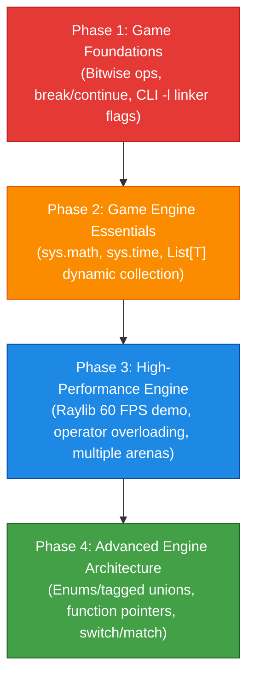

# The Complete Velo Language Gap Analysis (Small to Big) 📋

> **Document Status**: Living Architectural Audit  
> **Target Version**: Velo 2.0+ (Towards Production Systems & Game Engine Viability)  
> **Scope**: An exhaustive, brutally honest breakdown of every single gap, limitation, and missing feature in the Velo programming language—from minor syntax nuances to major compiler subsystems.

---

## Executive Summary & Gap Severity Matrix

Velo is a working, self-hosted, triple-bootstrapped systems programming language that compiles to native machine code via C99. While its core foundation (zone memory, pointers, structs, basic control flow, and multi-file modules) is verified and leak-free, it currently lacks several language features, standard libraries, and compiler controls required to build full-scale desktop applications and modern game engines.

| Severity Level | Focus Area | Impact |
| :--- | :--- | :--- |
| 🔴 **P0: Critical Blockers** | Bitwise ops, `break`/`continue`, custom linker flags (`-l`), slices/dynamic arrays | Blocks building game engines, binary protocols, and real loops |
| 🟠 **P1: Major Language Gaps** | `enum`/tagged unions, `switch`/`match`, math library, multi-arena allocators | Forces cumbersome boilerplate, unsafe type tricks, and prevents DOD/ECS |
| 🟡 **P2: Ergonomic Gaps** | Operator overloading, method syntax, default values, raw strings, block comments | Slows down iteration speed, friction when writing math/vector code |
| 🟢 **P3: Ecosystem & Tooling** | Debug symbols (`-g`), LSP/IDE tooling, package manager, native test runner | Affects developer comfort, discovery, and large-scale collaboration |

---

## 1. Syntax, Lexer & Tokenizer Gaps

### 1.1 Bitwise Operators [COMPLETED] ✅
* **Supported Operators**: Binary `&`, `|`, `^`, `<<`, `>>`, unary `~`, and compound assignments `&=`, `|=`, `^=`, `<<=`, `>>=`.
* **Verified**: Full operator precedence hierarchy in Stage 1 and Stage 2 self-hosted compilers. Verified with `examples/14_bitwise_operators.vl` and `tests/test_bitwise_operators.py`.

### 1.2 Comments & Documentation [COMPLETED] ✅
* **Nested Block Comments**: Arbitrary-depth multi-line comments (`/* ... /* ... */ ... */`) implemented in both Stage 1 and Stage 2 self-hosted lexers with unclosed comment diagnostics.
* **Structured Documentation**: Single-line `///` and block `/** ... */` doc comment recognition for top-level structs, functions, and externs.
* **Native Doc Generator CLI**: Built-in CLI command `velo doc <source.vl> [-o output.md]` extracting clean GitHub-flavored Markdown API reference documentation tables and signatures directly from AST definitions. Verified with `examples/15_docs_and_comments.vl` and `tests/test_docs_and_comments.py`.

### 1.3 Literal Formatting [COMPLETED] ✅
* **Numeric Bases**: Hexadecimal (`0x` / `0X`), binary (`0b` / `0B`), and octal (`0o` / `0O`) literals with full type preservation and C99 emission.
* **Digit Separators**: Underscore digit separators supported in all integer, hex, binary, octal, and floating point literals (e.g. `1_000_000`, `0xFF_AA_BB_CC`, `0b1010_1010`).
* **Scientific Notation**: Full exponent support (`1e-4`, `2.5e6`, `1E3`, `3.14e+2`) in both Stage 1 and Stage 2 self-hosted compilers.
* **Explicit Literal Suffixes**: Explicit integer (`u8`, `u16`, `u32`, `u64`, `usize`, `i8`, `i16`, `i32`, `i64`, `isize`) and float (`f32`, `f64`) suffixes with automatic type inference and C99 suffix mapping (`LL`, `ULL`, `U`, `f`). Verified with `examples/16_literal_formatting.vl` and `tests/test_literal_formatting.py`.

### 1.4 String & Character Escapes [COMPLETED] ✅
* **Raw / Multi-line Strings**: Supported via backticks (`` `...` ``). Preserves literal backslashes, quotes, and newlines across multiple lines without escape decoding. Automatically normalized and formatted into standard C99 string literals.
* **Unicode Escapes (`\uXXXX`)**: Full 4-digit hexadecimal Unicode escape support in standard string and character literals, encoded automatically into compliant UTF-8 multi-byte sequences (`0x00A9` -> `0xC2 0xA9`, `0x2764` -> `0xE2 0x9D 0xA4`).
* **Character Literals & Escapes**: Character literals support standard escapes (`\n`, `\t`, `\r`, `\0`, `\\`, `\'`, `\"`), 2-digit hex escapes (`\xNN`), and 4-digit Unicode escapes (`\uXXXX`), correctly evaluating to their numeric integer values. Verified with `examples/17_string_escapes.vl` and `tests/test_string_escapes.py`.

---

## 2. Control Flow & Language Statements

### 2.1 Loop Controls: `break` and `continue` [COMPLETED] ✅
* **Supported Controls**: Native `break` and `continue` statements in both `while` loops and `loop <var> in <start>..<end>` range loops.
* **Semantics & Code Generation**: Direct mapping to C99 `break;` and `continue;` control flow with correct nested loop scoping and Go-style statement termination. Verified with `examples/18_break_continue.vl` and `tests/test_break_continue.py`.

### 2.2 Branching: `on` Statement [COMPLETED] ✅
* **Signature `on` Keyword**: Velo exclusively standardizes on the punchy, unique 2-letter **`on <expr> { ... }`** keyword tailored for game engines and state dispatching (`match` and `switch` completely eliminated from the language).
* **Multi-Value Patterns**: Matching comma-separated alternative values in a single branch (e.g. `201, 202 => { ... }`).
* **Default & Wildcard Fallbacks**: Clean fallback handling supporting `else => { ... }` and wildcard `_ => { ... }`.
* **Block and Single-Statement Arms**: Supports curly-brace scoped code blocks `{ ... }` as well as concise single-statement arm bodies (e.g. `1 => action = "jump"`).
* **High-Performance C99 Jump Tables**: Emits native scoped C99 `switch (...) { case ...: { ... break; } default: { ... break; } }` blocks enabling $O(1)$ constant-time jump table optimizations by C compilers without accidental fallthrough. Verified with `examples/19_match_switch.vl` and `tests/test_match_switch.py`.

### 2.3 Range Loop Flexibility [COMPLETED] 🛡️
* **Unified Loop Syntax**: Consolidated all loops (`while`, `loop .. in`, `repeat`, `infinite`) into a single expressive `loop` keyword.
* **Custom Step Increments**: Slicing syntax `loop i in 0..10:2` for forward custom steps.
* **Smart Auto-Countdown**: When $start > end$ (`loop 5..0`), loops automatically decrement by `-1` without needing `:-1`. Custom decrement steps like `loop 10..0:2` also supported.
* **Inclusive & Exclusive Ranges**: Supports both half-open ranges `0..10` and fully inclusive ranges `0..=10` via `..=` operator.
* **Implicit Variable**: Anonymous ranges (`loop 0..10:2`), repeat loops (`loop 5`), condition loops (`loop cond`), and infinite loops (`loop`) automatically provide the `it` iteration counter starting at 0.
* **Retirement of `while`**: Retired `while` keyword across the entire language, compiler, test suite, and examples. Verified with `examples/20_range_loops.vl` and `tests/test_range_loops.py`.

---

## 3. Type System & Data Modeling

### 3.1 First-Class Enums & Tagged Unions (`kind`) [COMPLETED] ✅
* **Unified 4-Letter Keyword**: Velo standardizes on `kind` (harmonizing with `data`, `act`, `zone`, `loop`).
* **Pure Scalar Enums**: Unit variants (`North`, `East`) and explicit discriminants (`Ok = 200`, `NotFound = 404`) with zero runtime overhead, lowering directly to C99 `int32_t` scalars.
* **Payload-Bearing Tagged Unions**: Supports single-payload variants (`KeyDown: i32`) and multi-field payloads (`Click(button: i32, x: f32, y: f32)`), lowering to C99 `struct { int32_t kind; union { ... } as; }`.
* **Contextual Dot-Shorthand**: `let d: Direction = .North`, `let e: Event = .KeyDown(65)`, `let c: Event = .Click(1, 10.0, 20.0)` whenever target type is known; fully-qualified `Direction.North` always valid.
* **Pattern Matching Destructuring (`on`)**: Directly match with `on e { .KeyDown(key) => ..., .Click(btn, x, y) => ... }` with automatic payload variable bindings scoped to each arm. Verified with `examples/21_enums_and_unions.vl` and `tests/test_enums_and_unions.py`.
* **OPEN DEFECT (found while probing 5.2 slice 2)** — *by-value struct payloads fail at the C level*: `kind Obj { Val(Pair) }` (a plain `data Pair` payload) both-stage compiles until GCC rejects the emitted C: `field 'Val' has incomplete type` (the union member is declared before the EMITTED struct definition order resolves). The `@Pair` pointer payload works (`Val(@Pair)` box → memcpy of an address). Fix direction: emit payload-struct definitions before their `kind` unions, or widen the emitter's struct-definition ordering pass; both stages must stay wording-identical at parity (identical GCC failure today — no divergence to reconcile).

### 3.2 Generics / Parametric Polymorphism [COMPLETED] ✅
* **Syntax Choice**: Proposal A (`[T]`): `data Box[T]`, `kind Option[T]`, `act min[T]`, `act swap[T](a: @T, b: @T)`, multi-param `data Pair[K, V]`.
* **Zero-Cost C99 Monomorphization**: AST specialization pass monomorphizes generic structs, kinds, and functions on demand into concrete C99 types (`Box_i32`, `Option_string`, `min_i32`, `Pair_string_i32`) with zero virtual dispatch or boxing overhead.
* **Call-Site Type Inference**: Functions can be invoked directly as `min(15, 25)` without type arguments, inferring type arguments from parameters; explicit instantiation `min[f32](3.14, 2.71)` also supported.
* **Pointer & Struct Specialization**: Pointer types like `@T` cleanly unify and specialize (e.g. `swap[i32](@x, @y)`).
* **Self-Hosted Monomorphizer**: Fully integrated into both Python (`velo/monomorphize.py`) and self-hosted Stage 2 compiler (`src/analysis/monomorphize.vl`). Verified with `examples/22_generics.vl` and `tests/test_generics.py`.

### 3.3 Function Pointers & First-Class Callbacks [COMPLETED] ✅
* **Native `act(...) -> Ret` Syntax**: First-class function type signature harmonizing with Velo's `act` keyword (e.g. `act(i32, i32) -> i32`, `act(@Button) -> void`, `act() -> void`).
* **Variable Storage & Higher-Order Functions**: Storing named functions in variables (`let op: act(i32, i32) -> i32 = add`), passing callbacks to higher-order functions (`apply_binary(7, 8, op)`).
* **Struct Function Pointer Fields (Callbacks & Vtables)**: Storing function pointers in struct data fields (e.g. `data Button { on_click: act(@Button) -> void }`).
* **Direct Execution & Null Safety**: Calling function pointers directly via variable (`op(10, 20)`) or member access (`btn.on_click(@btn)`). Full null check compatibility (`if btn.on_click != null { btn.on_click(@btn) }`).
* **Inline Anonymous Functions**: Anonymous callbacks with parameter inference and block bodies: `act(b: @Button) { ... }`, `act(x: i32, y: i32) -> i32 { return x - y }`.
* **C99 Function Pointer Typedef Lowering**: Zero-overhead function pointer typedefs (`typedef int32_t (*velo_act_i32_i32_to_i32)(int32_t, int32_t);`), with anonymous functions lifted to `static` C functions with forward prototypes. Verified across Stage 1 Python compiler and Stage 2 self-hosted native compiler with `examples/23_function_pointers.vl` and `tests/test_function_pointers.py`.

### 3.4 Method Syntax / Uniform Function Call Syntax (UFCS) [COMPLETED] ✅
* **Pure UFCS Without OOP Keywords**: Any free function `act foo(self: T, ...)` or `act foo(self: @T, ...)` can be invoked using method call syntax: `x.foo(...)`. No `class`, `struct impl`, or OOP ceremony required.
* **Smart Auto-Referencing & Auto-Dereferencing**:
  - If a function expects a pointer `@T` and the receiver is a value lvalue of type `T`, the compiler automatically passes its address (`&x`).
  - If a function expects a value `T` and the receiver is a pointer `@T`, the compiler automatically dereferences the pointer (`*x`).
  - If the receiver type matches the first parameter type directly, it is passed directly without modification.
* **Struct Field Priority**: Struct fields (such as callback function pointers `btn.on_click(...)`) always take priority over free functions with the same name, preserving callback and vtable mechanics.
* **Method Chaining & Extensibility**: Supports fluent chaining (e.g. `p.translate(1.0, 2.0).scale(2.0)`) and extension methods on both structs and primitive types (e.g. `7.square()`).
* **Generic Method Specialization**: Works seamlessly with generic functions and data types (e.g. `box.unwrap()`), inferring type arguments from the receiver and arguments. Verified across Stage 1 Python compiler and Stage 2 self-hosted native compiler with `examples/24_ufcs_methods.vl` and `tests/test_ufcs_methods.py`.

### 3.5 Operator Overloading for Game Math [COMPLETED] ✅
* **Signature `act op <symbol>` Syntax**: Clean 2-letter `op` prefix aligning with Velo's keyword philosophy (`on`, `in`, `as`, `op`). Supports both `act op +(...)` and `act op+(...)`.
* **Disambiguation by Parameter Count**: Single-parameter declarations define unary operators (e.g. `act op -(v: Vector2)` for negation); two-parameter declarations define binary operators (e.g. `+`, `-`, `*`, `/`, `%`, `==`, `!=`, `<`, `<=`, `>`, `>=`).
* **Zero Runtime Overhead & C99 Name Mangling**: Deterministic C function identifier mangling based on operator name and operand types (`velo_op_add_Vector2_Vector2`, `velo_op_mul_Vector2_f32`, `velo_op_neg_Vector2`).
* **Automatic Compound Assignment**: Statements like `pos += vel` and `pos *= 2.0` automatically desugar into `pos = pos + vel` and `pos = pos * 2.0`, executing overloaded operators without duplicate boilerplate.
* **Smart Auto-Referencing / Auto-Dereferencing**: Functions expecting pointer parameters `@Vector2` automatically receive `&v` when invoked with value lvalues.
* **Bit-for-Bit Triple-Bootstrap Determinism**: Verified with `examples/25_operator_overloading.vl` and `tests/test_operator_overloading.py` across Python reference compiler and Stage 2 self-hosted native compiler.

### 3.6 Advanced Struct Features (🟡 P2 Ergonomic)
* **Default Field Initializers**: [COMPLETED] ✅ — *"Cannot declare `data Point { x: f32 = 0.0, y: f32 = 0.0 }`"* (Former Defect).
  - **Fix Applied**: Constant-literal defaults (int / float / string / bool, optional unary `-`) parsed in both compilers; struct literals fill omitted defaulted fields via C99 designated initializers appended after the provided ones; omitted fields without a default are now a compile error in both compilers (Python Stage 1 codegen validation, Stage 2 self-hosted semantic checker). Defaults are carried into every generic specialization.
  - **Verification**: `examples/26_advanced_structs.vl` + `tests/test_advanced_structs.py` (Stage 1 CLI run/emit-c assertions and native `bin/velo.exe` run).
* **Struct Packing & Alignment**: [COMPLETED] ✅ — *"No `#align(16)` / `#packed` directives"* (Former Defect).
  - **Fix Applied**: `data Name #align(N) #packed { ... }` parsed after name/type parameters in both compilers; emitted as `struct __attribute__((aligned(N), packed)) Name { ... };` on the definition only (forward typedefs untouched). Attributes survive generic instantiation.
  - **Verification**: Emitted C asserted in `tests/test_advanced_structs.py` for both compilers; native run compiles the attributes with GCC.
  - **Residual Limitation**: Attribute support is GCC/Clang-shaped (`__attribute__`); MSVC layouts would need a separate pragma mapping.
* **Type Aliases**: [COMPLETED] ✅ — *"No `type EntityId = u64`"* (Former Defect).
  - **Fix Applied**: `aka Name = <primitive|@primitive>` as a contextual keyword at top level only; target validated at parse time (no alias-of-alias). Both monomorphizers gained an always-running Pass 0 that canonicalizes alias names in every type string (fields, kind payloads, params/returns, locals, casts) order-free across the whole merged program, so aliases work even in programs without generics; codegen emits a decorative `typedef`.
  - **Verification**: Same example + test file; triple-bootstrap determinism re-verified (Gen2 vs Gen3 emit-c SHA-256 identical).
  - **Residual Limitation**: Aliases are primitive-only by design; alias declarations are not yet listed by `velo doc`, and `VELO.md` sync is owner material. The missing-field diagnostic wording differs slightly between the two compilers (both reject with the same exit behavior). Default-initializer values are not type-checked against their field type (constant-literal defaults only).

---

## 4. Memory Management & Hardware Access

### 4.1 Extensible Allocator Architecture [COMPLETED] ✅
* **Former Defect (Incomplete Architecture)**: The memory subsystem had the arena infrastructure (`VeloZoneArena`, `zone <bytes> { }` scoped blocks, a reuse pool of up to 32 arenas) but lacked the language-level `@Allocator` interface — functions could not receive an arena handle as a parameter, meaning every allocation always targeted the implicit thread-global active arena.
* **Fix Applied**:
  - **Runtime** (`velo/runtime/velo_runtime.h`): Added `typedef VeloZoneArena* VeloAllocator`, `velo_alloc_with(a, size, count)` (bump-allocates into an explicit arena handle), and `velo_alloc_used(a)` (reads its watermark).
  - **Language surface**: `@Allocator` is now a recognized Velo type (maps to `VeloZoneArena*` in C). Two new builtin intrinsics: `mem.current()` (captures the currently-active arena as a passable `@Allocator`) and `mem.alloc_with(a, @T, n)` (allocates `n` elements of `T` into arena `a`).
  - **Stage 1** (`velo/codegen_c.py`): `TYPE_MAP` extended with `"Allocator": "VeloZoneArena"`. `_emit_expression`, `_infer_raw_velo_type`, and `_resolve_expr_type` handle the two new intrinsics.
  - **Stage 2** (`src/backend/codegen_types.vl`, `src/backend/codegen_expr.vl`, `src/analysis/type_checker.vl`): `map_type_to_c` maps `Allocator → VeloZoneArena`; `infer_expr_type` returns `@Allocator` / `@T`; `emit_c_expr` emits the correct C for both new intrinsics. `is_known_type` accepts `Allocator`.
  - **Tests** (`tests/test_allocators.py`): 3 new parity tests — `test_allocator_passable_handle` (pass allocator to a function), `test_allocator_stored_in_struct` (store in a `data` field), `test_allocator_oom_is_fatal` (alloc_with into exhausted arena aborts with a legible error). All pass on both Stage 1 and Stage 2.
  - **Example** (`examples/28_allocator_interface.vl`): end-to-end demo including a `Pool` struct holding an `@Allocator`.
* **Residual Limitation**: `@Allocator` is a raw arena pointer (single bump-allocator strategy). Pluggable vtable-based allocators (heap, pool, slab) are not yet supported — `mem.heap_alloc` has no passable handle form. Handles are lifetime-untracked: using one after its `zone <bytes> { }` block exits is silent UB (no detection in either stage). `velo_alloc_used` exists in the runtime only — no language intrinsic reads a non-active arena's watermark. Active-arena state became per-thread in §4.2, but passing one `@Allocator` handle across threads is still unsynchronized by design.
* **Verification**: Triple-bootstrap chain rebuilt (Gen1 → Gen2 → Gen3, `bin/velo.exe` updated); SHA-256 fixed-point preserved (Gen2 ≡ Gen3 bit-for-bit). Full suite: **120/120 passing**.

### 4.2 Multithreaded Memory Safety [COMPLETED] ✅
* **Former Defect (Shared Arena State)**: The 32 MB default arena, the active-arena pointer (`g_velo_zone_active`) and the 32-slot private-arena reuse pool were process-global, unsynchronized C statics. Two threads calling `mem.alloc(...)` concurrently would corrupt each other's bump watermarks immediately, and `zone <bytes> { }` re-entries raced on one shared pool.
* **Fix Applied** (`velo/runtime/velo_runtime.h`, mirrored in both emitters):
  - Compiler-shim macro `VELO_TLS` (`__thread` for GCC/Clang, `__declspec(thread)` for MSVC) — both compilers emit C compiled with `-std=c99`, where the C11 keyword `_Thread_local` is unavailable, so the keyword path had to be shimmed at runtime level.
  - Zone state is now thread-local and lazily initialized per thread: its own 32 MB heap-backed default arena, its own active pointer, and its own reuse pool. All entry points (`velo_zone_push/pop`, `velo_zone_enter/leave`, `velo_mem_alloc`, `velo_mem_used`) read state through the single accessor `velo_zone_active()`, so concurrent threads bump independent watermarks and the pools cannot race.
  - Both emitters now emit that accessor for `mem.current()` — `velo/codegen_c.py` and `src/backend/codegen_expr.vl` were the only two call sites touching raw runtime state. `velo_runtime.h` remains thread-API-agnostic (no pthread/Win32 threads inside).
  - Single-threaded semantics are unchanged: first touch lazily creates the default arena with watermark 0, all OOM/fatal messages are byte-identical, `zone { }` / `zone <bytes> { }` behavior verified by the existing 4.1 test suite.
  - Test (`tests/test_thread_local_runtime.py`): a C harness compiled against the runtime header by the same GCC the drivers use, spawning 8 winpthreads that execute 300 iterations of `velo_zone_enter → alloc → write/readback → pop → leave` concurrently. Asserts: threads start with fresh (unused) default arenas, data written into a thread's arena is never clobbered, each thread's `mem.current()` handle is distinct across all threads, and the active pointer is restored exactly after block exit.
* **Verification**: Full suite **126/126**; triple-bootstrap chain rebuilt (Gen1 → Gen2 → Gen3), Gen2 ≡ Gen3 emit-c SHA-256 (`7c46effa…`); all compiler sources within the 400-line limit.
* **Fix Applied §2 (Language-Level Thread Surface)** — the missing third slice, closing the "no in-language threads" residual:
  - Runtime (`velo_runtime.h`): `velo_thread_spawn(VeloThreadFn) -> VeloThreadCtx*`, `velo_thread_join(ctx) -> i32`, and opaque mutexes `velo_mutex_create/acquire/release/destroy`. Windows path uses `_beginthreadex` + manually declared kernel32 prototypes (`WaitForSingleObject`, `CloseHandle`, `CreateMutexW`, `ReleaseMutex`) — no `windows.h` inclusion, no driver flag changes, no new DLL dependency; the POSIX branch uses pthreads. Spawn-wrap trampoline calls the zero-arg i32 entry act, captures its return value, and calls `velo_thread_tls_release()` before exit.
  - Thread-exit arena leak closed: `velo_thread_tls_release()` frees the calling thread's whole per-thread arena set (default 32 MB buffer + arena struct + pooled private arenas); idempotent, and only reachable from the trampoline path where all zone blocks are provably closed.
  - Heap ledger (§4.2, *revisited in this fix*): first shipped as a per-thread `VELO_TLS` counter, but that mis-attributes a cross-thread `mem.free` to the freeing thread instead of the allocating one (diagnostic skew), and a plain shared `+=` would tear. Now a single shared counter `g_velo_heap_active` updated with true atomics — `__sync_fetch_and_add` (GCC, the only driver toolchain) / `_InterlockedExchangeAdd64` (MSVC intrinsics path, untested) — so allocation accounting is consistent under concurrent alloc/free, exactly-bounded by the freed headers (`velo_heap_free` clamps a bogus-free underflow best-effort). malloc/free themselves were already thread-safe; `mem.heap_used()` now reports the whole process.
  - Language surface (both emitters, identical emission): new types `@Thread` (→ `VeloThreadCtx*`) and `@Mutex` (→ handle); intrinsics `thread.spawn(fn) -> @Thread`, `thread.join(h) -> i32`, `thread.mutex() -> @Mutex`, `thread.acquire(m)` / `thread.release(m)` / `thread.free(m)` (all void). Fn args are zero-arg i32-returning act values (named (`thread.spawn(worker)`) and anonymous (`thread.spawn(act() -> i32 { ... })`) both work — the runtime no longer casts blindly; see §3 below). Stage 2 additionally whitelisted `sys.thread` in its loader (`driver.vl`, both `DECL_USE` passes — Stage 2 otherwise resolves unknown `use` targets as file dependencies) and in its ident/known-type tables (`type_checker.vl`).
  - Tests: `tests/test_threads.py` (parity cases on both stages — spawn/join with per-thread arena-isolation asserts inside workers, mutex-guarded shared counter to exactly 4, anonymous-act spawn, mutex basic ops, shared-heap-ledger consistency); C harness `test_spawn_join_mutex_runtime_api` (spawn/join publishes 42/17, 4 threads × 1000 increments = 4000 under one mutex, 100 spawn/join cycles stable); example `examples/29_thread_spawn.vl` runs identically on both stages.
  - Verified sharing pattern through the language: a `@Mutex` held in a global `mut` (assigned once in `main` **before** any spawn — spawn/join orders the visibility) lets workers share that lock and touch a global counter safely; call-initialized globals (`mut g: @Mutex = thread.mutex()` at file scope) are NOT supported — globals compile to C statics whose initializers must be constant.
* **Fix Applied §3 (Compile-Time Argument Checking)** — intrinsic arguments were previously trusted by contract (any pointer cast through C); now they are checked by BOTH compilers with char-identical messages:
  - `thread.spawn(x)`: exactly 1 argument, and `x` must be an `act() -> i32` value — a named top-level act, an act-typed local/global, or an anonymous act. Wrong arity/shape/signature (e.g. `thread.spawn(42)` or a `act(i32) -> i32` fn) is a build error: `thread.spawn expects act() -> i32 (got <type>)`.
  - `thread.join(x)` requires `@Thread`; `thread.acquire/release/free(x)` require `@Mutex`; `thread.mutex()` takes no arguments; all others take exactly 1 (`thread.join takes exactly 1 argument`, `thread.mutex takes no arguments`).
  - Stage 1 raises inside codegen (`velo/codegen_c.py::_thread_expect`, with `_thread_arg_type`/`_is_thread_entry`); `velo.py check` runs the generator, so the checks fire in `check` AND `build`. Stage 2 checks in the semantic pass (`check_thread_call(st, expr, member)` in `src/analysis/type_checker.vl`, wired into the thread inference branch, which returns `unknown` on failure so dependent expressions fail fast). Type spellings compare whitespace-tolerantly on both sides (`strip_type_spaces` in `src/common/act_types.vl`; Stage 1 strips spaces before comparing).
  - Compiler-crash hardening: Stage 2's thread emit branches now guard a missing first arg (emit `NULL` instead of dereferencing null while continuing past semantic errors).
  - Tests: 6 two-stage compile-rejection cases in `tests/test_threads.py` (build path, both stages, message-substring asserts incl. wrong-signature named act reported as `got act(i32) -> i32` on both stages).
* **Fix Applied §4 (Runtime Lifecycle Checking)** — handle misuse was silent UB; now it is a deterministic loud fatal:
  - Tombstone pattern: a released handle is NEVER freed. It is tagged `VELO_HANDLE_DEAD` (`VELO_HANDLE_LIVE` while valid) and parked on a process-lifetime dead-list; its address can never be recycled by malloc, so a replayed or stale handle deterministically reads DEAD instead of re-validating against a recycled allocation.
  - `@Thread`: join on NULL/never-stored → `Velo Fatal Error: thread join on a null handle (spawn failed or handle never stored)`; second join of the same handle → `thread join on an already-joined thread handle`. `join` returns the entry act's real i32 exactly once — it no longer fabricates `-1` for a null handle, removing the ambiguity between "spawn failed" and "worker returned -1".
  - `@Mutex` is a `VeloMutexCell` handle: use-after-free and double `thread.free` → `mutex operation on a freed mutex`; null → `mutex operation on a null handle`; foreign garbage → `... on an invalid mutex handle`. Spawn/mutex-create failure (OOM or OS refusal) is fatal rather than returning a handle that would lie at join.
  - Cost (documented trade): ~40 bytes parked per joined thread / destroyed mutex for the process lifetime — the price of deterministic detection without a registry or generations.
  - Tests: the main harness keeps only healthy paths (`velo_thread_join(NULL) == -1` assertion REMOVED — null is fatal now); 4 fatal-path mini-harnesses in `tests/test_thread_local_runtime.py` compile separately and assert non-zero exit with the specific message for null-join, double-join, mutex-after-free, mutex-double-free.
* **Verification**: Full suite **128/128**; thread surface adds 4 two-stage parity cases + 6 two-stage rejection cases + runtime API harness + 4 fatal mini-harnesses; `examples/29_thread_spawn.vl` byte-identical across stages; triple-bootstrap chain rebuilt (Gen1 → Gen2 → Gen3), Gen2 ≡ Gen3 emit-c SHA-256 (`46b351c8…`); `scripts/count_lines.py` reports no compiler source over 400 lines.
* **Residual Limitation**: No atomics, condition variables, or synchronized channels — `@Mutex` around globals is the only in-language synchronization. Sharing plain data without one is not detected at all — and is demonstrably worse than "occasionally wrong": GCC at `-O2` may fuse an unsynchronized global-value loop into a single memory operation (observed in this repo: a 5,000,000-iteration racer incrementing a global compiled to one `addq $5000000, gcount` in BOTH compilers' output), silently redefining the program's behavior instead of producing visible corruption; only thread-local data and the mutex-guarded path (opaque runtime calls act as compiler barriers) behave as written. A handle pointer that is neither NULL nor a tombstone (a wild/foreign pointer) is still raw-pointer UB — reading its magic may fault before any message; this matches Velo's general raw-pointer semantics for any `@T` and is not a regression, but detection covers *mechanically reachable* misuse (double-join/free, use-after-free of a real handle, null, wrong-arg compile errors), not arbitrary memory corruption. Two known windows inside that set: (a) destroying a mutex while another thread is inside `acquire` or holds it — the cell is still LIVE, so `thread.free` passes the assert and closes a native handle mid-use, undetected; (b) two threads double-joining the SAME handle concurrently can both pass the LIVE check inside the race window and each proceed — each still returns the correct status, and the tombstone-list push race is benign (the list is never traversed; detection keys on the per-object magic, not the list), but the log-equivalence of "exactly one joiner" is not enforced. No join timeout, no detach, no cancellation: a worker that never returns (or never releases its mutex) deadlocks `join` forever. MSVC/`cl.exe` builds remain untested (the atomic and threading paths have `_InterlockedExchangeAdd64`/`intrin.h` fallbacks, but drivers only ever invoke GCC); kernel32 prototypes stay declared inside the runtime header, so a unit that also includes `windows.h` would conflict (generated programs never do; MinGW import libs don't even resolve `InterlockedExchangeAdd64`/`Interlocked*` decls — hence the `__sync` builtin). Pointers into one thread's arena can still be aliased through globals and written by another thread with no detection — that is contract-based sharing, like C: Velo has no borrow/ownership model, so "memory safety" here means the allocator machinery never races and handles are never silently misused, not a no-data-race guarantee over program data. `@Allocator` handles remain unsynchronized across threads by design (bump watermark) — the worker-arena rule stands: each thread allocates into its own fresh arena; never pass a handle between threads.

### 4.3 Low-Level Memory Intrinsics [COMPLETED] ✅
* **Former Defect**: `mem.copy`/`mem.move`/`mem.set`/`mem.realloc` did not exist — copying a buffer required a manual Velo `while` loop indexing byte-by-byte, and persistent heap blocks could never be resized in place (the only "grow" idiom was alloc-new + manual copy + free).
* **Fix Applied**:
  - `mem.copy(dest, src, count)` / `mem.move(dest, src, count)` / `mem.set(dest, val, count)` lower onto runtime wrappers `velo_byte_copy` / `velo_byte_move` / `velo_byte_set` (`velo_runtime.h`) around the C trio `memcpy` / `memmove` / `memset` (args cast `(void*)` / `(int)` / `(long long)` — byte semantics are explicit: `count` counts BYTES, not elements; copying 8 bytes of an `@i64` buffer moves exactly one element, asserted by test). The wrappers exist because a NEGATIVE count is a caller bug the C trio would silently launder into a gigantic `size_t` rewrite/wipe (UB): with a signed `long long` parameter the wrappers die loudly on `count < 0` (`Velo Fatal Error: mem.<m> got a negative byte count!`), and huge-but-valid positive counts behave exactly as the bare C calls did.
  - `mem.realloc(ptr, @Type, count) -> @Type` is backed by a new runtime helper `velo_heap_realloc` (`velo/runtime/velo_runtime.h`) because plain C `realloc` can preserve neither the heap size-header protocol nor the shared atomic ledger: the RAW block (header + payload) is resized so the size word moves with it, then the `g_velo_heap_active` ledger is adjusted by the delta atomically. NULL `ptr` behaves like a fresh allocation (mirrors C `realloc(NULL, n)`); `count == 0` frees the block and yields NULL (documented Velo semantics); growth/shrink preserve payload prefix bytes — the ledger algebra across grow/shrink/fresh/free asserts to exactly 0 at exit in both stages. Its count is also signed: negative → the same loud fatal.
  - Both compilers enforce the same compile-time contract with identical wording (Stage 1 `velo/codegen_c.py::_mem_expect` ValueError path; Stage 2 new `src/analysis/mem_checks.vl::check_mem_call` wired into the `mem` infer branch of `type_checker.vl`, returning "unknown" after reporting): arity is `mem.<m> expects exactly 3 arguments: (...)` with the per-member signature; pointer args must be `@`-prefixed or you get `mem.<m> expects pointer arguments (got <T>)` (a plain `string` is deliberately rejected as a buffer — writing through a `const char*` is UB); `mem.realloc`'s type arg must itself be a `@`-prefixed type (`mem.realloc expects a @Type argument (got <T>)`, with bare type names like `i64` rendered as written, matching Stage 2's `is_known_type` infer); byte counts / fill values reject pointer, string, and act values (`mem.<m> expects an integer byte count/fill value (got <T>)`).
  - Negative counts are closed at BOTH layers: statically, a negative **literal** count is rejected at compile time (`mem.<m> expects a non-negative byte count`, detected as unary-minus over an int literal — Stage 1 `UnaryExpr`/`IntLiteral`, Stage 2 `EXPR_UNARY`/`TOK_MINUS`/`EXPR_INT` in `mem_checks.vl`); dynamically, a variable-held negative dies at the runtime wrapper (the compile-time check can't know values). Compile-time-when-knowable + loud-fail-otherwise mirrors the project's usual tiering.
  - Stage 2's emit branches (`codegen_expr.vl`) null-guard every argument slot so the compiler itself cannot crash past the semantic errors it just reported.
* **Verification**: Full suite **138/138**; `tests/test_mem_intrinsics.py` adds two-stage parity cases covering set/copy/move-overlap (via `buf + 4` pointer arithmetic), realloc grow 4→8 and shrink 8→2 with prefix preservation + ledger 64→16→0, NULL-arg fresh allocation, zero-count free→null, a byte-count-semantics parity case, 6 two-stage build-rejection cases (`bad_copy_int`: `(got i32)`, pointer-as-count: `(got @u8)`, string semantics, arity, `@Type` arg `(got i64)`) and 2 negative-literal rejections. An honest re-audit then closed further gaps: (1) the committed overlap case used all-equal bytes, which cannot distinguish `memmove` from a cascading memcpy-UB — a distinct-payload case (10..17, 56-byte shift) asserts `10 10 11 12 / 13 14 15 16`; (2) variable-held NEGATIVE counts fatal with the exact message and non-zero exit on both stages; (3) CONCURRENT realloc — 4 worker threads × 120 grow/shrink reallocs, shared atomic ledger asserted EXACTLY 0; (4) the OOM path via a C mini-harness (`velo_heap_realloc(NULL, 8, 2^58)` → malloc failure) asserting `Velo Fatal Error: Out of Heap Memory!` and exit 1; (5) acceptance-class coverage: a float count truncates through `(long long)` identically on both stages (2.9 → 2 bytes set), a struct-field count works identically, a named act as count is REJECTED by both stages — the audit first found the stages DIVERGED here (Stage 1's variable-scope infer rendered a bare act name as `i32` and would have emitted a function-pointer-as-count runtime crash while Stage 2 rejected it; fixed by reusing §4.2's `_thread_arg_type`, which resolves function declarations), and a void count (`io.println(...)`) is now rejected by BOTH stages `(got void)` — the audit found admission was NOT parity (Stage 1 failed the invalid `((long long)(void-expr))` C while Stage 2 inlines io emission as int-valued `printf`, silently running with count = chars-printed). `scripts/count_lines.py` reports no compiler source over 400 lines (`codegen_expr.vl` 399, `type_checker.vl` 395, `mem_checks.vl` 100); triple-bootstrap chain rebuilt (Gen1 → Gen2 → Gen3), Gen2 ≡ Gen3 emit-c SHA-256 (`e9960733…`).
* **Residual Limitation**: Overlapping regions are only correct through `mem.move` — `mem.copy`/`mem.set` on overlapping or self-referencing regions remain C-UB (inherent to the memcpy trio; Velo adds nothing to defend it). `mem.realloc`/`mem.free` on a non-heap pointer is the same raw-pointer UB class as before this change (no magic/header validation is attempted): observed here by feeding a ZONE-arena pointer to `mem.realloc` — the process died with `STATUS_HEAP_CORRUPTION` (`0xC0000374`) on this Windows/GCC configuration, which is a DEMONSTRATION, not a test: UB is not portable or stable across C runtimes, so no assertion is committed (NULL handling, by contrast, IS specified and tested). Reallocation failure is fatal (`Out of Heap Memory!`, old block stays valid until exit), not a nullable return — programs that wanted "try to grow, else keep the old block" cannot express it (covered by the C mini-harness, but the API shape itself stands). The count/fill check rejects pointer, string, act, AND void values (`void` was deliberately made a rejection after the audit showed admitting it made the stages disagree), admits `unknown` only because an unknown infer always co-occurs with another error report (adding a second report would double-log; the program still fails), and further admits ints, floats, bools — precision through the cast is the caller's business and IS pinned by a parity test (2.9 → 2 bytes); a size-overflowing expression (`count * sizeof` wrapping) is not analyzed — huge-but-valid positive counts reach the C trio unchanged. A `@badtype`-typo type argument escapes Stage 1's semantic check (its shape is indistinguishable from a valid type reference) and fails later at the C compile step — pre-existing `mem.heap_alloc`/`mem.alloc_with` blindspot parity, unchanged. `mem.move` does not report or repair a failed partial overlap (it can't: C `memmove` is all-or-nothing and always succeeds). Pre-existing divergence discovered while probing this feature (NOT caused by it, surfaced to the audit): Stage 2 does not reject assignment to an immutable `let` — a program mutating a `let` loop counter fails Stage 1 at the C-compile step (emitted `const`) yet builds and runs through Stage 2; the surface-visible outcome differs across stages for the same source.

---

## 5. Standard Library Gaps (`sys.*` and `std.*`)

Velo currently has a bare-minimum runtime (`velo_runtime.h`). To be a viable development language, the following libraries are missing:

### 5.1 String Processing Library [COMPLETED] ✅
* **Former Defect (Bare-Minimum String Surface)**: Strings were raw C `const char*` with a single `str.len(...)` builtin. Every non-trivial program — the compiler's own sources included (`check.vl`, `utils.vl`, `codegen_types.vl`) — hand-rolled `starts_with`/`rfind`/`copy_slice_to_string` helpers, and `a + b` on strings silently lowered to C pointer arithmetic (no concat), while trimming/case-mapping/splitting were not expressible at all.
* **Fix Applied**:
  - **Runtime** (`velo/runtime/velo_runtime.h`): ten `velo_str_*` helpers — `contains`, `starts_with`, `ends_with`, `index_of` (→ `i64`, `-1` = not-found; `usize` has no room for the sentinel; substring needle subsumes the gap's "char" form), `trim`, `replace` (count-pass + fill-pass: exact allocation, all non-overlapping occurrences, empty needle = byte-identical copy, empty replacement deletes, self-referential replacement safe), `to_upper`/`to_lower` (ASCII-only and locale-independent BY DESIGN — the C ctype tables would vary with locale and break the determinism mandate), `concat`, and `split` (Python-style tokenization: delimiters separate and never merge, empty tokens preserved, trailing delimiter yields a trailing empty token, `""` → one empty token; empty delimiter is a loud fatal). Every helper that returns memory allocates via `velo_heap_alloc` — same base as `velo_fs_read_file` — so results are caller-owned (`mem.free`), stay valid across `zone { }` exits, and each argument is evaluated exactly once (real C parameters, not inlined expressions). Null string args die loudly (`Velo Fatal Error: str.<m> got a null string`); legacy `str.len` keeps its plain `strlen` lowering and is intentionally untouched. SINCE 5.2 SLICE 11: `str.split` returns the OWNing `shelf[string]` — a `VeloShelf` by value whose tokens are fresh ARENA strings (zone-scoped, the `sorted()` copy precedent); the NULL-terminated `@string` array + the `mem.free(parts)` idiom RETIRED (see the slice-11 entry in 5.2 — every other `velo_str_*` helper keeps the heap-alloc caller-owned shape).
  - **Stage 1** (`velo/codegen_c.py`): `STR_RUNTIME_MEMBERS`/`_STR_SIGS` tables, `_str_expect` compile-checker (ValueError path fires in `build` AND `check`), emission branch `velo_str_<member>(...)`, and return-type inference in both `_infer_raw_velo_type` and `_resolve_expr_type` (`bool` / `string` / `i64` / — since slice 11 — `shelf[string]` for split).
  - **Stage 2** (`src/analysis/str_checks.vl`, `src/analysis/type_checker.vl`, `src/backend/codegen_expr.vl`): new `check_str_call` checker wired into the `str` infer branch (returns `unknown` after reporting), the same return types in the infer branch, and a member-driven `velo_str_<member>` emit branch (compact style; `codegen_expr.vl` stays within the 400-line standard). Signature/arity/type-check wording is character-identical with Stage 1: `str.<m> expects exactly N argument(s): (...)` and `str.<m> expects string arguments (got <T>)`. Unknown members keep each stage's pre-existing fallthrough verbatim (no new rejects grafted onto old programs).
  - **Example** (`examples/30_string_library.vl`): full surface demo, byte-identical across both stages (values bound to locals before interpolation — calls/indexing inside `{}` interpolations are NOT supported by the interpolation emitters, see Residual).
  - **Tests** (`tests/test_string_library.py`): example parity with exact expected output; edge-case parity program (empty inputs, trim whitespace classes `\t \r \n \v \f` via `\x0b`/`\x0c` escapes, inner-space preservation, non-overlapping replacement, no-occurrence replacement with a function-call argument, position-0 index, empty affix/substring matches, single-token/empty-input/no-match splits via the slice-11 `shelf[string]` result — the shared `count_tokens` helper retired with the swap, reads bound to locals like every interpolation); 7 two-stage compile-rejection cases with exact message asserts (slice 11 added the retired-annotation row); empty-delimiter fatal through the language on both stages; a 12-case C mini-harness battery over every null guard plus the empty-delimiter fatal (own process per case, exact message + non-zero exit).
* **Fix Applied §2 (Single-Block Split Ownership — leak closed)** [SUPERSEDED BY 5.2 SLICE 11]: the original `str.split` allocated N+1 separate heap blocks (array + every token), so `mem.free(parts)` leaked the tokens to process exit. `velo_str_split` now lays out ONE heap block — the `(ntok + 1)`-slot NULL-terminated pointer array first (pointer-aligned, the array slice is a multiple of `sizeof(char*)`), then all token bytes behind it — and every token pointer aims into that tail, so `mem.free(parts)` reclaims everything exactly once and the ledger moves by a single atomic op. Total bytes are identical to the N+1 total (68 held for `"one,two,three,,five"`), so the ledger algebra is unchanged; runtime-only change (the header is external — no bootstrap rebuild required, emit-c fixed point re-verified unchanged). New language test `test_split_single_block_ownership` pins `held = 68` / `after = 0` / `ledger balanced` on both stages. Ownership contract (documented in the header, example, and gaps): free ONLY what split returned — an individual token is an interior pointer with no size header, so `mem.free(parts[0])` is the same non-header-pointer UB class as `mem.free` on any other bad pointer (observed once as a `STATUS_HEAP_CORRUPTION` crash — a demonstration of the class, not a committed assert, mirroring §4.3's realloc-UB precedent); likewise `mem.realloc(parts, ...)` would move the block and strand the interior token pointers (prefix bytes survive, pointer identity does not). SLICE 11 SUPERSEDES the whole ownership story: split now returns the arena-backed owning `shelf[string]` — no heap ledger movement at all, no `mem.free` idiom, the token-leak defect retired WITH the `@string` spelling. The historical test rows migrated to the zone-owned story.
* **Residual Limitation**: Pre-existing divergences recorded during the audit, not fixed here: (1) an unknown `str.<anything>` member compiles through Stage 1 until GCC rejects the emitted C (`'str' undeclared`) while Stage 2 rejects semantically (`Member access on non-struct type`) — same program, different failure layer, both fail; (2) function calls AND index expressions inside string interpolation `{...}` are emitted untranslated by BOTH interpolation emitters (indexing a `@string` prints a pointer-sized number, identically wrong on both stages) — the house idiom (bind to a local first) is used by the committed example and tests. Freeing a split token directly or reallocating the split array strands/stomps interior pointers (see §2 — accepted trade of the one-block design; an owning slice type in §5.2 would subsume both rules). No C-string size arithmetic is overflow-analyzed (huge-but-invalid replace/split sizes reach `malloc` as in any C program). `str.len`'s null behavior remains historical UB (strlen on NULL) rather than the new helpers' loud fatal — tightening it would be a behavior change left to a dedicated pass.
* **Verification**: Triple-bootstrap chain rebuilt (Gen1 → Gen2 → Gen3, `bin/velo.exe` updated); SHA-256 fixed point preserved (Gen2 ≡ Gen3 bit-for-bit, `d1f7226a…`); re-verified unchanged after the runtime-only §2 edit. Full suite: **144/144 passing** (+6th test `test_split_single_block_ownership`). Probe parity cases confirmed: empty-string transform results, `-1` sentinel, overlong-needle `index_of`, self-referential replace (`"a"`→`"aaa"`) byte-identical across stages; single-free ledger return (`68 → 0`) byte-identical both stages. `scripts/count_lines.py` reports no compiler source over 400 lines (`codegen_expr.vl` 397, `type_checker.vl` 396, `str_checks.vl` 70).

### 5.2 Dynamic Collections — COMPLETE (slices 1–11) ✅
* The chapter shipped in full: slice 1 core `shelf[T]` (+ the reserved-word doctrine), slice 2 IA ladder + `shelf[dyn]`, slice 3 the vector surface (`put`/`take`/`insert`/`remove_at`/`sorted`/`reversed`), slice 4 loop-index + `reversed()`, slice 5 `join(sep)` + the repr machinery, slice 6 `Map[K, V]` core, slice 7 Map advanced, slice 8 the dyn engine (auto-unbox ops + the u64 tag), slice 9 `ring[T]` + `bitset`, slice 10 the memory model (`heap shelf` + shared @shelf rows), slice 11 the section sweep (`str.split` → `shelf[string]` hard swap, contextual `shelf`, the `--unsafe-shelf-index` knob, the standing leftovers moved to §6.9). All entries below are the historical build log.
* No dynamic array (`List[T]` or `Vector[T]`).
* No hash map (`Map[K, V]` or `Dict[K, V]`).
* No ring buffer / circular queue.
* No bitset (critical for ECS component masks).

**Design contract (pinned before slice 1, per §workflow)** — the dynamic array is Velo's first collection, spelled `shelf` (family of concrete nouns: `data`/`kind`/`zone`):

* **Syntax (Option A, constructor-style literal)** — the literal carries the type name itself, so every shape incl. the empty shelf is self-describing:
  ```vlang
  let xs = shelf[1, 2, 3]            // inferred shelf[i32]
  let empty: shelf[i32] = shelf[]    // empty needs an annotation (dyn is not here yet)
  let grid = shelf[shelf[1, 2], shelf[3]]   // nested rows, SAME spelling at every depth
  let named: shelf[i64] = shelf[7]   // annotation allowed; element checked strictly
  ```
  Type position uses plain generic syntax: `shelf[i32]`, `@shelf[i32]`, `shelf[shelf[i32]]`, struct fields, params, returns. In expression position `shelf[...]` takes VALUES only (a type name among the elements is rejected).
* **Element-type ladder, slice 1**: strictly homogeneous literals (all elements must infer the same Velo type, string-compared). Mixed → compile error: `shelf literal element types differ: i32 vs string (widening and shelf[dyn] are not available yet)`. The widen ladder (int+float → f64) and the tagged `dyn` box are later slices; slice 1 rejects mixed rather than silently re-typing.
* **Uniform single C struct** — like the allocator architecture, ONE struct serves every element type; per-element C knowledge lives at each use site:
  ```c
  typedef struct VeloShelf { void* data; size_t len; size_t cap; size_t esz; } VeloShelf;
  ```
  `esz` is set by the compiler at build/put sites (`sizeof(elem)`). Reads cast per element type: `((T*)xs.data)[i]`. No per-T monomorphization of the collection itself (generic *acts* over shelves still monomorphize normally).
* **Runtime helpers** (`velo_runtime.h`, shared by both stages): `velo_shelf_put(s, val, esz)` / `velo_shelf_get(s, idx)` / `velo_shelf_set(s, idx, val, esz)` / `velo_shelf_take(s)`. All element WRITES/reads are bounds-checked with loud fatals (`shelf index out of bounds: <i> (len <n>)`, `shelf.take: shelf is empty`) — same tiering as the mem.*/str.* wrappers. Bounds checks are the documented trade for not exposing raw Velo-buffer arithmetic in slice 1.
* **Memory**: the payload grows in the ACTIVE arena (`velo_mem_alloc`): growth allocates a new block (capacity doubling from 4), copies, and continues; the arena reclaims every growth generation wholesale at the enclosing `zone { }` exit — no free, ever, inside a zone. Payload is `void*`-shallow: elements are copied by bytes (strings copy the POINTER, not the characters — Velo strings are immutable C strings, so this is safe).
* **Surface, slice 1**: `xs.put(v)` (append), `xs.take()` (pop & return element; loud fatal on empty), `xs.len` (property, no parens), `xs[i]` read, `xs[i] = v` write, `loop v of xs { }` (OF iterates values; IN stays numeric-range-only). `put`/`take` are auto-`&`d per §3.5 smart referencing.
* **Mut-binding doctrine**: growth ops (`put`, `take`, indexed write) compile only on `mut`-bound shelves — walk any receiver/member chain to the root binding; a `let`-held shelf (or field route through a `let` root) is rejected: `cannot put into a shelf held by a let (declare with mut)`. Params count as mutable (matches both stages' registries). Reads (`len`, indexed read) work on `let`.
* **Nested shelves, snapshot rows v1**: `grid[i]` READ yields a copy of the row shelf; replacing a row (`grid[2] = shelf[7]`) is the supported write. In-row mutation of copy-yielded rows (`grid[2][1] = 7`) is REJECTED with the escape-hatch hint; the escape hatch itself (`rows: @shelf[int]` fields/let-refs yielding pointer rows) is a later slice.
* **Cross-call element types**: when a `shelf[T]` value is passed to a `shelf[U]` parameter, T and U must be string-equal (staged rejection, same wording both stages) — there is no implicit shelf-element widening, and a silent `esz` mismatch would corrupt reads.
* **Reserved word**: `shelf` is RESERVED (not contextual) in slice 1; a variable/expression named shelf is rejected at parse. This breaks the §6.8 contextual-keyword precedent on purpose: `shelf[` disambiguation must be grammar-stable, not scope-dependent. Documented residual (may revisit later).
* **Statement-expression dependence**: the literal lowers to a GCC statement-expression `({ VeloShelf _s = {0}; <bind each element once>; _s; })` — same GCC-only precedent the compiler already owns (`__thread`, `__attribute__`); MSVC hosts remain excluded (residual).
* **Deferred (later 5.2 slices)**: `heap shelf` escape hatch for outliving a zone; `join`/`indexed`/`reverse` etc.; `Map[K, V]`, ring buffer, bitset; MSVC statement-expression support; `str.split` switching from `@string` to `shelf[string]`; `shelf` becoming contextual; unchecked-index knob.

**Slice 2 contract (pinned before implementation, per §workflow)** — the mixed-type escapes: the `int+float → f64` widening ladder and `shelf[dyn]` tagged-box shelves (the JS-array surface):

* **Type**: `dyn` is a shelf-element spell only (inside `shelf[...]` brackets — annotations, params, fields, returns). Bare `dyn` outside a shelf is not a type; no new reserved word is introduced (a user identifier named `dyn` stays legal).
* **Inference ladder** (both stages, string-compared like slice 1): all elements infer the same type → elem = that type (unchanged); all-numeric mix (any int widths + f32/f64) with at least one float → elem = `f64` (widening; literals re-type silently); any other mix → elem = `dyn`. Integer-vs-integer width mixing (i32 vs i64) stays a strict differ error — the widen ladder is only int+float → f64. The old differ message loses its `(widening and shelf[dyn] are not available yet)` suffix (now false).
* **Boxable elements** (everything else in a mixed literal must box into the tag): int family (any width — boxed into one I64 tag at i64 range; u64 values above 2^63 wrap, documented), f32/f64 (→ F64), bool, string (pointer copy — immutable-C-string doctrine), any `@T` pointer (PTR copy, unbox shape unchecked — C-pointer trust semantics), `shelf[...]` / `@shelf[...]` (CHILD header copied by value / pointer respectively — snapshot doctrine applies to nested rows), and raw `dyn` values (pass-through whole-box copy, tag preserved). Plain struct values are NOT boxable: `shelf[dyn] element type <T> cannot be boxed — use a @<T> pointer element` (pinned). `@void`/null stays rejected (`shelf elements cannot be null (use a @T pointer element)`), at any element position in the dyn branch.
* **Layout** (`velo_runtime.h`, one C source of truth — the unbox fatal wording cannot diverge):
  ```c
  typedef enum { VELO_DYN_NONE=0, VELO_DYN_I64=1, VELO_DYN_F64=2, VELO_DYN_BOOL=3, VELO_DYN_STR=4, VELO_DYN_PTR=5, VELO_DYN_CHILD=6 } VeloDynTag;
  typedef struct VeloDyn { uint8_t tag; union { int64_t i64; double f64; _Bool b; const char* s; void* p; VeloShelf child; } as; } VeloDyn;
  ```
  A `shelf[dyn]` is a normal `VeloShelf` with `esz = sizeof(VeloDyn)`; the compiler boxes at literal/put/set sites by the value's Velo type.
* **Unbox surface**: `xs[i]` yields a raw `dyn`; the ONLY extraction is an `as`-cast: `xs[0] as i32` (any int width off the I64 box — C-cast semantics), `as f64`/`as f32` (float family off F64), `as bool`, `as string`, `as @T` (pointer), `as shelf[T]` (child value copy). The tag is checked by `velo_dyn_expect`; mismatch is a loud fatal `Velo Fatal Error: shelf[dyn] unbox: expected <target family>, found <tag>!` (exit 1). `as @shelf[...]` is rejected (`cannot unbox a shelf[dyn] child as @shelf — the header copy would dangle; use as shelf[...] instead`); any other target gets `cannot unbox a shelf[dyn] value into <target> — targets: int family, f32/f64, bool, string, @T, shelf[T]`.
* **Raw-dyn gates**: a raw `dyn` value may only be (a) `as`-cast, (b) stored into `shelf[dyn]` (put/assign literal/param), or (c) a loop-of binding. Binary/compare/unary use and io printing (both interpolation paths and the direct-argument path) are compile-rejected identically on both stages: `shelf[dyn] unbox: raw dyn values must be cast (as) to a concrete type first`.
* **Put/annotations**: `xs.put(v)` on `shelf[dyn]` skips the slice-1 elem-match check and boxes by the source type (void values reject: `shelf[dyn] put: cannot box a void value`). A `shelf[dyn]` annotation must string-match the literal's ladder elem — a homogeneous literal under a dyn annotation still rejects via the ordinary does-not-match wording (soundness: a non-boxed element would set the wrong `esz`); an empty `shelf[]` borrows `dyn` and `put` fills it boxed.
* **Generics**: `mono_infer_type` runs the SAME ladder over all literal args in both compilers (not first-arg-only; a literal `[T odd, f 2.5]` in a generic context must not infer `i32`).
* **Still deferred**: dyn arithmetic/compare (JS-style auto-unboxed operators), struct-in-dyn by value, u64 > 2^63 precision edge, `heap shelf`, `Map[K, V]`, contextuality, MSVC, `str.split` → `shelf[string]`, unchecked-index knob.


**Slice 1 completed** — the full shelf surface above ships in BOTH compiler stages with byte-identical runtime behavior:

* **Fix Applied**: Stage 1 (`velo/`): SHELF/OF tokens + `ShelfLiteral`/`LoopStmt.is_of` AST, parse/scope wiring, `_check_shelf_annotation` / `_shelf_expect` contract checks, `_emit_shelf_literal` statement-expression lowering, C runtime `VeloShelf` + `velo_shelf_put/get/set/take` (bounds-checked, arena-backed growth). Stage 2 (`src/`): `shelf_checks.vl` (mut doctrine, homogeneity, annotation pinning with `bool_val` memoization for single-report semantics, cross-call element equality), `shelf_gen.vl` (C emitters mirroring Stage 1's lowering), hooks in parser/checker/monomorphizer (shelf types pass through `mono_normalize_type` unmangled; `loop v of coll` clones push an element-typed scope entry so generics infer through the iterator), fresh-name counter on `SymbolTable`. Reserved-word enforcement at parse in both stages. The count/expr/infinite loop paths are untouched when `is_of` is false.
* **Residual Limitations (slice 1 scope)**: (1) *Put/take through a snapshot row copy compiles and silently mutates a temporary* — `grid[i].put(v)` moves a copy-derived receiver; only indexed ROW REPLACEMENT is the supported nested write (the row-copy WRITE rejection covers `grid[i][j] = v`); the @-pointer-row escape hatch is the later-slice fix. (2) *GCC statement-expression*: literal/put lower to `({...})`, so MSVC hosts cannot compile shelf programs (GCC/Clang-only, same tier as `__thread`). (3) *Index type check is compile-time, but bounds are runtime-only* — an in-range-but-late fatal is the documented trade for the single-struct design; the counter type is `usize`/`size_t` even for `loop`-carried `i32` range pairs (range loops remain `int32_t`). (4) *Cross-call equality is string-compare* — two spelling variants of the same type (`i32` vs an alias) are not unified; no widening even where scalar widening exists (i32→i64 via `types_are_compatible` does not apply to shelf elements — deliberate). (5) *Strictness windows OUTSIDE the shelf surface are unchanged* — a shelf-target assignment/return bypasses the generic `types_are_compatible` flow on both stages by design, so the stage-2-strict generic-widening windows recorded in §6.7(9) do not re-open here and shelf writes stay accepted on both stages. (6) *Empty-shelf literal as a bare return needs its pin from the declared return type* — a raw `return shelf[]` without annotation is pinned by the checker; a MISMATCHED non-empty shelf literal in a return position rides the pre-existing generic return compat (accepted as widening when scalar-widenable) — accepted family, not re-derived per-element. (7) `str.len shelf` is property-only; `.len()` call form is rejected with the unknown-member message (both stages agree it is not a method).
* **Verification**: Full parity suite **150/150 passing** (new `tests/test_dynamic_collections.py`: example 31 byte-identical, stack-core put/take/index semantics, loop-of snapshot (take inside the walk shifts the mutation view, not the walk), empty-literal annotation pinning, **15 compile-rejection pairs** with exact two-stage wording, plus 2 runtime-fatal pairs (`shelf index out of bounds: 5 (len 2)!`, `shelf take from an empty shelf!`, exit 1). Bootstrap chain rebuilt (Gen1 → Gen2 → Gen3, `bin/velo.exe` copied from Gen3); Gen2 ≡ Gen3 emit-c SHA-256 fixed point `711BE6EB…`. Diagnostics byte-level alignment fixed as a side effect: Stage 1's CLI now writes UTF-8 (`velo.py` stream reconfigure) so em-dash reply byte strings match Stage 2 exactly (`E2 80 94` on both). `scripts/count_lines.py` clean (all `src/**/*.vl` ≤ 400). Example `examples/31_shelf_basics.vl` binds every interpolated value to a local first (§6.7 interpolation rule).

**Slice 2 completed** — the widening ladder + `shelf[dyn]` tagged-box mixed shelves (the JS-array surface) ships in BOTH stages per the pinned contract above:

* **Fix Applied**: `velo/runtime/velo_runtime.h`: `VeloDynTag`/`VeloDyn` (tag + union box) + `velo_dyn_expect` fatal — one C source of truth for the unbox wording both stages emit. Stage 1 (`velo/`): `DYN_INT_TYPES`/`DYN_FLOAT_TYPES` in `monomorphize.py` (shared with `codegen_c.py`), the ladder + boxability in `_infer_raw_velo_type` (plus Binary/Unary infer branches so unannotated arithmetic binds its left-operand type instead of the historical i32 default — a stage-1/stage-2 parity defect the f64 widen surfaced), `_dyn_boxable_error`/`_emit_dyn_box`/`_emit_dyn_unbox`, the `as`-cast unbox hook in the cast emitter, raw-dyn gates in the binary/unary/member/io/interpolation emitters, put/set/literal boxing, mono ladder-side inference over ALL literal args. Stage 2 (`src/`): NEW `src/analysis/dyn_checks.vl` (families, boxability, unbox-target validation — kept free of `shelf_checks.vl` to avoid a use cycle; local shelf-prefix sniff, `str_checks.vl` precedent), ladder rewrite + put-dyn skip + `dyn_gate_error()` in `shelf_checks.vl`, gates (binary/unary/member) + cast unbox check in `type_checker.vl`, `emit_dyn_box`/`emit_dyn_unbox` + literal/put/set boxing in `shelf_gen.vl`, cast hook in `codegen_expr.vl`, io gates in `codegen_io.vl`, `map_type_to_c("dyn")` → `VeloDyn`, full-arg mono ladder in `monomorphize_expr.vl`. The differ message lost its now-false `(widening and shelf[dyn] are not available yet)` suffix.
* **Residual Limitations (slice 2 scope)**: (1) *Raw-dyn ↔ concrete crossings outside the pinned gates are still lax on Stage 1* — `let n: i32 = xs[0]` (declare-cast window) or passing a raw dyn as an `i32` parameter compiles through Stage 1 until GCC rejects the emitted C, while Stage 2 rejects at the checker with the generic `Type mismatch` wording; same failure tier, wording intentionally left unpinned (the pinned gate surface covers operators/prints/members only). (2) *`@T{...}` inline compound literals box a temporary* — `grow.put(@Pair{ a: 12, b: 56 })` without a bound local stores a pointer whose C storage dies with the lowering block; reads return garbage. Bind a named local first (`let pr = Pair{...}; grow.put(@pr)`) or use a zone/heap `@T` — pre-existing `@T{...}` semantics, documented, not re-engineered. (3) *u64 elements above 2^63 wrap* at box time (one I64 tag for all integer widths). (4) *`as` unbox is width-free within a family* — `xs[0] as i8` off the I64 box has C-cast truncation semantics (pinned contract, tested). (5) *Bounds/tag checks remain runtime-only* (slice-1 tiering). (6) *Diagnostics positions differ between stages* — Stage 1 raises without source positions from the inference walks while Stage 2 reports the offending element's `(line,col)`; wording is byte-identical (the historical 6.7 family), and stage-1 assertion failures print under the `[Velo Error]` CLI banner without position prefixes. (7) *Comparisons against `null` are covered by the raw-dyn gate* — a dyn box is never absent (tag `NONE` is the uninitialized state, reachable only through a zeroed header), so `xs[0] != null` rejects; discriminate by tag via `as` families instead.
* **Verification**: Full parity suite **155/155 passing** — `tests/test_dynamic_collections.py` gained the slice-2 battery: the mixed bag `shelf[15, true, "sx"]` (tagged boxes, `as` unbox of int/bool/string/@Pair, put of an int + a boxed `@Pair` + a raw-dyn pass-through that keeps the tag, take-then-unbox), the widening ladder in both orders (`shelf[1, 2.5]` and `shelf[2.5, 1]` → f64 with arithmetic through it, no boxes), nested child shelves (`shelf[shelf[1, 2], "c"]` → CHILD box → `as shelf[i32]` value copy), empty `shelf[dyn]` annotation + boxed puts, a generic act over `shelf[dyn]` (T unifies to `dyn` via the full-arg mono ladder), **13 compile-rejection pairs** with exact two-stage wording (mixed integer widths stay a strict differ `i32 vs i64`; struct element cannot be boxed; concrete/dyn annotation mismatches both directions; all five raw-dyn gates — binary, comparison, io.arg, io.interpolation, member-read; unbox rejects `as Point` and `as @shelf`; put of void and of a struct value) and **4 runtime-fatal pairs** (slice-1's two + `shelf[dyn] unbox: expected int, found string!` and `…expected float, found int!`, exit 1, words served by the shared runtime header). Bootstrap chain rebuilt (Gen1 → Gen2 → Gen3, `bin/velo.exe` copied from Gen3); Gen2 ≡ Gen3 emit-c SHA-256 fixed point `25FCFE58…` (moved from slice-1's `711BE6EB…` as expected). `scripts/count_lines.py` clean — the dyn contract acts split into `src/analysis/dyn_checks.vl` to stay under the 400-line budget.

**Slice 3 contract (pinned before implementation, per §workflow)** — the vector-operations surface: `sorted()`, `insert(i, v)`, `remove_at(i)` (the deferred "query/manipulation" items; `join`/`indexed`/`reverse` stay deferred for a later slice):

* **`xs.sorted()`** — returns a NEW shelf (fresh arena backing, same elements, ascending natural order); the receiver is untouched, so it is legal on a `let` shelf. Accepted element families: any integer width, `f32`/`f64` (per-width C compares), `string` (`strcmp` ascending, equal pointers short-circuit, NULLs sort first). Everything else rejects at compile: `shelf.sorted() supports numeric or string elements (got <elem>)` — including `shelf[dyn]` (tagged boxes are not comparable) and `bool`. Empty shelf sorts to empty. f32/f64 NaN placement is unspecified (the comparator reports 0 — nothing is less than NaN); documented, not NaN-aware.
* **`xs.insert(i, v)`** — in-place, requires a `mut` root (`cannot insert into a shelf held by a let (declare with mut)`); index arg must be an integer width, reusing the established `shelf index must be an integer (got <T>)` wording (no per-method spelling); the element arg runs the exact put rules (exact match / dyn boxable incl. the void and null rules; dyn values pass through boxed). Index bound is `0..len` INCLUSIVE (i == len appends); beyond it is a loud fatal `Velo Fatal Error: shelf insert index out of bounds: <i> (len <n>)!`. Returns void. Tail shifts right (memmove).
* **`xs.remove_at(i)`** — in-place, requires `mut` (`cannot remove from a shelf held by a let (declare with mut)`); same index-arg typing; bound `0..len-1` (`Velo Fatal Error: shelf remove index out of bounds: <i> (len <n>)!`, covering the empty shelf as `(len 0)`). Returns the REMOVED element by value: `velo_shelf_remove_at` stash-copies the victim to fresh arena storage BEFORE the tail shift (a "deref now" take-style pointer would read the shifted neighbor), so the returned copy is exact; for dyn shelves the returned box keeps its tag (gated downstream as raw dyn).
* **Runtime layout** (`velo_runtime.h`, single C source of truth): shared growth helper (`velo_shelf_reserve`, put's growth factored out — identical allocation behavior), macro-generated per-width comparators + `velo_shelf_sorted_<token>` wrappers (token = the Velo element spelling: `i8..i64, u8..u64, usize, isize, f32, f64, string`), `velo_shelf_insert` / `velo_shelf_remove_at(element)` with the fatal words above. Element-size mismatch on insert reuses put's `shelf element size mismatch` fatal verbatim.
* **Surface bookkeeping**: the `unknown shelf member` message lists all six members (`put, take, len, sorted, insert, remove_at are available`) on both stages (property vs call sites). Compiler-side rejects for sorted/insert lands at the checker (Stage 2) and the emit/infer walks (Stage 1) with identical bytes, mirroring slice-1's tiering.
* **Still deferred**: `reverse()`, `join`, `indexed`, `heap shelf`, MSVC, `str.split` → `shelf[string]`, contextuality, unchecked-index knob, dyn auto-unbox arithmetic.

**Slice 3 completed** — the vector-operations surface (`sorted()` / `insert(i, v)` / `remove_at(i)`) ships in BOTH stages per the pinned contract above:

* **Former Defect**: shelves could only grow at the tail (`put`) and pop from the tail (`take`) — no ordering, no arbitrary-position insertion/removal; the whole "vector-like manipulation" half of the 5.2 surface was on the deferred list.
* **Fix Applied**: `velo/runtime/velo_runtime.h`: `velo_shelf_reserve` (put's growth factored out — identical allocation behavior), macro-generated per-width comparators (12 scalar widths) + `velo_shelf_cmp_string` (strcmp, equal pointers short-circuit, NULLs first), `velo_shelf_sorted_copy` + 13 `velo_shelf_sorted_<token>` wrappers (token = the raw Velo element spelling), `velo_shelf_insert` (memmove tail-shift, bound 0..len INCLUSIVE, put's zero-size/mismatch fatals reused verbatim) and `velo_shelf_remove_at` (stash-copies the victim to fresh arena storage BEFORE the tail shift, so the by-value return is exact even for dyn boxes). Stage 1 (`velo/`): `_shelf_expect` extended to all five call members with a shared `_check_shelf_put_element` (put/insert element contract incl. the dyn boxability ladder) and `_sorted_family_error` (rejects dyn/bool/pointer/concrete user rows; unknown bare symbols — generic type params — flow to mono), both infer branches return void/elem/`shelf[elem]`, the mono ladder infers the three new members, and the emit branches box insert values / deref the remove_at stash / open the sorted statement-expression with `velo_shelf_sorted_<elem>`. Stage 2 (`src/`): NEW `src/analysis/shelf_calls.vl` (the whole `check_shelf_member_call` surface act — put/take moved verbatim, sorted/insert/remove_at added with identical wordings; `shelf_checks.vl` keeps literals/annotations/property reads at 321 lines), NEW `src/backend/shelf_calls_gen.vl` (the member-call emit act, split out so `shelf_gen.vl` sits at 328), property-read and call-site unknown-member lists updated to the six-member set on both stages.
* **Residual Limitations**: f32/f64 NaN placement is unspecified (the comparator can never order a NaN) — documented, not NaN-aware. `sorted()` inside a generic body only passes when the element is a bare type param (unknown to the symbol tables, mirroring stage 1's concrete-type lookup) — the final gate is mono-time, so a generic named identically to a struct/kind would be misjudged there (same tier as put's exact-match in generic bodies). Insert reuses put's runtime fatals word-for-word (`shelf element size mismatch`, `shelf put of a zero-size element`) and the put-family void wording (`shelf[dyn] insert: cannot box a void value`) — coherent, but derived, not separately pinned. `remove_at`'s victim stash costs one extra memcpy per pop for large rows — the arena churn is bounded and by-value semantics demand it. `reverse()` / `join` / `indexed` remain deferred.
* **Verification**: Full parity suite **158/158 passing** — `tests/test_dynamic_collections.py` gained the slice-3 battery: three acceptance pairs (sorted ints/f32/strings with the receiver-untouched check `keep 9`; insert/remove incl. append-at-len `gone 2 n 4 last 7`; the dyn bag `dn 3 d2 15 w sx` with insert-boxing, a raw-dyn passthrough keep-tag and `as`-casts off the removed box), **13 compile-rejection pairs** with exact two-stage wording (sorted on dyn/bool/struct rows/`@Point` pointer rows; insert/remove on a `let` root; `shelf.insert element mismatch: expected i32 (got string)`; index typing via the shared `shelf index must be an integer (got …)` words for insert and remove_at; sorted-args and insert/remove_at arity; the updated unknown-member list; `shelf[dyn] insert: cannot box a void value`) and **3 runtime-fatal pairs** (insert OOB `4 (len 2)`, remove OOB `4 (len 2)`, remove on the empty shelf `0 (len 0)` — exit 1, words served by the shared runtime header). Bootstrap chain rebuilt (Gen1 → Gen2 → Gen3, `bin/velo.exe` copied from Gen3); Gen2 ≡ Gen3 emit-c SHA-256 fixed point `B28FCDB9` (moved from slice-2's `25FCFE58…` as expected). `scripts/count_lines.py` clean — the member-call checker and emitter split into `src/analysis/shelf_calls.vl` / `src/backend/shelf_calls_gen.vl`.

**Slice 4 contract (pinned before implementation, per §workflow)** — the iteration widening + the reversal copy:

* **`loop v, i of xs { }`** — the OF-walk takes an OPTIONAL second binding: the first binding receives the VALUE (element), the second the INDEX of each step (`usize`, same tier as `len`). Value first, index second; the names are the user's (an index named to clash with the value name fails identically at the GCC tier — C shadowing in one scope, both stages emit the same C, accepted family). More than two bindings rejects at parse: `loop of takes at most two bindings (value, then index)`. One-binding forms unchanged. Snapshot semantics unchanged (source evaluated once into a stable view; puts/takes during the body mutate the shelf, never the view). The index binding is a `let`-like element of the loop scope (reads work; no `mut` index). Works in generic bodies through mono (the index binding is pushed as a `usize` scope entry).
* **`xs.reversed()`** — returns a NEW shelf (fresh arena backing, elements reversed, receiver untouched), legal on a `let`. NO element-family restriction — a plain byte-swap on the copied row orders nothing, so every family ships (dyn boxes keep their tags, struct/pointer rows copy by value). Empty shelf reverses to empty. Takes no arguments (`shelf.reversed takes no arguments`).
* **Surface bookkeeping**: the `unknown shelf member` message grows to the seven-member list (`put, take, len, sorted, insert, remove_at, reversed are available`) on both stages (property + call sites).
* **Runtime layout** (`velo_runtime.h`, single C source of truth): `velo_shelf_reversed(const VeloShelf* s)` — one function for ALL families (fresh arena row + `memcpy` pair swap); no per-width wrappers needed.
* **Naming decision pinned**: copy-`reversed()` (not in-place `reverse()`) — mirrors `sorted()`'s copy-on-let doctrine; an in-place variant can layer later without breaking anything.
* **Still deferred**: `join`, `indexed` (needs generic data rows; the loop-index form covers the use case), `Map[K, V]`, `ring`, `bitset`, `heap shelf`, MSVC, `str.split` swap, contextuality, unchecked-index — tracked in `array.md`.

**Slice 4 completed** — the iteration widening + the reversal copy ships in BOTH stages per the pinned contract above:

* **Former Defect**: the OF-walk was value-only (`loop v of xs` gave no access to the step index), and there was no way to walk a shelf backwards except a manual countdown index loop — `reverse` sat on the slice-3 deferred list.
* **Fix Applied**: `velo/runtime/velo_runtime.h`: `velo_shelf_reversed(const VeloShelf* s)` — fresh arena row + `memcpy` pair swap, ONE function for every element family (bytes swap; nothing to order). Stage 1 (`velo/`): `LoopStmt.of_index`, the parser's comma-binding branch with the third-binding reject (immediate `ValueError`), loop-of emit uses the user's index name as the C counter and registers it (`usize`, `mut=False`) when present (fresh `lidx_` otherwise), mono registers `loop_scope[of_index] = "usize"` and carries `of_index` through the clone, `_shelf_expect` gains `reversed` (arity-only — no mut check, no family check), both infer branches return `shelf[elem]` for `sorted`/`reversed`, the emit branch opens the statement-expression with `velo_shelf_reversed`, and all four unknown-member sites grow to the seven-member list. Stage 2 (`src/`): `stmt.vl` gains the `loop_index` string field (nulled in every loop maker so non-OF loops see garbage-free zero-memory), `make_loop_of_stmt` takes the index name, `parser_stmt.vl` parses `IDENT [, IDENT]? of` with the pinned reject (`report_error` + `p.had_error`, then skip-to-OF best-effort recovery so one defect yields one parse error), mono chains a `usize` ScopeEntry before the element entry and passes `loop_index` through, `type_checker.vl` defines the index like a `let` (`usize`) in the loop scope, `shelf_gen.vl` uses the user's index as the C counter and defines it for wide/faithful interpolation formatting, `shelf_calls.vl`/`shelf_calls_gen.vl` mirror the sorted branch minus family checks (`velo_shelf_reversed`, fresh `rev_` name), and the property-site unknown-member list in `shelf_checks.vl` joins the seven-member set.
* **Residual Limitations**: (1) *Same-name bindings (`loop i, i of xs`) fail only at the GCC tier* — both stages emit identical C redefining one name in one scope; accepted family per the pinned contract, no Velo-level wording. (2) *Stage 2's third-binding reject recovers and keeps parsing (single diagnostic), Stage 1 aborts at the first error* — exit status and pinned wording match; position prefixes stay the historical 6.7 family. (3) *The user's index name shadows identically-named outer bindings inside the loop only* — C99 block scope, same rule the value binding already follows. (4) *Reversed on a `@shelf` receiver copies the view header and builds the fresh row from the unpacked view* — the snapshot-copy doctrine, reusing the put-era `*recv` unpack. (5) *`{xs[i]}`-style index EXPRESSIONS inside string interpolation remain the pre-existing §6.7 untranslated residual* — probes/tests bind `let x = xs[i]` first (house idiom; the loop probes do).
* **Verification**: Full parity suite **160/160 passing** — `tests/test_dynamic_collections.py` gained the slice-4 battery: two acceptance pairs (the index walk `i 0 v 9 … i 3 v 3` exercised through a GENERIC body so mono's `usize` index scope runs on both stages; reversed ints/strings/dyn with tags kept, empty→empty `en 0`, receiver-untouched `keep 9`) and two compile-rejection pairs with exact two-stage wording (the third binding `loop of takes at most two bindings (value, then index)`; `shelf.reversed takes no arguments`), plus the unknown-member list bump (`rej_push`, seven members). Bootstrap chain rebuilt (Gen1 → Gen2 → Gen3, `bin/velo.exe` copied from Gen3); Gen2 ≡ Gen3 emit-c SHA-256 fixed point `7CDFE15C…` (moved from slice-3's `B28FCDB9` as expected). `scripts/count_lines.py` clean (`stmt.vl` 399, `monomorphize.vl` 399, `type_checker.vl` 398 after in-place compactions). Stage-2 third-binding recovery needed a Velo condition-`loop` — a first-draft C-style `while` was caught by Gen1 at build time (the self-hosted front end is lucky to fail loudly).

**Slice 5 contract (pinned before implementation, per §workflow)** — `join(sep)` + the shared repr machinery:

* **`xs.join(sep)`** — returns a `string` (fresh arena buffer, receiver untouched), legal on a `let` (read-only). Separator must be a `string` (`shelf.join separator must be a string (got <T>)`); ANY separator content is legal — including the empty `""` (plain concatenation). Arity: exactly 1 argument (`shelf.join expects exactly 1 argument: (shelf s, separator)`). Empty shelf joins to the empty string (`len 0` → `""`).
* **Formatting parity (PINNED)**: element stringify reuses io-string interpolation's printf ladder exactly, pinned: all integer widths → `%lld` of `(long long)` (the u64>2^63 signed-render window is inherited — byte-identical with interpolation by construction); `f32`/`f64` → `%.2f` of `(double)`; `bool` → `true`/`false`; `string` → characters verbatim (no quotes). Join output is byte-identical to concatenating the equivalent interpolation prints of the same elements (both stages).
* **Joinable families (compile-pinned)**: the 10 integer widths + `f32`/`f64` + `string` + `bool` — 14 wrapper tokens. Compile rejects on the rest: `shelf[dyn] join is not supported — cast elements first` (tagged boxes have no family formatter) and, for the remaining non-family rows (struct / `@T` pointer / child `shelf[T]` rows), `shelf.join is not supported on <elem> elements`. Unknown bare symbols (generic bodies) flow to mono like `sorted()` does. bool is joinable (it is NOT sorted-joinable) — the closures differ deliberately.
* **Runtime layout** (`velo_runtime.h`, single C source of truth): a generic two-pass engine — measure pass (each writer snprintfs with `dst == NULL` for the would-be length), exact arena buffer, write pass — plus per-family writers (ints `%lld`, floats `%.2f`, bool/`string` memcpy of the C literal/characters) and `VELO_SHELF_JOIN(token)` wrappers, `velo_shelf_join_<token>(const VeloShelf*, const char*) -> const char*`. `stdio` is already linked (snprintf with `NULL, 0` = the C99 measure idiom); no new deps.
* **Shared repr machinery**: the per-family writer functions become the repr layer S6's map fatal wording reuses (`map key not found: <krepr>`) — the deferred Map work pays off this extra pass over sorted's comparator-only design.
* **Still deferred**: everything S6+ (`Map[K, V]`, `ring`, `bitset`, `heap shelf`, MSVC, `str.split` swap, contextuality, unchecked-index) and a repr for dyn boxes (defer/ring of a mixed bag stays closed; a future `dyn` repr is its own slice).

**Slice 5 completed** — `join(sep)` + the shared repr machinery ships in BOTH stages per the pinned contract above:

* **Former Defect**: shelves had no way to render into text — every display had to be hand-made with an index loop and interpolation; the "repr machinery" S6's map fatal wording plans to reuse did not exist, and bool was an orphan family (unordered but perfectly printable).
* **Fix Applied**: `velo/runtime/velo_runtime.h`: the two-pass join engine (`velo_shelf_join_generic` — measure pass renders each element with the writer called `dst == NULL` for the C99 would-be length, exact fresh-arena buffer, write pass) plus per-family writers (macro-generated int writers `%lld` of `(long long)`, float writers `%.2f` of `(double)`, bool/`string` memcpy writers) and 14 `VELO_SHELF_JOIN(token)` wrappers including `bool`. Stage 1 (`velo/`): `_shelf_expect` gains `join` (arity, separator typing, family gate via the new `_join_family_error` — bool joinable, dyn gets its own pinned words, struct/`@T`/child-shelf rows get the generic words), both infer branches return `"string"` for `join`, the emit branch opens a statement-expression around `velo_shelf_join_<elem>(rec, (const char*)(sep))` with a fresh `jj_` name, and all four unknown-member sites grow to the eight-member list. Stage 2 (`src/`): `is_join_elem_family` in `shelf_calls.vl` (same lattice as sorted's but bool passes and child `shelf[T]` rows REJECT via `is_shelf_type`), the `join` checker branch with identical wordings, `shelf_calls_gen.vl`'s join emit branch, the property-site list bump in `shelf_checks.vl`.
* **Residual Limitations**: (1) *`sorted()` still accepts child-shelf rows and dies at the GCC tier* — the pre-existing slice-3 family hole (`velo_shelf_sorted_shelf[i32]` is C garbage); join's family check closes the SAME window explicitly, and sorted can inherit the one-line closure in a later slice (wording unpinned there). (2) *The join measure pass walks string elements twice* (strlen in measure + memcpy in write) — the arena churn is bounded (one exact buffer, one leaked watermark if a bigger scratch were used is avoided); fine for display-sized shelves. (3) *u64 elements above 2^63−1 render signed* — inherited from the `%lld` interpolation ladder by construction (byte-identical parity is the pinned behavior, the window documents itself). (4) *A `dyn` repr (stringifying a mixed bag through its tags) stays deferred* — the writers are per-typename, not per-tag; S6's map keys are pinned to concrete families so the machinery suffices there.
* **Verification**: Full parity suite **162/162 passing** — `tests/test_dynamic_collections.py` gained the slice-5 battery: two acceptance pairs (`test_shelf_join_families` — i32/i64/u8 multi-width via `as i64`/`as u8` cast-pinned literals, `2.50|0.50|1.00` floats, verbatim strings, `true/false/true` bools, separators `", "`/`"|"`/`","`/`""`, empty shelf `e[] n 0`; `test_shelf_join_interpolation_parity` — the contract made executable: four join lines asserted byte-equal to their equivalent interpolation prints at runtime, floor: int/float/bool/string × both stages) and **5 compile-rejection pairs** with exact two-stage wording (join arity `shelf.join expects exactly 1 argument: (shelf s, separator)`; non-string separator `shelf.join separator must be a string (got i32)`; dyn bag `shelf[dyn] join is not supported — cast elements first`; `@Point` pointer row and child `shelf[i32]` row `shelf.join is not supported on <elem> elements`), plus the unknown-member list bump (`rej_push`, eight members). Bootstrap chain rebuilt (Gen1 → Gen2 → Gen3, `bin/velo.exe` copied from Gen3); Gen2 ≡ Gen3 emit-c SHA-256 fixed point `6BCDFE3B…` (moved from slice-4's `7CDFE15C…` as expected). `scripts/count_lines.py` clean (`shelf_calls.vl` grew to 243 with the join branch; no file approached 400). One stage-2-side test-only fix: the first join battery draft rebound `bs` for two different shelves — stage 2 rightly rejects the redeclare while stage 1 rebinding window allowed it (a known strict-differ 6.7 window, kept as-is).

**Slice 6 contract (pinned before implementation, per §workflow)** — `Map[K, V]` core:

* **Type spelling**: `Map[K, V]` — the first TWO-parameter bracket type. Canonical spelling is `Map[<K>, <V>]` with a comma-space join; both stages' `parse_type_annotation` ALREADY generalize (bracket args parse comma-separated and re-join `", "`), so `Map[i32,   string]` normalizes to `Map[i32, string]` at parse on both stages and **no type-parser changes are needed**. `Map` (capital) stays a plain identifier at type positions (it lexes as an identifier today); lowercase `map` becomes a reserved keyword on BOTH stages (for the literal form) — accepted reservation; a codebase pre-check found only comment mentions of `\bmap\b` in `src/**`, `examples/`, tests. `@Map[K, V]` pointers are legal in every shelf-legal type position (annotated lets, args, returns, struct fields).
* **Bare `Map`** (no brackets) rejects on both stages with one wording: `a bare 'Map' needs key and value types: use Map[K, V]` (stage 1: loud error at lowering, mirroring `_map_type`'s bare-shelf raise; stage 2: parse-time reject mirroring bare-`shelf`, same words).
* **Key families (PINNED)**: all 10 integer widths + `bool` + `string`. Compile rejects anything else (floats, structs, `@T` pointers, `dyn`) with one wording for all offenders: `map keys must be integer, bool, or string (got <T>)`. The float exclusion rests on NaN being unordered (`NaN == NaN` is false, so an equality-not-ordering key model still cannot give `put(k, v)` then `get(NaN)` any sane meaning) — documented rationale, not message text.
* **String keys hash CONTENT** (FNV-1a over the characters, equality via `strcmp`) — DIFFERS from shelf string elements (keyed by pointer identity). This is safe only because Velo strings are immutable: a stored string key can never alias-mutate to disagree with its recorded hash. Pointer COMPACTNESS is preserved (an 8-byte key slot), while key semantics are content-defined.
* **Value families**: any shelf-legal element — scalars, `string`, `bool`, `@T` pointers, struct rows, `dyn` boxes, child `shelf[T]`, child `Map[K2, V2]` — all memcpy'd by value (_snapshot-row doctrine_: struct/dyn/shelf/map values store byte copies; container values share row bytes until overwritten, exactly like shelf rows).
* **Literal**: `map[k0: v0, k1: v1, ...]` (colon pairs, lowercase `map` lexer keyword). Empty `map[]` needs an annotation (shelf precedent). Keys: homogeneous in spelling — any two distinct key spellings reject with `map literal key types differ: <A> vs <B>` (uniform for `i32 vs string`, `i8 vs i64`, `bool vs i32` since no cross-widening applies to keys — floats never reach the ladder). Values mirror the shelf ladder exactly: homogeneous → `V`; int+float → `f64` widening; mixed int widths strict-differ `map literal value types differ: i32 vs i64`; any other mixed bag → `Map[K, dyn]` (dyn boxability wording reused verbatim: `shelf[dyn] element type <T> cannot be boxed — use a @<T> pointer element`). Null VALUES reject `map values cannot be null (use a @T pointer value)`. Null KEYS reject via the key-family wording (`dyn`/`@void` are not key families).
* **Members** (compile-checked, mirroring the shelf surface): `m.put(k, v)` — upsert, arity 2 (`map.put expects exactly 2 arguments: (map m, key, value)`), requires a `mut` root (`cannot put into a map held by a let (declare with mut)`); `m.get(k)` → `V`, fatal on miss (arity 1: `map.get expects exactly 1 argument: (map m, key)`); `m.has(k)` → `bool` (arity 1: `map.has expects exactly 1 argument: (map m, key)`); `m.len` → `usize` property read (legal on a `let` — it is a read). Unknown members reject `unknown map member '<name>' (put, get, has, len, get_or, take are available)` (the list grew when slice 7 added get_or/take). Key typing is strict for every member and subscript form: `map key mismatch: expected <K> (got <G>)`; values: `map value mismatch: expected <V> (got <G>)`. Dyn boxes flowing into `Map[K, dyn]` values/puts ride the dyn boxable machinery exactly like shelf puts.
* **Subscript**: `m[k]` read — same as `get` (fatal on miss, strict key type); `m[k] = v` — upsert (the payload twin of `put`: requires a `mut` root — `cannot write into a map held by a let (declare with mut)`; compound assignments reject with the shelf wording analog `compound assignments on maps are not supported yet — use an explicit '=' write`).
* **Cross-call equality**: passed map arguments string-match BOTH slots exactly: `map argument types must match exactly: got Map[i32, string], expected Map[i64, string]` (one wording, both stages; mirrors the shelf element match).
* **Runtime layout** (`VeloMap` in `velo_runtime.h`, the single C source of truth): open addressing with linear probing, FNV-1a over key BYTES (string keys hash content), power-of-two capacity growing ×2 when load exceeds 0.75, `hashes` array in `0 = empty` form (stored hash pre-OR'd with 1 — FNV values and `0`-hash keys cannot collide into the empty sentinel), separate `keys`/`vals` arrays with per-map `ksz`/`vsz`/`kstring`/`len`/`cap` header — all grown storage allocated in the ACTIVE arena and regenerated on rehash (shelf growth doctrine: no per-entry frees, zones reclaim wholesale). Tombstones are NOT wired in this slice: S6 has no removal surface; the engine reserves the growth-count parameter so S7's `take` can add tombstate without a layout migration. Probe order is deterministic from the 64-bit hash, so patch-order iteration (S7's loop surface) will be HASH-ordered, NOT insertion-ordered — pinned now, documented in the S7 sheet.
* **Fatal representation**: `m.get`/`m[k]` miss fatals `Velo Fatal Error: map key not found: <krepr>!` — `<krepr>` renders through the slice-5 writer machinery byte-for-byte (each emit dispatch passes the KEY FAMILY TOKEN — `"i32"`, `"string"`, `"bool"`, … — and the runtime dispatches to `velo_join_w_<token>` with `dst == NULL` measure then exact render into a fresh fatal buffer). Missing string key `"nope"` renders `map key not found: nope!`; int key `5` renders `map key not found: 5!`; matching interpolation's format exactly by construction (floats never reach this path — they cannot be keys).
* **Mutation semantics**: assignments copy the `VeloMap` HEADER (`len`/`cap`/`ksz`/`vsz`/`kstring` + the three array pointers) — two headers share backing storage until a `put` on either one triggers the 0.75-load rehash, which regenerates that header's arrays into fresh arena blocks and SEVERS the sharing. `b = m (mut b); b.put(k, v); m.has(k)` may be observed true THROUGH THE COPY until the rehash lands — the put-through-snapshot-row residual (slice 1) family, accepted per contract and documented; no COW counter is built in S6.
* **Stage-2 budget strategy**: NEW `src/analysis/map_checks.vl` (type-spelling helpers `is_map_type`/`map_key_type`/`map_value_type`, the literal ladder, member/index/assign checkers) and NEW `src/backend/map_gen.vl` (emit: literal build, subscript read/write, member calls, `map_type_to_c` branch). Wiring is four IN-PLACE one-line dispatch extensions in `type_checker.vl` (lines 82/98/150/296: `or is_map_type(...)` + the import with a compaction to stay ≤400) and three IN-PLACE emit dispatches (`codegen_expr.vl` 45/140/322, `codegen_stmt.vl` 54) — no recv-flow file grows a function body.
* **Residuals accepted at pin time**: (1) generic-map parameters (`act f[T](m: Map[T, i32])`) rely on the mono type-string substitution machinery — S6 tests skip them; mono substitution of `shelf[T]` was hardened in §3.2, `Map[T, …]` substitution inherits untested mono corner (a later slice exercises it). (2) Interpolation `{m}` of a map-typed value gets NO explicit gate — it falls to the GCC tier by the shelf precedent (§5.2 slice 1 notes `{xs}` identically); both stages emit identical C so parity holds. (3) Tombstone state (S7 `take`), patch-order iteration (S7), `ring`/`bitset`/`heap shelf` and dyn-repr remain deferred slices.


**Slice 6 completed** — `Map[K, V]` core ships in BOTH stages per the pinned contract above:

* **Former Defect**: Velo had no key-value container — associative lookup meant hand-rolled parallel shelves with a linear index scan; the two-parameter bracket type did not exist on either compiler stage, `map` was an unadorned identifier, and the §5.2 dynamic-collections arc listed the hash map as its largest outstanding slice.
* **Fix Applied**: `velo/runtime/velo_runtime.h`: the `VeloMap` engine — open addressing with linear probing, FNV-1a over key bytes (string keys hash CONTENT and compare with strcmp), power-of-two capacity growing ×2 past 0.75 load, `hashes` stored `| 1` so `0` stays the empty sentinel, per-map `ksz/vsz/kstring/len/cap` header with separate key/value byte arrays grown in the active arena; `put/has/copy_out` always consult the HEADER's own sizes (compiler `sizeof` is slot-layout knowledge only), and `velo_map_fatal_missing` renders misses through the slice-5 repr writers. Stage 1 (`velo/`): `map` lexer keyword + `MapLiteral` (alternating K,V chain, `arg_count = 2 × pairs`) + parser bare-`Map` reject; `codegen_c.py` gains the checker surface (`_check_map_annotation`, `_pin_empty_map_return`, `_map_expect`, `_check_map_value`, key-family/mut-doctrine wordings), the value ladder over shelf machinery, `_emit_map_literal` statement expression with per-pair typed slots, subscript read via `velo_map_copy_out` + fatal, member-call twins, the indexed-write block, `map_type_to_c`'s VeloMap branch, mono twins (`_map_kv_of`, normalize `Map[` passthrough, infer/clone), plus the decl-tier `_resolve_expr_type` map branch (unannotated `let q = m[k]` now yields `V` — a stage-1 defect the battery itself flushed out mid-verification and fixed on the spot). Stage 2 (`src/`): NEW `analysis/map_checks.vl` (trimmed-slot spellers `map_key_type`/`map_value_type`, `map_has_slots`, key-family gate with silent memoization, the literal ladder, member/index/assign/annotation/call-args checkers, RAW `Map[`-prefix pin mirrors) + NEW `backend/map_gen.vl` (literal build, fatal-on-miss read, `put/get/has` emit, indexed write, recv contract `&(x)` vs `(x)`), wired through `type_checker.vl`/`type_check_program.vl` (Pass-1.5 twin) and `codegen_expr.vl`/`codegen_stmt.vl`/`codegen_types.vl`, with mono twins in `monomorphize_expr.vl`/`monomorphize_types.vl` (`Map[`-prefixed passthrough, bracket-depth-aware two-slot extractors, best-effort `Map[k0, v0]`/`f64`/`dyn` infer ladder, K,V-chain clone carrying the pinned spelling).
* **Residual Limitations**: (1) *Odd one-slot spellings diverge behind the canonical wall*: `Map[i32]`/`Map[]`-shaped annotation spellings are silent in both stages' dedicated map compare, but stage-2's general VarDecl `types_are_compatible` then rejects (`Type mismatch in variable declaration`) where stage-1 defers the failure to the first access's GCC tier — no map grace was added to the general compare (declined: canonical single-defect cases pin the contract; the spelling class is unreachable from the parser's canonical re-join anyway). (2) *Fatal-path receiver double-eval*: the miss fatal emits the receiver expression text twice (`velo_map_copy_out` then `velo_map_fatal_missing`), mirroring stage-1's pre-built `rec` string — a side-effecting receiver evaluates twice on BOTH stages (shared window; a future shared-emit recv-binding temp fixes it in one place). (3) *Multi-defect literals can surface a cascade second diagnostic* (stage-2 reports-and-continues vs stage-1 raise-and-abort ordering); single-defect battery cases pin the exact wording. (4) *Illegal-key empty-literal return pins report twice* on stage 2 (key-family wording, then the still-unpinned literal trips the generic `cannot infer …` wording) — bounded cascade noise. (5) *`@Map[K, V]` spellings neither pin empty literals nor mismatch-compare* — stage-1's annotation gate is the RAW `Map[` prefix and stage-2 mirrors it exactly (KV extraction still @-strips on both, so `@Map` receivers work everywhere else). (6) *Interpolation windows* remain the §6.7 family (`{m.get(k)}`/`{m[k]}` render literal text; struct-member interpolation on a bracket-read local fell into the `%.2f` tier in one battery draft — the house bind-to-typed-scalar-local-first pattern applies, and the battery follows it). (7) *Cross-slot header copies share backing storage until a rehash lands* — pinned per contract (mutation semantics above).
* **Verification**: Dual-stage reject sweep over 24 pins (20 compile-reject programs + 3 runtime fatals + 1 bare-`Map` parse reject) — **0 wording diffs** after prefix normalization (stage-2 diagnostics carry `semantic:L:C -` / `file:L:C -`, stage-1 does not; bodies byte-identical). `tests/test_dynamic_collections.py` gained the slice-6 battery: **7 acceptance pairs** (int-key upsert surface incl. bracket write/`has`, string-key CONTENT-dedupe + bracket write, child-struct values via `get` + bracket read, `Map[i32, dyn]` mixed bag + `as` unbox + dyn bracket write, bool keys, and 2 exact-spelling cross-call accepts) to **22 two-stage compile-rejection pairs** with exact wordings (key families `Point`/`f32`/`dyn`, key/value differ, put/get/has arity, unknown member function AND property, let-doctrine put + write, put/get key mismatch, put value mismatch, annotation mismatch, empty-literal infer, null value, bare `Map`, cross-call exact-match reject, compound-assign reject) and **3 runtime fatals** (`map key not found: zz!` string, `…: false!` bool, `…: 9!` subscript; exit 1 on both stages). Full suite **166/166** (up from 162). Bootstrap chain rebuilt Gen1 → Gen2 → Gen3 with `bin/velo.exe` copied from Gen3; Gen2 ≡ Gen3 emit-c SHA-256 fixed point **`3A5B410DC143…`** (moved from slice-5's `6BCDFE3B…`), reproducing byte-identically from a fresh Gen1 build after the decl-tier fix landed in `velo/codegen_c.py`. `scripts/count_lines.py` clean — new files `map_checks.vl` 375 / `map_gen.vl` 276; worst vendors `monomorphize.vl`, `type_checker.vl`, `stmt.vl` at 399.


**Slice 7 contract (pinned before implementation, per §workflow)** — Map advanced: `get_or`, `take` (the tombstone migration), key iteration, V edges:

* **`m.get_or(k, default)` → V** — absence handled without an option type. Compile-checked exactly like `get` plus a default value slot: arity exactly 2 (`map.get_or expects exactly 2 arguments: (map m, key, default)`); the key rides the family gate and the strict `map key mismatch: expected <K> (got <G>)`; the default rides the put value-slot gates VERBATIM (`map value mismatch: expected <V> (got <G>)`, `map values cannot be null (use a @T pointer value)`, V = `dyn` boxes the default at the miss-assign through the same dyn-box machinery as put). NOT a mutation — read-tier like `get`/`has`/`len`, legal on a `let`. A miss returns the default untouched (`len` unchanged). Evaluation order pinned: the KEY binds first, the default is LAZY — evaluated only inside the miss branch, never on the hit. Mono twins return V.
* **`m.take(k)` → V** — removes the entry AT MOST once, value copied out FIRST (`velo_map_take` mirrors the take() discipline: copy out, then sever). Arity exactly 1 (`map.take expects exactly 1 argument: (map m, key)`); MUT ROOT REQUIRED (`cannot take from a map held by a let (declare with mut)`, the put doctrine's two-part verb template with the noun doubled on "from"); key family + strict mismatch like get. Miss = the loud fatal family byte-identical with get/subscript: `Velo Fatal Error: map key not found: <krepr>!` exit 1. Length decree: len decreases by exactly 1 on success.
* **Tombstones (the S6-reserved migration)**: taken slots park `hashes[at] = VELO_MAP_TOMB` — constant 2, legal ONLY because live hashes store `h | 1` (odd ≥ 1), so the existing has/copy_out probe loops (`!= 0` keeps probing, `== h` gates the match) need no new guard by construction. Engine deltas: `VeloMap` gains `size_t tomb`; `velo_map_regen` generalizes the ×2 grow (live-row rebuild that skips TOMB rows and resets tomb to 0); put counts load as `len + tomb`, RECYCLES the first tombstone seen during its probe (len unchanged, tomb -= 1) before falling back to the empty slot; take tombstones (len -= 1, tomb += 1) and compacts IN PLACE (regen at the same cap, storage regenerated in the active arena) when tomb passes half the cap. The half-cap compact and the 0.75-occupancy grow are deterministic engine-internal reactions with no user-visible ordering; assignment still copies the HEADER and sharing severs on the first mutating op exactly per S6.
* **`loop k of m { }` — key iteration**: iterates the KEYS in HASH ORDER (the S6 pin stands: deterministic 64-bit FNV derivation, NOT insertion-ordered). Snapshot doctrine: at loop ENTRY the live keys are scanned once (cap wide, skipping empty and tomb slots) and their bytes copied into a fresh key-typed array in the active arena; put/take during the body mutate the live map, never the view. The iterator binds K; the optional slice-4 second binding names the usize step index. Empty map → zero iterations. The of-source gate becomes the UNION on both stages: a shelf source keeps the shelf walker unchanged; a `Map[K, V]` source iterates keys; anything else rejects `the 'of' source of a loop must be a shelf or map (got <T>)` (wording bumped from the shelf-only words; nothing pinned the old wording — no battery or sweep row carried it).
* **Unknown-member list bump**: `unknown map member '<name>' (put, get, has, len, get_or, take are available)` — the S5-style four-site list growth (stage-1's `_map_expect` raise, stage-2's `check_map_member_call` wording, the two S6 battery rows `unknown_member`/`unknown_prop`, and the slice-6 contract line above amended in place).
* **V edges ride the S6 slot machinery**: V = `dyn` boxes persist through put/get/get_or/take (the get-or default is the ONE new boxing site); V = child `Map[K2, V2]` / `shelf[T]` values copy the child HEADER on every out-flowing read (get/get_or/take/`[k]`) — the snapshot-row doctrine applies to the header itself (a taken child header shares the live child's storage until the child rehashes).
* **Residuals accepted at pin time**: (1) the fatal-path receiver double-eval window (S6 residual 2) carries into `take` verbatim — a side-effecting receiver on the miss path evaluates twice on BOTH stages. (2) Generic-map parameters and key-iteration in generic bodies remain best-effort mono territory (S6 residual 1 stands — untested, documented). (3) The map fatal's `<krepr>` for `get_or` on a miss never renders (absence is silent) — the writer machinery is shared but only `take` speaks it in S7.


**Slice 7 completed** — the map advanced surface (`get_or`, `take` + tombstones, key iteration, V edges) ships in BOTH stages per the pinned contract above:

* **Former Defect**: maps had no absence-safe read (`get` fatals on miss — absence handling required a `has` probe followed by a double lookup), no removal surface (erasing one key meant rebuilding the whole map literal by hand), no iteration (dumping keys required keeping a parallel shelf alongside the map, which `put` immediately desynced), and the tombstone layout slice-6 explicitly reserved was pending as the md says ("take() migrates the layout when it lands").
* **Fix Applied**: `velo/runtime/velo_runtime.h`: `VELO_MAP_TOMB` (2) plus `size_t tomb` on the header; `velo_map_regen(m, new_cap)` generalizes the ×2 grow (live-row rebuild that skips TOMB rows and resets tomb) with the thin `velo_map_grow` wrapper; `put` counts load as `len + tomb` and RECYCLES the first tombstone seen during probe before falling to the empty slot; new `velo_map_take` (value copies out FIRST, the slot parks the tombstone, len -= 1, tomb += 1, and an in-place half-cap compact when tombstones pass `cap/2`) — the probe arithmetic needed zero changes in `has`/`copy_out` by construction because stored hashes are odd. Stage 1 (`velo/`): `_map_expect` gains the `get_or`/`take` twins (member lattice, arity rows, key gate widened, the default routed through the put value-slot checker with the literal `"put"` member string so the dyn-void wording stays cross-stage byte-identical, and `take`'s mut gate via the two-part verb template with `"take"`/`"from"`); emit branches — `get_or` binds the key slot first and interleaves the LAZY default (`{ mv = (default); }` inside the miss branch, dyn-boxed there via the shared emit_dyn_box machinery), `take` lowers to `velo_map_take` + `velo_map_fatal_missing` (the loud family, exit 1); the unknown-member list bumped at all four stage-1 sites; the OF-walk dispatches MAP-FIRST (a `Map[K, V]` source builds the snapshot key array — live-row scan copy into fresh arena storage, K-typed iterator, usize second binding) with the union wording `the 'of' source of a loop must be a shelf or map (got <T>)` on the fall-through; decl-tier and mono infer twins (`get_or`/`take` → V). Stage 2 (`src/`): `map_checks.vl` (lattice + wording bump, `get_or` arity/value-slot branch, `take` mut-binding branch, new `check_map_loop_keys` + the `check_map_loop_source` dispatcher so `type_checker.vl` stays a one-identifier swap at 399), `shelf_checks.vl` wording bump (union), `map_gen.vl` (`get_or`/`take` emit branches following the `))))` four-close discipline, `emit_map_loop` with the scan/fill snapshot passes and `const K it = ((const K*)ldat)[iname]`), `codegen_stmt.vl` map dispatch before the shelf walker, `monomorphize_expr.vl` twins. Both stages reject the same programs with the same words and agree on the hash-ordered visit sequence.
* **Residual Limitations**: (1) the fatal-path receiver double-eval window now covers `take` verbatim (S6 residual 2 extended — shared emit fix deferred). (2) The map snapshot ARRAY is per-loop-entry arena garbage (same regeneration economics as the shelf snapshot; reclaimed wholesale at zone exit). (3) `get_or` never renders `<krepr>` (silent absence — pinned at contract). (4) Generic-map key iteration stays mono best-effort (S6 residual 1). (5) The union of-source gate does not whitelist OTHER collection kinds as future sources — S9's `ring[T]` will need its own dispatch row (wording will grow again; the sweep+battery rows pin today's words). (6) Hash-order iteration is pinned as the ONLY ordering — no insertion-order mode exists (documented caveat vs shelf iteration, per the md sheet).
* **Verification**: Standalone engine smoke (tomb cycle, recycle churn via put/take/put, probe chains walking past tombstones, take-heavy traffic crossing the half-cap compact with `tomb` reset to 0, manual snapshot scan skipping tombs, string-key take by CONTENT) — ALL GREEN. Dual-stage reject sweep over **37 pins** (31 compile rejects + 5 runtime fatals + 1 bare-`Map` parse reject) — **0 wording diffs**. `tests/test_dynamic_collections.py` gained the slice-7 battery: **+9 acceptance pairs** (get_or hit/miss on mut and let, the lazy default proven by a default that would fatal if evaluated, take flow with recycle churn, `Map[i32, dyn]` get_or/take boxes, child `shelf[T]` header copy through get_or/take, child `Map[…]` take + inner read, child-mutation-through-its-own-copy with the outer map untouched, hash-order key loop with index binding + K-typed reuse (visit rows computed from the engine's FNV placement), empty-map no-op loop) to **+10 two-stage rejection pairs** (get_or arity ×2, default + key mismatches, null default, take arity/fatal/let/key, OF odd source) and **+2 runtime fatals** (`map key not found: zz!` string miss; `…: 5!` second take; exit 1 on both stages); the two S6 unknown-member rows bumped in place. Full suite **166/166**. Bootstrap chain rebuilt Gen1 → Gen2 → Gen3 with `bin/velo.exe` copied from Gen3; Gen2 ≡ Gen3 emit-c SHA-256 fixed point **`2A9F7B23394E…`** (moved from slice-6's `3A5B410D…` — the runtime header text changed), reproducing byte-identically from a fresh Gen1 build. `scripts/count_lines.py` clean — largest touched `map_checks.vl` 393 / `map_gen.vl` 367 / `codegen_stmt.vl` 385.


**Slice 8 contract (pinned before implementation, per §workflow)** — dyn engine: auto-unbox operators + the `VELO_DYN_U64` tag:

* **Raw-dyn arithmetic (`+ - * / %`) with any `dyn` side → result RE-BOXED as `dyn`** (decl tier `let z = bag[0] + 2` yields `dyn`/`VeloDyn` on both stages; `2 + bag[0]` too — the decl infer no longer reads the left type blindly). Numeric ladder (slice-2 spirit): any float in the pair → F64 math (`f64`), else I64 math (int family; a concrete `i32` widens, mixed widths ride the i64 view). Compile gate: the concrete witness of an arithmetic must be numeric — `dyn ⊙ <string|bool|@T|shelf[T]|@void>` rejects `shelf[dyn] op: cannot apply '<op>' between dyn and <T> — unbox with as first`. dyn ⊛ dyn with a non-numeric box (string/bool/pointer/shelf tag) fatals at runtime: `Velo Fatal Error: shelf[dyn] arith: cannot apply '<op>' to <lfamily> and <rfamily>!` (families spelled by `velo_dyn_tag_name`).
* **Raw-dyn compares (`== != < <= > >=`) → plain `bool` (NOT boxed)**. dyn ⊛ concrete: the concrete side witnesses the family at runtime — int ring, F64, STR (strcmp), BOOL — through the unbox gate; a family mismatch fires the EXISTING fatal (`Velo Fatal Error: shelf[dyn] unbox: expected <family>, found <family>!`, wording unchanged). dyn ⊛ dyn: `velo_dyn_compare` requires the SAME family — int/int (both-U64 compares unsigned, any I64 side makes it signed), float/float, string strcmp tri-state, bool/bool; mixed families fatal with the same unbox wording reading `expected <right-family>, found <left-family>`; pointer/shelf-box pairs (same tag, outside the compare lattice) fatal `Velo Fatal Error: shelf[dyn] compare: <family> boxes are not comparable!`. `bag[0] == null` rejects with the boxable-null words.
* **Concrete mixed-family compares get a compile reject** (formalizes today's GCC-warning tier — `m[0] < "a"` built silently before): both sides concrete, neither dyn, families differ across the {numeric, string, bool} lattice → `mismatched compare operand families: <L> and <R> (no implicit conversion)`. NOT applied when either side is `@T`/null/shelf/struct (pointer identity compares like `p == q` stay legal) and NOT when a user op overload matches (`find_binary_op` wins first).
* **`string + string` stays rejected, own pinned wording**: `cannot apply '<op>' to string operands (concatenation is str.concat)` — arithmetic on two concrete strings, all five ops, both stages. (One pinned wording per reject class: compare / concat / dyn-op each speak once.)
* **`VELO_DYN_U64 = 7`** closes the slice-2 residual (3): the union gains `uint64_t u64` (bit-aliases `i64`); u64-TYPED sources box `VELO_DYN_U64` (`.u64 = (uint64_t)(…)` — no impl-defined i64 cast, no GCC warning); integer LITERALS above the i64 range promote to `u64` at the dyn box sites (the box helpers take the expr node; covers shelf/map literals + put/set/assign) so `shelf[18446744073709551615, "a"]` boxes a U64 tag warning-free. `velo_dyn_tag_name(U64)` prints `"int"` — families, not tag names, are what fatals print, so the unbox wording survives byte-identical. Unbox: int-family targets (`as i8…i64, u8…u64, usize, isize`) accept I64 OR U64 boxes via the new `velo_dyn_expect_int` ring gate (same fatal wording shape); `as u64` reads exact, `as i64` wraps above 2^63 (documented); non-int targets off a U64 box fatal as `found int`.
* **Emission doctrine (single source of truth)**: both stages lower a raw-dyn binop to IDENTICAL C — bind both operands once into `VeloDyn` temps (left first; evaluation order pinned), boxing the concrete side by its Velo type through the shared box helper, then call the runtime helper (`velo_dyn_arith(op, l, r) -> VeloDyn`; `velo_dyn_compare(l, r) -> int64_t` tri-state mapped `== 0 / != 0 / < 0 / <= 0 / > 0 / >= 0`). The ladder, promotion, and family rules live ONLY in `velo_runtime.h` — the stages cannot diverge on them by construction (S7 doctrine).
* **Stays gated (pinned)**: `and`/`or` with a raw dyn operand, unary `- ! ~ not` on raw dyn, raw-dyn io printing (interpolation `{bag[0]}` and `io.println(bag[0])`) — all keep `shelf[dyn] unbox: raw dyn values must be cast (as) to a concrete type first`. Struct-in-dyn BY VALUE stays rejected (the union would grow to the struct max size). Compound assignment on shelves stays the slice-1 reject.
* **Residuals accepted at pin time**: (1) dyn int math/compares read the i64 VIEW of the box — u64 values above 2^63 wrap in dyn arithmetic and in signed compares (exact u64 math stays concrete; `+ - *` are modular-identical, `/ %` and cross-2^63 compares are not). (2) A lone big literal `shelf[18446744073709551615]` still fails the shelf element ladder (`shelf[i32] does not match annotation shelf[dyn]`) — the U64 box needs a mixed bag to force `dyn` (pinned). (3) Plain `let x = <big literal>` still infers i32 and wraps (pre-existing; the promotion is dyn-box-site-only). (4) The loop-count heuristic does not unwrap raw-dyn arithmetic (`loop i of bag[0] + 2` hits the GCC tier — loud). (5) Float `%` in dyn arith uses a self-contained fmod equivalent (C99 truncation, no `<math.h>`/link-surface dependency) while concrete `f64 % f64` remains a GCC-tier window — dyn is the safer superset here. (6) `usize`/`isize` sources box I64 (pointer-width wrap residual unchanged).
* **Verification plan**: standalone engine smoke first (S7 flow: U64 roundtrip exact, arith ladder, compare lattice, fatal shapes), then both stages, the dual-stage reject sweep extended with the S8 pins, battery rows in `tests/test_dynamic_collections.py`, chain rebuild + Gen2 ≡ Gen3 emit-c fixed point, `scripts/count_lines.py` clean.


**Slice 8 completed** — the dyn engine's auto-unbox operators + the `VELO_DYN_U64` tag ship in BOTH stages per the pinned contract above:

* **Former Defect**: every raw-dyn operator was compile-rejected (`shelf[dyn] unbox: raw dyn values must be cast (as) to a concrete type first`), so a mixed bag forced a cast before any arithmetic — `bag[0] + 2` needed `bad[0] as i32 + 2` plus a manual re-box that the type system could not even express; u64 values above 2^63 boxed through an impl-defined `(int64_t)` cast (GCC warning, tag claimed I64); and concrete mixed-family compares (`m[0] < "a"`) plus `string + string` concat reached GCC as pointer-vs-int garbage tiers.
* **Fix Applied**: `velo/runtime/velo_runtime.h` (single C source of truth): `VELO_DYN_U64 = 7` with `uint64_t u64` in the payload union (bit-aliasing `i64`); `velo_dyn_tag_name(U64)` prints `"int"` so the fatal families survive untouched; `velo_dyn_expect_int` — the int-family ring gate accepting I64 or U64 boxes; `velo_dyn_family_rank` + `velo_dyn_arith` (numeric pairs only: int ring → i64 math, any float → f64 with int-side promotion, result re-boxed at the ladder's tag; anything else fatals `shelf[dyn] arith: cannot apply '<op>' to <lfamily> and <rfamily>!`) + `velo_dyn_compare` (tri-state: int/int with both-U64 unsigned, float/float, string strcmp, bool/bool; mixed pairs fatal with the unbox wording reading `expected <right-family>, found <left-family>`; same-tag pointer/shelf pairs fatal `shelf[dyn] compare: <family> boxes are not comparable!`) + a self-contained `velo_dyn_fmod` (no `<math.h>` dependency). Stage 1 (`velo/codegen_c.py`): the BinaryExpr branch swaps the blanket gate for `_emit_dyn_binop` — both operands bound once into `VeloDyn` temps (left first), the concrete side boxed through `_emit_dyn_box`, then the runtime helper — with the dyn-op wall on non-numeric arith witnesses, the boxable-null/boxable walls on compare witnesses, the concrete mixed-family compare wall (`_compare_family` lattice) and the `string + string` concat wall; `_emit_dyn_box` gains the u64 branch and the >i64-range literal promotion (callers hand over the expr node at all eight box sites); `_emit_dyn_unbox` int targets ride `velo_dyn_expect_int`; the decl-tier infer returns `dyn` for arith with a dyn side regardless of which operand carries it; unary/`and`/`or`/print/interp/member gates untouched. Stage 2 (`src/`): `dyn_checks.vl` gains `check_dyn_binary` (the checker mirror: dyn arith → `"dyn"`, dyn compares → `"bool"`, `and`/`or` keep `dyn_gate_error` — which MOVED here from `shelf_checks.vl` since shelf_checks cannot be used from dyn_checks without a cycle), the wording builders (`dyn_arith_witness_error`/`dyn_concat_error`/`dyn_mixed_compare_error`), `dyn_compare_family`, and the text-based `int_literal_exceeds_i64` (the parser's i32 `int_val` cannot hold the magnitude; decimal + hex spellings against the i64 bounds); `type_checker.vl`'s EXPR_BINARY is a two-line swap to `check_dyn_binary` (399 after compactions); `shelf_gen.vl` mirrors the u64 box branch and the ring unbox; `shelf_calls_gen.vl` hosts `emit_dyn_binop` + the op mappers (the 400-line budget split — the file exists for exactly this doctrine); `codegen_expr.vl` dispatches dyn operands before the overload resolver; `codegen_io.vl` re-imports the moved gate wording.
* **Residual Limitations**: (1) dyn int math and signed compares read the i64 VIEW of the box — u64 values above 2^63 wrap in dyn arithmetic, in `/`/`%`, and in cross-2^63 compares (exact u64 math stays concrete; `+ - *` are modular-identical; both-U64 compares are unsigned). (2) A lone big literal `shelf[18446744073709551615]` still fails the shelf element ladder (mixed bag forces `dyn` — pinned). (3) Plain `let x = <big literal>` still infers i32 and wraps (pre-existing; the promotion is dyn-box-site-only). (4) The loop-count heuristic does not unwrap raw-dyn arithmetic (GCC tier — loud). (5) Concrete `f64 % f64` remains a GCC-tier window while dyn float `%` uses the truncation-based fmod equivalent — dyn is the safer superset. (6) `usize`/`isize` sources box I64 (pointer-width wrap residual unchanged). (7) Stage-2's backend-tier reports (the io print gates) do not abort the build — the wording prints, then the binary still builds and prints nothing useful, where Stage 1 hard-rejects; pre-existing S2-era asymmetry, wording bodies stay byte-identical (the sweep surfaces backend-tier lines from successful builds to compare them). (8) Mono-cloned int literals lose the C literal TEXT (`make_int_expr` carries no `str_val`), so a big literal inside a GENERIC body wraps at the emit tier — pre-existing mono corner, same family as the S6 residual 1; non-generic programs keep the parser node and box U64 exactly.
* **Verification**: Standalone engine smoke (`dyn_engine_smoke8.c`, 23 checks) — U64 roundtrip exact, the i64/u64 union bit-alias, the family ring, the arith ladder (int+int → I64, any float → F64, u64-view wrap), the compare lattice (tri-state mapping, both-U64 unsigned, strcmp, bool), and the concrete-side boxing shapes — ALL GREEN. Dual-stage reject sweep over **53 pins** (35 compile rejects + 15 runtime fatals + 1 bare-`Map` parse reject; 16 new S8 rows) — **0 wording diffs** after prefix normalization (the sweep now also strips `backend:L:C -` and surfaces backend-tier lines from successful builds). `tests/test_dynamic_collections.py` gained the slice-8 battery: the legalized slice-2 gate rows (`rej_dyn_gate_add`/`rej_dyn_gate_cmp`) retired in favor of `TestDynOperators` — **2 acceptance pairs** (the arith/compare ladder program asserting `a 12 b 12 c 13 / f 10.50 / g 2.50 / c1 true c2 false c3 true / s1 true s2 true / b1 true`, and the U64 roundtrip `exact / signed view / v 7`), **+11 two-stage rejection pairs** (dyn-op walls on string/bool witnesses, concat `+`/`-`, mixed-family compares on rows and literals and bool-vs-string, `and`/unary gate regressions, dyn-vs-null boxable words, the lone big literal's ladder reject) and **+3 runtime fatals** (mixed-family compare, mixed-family arith, `as f64` off a U64 box; exit 1 on both stages). Full suite **168/168** (up from 166). Bootstrap chain rebuilt Gen1 → Gen2 → Gen3 with `bin/velo.exe` copied from Gen3; Gen2 ≡ Gen3 emit-c SHA-256 fixed point **`AC9691756B76…`** (moved from slice-7's `2A9F7B23…` — the runtime header and compiler sources changed), reproducing byte-identically from a fresh Gen1 build. `scripts/count_lines.py` clean — largest touched `type_checker.vl` 399 / `codegen_expr.vl` 396 / `shelf_gen.vl` 357; new-code home `shelf_calls_gen.vl` 219, `dyn_checks.vl` 283.


**Slice 9 contract (pinned before implementation, per §workflow)** — `ring[T]` + `bitset`:

* **Type spellings**: `ring[T]` — one-slot bracket type riding the shelf/Map machinery (canonical `ring[<T>]`, comma-space join; `@ring[T]` legal in every type position); `bitset` — the first bare collection type (no slots). `ring` and `bitset` become RESERVED lowercase keywords on BOTH stages (the S6 `map` reservation doctrine, accepted reservation; literals need the keyword to disambiguate from IndexExpr). A bare `ring` (no brackets) rejects with `a bare 'ring' needs an element type: use ring[T]` (stage 1: loud error at lowering, mirroring bare-shelf; stage 2: parse-time reject, same words). `bitset` lowers to `VeloBitset`, `ring[T]` to the runtime's single `VeloRing`.
* **Ring element families**: exactly the shelf element families MINUS `dyn` — all 10 integer widths, `f32`/`f64`, `bool`, `string` (pointer copy, immutable), `@T` pointers, struct values, child `shelf[T]`/`Map[K, V]` headers (the memcpy slot doctrine applies: struct/container values store byte copies; the snapshot rules carry over). `ring[dyn]` is a later slice (the tagged-box machinery is shelf-specific) — a non-family element rejects `ring element type <T> is not supported — use a @<T> pointer element`. Literal ladder (pre-slice-2 shelf spirit, no dyn arm): homogeneous → `ring[T]`; all-numeric with a float widens → `ring[f64]`; ANY other mix (int-width differs or non-numeric) rejects with ONE wording `ring literal element types differ: <A> vs <B>`. Empty `ring[]` needs an annotation (empty literals borrow the annotation's element); a non-empty literal must match it — `ring literal element type ring[<A>] does not match annotation <decl>`. Unannotated `ring[1, 2, 3]` infers `ring[i32]`.
* **Ring members**: `r.put(v)` → void, arity 1 (`ring.put expects exactly 1 argument: (ring r, element value)`), element mismatch `ring.put element mismatch: expected <T> (got <G>)`, mut root (`cannot put into a ring held by a let (declare with mut)`); `r.pop()` → T, arity 0 (`ring.pop takes no arguments`), mut root (`cannot pop from a ring held by a let (declare with mut)`), EMPTY = the loud fatal family `Velo Fatal Error: ring pop from an empty ring!` exit 1; `r.peek()` → T, arity 0 (`ring.peek takes no arguments`), READ tier (legal on a let), empty fatal `Velo Fatal Error: ring peek from an empty ring!`; `r.len` → usize property (read tier). Unknown members reject `unknown ring member '<name>' (put, pop, peek, len are available)` — for calls AND property reads. Cross-call arguments string-match the element exactly: `ring argument element types must match exactly: got ring[i32], expected ring[i64]`.
* **Ring iteration**: `loop v of r` iterates FIFO (front to back) in a SNAPSHOT taken at loop entry (elements copied in FIFO order into a fresh T-typed arena array; put/pop during the body mutate the live ring, never the view); the optional second binding names the usize step index; empty ring → zero iterations. The of-source union grows a THIRD arm: `the 'of' source of a loop must be a shelf, map, or ring (got <T>)` — the S7 residual (5) anticipated this growth; the S7 sweep+battery rows that pin the old wording bump in place.
* **Ring engine** (`VeloRing` in velo_runtime.h, single C source of truth): zero-init header `{ esz, cap, head, len, data }` — power-of-two capacity, `head` = front index in mask space, FIFO put at `(head + len) & (cap-1)`, pop/peek at `head` with `head = (head + 1) & (cap-1)`; growth ×2 (min 8) regenerates the slot array UNROLLED (front → slot 0) in fresh arena storage — no per-element frees (the shelf/map regeneration doctrine). `loop of` walks `head..head+len` masked for the snapshot. O(1) front removal is the differentiator vs shelf (rationale pinned in the md).
* **Bitset surface**: `bitset` — arena-backed u64 word array, grow-on-set: `b.set(i)`/`b.clear(i)`/`b.toggle(i)` → void (arity 1, MUT root — one wording for all three mutators: `cannot mutate a bitset held by a let (declare with mut)`; index must be an integer: `bitset index must be an integer (got <T>)`); `b.has(i)` → bool (read tier); `b.count()` → usize, `b.first_unset()` → i32 (read tier, arity 0 — `bitset.count takes no arguments` / `bitset.first_unset takes no arguments`); pair ops logical IN PLACE: `b.and(o)` operates over the target's words with the other's out-of-range words read as 0 (zeroing target bits beyond the other's coverage — conceptually exact, never grows), while `b.or_with(o)`/`b.xor_with(o)` GROW the target to the other's coverage first (a union that drops the other's beyond-coverage bits is not a union — pinned after the engine smoke caught the asymmetry); all three → void (arity 1, mut root, arg must be a bitset — `bitset.and expects a bitset argument (got <T>)`); `b.flip()` → void (arity 0, mut root — `bitset.flip takes no arguments`) complements the MATERIALIZED words (the unmaterialized region reads unset before and after — documented: a bitset models its materialized words, not an infinite bit plane). Index semantics (PINNED): a NEGATIVE index is the only out-of-bounds — loud fatal on every index-taking op `Velo Fatal Error: bitset index out of bounds: <i>!` exit 1; positive beyond-coverage: set/toggle GROW the word array, clear is a no-op (the bit is already unset), has reads false (an unset bit — required so `first_unset()` composes). Arity wordings mirror the map verb template: `bitset.set expects exactly 1 argument: (bitset b, index)` (clear/toggle same shape), `bitset.and expects exactly 1 argument: (bitset b, other)` (or_with/xor_with same shape). Unknown members reject `unknown bitset member '<name>' (set, clear, toggle, has, count, first_unset, and, or_with, xor_with, flip are available)` — calls AND property reads.
* **Bitset literal + annotation**: `bitset[1, 9, 100]` — comma-separated INTEGER-typed expressions lower to construction + a `set` per element (negative elements ride the runtime OOB fatal); `bitset[]` infers `bitset` WITHOUT an annotation (no element ladder exists — documented deviation from the shelf/map empty-literal rule); `let b = bitset[1]` infers `bitset`; a bitset literal under a non-bitset annotation rejects `bitset literal does not match annotation <T>`. Bitsets have NO subscript, NO `loop of`, and NO interpolation repr (GCC tier by the shelf precedent).
* **Files**: runtime `VeloRing`/`VeloBitset` + helpers in velo_runtime.h; stage 1: `velo/tokens.py`, `velo/parser.py`, `velo/codegen_c.py`, `velo/monomorphize.py` (the `ring[`/`bitset` type passthrough twins). Stage 2: `token.vl` + `lexer.vl` keywords; NEW `src/frontend/parser_lit.vl` (the bracket-list helper + ring/bitset literal arms — parser_expr.vl's shelf arm compacts onto the shared helper to fund the dispatch lines); `ast/expr.vl` (+`EXPR_RING_LIT`/`EXPR_BITSET_LIT`, first_arg-chain shape); NEW `src/analysis/ring_checks.vl` + NEW `src/analysis/bitset_checks.vl` (the sheet's two-file option); `type_checker.vl` dispatch extensions (+member-access, +member-call, +annotation — one-line swaps with compactions to stay ≤400); `map_checks.vl` of-source union +2; `monomorphize_types.vl`/`monomorphize_expr.vl` passthrough twins; NEW `src/backend/ring_gen.vl` + NEW `src/backend/bitset_gen.vl`; `codegen_expr.vl` dispatches (+literals, +member calls); `codegen_stmt.vl` +ring loop dispatch.
* **Residuals accepted at pin time**: (1) `ring[dyn]` does not exist (tagged-box rings are a later slice; the ladder has no dyn arm). (2) Ring put/pop/peek evaluate through the shared memcpy slot machinery — struct values in a ring are SNAPSHOT copies (mutation-through-row rules match shelf rows). (3) `bitset` has no bounds ABOVE the coverage (grow-on-set) — the OOB fatal is negative-index-only; the sheet's test row reads as the negative-index fatal (the only reading consistent with grow-on-set). (4) Bitset pair ops never grow the target; `and` zeroes target bits beyond the other's coverage (conceptually exact), `flip` is a materialized-words operation. (5) No repr/print for rings or bitsets (GCC tier, shelf precedent); no ring/bitset subscript; `first_unset()` on an all-ones bitset returns `words*64` (the next unset — total function). (6) The of-union wording growth bumps the S7 battery/sweep rows in place (nothing else pinned the old words).
* **Verification plan**: standalone engine smoke first (ring FIFO across the wrap boundary, growth unroll, bitset word math vs hand-computed, OOB fatal shape), then both stages, the dual-stage reject sweep extended with the S9 pins (and the of-union wording bump), battery classes in `tests/test_dynamic_collections.py`, chain rebuild + Gen2 ≡ Gen3 emit-c fixed point, `scripts/count_lines.py` clean.


**Slice 9 completed** — `ring[T]` + `bitset` ship in BOTH stages per the pinned contract above:

* **Former Defect**: Velo had no FIFO container (front removal on a shelf meant an O(n) hand-rolled index walk or a parallel index shelf that desynced on every put) and no bitset (flag planes were hand-rolled `%`/`/` arithmetic over i64 locals); the §5.2 arc listed both as the S9 slice, and the S7 of-source union explicitly reserved the third-arm wording growth.
* **Fix Applied**: `velo/runtime/velo_runtime.h`: the `VeloRing` engine (zero-init `{esz, cap, head, len, data}` header — power-of-two capacity, `head` in mask space, FIFO put at `(head+len)&(cap-1)`, pop/peek at `head` with the value copied out FIRST then the head advancing; growth ×2 (min 8) regenerates the slot array UNROLLED front→slot 0 in fresh arena storage, no per-element frees; the empty-fatals speak one wording helper `velo_ring_fatal_empty("pop"/"peek")` — and the EMPTY check precedes the element-size check because a zero-init ring has `esz == 0`, which the smoke caught as a mis-worded peek fatal) and the `VeloBitset` engine (u64 word array, grow-on-set/toggle; clear-beyond is a no-op and has-beyond reads false; NEGATIVE index = the only OOB, one loud fatal on every index op; Kernighan popcount; `first_unset` total via the invert-and-scan; pair ops in place — `and` treats the other's out-of-range words as 0, `or`/`xor` GROW the target first because a union that drops the other's beyond-coverage bits is not a union — a contract bug the engine smoke caught before any compiler wiring). Stage 1 (`velo/`): `ring`/`bitset` reserved keywords; the parser accepts them as type bases (bare-`ring` raises the loud lower-time reject; `bitset` is legal bare) and parses both bracket literals; `codegen_c.py` gains the S9 block (type mapping `ring[`→VeloRing/`bitset`→VeloBitset, the ring family gate = shelf families minus `dyn`, the no-dyn literal ladder with ONE differ wording, annotation checks, `_ring_expect`/`_bitset_expect` lattices with the mut-root doctrine, the literal emitters, the member-call emit arms, the ring of-source FIFO snapshot arm, the cross-call element match, and the subscript rejects); `monomorphize.py` passes `ring[`/`bitset` through and clones/infers both literals. Stage 2 (`src/`): `token.vl`+`lexer.vl` keywords; NEW `parser_lit.vl` (the bracket-list walk + ring/bitset arms, one dispatch line in parser_expr.vl); `ast/expr.vl` `EXPR_RING_LIT`/`EXPR_BITSET_LIT`; NEW `analysis/misc_checks.vl` (the sheet's shared-file option — spellers, the family gate, the memoized ladder, the infer wrapper building canonical `ring[<elem>]`, annotations, the member-access/call lattices, the mut-root walk reusing shelf's `shelf_root_binding_name`+`resolve_variable`, the subscript rejects, and the FIFO loop-elem checker) with three one-line dispatches in `type_checker.vl`; `shelf_checks.vl` grows the ring cross-call arm (the `velo check` path needs the wall in the CHECKER, not just stage-1's emit tier — the battery flushed this out); `map_checks.vl` of-union third arm + the wording bump (`a shelf, map, or ring`); `monomorphize_expr.vl` shares one `mono_lit_elem_scan` ladder between shelf/ring (fallback "dyn" vs t0) + `mono_ring_spelling`; NEW `backend/ring_gen.vl` + `bitset_gen.vl` (the literal/call/loop emitters + the dispatch twins) behind one-line dispatches in `codegen_expr.vl`/`codegen_stmt.vl`; `codegen_types.vl` maps both spellings. The `.and(` member name required making the AND keyword contextual after a dot on BOTH parsers (the pinned pair-op surface).
* **Residual Limitations**: (1) `ring[dyn]` does not exist (the tagged-box machinery is shelf-specific; the ladder has no dyn arm) — a dyn element rejects with the family-gate wording. (2) Ring struct/child-container values are snapshot copies (the memcpy slot doctrine); put/pop/peek copy bytes, never alias. (3) The bitset OOB fatal is negative-index-only (the only reading consistent with grow-on-set); positive beyond-coverage reads unset. (4) Pair-op coverage asymmetry is pinned: `and` never grows (zeroing target bits beyond the other), `or`/`xor` grow (materializing the other's bits) — the smoke caught the original symmetric design losing union bits. (5) `flip` complements the MATERIALIZED words only (a bitset models its materialized words, not an infinite plane) — after `or_with` growth a flip covers the grown words too. (6) No repr/print for either type (GCC tier, the shelf precedent); no subscript; `first_unset` on an all-ones bitset returns `words*64`. (7) The `.and` contextual keyword after a dot is parser-surface only — `and` stays reserved everywhere else. (8) The stage-1 loop-count heuristic still does not unwrap raw-dyn arithmetic (the S8 residual (4) stands).
* **Verification**: Standalone engine smoke (`s9_engine_smoke9.c`, 25 checks) — FIFO across the wrap boundary, the growth unroll with front→slot 0, pop/peek discipline, bitset word math vs hand-computed values, the pair-op lattice, flip over materialized words, and the negative-index fatal — ALL GREEN (it caught BOTH the peek-empty wording bug and the or/xor union-loss contract bug before any compiler wiring). Dual-stage reject sweep over **73 pins** (35 compile rejects + 20 runtime fatals + 1 bare-`Map` parse reject + 17 new S9 rows incl. the of-union wording bump on the existing odd-source rows) — **0 wording diffs** after prefix normalization. `tests/test_dynamic_collections.py` gained the slice-9 battery: `TestRingBitset` — **3 acceptance pairs** (the wrap-boundary FIFO program asserting `len 8 acc 45 front 10` plus the 8-element FIFO `loop of` walk and the untouched live ring `after of 8`; the literal-ladder program `len 3 / v 1.00 / head a`; the bitset surface `c1 3 first 0 … / c2 3 h2b true / and 1 or 2 h100 true / xor 0 flip h1 true h0 true / empty 0 0` — the xor/flip rows pin the or-growth semantics), **+19 two-stage rejection pairs** (bare ring, put mismatch/arity/on-let, pop arity/on-let, empty-literal infer, the differ wall, the dyn-element wall, the subscript rejects, unknown members both types, the cross-call element match, bitset index-type/on-let/arity/arg-type/unknown/annotation) and **+3 runtime fatals** (pop/peek empty, negative bitset index; exit 1 on both stages); the S7 `of_odd_source` row bumped in place. Full suite **173/173** (up from 168). Bootstrap chain rebuilt Gen1 → Gen2 → Gen3 with `bin/velo.exe` copied from Gen3; Gen2 ≡ Gen3 emit-c SHA-256 fixed point **`E1BA4F970C52…`** (moved from slice-8's `AC969175…` — the runtime header and compiler sources changed), reproducing byte-identically from a fresh Gen1 build. `scripts/count_lines.py` clean — worst vendors `monomorphize.vl`/`type_checker.vl`/`stmt.vl`/`lexer.vl` at 399; new files `misc_checks.vl` 397 / `ring_gen.vl` 219 / `bitset_gen.vl` 124 / `parser_lit.vl` 78.


**Slice 10 contract (pinned before implementation, per §workflow)** — memory model: `heap shelf` + shared rows:

* **`heap` reserved keyword** (both stages, the S6 `map` reservation doctrine; the pre-check found no identifier collisions — only `mem.heap_alloc` (a different token) and comments). Type spelling `heap shelf[T]` — the canonical spelling carries the `heap ` prefix through the whole string-typed machinery; legal in every shelf type position (annotations, params, returns, fields, globals). Spell comparison stays STRICT everywhere the shelf surface already string-compares (cross-call args, annotations): `heap shelf[i32]` and `shelf[i32]` are different spellings — the copied header carries its own `src`, so flows stay coherent, but spellings stay honest. A bare `heap` (no shelf) is a parse reject; `heap map`/`heap ring`/`heap bitset` are NOT in this slice (zone-backed only, documented).
* **Literal**: `heap shelf[...]` — the shelf literal ladder unchanged (homogeneous / f64 widen / dyn bags / all boxable families); infers `heap shelf[<elem>]`; empty `heap shelf[]` borrows the annotation's element (which must itself carry the prefix); unannotated empty rejects with the shelf wording. The literal's is-heap-ness rides a DISTINCT node kind (`EXPR_HEAP_SHELF_LIT`; stage 1: `ShelfLiteral.is_heap`) so every existing shelf dispatch gains one `or`-arm instead of a field hunt.
* **Runtime layout** (`velo_runtime.h`, the layout change pinned in the sheet): `VeloShelf` grows `VeloAllocator src` — `NULL` = the active arena (zero-init = today's behavior byte-for-byte); ONE allocator selector `velo_shelf_alloc(s, esz, count)` — `src == NULL → velo_mem_alloc(esz, count)`, else `velo_heap_alloc(esz, count)`; the compilers store the pinned sentinel `VELO_SHELF_HEAP_SRC`. ALL allocating shelf helpers honor the selector: `velo_shelf_reserve` (growth) AND the `take`/`remove_at` victim stashes (a heap shelf's returned copies must survive the zone too) AND `sorted()`/`reversed()` result rows (a derived shelf INHERITS the receiver's source). `join` already returns heap strings; the of-loop snapshot stays arena (it never outlives the loop); `Map`/`ring`/`bitset` engines stay zone-backed (heap variants are later slices).
* **Zone interaction**: heap growth/puts never touch the active arena, so nothing is charged to the enclosing `zone { }` — a heap shelf built inside a zone (or returned from an act) stays fully valid after the exit, and its bytes show on the HEAP ledger (persistent-block pricing). Freeing shelves is NOT wired in this slice (the heap ledger accounts them; explicit shelf frees are a later slice — documented).
* **Shared rows closure** (the slice-1 residual (1) promise): the nested-write row-copy guard on BOTH stages must test the ROW TYPE's pointer-ness, not the row's element — `grid[i][j] = v` and `grid[i].put(v)` mutate the SHARED row when grid's rows are `@shelf[T]` (the member-call route already worked on both stages; the indexed-write route wrongly rejected on BOTH — stage 1's guard read `base_type` = the row type but tested the element, stage 2's read the row's element). Value rows keep the row-copy reject verbatim (`cannot write through a shelf row copy (snapshot rows) — use @shelf[int] rows for in-place mutation`). Heap-shelf-value rows share their data the same way (the copied header's `data` points at the heap block) — the natural combination, battery-pinned through the pointer route.
* **`as @shelf[T]` unbox RE-OPENED** (the slice-2 reject retires): the PTR box holds a real pointer the user owns — the dangle wording (`cannot unbox a shelf[dyn] child as @shelf — the header copy would dangle; use as shelf[...] instead`) is deleted on both stages (the emit branch, `_emit_dyn_unbox`'s base check, `check_dyn_unbox_target`'s @shelf arm, and the is-dyn-unbox-target comment); the roundtrip keeps IDENTITY (the same `VeloShelf*` comes back — `as shelf[T]` value copies unchanged). Trust doctrine documented: the pointer is as valid as its owner's lifetime — the slice-2 residual (2) `@T{...}` inline-temporary footgun stands, and a heap shelf is the safe way to OWN shared rows. The battery row `rej_dyn_unbox_shelfptr` retires.
* **Mono**: `heap shelf[...]` passes `mono_normalize_type` UNCHANGED on both stages (the shelf passthrough must strip-match past the prefix — otherwise the mangler corrupts the spelling); the literal infer/clone arms carry the heap kind/flag.
* **Residuals accepted at pin time**: (1) `@heap shelf[T]` spellings are not pinned (pointers-to-heap-shelves ride the general @T machinery where they already work; the canonical spellings in battery rows are value-level). (2) `heap` variants of `map`/`ring`/`bitset` are later slices (the selector doctrine generalizes, but only the shelf helpers are wired). (3) No explicit free for heap shelves (the ledger accounts them; `mem.free` covers `@T`/str/fs results only). (4) `heap shelf[T]` vs `shelf[T]` strict spell-equality means a heap shelf cannot flow into a `shelf[T]` parameter — spell the parameter `heap shelf[T]` (the header copy carries `src`, so the callee's puts stay heap). (5) Heap rows inside a heap grid via `@shelf` pointers still require the POINTED-TO shelves to outlive the use — pointer ownership is the user's (trust doctrine); heap-shelf-value rows are the self-owning route. (6) The dyn CHILD box (`as shelf[T]`) copies headers value-style — a heap child's copied header still points at the shared heap data (documented, coherent with the row doctrine).
* **Verification plan**: standalone engine smoke first (the selector: zone-backed vs heap growth across a zone exit; the stash/sorted/reversed inheritance; the shared-row writes), then both stages, the dual-stage reject sweep extended with the S10 pins (and the retired `as @shelf` row removed), battery classes in `tests/test_dynamic_collections.py`, chain rebuild + Gen2 ≡ Gen3 emit-c fixed point, `scripts/count_lines.py` clean.


**Slice 10 completed** — the memory model (`heap shelf` + shared rows) ships in BOTH stages per the pinned contract above:

* **Former Defect**: every shelf's payload was chained to the ACTIVE arena — a shelf built inside a `zone { }` (or any act) died at the zone exit, so shelves could not be returned from acts or outlive their enclosing scope at all; the slice-1 residual (1) promise stood open (`grid[i].put(v)` mutated a snapshot-row temporary; the @-pointer-row escape hatch was the named fix); and the slice-2 `as @shelf` dangle reject walled off a legal pointer roundtrip.
* **Fix Applied**: `velo/runtime/velo_runtime.h`: `VeloShelf` grows `VeloAllocator src` (the pinned layout change — NULL = the active arena, zero-init byte-identical with every pre-slice-10 shelf); the ONE allocator selector `velo_shelf_alloc(s, esz, count)` (`NULL → velo_mem_alloc`, else `velo_heap_alloc` — heap bytes ride the shared ledger, never the zone watermark) with the pinned compilers' sentinel `VELO_SHELF_HEAP_SRC`; every allocating helper honors it — `velo_shelf_reserve` (growth), the `remove_at` victim stash (a heap shelf's returned copy survives the zone), and `velo_shelf_sorted_copy`/`velo_shelf_reversed` (a derived shelf INHERITS the receiver's source). Stage 1 (`velo/`): the `heap` keyword; `ShelfLiteral.is_heap`; the type parser prefixes the canonical spelling (`heap shelf[T]` verbatim, with the bare-`heap shelf` parse reject); `_map_type`/`_shelf_elem_type` strip the modifier; the literal infer spellings carry `heap `; `_check_shelf_annotation` compares the storage modifier as part of the spelling (the full literal spelling sits in the elem slot of the mismatch wording, checked BEFORE the empty borrow); `_emit_shelf_literal` sets the src sentinel; the nested-write row-copy guard re-basis onto the ROW TYPE's pointer-ness (`@shelf[..]` rows write through; value rows keep the reject verbatim); the return-pin accepts heap spellings; the cross-call check counts `heap shelf[...]` as a shelf spelling (strict, both directions); the `as @shelf` dangle reject retires from `_emit_dyn_unbox`; mono passes `heap shelf[...]` through unchanged and carries `is_heap` through clones. Stage 2 (`src/`): `TOK_HEAP` + the lexer keyword; `EXPR_HEAP_SHELF_LIT` + its maker; `parser.vl`'s type flow consumes the modifier and splices the spelling through the SHARED bracket walk (the bare-`heap shelf` reject rides the same flow); `parser_lit.vl`'s `parse_heap_shelf_literal`; `shelf_checks.vl` — `is_shelf_type`/`shelf_elem_type` heap-aware, `check_shelf_annotation` heap-kind spelling wall, `shelf_inferred_type` prefixes, `pin_empty_shelf_return` heap returns, the row-copy guard re-based (the direct row-type infer tests `row_t[0] != '@'`), the ring-style cross-call arm extended to heap spellings; `type_checker.vl` one-line infer dispatch; `dyn_checks.vl` retires the @shelf arm; `monomorphize_types.vl`/`monomorphize_expr.vl` passthrough + `mono_shelf_spelling(heap_pfx, elem)`; `shelf_gen.vl` (the literal emit sets the sentinel; `is_shelf_form`/`shelf_raw_elem` strip the modifier); `codegen_expr.vl`/`codegen_types.vl` dispatches.
* **Residual Limitations**: (1) `@heap shelf[T]` spellings are unpinned (pointers-to-heap-shelves ride the general @T machinery; the battery rows are value-level). (2) `heap` variants of `map`/`ring`/`bitset` are later slices (only the shelf helpers honor the selector). (3) No explicit free for heap shelves — the heap ledger accounts them (persistent-block pricing); `mem.free` covers `@T`/str/fs results only. (4) Strict spell-equality: a heap shelf cannot flow into a `shelf[T]` parameter — spell the parameter `heap shelf[T]` (the header copy carries `src`, so the callee's puts stay heap). (5) `@shelf` rows still require the POINTED-TO shelves to outlive the use (pointer ownership is the user's — trust doctrine); heap-shelf-value rows are the self-owning route (`heap shelf[heap shelf[...]]` shares through the copied header's data pointer). (6) The `.and`-style contextual dots are untouched; `heap` is a full reserved word (a variable named `heap` now rejects — no codebase collision found at pin time).
* **Verification**: Standalone engine smoke (`s10_engine_smoke.c`, 5 checks) — the zone-backed default byte-identical, heap growth surviving a `velo_zone_enter/leave` cycle, the take stash and the reversed/sorted source inheritance, and the shared-row put through a row pointer — ALL GREEN. Dual-stage reject sweep over **73 pins** — **0 wording diffs** (the sweep's dyn rows needed no edits: the retired `as @shelf` reject never had a sweep row). `tests/test_dynamic_collections.py` gained the slice-10 battery: the slice-2 `rej_dyn_unbox_shelfptr` row retired in favor of `TestHeapShelf` — **3 acceptance pairs** (heap-outlives-zone-and-act `len 52 v51 49 gn 100 last 99`; shared rows `a 7 b 9 c 2` — `grid[0].put(9)` AND `grid[0][1] = 7` both mutate the shared row; the `as @shelf[i32]` identity roundtrip `v 6 ln 2`), **+7 two-stage rejection pairs** (both spelling walls, the bare-heap reject, the empty-literal infer, the heap cross-call wall, the value-row guard, the heap-on-let mut doctrine). Full suite **177/177** (up from 173). Bootstrap chain rebuilt Gen1 → Gen2 → Gen3 with `bin/velo.exe` copied from Gen3; Gen2 ≡ Gen3 emit-c SHA-256 fixed point **`8CB4A6E10BB6…`** (moved from slice-9's `E1BA4F97…` — the runtime header and compiler sources changed), reproducing byte-identically from a fresh Gen1 build. `scripts/count_lines.py` clean — worst vendors at 399 (`monomorphize.vl`/`type_checker.vl`/`stmt.vl`/`lexer.vl`); no new file needed the 400-line split (the heap surface spread across the existing shelf/machinery files).


**Slice 11 contract (pinned before implementation, per §workflow)** — the section sweep: `str.split` → `shelf[string]`, contextual `shelf`, the `--unsafe-shelf-index` knob, and the MSVC carve-out:

* **`str.split` → `shelf[string]` HARD SWAP (breaking change)**: the runtime `velo_str_split` returns `VeloShelf` BY VALUE — an arena-backed shelf (src NULL, the `sorted()` copy precedent) whose tokens are fresh arena strings (the immutable-C-string doctrine: the shelf OWNS its tokens; they live and die together at the zone exit). All the split GUARDS survive byte-identical: the null-string words, the empty-delimiter fatal, the arity/type checks (`str.split expects string arguments (got bool)`), empty-token preservation, trailing-delimiter tokens, `""` → one empty token, multi-char delimiters. Both stages' infer branches return `shelf[string]`; the emit lowers to the same `velo_str_split(...)` call (a struct return). The `@string` token-array spelling RETIRES as a split result (`@string` itself stays a legal plain pointer type — the general @T surface is untouched); the `mem.free(parts)` ownership idiom retires WITH it (the tokens are arena-owned now — the zone reclaims; the heap-ledger ownership rows migrate out of the battery); the call-site count idiom (`count_tokens` NULL-walks) becomes `parts.len` (the bounds-checked shelf property) and the indexed reads become bounds-checked shelf reads. Every call site, the example, and the 5.1 str docs update in the same commit.
* **Contextual `shelf`**: usable as an identifier when NOT immediately followed by `[` — implemented at the LEXER on both stages (the identifier scan: the keyword hit for `shelf` downgrades to an identifier token unless the very next source char is `[`); refinement during implementation: the downgrade ALSO exempts a `shelf` whose PARSER-VISIBLE previous token is `heap` (both lexers keep `TOK_SHELF` after `TOK_HEAP`), so the bare `heap shelf` annotation wall stays parse-level exactly as slice 10 pinned it instead of drifting into a lexer error. `shelf[` stays permanently keyword in expression position (the `let x = shelf[i]` literal-vs-index ambiguity is genuinely unresolvable — a variable named `shelf` cannot be subscripted, the pinned trade) and `let shelf = 5`, params/fields/acts named `shelf` all keep working; the bare-`shelf` type reject flows through the type STRING (Stage 1 raises in `_map_type`; Stage 2's wall is now name-based in the VarDecl checker). Parser rule identical on both stages. `ring`/`bitset`/`map`/`heap` stay fully reserved.
* **`--unsafe-shelf-index` CLI knob (BOTH stages)**: lowers the shelf index READ `xs[i]` to the unguarded `((T*)(recv)->data)[(usize)(idx)]` (writes stay guarded — the set path keeps its bounds fatal; only reads are knob-gated). Silent-OOB documented (out-of-range indexes are silent UB — the price of skipping the bounds check); NOT exercised by the default suite (flag-gated). Stage 1: an argparse flag on build/emit-c/check/run threaded through `CompilerDriver` into `CCodeGenerator.unsafe_shelf_index`. Stage 2: the flag parsed in `main.vl` and threaded through `driver.vl`/`check.vl` into a `SymbolTable.unsafe_shelf_index` field the emitter reads (the `st` flows to every emit site).
* **MSVC carve-out**: MOVED OUT of 5.2 into a standalone infra gap (§6.9) — statement-expression-free lowering is a whole-emitter rewrite; GCC-only already matches the `__thread` precedent and no collection feature depends on it. The 5.2 section retitles to ✅ with the MSVC residual re-pointed at the new gap.
* **Residuals accepted at pin time**: (1) split's tokens are arena-owned — a split result does NOT survive its zone and cannot be `mem.free`d (the owning shape is the shelf; the ledger no longer moves for split). (2) A variable named `shelf` cannot be subscripted (`shelf[` is permanently the literal/index keyword) — the sheet's pinned ambiguity resolution. (3) The unsafe knob covers READS only (an OOB write stays a loud fatal — the write path mutates length state the guard protects). (4) `@string` remains legal as a plain pointer type (params/fields/annotations) — only the split result retires.
* **Verification plan**: the split battery migrated to `shelf[string]` (`.len`, bounds-checked reads, the of-loop, the guards), contextuality accepts (a var named `shelf`, a param named `shelf`) + the pinned reject (`shelf[` on a shelf-named var rides the literal path), the unsafe flag compiles+runs with an intentionally-OOB program (flag-gated, outside the default suite), dual-stage sweep, chain + fixed point, count_lines clean.

**Slice 11 [COMPLETED] ✅**

* **Former Defect (5.2's unshipped tail)**: `str.split` still returned the NULL-walk `@string` shape with a two-idiom ownership story (heap ledger + `mem.free`, see 5.1 §2 above); `shelf` was fully reserved although `shelf[` was the only genuinely ambiguous spelling (a variable can never be named `shelf`); and the bounds-checked read had no escape hatch for hot loops.
* **Fix Applied**: (1) the hard swap — `velo_str_split` returns `VeloShelf` BY VALUE (arena-backed, `src` NULL, fresh arena-string tokens) after the shelf helpers section (it needs the shelf struct + put in scope); both stages' infer branches return `shelf[string]`; every split guard byte-identical; `count_tokens` NULL-walks became `.len`; indexed reads became bounds-checked shelf reads; the retired pairing `@string`-as-split-result (decls AND plain assignments) rejects with one wording, byte-identical on both stages: `str.split returns shelf[string] — annotating @string is retired (slice 11)` (Stage 1: a `_check_split_retire` spot-wall; Stage 2: the wall BRANCHES on `is_split_retire_pair`/`split_retire_message` in `shelf_checks.vl` — one diagnostic, no double report against the generic wall). (2) Contextual `shelf` at both lexers with the `heap`-predecessor exception (see the pinned contract above; stage-2's bare-`shelf` wall went name-based in the VarDecl checker). (3) `--unsafe-shelf-index` on both stages: Stage 1 = argparse flag on run/build/emit-c/check + `CompilerDriver.unsafe_index_flag` → `CCodeGenerator.unsafe_shelf_index` → the unguarded emit branch; Stage 2 = `main.vl` scans the flag anywhere among the command args → `driver.vl`/`check.vl` threading → `SymbolTable.unsafe_shelf_index` → the `shelf_gen.vl` emit branch; the unsafe read spell `((T*)(recv)->data)[(usize)(i)]` is byte-identical on both stages. (4) `examples/30_string_library.vl` + the split battery migrated in the same commit. (5) MSVC → §6.9.
* **Residual Limitations (revealed by the slice, documented not fixed)**: (1) THE INTERPOLATION PATH — shelf reads, `.len`, and calls inside `{...}` are lowered untranslated by BOTH interpolation emitters (pre-existing since shelves were born in 5.2, unexercised until the swap): `io.println("{parts[0]}")` reaches GCC as a struct subscript (compile ERROR — loud, not silent) and `{parts.len}` prints an f64 (`4.00`); the house idiom (bind to a local first) stays the rule and the battery/example obey it. (2) Stage 1 has NO generic VarDecl/assign annotation walls — `let x: i32 = "s"` passes Stage 1's check (dies later at GCC) while Stage 2 reports `Type mismatch in variable declaration` / `Type mismatch in assignment`; a latent parity gap the split probes exposed (the sweep has no generic-mismatch rows). The retired split pairing is the one wording now branched identically on both stages. (3) The `run` subcommand's stage-1 flag placement: `args` is an argparse REMAINDER grab, so `--unsafe-shelf-index` must come BEFORE the file (`velo run --unsafe-shelf-index p.vl`); stage 2 accepts it anywhere — CLI-surface asymmetry documented in the battery harness. (4) The unsafe knob covers READS only (an OOB write stays a loud fatal — the write path mutates length state).
* **Verification**: full suite **178/178 passing**; dual-stage sweep **81 pins / 0 diffs** (73 inherited + 8 new: 3 contextuality accepts run byte-identical, 3 retired-pairing walls with identical wording, split OOB + empty-delimiter runtime fatals); the split battery rows print identical output on both stages; the chain rebuilt Gen1 → Gen2 → Gen3 + `bin/velo.exe` (twice — mid-implementation the rope broke: a dropped `has_operator_overloads` field and a `char**` argv-const poisoning from a helper act taking `@string`, both fixed by restoring the field and scanning args inline in `main`); SHA-256 fixed point `FD563E7A5E67EA7D4CDD0379D9BDF5E791A999E4CEF269AD56A456BEE9F27467` (Gen2 ≡ Gen3 emit-c, re-verified byte-identical from a FRESH Gen1); `scripts/count_lines.py` clean — max 399 (`lexer.vl`, `type_checker.vl`, `symbol_table.vl`, `monomorphize{,_expr}.vl`, `stmt.vl`).


### 5.3 Math Library (`sys.math`) (🟠 P1 Major)

**Slice 1 [COMPLETED] ✅**

* **Former Defect (5.3's opening gap)**: no math standard library at all — `math.*` spellings reached both stages' generic lowerers and died as GCC noise (`'math' undeclared`), and `use sys.math` was not a recognized module marker on Stage 2 (its driver whitelisted only `sys.io`/`sys.mem`/`sys.fs`/`sys.thread`, so the module probe wrote `Source file does not exist: ... sys.math`).
* **Fix Applied**: (1) `use sys.math` rides the module-marker set on both stages (Stage 1 driver.py already accepted every `sys.*`; Stage 2 `driver.vl` grew `sys.math` in BOTH load/pass spots). (2) Constants as bare member properties on the `math` receiver — `math.PI`, `math.TAU`, `math.RAD2DEG`, `math.DEG2RAD` — all `f64`, emitted by BOTH compilers as the SAME full-precision decimal digit strings wrapped in parens (`(3.14159265358979323846)` etc.); Stage 1's interpolation lane (`_resolve_path_type` / `_convert_path_to_c`) carries the same guards so `{pi}`-style binds and direct `{math.PI}` properties both resolve. (3) First call family `math.sqrt(x)` / `math.pow(b, e)` / `math.cbrt(x)` → `f64], lowered DIRECTLY onto C99 libm (shared `velo_runtime.h` gained `#include <math.h>` once — no `velo_math_*` helpers, no `-lm` needed: MinGW ucrt64 resolves via libmingwex/msvcrt), with the widening contract: every int spell (i8..u64, usize, isize) plus f32/f64 rides an emitted `(double)(...)` cast (single evaluation per argument on both stages), bool/string/collection args reject with the parity wording `math.<m> expects f64 (or int) arguments (got <t>)`, and the signature text is a shared table (`MATH_CALLS` ↔ `math_member_sig`, byte-identical spellings). (4) The math namespace is CLOSED for calls (shelf unknown-member precedent): `unknown math member '<m>' (functions: sqrt, pow, cbrt; constants: PI, TAU, RAD2DEG, DEG2RAD are available)` — Stage 1 via `_math_expect`, Stage 2 via the new `check_math_call` in `src/analysis/math_checks.vl` (NEW file — the ceiling files only compressed: `type_checker.vl` 399→396, `codegen_expr.vl` stays ≤ its pre-slice 398). (5) The bare-property path rejects unknown constant names with `unknown math constant '<m>' (constants: PI, TAU, RAD2DEG, DEG2RAD)` + a `(functions need parens: math.<fn>(...))` hint when the member names a known function (both stages, byte-identical). (6) `monomorphize.py`'s module-receiver set gained `"math"` (its Stage-2 twin has no such set — verified by probe).
* **Residual Limitations (revealed by the slice, documented not fixed)**: (1) THE INTERPOLATION ESCAPE — `{math.PIE}`-style unknown paths inside `{...}` bypass BOTH checkers (interpolation paths are pure emit-lane data on both stages) and die loudly at GCC (`'math' undeclared`), exactly the pre-existing gaps-6.7 residual class; a sub-observation rides along: for never-valid unknown paths the two stages pick different printf lanes (Stage 1 defaults its path resolver to f32 → `%.2f`; Stage 2 to i32 → `%lld` — both fail at GCC, so nothing observable diverges for paths that COMPILE). (2) Identifiers emit raw into C, so a user variable named `unsigned` (or any C keyword) fails GCC with `two or more data types in declaration specifiers` — PRE-EXISTING naming hole revealed by a battery fixture, not math-specific, unpinned. (3) The checker-visible reject rows are compared after stripping the house stage wrappers — Stage 1 prints bare `[Velo Error]` words while Stage 2 prefixes `semantic:line:col - ` and appends its `Semantic analysis failed with N errors.` summary; the battery harness normalizes both (house-wide convention, now pinned in `test_math_library.py`).
* **Verification**: full suite **183/183 passing** (179 base + the 4-test `tests/test_math_library.py` battery: accepts parity incl. the full int-ladder sqrt, f32/f64 widen, chained `math.sqrt(math.pow(...))`, the `shelf[f64]` widening mix, constants via bindings AND direct interpolation properties; rejects = bool/string args, 1- and 2-arg arity, unknown member, bare-function + unknown-constant wording twins); dual-stage sweep **20/20 clean, 0 diffs** (`sweep_53_s1.py` — 11 accepts + 9 reject wordings, equal stdout / identical normalized stderr); the chain rebuilt Gen1 → Gen2 → Gen3 + `bin/velo.exe`; SHA-256 fixed point `30ED5F3C3F2EF7378A1695745E7C157DFAF378DAE7D99937A7208BE4A2F21EDB` (Gen2 ≡ Gen3 emit-c); `scripts/count_lines.py` clean — max 399 unchanged, new `math_checks.vl` lands at 130 (its growth room is ample, and further math slices must keep them there).

**Slice 2 [COMPLETED] ✅**

* **Former Defect (S1's unshipped tail)**: the trig family from the 5.3 sheet (`sin`, `cos`, `tan`, `atan2`, `acos`, `asin`) was MISSING — unknown members only got the closed-set reject wall from S1, so programs could not express angles, and the arc functions (`atan2`/`acos`/`asin`) that S5's example will need for degree/radian conversions were absent.
* **Fix Applied**: (1) all six members landed on BOTH stages in the S1 contract shape — `f64` → `f64`, every int spell + f32/f64 widening through the single `(double)(...)` cast, bool/string reject with the same wording family, signature texts joined the shared tables (`MATH_CALLS` ↔ `math_member_sig`; `atan2` is 2-ary with the C `atan2(y, x)` argument order, sig `: (f64 y, f64 x)`). (2) `math_member_ret` was SIMPLIFIED on Stage 2 to arity-membership (`> -1` → `f64`), so ret ladders are maintenance-free for S3/S4. (3) The stage-2 emit ladder moved into NEW `src/backend/math_gen.vl` (`emit_math_call`, all 9 forms, the S1 one-closing-paren split discipline for 2-arg members) — `codegen_expr.vl` dropped 398→395 and `codegen_expr.vl`'s math branch is now a one-line dispatch, headroom restored for the remaining slices. (4) The closed-set wording grew exactly as the shelf member lists did per slice: `unknown math member '<m>' (functions: sqrt, pow, cbrt, sin, cos, tan, atan2, acos, asin; constants: PI, TAU, RAD2DEG, DEG2RAD are available)` — updated in all four copies in the same commit (stage-1 `_math_expect`, stage-2 `check_math_call`, battery row, sweep row).
* **Residual Limitations (S2-visible)**: the S1 residuals carry forward unchanged (interpolation unknown-path escape extends gaps 6.7; raw-C-keyword identifier emission; stage wrapper normalization in the batteries). New honest note: arc-domain pins are limited to the EXACT IEEE legs (`acos(1)=0`, `acos(0)=asin(1)=π/2` = `1.570796`) and zero arguments (`sin(0)`, `tan(0)`); behavior for `|x|>1` inputs, `atan2(0,0)` and.Inf/NaN prints is libc-defined on identical C — documented, unpinned by batteries (would over-pin libc representations).
* **Verification**: full suite **184/184** (`test_accepts_trig_family` pins byte-identical outputs incl. `atan2` at `0.79`, the widened spellings `sin(i32)`/`atan2(i64,i64)`/`cos(f32)`, and `sin(1.0)+sin(0.0)` arithmetic; `rej_math_arity3` pins the atan2 arity wall); dual-stage sweep `sweep_53_s2.py` **25/25 clean, 0 diffs** (15 accepts + 10 reject wordings, cumulative over S1 rows; chain rebuilt Gen1 → Gen2 → Gen3 + `bin/velo.exe`; SHA-256 fixed point `54DC6F7D9A504704D8D8651EE29691CDEB9DCE64D6246B60319A7E8ACA08EB08` (Gen2 ≡ Gen3 emit-c); `count_lines.py` clean — `math_gen.vl` lands at 36, `math_checks.vl` 140, ceiling files untouched (max still 399).

**Slice 3 [COMPLETED] ✅**

* **Former Defect (S2's unshipped tail)**: the exponentials/logs family from the 5.3 sheet (`exp`, `log`, `log2`) was MISSING — no way to grow/shrink values or convert between linear and exponential scales, and no natural-log base for the coming example's compounding rows.
* **Fix Applied**: all three members landed on BOTH stages in the pure S1-contract shape — `f64` → `f64`, every int spell + f32 widens through the single `(double)(...)` cast, bool/string/arity reject with the same wording family, signature texts joined the shared tables (`MATH_CALLS` ↔ `math_member_sig`, all `: (f64 x)`). Zero checker-side ret-ladder work this slice (S2's arity-membership `math_member_ret` covered them automatically — the S2 refactor paid off exactly as designed). Stage 2's `math_gen.vl` grew the three emit forms; the closed-set wording grew to the 12-function list in all four copies (`log10` deliberately stays CLOSED OUT — it was never on the gaps 5.3 list, so `math.log10(...)` rejects with the listing that names every shipped function instead).
* **Residual Limitations (S3-visible)**: the S1/S2 residuals carry forward unchanged. Domain behavior (log(0) = -Inf, log(neg) = NaN, exp overflow = +Inf) is libc-defined on identical C and stays unpinned — batteries pin only the exact-IEEE anchors (`exp(0)=1`, `log(1)=0`, `log2(8)=3`) and `%.2f`-stable results (the `exp(log(5.0))` round-trip hides ulp noise by design).
* **Verification**: full suite **185/185** (`test_accepts_explog_family` pins byte-identical 10-row output incl. the round-trip, widened spellings `log2(i64)`/`exp(int literal)`/`log(f32)`, and the shelf[f64] mix element); dual-stage sweep `sweep_53_s3.py` **34/34 clean, 0 diffs** (cumulative S1+S2 rows re-swept: 22 accepts + 12 reject wordings); chain rebuilt Gen1 → Gen2 → Gen3 + `bin/velo.exe`; SHA-256 fixed point `8ED2798FA05D6554710754A4DEA0B5931483AD1E38937F0D800A55A5FD2EE67B` (Gen2 ≡ Gen3 emit-c); `count_lines.py` clean — `math_checks.vl` 144, `math_gen.vl` 41, ceiling files untouched (max still 399, `codegen_expr.vl` holds at 395 from S2's compression).

**Remaining slices (contracts in math.md)**: S4 utility family (abs/floor/ceil/round with the int-dispatch decisions; min/max; clamp; lerp) · S5 example 33 + chapter close.

### 5.4 Extended File System & OS Primitives (`sys.fs`, `sys.os`) (🟠 P1 Major)
* **`sys.fs` Missing**:
  - `fs.read_dir(path)` (directory scanning).
  - `fs.create_dir(path)` / `fs.create_dir_all(path)`.
  - `fs.is_dir(path)` vs `fs.is_file(path)`.
  - `fs.copy(src, dst)` / `fs.rename(src, dst)`.
  - File streaming: `fopen`, `fread`, `fwrite`, `fseek` (currently only entire file read/write).
* **`sys.os` Missing**:
  - `os.get_env(key)` / `os.set_env(key, val)`.
  - `os.args()` (CLI argument access outside of `main(argc, argv)`).
  - `os.exit(code)` (immediate exit with status code).

### 5.5 High-Resolution Clock & Timing (`sys.time`) (🟠 P1 Major)
* No high-resolution timer (`time.now()`, `time.delta()`, `time.sleep_ms()`).
* In games, calculating `dt` (delta time) requires high-resolution performance counters (`QueryPerformanceCounter` on Windows, `clock_gettime` on Linux).

---

## 6. Compiler, Tooling & Build System Gaps

### 6.1 Linker Flags for Third-Party C Libraries (🔴 P0 Critical)
* **Current State**: `bin/velo.exe` hardcodes `gcc -O2 <c_file> -o <binary>`.
* **Impact**: You cannot link external libraries such as **Raylib, SDL2, OpenGL, Vulkan, Box2D, or SQLite** without manually running GCC in the terminal.
* **Needed Solution**:
  - `velo build main.vl -o game.exe -lraylib -lopengl32 -lgdi32 -lwinmm`
  - Or `#link "raylib"` / `#link "opengl32"` pragma in source code.

### 6.2 Optimization Flags & Build Modes (🟠 P1 Major)
* **Current State**: Always compiles with `-O2`.
* **Missing Modes**:
  - `velo build --debug` (emits `-O0 -g` with full debug symbols).
  - `velo build --release` (emits `-O3 -flto` with link-time optimization).

### 6.3 Diagnostic Formatting & Error Visuals (🟡 P2 Ergonomic)
* Current errors print: `[Velo Error] semantic:line:col - message`.
* Modern compilers (Clang, Rust, Zig) print colorized source code snippets with arrows pointing to the exact token:
  ```text
  examples/02_math_and_logic.vl:29:14: error: undeclared identifier 'foo'
     29 |     let x = foo + 10;
        |             ^^^
  ```

### 6.4 Developer Tooling: Language Server Protocol (LSP) (🟢 P3 Ecosystem)
* A declarative VS Code extension (TextMate grammar + snippets + language configuration)
  exists as local owner material (`editors/vscode/`), untracked and unpublished. It colors
  text but cannot report any compiler diagnostic.
* No LSP server providing autocomplete, jump-to-definition, hover documentation, or red
  squiggly error diagnostics in the editor. The enabling step is a `velo check [--json]`
  diagnostics-only CLI covering both compilers (see `editors/vscode/ROADMAP.md`, Phases 2–3);
  grammar currently misses `aka`, `#align`/`#packed`, and `op` (extension Phases 0).

### 6.5 Native Integrated Test Runner (🟢 P3 Ecosystem)
* Currently, tests are driven via Python `pytest` and subprocess invocations.
* Velo lacks an in-language test primitive:
  ```velo
  test "vector addition" {
      let v = Vec2{ x: 1.0, y: 2.0 }
      assert(v.x == 1.0)
  }
  ```
  and a `velo test` CLI subcommand.

### 6.6 Lexer Token Buffer Sizing & Overflow Diagnostics [COMPLETED] ✅
* **Former Defect (Silent Compiler Corruption)**: The self-hosted lexer (`src/frontend/lexer.vl`) used a hardcoded **8,192-token** capacity, and `add_token` **silently discarded** tokens beyond it. Any valid file past the cap (~2,000+ statements; large real-world or generated modules) produced a truncated token stream, derailing the parser into a runaway allocation loop that crashed with a **misleading `Zone Arena Out of Memory` fatal error** — the message blamed memory while the actual cause was lexer truncation. Notably masked because the compiler's own corpus obeys the `<= 400 lines/file` standard and never crossed the cap.
* **Fix Applied**: `src/backend/driver.vl` now sizes the token buffer from the source at both `create_lexer` call sites (compilation and docgen): `create_lexer(source, slen, slen + 2)` — provably sufficient since a token can never consume less than one source character. The lexer records overflow in the new `Lexer.dropped_count` field (explicitly zero-initialized, as arena memory is reused across files), and the driver emits a real diagnostic — `[Velo Error] <file>: lexer token buffer too small; N tokens were truncated. Split this file into smaller modules.` — failing the build/notably the docgen cleanly instead of emitting garbage.
* **Residual Limitation**: Very large single files (~0.5 MB+ of source) still exhaust the fixed 16 MB global arena with a loud (honest) allocation failure; proper resolution belongs to the multi-arena allocator work in §4.1.
* **Verification**: Triple-bootstrap chain rebuilt (Gen1 → Gen2 → Gen3, `bin/velo.exe` updated); SHA-256 fixed point preserved (Gen2 ≡ Gen3 bit-for-bit). New regression suite `tests/test_lexer_capacity.py` covers (1) a 23,921-token file that previously phantom-OOM'd now compiling and executing correctly, and (2) the truncation diagnostic firing with a correct truncated count on a tiny-cap test build. Full suite: **85/85 passing** (was 83).

### 6.7 Machine-Readable Diagnostics CLI (`velo check`) [COMPLETED] ✅
* **Former Limitation (Unstructured-Only Diagnostics)**: The only compiler failure surface was human-format stdout with no machine-readable mode — editors and tools could not consume diagnostics reliably, and the VS Code extension roadmap (Phase 2 keystone) had no stable contract to build on. `velo run`/`build` output mixes confirmation lines, recoverable parser cascades, and stage summaries in prose.
* **Fix Applied**: Both compilers implement `velo check <file> [--json]` — full validation pipeline (lex → parse → semantic analysis → monomorphization) with **no code generation and no execution**; exit 0 when clean, 1 when any diagnostic was reported; JSON schema `{file, ok, diagnostics:[{file, line, col, severity, message}]}` (1-based positions, `0/0` = unpositioned, documented in `docs/SPECIFICATION.md` §9/§9.1). Stage 1 extracts structured exceptions directly (`CompilerDriver.check` over `LexerError`/`ParserError` tokens and semantic ValueErrors). Stage 2's lack of module-level state (no in-core diagnostics buffer without threading collector state through every parser/checker signature) is closed by **fd-1 capture**: new runtime helpers `velo_capture_begin/end` (`velo/runtime/velo_runtime.h`, `_dup/_dup2/_fileno` with Windows + POSIX shims, uniquely-named `velo_*` symbols to avoid libc header collisions) capture the existing pretty error stream into a temp file, and `src/backend/check.vl` re-emits each captured line as a JSON diagnostic, folding recovered parse errors into the verdict (compiler's own success AND a captured error-line scan). Surfaced and closed in the same change: the Stage 2 semantic checker never whitelisted `fs.remove_file` although its own codegen emitter explicitly supported that name — `check.vl` uses it, so `type_checker.vl` now accepts it (parity with Stage 1's unchecked module calls). Nice CLI details: checker pseudo-filenames (`semantic`) are attributed to the checked file; `[Velo Warning]` lines map to `severity: "warning"` and keep `ok: true`; the `Semantic analysis failed with N errors.` summary is skipped (its constituent diagnostics are already listed).
* **Residual Limitations**: (1) *Collection policy differs* — Stage 1 fails fast at the first lex/parse error (typically 1 diagnostic) while Stage 2 collects many; parsing of a file with recoverable errors therefore yields different counts per compiler. (2) *Message wording differs* (historical per-compiler strings, e.g. `Source file not found:` vs `Source file does not exist:`; native missing-field diagnostics are positioned while Stage 1 semantic `ValueError`s carry no position today). (3) *Severity taxonomy divergence*: duplicate type aliases are a Stage 2 **warning** (`ok: true`) but a Stage 1 **error** (`ok: false`). (4) The JSON re-shapes the pretty stream on Stage 2; per-file attribution stays weak for multi-file programs (imported files' parse diagnostics carry their canonicalized path, checker diagnostics attribute to the checked file). (5) Stage 2 capture writes `velo_check_capture.tmp` into the CWD (`fs` module has no mkdir). (6) Newly discovered pre-existing defects recorded, not fixed here: calls inside string interpolation are emitted untranslated on the native side; `argv[0]` indexing produces garbage values (both block self-locating designs and remain open for the codegen backlog). (7) Stage 1 `ok` costs one discarded C-string generation (~microseconds at editor scale) rather than restructuring the pipeline — deliberate, no behavior change. (8) *Stage 2 codegen defect found by this feature (worked around, fix owed in codegen)*: `expr != null` where `expr` is a **function call** is expanded into a null-guarded ternary that re-evaluates the call — side effects run twice (`compile_source_to_c(...) != null` executed the pipeline twice and duplicated captured diagnostics; visible only under capture). Variables (`x != null`) are unaffected; the house idiom "bind the call to a local, then compare" is now used by `check.vl` and must be followed until the emitter emits single-evaluation null comparisons. (9) *Statement-level semantic divergence found by the Tier B LSP work*: statements that parse cleanly on both compilers diverge at the gate — Stage 1's semantic validation (CCodeGenerator-based) accepts an indented `pickle = definitely_not_a_decl` (assignment to an undeclared identifier) inside an act body (`ok: true`) while Stage 2's checker reports two `Undeclared identifier` errors (`ok: false`); bare two-identifier lines behave the same way. Exit codes diverge on such inputs. Fix decision owed: define the correct semantics (reject in both) and align Stage 1's checker. (10) *`use sys.str` loader divergence found by the Phase 4 extension parity work*: `str` calls are ambient on both stages (`str.len(s)` compiles with no `use` at all), but the module-root statement `use sys.str` compiles with Stage 1 (`ok: true` — the driver skips every `sys.*` import) while Stage 2's loader rejects it as a missing file (`Source file does not exist: <dir>/sys.str`). The builtin-module use namespace is therefore `{io, mem, fs}` on both stages, with `sys.str` a Stage-1-only no-op. Editor consequence closed in the same change: the extension grammar's `sys.(io|mem|fs)` use-root rule already encodes the both-stage truth, and the LSP analyzer's completion module roots now offer exactly `sys.io|sys.mem|sys.fs` (never `sys.str` as a `use` root — `str.*` remains a valid member-call surface). Compiler fix owed: either teach Stage 2's loader to accept builtin-module imports uniformly or gate Stage 1's `use sys.*` to the real modules.
* **Verification**: New suite `tests/test_check_cli.py` — 15 tests over both compilers: JSON schema conformance, exit codes, clean/parse-broken/semantic-broken/missing-file/warning paths, pretty mode, and **cross-compiler position parity** (first parse diagnostic lands on the identical line/col in both). Full suite: **107/107 passing** (was 92). Triple-bootstrap chain rebuilt (Gen1→Gen2→Gen3, `bin/velo.exe` updated); SHA-256 fixed point preserved (Gen2 ≡ Gen3 bit-for-bit); all compiler sources within the ≤400 line/file standard.

### 6.8 Parser: Reserved Keywords as Contextual Identifiers [COMPLETED] ✅
* **Former Defect (Keyword/Identifier Collision)**: The reserved keyword `data` (`TokenType.DATA` / `TOK_DATA`) could not be used as a variable name in either the Stage 1 Python parser or the Stage 2 self-hosted parser. Programs using `let data: @u8 = ...` or `mut data = ...` failed with `Expected variable name after 'let'` / `Expected variable name after 'mut'`. This blocked idiomatic naming — `data`, `kind`, and `op` are all English words as natural as `i` or `buf`.
* **Fix Applied**: Both parsers' identifier-acceptance functions now treat `TOK_DATA` / `TokenType.DATA` as contextually valid in name positions:
  - Stage 1 (`velo/parser.py`): `_check(TokenType.IDENTIFIER)` extended to match `DATA` tokens alongside `IDENTIFIER`, `KIND`, `OP`.
  - Stage 2 (`src/frontend/parser.vl`): `parser_check(p, TOK_IDENTIFIER)` extended to match `TOK_DATA` tokens alongside `TOK_KIND`, `TOK_OP`.
* **Semantic Correction**: `test_zone_inside_generic_function` was using `let bump: usize = ...` followed by `bump = bump + 0` — an assignment to an immutable binding (`let` = const in C). Corrected to `mut bump: usize = ...` (the test intent was always a mutable accumulator). Using `let` for mutable bindings was a test authoring error; Velo semantics (`let` = immutable, `mut` = mutable) remain unchanged.
* **Residual Limitation**: Other reserved keywords (`use`, `act`, `loop`, `zone`, `defer`, `return`, `break`, `continue`, `on`, `extern`, `aka`) are not yet contextually re-accepted as variable names and will still produce parser errors if used as identifiers. These rarely conflict in practice.
* **Verification**: Triple-bootstrap chain rebuilt (Gen1 → Gen2 → Gen3, `bin/velo.exe` updated); SHA-256 fixed point preserved (Gen2 ≡ Gen3 bit-for-bit). Full suite: **117/117 passing** (was 115).

### 6.9 MSVC Portability of the Emitted C (🟠 P1 Major — carved out of 5.2 slice 11)
* **Former Defect (Statement-Expression Dependence)**: the emitted C99 relies on GCC statement expressions (`({ ... })`) at expression positions (map reads/writes, shelf read slots) and `__thread` for the arena — GCC-only. The `__thread` precedent already matches trunk doctrine (§6 statement-expression class predates slice 3); but a whole-emitter rewrite to statement-expression-free lowering (hoisted slot declarations + explicit sequencing on every multi-step expression) is a whole-emitter rewrite, far beyond a collection-library slice.
* **Slice-11 Carve-Out**: MOVED OUT of the 5.2 scope at pin time — no collection feature depends on it, the trunk is [ex]GCC-only (`velo.py` shells out to `gcc`, the self-hosted chain is built by gcc, `scripts/` and the sweep assume msys64 ucrt64 in PATH), and §6.2 (build modes) will re-open the toolchain question anyway.
* **What the port needs (recorded for the eventual pass)**: (1) replace every `({ ... })` expression with hoisted statements at the enclosing statement level (the emitters know their statement containers — the rewrite is mechanical but touches ~every emit site); (2) `__thread` → a thread-local storage abstraction (C23 `thread_local` or a shim header per target); (3) MSVC's `strcpy`-family deprecation warnings / arbitrary `/MT` CRT linking; (4) the `velo.exe` chain's determinism mandate re-verified per host compiler (SHA-256 fixed point is gcc-bound TODAY).
* **Verification**: none required by the carve-out — the gap stays open until the emitter rewrite lands.

---

## 7. Game Engine Specific Technical Gaps

| Engine Subsystem | Missing Velo Feature | Workaround Today |
| :--- | :--- | :--- |
| **Windowing & Input** | No C library linking flag in CLI | Manually invoke GCC with `-lraylib` / `-lSDL2` |
| **Math & Physics** | No Operator Overloading (`+`, `*`) | Must write `vec3_add(a, b)` |
| **Physics / Collision** | No Bitwise Operators (`&`, `|`, `^`) | Must use integer arithmetic or avoid bitmasks |
| **Asset Loading** | No streaming file seek (`fseek`) | Must load entire audio/texture files into RAM at once |
| **Frame Allocations** | Single fixed 16MB buffer | Good for small demos, but overflows on 4K meshes |
| **Animation / Events** | No Function Pointers / Callbacks | Must use integer action IDs and `if/else` ladders |
| **Entity Component System (ECS)** | No Generics or Struct Reflection | Must write hardcoded component arrays |
| **SIMD Math** | No 128-bit / 256-bit SIMD intrinsics | Relies purely on GCC autovectorization |

---

## 8. Prioritized Strategic Roadmap to Game Readiness



### Phase 1: Game Foundations (The "Make a Window" Milestone)
1. **Bitwise Operators**: Implement `&`, `|`, `^`, `~`, `<<`, `>>` in lexer, parser, semantics, and C codegen.
2. **Loop Controls**: Implement `break` and `continue` in `while` and `loop`.
3. **Linker Flag Passing**: Add `-l<lib>` and `-L<dir>` support to `velo build` and `velo run`.
4. **Validation**: Write an `extern` Raylib script that opens a window, captures keyboard input, and draws a rectangle at 60 FPS.

### Phase 2: Engine Essentials (The "Playable Gameplay" Milestone)
1. **`sys.math`**: Implement trigonometry, square root, powers, min/max, clamp, and lerp.
2. **`sys.time`**: Implement microsecond-accurate delta time calculation (`time.now()`).
3. **`mem.copy` / `mem.set`**: Native memory byte-block manipulation.
4. **Dynamic Array**: A standard resizable buffer library for managing game entities.

### Phase 3: Ergonomics & Scaling (The "Clean Code" Milestone)
1. **Operator Overloading**: Enable `+`, `-`, `*` on custom structs for vector and matrix math.
2. **Multiple Zone Arenas**: Parameterized arenas instead of a single global 16MB buffer.
3. **Enums & `switch`**: Clean state machines and event dispatching.
