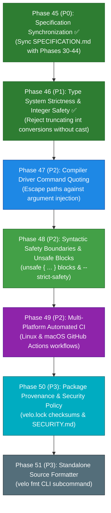

# The Velo Language Gap Analysis & Phased Engineering Roadmap 📋

> **Document Status**: Active Phased Roadmap & Open Engineering Backlog  
> **Target Version**: Velo 2.0+ (Production Systems & Game Engine Viability)  
> **Source Baseline**: Programming Language Review Report `PLR-VELO-2026-001` (Commit `49b2010`)  
> **Archive**: All completed historical gap audits (§1.1 through §44.1) are preserved in Git history.  
> **Workflow Rule**: An AI agent or engineer MUST only implement **one single Phase and one single Task at a time**. After completing each task, verify with tests (`python -m pytest tests -q`), rebuild the bootstrap chain (`bin/velo.exe`), and update this document.

---

## 1. Summary of Completed Milestones

All foundational milestones and language extensions implemented prior to Review `PLR-VELO-2026-001` are **100% completed, self-hosted, and passing all 636 regression tests**:

| Milestone Range | Scope & Capabilities Delivered | Status |
| :--- | :--- | :---: |
| **Foundational Milestones (§1 – §6)** | Bitwise ops, control flow, `kind` enums/tagged unions, generics, function pointers, UFCS, operator overloading, advanced structs, zone arena, collections (`shelf`, `map`, `ring`, `bitset`, `dyn`), math, fs, time, build modes, visual error diagnostics, LSP 3.17, native test runner, MSVC C99 portability. | **COMPLETED** ✅ |
| **Standard Library Modernization (Phases 1 – 29)** | Pure-Velo `std.*` migration (`io`, `str`, `fmt`, `coll`, `fs`, `json`, `time`, `math`, `os`, `net`, `crypto`, `http`, `log`, `test`, `encoding`, `csv`, `cli`, `url`, `rand`, `uuid`, `text`, `timer`, `validate`). | **COMPLETED** ✅ |
| **Language & Systems Hardening (Phases 30 – 44)** | Codegen error gating, algebraic error handling (`or` / `fail`), lexical zone escape analysis, compile-time null safety (`?T`), non-blocking async event loop (`std.async`), async HTTP client/server, zero-alloc HTTP server fast-path, flow-sensitive type narrowing, first-class `if-else` expressions, string pattern matching in `on`, string `+`/`+=` concatenation, fixed-size stack arrays (`[N]T`), and first-class tuples with multiple return values (`-> (A, B)`). | **COMPLETED** ✅ |

*(Full historical defect analyses, fix implementations, and verification proofs for Phases 1 through 44 are preserved in Git history).*

---

## 2. Active Phased Engineering Roadmap (Gaps from Review `PLR-VELO-2026-001`)

The following roadmap comprises strictly the open gaps and findings identified during the independent engineering review of Velo v2.0-beta.



---

### Phase 45: Language Specification Synchronization & Contract Hardening (`PLR-VELO-001`) [COMPLETED] ✅

#### Task 45.1: Specification Modernization for Post-Phase 30 Features [COMPLETED] ✅
* **Former Defect**:
  - `docs/SPECIFICATION.md` covered only Stage 1 and early Stage 2 features up to §2.9 and §9.
  - Major language capabilities implemented and verified across Phases 30 through 44 were absent from the formal specification:
    1. Fixed-size stack arrays (`[N]T`, `buf.len`, `buf.ptr`, stack allocation semantics).
    2. First-class tuples and multiple return values (`-> (A, B)`, destructuring `let (a, b) = val`, wildcard `_`, member access `t.0`/`t.1`).
    3. Algebraic outcome types (`T or E`, `fail err`, and `or return` unwrapping).
    4. Compile-time null safety and optional types (`?T`, `opt.val`, `opt.has`, and `null` literal semantics).
    5. Flow-sensitive type narrowing (`if x != null { ... }` narrowing `?T` to `T`).
    6. First-class `if-else` expressions producing values (`let x = if cond { a } else { b }`).
    7. String pattern matching in `on` statements.
    8. Native string concatenation operators (`+` and `+=`).
* **Fix Applied**:
  - Updated `docs/SPECIFICATION.md` to Stage 2 Production Specification standard.
  - Formalized §1.4 (`fail` keyword), §1.6 (precedence table with string concat `+` and append `+=`), and §1.7 (strict left-to-right evaluation order and short-circuit semantics).
  - Authored comprehensive normative sections:
    * **§2.10: Fixed-Size Stack Arrays (`[N]T`)**: syntax, zero-initialization, array literals, constant compile-time bounds checking, immutability, `.len` and `.ptr` properties, array copy assignment via `memcpy`, and C99 compound literal lowering.
    * **§2.11: First-Class Tuples & Multiple Return Values (`-> (A, B)`)**: type annotations, tuple literals, destructuring declarations (`let (a, b) = ...`), wildcard discard `_`, member access (`.0`, `.1`), and zero-overhead mangled struct lowering.
    * **§2.12: Optional Types & Compile-Time Null Safety (`?T`)**: nullable pointer representation, boxed value structs (`_Velo_Opt_T`), `.has` and `.val` properties, and flow-sensitive type narrowing across branches and early returns.
    * **§2.13: Algebraic Outcome Types & Error Handling (`T or E`)**: outcome syntax, `fail` statements, `or return` error propagation, `.ok`, `.val`, `.err` properties, and C union lowering.
    * **§6.2: Native String Concatenation (`+` and `+=`)**: zone/heap dynamic allocation and desugaring.
    * **§7.3.2: String Pattern Matching in `on`**: string comparison lowering and wildcard matching.
    * **§7.4: First-Class Conditional Expressions (`if-else`)**: expression evaluation, branch typing, and automatic widening (`widen_if_branch_types`).
    * **§9: CLI Surface**: updated command reference table to include `test`, `pkg`, and `lsp`.
* **Residual Limitation**:
  - 1-tuples `(T,)` are not part of the grammar (parenthesized single expressions `(expr)` remain grouping expressions). Fixed-size stack arrays cannot be returned directly by value due to C99 return type limitations (pointers `@T` or enclosing structs should be returned).
* **Verification**:
  - Verified every specification code example compiles and runs cleanly with `bin/velo.exe`.
  - Audited `docs/SPECIFICATION.md` against parser AST definitions in `src/ast/` and `src/frontend/`.
  - Ran automated test suites with 100% pass rate.
  - Line standards verified (`scripts/count_lines.py`).

---

### Phase 46: Type System Strictness & Implicit Integer Narrowing Safety (`PLR-VELO-002`) [COMPLETED] ✅

#### Task 46.1: Enforce Explicit Casts for Truncating or Signed/Unsigned Conversions [COMPLETED] ✅
* **Former Defect**:
  - In `src/ast/types.vl` (lines 251–252), `types_are_compatible` previously allowed all integer and float types to implicitly convert to one another:
    ```rust
    if is_int_type(expected) and is_int_type(actual) { return true }
    if is_float_type(expected) and is_float_type(actual) { return true }
    ```
  - Any integer type (e.g. `u64`, `i64`) was treated as structurally compatible with any smaller integer type (e.g. `i8`, `u8`) without requiring an explicit cast (`x as i8`).
  - In systems and embedded code, this permitted silent integer truncation and unintended sign inversion at runtime.
  - Furthermore, `f64` could implicitly convert to narrower float type `f32` without explicit cast.
* **Fix Applied**:
  - Implemented strict integer and float compatibility rules in `src/ast/int_types.vl`:
    * Safe widening within the same signedness (`i8 -> i16 -> i32 -> i64 / isize`, `u8 -> u16 -> u32 -> u64 / usize`) and float widening (`f32 -> f64`) remain implicitly compatible.
    * Narrowing integer conversions (e.g. `u64 -> u8`, `i64 -> i32`, `usize -> u32`), signed/unsigned mismatches (e.g. `i32 -> u32`, `u32 -> i32`), and narrowing float conversions (`f64 -> f32`) are strictly rejected at compile time unless an explicit cast `as <type>` is used.
    * Descriptive error messages emitted:
      `[Velo Error] Cannot implicitly convert '{actual}' to narrower type '{expected}'. Use explicit cast 'as {expected}'.`
      `[Velo Error] Cannot implicitly convert '{actual}' to '{expected}'. Use explicit cast 'as {expected}'.`
      `[Velo Error] Cannot implicitly convert '{actual}' to narrower type '{expected}'. Use explicit cast 'as {expected}'.`
  - Created contextual literal adaptation in `src/analysis/literal_check.vl`:
    * Unsuffixed integer literals and arithmetic/bitwise expressions composed of unsuffixed literals adapt contextually to target integer types (`u8`, `i8`, `u16`, `i16`, `u32`, `i32`, `u64`, `i64`, `usize`, `isize`) if the constant value fits within the target range.
    * Compile-time out-of-range diagnostic emitted if the literal exceeds the target type range:
      `[Velo Error] Integer literal '{lit}' out of range for type '{target}'`.
    * Suffixed literals (`1000_u64`) are checked strictly according to their explicit type.
  - Integrated literal adaptation and strict type checking across:
    * Variable declarations (`STMT_VAR_DECL`).
    * Variable assignments and compound assignments (`STMT_ASSIGN`).
    * Return statements (`STMT_RETURN`).
    * Struct field initializers and default field values (`DECL_DATA`).
    * Function and method call arguments (`adapt_and_check_call_args`).
    * Binary arithmetic/bitwise expressions and fallback operators (`TOK_OR`, `??`).
    * Built-in `sizeof` expression support returning `"usize"`.
  - Audited compiler source and standard library, fixing latent signedness/narrowing bugs and adding explicit casts:
    * `src/frontend/parser_lit.vl`: fixed `parser_previous(p)` replacing invalid negative offset peek.
    * `src/backend/check.vl`: added explicit `usize` casts.
    * `src/analysis/reflect_checks.vl`, `src/backend/reflect_gen.vl`, `src/backend/shelf_gen.vl`, `src/analysis/mono_unroll.vl`, `src/analysis/monomorphize_expr.vl`: added explicit `as i32` casts for `sb_append_int` and `make_int_expr`.
    * `std/test/benchmark.vl`: typed `mut warmup_count: usize = 5`.
    * `std/tests/coll/shelf_test.vl`: typed `let slice_size: usize = 16`.
    * `std/tests/rand/rand_test.vl`: typed `mut f_min: f64 = 20.0`, `mut f_max: f64 = 10.0`.
* **Residual Limitation**:
  - Unchecked truncating conversions are only allowed when an explicit `as <type>` cast is written. Pointer-to-integer conversions continue to require `as usize` or `as isize`.
* **Verification**:
  - Added comprehensive test suite `tests/test_type_checker.py` (23/23 tests passing) covering unsigned/signed widening, narrowing rejection, explicit cast acceptance, signed/unsigned rejection, function arg/return/struct field narrowing, integer literal adaptation and out-of-range diagnostics, suffixed literal enforcement, and float widening/narrowing.
  - Passed full test suite: 659 passed in 555.47s (100% pass rate).
  - Maintained 3-generation self-hosting bootstrap determinism (Gen2 and Gen3 emit identical bit-for-bit C output matching `bootstrap.c` with SHA-256 `c79988a72057e0826814ec8dd630446190e62d70ef6d4630b685b3d776905310`).
  - Maintained line count standards across all 98 compiler source files in `src/` ($\le 394$ lines, ceiling 400).

---

### Phase 47: Compiler Driver Command Quoting & Injection Hardening (`PLR-VELO-003`)

#### Task 47.1: Robust Escaped Path Quoting Across GCC and MSVC Compiler Drivers [OPEN] ⏳
* **Defect**:
  - In `src/backend/driver.vl` and `src/backend/driver_cc.vl`, compilation, linking, and execution commands invoke GCC or MSVC `cl.exe` by assembling command strings without escaping paths:
    ```rust
    sb_append_str(@sb, "gcc -O2 ... -o ")
    sb_append_str(@sb, out_path)
    ```
  - If a project path, source file path, include directory, or output executable path contains spaces or shell metacharacters, the external shell or process launcher misinterprets flags, resulting in build failures or argument injection.
* **Required Fix**:
  - Implement a dedicated path quoting helper `quote_path(path: string) -> string` in `src/common/utils.vl`.
  - Wrap all path operands in escaped double quotes (`"\"" + path + "\""`) across:
    - Input source file paths and output executable paths (`-o "..."`, `/Fe:"..."`).
    - Include paths (`-I "..."`, `/I "..."`).
    - Library search paths (`-L "..."`, `/LIBPATH:"..."`).
    - Cache directory paths (`.velo_cache`).
  - Ensure Windows backslashes in quoted strings are handled correctly by GCC and MSVC drivers.
* **Acceptance & Verification**:
  - Add regression test in `tests/test_cc_backend.py` compiling and executing a `.vl` file inside a directory with spaces (e.g. `tests/fixtures/path with spaces/main.vl`).
  - Verify clean execution with both `--cc gcc` and `--cc cl`.
  - Verify line count of `src/backend/driver.vl` and `src/backend/driver_cc.vl` remains $\le 395$ lines.

---

### Phase 48: Syntactic Safety Boundaries & Unsafe Blocks (`PLR-VELO-004`)

#### Task 48.1: `unsafe { ... }` Block Syntax and `--strict-safety` Verification [OPEN] ⏳
* **Defect**:
  - Velo provides compile-time zone escape analysis, but raw pointer dereferencing (`ptr.@`, `ptr.field`) and unchecked pointer arithmetic are syntactically permitted anywhere in user code.
  - Systems developers cannot easily audit where unsafe memory manipulations occur or enforce that high-level application logic remains free of raw pointer hazards.
* **Required Fix**:
  - Add `unsafe` keyword to lexical tokens and parser AST (`STMT_UNSAFE = 216`).
  - Add compiler flag `--strict-safety`:
    - When enabled, performing raw pointer dereferencing (`ptr.@`), pointer arithmetic, or unchecked foreign calls (`extern act`) outside of an `unsafe { ... }` block emits a compile error:
      `[Velo Error] Raw pointer dereference requires an 'unsafe { ... }' block when compiling with --strict-safety.`
    - When `--strict-safety` is omitted, `unsafe { ... }` blocks parse and execute normally with full backward compatibility.
  - In emitted C, `unsafe { ... }` lowers to an ordinary scoped C block `{ ... }`.
* **Acceptance & Verification**:
  - Add test suite `tests/test_strict_safety.py` verifying that raw pointer operations are permitted inside `unsafe { ... }` and rejected outside when `--strict-safety` is active.
  - Verify self-hosted compiler rebuilds cleanly with deterministic SHA-256 fixed point.

---

### Phase 49: Multi-Platform Automated Continuous Integration (`PLR-VELO-005`)

#### Task 49.1: Linux & macOS Automated Test and Bootstrap Matrix [OPEN] ⏳
* **Defect**:
  - `runtime/velo_runtime.h` implements POSIX threading (`pthread`), monotonic clock, and filesystem compatibility shims, but automated testing is conducted almost exclusively on Windows (`x86_64-pc-windows-msvc` and MinGW/UCRT64).
  - Cross-platform regressions on Linux (x86_64 / aarch64) and macOS (Apple Silicon) can go undetected until manual user testing.
* **Required Fix**:
  - Add `.github/workflows/ci.yml` multi-platform test matrix:
    - **Windows:** Windows Server 2022 with MSYS2 UCRT64 GCC and MSVC `cl.exe`.
    - **Linux:** Ubuntu 22.04 LTS / 24.04 LTS with GCC and Clang.
    - **macOS:** macOS 14 / 15 (Apple Silicon) with Apple Clang.
  - Provide a canonical POSIX bootstrap script `scripts/bootstrap.sh` that mirrors `scripts/bootstrap.bat`:
    - Compiles `bootstrap.c` using ambient `gcc` or `clang` with `-std=c99 -O2 -I runtime`.
    - Runs 3-stage self-hosting bootstrap (`bin/velo build src/main.vl -> Gen2 -> Gen3`).
    - Verifies SHA-256 determinism across generations.
  - Wire `python -m pytest tests -q` into CI across all platforms.
* **Acceptance & Verification**:
  - Verify `scripts/bootstrap.sh` executes cleanly on Linux/macOS environments.
  - All CI workflow jobs pass with zero failures.

---

### Phase 50: Package Supply Chain Integrity & Vulnerability Disclosure (`PLR-VELO-006`)

#### Task 50.1: Package Checksum Verification (`velo.lock`) and `SECURITY.md` Policy [OPEN] ⏳
* **Defect**:
  - The package manager (`velo pkg`) parses `velo.pkg` manifests, but lacks cryptographic checksum verification for fetched package sources, leaving users vulnerable to altered or tampered dependencies.
  - The repository lacks a formal `SECURITY.md` file establishing a vulnerability disclosure channel, supported version tiers, and incident response SLAs.
* **Required Fix**:
  1. **Lockfile & Hash Verification:**
     - Extend `src/common/manifest.vl` and `src/backend/driver_pkg.vl` to generate and verify `velo.lock`.
     - Store SHA-256 hashes for all resolved dependencies:
       ```
       package "raylib" = { source = "...", version = "5.0", hash = "sha256:..." }
       ```
     - During `velo pkg install` / `velo pkg update`, calculate SHA-256 of downloaded archives using `std.crypto` and reject mismatched digests.
  2. **Security Policy (`SECURITY.md`):**
     - Author `SECURITY.md` in repository root declaring:
       - Supported language and compiler release versions.
       - Vulnerability reporting procedures (private email contact).
       - Triage timeline (acknowledgement within 48 hours, patch targets).
       - Responsible disclosure policy.
* **Acceptance & Verification**:
  - Create test suite `tests/test_pkg_security.py` verifying that modified package contents fail checksum verification during install.
  - Verify `SECURITY.md` is present and valid markdown.

---

### Phase 51: Standalone Canonical Source Formatter (`velo fmt`) (`PLR-VELO-007`)

#### Task 51.1: AST/Token-Based Standalone Code Formatter Subcommand [OPEN] ⏳
* **Defect**:
  - Velo provides `velo check`, `velo doc`, `velo test`, and an LSP server, but lacks an automated, deterministic CLI formatter (`velo fmt <file>`).
  - Formatting inconsistencies in multi-developer projects must currently be resolved manually.
* **Required Fix**:
  - Implement `src/tooling/formatter.vl` and dispatch `velo fmt <file> [--check]` in `src/main.vl`.
  - The formatter:
    - Scans tokens and comments preserving all doc comments (`///`) and block comments (`/* ... */`).
    - Standardizes indentation to 4 spaces per block level.
    - Normalizes spacing around binary operators (`+`, `-`, `*`, `==`, etc.), type annotations (`: T`), and control blocks (`if`, `loop`, `on`).
    - `--check` flag returns exit code 0 if formatted, or exit code 1 with a diff if unformatted (for CI).
* **Acceptance & Verification**:
  - Add test suite `tests/test_formatter.py` verifying formatting idempotency: `format(format(code)) == format(code)`.
  - Verify formatting preserving comments and AST semantics.
