# The Velo Language Gap Analysis & Phased Engineering Roadmap 📋

> **Document Status**: Active Phased Roadmap & Open Engineering Backlog  
> **Target Version**: Velo 2.0+ (Production Systems & Game Engine Viability)  
> **Archive**: All completed historical gap audits (§1.1 through §6.9) are preserved in [docs/gaps_archive.md](file:///c:/projects/easylang/docs/gaps_archive.md).  
> **Workflow Rule**: An AI agent or engineer MUST only implement **one single Phase and one single Task at a time**. After completing each task, verify with tests, rebuild the bootstrap chain (`bin/velo.exe`), and update this document.

---

## 1. Completed Foundation Milestones (Summary Audit)

All 26 foundational milestones from the initial language roadmap (§1 through §6) are **100% completed, tested, and self-hosted**:

| Section | Milestone Area | Core Capabilities Delivered | Status |
| :--- | :--- | :--- | :---: |
| **§1.1 – §1.4** | **Syntax & Lexer** | Binary/unary bitwise ops (`&`, `\|`, `^`, `~`, `<<`, `>>`), block/doc comments, numeric literals (`0x`, `0b`, `0o`, `_`), character/string escapes (`\uXXXX`, `` `raw` ``) | **COMPLETED** ✅ |
| **§2.1 – §2.3** | **Control Flow** | `break` and `continue` in loops, pattern matching `on` statements, safe range loops | **COMPLETED** ✅ |
| **§3.1 – §3.5** | **Type System** | `kind` enums/tagged unions, generic functions/structs, function pointers/callbacks, UFCS method calls, operator overloading (`+`, `-`, `*`, `/`, `[]`) | **COMPLETED** ✅ |
| **§3.6** | **Advanced Structs** | Default field initializers, struct alignment & packing (`#align`, `#packed`), type aliases (`aka`) | **COMPLETED** ✅ |
| **§4.1 – §4.3** | **Memory Subsystem** | Extensible `@Allocator` interface, multithreaded thread-locals (`thread.spawn`/`join`), memory intrinsics (`mem.copy`, `mem.set`) | **COMPLETED** ✅ |
| **§5.1 – §5.5** | **Standard Library** | `sys.str` string library, Dynamic collections (`shelf`, `map`, `ring`, `bitset`, `dyn`), `sys.math`, `sys.fs`/`sys.os`, `sys.time` | **COMPLETED** ✅ |
| **§6.1 – §6.2** | **Toolchain** | Linker flags (`-l<lib>`, `-L<dir>`), build modes (`--debug`, `--release`, `-O0`..`-O3`) | **COMPLETED** ✅ |
| **§6.3 – §6.5** | **Developer Tooling** | Visual snippet error diagnostics, LSP Language Server 3.17 (`velo lsp`), native integrated test runner (`test` / `assert`) | **COMPLETED** ✅ |
| **§6.6 – §6.8** | **Compiler Internals** | Dynamic lexer token sizing, `velo check [--json]` CLI, contextual keywords (`data`, `kind`, `op`) | **COMPLETED** ✅ |
| **§6.9** | **Portability** | MSVC C99 portability of emitted C (zero GCC statement expressions, `VELO_TLS`, `VELO_ALIGNED`) | **COMPLETED** ✅ |

*(Full historical audit logs, defect explanations, and verification proofs for §1.1–§6.9 are preserved in [docs/gaps_archive.md](file:///c:/projects/easylang/docs/gaps_archive.md)).*

---

## 2. Active Phased Engineering Roadmap (Unsolved Gaps)

Each phase is divided into self-contained, atomic tasks. **Do not combine tasks. Complete Task N.1 before proceeding to Task N.2.**

```mermaid
flowchart TD
    P1["Phase 1: Toolchain CLI & Codegen Hardening\n(--cc cl driver flag, string interpolation calls, ternary side-effects)"] --> P2["Phase 2: Language Ergonomics & Tooling Polish\n(Contextual keywords, struct dot-autocomplete in LSP)"]
    P2 --> P3["Phase 3: Hardware SIMD Math Library (sys.simd)\n(f32x4/i32x4 types, vector arithmetic, dot/min/max)"]
    P3 --> P4["Phase 4: Compile-Time Struct Reflection\n(Field metadata builtins, compile-time unrolled iteration)"]
    P4 --> P5["Phase 5: Package Manifest & Dependency Manager (velo pkg)\n(velo.toml format, multi-module packaging, dependency cache)"]
    P5 --> P6["Phase 6: Multi-Arena Memory Management & Scaling\n(Custom arena creation, heap-spilling fallback)"]
    P6 --> P7["Phase 7: Dynamic Collections Lifecycle & Memory Integrity\n(heap shelf buffer leak fix, shelf.destroy, heap map)"]
    P7 --> P8["Phase 8: String Subsystem Modernization & Safety\n(zone-allocated strings, in-memory string interpolation str.format)"]
    P8 --> P9["Phase 9: Source-Level Debugger Support\n(#line preprocessor directives for GDB / VS Debugger)"]
    P9 --> P10["Phase 10: Compiler Architecture & Bootstrapping Modernization\n(400-line modular relief, portable bootstrap.c snapshot)"]
    style P1 fill:#e53935,stroke:#b71c1c,color:#ffffff
    style P2 fill:#fb8c00,stroke:#e65100,color:#ffffff
    style P3 fill:#1e88e5,stroke:#0d47a1,color:#ffffff
    style P4 fill:#43a047,stroke:#1b5e20,color:#ffffff
    style P5 fill:#8e24aa,stroke:#4a148c,color:#ffffff
    style P6 fill:#00acc1,stroke:#006064,color:#ffffff
    style P7 fill:#d32f2f,stroke:#b71c1c,color:#ffffff
    style P8 fill:#f57c00,stroke:#e65100,color:#ffffff
    style P9 fill:#1976d2,stroke:#0d47a1,color:#ffffff
    style P10 fill:#7b1fa2,stroke:#4a148c,color:#ffffff
```



---

### Phase 1: Toolchain CLI & Codegen Hardening

#### Task 1.1: MSVC CLI Driver Backend Flag (`--cc cl`) [COMPLETED] ✅
* **Former Defect**: In §6.9, emitted C was made 100% portable C99 for MSVC (`cl.exe`). However, the Velo CLI driver (`velo build`, `velo run`, `velo test`) hardcoded calling `gcc.exe`. To compile with MSVC, users had to run `velo emit-c` and manually invoke `cl.exe`.
* **Fix Applied**:
  - Implemented `--cc <gcc|cl>` option across Stage 1 (`velo.py`, `velo/driver.py`) and Stage 2 (`src/main.vl`, `src/backend/driver.vl`, `src/backend/driver_cc.vl`).
  - Added MSVC `cl.exe` command assembly and flag translation:
    * Passed `/nologo`, `/TC`, `/W3`, `/wd4090`, `/wd4996`, `/D_CRT_SECURE_NO_WARNINGS`.
    * Output executable translation `/Fe:<path>`.
    * Optimization flags `/O2` (default / release), `/Od /Zi` and `/DEBUG` (debug), `/O1` (`-O1`).
    * Linker flags: `/link`, `/LIBPATH:<dir>` for `-L`, `<lib>.lib` for `-l`.
    * Automatic discovery of Visual Studio `vcvars64.bat` if `cl` is not on ambient PATH.
  - Extracted compilation and execution command assembly into `src/backend/driver_cc.vl` (153 lines), reducing `src/backend/driver.vl` from 392 to 356 lines, comfortably respecting the 400-line file limit.
  - Fixed `@shelf[T]` dynamic unbox order in `src/backend/shelf_gen.vl` so unboxing a pointer cast `as @shelf[...]` emits `velo_dyn_unbox_ptr` matching Stage 1.
  - When `--cc` is omitted, default remains `gcc` with 100% backward compatibility.
* **Residual Limitation**: Compiling with MSVC requires MSVC C++ Build Tools or Visual Studio installed on Windows (standard MSVC requirement); automatic detection scans standard VS 2022 / VS 2019 install paths or ambient PATH.
* **Verification**:
  - Verified `python velo.py build examples/31_shelf_basics.vl --cc cl` and `run --cc cl` build and execute correctly.
  - Verified `bin/velo.exe build examples/31_shelf_basics.vl --cc cl` and `run --cc cl` build and execute correctly.
  - Verified `bin/velo.exe test examples/15_native_tests.vl --cc cl` executes and passes all 105 tests.
  - Added dedicated test suite `tests/test_cc_backend.py` covering Stage 1 & Stage 2 build, run, default fallback, and invalid backend rejection (all 6 tests passing).
  - 3-stage bootstrap chain completed (`Gen1 -> Gen2 -> Gen3 -> bin/velo.exe`) with bit-for-bit SHA-256 determinism verified (`DCECDA55AE81D1160EAD359435443B2DF5609F4E68455D8AA5222F4B34998C13`).
  - All source files in `src/` verified $\le 399$ lines (`scripts/count_lines.py`).
  - Full test suite passing (280 tests passed).

#### Task 1.2: Native String Interpolation Function Calls [COMPLETED] ✅
* **Former Defect**:
  - In Stage 1 (`velo/codegen_c.py`), string interpolation used regex `r'\{([a-zA-Z0-9_\.@\[\]]+)\}'`, which skipped any expression containing parentheses `(` or operators `+`, emitting `{fib(5)}` verbatim without interpolation.
  - In Stage 2 (`src/backend/codegen_io.vl`), `resolve_path_type_and_c` only handled simple variable identifiers and struct field paths. Calling functions inside `{...}` (e.g. `fib(5)`) defaulted to `i32` `%lld`, UFCS method calls (e.g. `p.get_name()`) were emitted as invalid C member accesses `p.get_name()` failing C compilation, and string-returning functions were formatted with `%lld` printing pointer addresses.
* **Fix Applied**:
  - In Stage 1 (`velo/codegen_c.py`), replaced the restrictive regex in `_lower_io_call` with a brace-depth scanner to extract balanced `{...}` regions, tokenized and parsed the inner expression with `Lexer` and `Parser`, resolved its type via `_resolve_expr_type`, emitted C code, and mapped to the proper format specifier (`%lld`, `%.2f`, `%s`, `%s`) with required casts.
  - In Stage 2 (`src/backend/codegen_io.vl`), added `parse_interp_expr(source: string) -> @ExprNode` leveraging `lexer.vl`, `parser.vl`, and `parser_expr.vl`. Interpolation regions are parsed into complete AST `@ExprNode` trees, typed with `infer_expr_type(st, parsed_expr)`, and emitted via `emit_c_expr(@c_sb, st, parsed_expr)`, enabling arbitrary expressions, function calls, UFCS method calls, and operators inside interpolation.
  - Maintained safe fallback to `resolve_path_type_and_c` if parsing fails.
  - Line count of `src/backend/codegen_io.vl` maintained at 319 lines (under the 400-line ceiling).
* **Residual Limitation**:
  - Expressions inside string interpolation containing unescaped quote characters are bounded by standard Velo string literal lexical rules. Variables, function arguments, UFCS methods, operators, and constants are fully supported.
* **Verification**:
  - Added dedicated test suite `tests/test_string_interpolation.py` validating function calls, UFCS method calls, arithmetic expressions, and types (`i32`, `f64`, `bool`, `string`) across Stage 1 and Stage 2.
  - 3-stage bootstrap chain completed (`Gen1 -> Gen2 -> Gen3 -> bin/velo.exe`) with bit-for-bit SHA-256 determinism verified (`ADC60D9D80B32607B6B0D6FB669F7EBECE3051E8A3C0384705DFEA6F06678BC3`).
  - All source files $\le 399$ lines (`scripts/count_lines.py`).
  - No UTF-8 BOM in any `.vl` file.
  - Full test suite passing (281 tests passed).

#### Task 1.3: Single-Evaluation Null Comparisons for Function Calls [COMPLETED] ✅
* **Former Defect**:
  - In Stage 2 (`src/backend/codegen_expr.vl`), checking a string-returning function call against `null` (e.g. `call_count() != null`) matched `if ltype == "string" or rtype == "string"` without checking for `null` literals (`EXPR_NULL` / `@void`). This lowered the check into a redundant null-guarded ternary: `((call_count() != NULL && NULL != NULL) ? (strcmp(call_count(), NULL) != 0) : (call_count() != NULL))`. As a result, `call_count()` was evaluated in both the ternary test and the else branch, executing its side effects twice.
  - In string equality comparisons (`call_count() == "hello"`), both Stage 1 and Stage 2 evaluated the function call twice across the condition and branches of the ternary.
* **Fix Applied**:
  - In `src/backend/codegen_expr.vl`, updated equality / inequality emission:
    * Gated the string comparison block with `expr.left.kind != EXPR_NULL and expr.right.kind != EXPR_NULL and ltype != "@void" and rtype != "@void" and (ltype == "string" and rtype == "string")`. When comparing against `null`, it falls through to direct C pointer comparisons `(expr != NULL)` / `(expr == NULL)`, evaluating `expr` exactly once.
    * For string comparisons where either operand is an `EXPR_CALL`, lowered the comparison to `velo_str_eq(left, right)` or `velo_str_neq(left, right)`, evaluating arguments exactly once.
    * Re-condensed the emission logic in `codegen_expr.vl`, reducing line count from 395 to 384 lines.
  - In `velo/codegen_c.py` (Stage 1), added `velo_str_eq` / `velo_str_neq` emission when comparing strings where either operand is a `CallExpr`.
  - In `velo/runtime/velo_runtime.h`, added C99 portable static inline helper functions `velo_str_eq` and `velo_str_neq`.
* **Residual Limitation**:
  - None. Both null comparisons (`!= null`, `== null`) and string comparisons with function calls evaluate arguments exactly once on both stages.
* **Verification**:
  - Added dedicated test suite `tests/test_null_comparisons.py` verifying single evaluation for `get_str() != null`, `null != get_str()`, `get_null_str() == null`, `get_node() == null`, `get_str() == "gamma"`, and `get_str() != "epsilon"` across Stage 1 and Stage 2.
  - 3-stage bootstrap chain completed (`Gen1 -> Gen2 -> Gen3 -> bin/velo.exe`) with bit-for-bit SHA-256 determinism verified (`3B0CE93693C8DA26BA366546F2976F80DC5A4B1899B22541A7901C68E1E93FD6`).
  - Native test suite `bin/velo.exe test examples/15_native_tests.vl` passed all 105 tests.
  - All source files $\le 399$ lines (`scripts/count_lines.py`).
  - No UTF-8 BOM in any `.vl` file.
  - Full test suite passing (282 tests passed).

---

### Phase 2: Language Ergonomics & Tooling Polish

#### Task 2.1: Contextual Re-acceptance of Remaining Reserved Keywords [COMPLETED] ✅
* **Former Defect**:
  - Previously, only `data`, `kind`, `op`, and `test` were accepted contextually in identifier positions. Using reserved keywords such as `use`, `act`, `loop`, `zone`, `defer`, `return`, `break`, `continue`, `on`, `extern`, and `aka` as struct field names (e.g. `node.return`, `event.action`, `task.loop`), struct literal field initializers (`Node { return: 1, loop: 2 }`), member accesses (`n.return`, `n.loop`), function parameters, or variable declarations failed at parse time with syntax errors.
* **Fix Applied**:
  - In Stage 1 (`velo/parser.py`), defined `CONTEXTUAL_IDENT_TOKENS` and added `_consume_ident()`. Updated struct field definitions, enum variant fields, struct literal initializers (`_is_struct_literal` & `_parse_struct_literal`), member dot-access (`_parse_postfix`), function/extern/anonymous parameters, and `let`/`mut`/typed variable declarations to accept contextual identifiers.
  - In Stage 2 (`src/frontend/parser.vl`, `src/frontend/parser_decl.vl`, `src/frontend/parser_stmt.vl`, `src/frontend/parser_expr.vl`), added `is_contextual_ident_tok()` and `parser_consume_ident()`. Updated `is_struct_literal`, struct field parsing, function parameters, `let`/`mut` statements, struct literal instantiations, and member accesses after `.` to accept contextual keyword identifiers.
  - Maintained expression/statement disambiguation: statement-level keywords starting statements or following line continuations preserve strict syntax error semantics for incomplete expressions (e.g., in LSP live diagnostics).
* **Residual Limitation**:
  - Reserved keywords with statement-level control flow syntax (`return`, `loop`, `defer`, etc.) remain reserved at the start of statements. Contextual re-acceptance applies cleanly where syntactic position is unambiguous (struct fields, member access, parameter lists, literal keys, and explicit declarations).
* **Verification**:
  - Added dedicated test suite `tests/test_contextual_keywords.py` verifying struct field definitions with `return`, `loop`, `use`, `defer`, `act`, `zone`, `break`, `continue`, `on`, `extern`, `aka`, `data`, `kind`, `op`, `test`, member accesses, struct literal initialization, and execution parity between Stage 1 and Stage 2.
  - 3-stage bootstrap chain completed (`Gen1 -> Gen2 -> Gen3 -> bin/velo.exe`) with bit-for-bit SHA-256 determinism verified (`DE75DE1C3ED69ECC0F712F6DABD2BD96CB25FD0FDF179193777920D2C31FF77F`).
  - Native test suite `bin/velo.exe test examples/15_native_tests.vl` passed all 105 tests.
  - All source files $\le 399$ lines (`scripts/count_lines.py`).
  - No UTF-8 BOM in any `.vl` file.
  - Full test suite passing (296 tests passed).

#### Task 2.2: Struct Field Dot-Autocomplete in LSP (`velo lsp`) [COMPLETED] ✅
* **Former Defect**:
  - The LSP analysis server (`velo/analysis.py` and `editors/vscode/_server/velo_analysis.py`) provided member completion only for builtin modules (`sys.io`, `sys.mem`, `io.`, `fs.`, etc.). Typing `.` after custom struct variables (`pt.<caret>`, `player.<caret>`), pointer parameters (`p: @Point`), or nested member paths (`player.pos.<caret>`) yielded an empty completion list with no field inference. Additionally, live buffers with an uncompleted trailing dot caused parse failures that cleared the symbol table index during completion requests.
* **Fix Applied**:
  - In `velo/analysis.py` (and mirrored in `editors/vscode/_server/velo_analysis.py`), implemented AST type inference for local variable declarations and expressions:
    * Added `_infer_node_type()` handling `StructLiteral`, `AddressOf`, `DerefExpr`, `CallExpr`, `Identifier`, and `MemberAccess`.
    * Updated `_locals_of()` and `_local_lookup()` to track inferred struct types for untyped variable bindings and parameters.
    * Added `_resolve_expr_type_at()` to resolve the type of arbitrary dot-chained paths (`player.pos`) against the symbol table and local scopes.
    * In `VeloAnalysis.completions()`, safely handled live buffers with trailing dots by inserting a transient `__velo_caret__` placeholder during symbol indexing, resolving the target expression type, and returning declared struct fields as `CompletionItemKind.Field` (`kind: 5`) with field type details and prefix filtering.
* **Residual Limitation**:
  - Autocompletion resolves fields on static and local `data` struct variables, pointers, and nested member chains. Dynamic UFCS acts without declared receiver types default to general global symbol completion.
* **Verification**:
  - Expanded `test_lsp_completion` in `tests/test_lsp.py` with 4 test scenarios verifying:
    1. Direct struct instance variable completion (`pt.` -> `x`, `y` with `kind: 5`).
    2. Prefix filtering on field names (`pt.x` -> only `x`).
    3. Pointer parameter completion (`p: @Point` -> `x`, `y` with `kind: 5`).
    4. Nested member path completion (`player.pos.` -> `x`, `y`).
  - Pytest LSP suite passed all 8 tests in 0.37s.
  - Full test suite passing (296 tests passed).
  - Native test suite `bin/velo.exe test examples/15_native_tests.vl` passed all 105 tests.
  - All source files $\le 399$ lines (`scripts/count_lines.py`).
  - No UTF-8 BOM in any `.vl` file.

#### Task 2.3: Type Checking Default Struct Field Initializers [COMPLETED] ✅
* **Former Defect**: In §3.6, default field values (`data Point { x: f32 = 0.0 }`) were parsed and emitted, but their constant initializer values were not type-checked against the field's declared type during semantic analysis (e.g. `x: f32 = "invalid"` or `count: i32 = 1.5` passed without error).
* **Fix Applied**:
  - In `velo/codegen_c.py` (Stage 1), added `_types_are_compatible(expected, actual)` and validated each `f.default_expr` during `DataDecl` registration, raising `ValueError(f"Default value type mismatch for field '{f.name}': expected {f.type_name}, got {actual_t}")`.
  - In `src/analysis/type_check_program.vl` (Stage 2), added `check_struct_default_field(st, cur_f)` during Pass 1 struct registration in `check_program()`, verifying `infer_expr_type` against `cur_f.type_name` via `types_are_compatible` and emitting `report_error("semantic", cur_f.line, cur_f.col, "Default value type mismatch for field '...': expected ..., got ...")`.
  - Annotated in `src/analysis/type_checker.vl` that struct default initializers are validated in `check_program`.
* **Residual Limitation**: Field defaults remain restricted to constant literals (`number`, `string`, `bool`, or unary `-` on numeric literals); dynamic expressions or non-literal expressions in struct field defaults are not supported.
* **Verification**:
  - Added `tests/test_default_field_types.py` covering:
    1. Negative tests on Stage 1 for `f32 = "invalid"`, `i32 = 1.5`, `bool = 1`, `string = 42`.
    2. Negative tests on Stage 2 (`bin/velo.exe`) with identical error messages.
    3. `velo check --json` error diagnostics verifying machine-readable outputs on both stages.
    4. Positive execution tests verifying omitted fields correctly receive default initializers.
  - Rebuilt 3-stage bootstrap chain (`velo_gen1.exe` -> `velo_gen2.exe` -> `velo_gen3.exe` -> `bin/velo.exe`).
  - Verified determinism: Gen2 and Gen3 `emit-c src/main.vl` SHA-256 match exactly (`b14a8de470bc459e9be20b40ab296d684110a004dd98f772cac4601932fc1f95`).
  - Native test runner passed all 105 tests (`bin/velo.exe test examples/15_native_tests.vl`).
  - Pytest full test suite passed (308 tests passed in 203s).
  - All source files $\le 399$ lines (`scripts/count_lines.py`).
  - No UTF-8 BOM in any `.vl` file.

---

### Phase 3: Hardware SIMD Math Library (`sys.simd`)

#### Task 3.1: 128-bit SIMD Vector Types (`f32x4`, `i32x4`) [COMPLETED] ✅
* **Former Defect**:
  - The language lacked hardware SIMD vector types (`f32x4` and `i32x4`) and constructors for vectorized operations. Modern graphics, physics engines, and particle systems had to rely on scalar float/integer loops or hope for C compiler autovectorization.
* **Fix Applied**:
  - **Memory Layout & C Runtime**:
    * In `velo/runtime/velo_runtime.h`, defined portable 128-bit aligned vector types:
      - Under GCC/Clang: `typedef float f32x4 __attribute__((vector_size(16), aligned(16)));` and `typedef int32_t i32x4 __attribute__((vector_size(16), aligned(16)));`.
      - Under MSVC: `typedef __m128 f32x4;` and `typedef __m128i i32x4;` (via `<immintrin.h>`).
    * Added static inline constructor helpers `velo_f32x4(x, y, z, w)`, `velo_f32x4_splat(val)`, `velo_i32x4(x, y, z, w)`, and `velo_i32x4_splat(val)`.
    * Upgraded `velo_mem_alloc` and `velo_alloc_with` bump allocators to 16-byte align allocations when type size $\ge 16$.
  - **Stage 1 (Python Compiler)**:
    * In `velo/parser.py`: added `f32x4` and `i32x4` to `ALIAS_TARGET_PRIMITIVES` (supporting `aka Vec4 = f32x4`).
    * In `velo/analysis.py`: added `f32x4` and `i32x4` to `PRIMITIVE_TYPES`.
    * In `velo/monomorphize.py`: inferred `f32x4` and `i32x4` for constructor calls in `_infer_expr_type`.
    * In `velo/codegen_c.py`: registered `f32x4` and `i32x4` in `TYPE_MAP`, `_infer_raw_velo_type`, `_resolve_expr_type`, and implemented `_lower_simd_call` to validate arity (4 for vector, 1 for splat) and argument types (float/int for `f32x4`, int for `i32x4`), lowering calls with `velo_` prefix.
  - **Stage 2 (Self-Hosted Compiler)**:
    * In `src/ast/types.vl`: added `is_simd_type(name: string) -> bool` and integrated into `is_primitive_type`.
    * In `src/backend/codegen_types.vl`: mapped `f32x4` to `"f32x4"` and `i32x4` to `"i32x4"` in `map_type_to_c`.
    * In `src/frontend/parser_decl.vl`: registered `f32x4` and `i32x4` in `is_alias_target_primitive`.
    * In `src/analysis/simd_checks.vl`: implemented `is_simd_constructor` and `check_simd_constructor` for semantic checking and character-identical error reporting.
    * In `src/analysis/type_checker.vl`: dispatched SIMD constructor checking in `infer_expr_type`.
    * In `src/analysis/monomorphize_expr.vl`: recognized SIMD constructors in `mono_infer_type`.
    * In `src/backend/codegen_expr.vl`: lowered SIMD constructor calls with `velo_` prefix.
* **Residual Limitation**:
  - Binary arithmetic operators (`+`, `-`, `*`, `/`) between SIMD vectors and lane accessors (`v.x`, `v.y`, `v.z`, `v.w`, or `v[0]`) are scheduled for Task 3.2. Data access currently uses pointer indexing (`((@v) as @f32)[0]`).
* **Verification**:
  - Added test suite `tests/test_simd_vectors.py` (21 tests) covering:
    1. Positive execution on Stage 1 verifying constructors `f32x4`, `f32x4_splat`, `i32x4`, `i32x4_splat`, 16-byte alignment (`((@v) as usize) % 16 == 0`), data lane preservation in memory, struct embedding, function argument passing/return, and arena/heap 16-byte alignment.
    2. Positive execution on Stage 2 (`bin/velo.exe`) with identical behavior.
    3. Negative tests on Stage 1 for arity errors and type mismatches.
    4. Negative tests on Stage 2 (`bin/velo.exe`) with identical error messages.
    5. `velo check --json` diagnostics parity on both stages.
  - Rebuilt 3-stage bootstrap chain (`velo_gen1.exe` -> `velo_gen2.exe` -> `velo_gen3.exe` -> `bin/velo.exe`).
  - Verified determinism: Gen2 and Gen3 `emit-c src/main.vl` SHA-256 match exactly (`412055f5803cecb9e1571a6d93dd9c554ec1b7dea87c6a318d2af5d9e90f868b`).
  - Native test runner passed all 105 tests (`bin/velo.exe test examples/15_native_tests.vl`).
  - All source files $\le 397$ lines (`scripts/count_lines.py`).
  - No UTF-8 BOM in any `.vl` file.

#### Task 3.2: SIMD Vector Arithmetic & Lane Operations [COMPLETED] ✅
* **Former Defect**:
  - The language lacked hardware SIMD vector operations (`+`, `-`, `*`, `/`, unary `-`, `==`, `!=`) and lane accessor operations (`v.x`, `v.y`, `v.z`, `v.w`, `v[i]`, and lane mutations `v.x = val`, `v[i] = val`). Performing vector math required scalar loops, pointer casts, or reliance on C compiler autovectorization.
* **Fix Applied**:
  - **Memory & C Runtime (`velo/runtime/velo_runtime.h`)**:
    * Defined portable inline arithmetic operations lowering to hardware SIMD instructions:
      - Under GCC/Clang: native vector arithmetic operators (`a + b`, `a - b`, `a * b`, `a / b`, `-a`).
      - Under MSVC: `_mm_add_ps`, `_mm_sub_ps`, `_mm_mul_ps`, `_mm_div_ps` for `f32x4`; `_mm_add_epi32`, `_mm_sub_epi32`, `_mm_mullo_epi32` for `i32x4`; and `_mm_xor_ps`/`_mm_sub_epi32` for negation.
      - Portable equality `velo_f32x4_eq`, `velo_f32x4_neq`, `velo_i32x4_eq`, `velo_i32x4_neq` comparing all 4 lanes for a true C boolean (avoiding GCC vector comparison producing a vector mask).
      - Portable lane extractors `velo_f32x4_get(v, lane)` and `velo_i32x4_get(v, lane)`.
  - **Stage 1 (Python Compiler)**:
    * In `velo/monomorphize.py`: updated `_infer_expr_type` to infer types for SIMD `MemberAccess` (`.x`, `.y`, `.z`, `.w`), `IndexExpr` (`v[i]`), `BinaryExpr` (`+`, `-`, `*`, `/`, `==`, `!=`), and `UnaryExpr` (`-`).
    * In `velo/codegen_c.py`:
      - Dispatched SIMD arithmetic, equality, lane access, and unary negation in `_emit_expression`, `_resolve_expr_type`, and `_infer_raw_velo_type`.
      - In `AssignStmt`: handled SIMD lane mutations (`v.x = val`, `v[i] = val`, pointer writes `p.x = val`, `p[i] = val`) via lane pointer casting, and whole-vector compound assignments (`v += v2`, `v -= v2`, `v *= v2`, `v /= v2`) expanding to `v = velo_{type}_{op}(v, (v2));`.
      - Character-identical error reporting for unknown members, non-integer index, type mismatches, integer vector division, and unsupported unary operators.
  - **Stage 2 (Self-Hosted Compiler)**:
    * Created `src/backend/simd_gen.vl` (193 lines) implementing SIMD assignment, member, index, binary, and unary code generation.
    * In `src/analysis/simd_checks.vl`: added `check_simd_member_access`, `check_simd_index`, `check_simd_binary`, `check_simd_unary` with character-identical semantic diagnostics.
    * In `src/analysis/type_checker.vl`: dispatched SIMD checks in `infer_expr_type`.
    * In `src/analysis/monomorphize_expr.vl`: dispatched SIMD types in `mono_infer_type`.
    * In `src/backend/codegen_expr.vl`: dispatched SIMD member, index, binary, and unary expressions to `simd_gen.vl`.
    * In `src/backend/codegen_stmt.vl`: dispatched SIMD assignments to `simd_gen.vl`.
    * File line limits strictly maintained ($\le 397$ lines across all files in `src/`).
* **Residual Limitation**:
  - Specialized vector math functions (`simd.dot`, `simd.min`, `simd.max`, `simd.sqrt`) belong to the standard library module `sys.simd` and are scheduled for Task 3.3.
* **Verification**:
  - Extended test suite `tests/test_simd_vectors.py` (33 tests) covering:
    1. Positive execution on Stage 1 verifying `+`, `-`, `*`, `/`, unary `-`, `==`, `!=`, lane reads (`v.x`, `v[i]`), lane writes (`v.x = ...`, `v[i] = ...`), pointer lane access/write, and whole-vector compound assignments (`+=`, `-=`, `*=`, `/=`).
    2. Positive execution on Stage 2 (`bin/velo.exe`) with identical behavior.
    3. Negative tests on Stage 1 for unknown member, bad index, type mismatch, integer vector division, and unsupported unary ops.
    4. Negative tests on Stage 2 (`bin/velo.exe`) with character-identical error messages.
    5. `velo check --json` diagnostics parity on both stages.
  - Rebuilt 3-stage bootstrap chain (`velo_gen1.exe` -> `velo_gen2.exe` -> `velo_gen3.exe` -> `bin/velo.exe`).
  - Verified determinism: Gen2 and Gen3 `emit-c src/main.vl` SHA-256 match exactly (`4A2AE829039BACC3969B5D0753363C4A4653C550125D665EEFDA0D7F38800838`).
  - Native test runner passed all 105 tests (`bin/velo.exe test examples/15_native_tests.vl`).
  - Pytest full test suite passed (341 tests passed in 207s).
  - All source files $\le 397$ lines (`scripts/count_lines.py`).
  - No UTF-8 BOM in any `.vl` file.


#### Task 3.3: High-Performance SIMD Operations (`sys.simd`) [COMPLETED] ✅
* **Former Defect**:
  - The language lacked hardware SIMD vector operations (`sys.simd`) for specialized vectorized primitives: dot products, minimums, maximums, and fast square roots (`simd.dot`, `simd.sqrt`, `simd.min`, `simd.max`).
  - Standard library lacked the `sys.simd` module, requiring manual fallback or loop-based computation.
* **Fix Applied**:
  - **Memory & C Runtime (`velo/runtime/velo_runtime.h`)**:
    * Defined portable inline functions lowering to hardware SIMD instructions:
      - `velo_simd_dot(a, b) -> float`: Under MSVC uses `_mm_mul_ps` with shuffle and add; under GCC/Clang computes horizontal dot sum `(m[0] + m[1]) + (m[2] + m[3])` which GCC auto-vectorizes to dot/hadd.
      - `velo_simd_sqrt_f32x4(a) -> f32x4`: Under MSVC uses `_mm_sqrt_ps(a)`; under GCC/Clang constructs `(f32x4){ sqrtf(a[0]), sqrtf(a[1]), sqrtf(a[2]), sqrtf(a[3]) }` which compiles to `sqrtps` under `-O2`/`-O3`.
      - `velo_simd_min_f32x4(a, b)` & `velo_simd_max_f32x4(a, b)`: Under MSVC uses `_mm_min_ps` / `_mm_max_ps`; under GCC/Clang uses elementwise ternary lowering to `minps`/`maxps`.
      - `velo_simd_min_i32x4(a, b)` & `velo_simd_max_i32x4(a, b)`: Portable elementwise integer min and max for `i32x4`.
  - **Stage 1 (Python Compiler)**:
    * In `velo/analysis.py`: registered `sys.simd` and `simd` alias in `BUILTIN_MODULES` and autocomplete lists.
    * In `velo/monomorphize.py`: recognized `simd` as module in `is_module` and `_infer_expr_type` return types (`f32` for `dot`, matching vector type for `min`/`max`, `f32x4` for `sqrt`).
    * In `velo/codegen_c.py`: registered `SIMD_CALLS` and `SIMD_FUNCS_TEXT`, bare constant check in `_resolve_expr_type`, arity and type checks in `_simd_expect` and `_emit_simd_call`, lowered with `velo_simd_` runtime prefixes.
  - **Stage 2 (Self-Hosted Compiler)**:
    * In `src/backend/driver.vl`: recognized `sys.simd` as standard built-in module in `load_file_and_deps`.
    * In `src/backend/pretty_recon.vl`: registered `sys.simd` in `recon_is_builtin_mod`.
    * In `src/analysis/simd_checks.vl`: implemented `check_simd_constant` and `check_simd_call` with character-identical semantic diagnostics for unknown member, bare constant, arity, and operand types.
    * In `src/analysis/type_checker.vl`: dispatched `simd` module pseudo-type, `check_simd_constant`, and `check_simd_call`.
    * In `src/analysis/monomorphize_expr.vl`: inferred return types for `simd` calls in `mono_infer_type`.
    * In `src/backend/simd_gen.vl`: implemented `emit_simd_call` lowering calls to `velo_simd_dot`, `velo_simd_sqrt_f32x4`, `velo_simd_min_f32x4`, `velo_simd_min_i32x4`, `velo_simd_max_f32x4`, `velo_simd_max_i32x4`.
    * In `src/backend/codegen_expr.vl`: dispatched `simd` call expressions to `emit_simd_call`.
    * Strict code standards maintained: all source files in `src/` remain $\le 397$ lines (`python scripts/count_lines.py`).
* **Residual Limitation**:
  - `simd.dot` and `simd.sqrt` operate on `f32x4` vectors; 256-bit AVX vectors (`f32x8`) and integer dot products are reserved for future vector extension phases.
* **Verification**:
  - Created benchmark example `examples/36_simd_math.vl` benchmarking 1,000,000 vector transformations (sqrt, clamp via min/max, dot product accumulation) against a scalar baseline, running identically on Stage 1 and Stage 2.
  - Extended test suite `tests/test_simd_vectors.py` (51 tests) covering:
    1. Positive execution on Stage 1 and Stage 2 verifying `simd.dot`, `simd.sqrt`, `simd.min` (`f32x4` and `i32x4`), and `simd.max` (`f32x4` and `i32x4`).
    2. Character-identical negative diagnostics on Stage 1 and Stage 2 for unknown function name, bare constant reference without parens, wrong arities, invalid argument types, and mismatched operand types.
    3. `velo check --json` diagnostics parity on both stages.
  - Rebuilt 3-stage bootstrap chain (`velo_gen1.exe` -> `velo_gen2.exe` -> `velo_gen3.exe` -> `bin/velo.exe`).
  - Bit-for-bit determinism verified between Gen2 and Gen3: identical SHA-256 (`94E6A858AF2D575D9FC5BCBC9C7C0FE561039196F24AFC3AA7A9D163A7D0E15C`).
  - Native test runner passed all 105 tests (`bin/velo.exe test examples/15_native_tests.vl`).
  - Pytest full test suite passed (359 tests passed in 205s).
  - All source files $\le 397$ lines (`scripts/count_lines.py`).
  - No UTF-8 BOM in any `.vl` file.

---

### Phase 4: Compile-Time Struct Reflection & Introspection

#### Task 4.1: Compile-Time Field Metadata Builtins [COMPLETED] ✅
* **Former Defect**:
  - Game engines, serialization frameworks, and debug inspectors lacked the ability to query struct field counts, field names, and field types at compile time without manually written reflection tables and boilerplate.
* **Fix Applied**:
  - **Compile-Time Query Intrinsics**:
    * `field_count(T)`: returns integer constant (`i32`) of the number of fields in struct `T` (or `@T`).
    * `field_name(T, index)`: returns string literal (`string`) of the field name at `index`. When `index` is a constant integer, evaluates at compile time to a string literal; when `index` is dynamic, lowers to an inline lookup table `((const char*[]){...})[(int)(index)]`.
    * `field_type(T, index)`: returns string literal (`string`) of the field type name at `index`. When `index` is constant, evaluates at compile time; when dynamic, lowers to `((const char*[]){...})[(int)(index)]`.
  - **Stage 1 (Python Compiler)**:
    * In `velo/monomorphize.py`: in `_transform_expr`, substituted generic type parameters `T` or `@T` passed as argument 0 to `field_count`, `field_name`, `field_type`. In `_infer_expr_type`, added return types `i32` for `field_count` and `string` for `field_name`/`field_type`.
    * In `velo/codegen_c.py`: in `generate()`, recorded struct field declarations in `struct_field_decls`. In `_infer_raw_velo_type`, `_resolve_expr_type`, and `_emit_expression`, enforced bare identifier checks (ensuring non-variable references to reflection intrinsics without parentheses fail with character-identical errors), and implemented `_lower_field_reflection_call` supporting bounds checking for constant integer expressions (including negative unary expressions `-X`), constant literal emission, and dynamic runtime array fallback.
    * In `velo/analysis.py`: added hover documentation and autocomplete items for `field_count`, `field_name`, and `field_type`.
  - **Stage 2 (Self-Hosted Compiler)**:
    * Created `src/analysis/reflect_checks.vl` (157 lines): implemented `is_reflect_builtin`, `check_reflect_bare_constant`, `extract_type_arg_name` (supporting bare identifiers, pointer syntax `@T`, and bracketed generic types), `get_reflect_const_int` (handling integer literals and negative unary integers `-X`), and `check_reflect_builtin` enforcing character-identical semantic diagnostics for wrong arity, non-struct argument, primitive type, unknown struct, invalid index type, and compile-time out-of-bounds indices.
    * In `src/analysis/type_checker.vl`: dispatched `check_reflect_bare_constant` when a reflection intrinsic is used as a bare identifier without shadowing variables, and `check_reflect_builtin` in `infer_expr_type`.
    * In `src/analysis/monomorphize_expr.vl`: inferred return types `i32` for `field_count` and `string` for `field_name`/`field_type` in `mono_infer_type`; in `mono_clone_expr`, substituted generic type parameters in the first argument of reflection calls.
    * Created `src/backend/reflect_gen.vl` (78 lines): implemented `emit_reflect_call` for `field_count`, `field_name`, and `field_type`, emitting compile-time integer and string constants or dynamic array indexers.
    * In `src/backend/codegen_expr.vl`: dispatched reflection builtin calls to `emit_reflect_call`.
    * Strict code standards maintained: all source files in `src/` remain $\le 397$ lines (`python scripts/count_lines.py`).
* **Residual Limitation**:
  - Task 4.1 delivers field metadata queries (`field_count`, `field_name`, `field_type`). Compile-time unrolled field value access/iteration (e.g. `field_value(item, i)`) and automated struct serialization belong to Task 4.2.
* **Verification**:
  - Created example `examples/37_struct_reflection.vl` demonstrating compile-time reflection, pointer syntax `@Point`, empty struct inspection (`Empty`), multi-field structs (`Person`), dynamic iteration loops, and generic struct inspection functions (`inspect_struct[T](target: @T)`), verifying identical output on Stage 1 and Stage 2.
  - Added test suite `tests/test_reflection.py` (15 tests) covering:
    1. Positive execution on Stage 1 and Stage 2 with assertions verifying field counts, field names, field types, empty structs, dynamic loops, and generic inspector.
    2. Character-identical negative diagnostics on Stage 1 and Stage 2 for wrong arities, non-struct arguments, primitive types, unknown structs, non-integer index types, positive out-of-bounds indices, negative out-of-bounds indices, and bare identifier usage.
    3. `velo check --json` diagnostics schema and message parity on both stages.
    4. LSP hover tooltips and autocomplete entries for reflection intrinsics.
  - Rebuilt 3-stage bootstrap chain (`velo_gen1.exe` -> `velo_gen2.exe` -> `velo_gen3.exe` -> `bin/velo.exe`).
  - Bit-for-bit determinism verified between Gen2 and Gen3: identical SHA-256 (`EBF892BF3FF70482299B60AB39B4FBF018E1F075AC596B8E87D51F822A28633D`).
  - Native test runner passed all 105 tests (`bin/velo.exe test examples/15_native_tests.vl`).
  - Full pytest test suite passed (374 passed in 208s).
  - All source files $\le 397$ lines (`scripts/count_lines.py`).
  - No UTF-8 BOM in any `.vl` file.

#### Task 4.2: Compile-Time Field Iteration & Serialization [COMPLETED] ✅
* **Former Defect**:
  - Writing JSON, binary, or debug serializers previously required manually writing repetitive serialization boilerplate for every field of every struct. The language lacked compile-time loop unrolling and dynamic field value accessor intrinsics (`field_value(item, index)`), preventing generic serializers from iterating over struct fields at compile time.
* **Fix Applied**:
  - **Compile-Time Field Iteration & Unrolling**:
    * Loop unrolling during monomorphization: `loop i in 0..field_count(T)` (or any loop whose bounds evaluate to compile-time constant integers and whose body contains reflection queries on the iterator variable) is unrolled into sequential statements at compile time with the iterator substituted by literal integers.
  - **Dead-Branch Elimination**:
    * Constant folding for `if` conditions in monomorphization: conditional statements testing compile-time expressions (e.g. `if field_type(T, i) == "string"`, `==`, `!=`, `<`, `<=`, `>`, `>=`, `and`, `or`, `not`) evaluate at monomorphization time, keeping only the taken branch and discarding dead branches.
  - **Compile-Time Field Value Access**:
    * `field_value(item, index)`: returns the field at constant integer `index` of struct instance `item` (or pointer `(item)->field`).
    * Strongly typed: statically infers the declared type of the target struct's field at `index`.
    * Supports both rvalue reads and lvalue assignment targets (`field_value(@item, index) = val`).
    * Lowers to direct C member access `((item).field)` or `((item)->field)`.
  - **Diagnostics Parity**:
    * Strict compile-time checks in both stages for arity (exactly 2 arguments), non-struct target, non-integer index, non-constant index, out-of-bounds indices, and bare identifier usage.
  - **Stage 1 (Python Compiler)**:
    * In `velo/monomorphize.py`: implemented `_eval_const_expr`, `_eval_const_int`, `_subst_ident_in_block`, unrolling loops in `_transform_stmt`, dead-branch elimination in `IfStmt`, constant folding for `field_count`/`field_name`/`field_type` in `_transform_expr`, and field type inference for `field_value` in `_infer_expr_type`.
    * In `velo/codegen_c.py`: implemented `_lower_field_value_call` for rvalue/lvalue member access and semantic validation.
    * In `velo/analysis.py`: added hover documentation and autocomplete for `field_value`.
  - **Stage 2 (Self-Hosted Compiler)**:
    * Created `src/analysis/mono_unroll.vl` (330 lines): implemented `mono_eval_const_int`, `mono_eval_const_str`, `mono_eval_const_bool`, `mono_fold_binary`, `mono_infer_field_value_type`, `mono_subst_ident_in_expr`, `mono_subst_ident_in_stmt`, and `mono_unroll_loop`.
    * In `src/analysis/monomorphize_types.vl`: tracked `g_current_mono` for global struct lookup.
    * In `src/analysis/monomorphize_expr.vl`: dispatched `field_value` return type in `mono_infer_type`, folded constant binary expressions and reflection builtins, preserved substituted `type_name` on calls.
    * In `src/analysis/monomorphize.vl`: hooked `mono_unroll_loop` in `STMT_LOOP`, dead-branch elimination in `STMT_IF`, empty block elimination, and gated monomorphization pass on `mono_has_reflect_loops`.
    * In `src/analysis/reflect_checks.vl`: added `check_reflect_field_value` with character-identical negative diagnostics.
    * In `src/backend/reflect_gen.vl`: implemented `field_value` code generation lowering to `((item)->field)` or `((item).field)`.
    * In `src/backend/codegen_stmt.vl`: added `STMT_BLOCK` generation for unrolled scoped blocks.
* **Residual Limitation**:
  - Compile-time field iteration unrolls ranges `0..field_count(T)` with compile-time constant bounds; dynamic/runtime iteration over heterogeneous types requires runtime type tags (`dyn` / variant types).
* **Verification**:
  - Created `examples/38_json_serializer.vl` demonstrating generic compile-time JSON serialization (`serialize_json[T](item: @T)`) with nested structs (`UserProfile` containing `Vec2` and `Address`), dead-branch elimination, and `field_value` mutation (lvalue), running identically on Stage 1 and Stage 2.
  - Extended `tests/test_reflection.py` to 23 tests covering unrolling, serialization, and all negative diagnostics on both stages.
  - 3-stage bootstrap chain completed (`Gen1 -> Gen2 -> Gen3 -> bin/velo.exe`) with bit-for-bit SHA-256 determinism verified (`c26044d669558313c2c755cce8211a41f64037a94060e67282038e09954ebaac`).
  - Native test runner passed all 105 tests (`bin/velo.exe test examples/15_native_tests.vl`).
  - Full test suite passed (382 tests passed).
  - All source files $\le 397$ lines (`scripts/count_lines.py`).
  - No UTF-8 BOM in any `.vl` file.

---

### Phase 5: Package Manifest & Dependency Manager (`velo pkg`)

#### Task 5.1: Package Manifest Specification (`velo.pkg`) [COMPLETED] ✅
* **Former Defect**:
  - Velo projects lacked a standardized, human-friendly project configuration file; build flags, entrypoints, and library dependencies had to be passed manually as CLI arguments. Generic formats (TOML, JSON, YAML) carried excessive syntax punctuation and lacked Velo's clean, unique aesthetic.
* **Fix Applied**:
  - **Manifest Specification (`velo.pkg`)**:
    - Designed Velo-native declarative block syntax with colon key-value pairs, zero quotes on keys, bracketed lists, and line comments (`//` and `#`):
      ```velo
      pkg "my_game" {
          version: "0.1.0"
          entry: "src/main.vl"
          authors: ["Devad"]
      }

      deps {
          raylib: git "https://github.com/velo-lang/raylib-velo" @ "v1.0"
          physics: local "../physics_engine"
          math: "1.2.0"
      }

      link {
          libs: ["raylib", "gdi32", "winmm"]
          flags: ["-O3"]
      }
      ```
  - **Stage 1 (Python Compiler)**:
    - Created `velo/manifest.py`: implemented `PackageMeta`, `DependencySpec`, `LinkConfig`, and `PackageManifest` data models; implemented `ManifestTokenizer` and `ManifestParser` with full line/col error diagnostics; added `parse_manifest` and `load_manifest` APIs.
    - In `velo.py`: added `velo pkg check [manifest_path]` CLI command validating manifests and reporting status.
  - **Stage 2 (Self-Hosted Compiler)**:
    - Created `src/common/manifest.vl` (313 lines): implemented `PackageMeta`, `DependencySpec`, `LinkConfig`, and `PackageManifest` AST data structures; implemented zero-dependency tokenizer and recursive-descent parser with line/col error formatting; added `manifest_parse`, `manifest_load`, and `manifest_find_dep` APIs.
    - In `src/main.vl`: integrated `use "common/manifest.vl"` and implemented `velo pkg check [manifest_path]` CLI command.
* **Residual Limitation**:
  - Task 5.1 delivers manifest specification, parsing, and structural validation. Project build automation (`velo pkg build` / `velo pkg run`) and dependency fetching are scheduled for Task 5.2 and subsequent slices.
* **Verification**:
  - Added dedicated test suite `tests/test_manifest.py` (13 tests) covering:
    1. Python API parsing of full and minimal manifests.
    2. CLI validation parity (`velo pkg check`) across Stage 1 and Stage 2 (`bin/velo.exe`).
    3. Character-identical negative diagnostics across both compilers for missing `pkg` block, missing required fields (`name`, `version`, `entry`), unknown top-level items, unknown block fields, unterminated strings, and nonexistent manifest files.
  - Rebuilt 3-stage bootstrap chain (`Gen1 -> Gen2 -> Gen3 -> bin/velo.exe`) with bit-for-bit SHA-256 determinism verified (`f19e237a8d0c5edb38ae6d4e4231b10a44e8be261e4585bcb77d52515dd2a898`).
  - Native test runner passed all 105 tests (`bin/velo.exe test examples/15_native_tests.vl`).
  - Full test suite passed (395 tests passed in 225s).
  - All 64 `src/**/*.vl` source files verified $\le 397$ lines (`scripts/count_lines.py`).
  - No UTF-8 BOM in any `.vl` file.

#### Task 5.2: Project Build Command (`velo pkg build` / `velo pkg run`) [COMPLETED] ✅
* **Former Defect**:
  - Building a project with dependencies required manually passing `-l` and `-L` flags, knowing the exact entrypoint source path, and manually determining target executable destinations. Running a project with arguments required separate manual compilation and invocation steps.
* **Fix Applied**:
  - **Manifest Discovery & Resolution**:
    - Automatic manifest location: accepts explicit path, directory path (auto-discovering `<dir>/velo.pkg`), or defaults to `./velo.pkg`.
    - Relative entry point resolution: resolves `m.pkg.entry` relative to the manifest directory (`combine_paths(m_dir, m.pkg.entry)` in Stage 2; `os.path.normpath(os.path.join(m_dir, m.pkg.entry))` in Stage 1).
    - Output binary path resolution: defaults to `bin/<pkg_name>.exe` if `bin/` directory exists, otherwise `<pkg_name>.exe` in project root; honors custom `-o <bin>` when provided.
  - **Native Linker Flags & Library Forwarding**:
    - Automatically injects native libraries (`link.libs`, prefixed with `-l` as necessary) and extra compiler/linker flags (`link.flags`) alongside CLI `-l` and `-L` options into GCC and MSVC backend invocations.
  - **Stage 1 (Python Compiler)**:
    - In `velo/driver.py`: updated `CompilerDriver.build` and `CompilerDriver.run` to accept `extra_flags: Optional[list] = None` and forward them to GCC/MSVC.
    - In `velo.py`: implemented `pkg build` and `pkg run` CLI commands with full option flags (`-o`, `--debug`, `--release`, `-O`, `-l`, `-L`, `--cc`, `--unsafe-shelf-index`), entry validation, automated binary placement, and trailing argument forwarding for `pkg run`.
  - **Stage 2 (Self-Hosted Compiler)**:
    - Created `src/backend/driver_pkg.vl` (234 lines): implemented `handle_pkg_command(argc: i32, argv: @string, unsafe_index: bool) -> i32` dispatching `check`, `build`, and `run` subcommands, resolving manifest paths, parsing CLI options, merging linker libraries/flags, building binaries via `build_executable`, and running programs via `assemble_runner_cmd` and `system()`.
    - In `src/backend/driver_cc.vl`: relocated `resolve_opt_flags` (175 lines <= 397) to enable shared optimization flag computation across compiler and package drivers.
    - In `src/main.vl`: integrated `use "backend/driver_pkg.vl"`, added usage documentation for `pkg build` and `pkg run`, and delegated `cmd == "pkg"` to `handle_pkg_command` (350 lines <= 397).
* **Residual Limitation**:
  - Remote git repository fetching and local dependency cache resolution (`deps` block) are scheduled for subsequent Phase 5 tasks.
* **Verification**:
  - Added 6 dedicated end-to-end and parity tests to `tests/test_manifest.py` (total 19 tests):
    1. Minimal project build and execution (`mini_calc.exe` created and outputs `CALC_READY: 42`).
    2. Nested project directory entry resolution and custom output path (`-o custom_nested.exe`).
    3. Automatic `bin/` directory output detection (`bin/<name>.exe`).
    4. Linker flag forwarding from `link.flags: ["-O2"]`.
    5. Nonexistent entry source file reporting (`Entry source file not found: ...`).
    6. CLI usage and help parity across Stage 1 and Stage 2 (`velo pkg help`).
  - Rebuilt 3-stage bootstrap chain (`Gen1 -> Gen2 -> Gen3 -> bin/velo.exe`) with bit-for-bit SHA-256 determinism verified (`2901667ea8a763b3009deeea28f02ef431c070a073703f5b24a2efb72c13463d`).
  - Native test runner passed all 105 tests (`bin/velo.exe test examples/15_native_tests.vl`).
  - Full pytest test suite passed: 401 passed in 222s.
  - All 65 `src/**/*.vl` source files strictly $\le 397$ lines (`scripts/count_lines.py`).
  - No UTF-8 BOM in any `.vl` file.

---

### Phase 6: Multi-Arena Memory Management & Scaling

#### Task 6.1: Parameterized Scoped Arenas [COMPLETED] ✅
* **Former Defect**: Velo previously only supported the global thread-local 64 MB arena for zone allocations, or pooled scratch arenas via `zone <bytes> { }` which were recycled through the thread-local pool upon block exit. Systems applications (such as high-resolution textures, large game assets, audio buffers, or in-memory caches) could exhaust the 64 MB thread-local buffer or could not pass a long-lived standalone custom arena across multiple scoped code blocks.
* **Fix Applied**:
  - Added `mem.create_arena(cap: usize) -> @Allocator` and `mem.destroy_arena(a: @Allocator) -> void` to `velo/runtime/velo_runtime.h`, creating standalone heap-backed `VeloZoneArena` descriptors and buffers outside the thread-local pool.
  - Implemented `zone <arena> { ... }` block syntax in both Stage 1 (`velo/codegen_c.py`) and Stage 2 (`src/backend/codegen_stmt.vl`):
    * Dispatches `velo_zone_enter_arena` (saving and restoring previous active arena via `velo_zone_leave_arena`).
    * Preserves O(1) watermark reset (`velo_zone_pop`) on block exit without returning `custom_arena` to the reuse pool or destroying its underlying buffer.
  - Added support for 1-argument raw byte allocation: `mem.alloc(count: usize) -> @u8` and `mem.heap_alloc(count: usize) -> @u8` alongside typed 2-argument allocations (`mem.alloc(@Type, count)`).
  - Maintained complete Stage 1 / Stage 2 semantic parity across `velo/codegen_c.py`, `src/analysis/type_checker.vl`, `src/backend/codegen_expr.vl`, and `src/backend/codegen_stmt.vl`.
  - Added unit and parity tests in `tests/test_allocators.py` covering explicit 256 MB arena creation, single-argument raw byte allocation, consecutive zone entry with O(1) watermark reset, and defer destruction.
* **Residual Limitation**: The created arena has a fixed capacity specified at creation time; if allocations within the arena exceed capacity, the runtime terminates with fatal Out of Memory. Dynamic chunk spilling fallback for automatic chunk growth is addressed in Task 6.2.
* **Verification**:
  - Rebuilt bootstrap chain: `python velo.py build src/main.vl -o bin/velo_gen1.exe`, `bin/velo_gen1.exe build src/main.vl -o bin/velo_gen2.exe`, `bin/velo_gen2.exe build src/main.vl -o bin/velo_gen3.exe`, `cp bin/velo_gen3.exe bin/velo.exe`.
  - Verified determinism: SHA-256 of `emit-c src/main.vl` output between Gen2 and Gen3 matches bit-for-bit (`F805475F1B06A7C2E2C91A553B994A6B8136CEB291D2DA9A56BC8E258B3BF980`).
  - Native tests: `bin/velo.exe test examples/15_native_tests.vl` (all 105 passed).
  - Test suite: `python -m pytest tests -q` (all 405 tests passed).
  - Code standards: `python scripts/count_lines.py` verified all 65 compiler source files $\le 397$ lines (max file 397 lines).
  - Encoding standards: zero UTF-8 BOM characters across all `.vl` files.

#### Task 6.2: Dynamic Arena Chunk Spilling [COMPLETED] ✅
* **Former Defect**: When allocations inside a zone arena exceeded primary capacity (such as the default 64 MB thread-local arena or custom standalone arenas), the runtime terminated with a fatal `Zone Arena Out of Memory` error, crashing the process even when ample system RAM was available.
* **Fix Applied**:
  - Implemented dynamic chunk spilling fallback in `velo/runtime/velo_runtime.h`:
    * Added `VeloZoneChunk` descriptor linked list to `VeloZoneArena`.
    * Added `can_grow` configuration (`1` for default 64 MB arena and `mem.create_arena` instances; `0` for explicitly sized fixed-budget `zone <bytes>` blocks).
    * Updated `velo_mem_alloc` and `velo_alloc_with`: when an allocation exceeds the primary buffer, it dynamically allocates linked secondary heap chunks (sized dynamically from 8 MB up to requested allocation size) via `velo_zone_new_chunk`.
    * Implemented `velo_zone_free_chunks` at zone exit points (`velo_zone_pop`, `velo_zone_leave`, `velo_mem_destroy_arena`, `velo_thread_tls_release`, `velo_mem_reset`), freeing all secondary chunks and restoring the primary watermark to 0 with zero memory leaks.
    * Updated `velo_mem_used()` and `velo_alloc_used(a)` via `velo_arena_total_used` to accurately reflect memory usage across primary and spilled secondary chunks.
  - Added comprehensive verification in `tests/test_allocators.py`:
    * `test_dynamic_chunk_spilling_10000_exceeding_64mb`: Allocating 10,000 buffers of 8,192 bytes (81.92 MB total) exceeding the 64 MB default arena without crashing or leaking memory.
    * `test_dynamic_chunk_spilling_consecutive_zones`: Consecutive zone blocks spilling beyond capacity and cleanly reclaiming all memory between runs.
    * `test_dynamic_chunk_spilling_custom_arena`: Standalone arenas created via `mem.create_arena` dynamically spilling beyond initial capacity.
* **Residual Limitation**: Very large allocations require sufficient contiguous system heap address space from the OS `malloc`.
* **Verification**:
  - Rebuilt bootstrap chain: `bin/velo_gen1.exe build src/main.vl -o bin/velo_gen2.exe`, `bin/velo_gen2.exe build src/main.vl -o bin/velo_gen3.exe`, `Copy-Item bin/velo_gen3.exe bin/velo.exe -Force`.
  - Verified determinism: SHA-256 of `emit-c src/main.vl` output between Gen2 and Gen3 matches bit-for-bit (`F805475F1B06A7C2E2C91A553B994A6B8136CEB291D2DA9A56BC8E258B3BF980`).
  - Native test runner: all 105 tests passed (`bin/velo.exe test examples/15_native_tests.vl`).
  - Unit & parity tests: all 20 tests passed in `tests/test_allocators.py`.
  - Full test suite: all 408 tests passed (`python -m pytest tests -q`).
  - Code standards: all 65 compiler source files verified $\le 397$ lines (`python scripts/count_lines.py`).
  - Encoding standards: zero UTF-8 BOM characters across all `.vl` files.

---

### Systems Application Case Study: VeloKV In-Memory Database (`apps/velokv/`) [COMPLETED] ✅
* **Architectural Findings & Systems Learnings**:
  - **Scoped Request Arenas vs. Permanent Storage (`zone <size>` vs. `@Allocator`)**:
    In bare `zone { ... }` blocks (without size), the runtime pushes the watermark of the active thread-local arena (`g_velo_zone_tls_default`). If database entries are stored while inside a request handler, their backing memory is wiped when `zone` pops. Using `zone 65536 { ... }` forces allocation into a separate private pool-backed arena (`velo_zone_enter`), cleanly isolating transient parsing/wire buffers from persistent state stored via `mem.alloc_with(s.allocator, ...)`.
  - **String Interpolation Lowering**:
    String interpolation syntax `"{expr}"` is strictly lowerable within `sys.io` print calls (`io.println`, `io.print`). Outside of `io`, strings are compiled as raw C string literals. Systems services requiring dynamic RESP/HTTP protocol frame construction must use `str.concat` and numeric-to-ASCII serializers (`int_to_str`) or dynamic string builders.
  - **Low-Latency Socket Event Loop**:
    Non-blocking socket polling with unconditional `time.sleep_ms(1)` yields a maximum throughput of ~65 ops/sec on Windows due to the default 15.6ms OS timer interrupt slice. Introducing adaptive yielding (spinning 500 loop iterations before yielding time-slice) elevated sequential throughput to **17,400+ ops/sec** with sub-millisecond latency.
  - **Persistence Durability**:
    Streaming file persistence (`sys.fs` streaming `fwrite`) buffers in C CRT user-space memory; adding explicit `fflush` ensures crash recovery integrity against sudden process termination.
* **Verification**:
  - `bin/velo.exe test apps/velokv/test_velokv.vl -l ws2_32`: 9/9 native in-engine tests passed (RESP serializers, integer parsing, array frame parsing, inline telnet parsing, store key-value ops, TTL expiration, flushdb, command execution pipeline, and native TCP loopback handshake).
  - `python -m pytest tests/test_velokv.py -v`: 9/9 tests passed (PING, GET/SET/DEL/EXISTS, INCR/DECR, MSET/DBSIZE, passive TTL expiration, inline telnet, INFO telemetry, 1,000-op benchmark at 17,400+ ops/sec, and AOF crash recovery).
  - Full test suite: 291/291 passed.

---

### Systems Application Case Study: VeloStudio Desktop SQLite Inspector (`apps/velostudio/`) [COMPLETED] ✅
* **Architectural Findings & Systems Learnings**:
  - **Multi-Level Pointer Allocation Lowering (`mem.alloc(@@T, n)`)**:
    *Former Defect*: In the Stage 1 Python compiler (`velo/codegen_c.py`), `_extract_type_name` only inspected one level of `AddressOf` when unwrapping `@Type`. When allocating multi-level pointer arrays such as `res.rows = mem.alloc(@@string, cap)`, `_extract_type_name` failed to unwrap the nested `AddressOf`, falling back to `"void"` and emitting `velo_mem_alloc(sizeof(void), count)`. Because `sizeof(void)` is 1 on GCC, writing 8-byte pointer rows clobbered consecutive heap memory.
    *Fix Applied*: Updated `_extract_type_name` in `velo/codegen_c.py` to iteratively collect and retain outer address prefixes (yielding `@string`), mapping to `const char**` and allocating `sizeof(const char**) * count` (8 bytes per row pointer), establishing 100% parity with Stage 2's `infer_expr_type`.
  - **Zero-Electron Desktop Footprint**:
    A full-featured relational desktop database inspector with Raylib 5.0 windowing, hardware-accelerated OpenGL 2D drawing, interactive SQL text editor, table schema discovery, virtualized data grid, and CSV export compiles into a standalone **154 KB** binary launching in **< 30 ms** and consuming only **14.2 MB RAM** at 60 FPS (compared to 300 MB and 500+ MB RAM in Electron-based alternatives).
  - **Virtual Scrolling & Lifecycle Boundaries**:
    Per-frame Raylib rendering requires data grid rows to outlive the immediate render frame. Query results and schema metadata are explicitly managed in the database session life-cycle, allowing virtualized table clipping (`start_row = scroll_y / row_height`) to achieve smooth 60 FPS navigation over hundreds of rows with zero allocations per frame.
* **Verification**:
  - `bin/velo.exe test apps/velostudio/test_velostudio.vl -l sqlite3`: 2/2 native in-engine tests passed.
  - `python velo.py test apps/velostudio/test_velostudio.vl -l sqlite3`: 2/2 native in-engine tests passed.
  - `bin/velo.exe build apps/velostudio/main.vl -o bin/velostudio.exe -l raylib -l opengl32 -l gdi32 -l winmm -l sqlite3`: 154 KB standalone GUI binary successfully built.
  - `python velo.py build apps/velostudio/main.vl -o bin/velostudio_py.exe -l raylib -l opengl32 -l gdi32 -l winmm -l sqlite3`: verified dual-compiler parity.
  - `py -3 -m pytest tests/test_velostudio.py -v`: 3/3 tests passed.

---

### Phase 7: Dynamic Collections Lifecycle & Memory Integrity

#### Task 7.1: Reallocation Leak Fix for `heap shelf` & Explicit Teardown (`shelf.free` / `shelf.destroy`) [COMPLETED] ✅
* **Former Defect**:
  - In `velo/runtime/velo_runtime.h:1536-1545`, `velo_shelf_reserve()` allocated new buffers via `velo_shelf_alloc(s, s->esz, new_cap)`. When `s->src` was `VELO_SHELF_HEAP_SRC` (`heap shelf`), this allocated persistent heap memory via `velo_heap_alloc`. It copied live elements, but never called `velo_heap_free()` on the old buffer `s->data`. Over repeated appends and insertions, every intermediate power-of-two buffer remained abandoned on `g_velo_heap_active`.
  - Furthermore, the language lacked an explicit destructor builtin (`shelf.destroy(@s)` / `shelf.free(@s)` or `s.destroy()` / `s.free()`), meaning long-lived heap shelves had no mechanism to return their backing memory to the system heap upon completion.
* **Fix Applied**:
  - In `velo/runtime/velo_runtime.h`:
    * Captured `void* old_data = s->data;` in `velo_shelf_reserve`. After copying elements into `next`, called `if (s->src && old_data != NULL) velo_heap_free(old_data);` before updating `s->data = next`.
    * Implemented `velo_shelf_free(VeloShelf* s)`: frees backing buffer via `velo_heap_free` if `s->src && s->data`, and resets `s->data = NULL; s->len = 0; s->cap = 0;`.
  - In Stage 1 (`velo/codegen_c.py`, `velo/monomorphize.py`):
    * Extended member call checks and codegen to support `s.free()` and `s.destroy()` returning `void`, requiring `mut` shelf receiver.
    * Extended module call checks and codegen to support `shelf.destroy(@s)` / `shelf.free(@s)` returning `void`, enforcing arity 1, shelf type, and `mut` binding.
    * Updated `_shelf_root_binding` to unwrap `AddressOf` AST nodes.
  - In Stage 2 (`src/analysis/shelf_checks.vl`, `src/analysis/shelf_calls.vl`, `src/analysis/type_checker.vl`, `src/analysis/monomorphize_expr.vl`, `src/backend/shelf_calls_gen.vl`, `src/backend/codegen_expr.vl`):
    * Updated `check_shelf_member_call` and `check_shelf_module_call` validating `destroy`/`free` calls and checking `mut` root bindings.
    * Updated `shelf_root_binding_name` to unwrap `EXPR_ADDRESS_OF` nodes.
    * Added `emit_shelf_module_call` and `emit_shelf_member_call` free/destroy branches emitting `velo_shelf_free(...)`.
    * Strictly maintained line budget ($\le 397$ lines across all 65 `.vl` compiler files).
* **Residual Limitation**:
  - Direct pointer alias writes to a shelf struct (`mut p = @s; p.destroy()`) unbind through the pointer target; freeing a shelf whose interior is held by active `@shelf` references requires the programmer not to access the destroyed shelf afterward (tracked in lifetime audit).
* **Verification**:
  - Added `TestHeapShelfTeardown` in `tests/test_dynamic_collections.py` verifying 2,000 appends to `heap shelf[i32]` followed by teardown returns `mem.heap_used()` to 0.
  - Verified method syntax (`s.destroy()`, `s.free()`) and module syntax (`shelf.destroy(@s)`, `shelf.free(@s)`).
  - Verified rejection of teardown on non-mut shelves and invalid argument counts/types.
  - Re-verified `tests/test_array_mastery.py` where intermediate buffer leak was eliminated, dropping peak heap ledger from 64 to 48 bytes.
  - Rebuilt full 3-stage bootstrap chain (`bin/velo_gen1.exe -> bin/velo_gen2.exe -> bin/velo_gen3.exe -> bin/velo.exe`), verified bit-for-bit SHA-256 determinism (`3B0CE936...`).
  - Passed all 105 native tests (`bin/velo.exe test examples/15_native_tests.vl`).
  - Passed full test suite (`python -m pytest tests -q`): 411 passed in 252s.

#### Task 7.2: Parameterized and Heap-Backed Maps (`heap map[K, V]` & `map.destroy`) [COMPLETED] ✅
* **Former Defect**:
  - In `velo/runtime/velo_runtime.h:2044`, `velo_map_regen()` strictly allocated new key arrays, value arrays, and 64-bit hash arrays via `velo_mem_alloc()` (the active `zone` bump arena).
  - There was no `heap map[K, V]` syntax or allocator selector.
  - Any long-lived hash map that underwent rehashes and capacity growth (`velo_map_grow`) abandoned all previous hash and key/value arrays as dead arena watermark bloat. Furthermore, maps could not outlive the zone block in which they were created.
* **Fix Applied**:
  - In `VeloMap`, added `VeloAllocator src` field (`NULL` for active zone arena, `(VeloAllocator)1` sentinel for persistent heap).
  - Implemented `velo_map_alloc(m, sz, count)` in `velo/runtime/velo_runtime.h`: if `m->src != NULL`, allocates via `velo_heap_alloc()` and in `velo_map_regen()` frees old `m->keys`, `m->vals`, and `m->hashes` buffers via `velo_heap_free()`.
  - Added `velo_map_create_empty_heap()`, `velo_map_create_lit_heap()`, and `velo_map_free(VeloMap* m)` runtime primitives.
  - Implemented `heap map[K, V]` and `heap Map[K, V]` type parsing, annotation checking, and `heap map[...]` literal support across Stage 1 Python compiler (`velo/`) and Stage 2 self-hosted compiler (`src/`).
  - Updated lexers in both stages (`velo/lexer.py` and `src/frontend/lexer.vl`) to treat `map` as a contextual keyword (identifier when not followed by `[` or preceded by `heap`), enabling `map.free(@m)` and `map.destroy(@m)` calls.
  - Implemented `m.destroy()`, `m.free()`, `map.destroy(@m)`, and `map.free(@m)` builtins with compile-time `mut` receiver checking and arity validation across both compilers.
  - Strictly maintained compiler line budget ($\le 397$ lines across all 65 `.vl` files).
* **Residual Limitation**:
  - String keys inserted into `heap Map[string, V]` are stored as raw `const char*` pointer slots; `m.destroy()` reclaims internal table allocations (`keys`, `vals`, `hashes`), but dynamically allocated string key buffers are managed by the caller (tracked in Phase 8).
* **Verification**:
  - Added `TestHeapMapTeardown` in `tests/test_dynamic_collections.py` verifying:
    * 5,000 keys inserted into `heap Map[string, i32]` surviving a `zone { ... }` block exit without corruption.
    * 2,000 insertions into `heap Map[i32, i32]` followed by `m.destroy()` returning `mem.heap_used()` to 0 with zero leaks.
    * Both method syntax (`m.free()`, `m.destroy()`) and module syntax (`map.free(@m)`, `map.destroy(@m)`).
    * Negative rejection tests verifying compile-time errors for let-binding mutation, argument count/type mismatch, and unknown functions.
  - Rebuilt full 3-stage bootstrap chain (`bin/velo_gen1.exe -> bin/velo_gen2.exe -> bin/velo_gen3.exe -> bin/velo.exe`), verified bit-for-bit SHA-256 determinism (`14DA43B5...`).
  - Passed all 105 native tests (`bin/velo.exe test examples/15_native_tests.vl`).
  - Passed full test suite (`python -m pytest tests -q`): 415 passed in 274s.

---

### Phase 8: String Subsystem Modernization & Safety

#### Task 8.1: Arena-Aware String Allocation Primitives (`zone` Strings vs. Heap Strings) [COMPLETED] ✅
* **Former Defect**:
  - In `velo/runtime/velo_runtime.h:1427-1463`, all basic string manipulation functions (`str.concat`, `str.to_upper`, `str.to_lower`, `str.replace`, `str.trim`) unconditionally allocated via `velo_heap_alloc()` (persistent heap).
  - When used inside a 60 FPS game loop or request handler running under a `zone { ... }` block, temporary string operations (e.g. `let label = str.concat("Player: ", name)`) silently leaked heap memory every frame unless the developer wrote manual `defer mem.free(label)` for every single string transformation.
* **Fix Applied**:
  - In `velo/runtime/velo_runtime.h`:
    * Converted standard string operations (`str.concat`, `str.to_upper`, `str.to_lower`, `str.replace`, `str.trim`) to allocate in the active zone arena via `velo_mem_alloc(1, ...)` and helper `velo_str_copy_zone(...)`, guaranteeing zero persistent heap leaks and automatic O(1) reclamation on zone exit.
    * Implemented explicit persistent heap counterparts (`str.heap_concat`, `str.heap_to_upper`, `str.heap_to_lower`, `str.heap_replace`, `str.heap_trim`) allocating via `velo_heap_alloc(1, ...)` and tracked on `g_velo_heap_active`.
    * Hardened heap tracking with `VELO_HEAP_MAGIC` and `velo_is_in_zone(...)` checks in `velo_heap_alloc`, `velo_heap_free`, and `velo_heap_realloc`: `mem.free` on an arena-allocated string or wild pointer safely no-ops rather than faulting in CRT `free()`, and double-free is guarded.
  - In Stage 1 Python compiler (`velo/codegen_c.py`):
    * Added `heap_trim`, `heap_replace`, `heap_to_upper`, `heap_to_lower`, `heap_concat` to `STR_RUNTIME_MEMBERS` and `_STR_SIGS`.
    * Added `str.heap_*` functions to type resolution (`_resolve_expr_type`, `_infer_raw_velo_type`) returning `"string"`.
  - In Stage 2 self-hosted compiler (`src/analysis/str_checks.vl`, `src/analysis/type_checker.vl`):
    * Extended `str_member_sig` and `str_member_arity` in `src/analysis/str_checks.vl` with arity and signature checking matching Stage 1.
    * Extended `infer_expr_type` in `src/analysis/type_checker.vl` to resolve `str.heap_*` as `"string"`.
    * Kept all 65 `.vl` compiler files $\le 397$ lines (`python scripts/count_lines.py`).
* **Residual Limitation**:
  - Zone-allocated strings cannot outlive their enclosing `zone { ... }` block; passing a zone string across zone boundaries requires copying via `str.heap_concat(s, "")` or `str.heap_*` variants.
* **Verification**:
  - Added `test_zone_string_allocation_and_zero_heap_leak` in `tests/test_string_library.py` executing 10,000 chained string transformations (`str.concat`, `str.to_upper`, `str.to_lower`, `str.replace`, `str.trim`) inside a `zone { ... }` block, verifying `mem.heap_used()` is 0 inside and after zone exit.
  - Added `test_heap_string_allocation_and_free` in `tests/test_string_library.py` verifying `str.heap_*` variants allocate on the persistent heap, survive zone exit, and return `mem.heap_used()` to baseline when reclaimed via `mem.free()`.
  - Added compile-time rejection tests verifying argument arity and type checking on `str.heap_*` calls across both stages.
  - Rebuilt full 3-stage bootstrap chain (`bin/velo_gen1.exe -> bin/velo_gen2.exe -> bin/velo_gen3.exe -> bin/velo.exe`), verified bit-for-bit SHA-256 determinism (`B6A778EA...`).
  - Passed all 105 native tests (`bin/velo.exe test examples/15_native_tests.vl`).
  - Passed full test suite (`python -m pytest tests -q`): 417 passed in 278s.

#### Task 8.2: General In-Memory String Interpolation & Formatting (`str.format`) [COMPLETED] ✅
* **Former Defect**:
  - String interpolation syntax `"{expr}"` was strictly lowerable within `sys.io` print calls (`io.println`, `io.print`) by emitting C `printf` calls.
  - In all other expression positions (e.g. `let s = "Status: {code}"`, function returns, function arguments), strings were emitted as raw C string literals containing literal `{code}` text.
  - Building dynamic formatted strings in memory required manual chained `str.concat` calls, ASCII serializers (`int_to_str`), or manual string builders.
* **Fix Applied**:
  - In `velo/runtime/velo_runtime.h`:
    * Added `#include <stdarg.h>` and helper `velo_str_format_impl(const char* fmt, va_list ap, const char* fn_name, bool on_heap)` using `vsnprintf`.
    * Implemented `velo_str_format(const char* fmt, ...)` allocating within the active zone arena via `velo_mem_alloc`, guaranteeing zero persistent heap leak and automatic O(1) zone reclamation.
    * Implemented `velo_str_heap_format(const char* fmt, ...)` allocating on the persistent heap via `velo_heap_alloc`, tracked on `g_velo_heap_active` for explicit `mem.free()`.
    * Added NULL pointer checks via `velo_str_nonnull` with fatal error reporting for null format strings.
  - In Stage 1 Python compiler (`velo/codegen_c.py`, `velo/analysis.py`):
    * Registered `format` and `heap_format` in `sys.str` symbol table and type resolution with inferred return type `"string"`.
    * Added `_is_valid_interp_expr(expr)` rejecting bare standalone literals (`IntLiteral`, `FloatLiteral`, `StringLiteral`, `BoolLiteral`, `NullLiteral`) to preserve literal C brace syntax (`(VeloBitset){ 0 }`), while allowing arithmetic/binary operations and identifier/member/call lookups.
    * Unescaped quotes (`\"` -> `"`) in interpolation candidates prior to speculative parsing to preserve raw JSON literals.
    * Lowered general `StringLiteral` nodes with `{...}` interpolation expressions to `velo_str_format(...)`.
    * Implemented `str.format` and `str.heap_format` lowering with compile-time arity, format string validation, and specifier count verification.
  - In Stage 2 self-hosted compiler (`src/`):
    * Added `format` and `heap_format` signatures to `str_member_sig` in `src/analysis/str_checks.vl`.
    * Implemented `is_valid_interp_expr(st, expr)` and `check_str_call(st, expr, member)` in `src/analysis/str_checks.vl` with compile-time specifier validation and type inference.
    * Refactored `codegen_io.vl` factoring out `build_interp_fmt_and_args`, `parse_interp_expr` (with quote unescaping), `emit_string_expr_ex`, `emit_string_expr`, and `emit_str_call`.
    * Silenced speculative interpolation parse diagnostics in `src/frontend/parser_binary.vl` when `p.filename == "<interpolated>"`.
    * Updated `codegen_expr.vl` to route `EXPR_STRING` to `emit_string_expr` and `str.*` calls to `emit_str_call`.
    * Maintained line count compliance: all 65 `.vl` files $\le 397$ lines (`python scripts/count_lines.py`).
* **Residual Limitation**:
  - Interpolated expressions within `{...}` must be valid non-literal expressions or resolvable identifiers/members; bare standalone constant literals (e.g. `"{ 0 }"`) remain literal strings to protect C initializers. Compile-time format specifier counting validates string literals without `{`; complex dynamic format specifiers rely on runtime `vsnprintf`.
* **Verification**:
  - Added unit, integration, memory, and rejection tests in `tests/test_string_library.py`:
    * `test_in_memory_string_interpolation_and_zero_heap_leak`: verifies let-bindings, function arguments, return expressions, and zero heap leak inside `zone { ... }`.
    * `test_str_format_and_heap_format`: verifies formatted strings, heap persistence across zone boundaries, and clean `mem.free()` reclamation.
    * Null pointer fatal tests for `velo_str_format(NULL)` and `velo_str_heap_format(NULL)`.
    * Compile-time rejection tests for arity mismatches, non-string format arguments, and format specifier count mismatches on both `str.format` and `str.heap_format` across Stage 1 and Stage 2.
  - Verified regression suites: `tests/test_string_interpolation.py`, `tests/test_dynamic_collections.py`, `tests/test_string_escapes.py`, `tests/test_array_mastery.py`.
  - Rebuilt full 3-stage bootstrap chain (`bin/velo_gen1.exe -> bin/velo_gen2.exe -> bin/velo_gen3.exe -> bin/velo.exe`).
  - Bit-for-bit determinism verified: Gen2 and Gen3 `emit-c src/main.vl` SHA-256 match exactly (`F74695A8AE5214F3D4EAFF74AF7FB62C6C98F9BC8D45E391D1CA80C3EF088C55`).
  - Passed all 105 native tests (`bin/velo.exe test examples/15_native_tests.vl`).
  - Passed full test suite (`python -m pytest tests -q`): 419 passed in 247s.
  - Code standards: all 65 compiler source files verified $\le 397$ lines (`python scripts/count_lines.py`).
  - Encoding standards: zero UTF-8 BOM characters across all `.vl` files.

---

### Phase 9: Source-Level Debugger Support (`#line` Directives)

#### Task 9.1: C Preprocessor `#line` Directives for Native Debugging [COMPLETED] ✅
* **Former Defect**:
  - The emitted C99 translation units in `.velo_cache/` did not emit `#line` preprocessor directives mapping C statements back to original `.vl` source file paths and line numbers.
  - When stepping through code with GDB, LLDB, or Visual Studio Debugger, or when inspecting stack traces during a crash or assertion failure, debuggers pointed into generated `.velo_cache/*.c` scratch files rather than the developer's original `.vl` source lines.
* **Fix Applied**:
  - In Stage 1 Python compiler (`velo/codegen_c.py`, `velo/driver.py`, `velo.py`):
    * Added `self.no_line_directives` flag to `CCodeGenerator` and `CompilerDriver`.
    * Implemented `_emit_line_directive(self, line: int)` emitting `#line <line> "<normalized_path>"\n` at column 0.
    * Normalized Windows backslashes in paths to forward slashes (`/`).
    * Emitted `#line` directives before function declarations, anonymous lifted functions, top-level globals, test declarations, control flow statements (`if`, `loop`, `return`, `break`, `continue`, `on/match`), variable declarations, and expression statements.
    * Wired `--no-line-directives` flag to CLI subcommands (`run`, `build`, `emit-c`, `test`, `pkg build`, `pkg run`).
  - In Stage 2 self-hosted compiler (`src/`):
    * Created `src/backend/codegen_line.vl` providing `emit_line_directive(sb: @StringBuilder, st: @SymbolTable, line: i32)` with path backslash-to-slash normalization.
    * Added `no_line_directives: bool` to `SymbolTable` (`src/analysis/symbol_table.vl`).
    * Wired `emit_line_directive` into statement codegen (`src/backend/codegen_stmt.vl`), function declarations and top-level variables (`src/backend/codegen_c.vl`), and native test functions (`src/backend/test_gen.vl`).
    * Extended driver and CLI dispatcher (`src/backend/driver.vl`, `src/main.vl`) with `compile_source_to_c_opts`, `build_executable_opts`, `run_source_file_opts`, `test_target_opts`, and `--no-line-directives` CLI flag.
    * Maintained line count compliance: all 66 compiler `.vl` files $\le 397$ lines (`python scripts/count_lines.py`).
* **Residual Limitation**:
  - `#line` directive line numbers reflect statement start lines in the AST; intra-statement sub-expression column stepped debugging relies on DWARF column info when enabled by the C compiler.
* **Verification**:
  - Added unit, regression, CLI, and live debugger tests in `tests/test_debugger_line_directives.py`:
    * `test_emit_c_contains_line_directives_stage1`: verified Stage 1 output contains accurate `#line` directives with normalized forward slashes.
    * `test_emit_c_contains_line_directives_stage2`: verified Stage 2 output contains accurate `#line` directives with normalized forward slashes.
    * `test_no_line_directives_flag_stage1`: verified `--no-line-directives` flag strips all `#line` directives in Stage 1.
    * `test_no_line_directives_flag_stage2`: verified `--no-line-directives` flag strips all `#line` directives in Stage 2.
    * `test_control_flow_statements_line_directives`: verified accurate line mapping for `let`, `if`, `else if`, `loop`, `break`, `return`.
    * `test_debugger_gdb_backtrace_reports_source_line`: compiled an intentional null dereference crash binary with `velo build --debug` and ran under GDB (`gdb -batch -ex run -ex bt`), asserting GDB backtrace reports `crash_test.vl:3` instead of generated C cache files.
  - Rebuilt full 3-stage bootstrap chain (`bin/velo_gen1.exe -> bin/velo_gen2.exe -> bin/velo_gen3.exe -> bin/velo.exe`).
  - Bit-for-bit determinism verified: Gen2 and Gen3 `emit-c src/main.vl` SHA-256 match exactly (`42ae78eedc67a38f29a86cbdd273295e4c3d5739f58cdfa932a820d934ee4710`).
  - Passed all 105 native tests (`bin/velo.exe test examples/15_native_tests.vl`).
  - Passed full test suite (`python -m pytest tests -q`): 425 passed in 247s.
  - Code standards: all 66 compiler source files verified $\le 397$ lines (`python scripts/count_lines.py`).
  - Encoding standards: zero UTF-8 BOM characters across all `.vl` files.

---

### Phase 10: Compiler Architecture & Bootstrapping Modernization

#### Task 10.1: Relieve Compiler 400-Line File Limit Saturation via Structural Re-modularization [COMPLETED] ✅
* **Former Defect**:
  - The architectural discipline that no compiler source file in `src/**/*.vl` may exceed 400 lines (`scripts/count_lines.py`) produced severe file limit saturation. 10 core compiler files were hovering between 394 and 397 lines (e.g. `misc_checks.vl`, `map_checks.vl`, `codegen_expr.vl`, `codegen_stmt.vl`, `parser_expr.vl`, `monomorphize.vl`, `shelf_checks.vl`, `type_checker.vl`, `lexer.vl`, `parser_decl.vl`).
  - This 3-to-6 line margin created artificial friction, awkward code compression, and vulnerability to line count regressions upon any bug fix or language enhancement.
* **Fix Applied**:
  - Executed a whole-compiler structural re-modularization across all frontend, analysis, backend, AST, common, and CLI subsystems:
    * **Frontend Cluster**:
      - `src/frontend/parser_primary.vl` (277 lines): extracted primary expressions and anonymous act parsing from `parser_expr.vl` (now 135 lines).
      - `src/frontend/parser_decl_types.vl` (223 lines): extracted `data`, `kind`, and `aka` type declarations from `parser_decl.vl` (now 185 lines).
      - `src/frontend/parser_core.vl` (188 lines): extracted `Parser` struct and base token navigation/matching helpers from `parser.vl` (now 210 lines).
      - `src/frontend/parser_stmt_match.vl` (88 lines): extracted `on` pattern matching parser from `parser_stmt.vl` (now 284 lines).
      - `src/frontend/lexer_core.vl` (46 lines): extracted `Lexer` state and token buffer management from `lexer.vl` (now 210 lines).
      - `src/frontend/lexer_lit.vl` (183 lines): extracted numeric, string, and character literal lexing routines from `lexer.vl`.
    * **Analysis Cluster**:
      - `src/analysis/type_checker_stmt.vl` (125 lines): extracted statement type checking from `type_checker.vl` (now 286 lines).
      - `src/analysis/coll9_common.vl` (41 lines), `src/analysis/ring_checks.vl` (116 lines), `src/analysis/bitset_checks.vl` (87 lines): extracted collection-9 validation from `misc_checks.vl` (now 185 lines).
      - `src/analysis/shelf_lit_checks.vl` (122 lines): extracted shelf literal inference from `shelf_checks.vl` (now 284 lines).
      - `src/analysis/scope.vl` (89 lines): extracted lexical scope entry operations from `symbol_table.vl` (now 307 lines).
      - `src/analysis/map_types.vl` (102 lines): extracted map type classifiers from `map_checks.vl` (now 270 lines).
      - `src/analysis/mono_subst.vl` (165 lines), `src/analysis/mono_infer.vl` (213 lines), `src/analysis/mono_clone.vl` (158 lines): extracted type substitution, expression inference, and AST statement cloning from `monomorphize_types.vl` (now 229 lines), `monomorphize_expr.vl` (now 183 lines), and `monomorphize.vl` (now 251 lines).
    * **Backend Codegen Cluster**:
      - `src/backend/codegen_call.vl` (199 lines): extracted function call and module intrinsic C99 emitters from `codegen_expr.vl` (now 226 lines).
      - `src/backend/codegen_match.vl` (129 lines): extracted switch/case code generation from `codegen_stmt.vl` (now 277 lines).
      - `src/backend/codegen_fmt.vl` (239 lines): extracted string interpolation and path type resolution from `codegen_io.vl` (now 177 lines).
      - `src/backend/codegen_decl.vl` (326 lines): extracted struct, kind, alias, global, and extern prototypes from `codegen_c.vl` (now 87 lines).
      - `src/backend/driver_run.vl` (146 lines): extracted subprocess execution, binary building, and test target orchestration from `driver.vl` (now 247 lines).
      - `src/backend/shelf_helpers.vl` (121 lines): extracted dyn boxing/unboxing and shelf shape detection from `shelf_gen.vl` (now 249 lines).
    * **AST, Common & CLI Cluster**:
      - `src/ast/stmt_factory.vl` (273 lines): extracted AST node constructor factory functions from `src/ast/stmt.vl` (now 121 lines).
      - `src/common/num_utils.vl` (257 lines): extracted numeric literal parsing and C literal formatting from `src/common/utils.vl` (now 129 lines).
      - `src/cli_cmd.vl` (179 lines): extracted CLI usage manual and `run`/`build` command option parsers from `src/main.vl` (now 203 lines).
* **Residual Limitation**:
  - The maximum line count across all 82 compiler source files is 348 lines (`src/backend/check.vl`), ensuring a minimum 52-line buffer before the 400-line limit anywhere in the compiler.
* **Verification**:
  - `python scripts/count_lines.py`: Verified all 82 files in `src/**/*.vl` are $\le 348$ lines (100% compliance with $\le 350$ lines criterion; 0 files exceeding 348 lines).
  - Verified zero UTF-8 BOM across all 82 `.vl` source files.
  - Rebuilt complete 3-stage bootstrap chain (`python velo.py build src/main.vl -o bin/velo_gen1.exe`, `bin/velo_gen1.exe build src/main.vl -o bin/velo_gen2.exe`, `bin/velo_gen2.exe build src/main.vl -o bin/velo_gen3.exe`, `cp bin/velo_gen3.exe bin/velo.exe`).
  - Verified bit-for-bit SHA-256 determinism of `emit-c src/main.vl` between Gen2 and Gen3 (`9BA590FDB0E56D2297315FB6330449F75691CE646A58D65FDC20C13159495A6F`).
  - Native test runner passed 105/105 tests (`bin/velo.exe test examples/15_native_tests.vl`).
  - Pytest full suite passed 425/425 tests (`python -m pytest tests -q`).

#### Task 10.2: Portable C Snapshot Bootstrapping (`bootstrap.c`) & Python Transpiler Retirement [COMPLETED] ✅
* **Former Defect**:
  - The requirement in `AGENTS.md` that every single language change, new feature, and bug fix must land simultaneously in both the Python Stage 1 transpiler (`velo/`, 9,642 LOC with a 4,087-line `codegen_c.py` monolith) and the self-hosted Stage 2 compiler (`src/`, 16,152 LOC) created a massive dual-compiler maintenance tax.
  - Bootstrapping the compiler strictly required a Python 3 runtime and `python velo.py`.
* **Fix Applied**:
  - Emitted canonical C snapshot `bootstrap.c` at repository root via `bin/velo.exe emit-c src/main.vl -o bootstrap.c` (added `-o` / `--output` support to `emit-c` command in both self-hosted compiler and Python reference CLI).
  - Established top-level `runtime/velo_runtime.h` and updated backend compiler driver (`src/backend/driver_cc.vl`) to search `-I runtime -I velo/runtime`.
  - Created standalone cross-platform bootstrap scripts: `scripts/bootstrap.bat` (probing MSYS2 GCC, Clang, MSVC `cl`, and VS `vcvars64.bat`) and `scripts/bootstrap.sh` (POSIX GCC/Clang/CC) that compile `bootstrap.c` directly into `bin/velo.exe` / `bin/velo` without requiring Python.
  - Froze `velo/` and `velo.py` as a legacy reference tool (Stage 1), officially liberating developers from the dual-implementation mandate in `AGENTS.md`. Canonical compiler development now proceeds exclusively in `src/**/*.vl`.
  - Added comprehensive test suite `tests/test_bootstrap_snapshot.py` and updated `tests/test_stage2_bootstrap.py` to assert `bootstrap.c` file integrity, script existence, compilation, and bit-for-bit determinism.
* **Residual Limitation**:
  - `bootstrap.c` must be refreshed (`bin/velo.exe emit-c src/main.vl -o bootstrap.c`) whenever compiler source in `src/` is modified.
* **Verification**:
  - Deleted `bin/velo.exe` and rebuilt entire compiler from scratch using `scripts/bootstrap.bat` (MSYS2 UCRT64 GCC) with zero errors.
  - Rebuilt 3-stage bootstrap chain (Gen1 $\to$ Gen2 $\to$ Gen3) and verified bit-for-bit determinism (`064307b87a0a7b489615b0490cd079adda41ddaf290d1112b6c5f15bbde06f07`).
  - Ran `tests/test_bootstrap_snapshot.py` (5/5 passed).
  - Ran `tests/test_stage2_bootstrap.py` (4/4 passed).
  - Native test runner passed 105/105 tests (`bin/velo.exe test examples/15_native_tests.vl`).
  - Pytest full suite passed 100%.
  - Verified all 82 files in `src/**/*.vl` are $\le 348$ lines (`python scripts/count_lines.py`).
  - Verified zero UTF-8 BOM across all `.vl`, `.c`, and `.h` files.

---

## Phase 11: Foundational Pure-Velo Standard Library (`std.*`)

### §11.1 Memory Subsystem Independence (`std.mem`)

#### Task 1.1: Raw OS Virtual Page Allocator (`std/mem/page.vl`) [COMPLETED] ✅
* **Former Defect**:
  - Memory allocation in Velo relied strictly on C standard library runtime facilities (`velo_mem_alloc` calling `malloc`/`free` or C-backed zone chunks in `runtime/velo_runtime.h`), preventing true systems independence from `libc`.
  - There was no pure-Velo primitive for acquiring zero-initialized virtual memory pages directly from the underlying operating system kernel.
* **Fix Applied**:
  - Implemented `std/mem/page.vl` providing `os_page_alloc(size_bytes: usize) -> @u8` and `os_page_free(ptr: @u8, size_bytes: usize) -> bool`.
  - Directly interfaces with OS kernel virtual memory services (`VirtualAlloc` with `MEM_COMMIT | MEM_RESERVE` and `VirtualFree` with `MEM_RELEASE` on Windows).
  - Handles edge cases: `os_page_alloc(0)` safely returns `null`; `os_page_free(null, ...)` safely returns `false`.
  - Added test program `tests/std_mem_page_test.vl` and pytest integration in `tests/test_std_mem.py`.
* **Residual Limitation**:
  - None for virtual page allocation. Cross-platform resolution is fully automated via Go-style platform file suffix dispatching (`_windows.vl` / `_linux.vl`) in `src/backend/driver.vl`.
* **Verification**:
  - `bin/velo.exe run std/tests/mem/page_test.vl` passed with all edge cases and read/write boundary assertions.
  - `python -m pytest tests/test_std_mem.py` passed (3/3 passed including automated platform file resolution verification).
  - Triple-bootstrap chain re-verified and determinism validated (5/5 passed in `test_bootstrap_snapshot.py`).


#### Task 1.2: Pure Velo Byte Operations (`std/mem/ops.vl`) [COMPLETED] ✅
* **Former Defect**:
  - Memory copy, fill, and comparison relied on C runtime functions (`memcpy`, `memset`, `memcmp`), binding Velo's standard operations to `libc`.
* **Fix Applied**:
  - Implemented `std/mem/ops.vl` providing pure-Velo `copy(dest: @u8, src: @u8, n: usize)`, `set(dest: @u8, val: u8, n: usize)`, and `eq(a: @u8, b: @u8, n: usize) -> bool`.
  - Optimized with fast 64-bit (`u64`) word-level batch processing for chunks with trailing byte handling.
  - Implemented safe overlap handling in `copy` (backward copy when `dest` overlaps `src` forward, providing full `memmove` safety).
  - Added test suite `std/tests/mem/ops_test.vl` and pytest verification in `tests/test_std_mem.py`.
* **Residual Limitation**:
  - SIMD 128-bit vectorized copying (`sys.simd`) can be added as an optional fast-path for buffers > 1KB.
* **Verification**:
  - `bin/velo.exe run std/tests/mem/ops_test.vl` passed all set, copy, eq, overlap, and boundary assertions.
  - `python -m pytest tests/test_std_mem.py` passed (3/3 passed).


