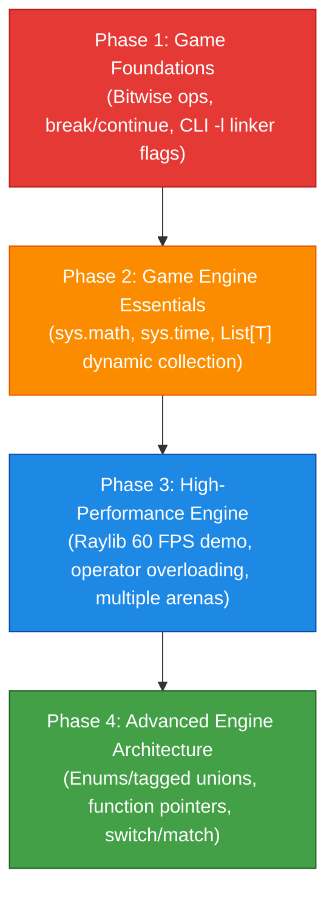

# The Complete Velo Language Gap Analysis (Small to Big) 📋

> **Document Status**: Living Architectural Audit  
> **Target Version**: Velo 2.0+ (Towards Production Systems & Game Engine Viability)  
> **Scope**: An exhaustive, brutally honest breakdown of every single gap, limitation, and missing feature in the Velo programming language—from minor syntax nuances to major compiler subsystems.

---

## Executive Summary & Gap Severity Matrix

Velo is a working, self-hosted, triple-bootstrapped systems programming language that compiles to native machine code via C99. While its core foundation (zone memory, pointers, structs, basic control flow, and multi-file modules) is verified and leak-free, it currently lacks several language features, standard libraries, and compiler controls required to build full-scale desktop applications and modern game engines.

| Severity Level | Focus Area | Impact |
| :--- | :--- | :--- |
| 🔴 **P0: Critical Blockers** | Bitwise ops, `break`/`continue`, custom linker flags (`-l`), slices/dynamic arrays | Blocks building game engines, binary protocols, and real loops |
| 🟠 **P1: Major Language Gaps** | `enum`/tagged unions, `switch`/`match`, math library, multi-arena allocators | Forces cumbersome boilerplate, unsafe type tricks, and prevents DOD/ECS |
| 🟡 **P2: Ergonomic Gaps** | Operator overloading, method syntax, default values, raw strings, block comments | Slows down iteration speed, friction when writing math/vector code |
| 🟢 **P3: Ecosystem & Tooling** | Debug symbols (`-g`), LSP/IDE tooling, package manager, native test runner | Affects developer comfort, discovery, and large-scale collaboration |

---

## 1. Syntax, Lexer & Tokenizer Gaps

### 1.1 Bitwise Operators (🔴 P0 Critical)
* **Missing Operators**: Velo has no bitwise AND (`&`), bitwise OR (`|`), bitwise XOR (`^`), bitwise NOT (`~`), left-shift (`<<`), or right-shift (`>>`).
* **Why it matters**: Game engines, graphics pipelines, hardware interfacing, and file formats rely constantly on bitmasks, entity flags, collision layers, and bit-packing. Currently, you cannot even write `flags & MASK`.

### 1.2 Comments & Documentation (🟡 P2 Ergonomic)
* **No Block Comments**: Only single-line `//` is supported. Multi-line `/* ... */` comments do not exist in the lexer.
* **No Docstrings**: No syntax for structured doc comments (e.g. `///` or `/** */`) that can be extracted into HTML/Markdown documentation.

### 1.3 Literal Formatting (🟡 P2 Ergonomic)
* **Numeric Bases**: No hexadecimal (`0xDEADBEEF`), binary (`0b101010`), or octal (`0o755`) literals. Colors in graphics programming are almost universally written in hex (`0xFF00FFFF`).
* **Digit Separators**: No support for underscores in numbers (e.g. `1_000_000` or `0xFF_AA_BB_CC`).
* **Scientific Notation**: Floating point literals cannot use exponents (`1e-4`, `2.5e6`).
* **Explicit Literal Suffixes**: Float literals default to `f32` (or whatever the context expects); there is no suffix syntax like `10.5f64`, `100u8`, `500i64`.

### 1.4 String & Character Escapes (🟡 P2 Ergonomic)
* **Raw / Multi-line Strings**: No raw string literals (like `` `raw\text` `` or `"""multiline"""`). Writing shaders, SQL, or embedded JSON requires manual escaping of newlines.
* **Unicode Escapes**: No `\uXXXX` or `\UXXXXXXXX` escape sequences for UTF-8 character points.
* **Character Type**: Characters are treated as raw integer byte values (`u8`). There is no distinct `char` or `rune` type.

---

## 2. Control Flow & Language Statements

### 2.1 Loop Controls: `break` and `continue` (🔴 P0 Critical)
* **Missing Control Flow**: Neither `while` nor `loop` statements support `break` or `continue`.
* **Impact**: Early exit from loops currently requires cumbersome boolean flags (e.g. `mut found = false; while !found { ... }`), adding unnecessary branching and indentation.
* **Labeled Breaks**: In nested loops (e.g. tilemap iteration `y` and `x`), there is no `break :outer` or `break label`.

### 2.2 Branching: `switch` / `match` Statement (🟠 P1 Major)
* **Missing Construct**: Velo only has `if / else if / else`.
* **Impact**: Dispatching over token kinds, state machines, game states, or input keycodes requires 20-40 chained `if / else if` branches, which cannot be optimized into C jump tables (`switch`).

### 2.3 Range Loop Flexibility (🟡 P2 Ergonomic)
* **Fixed Step**: `loop i in 0..N` only counts forward by `+1`.
* **Missing Steps**: No syntax for reverse ranges (`loop i in N..0`), custom step increments (`0..100 step 2`), or inclusive vs exclusive ranges (`0..=N`).
* **Collection Iteration**: Cannot iterate over an array or list directly (`loop item in items`).

---

## 3. Type System & Data Modeling

### 3.1 First-Class Enums & Tagged Unions (🟠 P1 Major)
* **No `enum` Declarations**: All constants and states must currently be declared as standalone global integers (`let TOKEN_INT: i32 = 101`).
* **No Tagged Unions (Sum Types)**: You cannot define algebraic data types like:
  ```velo
  enum Event {
      Quit,
      KeyDown: i32,
      MouseMove: Vec2
  }
  ```
  Instead, developers must use C-style untyped payloads with manual discriminator flags.

### 3.2 Generics / Parametric Polymorphism (🟠 P1 Major)
* **Current State**: All functions and structs must have concrete, monomorphic types.
* **Impact**: You cannot write a generic `List[T]`, `Queue[T]`, or `min[T](a: T, b: T)`. To have a list of `Particle` and a list of `i32`, you must copy-paste the struct definition or write untyped `@void` buffers.

### 3.3 Function Pointers & First-Class Callbacks (🟠 P1 Major)
* **Current State**: Functions cannot be stored in variables, passed as parameters, or placed in struct fields.
* **Impact**:
  - Cannot build UI event handlers (`button.on_click = callback`).
  - Cannot write higher-order functions like `sort(items, compare_fn)` or `filter` / `map`.
  - Cannot build polymorphic vtables or custom dynamic dispatch.

### 3.4 Method Syntax / Uniform Function Call Syntax (UFCS) (🟡 P2 Ergonomic)
* **Current State**: All functions are free functions: `update_particle(p, dt)`.
* **Desired State**: Method syntax `p.update(dt)` syntax sugar that automatically passes `p` as the first argument (`self` / `this`).

### 3.5 Operator Overloading for Game Math (🟡 P2 Ergonomic)
* **Current State**: Arithmetic operators (`+`, `-`, `*`, `/`) only work on built-in numeric primitives.
* **Impact**: Vector and matrix math in game engines becomes verbose and hard to read:
  ```velo
  // Current:
  let final_pos = vec2_add(vec2_add(pos, vec2_scale(vel, dt)), offset)
  // Desired:
  let final_pos = pos + vel * dt + offset
  ```

### 3.6 Advanced Struct Features (🟡 P2 Ergonomic)
* **Default Field Initializers**: Cannot declare `data Point { x: f32 = 0.0, y: f32 = 0.0 }`. All fields must be explicitly enumerated in struct literals.
* **Struct Packing & Alignment**: No directives for GPU hardware layouts:
  - `#align(16)` (required for SIMD vectors and OpenGL/Vulkan uniform buffers).
  - `#packed` (required for binary file formats and network packet headers).
* **Type Aliases**: No `type EntityId = u64` or `type Milliseconds = f64`.

---

## 4. Memory Management & Hardware Access

### 4.1 Extensible Allocator Architecture (🟠 P1 Major)
* **Current State**: Fixed, single global 16MB zone arena (`VELO_ZONE_BUFFER_SIZE`) + a single global malloc heap.
* **Impact**:
  - The 16MB buffer cannot be dynamically resized or configured per game.
  - You cannot instantiate multiple distinct arenas (e.g. `PerFrameArena`, `LevelLoadingArena`, `UIArena`).
  - No `Allocator` interface (like Zig or Odin) where functions receive `allocator: @Allocator`.

### 4.2 Multithreaded Memory Safety (🟠 P1 Major)
* **Current State**: `g_velo_arena` and `g_velo_arena_offset` are global, unsynchronized C static variables.
* **Impact**: If two threads call `mem.alloc(...)` simultaneously, the arena watermark corrupts immediately. There is no Thread-Local Storage (`__thread` / `_Thread_local`) for per-thread zone arenas.

### 4.3 Low-Level Memory Intrinsics (🔴 P0 Critical)
* **Missing Primitives**:
  - `mem.copy(dest: @u8, src: @u8, count: usize)` (C `memcpy`).
  - `mem.set(dest: @u8, val: u8, count: usize)` (C `memset`).
  - `mem.move(...)` (C `memmove`).
  - `mem.realloc(...)` (Resizing persistent heap buffers).
* Currently, copying an array requires a manual Velo `while` loop indexing byte-by-byte.

---

## 5. Standard Library Gaps (`sys.*` and `std.*`)

Velo currently has a bare-minimum runtime (`velo_runtime.h`). To be a viable development language, the following libraries are missing:

### 5.1 String Processing Library (🔴 P0 Critical)
* Strings are currently raw C `const char*` with only `str.len(...)`.
* **Missing String Functions**:
  - `str.contains(s, sub)`
  - `str.starts_with(s, prefix)` / `str.ends_with(s, suffix)`
  - `str.split(s, delimiter)`
  - `str.trim(s)`
  - `str.replace(s, old, new)`
  - `str.to_upper(s)` / `str.to_lower(s)`
  - `str.index_of(s, char)`
  - `str.concat(a, b)`

### 5.2 Dynamic Collections (🔴 P0 Critical)
* No dynamic array (`List[T]` or `Vector[T]`).
* No hash map (`Map[K, V]` or `Dict[K, V]`).
* No ring buffer / circular queue.
* No bitset (critical for ECS component masks).

### 5.3 Math Library (`sys.math`) (🟠 P1 Major)
* There is no math standard library!
* **Missing Functions**:
  - Trigonometry: `sin`, `cos`, `tan`, `atan2`, `acos`, `asin`.
  - Exponential: `sqrt`, `cbrt`, `pow`, `exp`, `log`, `log2`.
  - Utility: `abs`, `min`, `max`, `floor`, `ceil`, `round`, `clamp`, `lerp`.
  - Constants: `PI`, `TAU`, `RAD2DEG`, `DEG2RAD`.

### 5.4 Extended File System & OS Primitives (`sys.fs`, `sys.os`) (🟠 P1 Major)
* **`sys.fs` Missing**:
  - `fs.read_dir(path)` (directory scanning).
  - `fs.create_dir(path)` / `fs.create_dir_all(path)`.
  - `fs.is_dir(path)` vs `fs.is_file(path)`.
  - `fs.copy(src, dst)` / `fs.rename(src, dst)`.
  - File streaming: `fopen`, `fread`, `fwrite`, `fseek` (currently only entire file read/write).
* **`sys.os` Missing**:
  - `os.get_env(key)` / `os.set_env(key, val)`.
  - `os.args()` (CLI argument access outside of `main(argc, argv)`).
  - `os.exit(code)` (immediate exit with status code).

### 5.5 High-Resolution Clock & Timing (`sys.time`) (🟠 P1 Major)
* No high-resolution timer (`time.now()`, `time.delta()`, `time.sleep_ms()`).
* In games, calculating `dt` (delta time) requires high-resolution performance counters (`QueryPerformanceCounter` on Windows, `clock_gettime` on Linux).

---

## 6. Compiler, Tooling & Build System Gaps

### 6.1 Linker Flags for Third-Party C Libraries (🔴 P0 Critical)
* **Current State**: `bin/velo.exe` hardcodes `gcc -O2 <c_file> -o <binary>`.
* **Impact**: You cannot link external libraries such as **Raylib, SDL2, OpenGL, Vulkan, Box2D, or SQLite** without manually running GCC in the terminal.
* **Needed Solution**:
  - `velo build main.vl -o game.exe -lraylib -lopengl32 -lgdi32 -lwinmm`
  - Or `#link "raylib"` / `#link "opengl32"` pragma in source code.

### 6.2 Optimization Flags & Build Modes (🟠 P1 Major)
* **Current State**: Always compiles with `-O2`.
* **Missing Modes**:
  - `velo build --debug` (emits `-O0 -g` with full debug symbols).
  - `velo build --release` (emits `-O3 -flto` with link-time optimization).

### 6.3 Diagnostic Formatting & Error Visuals (🟡 P2 Ergonomic)
* Current errors print: `[Velo Error] semantic:line:col - message`.
* Modern compilers (Clang, Rust, Zig) print colorized source code snippets with arrows pointing to the exact token:
  ```text
  examples/02_math_and_logic.vl:29:14: error: undeclared identifier 'foo'
     29 |     let x = foo + 10;
        |             ^^^
  ```

### 6.4 Developer Tooling: Language Server Protocol (LSP) (🟢 P3 Ecosystem)
* No VS Code syntax highlighter extension.
* No LSP server providing autocomplete, jump-to-definition, hover documentation, or red squiggly error diagnostics in the editor.

### 6.5 Native Integrated Test Runner (🟢 P3 Ecosystem)
* Currently, tests are driven via Python `pytest` and subprocess invocations.
* Velo lacks an in-language test primitive:
  ```velo
  test "vector addition" {
      let v = Vec2{ x: 1.0, y: 2.0 }
      assert(v.x == 1.0)
  }
  ```
  and a `velo test` CLI subcommand.

---

## 7. Game Engine Specific Technical Gaps

| Engine Subsystem | Missing Velo Feature | Workaround Today |
| :--- | :--- | :--- |
| **Windowing & Input** | No C library linking flag in CLI | Manually invoke GCC with `-lraylib` / `-lSDL2` |
| **Math & Physics** | No Operator Overloading (`+`, `*`) | Must write `vec3_add(a, b)` |
| **Physics / Collision** | No Bitwise Operators (`&`, `|`, `^`) | Must use integer arithmetic or avoid bitmasks |
| **Asset Loading** | No streaming file seek (`fseek`) | Must load entire audio/texture files into RAM at once |
| **Frame Allocations** | Single fixed 16MB buffer | Good for small demos, but overflows on 4K meshes |
| **Animation / Events** | No Function Pointers / Callbacks | Must use integer action IDs and `if/else` ladders |
| **Entity Component System (ECS)** | No Generics or Struct Reflection | Must write hardcoded component arrays |
| **SIMD Math** | No 128-bit / 256-bit SIMD intrinsics | Relies purely on GCC autovectorization |

---

## 8. Prioritized Strategic Roadmap to Game Readiness



### Phase 1: Game Foundations (The "Make a Window" Milestone)
1. **Bitwise Operators**: Implement `&`, `|`, `^`, `~`, `<<`, `>>` in lexer, parser, semantics, and C codegen.
2. **Loop Controls**: Implement `break` and `continue` in `while` and `loop`.
3. **Linker Flag Passing**: Add `-l<lib>` and `-L<dir>` support to `velo build` and `velo run`.
4. **Validation**: Write an `extern` Raylib script that opens a window, captures keyboard input, and draws a rectangle at 60 FPS.

### Phase 2: Engine Essentials (The "Playable Gameplay" Milestone)
1. **`sys.math`**: Implement trigonometry, square root, powers, min/max, clamp, and lerp.
2. **`sys.time`**: Implement microsecond-accurate delta time calculation (`time.now()`).
3. **`mem.copy` / `mem.set`**: Native memory byte-block manipulation.
4. **Dynamic Array**: A standard resizable buffer library for managing game entities.

### Phase 3: Ergonomics & Scaling (The "Clean Code" Milestone)
1. **Operator Overloading**: Enable `+`, `-`, `*` on custom structs for vector and matrix math.
2. **Multiple Zone Arenas**: Parameterized arenas instead of a single global 16MB buffer.
3. **Enums & `switch`**: Clean state machines and event dispatching.
