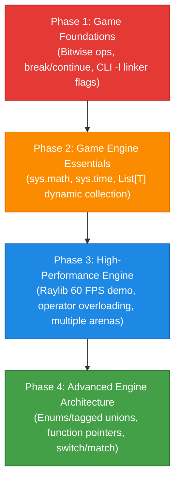

# The Complete Velo Language Gap Analysis (Small to Big) 📋

> **Document Status**: Living Architectural Audit  
> **Target Version**: Velo 2.0+ (Towards Production Systems & Game Engine Viability)  
> **Scope**: An exhaustive, brutally honest breakdown of every single gap, limitation, and missing feature in the Velo programming language—from minor syntax nuances to major compiler subsystems.

---

## Executive Summary & Gap Severity Matrix

Velo is a working, self-hosted, triple-bootstrapped systems programming language that compiles to native machine code via C99. While its core foundation (zone memory, pointers, structs, basic control flow, and multi-file modules) is verified and leak-free, it currently lacks several language features, standard libraries, and compiler controls required to build full-scale desktop applications and modern game engines.

| Severity Level | Focus Area | Impact |
| :--- | :--- | :--- |
| 🔴 **P0: Critical Blockers** | Bitwise ops, `break`/`continue`, custom linker flags (`-l`), slices/dynamic arrays | Blocks building game engines, binary protocols, and real loops |
| 🟠 **P1: Major Language Gaps** | `enum`/tagged unions, `switch`/`match`, math library, multi-arena allocators | Forces cumbersome boilerplate, unsafe type tricks, and prevents DOD/ECS |
| 🟡 **P2: Ergonomic Gaps** | Operator overloading, method syntax, default values, raw strings, block comments | Slows down iteration speed, friction when writing math/vector code |
| 🟢 **P3: Ecosystem & Tooling** | Debug symbols (`-g`), LSP/IDE tooling, package manager, native test runner | Affects developer comfort, discovery, and large-scale collaboration |

---

## 1. Syntax, Lexer & Tokenizer Gaps

### 1.1 Bitwise Operators [COMPLETED] ✅
* **Supported Operators**: Binary `&`, `|`, `^`, `<<`, `>>`, unary `~`, and compound assignments `&=`, `|=`, `^=`, `<<=`, `>>=`.
* **Verified**: Full operator precedence hierarchy in Stage 1 and Stage 2 self-hosted compilers. Verified with `examples/14_bitwise_operators.vl` and `tests/test_bitwise_operators.py`.

### 1.2 Comments & Documentation [COMPLETED] ✅
* **Nested Block Comments**: Arbitrary-depth multi-line comments (`/* ... /* ... */ ... */`) implemented in both Stage 1 and Stage 2 self-hosted lexers with unclosed comment diagnostics.
* **Structured Documentation**: Single-line `///` and block `/** ... */` doc comment recognition for top-level structs, functions, and externs.
* **Native Doc Generator CLI**: Built-in CLI command `velo doc <source.vl> [-o output.md]` extracting clean GitHub-flavored Markdown API reference documentation tables and signatures directly from AST definitions. Verified with `examples/15_docs_and_comments.vl` and `tests/test_docs_and_comments.py`.

### 1.3 Literal Formatting [COMPLETED] ✅
* **Numeric Bases**: Hexadecimal (`0x` / `0X`), binary (`0b` / `0B`), and octal (`0o` / `0O`) literals with full type preservation and C99 emission.
* **Digit Separators**: Underscore digit separators supported in all integer, hex, binary, octal, and floating point literals (e.g. `1_000_000`, `0xFF_AA_BB_CC`, `0b1010_1010`).
* **Scientific Notation**: Full exponent support (`1e-4`, `2.5e6`, `1E3`, `3.14e+2`) in both Stage 1 and Stage 2 self-hosted compilers.
* **Explicit Literal Suffixes**: Explicit integer (`u8`, `u16`, `u32`, `u64`, `usize`, `i8`, `i16`, `i32`, `i64`, `isize`) and float (`f32`, `f64`) suffixes with automatic type inference and C99 suffix mapping (`LL`, `ULL`, `U`, `f`). Verified with `examples/16_literal_formatting.vl` and `tests/test_literal_formatting.py`.

### 1.4 String & Character Escapes [COMPLETED] ✅
* **Raw / Multi-line Strings**: Supported via backticks (`` `...` ``). Preserves literal backslashes, quotes, and newlines across multiple lines without escape decoding. Automatically normalized and formatted into standard C99 string literals.
* **Unicode Escapes (`\uXXXX`)**: Full 4-digit hexadecimal Unicode escape support in standard string and character literals, encoded automatically into compliant UTF-8 multi-byte sequences (`0x00A9` -> `0xC2 0xA9`, `0x2764` -> `0xE2 0x9D 0xA4`).
* **Character Literals & Escapes**: Character literals support standard escapes (`\n`, `\t`, `\r`, `\0`, `\\`, `\'`, `\"`), 2-digit hex escapes (`\xNN`), and 4-digit Unicode escapes (`\uXXXX`), correctly evaluating to their numeric integer values. Verified with `examples/17_string_escapes.vl` and `tests/test_string_escapes.py`.

---

## 2. Control Flow & Language Statements

### 2.1 Loop Controls: `break` and `continue` [COMPLETED] ✅
* **Supported Controls**: Native `break` and `continue` statements in both `while` loops and `loop <var> in <start>..<end>` range loops.
* **Semantics & Code Generation**: Direct mapping to C99 `break;` and `continue;` control flow with correct nested loop scoping and Go-style statement termination. Verified with `examples/18_break_continue.vl` and `tests/test_break_continue.py`.

### 2.2 Branching: `on` Statement [COMPLETED] ✅
* **Signature `on` Keyword**: Velo exclusively standardizes on the punchy, unique 2-letter **`on <expr> { ... }`** keyword tailored for game engines and state dispatching (`match` and `switch` completely eliminated from the language).
* **Multi-Value Patterns**: Matching comma-separated alternative values in a single branch (e.g. `201, 202 => { ... }`).
* **Default & Wildcard Fallbacks**: Clean fallback handling supporting `else => { ... }` and wildcard `_ => { ... }`.
* **Block and Single-Statement Arms**: Supports curly-brace scoped code blocks `{ ... }` as well as concise single-statement arm bodies (e.g. `1 => action = "jump"`).
* **High-Performance C99 Jump Tables**: Emits native scoped C99 `switch (...) { case ...: { ... break; } default: { ... break; } }` blocks enabling $O(1)$ constant-time jump table optimizations by C compilers without accidental fallthrough. Verified with `examples/19_match_switch.vl` and `tests/test_match_switch.py`.

### 2.3 Range Loop Flexibility [COMPLETED] 🛡️
* **Unified Loop Syntax**: Consolidated all loops (`while`, `loop .. in`, `repeat`, `infinite`) into a single expressive `loop` keyword.
* **Custom Step Increments**: Slicing syntax `loop i in 0..10:2` for forward custom steps.
* **Smart Auto-Countdown**: When $start > end$ (`loop 5..0`), loops automatically decrement by `-1` without needing `:-1`. Custom decrement steps like `loop 10..0:2` also supported.
* **Inclusive & Exclusive Ranges**: Supports both half-open ranges `0..10` and fully inclusive ranges `0..=10` via `..=` operator.
* **Implicit Variable**: Anonymous ranges (`loop 0..10:2`), repeat loops (`loop 5`), condition loops (`loop cond`), and infinite loops (`loop`) automatically provide the `it` iteration counter starting at 0.
* **Retirement of `while`**: Retired `while` keyword across the entire language, compiler, test suite, and examples. Verified with `examples/20_range_loops.vl` and `tests/test_range_loops.py`.

---

## 3. Type System & Data Modeling

### 3.1 First-Class Enums & Tagged Unions (`kind`) [COMPLETED] ✅
* **Unified 4-Letter Keyword**: Velo standardizes on `kind` (harmonizing with `data`, `act`, `zone`, `loop`).
* **Pure Scalar Enums**: Unit variants (`North`, `East`) and explicit discriminants (`Ok = 200`, `NotFound = 404`) with zero runtime overhead, lowering directly to C99 `int32_t` scalars.
* **Payload-Bearing Tagged Unions**: Supports single-payload variants (`KeyDown: i32`) and multi-field payloads (`Click(button: i32, x: f32, y: f32)`), lowering to C99 `struct { int32_t kind; union { ... } as; }`.
* **Contextual Dot-Shorthand**: `let d: Direction = .North`, `let e: Event = .KeyDown(65)`, `let c: Event = .Click(1, 10.0, 20.0)` whenever target type is known; fully-qualified `Direction.North` always valid.
* **Pattern Matching Destructuring (`on`)**: Directly match with `on e { .KeyDown(key) => ..., .Click(btn, x, y) => ... }` with automatic payload variable bindings scoped to each arm. Verified with `examples/21_enums_and_unions.vl` and `tests/test_enums_and_unions.py`.
* **OPEN DEFECT (found while probing 5.2 slice 2)** — *by-value struct payloads fail at the C level*: `kind Obj { Val(Pair) }` (a plain `data Pair` payload) both-stage compiles until GCC rejects the emitted C: `field 'Val' has incomplete type` (the union member is declared before the EMITTED struct definition order resolves). The `@Pair` pointer payload works (`Val(@Pair)` box → memcpy of an address). Fix direction: emit payload-struct definitions before their `kind` unions, or widen the emitter's struct-definition ordering pass; both stages must stay wording-identical at parity (identical GCC failure today — no divergence to reconcile).

### 3.2 Generics / Parametric Polymorphism [COMPLETED] ✅
* **Syntax Choice**: Proposal A (`[T]`): `data Box[T]`, `kind Option[T]`, `act min[T]`, `act swap[T](a: @T, b: @T)`, multi-param `data Pair[K, V]`.
* **Zero-Cost C99 Monomorphization**: AST specialization pass monomorphizes generic structs, kinds, and functions on demand into concrete C99 types (`Box_i32`, `Option_string`, `min_i32`, `Pair_string_i32`) with zero virtual dispatch or boxing overhead.
* **Call-Site Type Inference**: Functions can be invoked directly as `min(15, 25)` without type arguments, inferring type arguments from parameters; explicit instantiation `min[f32](3.14, 2.71)` also supported.
* **Pointer & Struct Specialization**: Pointer types like `@T` cleanly unify and specialize (e.g. `swap[i32](@x, @y)`).
* **Self-Hosted Monomorphizer**: Fully integrated into both Python (`velo/monomorphize.py`) and self-hosted Stage 2 compiler (`src/analysis/monomorphize.vl`). Verified with `examples/22_generics.vl` and `tests/test_generics.py`.

### 3.3 Function Pointers & First-Class Callbacks [COMPLETED] ✅
* **Native `act(...) -> Ret` Syntax**: First-class function type signature harmonizing with Velo's `act` keyword (e.g. `act(i32, i32) -> i32`, `act(@Button) -> void`, `act() -> void`).
* **Variable Storage & Higher-Order Functions**: Storing named functions in variables (`let op: act(i32, i32) -> i32 = add`), passing callbacks to higher-order functions (`apply_binary(7, 8, op)`).
* **Struct Function Pointer Fields (Callbacks & Vtables)**: Storing function pointers in struct data fields (e.g. `data Button { on_click: act(@Button) -> void }`).
* **Direct Execution & Null Safety**: Calling function pointers directly via variable (`op(10, 20)`) or member access (`btn.on_click(@btn)`). Full null check compatibility (`if btn.on_click != null { btn.on_click(@btn) }`).
* **Inline Anonymous Functions**: Anonymous callbacks with parameter inference and block bodies: `act(b: @Button) { ... }`, `act(x: i32, y: i32) -> i32 { return x - y }`.
* **C99 Function Pointer Typedef Lowering**: Zero-overhead function pointer typedefs (`typedef int32_t (*velo_act_i32_i32_to_i32)(int32_t, int32_t);`), with anonymous functions lifted to `static` C functions with forward prototypes. Verified across Stage 1 Python compiler and Stage 2 self-hosted native compiler with `examples/23_function_pointers.vl` and `tests/test_function_pointers.py`.

### 3.4 Method Syntax / Uniform Function Call Syntax (UFCS) [COMPLETED] ✅
* **Pure UFCS Without OOP Keywords**: Any free function `act foo(self: T, ...)` or `act foo(self: @T, ...)` can be invoked using method call syntax: `x.foo(...)`. No `class`, `struct impl`, or OOP ceremony required.
* **Smart Auto-Referencing & Auto-Dereferencing**:
  - If a function expects a pointer `@T` and the receiver is a value lvalue of type `T`, the compiler automatically passes its address (`&x`).
  - If a function expects a value `T` and the receiver is a pointer `@T`, the compiler automatically dereferences the pointer (`*x`).
  - If the receiver type matches the first parameter type directly, it is passed directly without modification.
* **Struct Field Priority**: Struct fields (such as callback function pointers `btn.on_click(...)`) always take priority over free functions with the same name, preserving callback and vtable mechanics.
* **Method Chaining & Extensibility**: Supports fluent chaining (e.g. `p.translate(1.0, 2.0).scale(2.0)`) and extension methods on both structs and primitive types (e.g. `7.square()`).
* **Generic Method Specialization**: Works seamlessly with generic functions and data types (e.g. `box.unwrap()`), inferring type arguments from the receiver and arguments. Verified across Stage 1 Python compiler and Stage 2 self-hosted native compiler with `examples/24_ufcs_methods.vl` and `tests/test_ufcs_methods.py`.

### 3.5 Operator Overloading for Game Math [COMPLETED] ✅
* **Signature `act op <symbol>` Syntax**: Clean 2-letter `op` prefix aligning with Velo's keyword philosophy (`on`, `in`, `as`, `op`). Supports both `act op +(...)` and `act op+(...)`.
* **Disambiguation by Parameter Count**: Single-parameter declarations define unary operators (e.g. `act op -(v: Vector2)` for negation); two-parameter declarations define binary operators (e.g. `+`, `-`, `*`, `/`, `%`, `==`, `!=`, `<`, `<=`, `>`, `>=`).
* **Zero Runtime Overhead & C99 Name Mangling**: Deterministic C function identifier mangling based on operator name and operand types (`velo_op_add_Vector2_Vector2`, `velo_op_mul_Vector2_f32`, `velo_op_neg_Vector2`).
* **Automatic Compound Assignment**: Statements like `pos += vel` and `pos *= 2.0` automatically desugar into `pos = pos + vel` and `pos = pos * 2.0`, executing overloaded operators without duplicate boilerplate.
* **Smart Auto-Referencing / Auto-Dereferencing**: Functions expecting pointer parameters `@Vector2` automatically receive `&v` when invoked with value lvalues.
* **Bit-for-Bit Triple-Bootstrap Determinism**: Verified with `examples/25_operator_overloading.vl` and `tests/test_operator_overloading.py` across Python reference compiler and Stage 2 self-hosted native compiler.

### 3.6 Advanced Struct Features (🟡 P2 Ergonomic)
* **Default Field Initializers**: [COMPLETED] ✅ — *"Cannot declare `data Point { x: f32 = 0.0, y: f32 = 0.0 }`"* (Former Defect).
  - **Fix Applied**: Constant-literal defaults (int / float / string / bool, optional unary `-`) parsed in both compilers; struct literals fill omitted defaulted fields via C99 designated initializers appended after the provided ones; omitted fields without a default are now a compile error in both compilers (Python Stage 1 codegen validation, Stage 2 self-hosted semantic checker). Defaults are carried into every generic specialization.
  - **Verification**: `examples/26_advanced_structs.vl` + `tests/test_advanced_structs.py` (Stage 1 CLI run/emit-c assertions and native `bin/velo.exe` run).
* **Struct Packing & Alignment**: [COMPLETED] ✅ — *"No `#align(16)` / `#packed` directives"* (Former Defect).
  - **Fix Applied**: `data Name #align(N) #packed { ... }` parsed after name/type parameters in both compilers; emitted as `struct __attribute__((aligned(N), packed)) Name { ... };` on the definition only (forward typedefs untouched). Attributes survive generic instantiation.
  - **Verification**: Emitted C asserted in `tests/test_advanced_structs.py` for both compilers; native run compiles the attributes with GCC.
  - **Residual Limitation**: Attribute support is GCC/Clang-shaped (`__attribute__`); MSVC layouts would need a separate pragma mapping.
* **Type Aliases**: [COMPLETED] ✅ — *"No `type EntityId = u64`"* (Former Defect).
  - **Fix Applied**: `aka Name = <primitive|@primitive>` as a contextual keyword at top level only; target validated at parse time (no alias-of-alias). Both monomorphizers gained an always-running Pass 0 that canonicalizes alias names in every type string (fields, kind payloads, params/returns, locals, casts) order-free across the whole merged program, so aliases work even in programs without generics; codegen emits a decorative `typedef`.
  - **Verification**: Same example + test file; triple-bootstrap determinism re-verified (Gen2 vs Gen3 emit-c SHA-256 identical).
  - **Residual Limitation**: Aliases are primitive-only by design; alias declarations are not yet listed by `velo doc`, and `VELO.md` sync is owner material. The missing-field diagnostic wording differs slightly between the two compilers (both reject with the same exit behavior). Default-initializer values are not type-checked against their field type (constant-literal defaults only).

---

## 4. Memory Management & Hardware Access

### 4.1 Extensible Allocator Architecture [COMPLETED] ✅
* **Former Defect (Incomplete Architecture)**: The memory subsystem had the arena infrastructure (`VeloZoneArena`, `zone <bytes> { }` scoped blocks, a reuse pool of up to 32 arenas) but lacked the language-level `@Allocator` interface — functions could not receive an arena handle as a parameter, meaning every allocation always targeted the implicit thread-global active arena.
* **Fix Applied**:
  - **Runtime** (`velo/runtime/velo_runtime.h`): Added `typedef VeloZoneArena* VeloAllocator`, `velo_alloc_with(a, size, count)` (bump-allocates into an explicit arena handle), and `velo_alloc_used(a)` (reads its watermark).
  - **Language surface**: `@Allocator` is now a recognized Velo type (maps to `VeloZoneArena*` in C). Two new builtin intrinsics: `mem.current()` (captures the currently-active arena as a passable `@Allocator`) and `mem.alloc_with(a, @T, n)` (allocates `n` elements of `T` into arena `a`).
  - **Stage 1** (`velo/codegen_c.py`): `TYPE_MAP` extended with `"Allocator": "VeloZoneArena"`. `_emit_expression`, `_infer_raw_velo_type`, and `_resolve_expr_type` handle the two new intrinsics.
  - **Stage 2** (`src/backend/codegen_types.vl`, `src/backend/codegen_expr.vl`, `src/analysis/type_checker.vl`): `map_type_to_c` maps `Allocator → VeloZoneArena`; `infer_expr_type` returns `@Allocator` / `@T`; `emit_c_expr` emits the correct C for both new intrinsics. `is_known_type` accepts `Allocator`.
  - **Tests** (`tests/test_allocators.py`): 3 new parity tests — `test_allocator_passable_handle` (pass allocator to a function), `test_allocator_stored_in_struct` (store in a `data` field), `test_allocator_oom_is_fatal` (alloc_with into exhausted arena aborts with a legible error). All pass on both Stage 1 and Stage 2.
  - **Example** (`examples/28_allocator_interface.vl`): end-to-end demo including a `Pool` struct holding an `@Allocator`.
* **Residual Limitation**: `@Allocator` is a raw arena pointer (single bump-allocator strategy). Pluggable vtable-based allocators (heap, pool, slab) are not yet supported — `mem.heap_alloc` has no passable handle form. Handles are lifetime-untracked: using one after its `zone <bytes> { }` block exits is silent UB (no detection in either stage). `velo_alloc_used` exists in the runtime only — no language intrinsic reads a non-active arena's watermark. Active-arena state became per-thread in §4.2, but passing one `@Allocator` handle across threads is still unsynchronized by design.
* **Verification**: Triple-bootstrap chain rebuilt (Gen1 → Gen2 → Gen3, `bin/velo.exe` updated); SHA-256 fixed-point preserved (Gen2 ≡ Gen3 bit-for-bit). Full suite: **120/120 passing**.

### 4.2 Multithreaded Memory Safety [COMPLETED] ✅
* **Former Defect (Shared Arena State)**: The 32 MB default arena, the active-arena pointer (`g_velo_zone_active`) and the 32-slot private-arena reuse pool were process-global, unsynchronized C statics. Two threads calling `mem.alloc(...)` concurrently would corrupt each other's bump watermarks immediately, and `zone <bytes> { }` re-entries raced on one shared pool.
* **Fix Applied** (`velo/runtime/velo_runtime.h`, mirrored in both emitters):
  - Compiler-shim macro `VELO_TLS` (`__thread` for GCC/Clang, `__declspec(thread)` for MSVC) — both compilers emit C compiled with `-std=c99`, where the C11 keyword `_Thread_local` is unavailable, so the keyword path had to be shimmed at runtime level.
  - Zone state is now thread-local and lazily initialized per thread: its own 32 MB heap-backed default arena, its own active pointer, and its own reuse pool. All entry points (`velo_zone_push/pop`, `velo_zone_enter/leave`, `velo_mem_alloc`, `velo_mem_used`) read state through the single accessor `velo_zone_active()`, so concurrent threads bump independent watermarks and the pools cannot race.
  - Both emitters now emit that accessor for `mem.current()` — `velo/codegen_c.py` and `src/backend/codegen_expr.vl` were the only two call sites touching raw runtime state. `velo_runtime.h` remains thread-API-agnostic (no pthread/Win32 threads inside).
  - Single-threaded semantics are unchanged: first touch lazily creates the default arena with watermark 0, all OOM/fatal messages are byte-identical, `zone { }` / `zone <bytes> { }` behavior verified by the existing 4.1 test suite.
  - Test (`tests/test_thread_local_runtime.py`): a C harness compiled against the runtime header by the same GCC the drivers use, spawning 8 winpthreads that execute 300 iterations of `velo_zone_enter → alloc → write/readback → pop → leave` concurrently. Asserts: threads start with fresh (unused) default arenas, data written into a thread's arena is never clobbered, each thread's `mem.current()` handle is distinct across all threads, and the active pointer is restored exactly after block exit.
* **Verification**: Full suite **126/126**; triple-bootstrap chain rebuilt (Gen1 → Gen2 → Gen3), Gen2 ≡ Gen3 emit-c SHA-256 (`7c46effa…`); all compiler sources within the 400-line limit.
* **Fix Applied §2 (Language-Level Thread Surface)** — the missing third slice, closing the "no in-language threads" residual:
  - Runtime (`velo_runtime.h`): `velo_thread_spawn(VeloThreadFn) -> VeloThreadCtx*`, `velo_thread_join(ctx) -> i32`, and opaque mutexes `velo_mutex_create/acquire/release/destroy`. Windows path uses `_beginthreadex` + manually declared kernel32 prototypes (`WaitForSingleObject`, `CloseHandle`, `CreateMutexW`, `ReleaseMutex`) — no `windows.h` inclusion, no driver flag changes, no new DLL dependency; the POSIX branch uses pthreads. Spawn-wrap trampoline calls the zero-arg i32 entry act, captures its return value, and calls `velo_thread_tls_release()` before exit.
  - Thread-exit arena leak closed: `velo_thread_tls_release()` frees the calling thread's whole per-thread arena set (default 32 MB buffer + arena struct + pooled private arenas); idempotent, and only reachable from the trampoline path where all zone blocks are provably closed.
  - Heap ledger (§4.2, *revisited in this fix*): first shipped as a per-thread `VELO_TLS` counter, but that mis-attributes a cross-thread `mem.free` to the freeing thread instead of the allocating one (diagnostic skew), and a plain shared `+=` would tear. Now a single shared counter `g_velo_heap_active` updated with true atomics — `__sync_fetch_and_add` (GCC, the only driver toolchain) / `_InterlockedExchangeAdd64` (MSVC intrinsics path, untested) — so allocation accounting is consistent under concurrent alloc/free, exactly-bounded by the freed headers (`velo_heap_free` clamps a bogus-free underflow best-effort). malloc/free themselves were already thread-safe; `mem.heap_used()` now reports the whole process.
  - Language surface (both emitters, identical emission): new types `@Thread` (→ `VeloThreadCtx*`) and `@Mutex` (→ handle); intrinsics `thread.spawn(fn) -> @Thread`, `thread.join(h) -> i32`, `thread.mutex() -> @Mutex`, `thread.acquire(m)` / `thread.release(m)` / `thread.free(m)` (all void). Fn args are zero-arg i32-returning act values (named (`thread.spawn(worker)`) and anonymous (`thread.spawn(act() -> i32 { ... })`) both work — the runtime no longer casts blindly; see §3 below). Stage 2 additionally whitelisted `sys.thread` in its loader (`driver.vl`, both `DECL_USE` passes — Stage 2 otherwise resolves unknown `use` targets as file dependencies) and in its ident/known-type tables (`type_checker.vl`).
  - Tests: `tests/test_threads.py` (parity cases on both stages — spawn/join with per-thread arena-isolation asserts inside workers, mutex-guarded shared counter to exactly 4, anonymous-act spawn, mutex basic ops, shared-heap-ledger consistency); C harness `test_spawn_join_mutex_runtime_api` (spawn/join publishes 42/17, 4 threads × 1000 increments = 4000 under one mutex, 100 spawn/join cycles stable); example `examples/29_thread_spawn.vl` runs identically on both stages.
  - Verified sharing pattern through the language: a `@Mutex` held in a global `mut` (assigned once in `main` **before** any spawn — spawn/join orders the visibility) lets workers share that lock and touch a global counter safely; call-initialized globals (`mut g: @Mutex = thread.mutex()` at file scope) are NOT supported — globals compile to C statics whose initializers must be constant.
* **Fix Applied §3 (Compile-Time Argument Checking)** — intrinsic arguments were previously trusted by contract (any pointer cast through C); now they are checked by BOTH compilers with char-identical messages:
  - `thread.spawn(x)`: exactly 1 argument, and `x` must be an `act() -> i32` value — a named top-level act, an act-typed local/global, or an anonymous act. Wrong arity/shape/signature (e.g. `thread.spawn(42)` or a `act(i32) -> i32` fn) is a build error: `thread.spawn expects act() -> i32 (got <type>)`.
  - `thread.join(x)` requires `@Thread`; `thread.acquire/release/free(x)` require `@Mutex`; `thread.mutex()` takes no arguments; all others take exactly 1 (`thread.join takes exactly 1 argument`, `thread.mutex takes no arguments`).
  - Stage 1 raises inside codegen (`velo/codegen_c.py::_thread_expect`, with `_thread_arg_type`/`_is_thread_entry`); `velo.py check` runs the generator, so the checks fire in `check` AND `build`. Stage 2 checks in the semantic pass (`check_thread_call(st, expr, member)` in `src/analysis/type_checker.vl`, wired into the thread inference branch, which returns `unknown` on failure so dependent expressions fail fast). Type spellings compare whitespace-tolerantly on both sides (`strip_type_spaces` in `src/common/act_types.vl`; Stage 1 strips spaces before comparing).
  - Compiler-crash hardening: Stage 2's thread emit branches now guard a missing first arg (emit `NULL` instead of dereferencing null while continuing past semantic errors).
  - Tests: 6 two-stage compile-rejection cases in `tests/test_threads.py` (build path, both stages, message-substring asserts incl. wrong-signature named act reported as `got act(i32) -> i32` on both stages).
* **Fix Applied §4 (Runtime Lifecycle Checking)** — handle misuse was silent UB; now it is a deterministic loud fatal:
  - Tombstone pattern: a released handle is NEVER freed. It is tagged `VELO_HANDLE_DEAD` (`VELO_HANDLE_LIVE` while valid) and parked on a process-lifetime dead-list; its address can never be recycled by malloc, so a replayed or stale handle deterministically reads DEAD instead of re-validating against a recycled allocation.
  - `@Thread`: join on NULL/never-stored → `Velo Fatal Error: thread join on a null handle (spawn failed or handle never stored)`; second join of the same handle → `thread join on an already-joined thread handle`. `join` returns the entry act's real i32 exactly once — it no longer fabricates `-1` for a null handle, removing the ambiguity between "spawn failed" and "worker returned -1".
  - `@Mutex` is a `VeloMutexCell` handle: use-after-free and double `thread.free` → `mutex operation on a freed mutex`; null → `mutex operation on a null handle`; foreign garbage → `... on an invalid mutex handle`. Spawn/mutex-create failure (OOM or OS refusal) is fatal rather than returning a handle that would lie at join.
  - Cost (documented trade): ~40 bytes parked per joined thread / destroyed mutex for the process lifetime — the price of deterministic detection without a registry or generations.
  - Tests: the main harness keeps only healthy paths (`velo_thread_join(NULL) == -1` assertion REMOVED — null is fatal now); 4 fatal-path mini-harnesses in `tests/test_thread_local_runtime.py` compile separately and assert non-zero exit with the specific message for null-join, double-join, mutex-after-free, mutex-double-free.
* **Verification**: Full suite **128/128**; thread surface adds 4 two-stage parity cases + 6 two-stage rejection cases + runtime API harness + 4 fatal mini-harnesses; `examples/29_thread_spawn.vl` byte-identical across stages; triple-bootstrap chain rebuilt (Gen1 → Gen2 → Gen3), Gen2 ≡ Gen3 emit-c SHA-256 (`46b351c8…`); `scripts/count_lines.py` reports no compiler source over 400 lines.
* **Residual Limitation**: No atomics, condition variables, or synchronized channels — `@Mutex` around globals is the only in-language synchronization. Sharing plain data without one is not detected at all — and is demonstrably worse than "occasionally wrong": GCC at `-O2` may fuse an unsynchronized global-value loop into a single memory operation (observed in this repo: a 5,000,000-iteration racer incrementing a global compiled to one `addq $5000000, gcount` in BOTH compilers' output), silently redefining the program's behavior instead of producing visible corruption; only thread-local data and the mutex-guarded path (opaque runtime calls act as compiler barriers) behave as written. A handle pointer that is neither NULL nor a tombstone (a wild/foreign pointer) is still raw-pointer UB — reading its magic may fault before any message; this matches Velo's general raw-pointer semantics for any `@T` and is not a regression, but detection covers *mechanically reachable* misuse (double-join/free, use-after-free of a real handle, null, wrong-arg compile errors), not arbitrary memory corruption. Two known windows inside that set: (a) destroying a mutex while another thread is inside `acquire` or holds it — the cell is still LIVE, so `thread.free` passes the assert and closes a native handle mid-use, undetected; (b) two threads double-joining the SAME handle concurrently can both pass the LIVE check inside the race window and each proceed — each still returns the correct status, and the tombstone-list push race is benign (the list is never traversed; detection keys on the per-object magic, not the list), but the log-equivalence of "exactly one joiner" is not enforced. No join timeout, no detach, no cancellation: a worker that never returns (or never releases its mutex) deadlocks `join` forever. MSVC/`cl.exe` builds remain untested (the atomic and threading paths have `_InterlockedExchangeAdd64`/`intrin.h` fallbacks, but drivers only ever invoke GCC); kernel32 prototypes stay declared inside the runtime header, so a unit that also includes `windows.h` would conflict (generated programs never do; MinGW import libs don't even resolve `InterlockedExchangeAdd64`/`Interlocked*` decls — hence the `__sync` builtin). Pointers into one thread's arena can still be aliased through globals and written by another thread with no detection — that is contract-based sharing, like C: Velo has no borrow/ownership model, so "memory safety" here means the allocator machinery never races and handles are never silently misused, not a no-data-race guarantee over program data. `@Allocator` handles remain unsynchronized across threads by design (bump watermark) — the worker-arena rule stands: each thread allocates into its own fresh arena; never pass a handle between threads.

### 4.3 Low-Level Memory Intrinsics [COMPLETED] ✅
* **Former Defect**: `mem.copy`/`mem.move`/`mem.set`/`mem.realloc` did not exist — copying a buffer required a manual Velo `while` loop indexing byte-by-byte, and persistent heap blocks could never be resized in place (the only "grow" idiom was alloc-new + manual copy + free).
* **Fix Applied**:
  - `mem.copy(dest, src, count)` / `mem.move(dest, src, count)` / `mem.set(dest, val, count)` lower onto runtime wrappers `velo_byte_copy` / `velo_byte_move` / `velo_byte_set` (`velo_runtime.h`) around the C trio `memcpy` / `memmove` / `memset` (args cast `(void*)` / `(int)` / `(long long)` — byte semantics are explicit: `count` counts BYTES, not elements; copying 8 bytes of an `@i64` buffer moves exactly one element, asserted by test). The wrappers exist because a NEGATIVE count is a caller bug the C trio would silently launder into a gigantic `size_t` rewrite/wipe (UB): with a signed `long long` parameter the wrappers die loudly on `count < 0` (`Velo Fatal Error: mem.<m> got a negative byte count!`), and huge-but-valid positive counts behave exactly as the bare C calls did.
  - `mem.realloc(ptr, @Type, count) -> @Type` is backed by a new runtime helper `velo_heap_realloc` (`velo/runtime/velo_runtime.h`) because plain C `realloc` can preserve neither the heap size-header protocol nor the shared atomic ledger: the RAW block (header + payload) is resized so the size word moves with it, then the `g_velo_heap_active` ledger is adjusted by the delta atomically. NULL `ptr` behaves like a fresh allocation (mirrors C `realloc(NULL, n)`); `count == 0` frees the block and yields NULL (documented Velo semantics); growth/shrink preserve payload prefix bytes — the ledger algebra across grow/shrink/fresh/free asserts to exactly 0 at exit in both stages. Its count is also signed: negative → the same loud fatal.
  - Both compilers enforce the same compile-time contract with identical wording (Stage 1 `velo/codegen_c.py::_mem_expect` ValueError path; Stage 2 new `src/analysis/mem_checks.vl::check_mem_call` wired into the `mem` infer branch of `type_checker.vl`, returning "unknown" after reporting): arity is `mem.<m> expects exactly 3 arguments: (...)` with the per-member signature; pointer args must be `@`-prefixed or you get `mem.<m> expects pointer arguments (got <T>)` (a plain `string` is deliberately rejected as a buffer — writing through a `const char*` is UB); `mem.realloc`'s type arg must itself be a `@`-prefixed type (`mem.realloc expects a @Type argument (got <T>)`, with bare type names like `i64` rendered as written, matching Stage 2's `is_known_type` infer); byte counts / fill values reject pointer, string, and act values (`mem.<m> expects an integer byte count/fill value (got <T>)`).
  - Negative counts are closed at BOTH layers: statically, a negative **literal** count is rejected at compile time (`mem.<m> expects a non-negative byte count`, detected as unary-minus over an int literal — Stage 1 `UnaryExpr`/`IntLiteral`, Stage 2 `EXPR_UNARY`/`TOK_MINUS`/`EXPR_INT` in `mem_checks.vl`); dynamically, a variable-held negative dies at the runtime wrapper (the compile-time check can't know values). Compile-time-when-knowable + loud-fail-otherwise mirrors the project's usual tiering.
  - Stage 2's emit branches (`codegen_expr.vl`) null-guard every argument slot so the compiler itself cannot crash past the semantic errors it just reported.
* **Verification**: Full suite **138/138**; `tests/test_mem_intrinsics.py` adds two-stage parity cases covering set/copy/move-overlap (via `buf + 4` pointer arithmetic), realloc grow 4→8 and shrink 8→2 with prefix preservation + ledger 64→16→0, NULL-arg fresh allocation, zero-count free→null, a byte-count-semantics parity case, 6 two-stage build-rejection cases (`bad_copy_int`: `(got i32)`, pointer-as-count: `(got @u8)`, string semantics, arity, `@Type` arg `(got i64)`) and 2 negative-literal rejections. An honest re-audit then closed further gaps: (1) the committed overlap case used all-equal bytes, which cannot distinguish `memmove` from a cascading memcpy-UB — a distinct-payload case (10..17, 56-byte shift) asserts `10 10 11 12 / 13 14 15 16`; (2) variable-held NEGATIVE counts fatal with the exact message and non-zero exit on both stages; (3) CONCURRENT realloc — 4 worker threads × 120 grow/shrink reallocs, shared atomic ledger asserted EXACTLY 0; (4) the OOM path via a C mini-harness (`velo_heap_realloc(NULL, 8, 2^58)` → malloc failure) asserting `Velo Fatal Error: Out of Heap Memory!` and exit 1; (5) acceptance-class coverage: a float count truncates through `(long long)` identically on both stages (2.9 → 2 bytes set), a struct-field count works identically, a named act as count is REJECTED by both stages — the audit first found the stages DIVERGED here (Stage 1's variable-scope infer rendered a bare act name as `i32` and would have emitted a function-pointer-as-count runtime crash while Stage 2 rejected it; fixed by reusing §4.2's `_thread_arg_type`, which resolves function declarations), and a void count (`io.println(...)`) is now rejected by BOTH stages `(got void)` — the audit found admission was NOT parity (Stage 1 failed the invalid `((long long)(void-expr))` C while Stage 2 inlines io emission as int-valued `printf`, silently running with count = chars-printed). `scripts/count_lines.py` reports no compiler source over 400 lines (`codegen_expr.vl` 399, `type_checker.vl` 395, `mem_checks.vl` 100); triple-bootstrap chain rebuilt (Gen1 → Gen2 → Gen3), Gen2 ≡ Gen3 emit-c SHA-256 (`e9960733…`).
* **Residual Limitation**: Overlapping regions are only correct through `mem.move` — `mem.copy`/`mem.set` on overlapping or self-referencing regions remain C-UB (inherent to the memcpy trio; Velo adds nothing to defend it). `mem.realloc`/`mem.free` on a non-heap pointer is the same raw-pointer UB class as before this change (no magic/header validation is attempted): observed here by feeding a ZONE-arena pointer to `mem.realloc` — the process died with `STATUS_HEAP_CORRUPTION` (`0xC0000374`) on this Windows/GCC configuration, which is a DEMONSTRATION, not a test: UB is not portable or stable across C runtimes, so no assertion is committed (NULL handling, by contrast, IS specified and tested). Reallocation failure is fatal (`Out of Heap Memory!`, old block stays valid until exit), not a nullable return — programs that wanted "try to grow, else keep the old block" cannot express it (covered by the C mini-harness, but the API shape itself stands). The count/fill check rejects pointer, string, act, AND void values (`void` was deliberately made a rejection after the audit showed admitting it made the stages disagree), admits `unknown` only because an unknown infer always co-occurs with another error report (adding a second report would double-log; the program still fails), and further admits ints, floats, bools — precision through the cast is the caller's business and IS pinned by a parity test (2.9 → 2 bytes); a size-overflowing expression (`count * sizeof` wrapping) is not analyzed — huge-but-valid positive counts reach the C trio unchanged. A `@badtype`-typo type argument escapes Stage 1's semantic check (its shape is indistinguishable from a valid type reference) and fails later at the C compile step — pre-existing `mem.heap_alloc`/`mem.alloc_with` blindspot parity, unchanged. `mem.move` does not report or repair a failed partial overlap (it can't: C `memmove` is all-or-nothing and always succeeds). Pre-existing divergence discovered while probing this feature (NOT caused by it, surfaced to the audit): Stage 2 does not reject assignment to an immutable `let` — a program mutating a `let` loop counter fails Stage 1 at the C-compile step (emitted `const`) yet builds and runs through Stage 2; the surface-visible outcome differs across stages for the same source.

---

## 5. Standard Library Gaps (`sys.*` and `std.*`)

Velo currently has a bare-minimum runtime (`velo_runtime.h`). To be a viable development language, the following libraries are missing:

### 5.1 String Processing Library [COMPLETED] ✅
* **Former Defect (Bare-Minimum String Surface)**: Strings were raw C `const char*` with a single `str.len(...)` builtin. Every non-trivial program — the compiler's own sources included (`check.vl`, `utils.vl`, `codegen_types.vl`) — hand-rolled `starts_with`/`rfind`/`copy_slice_to_string` helpers, and `a + b` on strings silently lowered to C pointer arithmetic (no concat), while trimming/case-mapping/splitting were not expressible at all.
* **Fix Applied**:
  - **Runtime** (`velo/runtime/velo_runtime.h`): ten `velo_str_*` helpers — `contains`, `starts_with`, `ends_with`, `index_of` (→ `i64`, `-1` = not-found; `usize` has no room for the sentinel; substring needle subsumes the gap's "char" form), `trim`, `replace` (count-pass + fill-pass: exact allocation, all non-overlapping occurrences, empty needle = byte-identical copy, empty replacement deletes, self-referential replacement safe), `to_upper`/`to_lower` (ASCII-only and locale-independent BY DESIGN — the C ctype tables would vary with locale and break the determinism mandate), `concat`, and `split` (Python-style tokenization: delimiters separate and never merge, empty tokens preserved, trailing delimiter yields a trailing empty token, `""` → one empty token; returns a NULL-terminated `@string` array; empty delimiter is a loud fatal). Every helper that returns memory allocates via `velo_heap_alloc` — same base as `velo_fs_read_file` — so results are caller-owned (`mem.free`), stay valid across `zone { }` exits, and each argument is evaluated exactly once (real C parameters, not inlined expressions). Null string args die loudly (`Velo Fatal Error: str.<m> got a null string`); legacy `str.len` keeps its plain `strlen` lowering and is intentionally untouched.
  - **Stage 1** (`velo/codegen_c.py`): `STR_RUNTIME_MEMBERS`/`_STR_SIGS` tables, `_str_expect` compile-checker (ValueError path fires in `build` AND `check`), emission branch `velo_str_<member>(...)`, and return-type inference in both `_infer_raw_velo_type` and `_resolve_expr_type` (`bool` / `string` / `i64` / `@string`).
  - **Stage 2** (`src/analysis/str_checks.vl`, `src/analysis/type_checker.vl`, `src/backend/codegen_expr.vl`): new `check_str_call` checker wired into the `str` infer branch (returns `unknown` after reporting), the same return types in the infer branch, and a member-driven `velo_str_<member>` emit branch (compact style; `codegen_expr.vl` stays within the 400-line standard). Signature/arity/type-check wording is character-identical with Stage 1: `str.<m> expects exactly N argument(s): (...)` and `str.<m> expects string arguments (got <T>)`. Unknown members keep each stage's pre-existing fallthrough verbatim (no new rejects grafted onto old programs).
  - **Example** (`examples/30_string_library.vl`): full surface demo, byte-identical across both stages (values bound to locals before interpolation — calls/indexing inside `{}` interpolations are NOT supported by the interpolation emitters, see Residual).
  - **Tests** (`tests/test_string_library.py`): example parity with exact expected output; edge-case parity program (empty inputs, trim whitespace classes `\t \r \n \v \f` via `\x0b`/`\x0c` escapes, inner-space preservation, non-overlapping replacement, no-occurrence replacement with a function-call argument, position-0 index, empty affix/substring matches, single-token/empty-input/no-match splits with a shared `count_tokens` helper); 6 two-stage compile-rejection cases with exact message asserts; empty-delimiter fatal through the language on both stages; a 12-case C mini-harness battery over every null guard plus the empty-delimiter fatal (own process per case, exact message + non-zero exit).
* **Fix Applied §2 (Single-Block Split Ownership — leak closed)**: the original `str.split` allocated N+1 separate heap blocks (array + every token), so `mem.free(parts)` leaked the tokens to process exit. `velo_str_split` now lays out ONE heap block — the `(ntok + 1)`-slot NULL-terminated pointer array first (pointer-aligned, the array slice is a multiple of `sizeof(char*)`), then all token bytes behind it — and every token pointer aims into that tail, so `mem.free(parts)` reclaims everything exactly once and the ledger moves by a single atomic op. Total bytes are identical to the N+1 total (68 held for `"one,two,three,,five"`), so the ledger algebra is unchanged; runtime-only change (the header is external — no bootstrap rebuild required, emit-c fixed point re-verified unchanged). New language test `test_split_single_block_ownership` pins `held = 68` / `after = 0` / `ledger balanced` on both stages. Ownership contract (documented in the header, example, and gaps): free ONLY what split returned — an individual token is an interior pointer with no size header, so `mem.free(parts[0])` is the same non-header-pointer UB class as `mem.free` on any other bad pointer (observed once as a `STATUS_HEAP_CORRUPTION` crash — a demonstration of the class, not a committed assert, mirroring §4.3's realloc-UB precedent); likewise `mem.realloc(parts, ...)` would move the block and strand the interior token pointers (prefix bytes survive, pointer identity does not).
* **Residual Limitation**: Pre-existing divergences recorded during the audit, not fixed here: (1) an unknown `str.<anything>` member compiles through Stage 1 until GCC rejects the emitted C (`'str' undeclared`) while Stage 2 rejects semantically (`Member access on non-struct type`) — same program, different failure layer, both fail; (2) function calls AND index expressions inside string interpolation `{...}` are emitted untranslated by BOTH interpolation emitters (indexing a `@string` prints a pointer-sized number, identically wrong on both stages) — the house idiom (bind to a local first) is used by the committed example and tests. Freeing a split token directly or reallocating the split array strands/stomps interior pointers (see §2 — accepted trade of the one-block design; an owning slice type in §5.2 would subsume both rules). No C-string size arithmetic is overflow-analyzed (huge-but-invalid replace/split sizes reach `malloc` as in any C program). `str.len`'s null behavior remains historical UB (strlen on NULL) rather than the new helpers' loud fatal — tightening it would be a behavior change left to a dedicated pass.
* **Verification**: Triple-bootstrap chain rebuilt (Gen1 → Gen2 → Gen3, `bin/velo.exe` updated); SHA-256 fixed point preserved (Gen2 ≡ Gen3 bit-for-bit, `d1f7226a…`); re-verified unchanged after the runtime-only §2 edit. Full suite: **144/144 passing** (+6th test `test_split_single_block_ownership`). Probe parity cases confirmed: empty-string transform results, `-1` sentinel, overlong-needle `index_of`, self-referential replace (`"a"`→`"aaa"`) byte-identical across stages; single-free ledger return (`68 → 0`) byte-identical both stages. `scripts/count_lines.py` reports no compiler source over 400 lines (`codegen_expr.vl` 397, `type_checker.vl` 396, `str_checks.vl` 70).

### 5.2 Dynamic Collections (🟢 SOLVED — slices 1+2: shelf core + ladder/shelf[dyn]) ✅
* No dynamic array (`List[T]` or `Vector[T]`).
* No hash map (`Map[K, V]` or `Dict[K, V]`).
* No ring buffer / circular queue.
* No bitset (critical for ECS component masks).

**Design contract (pinned before slice 1, per §workflow)** — the dynamic array is Velo's first collection, spelled `shelf` (family of concrete nouns: `data`/`kind`/`zone`):

* **Syntax (Option A, constructor-style literal)** — the literal carries the type name itself, so every shape incl. the empty shelf is self-describing:
  ```vlang
  let xs = shelf[1, 2, 3]            // inferred shelf[i32]
  let empty: shelf[i32] = shelf[]    // empty needs an annotation (dyn is not here yet)
  let grid = shelf[shelf[1, 2], shelf[3]]   // nested rows, SAME spelling at every depth
  let named: shelf[i64] = shelf[7]   // annotation allowed; element checked strictly
  ```
  Type position uses plain generic syntax: `shelf[i32]`, `@shelf[i32]`, `shelf[shelf[i32]]`, struct fields, params, returns. In expression position `shelf[...]` takes VALUES only (a type name among the elements is rejected).
* **Element-type ladder, slice 1**: strictly homogeneous literals (all elements must infer the same Velo type, string-compared). Mixed → compile error: `shelf literal element types differ: i32 vs string (widening and shelf[dyn] are not available yet)`. The widen ladder (int+float → f64) and the tagged `dyn` box are later slices; slice 1 rejects mixed rather than silently re-typing.
* **Uniform single C struct** — like the allocator architecture, ONE struct serves every element type; per-element C knowledge lives at each use site:
  ```c
  typedef struct VeloShelf { void* data; size_t len; size_t cap; size_t esz; } VeloShelf;
  ```
  `esz` is set by the compiler at build/put sites (`sizeof(elem)`). Reads cast per element type: `((T*)xs.data)[i]`. No per-T monomorphization of the collection itself (generic *acts* over shelves still monomorphize normally).
* **Runtime helpers** (`velo_runtime.h`, shared by both stages): `velo_shelf_put(s, val, esz)` / `velo_shelf_get(s, idx)` / `velo_shelf_set(s, idx, val, esz)` / `velo_shelf_take(s)`. All element WRITES/reads are bounds-checked with loud fatals (`shelf index out of bounds: <i> (len <n>)`, `shelf.take: shelf is empty`) — same tiering as the mem.*/str.* wrappers. Bounds checks are the documented trade for not exposing raw Velo-buffer arithmetic in slice 1.
* **Memory**: the payload grows in the ACTIVE arena (`velo_mem_alloc`): growth allocates a new block (capacity doubling from 4), copies, and continues; the arena reclaims every growth generation wholesale at the enclosing `zone { }` exit — no free, ever, inside a zone. Payload is `void*`-shallow: elements are copied by bytes (strings copy the POINTER, not the characters — Velo strings are immutable C strings, so this is safe).
* **Surface, slice 1**: `xs.put(v)` (append), `xs.take()` (pop & return element; loud fatal on empty), `xs.len` (property, no parens), `xs[i]` read, `xs[i] = v` write, `loop v of xs { }` (OF iterates values; IN stays numeric-range-only). `put`/`take` are auto-`&`d per §3.5 smart referencing.
* **Mut-binding doctrine**: growth ops (`put`, `take`, indexed write) compile only on `mut`-bound shelves — walk any receiver/member chain to the root binding; a `let`-held shelf (or field route through a `let` root) is rejected: `cannot put into a shelf held by a let (declare with mut)`. Params count as mutable (matches both stages' registries). Reads (`len`, indexed read) work on `let`.
* **Nested shelves, snapshot rows v1**: `grid[i]` READ yields a copy of the row shelf; replacing a row (`grid[2] = shelf[7]`) is the supported write. In-row mutation of copy-yielded rows (`grid[2][1] = 7`) is REJECTED with the escape-hatch hint; the escape hatch itself (`rows: @shelf[int]` fields/let-refs yielding pointer rows) is a later slice.
* **Cross-call element types**: when a `shelf[T]` value is passed to a `shelf[U]` parameter, T and U must be string-equal (staged rejection, same wording both stages) — there is no implicit shelf-element widening, and a silent `esz` mismatch would corrupt reads.
* **Reserved word**: `shelf` is RESERVED (not contextual) in slice 1; a variable/expression named shelf is rejected at parse. This breaks the §6.8 contextual-keyword precedent on purpose: `shelf[` disambiguation must be grammar-stable, not scope-dependent. Documented residual (may revisit later).
* **Statement-expression dependence**: the literal lowers to a GCC statement-expression `({ VeloShelf _s = {0}; <bind each element once>; _s; })` — same GCC-only precedent the compiler already owns (`__thread`, `__attribute__`); MSVC hosts remain excluded (residual).
* **Deferred (later 5.2 slices)**: `heap shelf` escape hatch for outliving a zone; `sorted()`, `insert`/`remove_at`, `join`/`indexed` etc.; `Map[K, V]`, ring buffer, bitset; MSVC statement-expression support; `str.split` switching from `@string` to `shelf[string]`; `shelf` becoming contextual; unchecked-index knob.

**Slice 2 contract (pinned before implementation, per §workflow)** — the mixed-type escapes: the `int+float → f64` widening ladder and `shelf[dyn]` tagged-box shelves (the JS-array surface):

* **Type**: `dyn` is a shelf-element spell only (inside `shelf[...]` brackets — annotations, params, fields, returns). Bare `dyn` outside a shelf is not a type; no new reserved word is introduced (a user identifier named `dyn` stays legal).
* **Inference ladder** (both stages, string-compared like slice 1): all elements infer the same type → elem = that type (unchanged); all-numeric mix (any int widths + f32/f64) with at least one float → elem = `f64` (widening; literals re-type silently); any other mix → elem = `dyn`. Integer-vs-integer width mixing (i32 vs i64) stays a strict differ error — the widen ladder is only int+float → f64. The old differ message loses its `(widening and shelf[dyn] are not available yet)` suffix (now false).
* **Boxable elements** (everything else in a mixed literal must box into the tag): int family (any width — boxed into one I64 tag at i64 range; u64 values above 2^63 wrap, documented), f32/f64 (→ F64), bool, string (pointer copy — immutable-C-string doctrine), any `@T` pointer (PTR copy, unbox shape unchecked — C-pointer trust semantics), `shelf[...]` / `@shelf[...]` (CHILD header copied by value / pointer respectively — snapshot doctrine applies to nested rows), and raw `dyn` values (pass-through whole-box copy, tag preserved). Plain struct values are NOT boxable: `shelf[dyn] element type <T> cannot be boxed — use a @<T> pointer element` (pinned). `@void`/null stays rejected (`shelf elements cannot be null (use a @T pointer element)`), at any element position in the dyn branch.
* **Layout** (`velo_runtime.h`, one C source of truth — the unbox fatal wording cannot diverge):
  ```c
  typedef enum { VELO_DYN_NONE=0, VELO_DYN_I64=1, VELO_DYN_F64=2, VELO_DYN_BOOL=3, VELO_DYN_STR=4, VELO_DYN_PTR=5, VELO_DYN_CHILD=6 } VeloDynTag;
  typedef struct VeloDyn { uint8_t tag; union { int64_t i64; double f64; _Bool b; const char* s; void* p; VeloShelf child; } as; } VeloDyn;
  ```
  A `shelf[dyn]` is a normal `VeloShelf` with `esz = sizeof(VeloDyn)`; the compiler boxes at literal/put/set sites by the value's Velo type.
* **Unbox surface**: `xs[i]` yields a raw `dyn`; the ONLY extraction is an `as`-cast: `xs[0] as i32` (any int width off the I64 box — C-cast semantics), `as f64`/`as f32` (float family off F64), `as bool`, `as string`, `as @T` (pointer), `as shelf[T]` (child value copy). The tag is checked by `velo_dyn_expect`; mismatch is a loud fatal `Velo Fatal Error: shelf[dyn] unbox: expected <target family>, found <tag>!` (exit 1). `as @shelf[...]` is rejected (`cannot unbox a shelf[dyn] child as @shelf — the header copy would dangle; use as shelf[...] instead`); any other target gets `cannot unbox a shelf[dyn] value into <target> — targets: int family, f32/f64, bool, string, @T, shelf[T]`.
* **Raw-dyn gates**: a raw `dyn` value may only be (a) `as`-cast, (b) stored into `shelf[dyn]` (put/assign literal/param), or (c) a loop-of binding. Binary/compare/unary use and io printing (both interpolation paths and the direct-argument path) are compile-rejected identically on both stages: `shelf[dyn] unbox: raw dyn values must be cast (as) to a concrete type first`.
* **Put/annotations**: `xs.put(v)` on `shelf[dyn]` skips the slice-1 elem-match check and boxes by the source type (void values reject: `shelf[dyn] put: cannot box a void value`). A `shelf[dyn]` annotation must string-match the literal's ladder elem — a homogeneous literal under a dyn annotation still rejects via the ordinary does-not-match wording (soundness: a non-boxed element would set the wrong `esz`); an empty `shelf[]` borrows `dyn` and `put` fills it boxed.
* **Generics**: `mono_infer_type` runs the SAME ladder over all literal args in both compilers (not first-arg-only; a literal `[T odd, f 2.5]` in a generic context must not infer `i32`).
* **Still deferred**: dyn arithmetic/compare (JS-style auto-unboxed operators), struct-in-dyn by value, u64 > 2^63 precision edge, `heap shelf`, `Map[K, V]`, contextuality, MSVC, `str.split` → `shelf[string]`, unchecked-index knob.


**Slice 1 completed** — the full shelf surface above ships in BOTH compiler stages with byte-identical runtime behavior:

* **Fix Applied**: Stage 1 (`velo/`): SHELF/OF tokens + `ShelfLiteral`/`LoopStmt.is_of` AST, parse/scope wiring, `_check_shelf_annotation` / `_shelf_expect` contract checks, `_emit_shelf_literal` statement-expression lowering, C runtime `VeloShelf` + `velo_shelf_put/get/set/take` (bounds-checked, arena-backed growth). Stage 2 (`src/`): `shelf_checks.vl` (mut doctrine, homogeneity, annotation pinning with `bool_val` memoization for single-report semantics, cross-call element equality), `shelf_gen.vl` (C emitters mirroring Stage 1's lowering), hooks in parser/checker/monomorphizer (shelf types pass through `mono_normalize_type` unmangled; `loop v of coll` clones push an element-typed scope entry so generics infer through the iterator), fresh-name counter on `SymbolTable`. Reserved-word enforcement at parse in both stages. The count/expr/infinite loop paths are untouched when `is_of` is false.
* **Residual Limitations (slice 1 scope)**: (1) *Put/take through a snapshot row copy compiles and silently mutates a temporary* — `grid[i].put(v)` moves a copy-derived receiver; only indexed ROW REPLACEMENT is the supported nested write (the row-copy WRITE rejection covers `grid[i][j] = v`); the @-pointer-row escape hatch is the later-slice fix. (2) *GCC statement-expression*: literal/put lower to `({...})`, so MSVC hosts cannot compile shelf programs (GCC/Clang-only, same tier as `__thread`). (3) *Index type check is compile-time, but bounds are runtime-only* — an in-range-but-late fatal is the documented trade for the single-struct design; the counter type is `usize`/`size_t` even for `loop`-carried `i32` range pairs (range loops remain `int32_t`). (4) *Cross-call equality is string-compare* — two spelling variants of the same type (`i32` vs an alias) are not unified; no widening even where scalar widening exists (i32→i64 via `types_are_compatible` does not apply to shelf elements — deliberate). (5) *Strictness windows OUTSIDE the shelf surface are unchanged* — a shelf-target assignment/return bypasses the generic `types_are_compatible` flow on both stages by design, so the stage-2-strict generic-widening windows recorded in §6.7(9) do not re-open here and shelf writes stay accepted on both stages. (6) *Empty-shelf literal as a bare return needs its pin from the declared return type* — a raw `return shelf[]` without annotation is pinned by the checker; a MISMATCHED non-empty shelf literal in a return position rides the pre-existing generic return compat (accepted as widening when scalar-widenable) — accepted family, not re-derived per-element. (7) `str.len shelf` is property-only; `.len()` call form is rejected with the unknown-member message (both stages agree it is not a method).
* **Verification**: Full parity suite **150/150 passing** (new `tests/test_dynamic_collections.py`: example 31 byte-identical, stack-core put/take/index semantics, loop-of snapshot (take inside the walk shifts the mutation view, not the walk), empty-literal annotation pinning, **15 compile-rejection pairs** with exact two-stage wording, plus 2 runtime-fatal pairs (`shelf index out of bounds: 5 (len 2)!`, `shelf take from an empty shelf!`, exit 1). Bootstrap chain rebuilt (Gen1 → Gen2 → Gen3, `bin/velo.exe` copied from Gen3); Gen2 ≡ Gen3 emit-c SHA-256 fixed point `711BE6EB…`. Diagnostics byte-level alignment fixed as a side effect: Stage 1's CLI now writes UTF-8 (`velo.py` stream reconfigure) so em-dash reply byte strings match Stage 2 exactly (`E2 80 94` on both). `scripts/count_lines.py` clean (all `src/**/*.vl` ≤ 400). Example `examples/31_shelf_basics.vl` binds every interpolated value to a local first (§6.7 interpolation rule).

**Slice 2 completed** — the widening ladder + `shelf[dyn]` tagged-box mixed shelves (the JS-array surface) ships in BOTH stages per the pinned contract above:

* **Fix Applied**: `velo/runtime/velo_runtime.h`: `VeloDynTag`/`VeloDyn` (tag + union box) + `velo_dyn_expect` fatal — one C source of truth for the unbox wording both stages emit. Stage 1 (`velo/`): `DYN_INT_TYPES`/`DYN_FLOAT_TYPES` in `monomorphize.py` (shared with `codegen_c.py`), the ladder + boxability in `_infer_raw_velo_type` (plus Binary/Unary infer branches so unannotated arithmetic binds its left-operand type instead of the historical i32 default — a stage-1/stage-2 parity defect the f64 widen surfaced), `_dyn_boxable_error`/`_emit_dyn_box`/`_emit_dyn_unbox`, the `as`-cast unbox hook in the cast emitter, raw-dyn gates in the binary/unary/member/io/interpolation emitters, put/set/literal boxing, mono ladder-side inference over ALL literal args. Stage 2 (`src/`): NEW `src/analysis/dyn_checks.vl` (families, boxability, unbox-target validation — kept free of `shelf_checks.vl` to avoid a use cycle; local shelf-prefix sniff, `str_checks.vl` precedent), ladder rewrite + put-dyn skip + `dyn_gate_error()` in `shelf_checks.vl`, gates (binary/unary/member) + cast unbox check in `type_checker.vl`, `emit_dyn_box`/`emit_dyn_unbox` + literal/put/set boxing in `shelf_gen.vl`, cast hook in `codegen_expr.vl`, io gates in `codegen_io.vl`, `map_type_to_c("dyn")` → `VeloDyn`, full-arg mono ladder in `monomorphize_expr.vl`. The differ message lost its now-false `(widening and shelf[dyn] are not available yet)` suffix.
* **Residual Limitations (slice 2 scope)**: (1) *Raw-dyn ↔ concrete crossings outside the pinned gates are still lax on Stage 1* — `let n: i32 = xs[0]` (declare-cast window) or passing a raw dyn as an `i32` parameter compiles through Stage 1 until GCC rejects the emitted C, while Stage 2 rejects at the checker with the generic `Type mismatch` wording; same failure tier, wording intentionally left unpinned (the pinned gate surface covers operators/prints/members only). (2) *`@T{...}` inline compound literals box a temporary* — `grow.put(@Pair{ a: 12, b: 56 })` without a bound local stores a pointer whose C storage dies with the lowering block; reads return garbage. Bind a named local first (`let pr = Pair{...}; grow.put(@pr)`) or use a zone/heap `@T` — pre-existing `@T{...}` semantics, documented, not re-engineered. (3) *u64 elements above 2^63 wrap* at box time (one I64 tag for all integer widths). (4) *`as` unbox is width-free within a family* — `xs[0] as i8` off the I64 box has C-cast truncation semantics (pinned contract, tested). (5) *Bounds/tag checks remain runtime-only* (slice-1 tiering). (6) *Diagnostics positions differ between stages* — Stage 1 raises without source positions from the inference walks while Stage 2 reports the offending element's `(line,col)`; wording is byte-identical (the historical 6.7 family), and stage-1 assertion failures print under the `[Velo Error]` CLI banner without position prefixes. (7) *Comparisons against `null` are covered by the raw-dyn gate* — a dyn box is never absent (tag `NONE` is the uninitialized state, reachable only through a zeroed header), so `xs[0] != null` rejects; discriminate by tag via `as` families instead.
* **Verification**: Full parity suite **155/155 passing** — `tests/test_dynamic_collections.py` gained the slice-2 battery: the mixed bag `shelf[15, true, "sx"]` (tagged boxes, `as` unbox of int/bool/string/@Pair, put of an int + a boxed `@Pair` + a raw-dyn pass-through that keeps the tag, take-then-unbox), the widening ladder in both orders (`shelf[1, 2.5]` and `shelf[2.5, 1]` → f64 with arithmetic through it, no boxes), nested child shelves (`shelf[shelf[1, 2], "c"]` → CHILD box → `as shelf[i32]` value copy), empty `shelf[dyn]` annotation + boxed puts, a generic act over `shelf[dyn]` (T unifies to `dyn` via the full-arg mono ladder), **13 compile-rejection pairs** with exact two-stage wording (mixed integer widths stay a strict differ `i32 vs i64`; struct element cannot be boxed; concrete/dyn annotation mismatches both directions; all five raw-dyn gates — binary, comparison, io.arg, io.interpolation, member-read; unbox rejects `as Point` and `as @shelf`; put of void and of a struct value) and **4 runtime-fatal pairs** (slice-1's two + `shelf[dyn] unbox: expected int, found string!` and `…expected float, found int!`, exit 1, words served by the shared runtime header). Bootstrap chain rebuilt (Gen1 → Gen2 → Gen3, `bin/velo.exe` copied from Gen3); Gen2 ≡ Gen3 emit-c SHA-256 fixed point `25FCFE58…` (moved from slice-1's `711BE6EB…` as expected). `scripts/count_lines.py` clean — the dyn contract acts split into `src/analysis/dyn_checks.vl` to stay under the 400-line budget.

### 5.3 Math Library (`sys.math`) (🟠 P1 Major)
* There is no math standard library!
* **Missing Functions**:
  - Trigonometry: `sin`, `cos`, `tan`, `atan2`, `acos`, `asin`.
  - Exponential: `sqrt`, `cbrt`, `pow`, `exp`, `log`, `log2`.
  - Utility: `abs`, `min`, `max`, `floor`, `ceil`, `round`, `clamp`, `lerp`.
  - Constants: `PI`, `TAU`, `RAD2DEG`, `DEG2RAD`.

### 5.4 Extended File System & OS Primitives (`sys.fs`, `sys.os`) (🟠 P1 Major)
* **`sys.fs` Missing**:
  - `fs.read_dir(path)` (directory scanning).
  - `fs.create_dir(path)` / `fs.create_dir_all(path)`.
  - `fs.is_dir(path)` vs `fs.is_file(path)`.
  - `fs.copy(src, dst)` / `fs.rename(src, dst)`.
  - File streaming: `fopen`, `fread`, `fwrite`, `fseek` (currently only entire file read/write).
* **`sys.os` Missing**:
  - `os.get_env(key)` / `os.set_env(key, val)`.
  - `os.args()` (CLI argument access outside of `main(argc, argv)`).
  - `os.exit(code)` (immediate exit with status code).

### 5.5 High-Resolution Clock & Timing (`sys.time`) (🟠 P1 Major)
* No high-resolution timer (`time.now()`, `time.delta()`, `time.sleep_ms()`).
* In games, calculating `dt` (delta time) requires high-resolution performance counters (`QueryPerformanceCounter` on Windows, `clock_gettime` on Linux).

---

## 6. Compiler, Tooling & Build System Gaps

### 6.1 Linker Flags for Third-Party C Libraries (🔴 P0 Critical)
* **Current State**: `bin/velo.exe` hardcodes `gcc -O2 <c_file> -o <binary>`.
* **Impact**: You cannot link external libraries such as **Raylib, SDL2, OpenGL, Vulkan, Box2D, or SQLite** without manually running GCC in the terminal.
* **Needed Solution**:
  - `velo build main.vl -o game.exe -lraylib -lopengl32 -lgdi32 -lwinmm`
  - Or `#link "raylib"` / `#link "opengl32"` pragma in source code.

### 6.2 Optimization Flags & Build Modes (🟠 P1 Major)
* **Current State**: Always compiles with `-O2`.
* **Missing Modes**:
  - `velo build --debug` (emits `-O0 -g` with full debug symbols).
  - `velo build --release` (emits `-O3 -flto` with link-time optimization).

### 6.3 Diagnostic Formatting & Error Visuals (🟡 P2 Ergonomic)
* Current errors print: `[Velo Error] semantic:line:col - message`.
* Modern compilers (Clang, Rust, Zig) print colorized source code snippets with arrows pointing to the exact token:
  ```text
  examples/02_math_and_logic.vl:29:14: error: undeclared identifier 'foo'
     29 |     let x = foo + 10;
        |             ^^^
  ```

### 6.4 Developer Tooling: Language Server Protocol (LSP) (🟢 P3 Ecosystem)
* A declarative VS Code extension (TextMate grammar + snippets + language configuration)
  exists as local owner material (`editors/vscode/`), untracked and unpublished. It colors
  text but cannot report any compiler diagnostic.
* No LSP server providing autocomplete, jump-to-definition, hover documentation, or red
  squiggly error diagnostics in the editor. The enabling step is a `velo check [--json]`
  diagnostics-only CLI covering both compilers (see `editors/vscode/ROADMAP.md`, Phases 2–3);
  grammar currently misses `aka`, `#align`/`#packed`, and `op` (extension Phases 0).

### 6.5 Native Integrated Test Runner (🟢 P3 Ecosystem)
* Currently, tests are driven via Python `pytest` and subprocess invocations.
* Velo lacks an in-language test primitive:
  ```velo
  test "vector addition" {
      let v = Vec2{ x: 1.0, y: 2.0 }
      assert(v.x == 1.0)
  }
  ```
  and a `velo test` CLI subcommand.

### 6.6 Lexer Token Buffer Sizing & Overflow Diagnostics [COMPLETED] ✅
* **Former Defect (Silent Compiler Corruption)**: The self-hosted lexer (`src/frontend/lexer.vl`) used a hardcoded **8,192-token** capacity, and `add_token` **silently discarded** tokens beyond it. Any valid file past the cap (~2,000+ statements; large real-world or generated modules) produced a truncated token stream, derailing the parser into a runaway allocation loop that crashed with a **misleading `Zone Arena Out of Memory` fatal error** — the message blamed memory while the actual cause was lexer truncation. Notably masked because the compiler's own corpus obeys the `<= 400 lines/file` standard and never crossed the cap.
* **Fix Applied**: `src/backend/driver.vl` now sizes the token buffer from the source at both `create_lexer` call sites (compilation and docgen): `create_lexer(source, slen, slen + 2)` — provably sufficient since a token can never consume less than one source character. The lexer records overflow in the new `Lexer.dropped_count` field (explicitly zero-initialized, as arena memory is reused across files), and the driver emits a real diagnostic — `[Velo Error] <file>: lexer token buffer too small; N tokens were truncated. Split this file into smaller modules.` — failing the build/notably the docgen cleanly instead of emitting garbage.
* **Residual Limitation**: Very large single files (~0.5 MB+ of source) still exhaust the fixed 16 MB global arena with a loud (honest) allocation failure; proper resolution belongs to the multi-arena allocator work in §4.1.
* **Verification**: Triple-bootstrap chain rebuilt (Gen1 → Gen2 → Gen3, `bin/velo.exe` updated); SHA-256 fixed point preserved (Gen2 ≡ Gen3 bit-for-bit). New regression suite `tests/test_lexer_capacity.py` covers (1) a 23,921-token file that previously phantom-OOM'd now compiling and executing correctly, and (2) the truncation diagnostic firing with a correct truncated count on a tiny-cap test build. Full suite: **85/85 passing** (was 83).

### 6.7 Machine-Readable Diagnostics CLI (`velo check`) [COMPLETED] ✅
* **Former Limitation (Unstructured-Only Diagnostics)**: The only compiler failure surface was human-format stdout with no machine-readable mode — editors and tools could not consume diagnostics reliably, and the VS Code extension roadmap (Phase 2 keystone) had no stable contract to build on. `velo run`/`build` output mixes confirmation lines, recoverable parser cascades, and stage summaries in prose.
* **Fix Applied**: Both compilers implement `velo check <file> [--json]` — full validation pipeline (lex → parse → semantic analysis → monomorphization) with **no code generation and no execution**; exit 0 when clean, 1 when any diagnostic was reported; JSON schema `{file, ok, diagnostics:[{file, line, col, severity, message}]}` (1-based positions, `0/0` = unpositioned, documented in `docs/SPECIFICATION.md` §9/§9.1). Stage 1 extracts structured exceptions directly (`CompilerDriver.check` over `LexerError`/`ParserError` tokens and semantic ValueErrors). Stage 2's lack of module-level state (no in-core diagnostics buffer without threading collector state through every parser/checker signature) is closed by **fd-1 capture**: new runtime helpers `velo_capture_begin/end` (`velo/runtime/velo_runtime.h`, `_dup/_dup2/_fileno` with Windows + POSIX shims, uniquely-named `velo_*` symbols to avoid libc header collisions) capture the existing pretty error stream into a temp file, and `src/backend/check.vl` re-emits each captured line as a JSON diagnostic, folding recovered parse errors into the verdict (compiler's own success AND a captured error-line scan). Surfaced and closed in the same change: the Stage 2 semantic checker never whitelisted `fs.remove_file` although its own codegen emitter explicitly supported that name — `check.vl` uses it, so `type_checker.vl` now accepts it (parity with Stage 1's unchecked module calls). Nice CLI details: checker pseudo-filenames (`semantic`) are attributed to the checked file; `[Velo Warning]` lines map to `severity: "warning"` and keep `ok: true`; the `Semantic analysis failed with N errors.` summary is skipped (its constituent diagnostics are already listed).
* **Residual Limitations**: (1) *Collection policy differs* — Stage 1 fails fast at the first lex/parse error (typically 1 diagnostic) while Stage 2 collects many; parsing of a file with recoverable errors therefore yields different counts per compiler. (2) *Message wording differs* (historical per-compiler strings, e.g. `Source file not found:` vs `Source file does not exist:`; native missing-field diagnostics are positioned while Stage 1 semantic `ValueError`s carry no position today). (3) *Severity taxonomy divergence*: duplicate type aliases are a Stage 2 **warning** (`ok: true`) but a Stage 1 **error** (`ok: false`). (4) The JSON re-shapes the pretty stream on Stage 2; per-file attribution stays weak for multi-file programs (imported files' parse diagnostics carry their canonicalized path, checker diagnostics attribute to the checked file). (5) Stage 2 capture writes `velo_check_capture.tmp` into the CWD (`fs` module has no mkdir). (6) Newly discovered pre-existing defects recorded, not fixed here: calls inside string interpolation are emitted untranslated on the native side; `argv[0]` indexing produces garbage values (both block self-locating designs and remain open for the codegen backlog). (7) Stage 1 `ok` costs one discarded C-string generation (~microseconds at editor scale) rather than restructuring the pipeline — deliberate, no behavior change. (8) *Stage 2 codegen defect found by this feature (worked around, fix owed in codegen)*: `expr != null` where `expr` is a **function call** is expanded into a null-guarded ternary that re-evaluates the call — side effects run twice (`compile_source_to_c(...) != null` executed the pipeline twice and duplicated captured diagnostics; visible only under capture). Variables (`x != null`) are unaffected; the house idiom "bind the call to a local, then compare" is now used by `check.vl` and must be followed until the emitter emits single-evaluation null comparisons. (9) *Statement-level semantic divergence found by the Tier B LSP work*: statements that parse cleanly on both compilers diverge at the gate — Stage 1's semantic validation (CCodeGenerator-based) accepts an indented `pickle = definitely_not_a_decl` (assignment to an undeclared identifier) inside an act body (`ok: true`) while Stage 2's checker reports two `Undeclared identifier` errors (`ok: false`); bare two-identifier lines behave the same way. Exit codes diverge on such inputs. Fix decision owed: define the correct semantics (reject in both) and align Stage 1's checker. (10) *`use sys.str` loader divergence found by the Phase 4 extension parity work*: `str` calls are ambient on both stages (`str.len(s)` compiles with no `use` at all), but the module-root statement `use sys.str` compiles with Stage 1 (`ok: true` — the driver skips every `sys.*` import) while Stage 2's loader rejects it as a missing file (`Source file does not exist: <dir>/sys.str`). The builtin-module use namespace is therefore `{io, mem, fs}` on both stages, with `sys.str` a Stage-1-only no-op. Editor consequence closed in the same change: the extension grammar's `sys.(io|mem|fs)` use-root rule already encodes the both-stage truth, and the LSP analyzer's completion module roots now offer exactly `sys.io|sys.mem|sys.fs` (never `sys.str` as a `use` root — `str.*` remains a valid member-call surface). Compiler fix owed: either teach Stage 2's loader to accept builtin-module imports uniformly or gate Stage 1's `use sys.*` to the real modules.
* **Verification**: New suite `tests/test_check_cli.py` — 15 tests over both compilers: JSON schema conformance, exit codes, clean/parse-broken/semantic-broken/missing-file/warning paths, pretty mode, and **cross-compiler position parity** (first parse diagnostic lands on the identical line/col in both). Full suite: **107/107 passing** (was 92). Triple-bootstrap chain rebuilt (Gen1→Gen2→Gen3, `bin/velo.exe` updated); SHA-256 fixed point preserved (Gen2 ≡ Gen3 bit-for-bit); all compiler sources within the ≤400 line/file standard.

### 6.8 Parser: Reserved Keywords as Contextual Identifiers [COMPLETED] ✅
* **Former Defect (Keyword/Identifier Collision)**: The reserved keyword `data` (`TokenType.DATA` / `TOK_DATA`) could not be used as a variable name in either the Stage 1 Python parser or the Stage 2 self-hosted parser. Programs using `let data: @u8 = ...` or `mut data = ...` failed with `Expected variable name after 'let'` / `Expected variable name after 'mut'`. This blocked idiomatic naming — `data`, `kind`, and `op` are all English words as natural as `i` or `buf`.
* **Fix Applied**: Both parsers' identifier-acceptance functions now treat `TOK_DATA` / `TokenType.DATA` as contextually valid in name positions:
  - Stage 1 (`velo/parser.py`): `_check(TokenType.IDENTIFIER)` extended to match `DATA` tokens alongside `IDENTIFIER`, `KIND`, `OP`.
  - Stage 2 (`src/frontend/parser.vl`): `parser_check(p, TOK_IDENTIFIER)` extended to match `TOK_DATA` tokens alongside `TOK_KIND`, `TOK_OP`.
* **Semantic Correction**: `test_zone_inside_generic_function` was using `let bump: usize = ...` followed by `bump = bump + 0` — an assignment to an immutable binding (`let` = const in C). Corrected to `mut bump: usize = ...` (the test intent was always a mutable accumulator). Using `let` for mutable bindings was a test authoring error; Velo semantics (`let` = immutable, `mut` = mutable) remain unchanged.
* **Residual Limitation**: Other reserved keywords (`use`, `act`, `loop`, `zone`, `defer`, `return`, `break`, `continue`, `on`, `extern`, `aka`) are not yet contextually re-accepted as variable names and will still produce parser errors if used as identifiers. These rarely conflict in practice.
* **Verification**: Triple-bootstrap chain rebuilt (Gen1 → Gen2 → Gen3, `bin/velo.exe` updated); SHA-256 fixed point preserved (Gen2 ≡ Gen3 bit-for-bit). Full suite: **117/117 passing** (was 115).

---

## 7. Game Engine Specific Technical Gaps

| Engine Subsystem | Missing Velo Feature | Workaround Today |
| :--- | :--- | :--- |
| **Windowing & Input** | No C library linking flag in CLI | Manually invoke GCC with `-lraylib` / `-lSDL2` |
| **Math & Physics** | No Operator Overloading (`+`, `*`) | Must write `vec3_add(a, b)` |
| **Physics / Collision** | No Bitwise Operators (`&`, `|`, `^`) | Must use integer arithmetic or avoid bitmasks |
| **Asset Loading** | No streaming file seek (`fseek`) | Must load entire audio/texture files into RAM at once |
| **Frame Allocations** | Single fixed 16MB buffer | Good for small demos, but overflows on 4K meshes |
| **Animation / Events** | No Function Pointers / Callbacks | Must use integer action IDs and `if/else` ladders |
| **Entity Component System (ECS)** | No Generics or Struct Reflection | Must write hardcoded component arrays |
| **SIMD Math** | No 128-bit / 256-bit SIMD intrinsics | Relies purely on GCC autovectorization |

---

## 8. Prioritized Strategic Roadmap to Game Readiness



### Phase 1: Game Foundations (The "Make a Window" Milestone)
1. **Bitwise Operators**: Implement `&`, `|`, `^`, `~`, `<<`, `>>` in lexer, parser, semantics, and C codegen.
2. **Loop Controls**: Implement `break` and `continue` in `while` and `loop`.
3. **Linker Flag Passing**: Add `-l<lib>` and `-L<dir>` support to `velo build` and `velo run`.
4. **Validation**: Write an `extern` Raylib script that opens a window, captures keyboard input, and draws a rectangle at 60 FPS.

### Phase 2: Engine Essentials (The "Playable Gameplay" Milestone)
1. **`sys.math`**: Implement trigonometry, square root, powers, min/max, clamp, and lerp.
2. **`sys.time`**: Implement microsecond-accurate delta time calculation (`time.now()`).
3. **`mem.copy` / `mem.set`**: Native memory byte-block manipulation.
4. **Dynamic Array**: A standard resizable buffer library for managing game entities.

### Phase 3: Ergonomics & Scaling (The "Clean Code" Milestone)
1. **Operator Overloading**: Enable `+`, `-`, `*` on custom structs for vector and matrix math.
2. **Multiple Zone Arenas**: Parameterized arenas instead of a single global 16MB buffer.
3. **Enums & `switch`**: Clean state machines and event dispatching.
